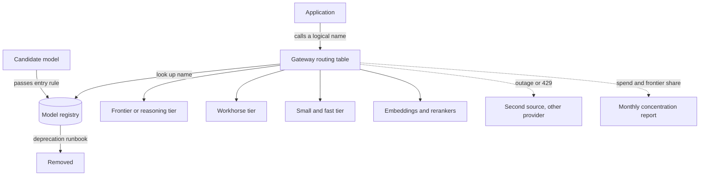

## TL;DR
A model portfolio is a small, governed set of models, each with a role, owner, eval baselines, cost
card, approved data classes and retirement plan. One model everywhere overpays on easy work; per-team
choices create sprawl nobody can evaluate, secure or exit.

## Why it exists
- **Failure mode 1: one model for everything.** The frontier model classifies support intents at
  frontier prices and latency, cannot be deployed in the region a customer requires, and one provider
  outage or deprecation hits every product at once.
- **Failure mode 2: every team picks its own.** Eighteen months later: a dozen models across half a
  dozen providers, a dozen sets of prompt lore, no shared evaluation, a security review and
  data-processing agreement per provider, incompatible data-use terms, no record of which model may see
  personal data, and nobody knows which systems depend on a retired version.
- **Every model has a fixed cost regardless of traffic.** An eval baseline per task family, a security
  and privacy review, prompt expertise, monitoring, quota management and a deprecation watch.
- **Marginal benefit falls fast.** Once the main tiers are covered, remaining tasks are already served
  well enough by something on the list. So the optimum is small but greater than one: enough variety to
  match difficulty to price and meet deployment constraints, few enough that the task-by-model eval
  matrix is actually run.
- **It is familiar discipline.** Engineering organisations already keep approved languages and
  databases; the portfolio applies that to the most expensive dependency in the system.

## How it works
### Roles, and why each exists
| Role | Used for | Why it exists |
|---|---|---|
| **Frontier or reasoning tier** | long-horizon agentic flows, complex code, low-volume high-value analysis | the hardest work; slow and expensive, so used by exception, behind a router or explicit task assignment |
| **Workhorse tier** | most retrieval-augmented answers, drafting, summarisation | chosen by the model-selection funnel as the cheapest model that clears the bar for typical task families |
| **Small and fast tier** | classification, routing, schema-bound extraction, PII detection, guardrail checks | most traffic is easy and the price gap between tiers is roughly an order of magnitude per step (illustrative, provider-dependent) |
| **Embeddings and rerankers** | the retrieval stack | versioned with extra care |
| **Specialised models** | vision and document understanding, speech-to-text, text-to-speech, code | modalities the text tiers do not cover |
| **Fine-tuned variants** | a specific high-volume task, derived from a base | owned by the training team but registered centrally so their lifecycle is visible |

- **Small tier specifics.** Often fine-tuned, sometimes self-hosted, expected to answer in well under a
  second.
- **Embedding care, because vectors are model-specific.** Changing an embedding model invalidates every
  stored vector; vectors from two models are not comparable.

### The registry entry
Each model has a record containing:
- **Identity:** exact pinned version, provider and deployment location.
- **Data terms:** data-use and retention terms; approved data classifications (may it see customer PII,
  source code, regulated data?).
- **Quality:** eval baselines per task family that uses it.
- **Cost card:** list price plus measured average tokens per request type; quota and rate limits.
- **Lifecycle:** owner, announced deprecation date, designated fallback.

The record turns "we use several models" into something an auditor, a finance team and an on-call
engineer can each read.

### Sizing the set: when a tier earns its place
The fixed-versus-marginal argument as a rule you can compute. Moving a task family from model A to a
cheaper model B is worth a new portfolio entry when

```
requests per month × (cost per request on A − cost per request on B)
  − added errors per month × cost per error   >   fixed monthly cost of running B as an entry
```

- **Fixed cost** = eval runs, amortised security and contract review, prompt maintenance, monitoring
  and on-call attention.
- **It explains both failure modes.** A small, high-volume task family clears it easily (the
  classification move below saves about 2,300 units a day); a ninth model for one team's low-volume
  task does not, even if slightly better.
- **Re-run it** when volume grows, prices shift, or an incumbent gets cheaper.

### Assignment versus routing
- **Assignment (default).** Configuration says this task family uses `workhorse`; it changes only after
  an eval. Start here *because* it is cheap and auditable.
- **Routing.** Chooses a tier per request at run time (by difficulty, confidence or input length) and
  needs its own evaluation of the router. Add it only for families where tracing shows a clear mix of
  easy and hard requests, exactly what the agentic slice in the example turns out to be.

### Entry and exit rules
- **Entry.** A model enters only if it beats an incumbent on a shared eval for some task family, or
  unlocks a constraint the set cannot meet (a new modality, a cheaper tier, a residency requirement).
  This rule is what keeps the set from regrowing.
- **Exit, as a planned migration:**
  1. Deprecation notice.
  2. List of consuming tasks from gateway logs.
  3. Regression evals on each.
  4. Cutover behind the gateway.
  5. Removal.
- **Routine by necessity.** Provider deprecations are routine, so the process has to be routine too.

### Enforcement through indirection
- **Logical names.** Applications reference names such as `workhorse`, `classifier-small` or `embed-v3`;
  the gateway maps them to the pinned vendor model. Only registered models are routable.
- **Why it works.** Fallback, rotation and vendor exit become possible *because* the dependency lives
  in one configuration table rather than in a dozen code bases.
- **What it does not do.** It does not make prompts magically portable; a rotation still runs
  regression evals on every consuming task.

### Diversity and concentration
- **Second source per critical tier,** on a different provider, for outage resilience and negotiating
  leverage.
- **Bought per tier, not blanket,** because every additional provider is another security review and
  contract.
- **Two concentration metrics:** share of spend per provider, and share of requests landing on the
  frontier tier. If the frontier handles a large fraction of volume, routing or task assignment is wrong.

## Diagram
Applications only ever name a role (`workhorse`, `classifier-small`, `embed-v3`); the gateway resolves
it through the registry (pinned version, data classes, baselines, cost card, owner, fallback) to a
pinned model. Models enter only by beating an incumbent on a shared eval or unlocking a constraint, and
leave only through the deprecation runbook (consumers from logs, regression evals, cutover).



## Examples
### Worked scenario: tiering and routing a million requests a day
**Illustrative price ratios** (units per million tokens; real prices vary by provider and date):

| Tier | Input | Output |
|---|---|---|
| Frontier | 10 | 30 |
| Workhorse | 1 | 3 |
| Small | 0.1 | 0.3 |

Daily traffic is 1,000,000 requests:
- **70% intent classification:** 300 input, 10 output tokens.
- **25% RAG answers:** 3,000 in, 250 out.
- **5% agentic tasks:** averaging 6 model calls each (20,000 in, 2,000 out per call).

| Slice | Everything on frontier | Tiered portfolio | Portfolio + routing in agentic |
|---|---|---|---|
| Classification | 700,000 × (300×10 + 10×30)/10⁶ = 2,310 | small: 700,000 × (300×0.1 + 10×0.3)/10⁶ ≈ 23 | ≈ 23 |
| RAG | 250,000 × (3,000×10 + 250×30)/10⁶ = 9,375 | workhorse: 250,000 × (3,000×1 + 250×3)/10⁶ ≈ 938 | ≈ 938 |
| Agentic | 300,000 calls × (20,000×10 + 2,000×30)/10⁶ = 78,000 | still frontier: 78,000 | frontier 100,000 calls × 0.26 = 26,000 + workhorse 200,000 × (20,000×1 + 2,000×3)/10⁶ = 5,200 → 31,200 |
| **Total per day** | **≈ 89,700** | **≈ 78,960 (only 12% saving)** | **≈ 32,160 (64% reduction)** |

- **Why tiering alone saved little.** The agentic 5% of requests is 87% of spend.
- **Where routing came from.** Tracing showed 4 of the 6 calls per task are tool-result summarisation
  and formatting that the workhorse handles at the same eval score.
- **The lesson.** The portfolio's first job is to make spend legible: the biggest lever was not the
  obvious 70% of traffic but step-level routing inside the smallest slice. Prefix caching of the shared
  20k context would cut it further.

### The same numbers as a runnable calculator
Swap in your own traffic mix and price card; the sizing rule is the last function.

```python
PRICE = {"frontier": (10, 30), "workhorse": (1, 3), "small": (0.1, 0.3)}  # illustrative, per 1M tokens

def daily_cost(slices):
    """slices: list of (calls_per_day, in_tokens, out_tokens, tier)."""
    total = 0.0
    for calls, n_in, n_out, tier in slices:
        p_in, p_out = PRICE[tier]
        total += calls * (n_in * p_in + n_out * p_out) / 1e6
    return total

single = [(700_000, 300, 10, "frontier"), (250_000, 3_000, 250, "frontier"),
          (300_000, 20_000, 2_000, "frontier")]
tiered = [(700_000, 300, 10, "small"), (250_000, 3_000, 250, "workhorse"),
          (300_000, 20_000, 2_000, "frontier")]
routed = tiered[:2] + [(100_000, 20_000, 2_000, "frontier"), (200_000, 20_000, 2_000, "workhorse")]

base = daily_cost(single)
for name, s in (("single", single), ("tiered", tiered), ("routed", routed)):
    c = daily_cost(s)
    print(f"{name:7s} {c:9,.0f} units/day  saving {1 - c / base:4.0%}")
# single 89,685 (0%), tiered 78,961 (12%), routed 32,161 (64%)

def earns_a_place(req_per_month, cost_a, cost_b, added_errors, cost_per_error, fixed_monthly):
    return req_per_month * (cost_a - cost_b) - added_errors * cost_per_error > fixed_monthly
```

With an illustrative fixed cost of 2,000 units a month per entry and no added errors: the
classification family (about 21M requests a month) saves ≈ 68,600 units a month and clears it easily; a
30,000-request-a-month team task with the same per-request saving gains ≈ 98 units and does not.

### A registry record
Field names are this lesson's schema, not a specific product's format; values are illustrative.

```yaml
logical_name: classifier-small
pinned_version: "<provider model id with date or version>"
provider: provider-b
deployment: eu-west, private endpoint
data_classes_approved: [internal, customer_pii]
data_use_terms: no training on inputs; 30-day retention   # copy from the signed agreement
eval_baselines:
  intent-classification: {metric: exact_match, score: 0.94, set: intents-v3}
cost_card: {price_in: 0.1, price_out: 0.3, avg_in: 300, avg_out: 10}
quota: {rpm: 6000}
owner: platform-ml
deprecation_date: null
fallback: classifier-small-secondary
```

## Production patterns
- **Logical names enforced at the gateway.** As soon as two applications call models. Applications send
  `workhorse` or `embed-v3`; the gateway's routing table maps each to a pinned vendor model and rejects
  unregistered names. Monitor requests that bypass the gateway (direct vendor keys found in billing).
- **Registry-driven deprecation runbook.** When any provider announces a retirement. Query gateway logs
  for every consumer of the logical name, run each consumer's regression eval on the replacement, cut
  over in the routing table, then delete the old mapping. Monitor days from notice to completed cutover.
- **Monthly concentration report.** Ongoing. Publish spend share per tier and per provider and the share
  of requests on the frontier tier. A rising frontier share is the alert that routing or assignment has
  drifted.
- **Sandbox tier for unregistered models.** For experimentation. Allow any model on non-sensitive data
  in a sandbox project with its own keys and budget cap; registration is required before production
  traffic. Monitor sandbox spend and how many sandbox models request registration.
- **Embedding rotation as a re-index project.** When changing `embed-*` entries. Build a new index with
  the new model alongside the old, measure retrieval quality on the golden set, then switch the logical
  name and the index together. Monitor recall on the golden queries before and after.

## Trade-offs
- **Tiering vs overhead.** Tiering cuts spend, but every tier adds evaluation, prompt and monitoring
  overhead. Once a tier's monthly saving falls below that fixed overhead (the sizing rule), a two-model
  portfolio, one strong and one small, is the right size.
- **Central approved list vs experimentation.** It gives governance and purchasing leverage but slows
  experimentation. The usual fix is a sandbox tier for unregistered models on non-sensitive data, with
  registration required before anything reaches production.
- **Multi-provider diversity vs review burden.** It buys resilience and negotiating power, but each
  provider is another review, contract and set of behavioural quirks. For low-stakes tasks a single
  provider with graceful degradation is enough.
- **Logical names vs portability.** They decouple applications from vendors, but prompts and
  tool-calling behaviour are not fully portable, so a rotation still costs a regression run per
  consuming task.
- **Fine-tuned variants vs lifecycle work.** They give the best cost-quality on narrow tasks but
  multiply lifecycle work, since each must be retrained or re-evaluated when its base model is retired.

## Pitfalls
- **Portfolio on paper, vendor IDs in code.** Symptom: a single deprecation notice turns into code
  changes and releases across a dozen repositories. Fix: logical names enforced at the gateway.
- **Frontier tier carries bulk traffic because "it works".** Symptom: frontier share of spend far exceeds
  the share of tasks that need it, and cost grows linearly with adoption. Fix: assign easy task
  families to cheaper tiers after an eval, and route inside mixed families.
- **Rotating the embedding model like any other model.** Symptom: retrieval quality collapses overnight
  because the index was not rebuilt with the new model's vectors. Fix: rotate as a re-index project.
- **No per-task eval baselines in the registry.** Symptom: a rotation approved on one team's evaluation
  silently degrades another team's task. Fix: store a baseline per consuming task family and rerun
  every one before a cutover.
- **Too many registered models.** Symptom: the task-by-model evaluation matrix is never fully run, so
  the quality of most combinations is unknown. Fix: enforce the entry rule and the sizing rule.
- **Skipping data-classification approval per model.** Symptom: an audit finds personal data flowing to
  a model whose terms never permitted it. Fix: approved data classes in each record, checked by the
  gateway before routing.

## When to use
- **Use when:** more than one task family or more than one team uses models; even a single product
  benefits from a small-plus-strong pair with explicit assignment.
- **Avoid when:** it is a lone prototype; it does not need one.
- **Measure:** spend share per tier and provider, fraction of requests on the frontier tier, number of
  registered models (should stay roughly flat), time to complete a migration after a deprecation
  notice, and eval coverage of the task-by-model matrix.
- **Daily work:** "which model should this new feature use" is answered by the registry, not by habit.
- **Interviews:** "how would you manage models across an organisation" is looking for tiers, a registry,
  entry and exit rules, logical names behind a gateway, and the concentration metrics.

## Role lens
- **Engineer:** Calls models by logical name through the gateway, adds eval baselines for any task that
  joins the portfolio, and runs the regression suite when a rotation is proposed.
- **Architect:** Owns the tier structure, the entry and exit rules, second-sourcing decisions per tier,
  and the concentration metrics that show whether routing matches intent.
- **FDE:** Translates the portfolio into the customer's environment, substituting models that meet
  their residency and data-use constraints while keeping the same logical roles and baselines.

## Check yourself
**Q:** After eighteen months your organisation runs eleven models across six providers. Leadership
wants this reduced without breaking products. How do you rationalise the portfolio, and how do you
stop it regrowing?
**A:** Start with an inventory from gateway or billing logs: which applications call which model, at
what volume and spend. Cluster the calls into task families and assemble or collect an eval set per
family. For each family, run the selection funnel across the models already in use, which reveals the
minimal set that clears every family's bar, typically a frontier model, a workhorse, a small model,
an embedding model and one or two specialised ones. Plan migrations family by family with regression
evals, moving applications onto logical names behind the gateway as you go so the next change is
configuration only. Keep a second provider for the tiers that matter. To prevent regrowth, enforce the
entry rule, a new model must beat an incumbent on a shared eval or unlock a constraint, give every
entry an owner and a retirement date, and publish spend share and frontier-tier share monthly.

## Interview questions
### What is a model portfolio, and why is its optimal size small but greater than one?
- **A governed set of models,** each with a role, owner, eval baselines, cost card and retirement plan,
  registered centrally and called by logical name.
- **One model overpays and concentrates risk:** frontier prices on easy work, and one outage or
  deprecation hits every product at once.
- **Every extra model has a fixed cost** (evals, security review, monitoring, deprecation watch) while
  marginal benefit falls once the tiers are covered.

### You tiered your traffic and saved only 12%. Where do you look next?
- **Look at spend share, not request share.** In the worked scenario the agentic 5% of requests was 87%
  of spend, so tiering the 70% classification slice barely moved the total.
- **Trace the expensive slice step by step.** Four of six calls per agentic task were summarisation and
  formatting the workhorse handled at the same eval score.
- **Route at step level inside that slice;** it took the saving from 12% to 64%, and prefix caching of
  the shared context would cut it further.

### A team wants to add a ninth model because it scores slightly better on their task. How do you decide?
- **Apply the entry rule:** it must beat an incumbent on a shared eval for some task family, or unlock a
  constraint such as a modality, a cheaper tier or residency.
- **Apply the sizing rule:** monthly saving minus added error cost must exceed the entry's fixed monthly
  cost. A low-volume task rarely clears it, even with a better score.
- **Offer the sandbox tier** for experimentation on non-sensitive data instead of production
  registration.

### How do you handle a provider deprecation notice across many applications?
- **Find consumers from gateway logs,** by logical name, rather than searching repositories.
- **Run each consumer's regression eval on the replacement,** because prompts and tool-calling
  behaviour are not fully portable even behind a logical name.
- **Cut over in the routing table, then remove the old mapping.** Track days from notice to completed
  cutover as the health metric of the process.

### Why is rotating the embedding model different from rotating any other model?
- **Vectors are model-specific.** Vectors from two embedding models are not comparable, so changing the
  model invalidates every stored vector.
- **Treat it as a re-index project:** build a new index alongside the old one, measure recall on the
  golden queries, then switch the logical name and the index together.
- **The symptom of skipping this** is retrieval quality collapsing overnight with no code change.

## Quiz
### Q: What is the main reason to keep a model portfolio small rather than registering every useful model?
- [ ] Providers charge more when an organisation uses many models
- [x] Each model carries fixed costs for evaluation, security review, monitoring and deprecation tracking, while the benefit of another model diminishes once the tiers are covered
- [ ] Gateways can only route to a limited number of back ends
- [ ] Small portfolios always produce higher quality outputs
> The cost of a model is not only its tokens; it is the task-by-model evaluations, reviews and
> lifecycle work it demands. Once a strong, a mid and a small tier exist, an extra model rarely
> clears a bar that nothing on the list already clears.

### Q: Why should applications reference logical names such as `workhorse` instead of vendor model identifiers?
- [ ] Logical names are billed at a lower rate
- [ ] Providers require logical names in their SDKs
- [x] So fallback, rotation and vendor exit become a configuration change in the gateway rather than code changes across every application
- [ ] Logical names avoid provider rate limits
> The indirection puts the dependency in one table. A deprecation or outage is then handled centrally,
> with regression evals per consuming task, instead of being discovered repository by repository.

### Q: Which portfolio rotation requires more than a prompt regression evaluation before cutover?
- [ ] Replacing the frontier model with a newer version from the same provider
- [x] Replacing the embedding model used by the retrieval index
- [ ] Replacing the small classification model with a fine-tuned variant
- [ ] Replacing the speech-to-text model
> Vectors produced by different embedding models live in different spaces, so queries embedded with
> the new model cannot be compared against documents embedded with the old one. The whole corpus must
> be re-indexed and retrieval quality re-measured before any switch.
