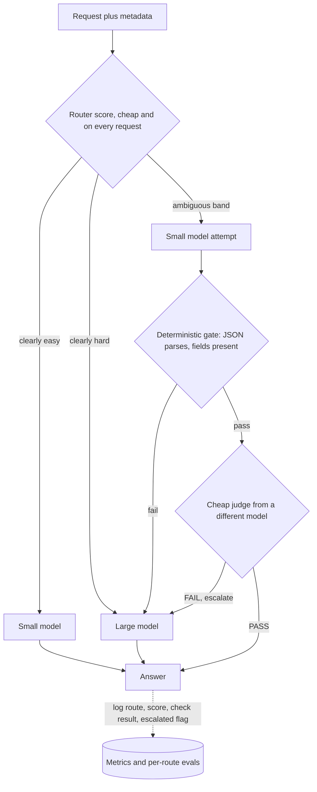

## TL;DR
Routing picks a model per request *before* the call; cascading calls the cheap model first and escalates
when a quality check fails. Both cut cost sharply, pay with router error or tail latency, and are only as
good as their quality signal.

## Why it exists
- **Requests vary enormously in difficulty.** Everything on the strongest model overpays; everything on the
  cheapest underdelivers.
- **The price gap is huge.** Small vs frontier is commonly one to two orders of magnitude per token
  (an illustrative range that changes with every price sheet), and the latency gap is several-fold. Yet a
  large share of requests are easy: a lookup, a reformulation, a yes/no classification, a short summary.
  Paying frontier prices for those is waste that scales linearly with success.
- **The naive alternatives each fail.** One big model makes cost and latency the product's ceiling. One
  small model fails on the hard tail, exactly the requests users remember and escalate. A model per
  feature is coarse: difficulty within one feature still varies by an order of magnitude.
- **So the decision must be per request, and cheap.** FrugalGPT showed a cascade with a learned "is this
  answer good enough" scorer can match the strongest model's accuracy on several benchmarks at a fraction
  of its cost. RouteLLM showed a router trained on human preference data can send most traffic to a
  cheaper model with little quality loss.
- **The engineering question** is where the quality signal comes from.

## How it works
### Routing: decide before the call
The router sees the request and its metadata (feature, tenant tier, language, length, conversation
state) and returns a model. In rough order of sophistication:

1. **Static rules.** Feature or tenant maps to a model. Zero latency, no learning; the right first step.
2. **Heuristics.** Token count, presence of code, number of constraints in the instruction, whether
   tools are needed. Cheap and surprisingly effective for coarse splits.
3. **Learned classifier.** An embedding plus a small classifier trained on past traffic labelled with
   "which model was needed". Labels come from offline evals: run both models, judge the small model's
   answer, and record whether it passed.
4. **LLM-as-router.** Ask a small model to grade difficulty. Useful when you have no labels yet, but it
   adds a model call to every request.

**Two kinds of router error:**

| Error | Cost |
|---|---|
| Hard request routed down | Quality |
| Easy request routed up | Money |

- **Set the threshold** from the cost ratio and the quality penalty you accept, tune it on an eval set,
  then monitor per route in production, because error rates drift as prompts and models change.
- **Keep the router cheap** *because* it runs on every request: a 30 ms classifier is free, a 2 s LLM call
  usually is not.

### Deriving the routing threshold
- The router estimates `p`, the probability that the small model's answer is adequate.
- `L` is the cost of an inadequate answer in the same units as tokens (a retry, a human escalation, a lost
  customer).
- Send small when `c_small + (1 − p) × L < c_large`, so route small when `p > 1 − (c_large − c_small) / L`.

| c_small | c_large | Cost of a bad answer | Route small when |
|---|---|---|---|
| 1 | 15 | 50 | p > 0.72 |
| 1 | 15 | 500 (a billing dispute) | p > 0.972: only near-certain requests go small |

The threshold encodes the business cost of a miss, not the router's accuracy, which is why one router can
need a different threshold per feature (costs illustrative).

### Cascading: decide after a cheap attempt
1. Call the small model.
2. Run a check.
3. Return if it passes; escalate if it fails.

**The check is the whole design.** Options, cheapest first:
- **Deterministic gate:** JSON parses, required fields are present, the cited document id exists, the
  generated SQL executes.
- **Agreement across *n* sampled answers:** disagreement is a usable proxy for uncertainty.
- **Verifier model or LLM judge.**
- **Grounding check** against retrieved passages.
- **Not self-reported confidence:** tempting and the least reliable, because models are poorly calibrated
  about their own correctness.

**Expected cost** per request is `c_small + c_check + p_escalate × c_large`. With illustrative units of 1
(small), 0.5 (judge) and 15 (large) at a 25% escalation rate: 1 + 0.5 + 3.75 = 5.25 units against 15 for
always-large, a 65% saving.

**The price is latency.** The 25% that escalate pay the small call, the check and the large call *in
series*, so p95 latency gets worse even as mean cost falls.

### Routing versus cascading
| | Routing | Cascading |
|---|---|---|
| Calls | One, so latency is bounded | Two or more on escalation, in series |
| Main risk | Prediction error | Serial latency and check cost on escalations |
| Needs | Labelled data to train | A reliable cheap check; no training data |
| Quality floor | Router accuracy | Set by the check |

In practice they combine: route the obvious cases, cascade the ambiguous band in the middle.

### Operating it
- **Log the route taken and why.**
- **Evaluate quality *per route*,** not only in aggregate, since a healthy average can hide a failing hard
  tail.
- **Keep a continuous baseline:** a small random slice (a few per cent) always served by the strong model,
  so you see the gap move when a provider silently updates the small model.
- **Budget and alert on the escalation rate,** because a degraded small model turns into 100% escalation
  and a cost spike on the large one.
- **Decide the consistency policy:** the same question may get different answers depending on the route,
  acceptable for chat and not for an audit trail.

## Diagram
The combined pattern: a cheap router sends obvious cases straight to one model, and only the ambiguous
middle band pays for the small call, the check and, on failure, the large call in series.



## Examples
### Two-rung cascade with LiteLLM
A deterministic gate, then a small judge, using LiteLLM so the same code talks to several providers. The
number to watch in production is `escalated`; its rate is what you tune.

```python
import json, litellm

# Model ids are illustrative and date quickly; use your providers' current ids. The judge should be a
# different model from the generator it grades: models rate their own outputs favourably.
SMALL, LARGE, JUDGE = "openai/gpt-4o-mini", "anthropic/claude-sonnet-4-20250514", "anthropic/claude-3-5-haiku-20241022"

def ask(model, messages, **kw):
    r = litellm.completion(model=model, messages=messages, temperature=0, **kw)
    return r.choices[0].message.content, r.usage

def passes_check(question, answer):
    try:                                              # 1) deterministic gate: valid JSON, required fields
        obj = json.loads(answer)
        if not isinstance(obj, dict) or not {"answer", "confidence"} <= obj.keys():
            return False
    except json.JSONDecodeError:
        return False
    verdict, _ = ask(JUDGE, [{"role": "user", "content":   # 2) cheap judge, only after the gate passes
        f"Question: {question}\nAnswer: {obj['answer']}\n"
        "Is the answer complete and correct? Reply PASS or FAIL only."}], max_tokens=2)
    return verdict.strip().upper().startswith("PASS")

def cascade(question):
    msgs = [{"role": "system", "content": 'Reply as JSON: {"answer": str, "confidence": number 0-1}'},
            {"role": "user", "content": question}]
    answer, usage = ask(SMALL, msgs)
    if passes_check(question, answer):
        return {"model": SMALL, "answer": answer, "escalated": False, "usage": usage}
    answer, usage = ask(LARGE, msgs)                  # escalate: same prompt, stronger model
    return {"model": LARGE, "answer": answer, "escalated": True, "usage": usage}

print(cascade("Our invoice says net-45 but the signed contract says net-30. Which applies, and why?"))
# Emit `escalated`, both usages and the judge verdict as metrics; alert when the escalation rate jumps.
```

- **Gate first** *because* it is free and catches the most common failure (unparseable output); the judge
  only spends tokens on well-formed answers.
- **Judge is a different model** from the small generator: LLMs show self-preference bias when grading
  their own outputs, so a same-model judge under-escalates.
- **Calibrate the judge** against human labels before its verdicts drive production routing.

### Threshold and saving calculator
Pure Python; plug in your own unit costs.

```python
def route_threshold(c_small, c_large, miss_cost):
    """Route small when P(small answer adequate) exceeds this."""
    return 1 - (c_large - c_small) / miss_cost

def cascade_cost(c_small, c_check, c_large, p_escalate):
    return c_small + c_check + p_escalate * c_large

for miss in (50, 500):
    print(f"miss costs {miss:>3}: route small when p > {route_threshold(1, 15, miss):.3f}")
# miss costs  50: route small when p > 0.720
# miss costs 500: route small when p > 0.972

for p in (0.10, 0.25, 0.40, 0.60):
    cost = cascade_cost(1, 0.5, 15, p)
    print(f"escalate {p:.0%}: {cost:5.2f} units, saving {1 - cost / 15:.0%} vs always-large")
# 10%: 3.00 (80%)   25%: 5.25 (65%)   40%: 7.50 (50%)   60%: 10.50 (30%)
```

### Worked scenario: mean cost falls, p95 rises
Illustrative latencies: small 0.8 s, judge 0.4 s, large 3.0 s; 25% escalate.

| Path | Share | Latency |
|---|---|---|
| Always-large | 100% | 3.0 s |
| Cascade, passes | 75% | 0.8 + 0.4 = 1.2 s |
| Cascade, escalates | 25% | 0.8 + 0.4 + 3.0 = 4.2 s |
| Cascade mean | | 0.75 × 1.2 + 0.25 × 4.2 = 1.95 s |
| Cascade p95 | | 4.2 s, because more than 5% of requests escalate |

Mean latency and cost both drop, but the tail is 40% slower than always-large. For a strict p95 product,
route instead.

## Production patterns
- **Route the obvious, cascade the band.** When you have some labels, send high-confidence easy requests
  straight to small and high-confidence hard ones straight to large; cascade only the middle band of
  router scores. Monitor the share of traffic in each band and per-band judged quality.
- **Deterministic baseline slice.** Serve a few per cent of requests on the strong model regardless of
  route, chosen by a stable hash so it is replayable: for example
  `int(hashlib.sha256(conv_id.encode()).hexdigest(), 16) % 100 < 3`, not Python's per-process salted
  `hash()`. Hashing the conversation id keeps a whole conversation on one model. Monitor the quality gap
  between the slice and the routed traffic, per route.
- **Escalation-rate budget.** Alert when the escalation rate over a rolling window leaves its normal band,
  and cap large-model spend per hour so a small-model regression cannot become an unbounded bill. Monitor
  escalation rate, large-model 429s and cost per successful task.
- **Thresholds as versioned config.** Keep per-feature thresholds in config, not code, so a change is a
  reviewed config edit with a rollback. Monitor misroute rate after each change against the eval set.
- **Log route, reason and scores on every request.** Emit model chosen, router score, check result and
  escalated flag as structured fields, so a complaint can be traced to the decision that produced it.
  Monitor quality and latency sliced by these fields.
- **Retrain the router on fresh labels.** Rebuild the labelled set from recent traffic after any
  prompt-template or model change, because routers trained on old prompts drift. Monitor misroute rate on
  a held-out slice of recent traffic.

## Trade-offs
- **Lower mean cost vs higher tail latency.** Escalated requests pay in series. This flips when the
  product has a strict p95 (voice, autocomplete), where routing or hedging beats cascading.
- **Training data vs a cheap check.** Routing needs labelled data and a classifier you must retrain;
  cascading needs only a reliable cheap check. Which is cheaper depends on whether you already have an
  eval set with judgments.
- **Per-request choice vs consistency.** The same question can get different answers; fine for chat, a
  problem for reproducible or audited workflows where one pinned model is required.
- **Savings vs easy share.** Savings scale with the share of easy traffic; a uniformly hard workload yields
  little and adds a moving part, so measure the difficulty distribution before building.
- **The check bounds quality.** A judge that favours verbose answers or misses subtle errors lets bad
  small-model answers through, so judge calibration is part of the system's eval.

## Pitfalls
- **Self-reported confidence as the escalation signal.** Symptom: escalation rate near zero while judged
  quality on the small route is poor. Fix: use an external check.
- **Measuring only aggregate quality.** Symptom: a healthy dashboard metric while complaints concentrate
  in the hard tail that was misrouted or wrongly passed. Fix: per-route evals.
- **No continuous baseline.** Symptom: quality drift nobody notices for weeks after a provider silently
  updates the small model, because nothing compares it with the strong one.
- **Escalation storms.** A small-model outage or regression sends everything to the large model. Symptom:
  429s and a cost spike on the large model during an incident that was not about it.
- **Unbounded cascades** (retry small with a new prompt, then medium, then large). Symptom: p99 latency
  several times the single-call latency and users abandoning before the answer arrives.
- **A router trained on last quarter's prompts.** Symptom: a misroute rate that creeps up after a
  prompt-template change with no code change in the router.

## When to use
- **Use when** traffic has a visible easy/hard split and cost or latency is a product KPI.
- **Avoid when** features are low-volume or uniformly hard; a single pinned model is simpler and more
  consistent.
- **Before building,** sample traffic, run both models and judge the results. That single experiment gives
  the easy share, router labels and a realistic saving.
- **Measure:** escalation rate, quality per route, cost per successful task and latency per route.
- **Interviews:** derive the expected-cost formula, name the latency penalty, and explain where the
  quality signal comes from and why self-reported confidence is not it.

## Role lens
- **Engineer:** Implements the router or the check, logs the route and reason on every request, builds the
  per-route eval, and tunes thresholds against cost and judge scores.
- **Architect:** Decides where routing lives (gateway versus application), the quality floor, budget
  guardrails on escalation, and the consistency policy for audited flows.
- **FDE:** Tunes thresholds to a customer's actual traffic mix, explains why two similar questions used
  different models, and shows cost per resolved task before and after.

## Check yourself
**Q:** You are asked to cut LLM spend on a support assistant by half without hurting customer
satisfaction. Design a routing or cascading approach and explain how you would prove it did no harm.
**A:** Start with data: sample a few thousand recent requests, answer each with both the small and the
large model, and have a judge plus a human sample label whether the small answer was adequate. That gives
the easy share, which bounds the achievable saving, and labelled data for a router. Then do the
arithmetic: with unit costs of 1 for the small model, 0.5 for the check and 15 for the large one, halving
spend means 1.5 + 15 × p_escalate ≤ 7.5, so at most 40% may escalate, which needs an easy share of at
least 60% even with a perfect check. If the measured share clears that with margin, a cascade with a
deterministic gate plus a cheap judge (or a trained router if p95 latency is tight) can reach the
target; if it does not, no router will, and the conversation moves to prompt length or caching. To prove no harm: offline eval per route on the labelled set; an online A/B against the
all-large baseline on resolution rate and satisfaction; a permanent few-per-cent shadow slice served by
the large model to track the gap continuously; and alerts on escalation rate and judge disagreement. Also
check tail latency per route and that answer consistency is acceptable for the product.

## Interview questions
### Why not just put every request on the strongest model and skip routing?
- **Cost scales linearly with success.** Small versus frontier is commonly one to two orders of magnitude per
  token (illustrative), so paying frontier prices for lookups, reformulations and yes/no classifications is
  pure waste.
- **Latency becomes the product's ceiling** too, because the latency gap is several-fold. Routing exists
  because difficulty varies per request, even within one feature.

### How would you derive the routing threshold for a feature where a wrong answer causes a billing dispute?
- **Write the expected cost:** route small when `c_small + (1 − p) × L < c_large`, so the threshold is
  `p > 1 − (c_large − c_small) / L`.
- **Plug in the miss cost:** with units 1, 15 and a miss cost of 500, only requests with p above 0.972 go
  small, versus 0.72 when a miss costs 50.
- **So thresholds are per feature,** because they encode the business cost of a miss, not router accuracy.

### When would you choose routing over cascading?
- **When p95 latency is strict** (voice, autocomplete), because escalated requests in a cascade pay the small
  call, the check and the large call in series.
- **When you already have labelled data** from offline evals to train a classifier.
- **Choose cascading instead** when there is no training data but a reliable cheap check exists, such as
  schema validation or SQL execution.

### Escalations jumped from 25% to 90% overnight with no deploy. What happened and what do you do?
- **Likely causes:** the small provider silently updated or degraded the model, or a prompt-template change
  broke its JSON output so the deterministic gate fails.
- **Contain first:** the escalation-rate alert fires and the hourly cap on large-model spend stops an
  unbounded bill; watch large-model 429s.
- **Then diagnose** with logged route, gate result and judge verdict per request, and compare against the
  continuous baseline slice served by the strong model.

### How do you keep a cascade's judge honest?
- **Use a different model from the generator,** because LLMs show self-preference bias when grading their
  own outputs, so a same-model judge under-escalates.
- **Calibrate against human labels** before its verdicts drive routing, and re-check periodically.
- **Watch for verbosity bias:** a judge that favours long answers lets bad small-model answers through, so
  judge calibration belongs in the system's eval.

## Quiz
### Q: What is the essential difference between routing and cascading?
- [ ] Routing uses a classifier, cascading uses rules
- [x] Routing chooses the model before any call; cascading calls a cheap model first and escalates on a failed quality check
- [ ] Routing saves cost, cascading saves latency
- [ ] Routing requires a gateway, cascading runs inside the application
> Both can live anywhere and use any decision mechanism. The structural difference is timing: a router
> predicts difficulty up front and pays prediction error; a cascade observes a real answer and pays
> serial latency and the cost of the check.

### Q: Small model costs 1 unit, the check 0.5 and the large model 12 units; 30% of requests escalate. Expected cost per request?
- [ ] 4.1 units
- [x] 5.1 units
- [ ] 13.5 units
- [ ] 3.6 units
> Expected cost is small + check + escalation share × large = 1 + 0.5 + 0.3 × 12 = 5.1. Forgetting the
> check gives 4.1; adding every component as if all ran every time gives 13.5; 3.6 is only the escalated
> portion.

### Q: Which escalation signal is least reliable for a cascade?
- [ ] The answer fails JSON schema validation
- [ ] Several sampled answers disagree with each other
- [x] The small model's own stated confidence is below a threshold
- [ ] Generated SQL fails to execute against the schema
> Models are poorly calibrated about their own correctness, so stated confidence is often high on wrong
> answers. Schema checks, execution and sample agreement are external signals that do not depend on the
> model knowing when it is wrong.
