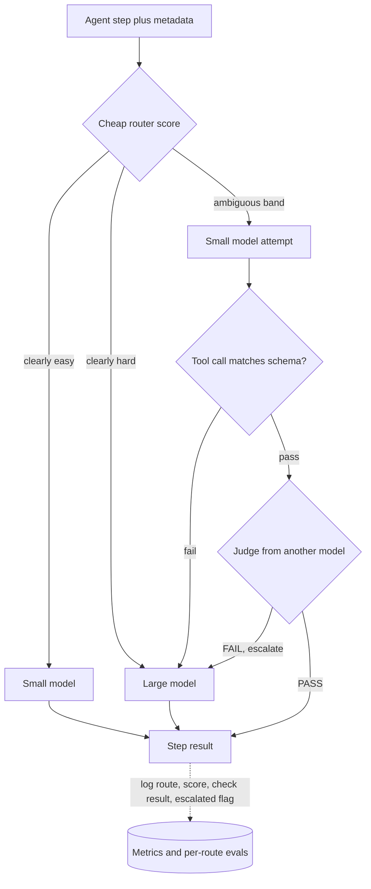

## TL;DR
In an agent, routing picks a model per step *before* the call; cascading tries a cheap model and
escalates when a check (a tool call that fails its schema, a judge) fails. Both cut cost per task,
paying with router error or tail latency.

## For agent builders
- **Why it matters for agents.** An agent task is many model calls of very different difficulty: planning
  is hard, filling tool arguments or summarising a tool result is usually easy. Routing per step, not per
  user request, is where most of the saving lives, and per-step errors compound across the task.
- **Where it shows up in your stack.** A model choice per node in LangGraph or per step in your own loop,
  LiteLLM or a gateway's routing rules, and LangSmith or your tracing for per-step model, cost and outcome.
- **What you control.** The step-to-model map, the escalation gate (tool-call schema validation is free and
  catches the commonest failure), escalation caps per task, and the metric you tune: cost per *successful
  task*, not per call.
- **What you can skip.** Training a learned router on day one. Static per-step rules plus a deterministic
  gate capture most of the win; learn a router once you have labelled traces.

## Decision case
### Scenario
An online retailer's support agent resolves order problems in chat: 30,000 tasks a day, 8 model steps
each (1 plan, 5 tool-argument steps, 1 tool-result summary, 1 final answer). Everything runs on a
frontier model today. Units and latencies are illustrative.
- **Units per step:** small 1, large 15, LLM judge 0.5. Latency per step: small 0.8 s, judge 0.4 s,
  large 3.0 s; schema validation is effectively free.
- **Constraints:** finance wants model cost per task halved (at most 60 units against 120 today); the
  chat UI streams per-step progress, so each step's p95 must stay at or under 4 s; task success must not
  drop; two engineers, four weeks.
- **Data available:** 2,000 traced tasks but no router labels. Replaying them shows 15% of small-model
  tool calls fail the schema gate. Calls that pass succeed 0.99, like the large model. Ungated, the
  agent's own retry after a tool error rescues most failing calls, so a small tool step succeeds about
  0.97 overall. With the gate, failing calls escalate and succeed at the large model's 0.99.
- **Cost of a failed task:** a human hand-off, priced at 300 units.

### Options
| Option | How it works | Units per task | Step p95 | Task success |
|---|---|---|---|---|
| A. All large | Status quo | 8 × 15 = 120 | 3.0 s | About 0.95 |
| B. Static routing, no gate | Plan and answer large, other steps small | 30 + 6 = 36 | 3.0 s | 0.97 to the 5th power ≈ 0.86 |
| C. Static routing plus schema-gated cascade on tool steps | Escalate only a tool step whose call fails its schema | 30 + 5 × (1 + 0.15 × 15) + 1 = 47.25 | 0.8 + 3.0 = 3.8 s | 0.99 to the 5th power ≈ 0.95 |
| D. Judge cascade on every step | Small first everywhere, judge, escalate about 30% | 8 × (1.5 + 0.3 × 15) = 48 | 0.8 + 0.4 + 3.0 = 4.2 s | Planner quality bounded by the judge |

### Decision
Choose **C**.
- **Budget:** 47.25 units is a 61% cut, inside the 60-unit target.
- **Latency:** an escalated step costs 3.8 s in series, under the 4 s per-step p95.
- **Quality:** the gate keeps tool steps near 0.99, so task success stays where it is.
- **Why not B:** it is cheaper per call but loses a task in seven. With a 300-unit hand-off it costs
  36 + 0.14 × 300 ≈ 78 units per task against about 62 for C; the gate wins once a failure costs more
  than about 122 units.
- **Why not D:** it breaks the latency constraint (4.2 s) and puts planning behind an uncalibrated judge.
- **Why no learned router:** C needs no labels, which the team does not have and cannot build in four
  weeks.

**What would change it:** if the gate's escalation rate climbs above 32%, C costs more than 60 units
and needs a better small model or prompt. A step p95 tightened to 3 s rules out any cascade, so route
only. Once a few thousand labelled traces exist, a router can send obviously hard tool steps straight
to large.

### Trade-offs accepted
- **Tail latency on escalated steps.** Accept 3.8 s on 15% of tool steps and watch step p95 per route.
- **Two models to keep compatible.** Keep a 3% baseline slice on the large model by stable hash and
  compare task success per route.
- **Escalation storms.** If the small model degrades, every tool step escalates. Cap escalations at 3
  per task and alert when the rate leaves its normal band.
- **No difficulty prediction yet.** Easy plans still pay large prices; revisit after labelling traces.

### Review rubric
- Measures the success rate, escalation rate and difficulty split from real traces before choosing.
- Compares options on cost per successful task, pricing failed tasks, not only cost per call.
- Checks the latency constraint against escalated paths in series, not the mean.
- Names the escalation signal, explains why it is external, and caps escalations per task.
- States the thresholds (escalation rate, p95) at which the choice flips.
- Plans monitoring per route, including a baseline slice on the strong model.

## Why it exists
- **Requests vary enormously in difficulty.** Everything on the strongest model overpays; everything on the
  cheapest underdelivers. Inside one agent task the spread is just as wide.
- **The price gap is huge.** Small vs frontier is commonly one to two orders of magnitude per token
  (an illustrative range that changes with every price sheet), and the latency gap is several-fold. Yet a
  large share of requests are easy: a lookup, a reformulation, a yes/no classification, a short summary.
  Paying frontier prices for those is waste that scales linearly with success.
- **The naive alternatives each fail.** One big model makes cost and latency the product's ceiling. One
  small model fails on the hard tail, exactly the requests users remember and escalate. A model per
  feature is coarse: difficulty within one feature still varies by an order of magnitude.
- **So the decision must be per request (per step), and cheap.** FrugalGPT showed a cascade with a learned
  "is this answer good enough" scorer can match the strongest model's accuracy on several benchmarks at a
  fraction of its cost. RouteLLM showed a router trained on human preference data can send most traffic to
  a cheaper model with little quality loss.
- **The engineering question** is where the quality signal comes from.

## How it works
### Routing: decide before the call
The router sees the request and its metadata (feature, tenant tier, language, length, conversation
state, and for agents the step type and tools in play) and returns a model. In rough order of
sophistication:

1. **Static rules.** Feature, tenant or agent step maps to a model. Zero latency, no learning; the right
   first step.
2. **Heuristics.** Token count, presence of code, number of constraints in the instruction, whether
   tools are needed. Cheap and surprisingly effective for coarse splits.
3. **Learned classifier.** An embedding plus a small classifier trained on past traffic labelled with
   "which model was needed". Labels come from offline evals: run both models, judge the small model's
   answer, and record whether it passed.
4. **LLM-as-router.** Ask a small model to grade difficulty. Useful when you have no labels yet, but it
   adds a model call to every request, and an agent pays it on every step.

**Two kinds of router error:**

| Error | Cost |
|---|---|
| Hard request routed down | Quality (in an agent: a wrong plan or wrong tool, and wasted later steps) |
| Easy request routed up | Money |

- **Set the threshold** from the cost ratio and the quality penalty you accept, tune it on an eval set,
  then monitor per route in production, because error rates drift as prompts and models change.
- **Keep the router cheap** *because* it runs on every request: a 30 ms classifier is free, a 2 s LLM call
  usually is not.

### Deriving the routing threshold
- The router estimates `p`, the probability that the small model's answer is adequate.
- `L` is the cost of an inadequate answer in the same units as tokens (a retry, a human escalation, a lost
  customer, or the rest of an agent task wasted on a bad plan).
- Send small when `c_small + (1 − p) × L < c_large`, so route small when `p > 1 − (c_large − c_small) / L`.

| c_small | c_large | Cost of a bad answer | Route small when |
|---|---|---|---|
| 1 | 15 | 50 | p > 0.72 |
| 1 | 15 | 500 (a billing dispute) | p > 0.972: only near-certain requests go small |

The threshold encodes the business cost of a miss, not the router's accuracy, which is why one router can
need a different threshold per feature or per agent step (costs illustrative).

### Cascading: decide after a cheap attempt
1. Call the small model.
2. Run a check.
3. Return if it passes; escalate if it fails.

**The check is the whole design.** Options, cheapest first:
- **Deterministic gate:** JSON parses, required fields are present, a tool call names a real tool with
  arguments that match its schema, the cited document id exists, the generated SQL executes.
- **Agreement across *n* sampled answers:** disagreement is a usable proxy for uncertainty.
- **Verifier model or LLM judge.**
- **Grounding check** against retrieved passages (the RAG step's own sources).
- **Not self-reported confidence:** tempting and the least reliable, because models are poorly calibrated
  about their own correctness.

**Expected cost** per request is `c_small + c_check + p_escalate × c_large`. With illustrative units of 1
(small), 0.5 (judge) and 15 (large) at a 25% escalation rate: 1 + 0.5 + 3.75 = 5.25 units against 15 for
always-large, a 65% saving.

**The price is latency.** The 25% that escalate pay the small call, the check and the large call *in
series*, so p95 latency gets worse even as mean cost falls. An agent with several escalating steps stacks
that penalty.

### Agent-specific: errors compound across steps
- **Task success is roughly the product of step successes.** Six tool steps at 0.99 each give about 0.94;
  at 0.97 each, about 0.83. A small model that looks "nearly as good" per step can lose a tenth of tasks.
- **So gate every routed-down step** and escalate that step, rather than letting a bad tool call
  propagate into later steps where it is harder to detect.
- **Tune on cost per successful task.** A route that saves 60% per call but adds retries and failed tasks
  can cost more overall.

### Routing versus cascading
| | Routing | Cascading |
|---|---|---|
| Calls | One, so latency is bounded | Two or more on escalation, in series |
| Main risk | Prediction error | Serial latency and check cost on escalations |
| Needs | Labelled data to train | A reliable cheap check; no training data |
| Quality floor | Router accuracy | Set by the check |

In practice they combine: route the obvious cases, cascade the ambiguous band in the middle. In an agent:
route by step type, cascade the steps that have a cheap gate.

### Operating it
- **Log the route taken and why,** per step, on the agent trace.
- **Evaluate quality *per route*,** not only in aggregate, since a healthy average can hide a failing hard
  tail.
- **Keep a continuous baseline:** a small random slice (a few per cent) always served by the strong model,
  so you see the gap move when a provider silently updates the small model.
- **Budget and alert on the escalation rate,** because a degraded small model turns into 100% escalation
  and a cost spike on the large one.
- **Decide the consistency policy:** the same question may get different answers depending on the route,
  acceptable for chat and not for an audit trail.

## Diagram
The combined pattern for one agent step: a cheap router sends obvious steps straight to one model, and
only the ambiguous band pays for the small call, the check and, on failure, the large call in series.



## Examples
### Per-step routing with a tool-call gate inside an agent loop
Static rules by step type, a free schema gate on tool calls, and escalation of only the failing step. A
per-task cap stops a degraded small model from sending every step to the large one.

```python
import json, litellm

# Model ids are illustrative; use your providers' current ids.
SMALL, LARGE = "openai/gpt-4o-mini", "anthropic/claude-sonnet-4-20250514"
ROUTE = {"plan": LARGE, "tool_args": SMALL, "summarize": SMALL}   # step type -> model
MAX_ESCALATIONS_PER_TASK = 3

def valid_tool_call(msg, tools):
    by_name = {t["function"]["name"]: t["function"] for t in tools}
    if not msg.tool_calls:
        return False                                            # a tool step that called no tool
    for tc in msg.tool_calls:
        fn = by_name.get(tc.function.name)
        if fn is None:
            return False                                        # invented tool
        try:
            args = json.loads(tc.function.arguments)
        except json.JSONDecodeError:
            return False                                        # unparseable arguments
        if not isinstance(args, dict) or not set(fn["parameters"].get("required", [])) <= args.keys():
            return False                                        # missing required argument
    return True

def run_step(step_type, messages, tools, task):
    model = ROUTE[step_type]
    msg = litellm.completion(model=model, messages=messages, tools=tools).choices[0].message
    if model == SMALL and tools and not valid_tool_call(msg, tools) \
            and task["escalations"] < MAX_ESCALATIONS_PER_TASK:
        task["escalations"] += 1                                # escalate this step only
        model = LARGE
        msg = litellm.completion(model=model, messages=messages, tools=tools).choices[0].message
    task["trace"].append({"step": step_type, "model": model, "escalated": model != ROUTE[step_type]})
    return msg
```

### Worked scenario: routing a 10-step agent task
Illustrative units per step: small 1, large 15. A task has 2 planning steps, 6 tool-argument steps and 2
summaries. Tool steps run small behind the schema gate, which escalates 15% of them.

| Policy | Cost per task | Notes |
|---|---|---|
| All large | 10 × 15 = 150 | Baseline |
| Plans large, the rest small, no gate | 30 + 8 = 38 | Tool-step success 0.97 each, so 0.97 to the 6th power ≈ 0.83 of tasks survive the tool steps |
| Plans large, gated tool steps, small summaries | 30 + 6 × (1 + 0.15 × 15) + 2 = 51.5 | About 66% cheaper; assuming gated tool steps behave near the large model's 0.99 each, ≈ 0.94 survive |

- **Lesson:** the ungated policy looks cheapest but loses roughly one task in six. Model calls alone still
  favour it (38 / 0.83 ≈ 46 vs 51.5 / 0.94 ≈ 55 per successful task), so price the failures too.
- **Where it flips:** if a failed task costs F (a retry, a human hand-off), ungated costs 38 + 0.17F and
  gated 51.5 + 0.06F per task, so the gate wins once F exceeds about 125 units, roughly eight large calls.
  A human hand-off usually costs far more.

### Two-rung cascade with LiteLLM
A deterministic gate, then a small judge, using LiteLLM so the same code talks to several providers. The
number to watch in production is `escalated`; its rate is what you tune.

```python
import json, litellm

# Model ids are illustrative and date quickly; use your providers' current ids. The judge should be a
# different model from the generator it grades: models rate their own outputs favourably.
SMALL, LARGE, JUDGE = "openai/gpt-4o-mini", "anthropic/claude-sonnet-4-20250514", "anthropic/claude-3-5-haiku-20241022"

def ask(model, messages, **kw):
    r = litellm.completion(model=model, messages=messages, temperature=0, **kw)
    return r.choices[0].message.content, r.usage

def passes_check(question, answer):
    try:                                              # 1) deterministic gate: valid JSON, required fields
        obj = json.loads(answer)
        if not isinstance(obj, dict) or not {"answer", "confidence"} <= obj.keys():
            return False
    except json.JSONDecodeError:
        return False
    verdict, _ = ask(JUDGE, [{"role": "user", "content":   # 2) cheap judge, only after the gate passes
        f"Question: {question}\nAnswer: {obj['answer']}\n"
        "Is the answer complete and correct? Reply PASS or FAIL only."}], max_tokens=2)
    return verdict.strip().upper().startswith("PASS")

def cascade(question):
    msgs = [{"role": "system", "content": 'Reply as JSON: {"answer": str, "confidence": number 0-1}'},
            {"role": "user", "content": question}]
    answer, usage = ask(SMALL, msgs)
    if passes_check(question, answer):
        return {"model": SMALL, "answer": answer, "escalated": False, "usage": usage}
    answer, usage = ask(LARGE, msgs)                  # escalate: same prompt, stronger model
    return {"model": LARGE, "answer": answer, "escalated": True, "usage": usage}

print(cascade("Our invoice says net-45 but the signed contract says net-30. Which applies, and why?"))
# Emit `escalated`, both usages and the judge verdict as metrics; alert when the escalation rate jumps.
```

- **Gate first** *because* it is free and catches the most common failure (unparseable output); the judge
  only spends tokens on well-formed answers.
- **Judge is a different model** from the small generator: LLMs show self-preference bias when grading
  their own outputs, so a same-model judge under-escalates.
- **Calibrate the judge** against human labels before its verdicts drive production routing.

### Threshold and saving calculator
Pure Python; plug in your own unit costs.

```python
def route_threshold(c_small, c_large, miss_cost):
    """Route small when P(small answer adequate) exceeds this."""
    return 1 - (c_large - c_small) / miss_cost

def cascade_cost(c_small, c_check, c_large, p_escalate):
    return c_small + c_check + p_escalate * c_large

for miss in (50, 500):
    print(f"miss costs {miss:>3}: route small when p > {route_threshold(1, 15, miss):.3f}")
# miss costs  50: route small when p > 0.720
# miss costs 500: route small when p > 0.972

for p in (0.10, 0.25, 0.40, 0.60):
    cost = cascade_cost(1, 0.5, 15, p)
    print(f"escalate {p:.0%}: {cost:5.2f} units, saving {1 - cost / 15:.0%} vs always-large")
# 10%: 3.00 (80%)   25%: 5.25 (65%)   40%: 7.50 (50%)   60%: 10.50 (30%)
```

### Worked scenario: mean cost falls, p95 rises
Illustrative latencies: small 0.8 s, judge 0.4 s, large 3.0 s; 25% escalate.

| Path | Share | Latency |
|---|---|---|
| Always-large | 100% | 3.0 s |
| Cascade, passes | 75% | 0.8 + 0.4 = 1.2 s |
| Cascade, escalates | 25% | 0.8 + 0.4 + 3.0 = 4.2 s |
| Cascade mean | | 0.75 × 1.2 + 0.25 × 4.2 = 1.95 s |
| Cascade p95 | | 4.2 s, because more than 5% of requests escalate |

Mean latency and cost both drop, but the tail is 40% slower than always-large. For a strict p95 product,
route instead; for a background agent where only task cost matters, the cascade's tail is usually fine.

## Production patterns
- **Route by agent step, cascade the gated steps.** Give planning and final-answer steps the strong model,
  run tool-argument and summarisation steps small, and cascade only steps with a cheap gate. When you have
  labels, send high-confidence easy steps straight to small and hard ones straight to large, and cascade
  only the middle band of router scores. Monitor per-step escalation rate, traffic share and judged quality
  per band, and task success.
- **Deterministic baseline slice.** Serve a few per cent of requests on the strong model regardless of
  route, chosen by a stable hash so it is replayable: for example
  `int(hashlib.sha256(conv_id.encode()).hexdigest(), 16) % 100 < 3`, not Python's per-process salted
  `hash()`. Hashing the conversation id keeps a whole conversation (or agent run) on one model. Monitor the
  quality gap between the slice and the routed traffic, per route.
- **Escalation-rate budget.** Alert when the escalation rate over a rolling window leaves its normal band,
  cap escalations per agent task, and cap large-model spend per hour so a small-model regression cannot
  become an unbounded bill. Monitor escalation rate, large-model 429s and cost per successful task.
- **Thresholds as versioned config.** Keep per-feature and per-step thresholds and the step-to-model map
  in config, not code, so a change is a reviewed config edit with a rollback. Monitor misroute rate after
  each change against the eval set.
- **Log route, reason and scores on every step.** Emit model chosen, router score, check result and
  escalated flag as structured fields on the agent trace (LangSmith run metadata or your own spans), so a
  complaint can be traced to the decision that produced it. Monitor quality and latency sliced by these
  fields.
- **Retrain the router on fresh labels.** Rebuild the labelled set from recent traces after any
  prompt-template, tool-schema or model change, because routers trained on old prompts drift. Monitor
  misroute rate on a held-out slice of recent traffic.

## Trade-offs
- **Lower mean cost vs higher tail latency.** Escalated requests pay in series. This flips when the
  product has a strict p95 (voice, autocomplete, an interactive agent), where routing or hedging beats
  cascading.
- **Training data vs a cheap check.** Routing needs labelled data and a classifier you must retrain;
  cascading needs only a reliable cheap check. Which is cheaper depends on whether you already have an
  eval set with judgments; agents get a free check wherever a tool schema exists.
- **Per-request choice vs consistency.** The same question can get different answers; fine for chat, a
  problem for reproducible or audited workflows where one pinned model is required.
- **Savings vs easy share.** Savings scale with the share of easy traffic (easy steps); a uniformly hard
  workload yields little and adds a moving part, so measure the difficulty distribution before building.
- **The check bounds quality.** A judge that favours verbose answers or misses subtle errors lets bad
  small-model answers through, so judge calibration is part of the system's eval.

## Pitfalls
- **Self-reported confidence as the escalation signal.** Symptom: escalation rate near zero while judged
  quality on the small route is poor. Fix: use an external check.
- **Measuring only per-call quality in an agent.** Symptom: every step scores well yet task success fell,
  because small per-step losses compound. Fix: measure task success per routing policy.
- **Measuring only aggregate quality.** Symptom: a healthy dashboard metric while complaints concentrate
  in the hard tail that was misrouted or wrongly passed. Fix: per-route evals.
- **No continuous baseline.** Symptom: quality drift nobody notices for weeks after a provider silently
  updates the small model, because nothing compares it with the strong one.
- **Escalation storms.** A small-model outage or regression sends everything to the large model. Symptom:
  429s and a cost spike on the large model during an incident that was not about it.
- **Unbounded cascades** (retry small with a new prompt, then medium, then large). Symptom: p99 latency
  several times the single-call latency and users abandoning before the answer arrives.
- **A router trained on last quarter's prompts.** Symptom: a misroute rate that creeps up after a
  prompt-template change with no code change in the router.

## When to use
- **Use when** traffic or agent steps have a visible easy/hard split and cost or latency is a product KPI.
- **Avoid when** features are low-volume or uniformly hard; a single pinned model is simpler and more
  consistent.
- **Before building,** sample traffic (or agent traces), run both models and judge the results. That
  single experiment gives the easy share, router labels and a realistic saving.
- **Measure:** escalation rate, quality per route, cost per successful task and latency per route.
- **Interviews:** derive the expected-cost formula, name the latency penalty, and explain where the
  quality signal comes from and why self-reported confidence is not it.

## Role lens
- **Engineer:** Implements the router or the check, logs the route and reason on every request, builds the
  per-route eval, and tunes thresholds against cost and judge scores.
- **Architect:** Decides where routing lives (gateway versus application), the quality floor, budget
  guardrails on escalation, and the consistency policy for audited flows.
- **FDE:** Tunes thresholds to a customer's actual traffic mix, explains why two similar questions used
  different models, and shows cost per resolved task before and after.

## Check yourself
**Q:** You are asked to cut LLM spend on a support assistant by half without hurting customer
satisfaction. Design a routing or cascading approach and explain how you would prove it did no harm.
**A:** Start with data: sample a few thousand recent requests, answer each with both the small and the
large model, and have a judge plus a human sample label whether the small answer was adequate. That gives
the easy share, which bounds the achievable saving, and labelled data for a router. Then do the
arithmetic: with unit costs of 1 for the small model, 0.5 for the check and 15 for the large one, halving
spend means 1.5 + 15 × p_escalate ≤ 7.5, so at most 40% may escalate, which needs an easy share of at
least 60% even with a perfect check. If the measured share clears that with margin, a cascade with a
deterministic gate plus a cheap judge (or a trained router if p95 latency is tight) can reach the
target; if it does not, no router will, and the conversation moves to prompt length or caching. To prove no harm: offline eval per route on the labelled set; an online A/B against the
all-large baseline on resolution rate and satisfaction; a permanent few-per-cent shadow slice served by
the large model to track the gap continuously; and alerts on escalation rate and judge disagreement. Also
check tail latency per route and that answer consistency is acceptable for the product.

## Interview questions
### Why not just put every request on the strongest model and skip routing?
- **Cost scales linearly with success.** Small versus frontier is commonly one to two orders of magnitude per
  token (illustrative), so paying frontier prices for lookups, reformulations and yes/no classifications is
  pure waste.
- **Latency becomes the product's ceiling** too, because the latency gap is several-fold. Routing exists
  because difficulty varies per request, even within one feature.

### How would you assign models to the steps of a tool-calling agent?
- **Split by step type:** planning and the final answer on the strong model; tool-argument filling,
  extraction and summarising tool results on a small one, because those are narrow and checkable.
- **Gate the small steps** with tool-schema validation and escalate only the failing step, with a per-task
  escalation cap.
- **Judge by task success and cost per successful task,** because per-step losses compound: six steps at
  0.97 each leave about 0.83 of tasks intact.

### How would you derive the routing threshold for a feature where a wrong answer causes a billing dispute?
- **Write the expected cost:** route small when `c_small + (1 − p) × L < c_large`, so the threshold is
  `p > 1 − (c_large − c_small) / L`.
- **Plug in the miss cost:** with units 1, 15 and a miss cost of 500, only requests with p above 0.972 go
  small, versus 0.72 when a miss costs 50.
- **So thresholds are per feature,** because they encode the business cost of a miss, not router accuracy.

### When would you choose routing over cascading?
- **When p95 latency is strict** (voice, autocomplete), because escalated requests in a cascade pay the small
  call, the check and the large call in series.
- **When you already have labelled data** from offline evals to train a classifier.
- **Choose cascading instead** when there is no training data but a reliable cheap check exists, such as
  schema validation, a tool-argument schema or SQL execution.

### Your agent's escalations jumped from 25% to 90% overnight with no deploy. What happened and what do you do?
- **Likely causes:** the small provider silently updated or degraded the model, or a prompt-template or
  tool-schema change broke its JSON output so the deterministic gate fails.
- **Contain first:** the escalation-rate alert fires and the hourly cap on large-model spend stops an
  unbounded bill; watch large-model 429s.
- **Then diagnose** with logged route, gate result and judge verdict per step, and compare against the
  continuous baseline slice served by the strong model.

### How do you keep a cascade's judge honest?
- **Use a different model from the generator,** because LLMs show self-preference bias when grading their
  own outputs, so a same-model judge under-escalates.
- **Calibrate against human labels** before its verdicts drive routing, and re-check periodically.
- **Watch for verbosity bias:** a judge that favours long answers lets bad small-model answers through, so
  judge calibration belongs in the system's eval.

## Quiz
### Q: What is the essential difference between routing and cascading?
- [ ] Routing uses a classifier, cascading uses rules
- [x] Routing chooses the model before any call; cascading calls a cheap model first and escalates on a failed quality check
- [ ] Routing saves cost, cascading saves latency
- [ ] Routing requires a gateway, cascading runs inside the application
> Both can live anywhere and use any decision mechanism. The structural difference is timing: a router
> predicts difficulty up front and pays prediction error; a cascade observes a real answer and pays
> serial latency and the cost of the check.

### Q: Small model costs 1 unit, the check 0.5 and the large model 12 units; 30% of requests escalate. Expected cost per request?
- [ ] 4.1 units
- [x] 5.1 units
- [ ] 13.5 units
- [ ] 3.6 units
> Expected cost is small + check + escalation share × large = 1 + 0.5 + 0.3 × 12 = 5.1. Forgetting the
> check gives 4.1; adding every component as if all ran every time gives 13.5; 3.6 is only the escalated
> portion.

### Q: Which escalation signal is least reliable for a cascade?
- [ ] The answer fails JSON schema validation
- [ ] Several sampled answers disagree with each other
- [x] The small model's own stated confidence is below a threshold
- [ ] Generated SQL fails to execute against the schema
> Models are poorly calibrated about their own correctness, so stated confidence is often high on wrong
> answers. Schema checks, execution and sample agreement are external signals that do not depend on the
> model knowing when it is wrong.

## Use cases & projects
### Use cases
- **Per-step model choice in agent graphs.** A strong model plans while a small model fills tool arguments
  and summarises tool results, each node pinned to its own alias.
- **Schema-gated escalation.** A tool call that fails JSON schema validation is retried on the stronger
  model, which catches the commonest small-model failure at no extra judge cost.
- **Text-to-SQL and code agents.** Execution against the schema or a test run is a free external gate that
  decides whether to escalate.
- **Support agents at scale.** Routine intents go to a cheap model; ambiguous or high-stakes intents go
  straight to the strong model, tuned on cost per resolved ticket.

### Mini project
**Add a schema-gated cascade to a tool-calling agent (2-3 hours).**
- **Goal:** cut cost per successful task without losing task success.
- **Steps:** build an agent with three tools and a labelled set of 30 tasks; run it all-strong and record
  success and cost; then route argument-filling to a small model, validate each tool call against its
  schema, escalate on failure with a cap of one escalation per step; log escalation rate per step.
- **Done when:** you have a table comparing success rate, escalation rate and cost per successful task for
  both runs, and you can name the step whose escalation rate is highest and why.
