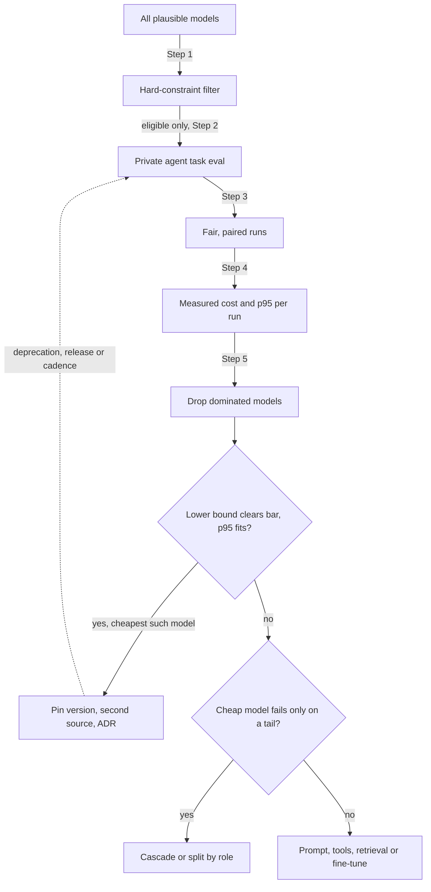

## TL;DR
Picking an agent's model is a funnel: filter by hard constraints (tool calling, context, deployment),
then choose per role the cheapest, fastest model whose run-level success clears your bar on your own
tasks. Quality has a threshold; cost is paid every step.

## For agent builders
- **Why it matters for agents.** Errors compound across steps: a model that picks the right tool 95% of
  the time finishes an 8-step run only about two times in three. Per-call benchmarks hide this, so you
  select on whole-run success, tool-call validity and steps per run.
- **Where it shows up in your stack.** The model identifier in your agent config or gateway route, the
  eval harness that replays agent tasks, and the provider usage fields you log per step for cost.
- **What you control.** The task eval set, the bar per agent role (planner, tool caller, summariser),
  the pinned version, the second source, and whether a cascade escalates hard steps to a stronger
  model.
- **What you can skip.** Leaderboard watching and arguing about which frontier model is "smartest". A
  private eval with intervals and a paired comparison answers the only question that matters.

## Decision case
### Scenario
An online retailer is launching a returns agent: it reads the order, checks the returns policy, decides
eligibility, creates the return label and messages the customer. All figures are illustrative.
- **Load:** 20,000 runs a day; each step sends about 8,000 input tokens and returns about 300.
- **Quality bar:** the lower 95% bound of run success on a 300-task private eval must be at least 0.80.
- **Latency:** p95 end-to-end run time within 25 s.
- **Budget:** at most 400 units a day of model spend.
- **Hard constraints:** an EU endpoint and native tool calling; one otherwise strong candidate is
  dropped at the filter because it has no EU endpoint.
- **Deadline:** six weeks, with a second source configured before launch.

Illustrative prices in units per million tokens: A 3 in and 15 out, B 0.5 and 2, C 0.1 and 0.4. Run
time is a conservative sum of per-step p95: 3.5 s for A, 2.0 s for B, 1.0 s for C.

### Options
| Option | Steps per run | Run success (lower bound) | Cost per run | Per day | Cost per successful run | p95 run |
|---|---|---|---|---|---|---|
| **A. Frontier everywhere** | 6 | 0.91 (0.878) | 0.171 | 3,420 | 0.188 | 21 s |
| **B. Mid tier everywhere** | 7 | 0.88 (0.843) | 0.0322 | 644 | 0.037 | 14 s |
| **C. Small model everywhere** | 9 | 0.74 (0.690) | 0.0083 | 166 | 0.011 | 9 s |
| **D. Split: B plans and picks tools, C does 4 routine steps** | 6 | 0.87 (0.832) | 0.0129 | 258 | 0.015 | 8 s |

Lower bounds use 1.96 × √(p(1 − p) / 300), about ±3 to ±5 points at these rates.

### Decision
**Choose D, with B as the second source.**
- C is the cheapest but its lower bound (0.690) fails the bar; its extra steps show where it fails.
- A and B clear the bar, but A costs about 8.6 times the budget and B about 1.6 times.
- D is the cheapest option whose lower bound clears 0.80 and whose p95 fits 25 s.
- D versus B is 261 versus 264 successful tasks out of 300: a 1-point gap inside the noise. A paired
  read of the discordant tasks before launch checks that the split loses no whole task category.

**What would change it.** A budget of at least 644 units a day makes B attractive, because one model
is simpler to evaluate and debug.

A scheduled re-run where D's lower bound drops below 0.80, or a
deprecation notice for either pinned version, reopens the funnel. A fine-tuned C that clears the bar
on routine steps would only lower D's cost further.

### Trade-offs accepted
- **Two models in one run.** Hand-offs between planner and worker are a new failure point; tool-call
  parse failures and run success are tracked per step type.
- **A thin margin.** D clears the bar by about 3 points; the eval grows from 300 to more tasks as
  production failures are labelled, which also narrows the interval.
- **B as the fallback costs more.** An outage of C's provider moves routine steps to B and spend
  towards 644 a day; fallback share and daily spend have alerts.

### Review rubric
- Applies the hard-constraint filter before any quality comparison, and says which candidate it removed.
- Scores whole agent runs and reports lower confidence bounds, not means or leaderboard ranks.
- Computes cost per run, per day and per successful run from steps and measured tokens, reproducibly.
- Chooses by the rule (cheapest that clears the bar and the latency budget) and names the runner-up.
- Pins versions, names a second source, and lists the triggers for re-selection.

## Why it exists
- **The choice is multiplied by every request and every step.** At any moment dozens of plausible
  models span one to two orders of magnitude in price per token and several-fold in latency, and the
  pick is paid for the life of the feature. An agent pays it on every step of every run. It deserves a
  method, and the obvious method is wrong.
- **"Top of the leaderboard" fails for four reasons.** (1) Benchmarks measure broad ability on public
  data, not your narrow distribution, tools and failure costs, and may have leaked into
  training. (2) The quality gap among the top two or three is often smaller than their cost gap, so the
  ranking is unstable exactly where the money is. (3) Non-quality dimensions decide feasibility. (4) Your
  prompt was tuned on the starting model, so a naive swap underrates every other candidate.
- **The feasibility dimensions.** Context length at your p95 prompt size (for agents, the transcript at
  the last step), reliable structured output, tool-calling behaviour, language coverage, rate limits at
  your peak, data residency and the provider's deprecation cadence.
- **"Cheapest and hope" fails on the tail.** A weaker model's errors concentrate in the hard,
  high-stakes cases, precisely the ones that generate support tickets, wrong tool actions or compliance
  findings.
- **Threshold versus linear.** Below the bar the feature does not work; above it, extra points rarely
  change the outcome, while cost and latency grow with volume. So the optimum is the cheapest model that
  clears the bar with a margin, and only measuring your task tells you which.

## How it works
### Step 1: apply hard constraints first
Filter before evaluating quality, *because* no quality number rescues a model that cannot run where the
data is. The usual gates:
- **Modality:** text, vision, audio.
- **Context window** versus your *measured* p95 prompt size, not the mean; for an agent, measure the
  transcript at the step limit, not the first call.
- **Output and tools:** native structured output or JSON-schema support; tool calling, including
  parallel calls if your loop uses them; languages.
- **Deployment:** a region, a VPC, on-prem or air-gapped, which narrows the field to open-weight models
  or private endpoints.
- **Commercial terms:** licence terms; quota and rate limits at launch peak (an agent makes several calls
  per user request); version pinning and deprecation policy; data-use and retention terms.

### Step 2: build the task evaluation before touching candidates
- **Size and source.** Fifty to a few hundred examples from real or realistic traffic, with expected
  outputs or a scoring rubric. For agents, each example is a task with a starting state, mocked or
  sandboxed tools and a success check.
- **The task's own metric.** Exact or normalised match for extraction and classification; citation
  faithfulness for retrieval-augmented answers; a calibrated LLM-as-judge rubric for free-form
  generation; pass@k for code; task success, valid tool calls and steps per run for agents.
- **First, because of bias.** Otherwise the prompt gets tuned to the first model tried and every later
  comparison favours the incumbent.
- **Over-sample the hard cases.** Hard and high-cost cases are where candidates differ: ambiguous tool
  choice, long transcripts, tool errors the agent must recover from.

### Step 3: run candidates fairly
1. **Same examples, same prompt structure,** then a bounded, equal amount of prompt adaptation per
   model, *because* format sensitivity differs between families and zero adaptation punishes the newcomer.
2. **Fix sampling settings, run several seeds,** and report a mean with a confidence interval.
3. **Know the noise floor.** On 100 examples a proportion near 0.9 has a 95% half-width of roughly ±6
   points, so a 2-point gap is noise:

| Fact from the formula | Consequence |
|---|---|
| 1.96 × √(0.9 × 0.1 / 100) ≈ 0.059 | a 2-point gap on 100 examples is noise |
| Repeated runs average only sampling randomness | they do not shrink the error from drawing *these* 100 examples; only more examples do |
| Halving the interval needs four times as many examples | 400 examples for ±3 points; about 860 for ±2 points at 0.9 |

4. **Compare paired.** Every candidate runs on the same examples, so count the examples only model A
   gets right and only model B gets right (McNemar's test uses exactly these discordant counts).
   Pairing cancels each example's difficulty, so it detects real differences two overlapping intervals
   hide.
5. **Read the discordance pattern.** Few discordant examples means the models behave alike. Many in both
   directions means they fail on different inputs, which argues for a cascade rather than a straight swap.
6. **Keep the set private.** A model that has seen your examples is not being evaluated.

### Step 4: measure cost and latency on real request shapes
- **Cost per request** = input tokens × input price + output tokens × output price, adjusted for cached
  prefixes; for an agent, sum it over every step of the run.
- **Measure tokens from the eval runs, don't estimate,** *because* tokenizers differ across families
  (the same document can be 20–30% more tokens in one than another, and more for non-English text),
  output verbosity differs, and weaker models often take more steps.
- **Reasoning models.** Hidden reasoning tokens are billed as output on most providers and can dominate,
  so price per token alone misleads.
- **Latency.** Time to first token and total latency at p50 and p95, under realistic concurrency, at
  the hours you will run; for agents, end-to-end run latency, since steps are sequential.

The number to compare is not cost per call but:

```
cost per successful task = (cost of all calls, including retries after format failures and escalations)
                           ÷ (tasks that pass the eval)
```

*Because* a model 40% cheaper per call that needs a retry on one call in five, or escalates often, can
lose its advantage once the denominator and the extra calls are counted.

### Step 5: find the frontier and apply the rule
1. **Plot** candidates on quality versus cost versus latency.
2. **Discard** any model another beats on all three.
3. **Choose** the cheapest whose *lower* confidence bound clears the bar and whose p95 fits the
   latency budget.
4. **Consider a cascade or a split by role** if the cheap model fails only on an identifiable tail:
   cheap by default, escalating to a stronger one on low confidence or a trigger condition, or a strong
   planner with a cheap model for routine tool steps. Often cheaper than the strong model everywhere.

### Step 6: operational factors and re-evaluation
- **Pin an exact model version,** never a floating alias, so quality and tool-call format cannot change
  under you.
- **Have a second source.** A fallback model that also clears the bar, even at higher cost, turns an
  outage or deprecation notice into a configuration change.
- **Schedule re-selection:** when a deprecation is announced, when a new model could move the frontier,
  or on a fixed cadence. The eval set makes each re-run cheap; this is the compounding payoff of
  building it first.

## Diagram
The selection funnel: hard constraints (modality, context at p95, tool calling, deployment, terms) remove
candidates before any quality work, and the rule at the bottom compares lower confidence bounds of run
success with the bar, not leaderboard ranks.



## Examples
### Worked scenario: per-step accuracy compounds over an agent run
Illustrative numbers for an 8-step support agent, assuming step errors are roughly independent (real
runs can recover from some errors, so treat this as a pessimistic sketch). Cost is normalised to 1.0 per
strong-model step.

| | Strong model | Cheap model |
|---|---|---|
| Correct tool call per step | 0.98 | 0.95 |
| Steps per run (from traces) | 8 | 10 (more retries and detours) |
| Run success ≈ per-step accuracy ^ steps | 0.98^8 ≈ 0.85 | 0.95^10 ≈ 0.60 |
| Cost per run | 8.0 | 10 × 0.3 = 3.0 |
| Cost per successful run | ≈ 9.4 | ≈ 5.0 |
| Clears a 0.80 run-success bar? | yes | no |

- **Read it as threshold versus linear.** The cheap model is cheaper per success but fails the bar, so
  it is not a candidate as the only model.
- **The fix is often a split.** Keep the strong model as planner and for hard tool choices, route
  routine steps (formatting, summarising a tool result) to the cheap one, and re-measure run success.
- **A 3-point per-step gap is big here.** At 0.99 per step, 8 steps give about 0.92; the per-call
  difference that looks negligible becomes the run-level difference that matters.

### Selection harness for the quantitative steps
Each candidate exposes a `call` that returns the text plus the measured token counts; prices are
placeholders you fill from the provider's current sheet. The rule requires the lower confidence bound,
not the mean, to clear the bar.

For an agent, `call` runs a whole task in the sandbox and returns the summed tokens, and `score` checks
the task's end state.

```python
import statistics, time
from dataclasses import dataclass
from typing import Callable

@dataclass
class Candidate:
    name: str
    price_in: float          # currency per 1M input tokens (fill from current price list)
    price_out: float         # currency per 1M output tokens
    call: Callable           # task -> (result, input_tokens, output_tokens), summed over agent steps

def evaluate(c: Candidate, golden, score, runs=3):
    per_example, lat, cost = [], [], []
    for ex in golden:
        s = []
        for _ in range(runs):
            t0 = time.perf_counter()
            text, n_in, n_out = c.call(ex["prompt"])
            lat.append(time.perf_counter() - t0)
            s.append(score(text, ex["expected"]))
            cost.append((n_in * c.price_in + n_out * c.price_out) / 1e6)
        per_example.append(statistics.mean(s))   # repeats of one example are not independent samples
    n = len(per_example)                          # the CI is over examples, not over example x run
    mean = statistics.mean(per_example)
    half_width = 1.96 * statistics.pstdev(per_example) / n ** 0.5   # rough 95% CI
    p95 = sorted(lat)[int(0.95 * (len(lat) - 1))]
    return {"model": c.name, "quality": mean, "lower": mean - half_width,
            "p95_s": p95, "cost_per_1k": 1000 * statistics.mean(cost)}

def select(results, bar, max_p95):
    eligible = [r for r in results if r["lower"] >= bar and r["p95_s"] <= max_p95]
    return min(eligible, key=lambda r: r["cost_per_1k"]) if eligible else None

# results = [evaluate(c, agent_tasks, task_succeeded) for c in candidates]
# print(select(results, bar=0.80, max_p95=30.0))   # run-level bar and end-to-end p95 for an agent
```

If `select` returns `None`, no candidate clears the bar within budget. The next moves, in roughly that
order of cost: prompt and tool-description work, retrieval improvements, a cascade or role split, or
fine-tuning a smaller model on agent traces.

### Is the gap real? Interval width and the paired test
Runnable, standard library only. It reproduces the noise-floor numbers above and the paired reading
used in Check yourself; the same reading applies to two agents run on the same tasks.

```python
from math import comb, sqrt

def half_width(p, n, z=1.96):
    """95% half-width of a proportion; only more examples shrink it."""
    return z * sqrt(p * (1 - p) / n)

def mcnemar_exact(only_a, only_b):
    """Two-sided exact McNemar p-value from the discordant counts."""
    n, k = only_a + only_b, min(only_a, only_b)
    return min(1.0, 2 * sum(comb(n, i) for i in range(k + 1)) / 2 ** n)

for n in (60, 100, 400, 860):
    print(f"n={n:4d}  p=0.9  ±{half_width(0.9, n):.3f}")
# n=60 ±0.076, n=100 ±0.059, n=400 ±0.029, n=860 ±0.020
print("3 vs 1  p =", round(mcnemar_exact(3, 1), 3))     # 0.625: few disagreements, models alike
print("14 vs 12 p =", round(mcnemar_exact(14, 12), 3))  # 0.845: many both ways, different failures
```

Both 2-point gaps are statistically invisible, but they mean different things: the first says "read
those four examples", the second says "the models fail on different inputs; consider a cascade".

### Worked scenario: the 40%-cheaper model that costs more
Illustrative numbers, normalised so the strong model costs 1.0 per call.

| | Strong model | Cheap model |
|---|---|---|
| Cost per call | 1.0 | 0.6 (40% cheaper) |
| Cost with retries (one call in five retried) | 1.0 | 0.6 × 1.2 calls = 0.72 |
| Escalations to the strong model | none | 25% of tasks → +0.25 |
| Spend per task | 1.0 | 0.97 |
| Tasks that pass the eval | 95% | 90% |
| **Cost per successful task** | **1.05** | **1.08** |

The per-call price says "save 40%"; the per-successful-task number says the swap loses money.

## Production patterns
- **Selection ADR with an evidence table.** For every model choice, per agent role. Record each
  candidate's eval score with its interval, cost per successful task, p95 latency, steps per run and
  failure categories, plus the re-selection triggers. Monitor whether production metrics stay inside the
  ADR's assumptions.
- **Pinned version in config, never an alias.** For every production route. Store the dated model
  identifier in configuration behind one model interface, so a change is a reviewed config diff. Monitor
  provider deprecation notices and have a re-selection ticket opened automatically.
- **Exercised second source.** For any user-facing agent. Configure a fallback model that also clears
  the bar on the agent eval (including tool-call format) and send a small scheduled share of traffic or a
  synthetic test through it, so it is not first used during an outage. Monitor 429 and 5xx rates per
  provider and fallback success rate.
- **Shadow comparison before a swap.** When a cheaper or newer candidate looks viable offline. Replay a
  sample of production agent tasks against the candidate in a sandbox without acting on its tool calls,
  then score both offline. Monitor the paired disagreement rate and which categories the disagreements
  fall into.
- **Log provider-reported usage per step.** Always. Store input, output and cached token counts from
  each response next to the trace span for that step, so cost per successful run is computed from data.
  Monitor forecast-versus-bill error, steps per run and output-token growth per route.
- **Scheduled re-run of the eval.** On a fixed cadence and on deprecation notices. Run the same
  harness against current candidates and compare lower bounds with the bar. Monitor the frontier, not
  release announcements.

## Trade-offs
- **Cheapest-that-clears vs headroom.** It minimises spend but leaves little margin when traffic drifts
  harder; if your task changes often, buy margin with a stronger model or a cascade.
- **One model vs a model per agent role.** A single model is simpler to evaluate and debug; splitting
  planner and worker roles saves cost but doubles eval work and adds hand-off failures. It pays when
  routine steps dominate token spend.
- **Private eval set vs effort.** It gives a trustworthy comparison but costs expert time and goes
  stale; a small set has wide intervals, so differences of a few points cannot be acted on.
- **Per-candidate prompt adaptation vs effort.** It makes the comparison fair but multiplies the work;
  skipping it is cheaper and systematically favours the incumbent model.
- **One provider vs second source.** Standardising on one provider's best model simplifies operations
  but concentrates deprecation and outage risk; a second source doubles evaluation work and halves the
  blast radius.
- **Reasoning-heavy models vs cost and variance.** They raise quality on genuinely hard tasks but bring
  high output-token cost and latency variance, which multiplies across agent steps; the choice flips as
  soon as the task is not reasoning-bound.

## Pitfalls
- **Choosing on public leaderboard rank.** Symptom: the "better" model scores lower on your eval, or wins
  it and then fails on JSON formatting or tool calls in production. Fix: a private task eval that also
  scores format and tool-call compliance.
- **Judging an agent model on single calls.** Symptom: a candidate wins a per-turn eval but finishes
  fewer runs, because small per-step errors compound. Fix: score whole runs in a sandbox and track steps
  per run.
- **Estimating cost from list price without measuring tokens.** Symptom: the bill differs from the
  forecast by a large fraction because of tokenizer differences, verbose outputs or extra agent steps.
  Fix: compute cost from token counts measured in the eval runs.
- **Comparing single runs and treating a 2-point gap as real.** Symptom: the ranking flips when someone
  re-runs the comparison the following week. Fix: report intervals, compare paired, and add examples.
- **Deploying a floating "latest" alias.** Symptom: quality or tool-call format changes overnight with
  no deploy and no entry in the change log. Fix: pin the dated version in config.
- **Ignoring quotas and rate limits at peak.** Symptom: 429 errors at launch, because each user request
  is several agent calls, and the fallback path has never been exercised. Fix: confirm quota for launch
  peak and exercise the second source beforehand.
- **Evaluating in English only for a multilingual product.** Symptom: context overflows and higher cost
  for languages whose tokenization is two to three times less efficient. Fix: include each supported
  language in the eval set and the token measurements.

## When to use
- **Run the funnel when:** a new task or agent role is introduced, a deprecation notice arrives, a model
  release plausibly moves the quality-cost frontier, or the latency or cost target changes.
- **Avoid:** re-selecting on every release announcement. The eval harness makes a scheduled re-run
  cheap, so put it on a cadence instead.
- **Measure:** eval score with its interval, run success and steps per run for agents, cost per
  successful task, p95 latency, and failure rates by category (format, tool call, refusal, timeout).
- **Day to day:** this shows up as "can we move this to the cheaper model", and the honest answer is
  always "the eval says".
- **Interviews:** articulate the threshold-versus-linear reasoning, the hard-constraint filter, and "I
  would build the eval set first"; naming a favourite model is not the expected depth.

## Role lens
- **Engineer:** Owns the eval harness, measures real token counts and latency percentiles, and keeps
  the model behind one interface so the next re-selection is a configuration change.
- **Architect:** Sets the quality bar and the latency and cost budgets per task, decides on second
  sourcing and cascades, and records the selection and its evidence as an ADR.
- **FDE:** Runs the funnel on the customer's own data under their deployment constraints, and shows
  stakeholders the quality-cost table rather than a vendor's benchmark slide.

## Check yourself
**Q:** You are asked to replace an expensive frontier model with one at a third of the price for a
retrieval-augmented assistant. On your 100-example eval the cheaper model scores 2 points lower. How do
you decide, and what would make you say no?
**A:** First, 2 points on 100 examples is inside the noise: the 95% interval around a score near 0.9 is
roughly ±6 points, so the gap is not established, and re-running seeds will not fix that, only more
examples will. Expand the set toward several hundred and compare each model's lower bound against the
bar, not against each other. Because both ran on the same examples, look at the paired view: if the
2-point gap is 3 losses against 1 win, the models behave almost identically and I read those few
examples; if it is 14 losses against 12 wins, they fail on different inputs, which means the score is
unstable and a cascade may beat either model alone. Second, read the failures by category: if the cheaper model's extra misses cluster in a high-cost class such as
wrong citations on compliance questions, that is disqualifying even if the total is small; if they
are stylistic, it is not. Third, check the dimensions the score ignores: format compliance, p95
latency, rate limits at peak, and the real cost ratio measured from tokens, since tokenizers differ.
Fourth, consider a cascade, cheap by default with escalation on low confidence, which may capture most
of the saving while covering the tail. I would say no if the lower bound misses the bar or the misses
land in the costly category.

## Interview questions
### How would you choose a model for a new production task?
- **Filter on hard constraints first:** modality, context window against measured p95 prompt size,
  structured output and tools, deployment region or environment, licence and rate limits.
- **Build a private task eval set before trying candidates,** because otherwise the prompt is tuned to
  the first model and every comparison favours it.
- **Pick the cheapest model whose lower confidence bound clears the bar** and whose p95 fits the latency
  budget, then pin the version and keep a second source.

### How does choosing a model for a multi-step agent differ from choosing one for a single call?
- **Errors compound.** A cheap model at 0.95 per-step tool accuracy that needs 10 steps succeeds about
  60% of the time, versus about 85% for a strong model at 0.98 over 8 steps, so you score whole runs,
  not turns.
- **Cost and latency are per run.** Weaker models often take more steps, and each step re-sends the
  transcript, so measure steps per run and summed tokens from the eval traces.
- **Roles can differ.** A strong planner with a cheaper model for routine tool steps is often the
  frontier, but it needs its own eval of the hand-offs.

### Why is "quality is a threshold, cost is linear" the core of the decision?
- **Below the bar the feature does not work;** above it, extra points rarely change the outcome.
- **Cost and latency are paid on every call** and grow with volume, for the life of the feature.
- **So the optimum is the cheapest model that clears the bar with a margin,** and only measuring your
  own task tells you which one that is.

### Your forecast said the new model would cost 30% less, but the first bill matched the old one. What went wrong?
- **Tokens were estimated, not measured.** Tokenizers differ across families, so the same document can
  be 20-30% more tokens in one, and more for non-English text.
- **Output verbosity and hidden reasoning tokens,** which most providers bill as output, can dominate,
  and an agent on the new model may take more steps per run.
- **Retries and escalations were left out of the denominator.** Compare cost per successful task
  computed from provider-reported usage logged per request.

### After a model upgrade your agent's run success dropped but single-turn evals look fine. How do you debug it?
- **Compare paired runs on the same tasks** and diff the traces at the first step where the two models
  diverge; that is usually a tool choice or a malformed argument.
- **Check tool-call format and parse failures per step,** since a pinned-version change can alter how
  arguments are emitted even when answers read well.
- **Fix with prompt or tool-description adaptation within a bounded budget,** then re-run the full agent
  eval; if it still misses the bar, roll back to the pinned previous version.

### When would you deliberately not pick the cheapest model that clears the bar?
- **When the task drifts often.** The cheapest-that-clears choice leaves little headroom, so buy margin
  with a stronger model or a cascade.
- **When it has no second source that also clears the bar,** because an outage or deprecation then
  becomes an emergency migration whose cost can exceed the saving.
- **When it cannot hold the rate limits or p95 at peak,** because feasibility beats a quality score.

## Quiz
### Q: Why is "pick the model at the top of a public leaderboard" a poor selection rule?
- [ ] Leaderboards are updated too infrequently to be useful
- [x] Benchmarks measure a different distribution from your traffic and may be contaminated, while your cost and latency are exact, so the rank says little about which model clears your bar most cheaply
- [ ] Top-ranked models are always rate-limited more aggressively
- [ ] Leaderboard models do not support structured output
> Leaderboards estimate broad ability on public data. Your task is narrow, has its own failure costs,
> and must fit a budget; the question is which eligible model clears your measured bar at the lowest
> cost, which only a task-specific evaluation answers.

### Q: Two candidate models differ by 3 points on a 60-example evaluation set. What is the right conclusion?
- [ ] The higher-scoring model is better and should be chosen
- [ ] The cheaper model should be chosen because 3 points never matters
- [x] The difference is probably within noise; enlarge the set, inspect the paired per-example disagreements, and compare lower confidence bounds against the quality bar before deciding
- [ ] Both models should be rejected for a larger model
> With 60 examples the 95% interval is roughly ±7 to ±8 points near 0.9, so a 3-point gap (about two
> examples) cannot be distinguished from sampling noise. More examples tighten it; repeated runs do
> not. The decision should be made against the bar with margin, not by comparing two noisy means.

### Q: Which of these must be applied as a hard filter before any quality comparison?
- [ ] Price per million output tokens
- [ ] Position on a human-preference leaderboard
- [x] Whether the model can be run in the region or environment where the data is allowed to be
- [ ] How recently the model was released
> Deployment and residency constraints are binary: a model that cannot legally or technically process
> the data is not a candidate regardless of quality or price. Price and recency are inputs to the
> later optimisation step, not gates.

## Use cases & projects
### Use cases
- **Choosing the model for a new agent.** The funnel removes models that fail hard constraints (tool
  calling, context at the last step, residency) before any quality testing is spent on them.
- **Picking per-role models.** A planner, a tool caller and a summariser can each get the cheapest model
  that clears their own bar.
- **Evaluating a newly released model.** A paired comparison on your agent tasks answers whether to
  switch, instead of a leaderboard headline.
- **Responding to a deprecation notice.** The same eval harness re-qualifies a replacement model and
  shows how much prompt re-tuning it needs.

### Mini project
**Run a whole-run model bake-off (2-3 hours).**
- **Goal:** pick a model for a small tool-calling agent on run-level success, not per-call quality.
- **Steps:** build a 3-tool agent and 20 tasks with checkable end states; run each task with two or
  three candidate models (several repeats each); log run success, tool-call validity, steps per run,
  tokens and latency from provider usage fields; compute cost per successful run.
- **Done when:** you have a table per model with success rate plus an interval, cost per successful run
  and p95 latency, and a one-paragraph choice naming the cheapest model that clears your bar with a
  margin.
