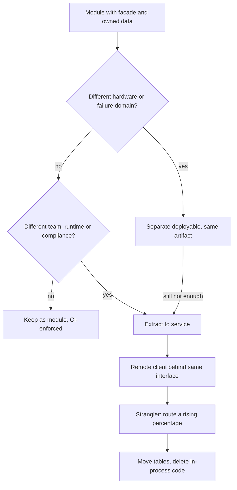

## TL;DR
An agent product has a loop, tools, retrieval, memory, a model tier and maybe a sandbox. Keep them as
enforced modules of one deployable; add a network hop only for a proven reason (GPU, failure domain,
team, security), because hops multiply across agent steps.

## For agent builders
- **Why it matters for agents.** One agent run makes many calls: 10-20 model and tool steps is normal. A
  synchronous network hop that costs a little per request costs that much per *step*, and its failure
  probability compounds across the whole run.
- **Where it shows up in your stack.** The agent API (FastAPI or similar), the tool layer behind a
  registry, the retriever, a `worker` for ingestion and long-running runs, a model server such as vLLM,
  and a sandbox for untrusted agent code.
- **What you control.** Which of those are in-process modules, which are separate deployables of the same
  image, and which are real services; plus the facades (`Retriever`, a tool interface) that keep that
  choice reversible.
- **What you can skip.** Service-mesh and platform-team theory. Know the hop arithmetic, the four
  properties of a module boundary, and the short list of reasons that justify a split.

## Why it exists
- **Failure mode 1: the big ball of mud.** A monolith with no internal structure: any table joined from
  anywhere, any function calls any other. Easy to deploy, impossible to change; every release needs a full
  regression and nobody can say which code owns which data, including which code owns agent memory.
- **Failure mode 2: the distributed monolith.** Services split too early or along the wrong lines. One
  feature touches four repositories, releases ship in lock-step, and one service's schema change breaks two
  others. You pay for the network (latency, retries, timeouts, serialisation, tracing) and get none of the
  independence.
- **Both naive answers skip the question.** Microservices answered failure mode 1 at many-team
  organisations; failure mode 2 is smaller teams copying the result without the cause. "Monoliths are
  legacy" and "microservices are best practice" both skip: *which boundaries need to be independently
  deployable, scalable or owned, today?*
- **AI systems sharpen it.** They genuinely mix different physics: a GPU-bound model server, a CPU-bound
  orchestration API, bursty batch ingestion and embedding, long-running agent workflows. That tempts teams
  to split everything on day one, often one service per tool.
- **What the modular monolith buys.** Internal boundaries stay sharp without paying the network tax until
  a specific boundary earns it.

## How it works
### What a module boundary is inside one deployable
Four properties, each chosen to make later extraction cheap:

1. **A narrow public API.** Other modules import one facade (an `api.py`, an interface, a package's
   exported surface) and nothing else, *because* a service boundary is exactly a public API over a
   network. If the in-process API is already narrow, extraction is a transport change. For an agent, the
   tool registry and the retriever are the obvious facades.
2. **Owned data.** Each module owns its tables (a schema per module, or at minimum a naming and ownership
   rule); no other module queries them directly, *because* a shared database is the coupling that makes
   services inseparable later. Agent memory, run state and the document index each get one owner.
   Cross-module reporting goes through the owning module's API or an event-fed read model.
3. **Events for side effects.** When module A needs B to react ("document ingested", "chat answered",
   "run finished"), A publishes an in-process event instead of calling B's internals. The bus is a
   function call today and an outbox plus broker tomorrow; the contract does not change.
4. **Enforcement in CI.** Boundaries that live only in a wiki erode in weeks. `import-linter` (Python),
   ArchUnit (JVM), Nx module-boundary lint rules (TypeScript) and Packwerk (Ruby) fail the build when a
   module reaches into another's internals.

**What you keep from one process:**
- In-process calls cost microseconds, versus a network round trip of roughly a millisecond or more
  (illustrative order of magnitude), paid once per agent step.
- One transaction boundary when you need atomicity, for example writing a tool result and the run state
  together.
- One build, one deploy, one log stream and one debugger for a whole agent trace.

### What changes when a boundary becomes a service
The added problems are the same every time:

| Problem | What it forces |
|---|---|
| **Network and partial failure** | Calls time out, succeed without the caller knowing, or get retried, so every mutating call needs idempotency, timeouts and circuit breakers; an agent retrying a "send email" tool is the classic double-send |
| **Data ownership becomes physical** | No shared database: an operation spanning two services becomes a saga with compensating actions, or an outbox-driven eventually consistent flow; joins become data pipelines |
| **Contracts become versioned** | Callers deploy on their own schedule, so the API must evolve backward-compatibly; contract tests replace the compiler, and tool schemas the model sees must stay stable too |
| **Operational surface multiplies** | Per-service CI/CD, dashboards, alerts, on-call, secrets, distributed tracing with propagated correlation IDs, and usually a platform team to make it repeatable |

None of these are reasons never to split; they are the price, and it is paid **per boundary**.

### The arithmetic of a hop
The price compounds rather than adding up linearly, and an agent loop multiplies it again:

- **Availability multiplies along a synchronous chain.** *n* services in series, each available a
  fraction *a*, succeed roughly *aⁿ* of the time.
  - Five services at 99.9% give 0.999⁵ ≈ 99.5%: the ~43 minutes of monthly downtime one service is allowed
    becomes ~3.6 hours for the path.
  - Real failures are correlated, so treat this as the shape rather than a forecast.
  - Five modules in one process fail together but do not multiply.
  - An agent run of 12 steps through 3 hops each crosses 36 links: 0.999³⁶ ≈ 96.5% of runs see no failure.
  - This is *why* service designs lean on async messaging, caches and fallbacks: each cuts a link out of
    the synchronous chain.
- **Fan-out amplifies tail latency.** A request that calls *n* services in parallel and waits for all is
  slow whenever any one is; parallel tool calls in one agent step behave the same way.
  - If each call exceeds its own p99 1% of the time, the request exceeds it with probability 1 − 0.99ⁿ,
    about 10% at *n* = 10. The callees' p99 becomes the caller's p90 (Dean and Barroso's "The Tail at
    Scale" is the classic treatment).
  - Standard mitigations are timeouts with partial results and hedged requests, both extra code a modular
    monolith never needs.

### The reasons that justify paying it
A boundary is worth a service when at least one holds and the modular monolith cannot deliver it:

- **Different scaling or hardware profile.** A vLLM model server needs GPUs and scales on tokens per
  second; the orchestration API scales on request concurrency on cheap CPU nodes. Co-deploying wastes the
  GPU.
- **Different failure domain.** An ingestion worker that can OOM on a 400-page PDF must not take the chat
  API down with it; neither should a runaway long agent run.
- **Different team and release cadence.** Conway's law is descriptive: when two teams own two things,
  their interface becomes a service boundary whether planned or not. The "inverse Conway manoeuvre" runs it
  the other way: shape teams around the boundaries you want, then split.
- **Different security or compliance envelope.** A component handling raw PII or running untrusted agent
  code may need its own network segment and credentials; a code-execution sandbox is the clearest case.
- **Different runtime.** Python for the ML path and TypeScript for the product surface is a common and
  legitimate split.

**The middle option many teams miss: one codebase, several deployables.** The same artifact runs as
`api`, `worker` or `scheduler` depending on its entrypoint. Processes are isolated and scale
independently, but there is one build, one set of contracts and no network between modules that do not
need it. Long agent runs fit naturally in `worker`.

### Extraction when it is time
Because the module already has a facade, owned data and events, extraction follows a fixed path:

1. Put the facade behind an interface.
2. Implement a remote client with the same interface.
3. Route a percentage of traffic to the new service (strangler pattern).
4. Move the tables.
5. Delete the in-process implementation.

Contract tests written against the facade keep passing throughout, and the agent loop never notices.

## Diagram
The decision path for one boundary (a tool, the retriever, the sandbox): stay a module by default, become
a separate deployable for isolation, and become a service only for a named independence.



## Examples
### Agent tools behind enforced module boundaries
The agent loop depends only on a tool contract and retrieval's public `Retriever`; side effects go through
an in-process event bus, and CI forbids reaching into internals. Moving the code sandbox to its own
service later means a second `Tool` implementation that speaks HTTP; the loop does not change.

```python
# app/retrieval/api.py — the only module other packages may import from retrieval
from dataclasses import dataclass
from typing import Protocol

@dataclass(frozen=True)
class Passage:
    doc_id: str
    text: str
    score: float

class Retriever(Protocol):                      # the contract; unchanged by extraction
    def search(self, tenant_id: str, query: str, k: int = 8) -> list[Passage]: ...

# app/tools/api.py — every tool the model can call implements this
class Tool(Protocol):
    name: str
    def run(self, tenant_id: str, args: dict, idempotency_key: str) -> str: ...

# app/agent/loop.py — depends on contracts, never on retrieval or tool internals
from app.tools.api import Tool
from app.events import publish                  # in-process today; outbox + broker later

def run_agent(tenant_id: str, run_id: str, task: str, tools: dict[str, Tool], llm, max_steps=12):
    messages = [{"role": "user", "content": task}]
    for step in range(max_steps):
        reply = llm(messages, tools=list(tools))            # model call elided
        if not reply.tool_calls:
            publish("run.finished", {"tenant_id": tenant_id, "steps": step + 1})
            return reply.text
        for call in reply.tool_calls:
            out = tools[call.name].run(tenant_id, call.args, f"{run_id}:{step}:{call.id}")
            messages.append({"role": "tool", "tool_call_id": call.id, "content": out})
    return "stopped: step budget reached"

# .importlinter — the build fails if the agent loop imports internals
# [importlinter:contract:retrieval-is-private]
# name = agent may only use retrieval.api and tools.api
# type = forbidden
# source_modules = app.agent
# forbidden_modules = app.retrieval.service
# allow_indirect_imports = True
```

### Hop calculator: what a proposed split costs
Run this before a design review to put numbers on a synchronous chain and a parallel fan-out.

```python
MINUTES_PER_MONTH = 30 * 24 * 60   # 43,200

def chain(per_service: float, hops: int) -> tuple[float, float]:
    avail = per_service ** hops                       # independent failures: the optimistic shape
    downtime_h = (1 - avail) * MINUTES_PER_MONTH / 60
    return avail, downtime_h

def fanout_slow(n: int, p_slow: float = 0.01) -> float:
    return 1 - (1 - p_slow) ** n                      # P(at least one callee beyond its p99)

for hops in (1, 3, 5, 10):
    a, h = chain(0.999, hops)
    print(f"{hops:>2} hops: {a:.3%} available, ~{h:.1f} h/month down, "
          f"fan-out slow {fanout_slow(hops):.1%}")
#  1 hops: 99.900% available, ~0.7 h/month down, fan-out slow 1.0%
#  3 hops: 99.700% available, ~2.2 h/month down, fan-out slow 3.0%
#  5 hops: 99.501% available, ~3.6 h/month down, fan-out slow 4.9%
# 10 hops: 99.004% available, ~7.2 h/month down, fan-out slow 9.6%
```

### Worked scenario: one service per tool
An agent team proposes a service per tool (search, CRM lookup, email, calendar, code sandbox) plus an
orchestrator and a memory service. A typical run is 12 steps; each step crosses orchestrator to memory to
tool, so 3 hops at 99.9% each.

| Design | Links per run | Runs with no failed link |
|---|---|---|
| Seven services, 3 hops per step | 36 | 0.999³⁶ ≈ 96.5% |
| Modular monolith, tools in-process, model remote | 12 | 0.999¹² ≈ 98.8% |

- **The 3.5% of runs that hit a failure** retry or abort mid-task, and a retried "send email" without an
  idempotency key sends twice.
- **Outcome:** tools stay modules behind one interface; the code sandbox becomes its own deployable
  because it runs untrusted code; the model tier is already remote.

### Worked scenario: six engineers, seven proposed services
A RAG startup proposes separate services for ingestion, chunking, embedding, retrieval, chat, tenancy and
evaluation.

| Question | Answer | Result |
|---|---|---|
| Different hardware? | Only the self-hosted embedding model (GPU) | Own serving process |
| Different failure domain? | Ingestion is bursty and can OOM on bad PDFs | `worker` deployable, same artifact |
| Different team? | No: one team of six | No service boundary |
| Already remote? | The hosted LLM | Already behind HTTP |

Outcome: three runtime units instead of seven, one build, and written triggers (second team, different
data store) for any further split.

## Production patterns
- **Boundary contracts in CI.** Use when a codebase has more than a couple of modules. Add one
  `import-linter` `forbidden` contract per module (as above) and run `lint-imports` as a required check.
  Monitor the number of contract exceptions; a growing ignore list means the boundary is wrong.
- **One image, many entrypoints.** Use when roles need isolation but share code. Build one container image
  and start it with a different command per role (`api`, `worker`, `scheduler`), each with its own replica
  count and resource limits. Run long agent tasks in `worker` so a stuck run cannot starve chat. Monitor
  per-role CPU, memory and restart counts.
- **Tools behind one interface, idempotent by contract.** Every tool takes an idempotency key derived from
  run, step and call id, whether it is in-process or remote. Extraction then never changes the agent loop,
  and retries after a timeout cannot double-execute. Monitor duplicate-key hits per tool.
- **Strangler routing for extraction.** Use when a module has earned a service. Put the remote client behind
  the same `Retriever` interface and route a small, rising percentage of calls to it with a feature flag.
  Compare error rate and p99 latency between the two paths before moving the tables.
- **Separate the model-serving tier and sandbox from day one.** Use when you self-host models or run
  agent-written code. Run the model server (for example vLLM) on GPU nodes and the sandbox in its own
  network segment, both over HTTP. Monitor GPU utilisation and queue depth separately from API concurrency.
- **Track the distributed-monolith signal.** Count coordinated multi-service deploys and repositories
  touched per feature from your deploy and PR history. A rising count is the earliest sign a boundary
  provides no independence.

## Trade-offs
- **One deploy, one transaction vs shared limits.** A modular monolith gives in-process latency and one
  transaction, but every module shares one process's resource limits and release train. It flips once a
  module needs different hardware or a team needs to ship without waiting for others.
- **Independence vs per-boundary tax.** Microservices give independent scaling and failure isolation, but
  each boundary adds network failure handling, versioned contracts and eventual consistency, paid on every
  agent step. Worth it only for boundaries whose independence you will actually exercise.
- **Enforced boundaries vs friction.** They cost up-front design and occasional friction when a quick
  cross-module query is forbidden. That is cheaper than untangling a shared database later, unless the
  product is a short-lived prototype that will be thrown away.
- **Several deployables vs coupled versions.** "One codebase, several deployables" keeps contracts in one
  place while isolating processes, but couples release versions across roles. It becomes a problem when
  roles need genuinely different dependency sets (for example CUDA libraries only in the serving role).

## Pitfalls
- **Splitting by technical layer.** An "LLM service" and a "database service" instead of business
  capabilities. Symptom: every user-facing change touches every service. Fix: split by capability.
- **One service per tool.** Symptom: agent runs fail or stall more often as tools are added, and traces
  span five services for one task. Fix: tools are modules behind one interface; only isolate a tool with a
  named reason (untrusted code, different credentials, different team).
- **A shared database behind "separate" services.** Symptom: a schema migration in one repository breaks
  another team's deploy with no compiler to warn anyone. Fix: one owner per table, access via API or events.
- **"Modular" without CI enforcement.** Symptom: six months later the dependency graph is a single strongly
  connected component. Fix: boundary lint as a required check.
- **Splitting early because components *feel* different.** Then most requests fan out across three
  services. Symptom: p99 latency dominated by hop count and retries, and incidents that need three on-call
  rotations to debug. Fix: require a named, measured independence (hardware, failure domain, team) before
  any split.
- **Model server as "just another module" of the API process.** Symptom: a GPU box running web handlers at
  5% GPU utilisation, or an API deploy that evicts a loaded model. Fix: separate serving tier.

## When to use
- **Default:** a modular monolith for a new AI or agent product. One Python codebase with enforced modules
  for ingestion, retrieval, orchestration, tools, memory, evaluation and tenancy, run as separate processes
  (`api`, `worker`) from the same artifact.
- **Separate from the start:** the model-serving tier when you self-host, because its hardware and scaling
  profile are provably different, and any sandbox that executes agent-written code.
- **Add a service boundary when:** you can name the specific independence needed (team, scaling, blast
  radius, compliance) and have measured that the monolith cannot provide it.
- **Measure before and after:** deploy frequency per module, change failure rate, p99 latency per request
  path, synchronous hops on the critical path (per agent step), and repositories a typical feature touches.
  A rising count of coordinated multi-service deploys is the earliest sign of a distributed monolith.
- **Interviews:** the expected answer is not "monolith" or "microservices" but a sequence: which
  boundaries, in what order, justified by which observed pressure, and how extraction stays reversible.

## Role lens
- **Engineer:** Writes the module facades, keeps the import-linter contracts green, and extracts a
  module into a service by swapping an adapter rather than rewriting callers.
- **Architect:** Owns the boundary map: which capabilities are modules, which are deployables, which
  are services, and the written criteria (scaling, team, blast radius) that promote one to the next.
- **FDE:** Fits the product into a customer's deployment constraints, often collapsing several services
  into one deployable for an on-prem or VPC install where a platform team does not exist.

## Check yourself
**Q:** A six-engineer startup is building a RAG product: document ingestion, a chat API, a self-hosted
embedding model and a hosted LLM. They propose seven microservices. How would you structure it and why?
**A:** I would start with one modular monolith in Python with enforced modules (ingestion, retrieval,
chat orchestration, tenancy, evaluation) and run it as two deployables from the same artifact: an `api`
process and a `worker` process for ingestion, because ingestion is bursty and can crash on bad
documents while chat must stay up. The embedding model gets its own serving process because it needs a
GPU and scales on throughput, not request concurrency. The hosted LLM is already a service behind an
HTTP boundary. That is three runtime units, not seven, with one build and one set of contracts. I would
write down the triggers for further splits, for example a second team taking ownership of ingestion or
retrieval needing a different data store, and keep module facades so extraction is an adapter swap.

## Interview questions
### What is a modular monolith, and why is it not just "a monolith with folders"?
- **Definition:** one deployable whose modules expose narrow public APIs, own their tables and talk via
  events for side effects, with the boundaries enforced by CI tooling such as `import-linter`.
- **Why it matters:** folders without enforcement erode into a big ball of mud; enforced facades and owned
  data make a later extraction a transport change rather than a rewrite.

### Your team wants each agent tool to be its own microservice. How do you respond?
- **Do the hop math per run, not per request:** 12 steps through 3 hops at 99.9% is 0.999³⁶ ≈ 96.5% of
  runs with no failed link, versus ≈ 98.8% with tools in-process.
- **Keep tools as modules behind one `Tool` interface** with idempotency keys, so any tool can be extracted
  later without changing the loop.
- **Isolate only with a reason:** a code sandbox (untrusted code), a tool needing separate credentials, or a
  tool owned by another team.

### Your services always ship together and one schema change broke two teams. What do you do?
- **Diagnose:** this is a distributed monolith. Count coordinated deploys and repositories touched per
  feature, and look for tables read by more than one service.
- **Fix ownership first:** give each table one owner and route other access through its API or events.
- **Then fix boundaries:** merge services that never change independently back into modules of one
  deployable; keep only the splits whose independence you exercise.

### Where do long-running agent runs execute, and why not in the API process?
- **In a `worker` deployable from the same image**, started from a queue, because a 10-minute run holding
  an API worker starves interactive chat and dies on every API deploy.
- **The API only enqueues and streams progress**, so each role scales on its own signal (queue depth versus
  request concurrency) without a separate codebase or versioned contract.

### A request path calls five services synchronously at 99.9% each. What availability should you expect?
- **Roughly 0.999⁵ ≈ 99.5%**, so ~43 minutes of allowed monthly downtime per service becomes ~3.6 hours
  for the path, assuming independent failures (real ones are correlated).
- **Mitigate** by cutting synchronous links: async messaging, caches, fallbacks, and timeouts with partial
  results for fan-out.

### How would you extract the retrieval module into its own service safely?
- **Same interface, new transport:** write an HTTP client implementing the existing `Retriever` contract,
  so `ChatService` and the agent loop do not change.
- **Strangler routing:** send a small, rising percentage of calls to the new service behind a flag and
  compare error rate and p99 with the in-process path.
- **Then move data:** migrate the tables, delete the in-process implementation, and keep the contract tests
  green throughout.

## Quiz
### Q: What most distinguishes a modular monolith from an ordinary monolith?
- [ ] It is written in several programming languages
- [x] Modules expose narrow public APIs, own their data, and the boundaries are enforced by tooling
- [ ] It is deployed as several containers behind a load balancer
- [ ] It uses an event broker for all internal communication
> The defining property is enforced internal boundaries, including data ownership, inside one deployable.
> Multiple containers or a broker describe deployment and transport, which is exactly what the modular
> monolith avoids until a boundary needs it.

### Q: Which observation is the strongest evidence that a service boundary was drawn in the wrong place?
- [ ] The service has its own database
- [ ] The service is written in a different language from its callers
- [x] Most feature changes require coordinated deploys of this service and its callers
- [ ] The service receives more traffic than any other
> Lock-step deploys mean the boundary does not provide independence, which is the only thing a network
> boundary buys. A separate database and a different language are normal properties of a healthy
> service.

### Q: A team self-hosts an embedding model and runs it inside the same process as their FastAPI chat
API. What is the most likely consequence?
- [ ] Lower latency because no network hop exists, with no downside
- [x] Poor GPU utilisation and coupled scaling, because web concurrency and model throughput have different profiles
- [ ] The model cannot be loaded because FastAPI is single-threaded
- [ ] Requests must be made idempotent because of partial failure
> GPU serving scales on batched throughput while an API scales on connection concurrency; co-locating
> them wastes the expensive resource and makes every API deploy evict the model. Idempotency concerns
> arise from network boundaries, not from co-location.
