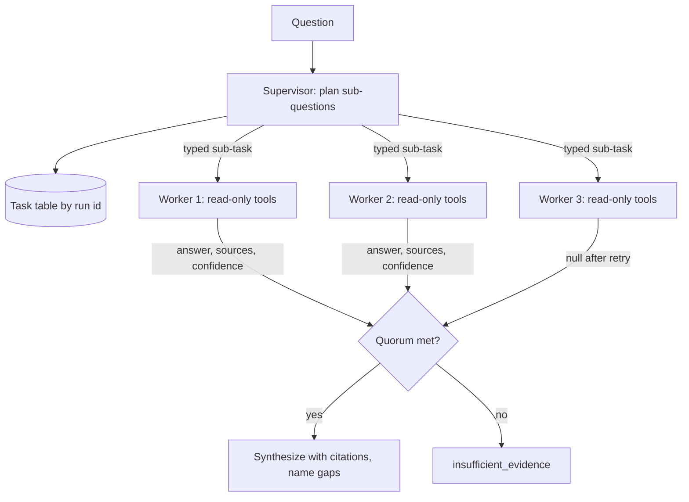

## TL;DR
A multi-agent system splits one task across loops with their own instructions, tools and context.
Build one only when one agent's context, tools or privileges stop scaling, because duplicated
context, compounding errors and harder tracing mean each split must buy a named gain.

## For agent builders
- **Why it matters for agents.** "Add another agent" is the most common over-design in agent projects.
  Knowing the topologies and their reliability arithmetic lets you split only for context isolation,
  privilege isolation, parallelism or specialization, and defend a single agent when none applies.
- **Where it shows up in your stack.** LangGraph supervisor graphs and subgraphs, hand-offs in the
  OpenAI Agents SDK, sub-agents in the Claude Agent SDK, conversation-based frameworks such as AutoGen
  and CrewAI, A2A between vendors, and parent–child spans in LangSmith, Langfuse or OpenTelemetry.
- **What you control.** The topology, the typed sub-task and result schema at each boundary, each
  agent's tool allowlist, per-worker budgets, the join rule (all, quorum or best effort) and the
  single-agent baseline you compare against.
- **What you can skip.** Agent "societies" and debate research until you have a concrete use. Production
  systems are mostly supervisor plus workers, or a short pipeline with checks.

## Why it exists
- **A single agent degrades as the task grows.** Its context fills with tool definitions, instructions
  for every sub-case and the accumulated trace, so the useful signal is diluted. Tool selection worsens
  as the list lengthens, since the model must pick among many similar schemas.
- **Privileges accumulate.** An agent that both reads untrusted web content and holds write credentials
  to internal systems is a prompt-injection path by construction. And one loop is sequential, even when
  the task has ten independent branches.
- **A bigger prompt and longer window only delay it.** That buys some headroom, then hits the same walls,
  now more expensively per step.
- **Splitting everything is just as common and more damaging.** Each agent re-reads context the others
  had, each hand-off loses information, each boundary is a place to disagree, and success becomes the
  product of the parts: five sequential stages at 95% each give roughly 0.95⁵ ≈ 77% end to end.
- **The deliberate version splits for a named gain:** isolation of context (each worker sees only its
  sub-task), isolation of privilege (the agent reading untrusted input has no write tools), parallelism,
  or specialization (small, sharp instructions and evals). A split that buys none of these is overhead.

## How it works
### Topologies and when each fits
| Topology | Shape | Fits when | Watch |
|---|---|---|---|
| Supervisor (orchestrator–workers) | one agent decomposes, dispatches, synthesizes | sub-tasks must be derived from the task | supervisor holds the plan; workers hold the detail |
| Pipeline | agents in sequence (research, draft, review) | stages need distinct skills, outputs checkable between them | compounding-error arithmetic |
| Parallel fan-out with aggregation | agents on independent partitions (document, region, hypothesis), then merge | breadth-first work | the aggregator's context budget is the limit |
| Evaluator–optimizer (critic) | one produces, one critiques against explicit criteria, loop | quality is checkable but hard to get right first time | loop until the critic passes or a budget ends |
| Peer hand-off | agents transfer control by conversation (triage to billing specialist) | conversational routing | each specialist needs its own persona and tools |

- **Frameworks name the same shapes differently.** A supervisor is a LangGraph node that routes to
  worker subgraphs; a peer hand-off is a hand-off in the OpenAI Agents SDK; fan-out is a parallel branch
  or several child workflows. Pick the topology first, then the framework feature that expresses it.

### What crosses the boundary
- **Send a typed task, not the transcript.** Passing the full transcript is the default in many
  frameworks and the main source of cost and confusion. A typed task (goal, constraints, relevant
  artifacts, output schema) makes workers cheap and testable.
- **Return structured, compact results** *because* the coordinator's context is the scarce resource and
  raw worker traces will exhaust it.
- **Pass large intermediates by reference** through a shared artifact store, *because* copying them
  through model context costs tokens on both sides and degrades attention.

### Compression is what a sub-agent buys
| Quantity (illustrative) | Value |
|---|---|
| One worker reads | 40k tokens of pages and tool output |
| One worker returns | a 400-token structured finding |
| Supervisor reasons over (five workers) | 2k tokens of distilled evidence |
| Instead of | 200k of raw material that would not fit, or would fit and drown the signal |

- **The price:** the total token bill is the sum over all agents, so multi-agent runs cost several times
  a single agent's. Anthropic's write-up of its research system reports on the order of 15× the tokens
  of a chat interaction.

### Reliability arithmetic: why topology matters
Compounding is about *undetected* errors.
- **Pipeline: a product.** Stage 3 receives stage 2's output and usually cannot tell a fluent wrong
  answer from a right one, so success is roughly the product p₁·p₂·…·pₙ.
- **Fan-out with an all-workers join: also a product** (five workers at 0.9 each: 0.9⁵ ≈ 0.59). Two
  properties change the arithmetic:
  1. **Retry alone.** Workers are independent, so with one retry each a worker succeeds with probability
     1 − 0.1² = 0.99, and all five with 0.99⁵ ≈ 0.95.
  2. **Quorum join.** Synthesize if at least k of n succeeded.
- **Both need detectable failure,** which is why workers return a schema with an explicit "not found" or
  low confidence rather than prose, and why pipelines need a validator between stages before any retry
  logic helps.
- **Cap retries.** Retries assume independent failures; a worker that fails because the sub-question is
  unanswerable will fail again.

### Coordination state
- **One task table keyed by run id** knows which sub-tasks exist, their status and their results.
- **Coordinator: model or code.** A model is flexible and derives the plan; code is predictable with a
  fixed fan-out. Mixed is common: code owns the fan-out and join, a model owns what each worker does.
- **Termination at two levels** *because* a worker can loop forever just as a single agent can, and the
  coordinator must also stop when the task is done, over budget, or when further delegation stops
  improving the result.

### Privilege and policy across agents
- **Per-agent tool sets and credentials,** scoped to the role.
- **A policy layer enforces it independently of prompts:** the web researcher cannot call `send_email`
  even if a page it read tells it to.
- **Delegation must not escalate:** a worker is never granted more than the coordinator had for this
  tenant and user.

### Observability across agents
- **One run id, parent–child spans,** exactly like distributed tracing across services.
- **Without it,** debugging means reconstructing a conversation among five participants from five logs;
  with it, you can see which worker produced the wrong fact and what it was given.

### Protocols
- **Across teams or vendors:** an interoperability protocol (A2A is the orientation point) standardizes
  discovery, task hand-off and status.
- **Inside one codebase:** a typed function call is simpler and sufficient.

## Diagram
The supervisor topology with read-only workers. Look at what crosses each arrow: a typed sub-task
goes out, a compact schema comes back, and synthesis happens only after the quorum check.



## Examples
### Supervisor with parallel read-only workers and a quorum
Workers get a narrow, read-only tool set, run in parallel with a per-worker budget, and return compact
structured results. `agent_run` is the single-agent loop from the agentic-architecture lesson,
`call_model` stands in for your model API, and `task_table` is the persisted coordination state.

```python
import asyncio, json

READ_ONLY = ["search_docs", "fetch_page"]            # workers never receive write tools
FAILED = {"answer": None, "sources": [], "confidence": 0.0}

async def worker(run_id, subtask, budget_usd=0.10, retries=1):
    for attempt in range(retries + 1):               # independent worker -> retry it alone
        try:
            result = await agent_run(
                run_id=f"{run_id}/{subtask['id']}/{attempt}",   # child span under the parent run
                system="Answer the sub-question using the tools. Return JSON: {answer, sources, confidence}. "
                       "Use answer=null if the tools do not support an answer.",
                task=json.dumps(subtask), tools=READ_ONLY, max_steps=6, budget_usd=budget_usd)
            out = json.loads(result)
            if out.get("answer"):
                return {"id": subtask["id"], **out}
        except (json.JSONDecodeError, TimeoutError):
            pass                                     # malformed or slow: a detectable failure
    return {"id": subtask["id"], **FAILED}

async def supervise(run_id, question, max_workers=5):
    plan = call_model(f"Split into at most {max_workers} independent sub-questions as JSON "
                      f"[{{id, question, why}}]. Question: {question}").json[:max_workers]
    task_table.create(run_id, [p["id"] for p in plan])                  # coordination state, persisted
    results = await asyncio.gather(*(worker(run_id, p) for p in plan))  # parallel fan-out
    for r in results:
        task_table.mark(run_id, r["id"], "done" if r["answer"] else "failed")
    evidence = [r for r in results if r["answer"] and r["confidence"] >= 0.5]
    if len(evidence) < max(1, (len(plan) + 1) // 2):                    # quorum: a majority must succeed
        return {"status": "insufficient_evidence", "results": results}
    synthesis = call_model("Synthesize an answer with citations from these findings only. Name any "
                           "sub-question that has no finding:\n" + json.dumps(evidence)
                           + f"\n\nQuestion: {question}").text
    return {"status": "ok", "answer": synthesis, "sub_results": results}
```

The choices that matter:
- **Typed sub-task in, schema out.** Workers never see the supervisor's transcript and never return a
  trace.
- **Detectable failure.** Null answer, bad JSON or timeout, so a worker can be retried in isolation.
- **Quorum before synthesis.** The supervisor declines to synthesize when most workers failed instead of
  producing a confident answer from thin evidence. `(n + 1) // 2` is a strict majority only for odd n;
  for four workers it accepts two, so use `n // 2 + 1` if you need a majority.

### Worked scenario: a data-residency question across three markets
| Step | Result |
|---|---|
| Plan | three sub-questions, one per market |
| Workers 1 and 2 | each return a finding with sources |
| Worker 3 | returns null twice (first attempt and retry) |
| Quorum `max(1, (3 + 1) // 2)` | 2 required, 2 found: synthesize |
| Synthesis | told to say the third market is unanswered rather than fill it in |

### Runnable: compare topologies before you build one
Pure Python. Plug in your measured per-stage success rates.

```python
from math import comb

def pipeline(p, n):            # every stage must succeed, errors undetected
    return p ** n

def with_retry(p, retries):    # independent, detectable failures only
    return 1 - (1 - p) ** (retries + 1)

def quorum(p, n, k):           # at least k of n workers succeed
    return sum(comb(n, i) * p**i * (1 - p)**(n - i) for i in range(k, n + 1))

print(round(pipeline(0.95, 5), 2))                # 0.77  five-stage pipeline
print(round(pipeline(0.9, 5), 2))                 # 0.59  fan-out, join needs all five
print(round(pipeline(with_retry(0.9, 1), 5), 2))  # 0.95  ...with one retry per worker
print(round(quorum(0.9, 5, 3), 3))                # 0.991 ...or a 3-of-5 quorum, no retries
```

## Production patterns
- **Code-owned fan-out, model-owned workers.** When the decomposition is a known shape (one worker per
  document, region or tenant), let code create sub-tasks and join them, and bound concurrency (for
  example an `asyncio.Semaphore`, or child workflows in a durable engine). Monitor per-worker failure
  and retry rates by sub-task type.
- **Tool allowlist per agent role, enforced at dispatch.** The tool registry checks the calling agent's
  role, tenant and user before executing, regardless of what the prompt says. Monitor denied tool
  calls per agent; a spike on a reading agent is a likely injection attempt.
- **Schema-validated worker returns with an explicit null.** Validate every worker result against a JSON
  Schema and treat invalid output as a failure, not as text to synthesize. Monitor the null and
  invalid-output rate per sub-task type, because it is your detectable-failure signal.
- **One trace, one span per agent.** Use the parent run id as the trace and each worker attempt as a
  child span carrying tokens, cost and tool calls (for example OpenTelemetry spans). Monitor total tokens
  per run and the share consumed by each agent.
- **Single-agent baseline in the eval suite.** Run the multi-agent design and a single-agent baseline on
  the same eval set on every significant change. Monitor task success, total tokens, wall-clock and
  per-stage failure attribution, and drop the split if it stops paying.

## Trade-offs
- **Parallel wall-clock vs total tokens.** Parallel workers cut wall-clock time for breadth-first tasks,
  but total tokens rise because each worker rebuilds context; for narrow sequential tasks one agent is
  cheaper.
- **Narrow tool sets vs routing risk.** Per-agent tool sets improve selection accuracy and contain blast
  radius, at the cost of a coordinator that must route correctly; mis-routing becomes the new failure
  mode.
- **Testable stages vs compounding errors.** Pipelines make each stage independently testable, but
  errors compound multiplicatively. Add checks between stages or shorten the chain when end-to-end
  reliability matters more than modularity.
- **Model supervisor vs code fan-out.** A model-driven supervisor adapts its plan to the task; a
  code-driven fan-out is predictable and cheap. Use the model only where the decomposition is genuinely
  unknown in advance.
- **Artifacts by reference vs a shared store.** References keep contexts small but require a shared store
  with access control; for tiny results inline JSON is simpler.

## Pitfalls
- **Splitting along an org chart or for "cleanliness."** No isolation, parallelism or specialization
  gain. Symptom: higher cost and latency than the single-agent baseline with no quality gain. Fix: keep
  one agent until you can name the gain.
- **Forwarding full transcripts between agents.** Symptom: worker contexts that are mostly the
  supervisor's history, and costs that grow with every added agent. Fix: send a typed sub-task.
- **A worker that reads untrusted content holding write tools.** Symptom: an action nobody asked for,
  traced back to instructions inside a fetched page. Fix: read-only tools for readers, enforced at
  dispatch.
- **Synthesizing over failed or low-confidence workers.** Symptom: fluent final answers whose citations
  point at sub-results that said "not found". Fix: filter on the explicit null and confidence, and apply
  a quorum before synthesis.
- **No shared run id across agents.** Symptom: an incident where five logs disagree about what happened
  and nobody can say which agent introduced the error. Fix: one trace per run, one child span per agent.

## When to use
- **Use when you can name the gain:** independent branches that can run in parallel, a privilege boundary
  separating reading untrusted input from acting, or a single agent whose tool list or instruction set
  has outgrown one context.
- **Avoid when:** the goal is to look modular, to fix a weak single agent, or the task is a short
  sequential chain.
- **Measure:** against the single-agent baseline: task success, total tokens, wall-clock, and per-stage
  failure attribution.
- **Day to day:** contract design between agents, and tracing work.
- **Interviews:** expect "why not one agent", how you prevent compounding errors and privilege
  escalation, and how you would debug a wrong final answer.

## Role lens
- **Engineer:** Implements typed hand-offs, per-agent tool scopes and budgets, parallel fan-out with a
  join, and parent–child tracing so every worker's steps roll up under one run.
- **Architect:** Decides whether a split is justified, chooses the topology, owns the privilege model
  across agents, and sets the aggregate budget and termination policy.
- **FDE:** Maps customer workflows onto agents with the right data access each, and explains to
  stakeholders why the system refuses to answer when workers fail rather than guessing.

## Check yourself
**Q:** Your single research agent handles 20 tools and answers in about 90 seconds with 80% task
success. A colleague proposes five specialist agents. How would you decide whether that is an
improvement, and what would you watch for?
**A:** First I would name what the split buys. If sub-questions are independent, parallel workers can
cut wall-clock substantially, since latency becomes the slowest worker rather than the sum; if 20 tools are hurting tool selection, five agents with four tools each
may raise accuracy; if one tool reads untrusted web pages, separating it from write tools is a security
gain. Then I would run both designs on the same eval set and compare task success, total tokens, latency
and failure attribution per stage, because the multi-agent version will cost more tokens and introduce
routing and synthesis errors that did not exist before. I would watch for compounding: a pipeline of five
95% stages is roughly 77% end to end, so the topology should be parallel with a join rather than
sequential where possible, because independent workers can be retried alone and joined with a quorum,
provided their failures are detectable through a structured "not found". I would also check that the
baseline's failures are actually the kind the split fixes: if the single agent fails because it lacks
data, five agents will lack it too.

## Interview questions
### What is a multi-agent system, and what makes a split worth its coordination cost?

- **Definition:** several model loops, each with its own instructions, tools and context, coordinated
  by a topology such as supervisor, pipeline, fan-out, critic loop or peer hand-off.
- **A split must buy a named gain:** context isolation, privilege isolation, parallelism or
  specialization, because every boundary adds re-read context, lossy hand-offs and new places to fail.

### A multi-agent research run returns a confident but wrong fact. How do you find where it came from?

- **Open the run's trace.** One run id with parent–child spans per worker attempt shows which worker
  produced the fact and exactly which typed sub-task and tool results it was given.
- **Check the join.** If the supervisor synthesized over a null or low-confidence result, the bug is the
  quorum or confidence filter, not the worker.
- **Without shared tracing** you are reconstructing a five-party conversation from five logs, which is
  why the run id is non-negotiable.

### Five parallel workers each succeed 90% of the time. How reliable is the run, and how do you raise it?

- **All-workers join:** 0.9⁵ ≈ 0.59, a product just like a pipeline.
- **One retry per worker:** each succeeds with 1 − 0.1² = 0.99, so all five with 0.99⁵ ≈ 0.95.
- **3-of-5 quorum, no retries:** about 0.991. Both levers need detectable failure (an explicit null or
  schema-invalid output), and retries assume failures are independent.

### How do you stop a web-reading agent from being prompt-injected into taking actions?

- **Privilege isolation:** the agent that reads untrusted pages gets read-only tools only, so a page
  saying "send this email" has nothing to call.
- **Policy outside the prompt:** the tool registry checks role, tenant and user at dispatch, and
  delegation never grants a worker more than the coordinator had for that tenant and user.

### When should code own the coordination instead of a model supervisor?

- **Code when the decomposition is known:** one worker per document, region or tenant is predictable,
  cheap and easy to test.
- **Model when sub-tasks must be derived from the task,** accepting a less predictable plan; the common
  mix is code owning fan-out and join while a model owns what each worker does.

### Your multi-agent system costs four times the single agent for the same quality. What do you do?
- **Attribute tokens per agent.** Child spans show where tokens go; forwarded transcripts and
  supervisor re-reads of raw worker output are the usual culprits.
- **Shrink the boundary:** typed sub-tasks in, compact schema results out, large intermediates by
  reference.
- **Re-check the gain.** If the sub-tasks are not independent and no privilege boundary exists, fold the
  workers back into one agent and keep the baseline in the eval suite.

## Quiz
### Q: Which gain does NOT by itself justify splitting one agent into several?
- [ ] Running independent sub-tasks in parallel
- [ ] Separating an agent that reads untrusted content from one holding write credentials
- [x] Making the architecture diagram look more modular
- [ ] Reducing a tool list that has grown past what one context selects from accurately
> Multi-agent systems add coordination cost, duplicated context and compounding errors. The split must
> buy parallelism, privilege isolation or specialization; modularity for its own sake is pure overhead.

### Q: Why should a worker agent receive a typed sub-task instead of the supervisor's full transcript?
- [ ] Workers cannot parse long messages
- [x] It keeps worker context small and focused, makes workers testable in isolation, and stops cost growing with every added agent
- [ ] Transcripts contain secrets that workers must not see
- [ ] Typed tasks are required by agent protocols
> Forwarding transcripts means every worker pays for context it does not need, and the supervisor's
> noise dilutes its instructions. A typed task defines a contract that can be evaluated independently.

### Q: A five-stage agent pipeline has stages that each succeed about 95% of the time. What is the approximate end-to-end success rate, and what does it imply?
- [ ] About 95%, since the stages are independent
- [x] About 77%, so long sequential chains need intermediate checks or fewer stages
- [ ] About 99%, because later stages correct earlier errors
- [ ] About 50%, because errors always double at each hand-off
> Sequential stages multiply: 0.95 to the fifth power is roughly 0.77, because a later stage cannot
> usually detect an earlier stage's fluent error. Compounding is why pipelines need validation between
> stages, and why independent parallel workers, retried alone and joined by quorum, fare better.

## Use cases & projects
### Use cases
- **Parallel research.** A lead agent splits a broad question into independent sub-questions, workers
  search in parallel with their own context, and the lead merges cited findings.
- **Generator and reviewer pairs.** One agent drafts code or a report and a second, with a different
  prompt and rubric, checks it before anything ships.
- **Specialists behind a router.** Billing, technical and account agents each hold a small tool set, so no
  single agent carries every tool and instruction.
- **Long pipelines with validation gates.** Extraction, enrichment and summarization stages pass
  structured outputs and are checked between hand-offs to stop errors compounding.

### Mini project
**Compare one agent with a lead-and-workers system (2-3 hours).**
- **Goal:** measure whether splitting a research task across agents pays for its extra cost.
- **Steps:** pick 10 research questions that each need 3-4 independent facts; run a single agent with a
  search tool; then run a lead agent that spawns parallel workers, each returning a structured finding
  the lead validates and merges; record tokens, wall-clock time and answer quality for both.
- **Done when:** you have a table of cost, latency and graded accuracy per setup, plus a short note on
  which questions justified multiple agents and which did not.
