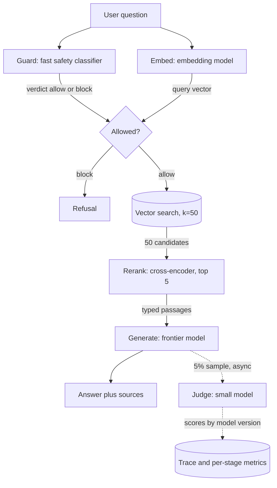

## TL;DR
A production agent is a multi-model system: planner, executors, embedder, reranker, guard and judge, each
sized to its budget and joined by typed contracts. The price is coupling: each stage's output feeds the
next, so version and evaluate them together.

## For agent builders
- **Why it matters for agents.** Planner plus executors is the backbone of most agent designs, and around
  it sit retrieval (embed, rerank), a guard on user input and tool results, and a judge for evals. Each is a
  different model class with its own latency, cost and failure mode.
- **Where it shows up in your stack.** Nodes in a LangGraph graph or steps in your own loop, each with its
  own model; structured outputs (Pydantic or Zod) between them; a gateway or LiteLLM as single egress;
  LangSmith or OpenTelemetry traces that record model and version per step.
- **What you control.** Which jobs exist, which model class serves each, the typed contract between them,
  per-stage timeouts and degraded modes, and evaluating each stage plus end-to-end task success.
- **What you can skip.** Ensembles and exotic compositions until a high-stakes decision justifies them.
  Planner plus executors, a retrieval stack and a sampled judge cover most agents.

## Why it exists
- **Production requests pass through many jobs.** Safety classifier, PII redaction, query rewriting,
  embedding, retrieval, reranking, generation, structured extraction, perhaps a judge, sometimes speech or
  vision. Early LLM apps were one prompt and one model; production systems and agents are not.
- **No single model is best at every job,** and the best model for each job is rarely the cheapest. Pushing
  everything through one frontier generator fails three ways:
  - **Cost:** embedding a hundred thousand chunks through a generative model is nonsense when an embedding
    model does it for a tiny fraction of the price.
  - **Capability:** a chat model does not emit vectors, and a prompted generalist ranks query–document pairs
    worse and far more expensively than a cross-encoder trained for exactly that.
  - **Latency:** every extra job on the critical path is another multi-second call, and an agent repeats
    the path on every step.
- **The opposite naive design fails on operability.** "Best model for every job from whichever vendor,
  wired up ad hoc": each vendor brings its own authentication, limits, failure modes and tokeniser; nobody
  knows which versions are in production; and when quality drops nobody can tell which stage regressed.
- **What the architecture buys:** specialisation while the system stays one thing you can reason about: a
  governed portfolio of models, stage contracts, shared telemetry, and evaluation per stage *and* end to
  end.

## How it works
### Decompose by job, not by vendor
For each job a request or agent step needs, record output type (vector, label, score, free text,
structured object, tool call), quality sensitivity, volume, latency budget and data sensitivity. The
mapping mostly writes itself:

| Job shape | Model class |
|---|---|
| High-volume, narrow output (tool arguments, extraction) | Small specialised model, often self-hosted |
| Low-volume, open-ended generation (planning, final answer) | Frontier model |
| Vectors (RAG, long-term memory) | Embedding model |
| Pairwise relevance | Cross-encoder reranker |
| Safety screening on every request and tool result | Fast classifier; a larger model only for ambiguous cases |

Routing within a job (see model routing / cascading) is orthogonal to decomposition across jobs.

### Patterns of composition
1. **Pipeline.** Guard → rewrite → embed → retrieve → rerank → generate → verify. This is the RAG step an
   agent calls as a tool.
   - Independent stages (guard and embed) run concurrently.
   - A gate that almost always passes can run *speculatively*: start retrieval, or even generation, while
     the guard decides, and discard the work if it blocks.
   - You pay wasted calls on the few blocked requests to remove the guard's latency from every other one.
   - Unsafe only if the speculative stage has side effects or streams to the user before the gate passes,
     which rules it out for agent steps that call write tools.
2. **Generator plus verifier.** A second model checks grounding, schema or policy. Inline when it gates the
   response; sampled and asynchronous when it feeds monitoring.
3. **Planner plus executors.** A strong model decomposes a task and cheap models carry out subtasks; the
   backbone of most agent designs. The plan is a typed object, not prose, so executors and replanning can
   rely on it.
4. **Ensemble.** Several models answer and a selector or vote picks. Expensive; reserved for high-stakes
   decisions where the extra calls are cheaper than a mistake.

### Contracts between stages
- **Typed, versioned schemas:** each stage's input and output is a Pydantic or Zod model, not free text.
  For agents that includes the plan, each tool call and each tool result.
- **Model id and version in the trace** for every stage and agent step.
- **Why it is not bureaucracy:** the next stage was tuned against *this* stage's output distribution.
  - Swap the query rewriter and the embedder sees different text.
  - Swap the embedding model and every stored vector (documents and agent memory) is in a different space.
  - Swap the generator and the citation format the verifier parses may change.
  - Swap the planner and executors receive differently shaped subtasks.
- **Typed contracts make drift detectable** at the boundary instead of three stages downstream; versions
  make it attributable. They also stop prompt-injection text in a tool result from riding into the next
  stage as instructions.

### Budgets compose, tails do not average
- **Latency adds along the serial path,** so parallelise what you can and budget with tail numbers. An
  agent multiplies the path by its step count.
- **Bounds:** the p99 of a sum of four stages is at least the largest single-stage p99 and can exceed the
  sum of all four p99s, because tail events in different stages combine. The sum of the p99s is only
  guaranteed to be at least the p96 of the total, by a union bound over the four stages.
- **Independent slowness:** the sum of the p99s is a pessimistic budget, because tails rarely coincide.
- **Correlated slowness** (two stages on one GPU pool or one provider, a retry policy at every stage, a
  shared overloaded network path) drives the real p99 towards or past that sum.
- **Rule:** budget with the sum, then measure the end-to-end distribution.
- **Cost adds per request.** Find the dominant stage: usually generation (the planner, in an agent),
  sometimes a reranker scoring 50 candidates with a large cross-encoder.
- **Failure is per stage.** Each needs its own timeout, fallback and degraded mode (drop the reranker,
  skip the judge).

### Evaluate per stage and end to end
| Level | Examples | Tells you |
|---|---|---|
| Component | recall@k for retrieval, precision for the guard, schema pass rate for extraction, tool-call validity for executors | *Which* stage moved |
| End task | Task success, judged answer quality | Whether it mattered |

- **You need both** *because* a stage can improve on its own metric and hurt the task: a reranker that
  prefers long passages raises nDCG and pushes the generator past its useful context.
- **Any model change** ships behind a flag and a rerun of both evaluations.

### Run it as a portfolio
- **A registry** of approved models with versions, owners and deprecation dates.
- **A gateway as the single egress,** so cost and usage are attributable per stage.
- **A stage upgrade is a release,** with a canary, not a config edit.

## Diagram
A typical RAG pipeline an agent calls as a tool, matching the code below: guard and embed run
concurrently and join at the gate, each later stage depends on the previous one's typed output, and the
sampled judge sits off the hot path.



## Examples
### Planner plus executors with a typed contract
The planner (strong model) returns a typed plan; each executor step runs on a small model and its output
is validated before the next step sees it. `llm_structured` is a thin adapter around any structured-output
API; the model ids are placeholders.

```python
from pydantic import BaseModel, Field

MODELS = {"plan": "frontier-chat-2026-06", "execute": "small-chat", "answer": "frontier-chat-2026-06"}

class Step(BaseModel):
    tool: str                       # must name a registered tool
    goal: str
class Plan(BaseModel):
    steps: list[Step] = Field(max_length=8)   # bound the loop in the contract itself
class ToolResult(BaseModel):
    tool: str
    ok: bool
    data: dict                      # data, never instructions: the next prompt quotes it as data

async def run_task(task, tools, trace):
    plan = await llm_structured(MODELS["plan"], Plan, task=task, tools=list(tools))
    trace.append({"stage": "plan", "model": MODELS["plan"], "steps": len(plan.steps)})
    results = []
    for s in plan.steps:
        if s.tool not in tools:
            raise ValueError(f"planner invented tool {s.tool}")      # contract violation, caught at the boundary
        args = await llm_structured(MODELS["execute"], tools[s.tool].Args, goal=s.goal, prior=results)
        results.append(ToolResult(tool=s.tool, **await tools[s.tool].run(args)))
        trace.append({"stage": "execute", "model": MODELS["execute"], "tool": s.tool})
    return await llm_structured(MODELS["answer"], Answer, task=task, results=results)
```

### Worked scenario: one agent task across stages
Illustrative units: frontier call 15, small call 1, guard on a tool result 0.2. One task: 1 plan, 6
executor steps, a guard on each tool result, 1 final answer.

| Design | Calls | Cost per task |
|---|---|---|
| Everything on the frontier model | 8 frontier | 8 × 15 = 120 |
| Planner and answer frontier, executors small, guarded results | 2 frontier, 6 small, 6 guards | 30 + 6 + 1.2 = 37.2 |
| Latency on the serial path (frontier 3 s, small 0.8 s, guard 0.08 s) | | 6 + 4.8 + 0.48 ≈ 11.3 s vs 24 s |

- **Lesson:** the split cuts cost about 3× and halves serial latency, but now three model classes must stay
  compatible, so executor tool-call validity and task success both need evals.

### Typed pipeline skeleton with a trace
Each stage names its model and records timing and version; independent stages run concurrently; the judge
runs off the hot path on a sample. `classify`, `embed`, `rerank`, `generate`, `judge` and `vector_search`
are thin adapters around whatever providers or servers you use.

```python
import asyncio, time, random
from dataclasses import dataclass, field

MODELS = {"guard": "safety-classifier-v3", "embed": "text-embed-v2",
          "rerank": "cross-encoder-v1", "generate": "frontier-chat-2026-06", "judge": "small-chat"}
BACKGROUND = set()                 # references to fire-and-forget tasks (asyncio only keeps weak ones)

@dataclass
class Trace:                       # one record per request: which model served which stage, how long
    stages: list = field(default_factory=list)
    def add(self, stage, model, t0):
        self.stages.append({"stage": stage, "model": model, "ms": round((time.perf_counter() - t0) * 1000)})

async def stage(name, fn, trace, **kw):
    t0 = time.perf_counter()
    out = await fn(MODELS[name], **kw)              # every adapter takes the model id as its first argument
    trace.add(name, MODELS[name], t0)
    return out

async def answer(question):
    trace = Trace()
    verdict, qvec = await asyncio.gather(          # guard and embedding are independent: run concurrently
        stage("guard", classify, trace, text=question),
        stage("embed", embed, trace, text=question))
    if verdict != "allow":
        return {"answer": "I can't help with that request.", "trace": trace.stages}
    candidates = await vector_search(qvec, k=50)                                 # a database call, not a model
    top = await stage("rerank", rerank, trace, query=question, docs=candidates, k=5)
    draft = await stage("generate", generate, trace, question=question, context=top)
    if random.random() < 0.05:                                                   # sampled judge, off the hot path
        t = asyncio.create_task(stage("judge", judge, trace, question=question, answer=draft, context=top))
        BACKGROUND.add(t); t.add_done_callback(BACKGROUND.discard)              # keep a reference or it may be GC'd
    return {"answer": draft, "sources": [d.id for d in top], "trace": trace.stages}
```

- **The trace makes it debuggable:** group judge scores by the `generate` model version, or latency by
  stage, instead of guessing.
- **Emit the trace late:** the sampled judge appends *after* the response returns, so emit the trace when
  background work finishes, not at return.

### Worked latency budget
Illustrative p95s for the retrieval tool, read off the structure:

| Stage | p95 | On the serial path? |
|---|---|---|
| Guard | 80 ms | Yes (parallel with embed, the longer of the two) |
| Embed | 40 ms | No, hidden behind guard: concurrency saved these 40 ms |
| Vector search | 30 ms | Yes |
| Rerank | 150 ms | Yes |
| Generation | 2.5 s | Yes, nine-tenths of the total |
| **Serial budget** | 80 + 30 + 150 + 2,500 ≈ 2.8 s | |

- **Stream the generator first.** It moves the user-visible number to time-to-first-token and does more for
  perceived latency than any change to the other stages.
- **Cost usually has the same shape,** until someone raises the rerank candidate count from 50 to 500 and
  the reranker becomes the dominant line.

### Why correlated slowness breaks the budget
A runnable simulation: four stages at 200 ms that occasionally take 1,500 ms.

```python
import random

def p(xs, q):
    xs = sorted(xs); return xs[int(q * (len(xs) - 1))]

def stage(slow):                              # 200 ms normally, 1,500 ms when slow
    return random.uniform(180, 220) + (1300 if slow else 0)

random.seed(0)
N, P_SLOW, STAGES = 100_000, 0.02, 4
indep, corr = [], []
for _ in range(N):
    indep.append(sum(stage(random.random() < P_SLOW) for _ in range(STAGES)))  # independent causes
    shared = random.random() < P_SLOW                                           # one shared GPU pool
    corr.append(sum(stage(shared) for _ in range(STAGES)))

one = [stage(random.random() < P_SLOW) for _ in range(N)]
print(f"single-stage p99 ~ {p(one, .99):,.0f} ms; sum of 4 p99s ~ {4 * p(one, .99):,.0f} ms")
print(f"end-to-end p99, independent slowness: {p(indep, .99):,.0f} ms")
print(f"end-to-end p99, correlated slowness:  {p(corr, .99):,.0f} ms")
# single-stage p99 ~ 1,499 ms; sum of 4 p99s ~ 5,997 ms
# independent: ~2,130 ms (tails rarely coincide); correlated: ~6,000 ms (the full sum)
```

## Production patterns
- **Model registry checked in CI.** Keep one file listing every stage's and agent node's approved model
  id, version, owner and deprecation date; fail the build if code references a model not in it. Monitor
  days until each model's deprecation and the number of stages on unregistered or retired versions.
- **Single egress with stage tags.** Send every model call through the gateway with the stage or agent-node
  name and pipeline version attached as request metadata, so spend and errors split by stage. Monitor cost
  per stage per task and which stage dominates.
- **Re-index behind an alias on embedder change.** Build a new index with the new embedding model, compare
  recall@k on the golden set, then switch a read alias in one step; never mix query and document vectors
  from different models, and re-embed agent memory stores too. Monitor recall@k and the share of documents
  re-embedded.
- **Stage upgrades as canaries.** Put each stage's model id behind a flag, send a small share of traffic
  to the new version, and compare both the component metric and the end-task metric (agent task success)
  before widening. Monitor the two metrics side by side; divergence means hidden coupling.
- **Per-stage timeout with a degraded mode.** Give optional stages a hard timeout and a defined fallback
  (rerank times out, so keep vector-search order; the judge is skipped). Monitor degraded-mode rate per
  stage; a rising rate is an incident before users notice.
- **Sampled asynchronous judge.** Judge a fixed share (for example 5%) of production answers or agent runs
  off the hot path and group scores by each stage's model version. Monitor judge score per version and
  judge agreement with periodic human labels.

## Trade-offs
- **Right-sized models vs moving parts.** Each stage gets a right-sized model for quality and cost, but
  there are more vendors and versions to manage; for low-volume agents one strong model's simplicity can
  win outright.
- **Independent upgrades vs hidden coupling.** A swap is safe only with an end-to-end eval; independence
  evaporates when stages have been tuned to each other's quirks, as executors are to the planner's plans.
- **Concurrency vs burst cost.** Running independent stages concurrently cuts latency, but raises peak
  concurrency and cost during bursts, and complicates per-stage rate-limit budgeting.
- **Vendor diversity vs compliance load.** Best-of-breed quality and resilience, but every new processor
  needs a security review and a data-processing agreement; in regulated settings fewer vendors is the
  better trade.
- **Inline verifier vs sampled judge.** Inline raises the quality floor on every request at a latency and
  cost premium; a sampled asynchronous judge is nearly free but only catches problems after users have
  seen them.

## Pitfalls
- **Upgrading the embedding model without re-indexing.** Symptom: retrieval recall collapses (and agent
  memory lookups return nonsense) because query vectors and stored document vectors now live in different
  spaces.
- **Budgeting latency with averages.** Symptom: an end-to-end p99 far above the sum of stage p50s while
  every stage looks healthy on its own dashboard.
- **No per-stage telemetry.** Symptom: "the answers got worse" with no way to tell whether the rewriter,
  retriever, reranker, planner or generator regressed.
- **Free text between stages instead of typed objects.** Symptom: parse failures after a model update and
  prompt-injection text riding from one stage (or tool result) into the next.
- **An LLM judge inline on all traffic.** Symptom: cost roughly doubling and latency rising with no gain
  the product can show, when a 5% sample would have caught the same regressions.
- **Treating two vendors' "same" capability as interchangeable.** Symptom: dimension mismatches, silent
  truncation at a different token limit, or changed tool-call formats after a swap.

## When to use
- **Always, explicitly:** any agent beyond a prototype is already multi-model; the question is whether
  the decomposition is explicit.
- **Make it explicit when** you have more than one model class in the path, or more than one team touching
  the pipeline.
- **Measure:** cost and latency per stage (p50, p95, p99), each stage's component metric and the end-task
  metric; alert on divergence between them.
- **Avoid** adding a stage without a measured gain; each one is a dependency with its own failure mode.
- **Interviews:** draw the pipeline, name the model class and budget per stage, and explain how you would
  localise a regression after an upgrade. That coupling-and-eval story distinguishes architecture from a
  diagram.

## Role lens
- **Engineer:** Implements typed stage adapters, records model versions in traces, writes component evals
  and makes sure independent stages actually run concurrently.
- **Architect:** Owns the portfolio: which model classes are approved for which jobs, the version and
  deprecation policy, and how the latency and cost budget is split across stages.
- **FDE:** Assembles the pipeline from models the customer has already approved, often under procurement
  limits, and explains why the reranker and the generator come from different vendors.

## Check yourself
**Q:** A RAG product swapped its generator for a newer model that benchmarks higher, and answer quality
dropped. How does thinking in stages explain this, and how would you diagnose it?
**A:** The generator is one stage whose prompt and context handling were tuned against the old model's
behaviour: citation format, response length, how it treated conflicting passages, how literally it
followed the system prompt. First confirm the other stages did not move: retrieval recall@5 and reranker
scores on the golden set should be unchanged, which isolates the regression to generation. Then compare
judge scores old versus new on the same fixed set, check structured-output and citation parse failure
rates, check for context truncation from a different tokeniser or limit, and read a sample of
disagreements. The fix is usually prompt re-tuning plus an end-to-end eval before a canary rollout. The
lesson is procedural: a stage upgrade is a release that needs per-stage telemetry, end-to-end evaluation
and a feature flag, regardless of what the public benchmark says.

## Interview questions
### Why not run every job in the pipeline through one frontier model?
- **Cost:** embedding a hundred thousand chunks through a generative model costs far more than an
  embedding model built for it.
- **Capability:** a chat model does not emit vectors, and a prompted generalist ranks query–document pairs
  worse and more expensively than a cross-encoder.
- **Latency:** every extra job on the critical path is another multi-second call, so specialised small
  models keep the serial path short.

### Design the model stages for a tool-calling support agent with retrieval and a safety check.
- **Decompose by job:** planner (frontier), executors filling tool arguments (small), a retrieval tool
  (embed, vector search, cross-encoder rerank), a guard on user input and tool results, and a sampled
  asynchronous judge.
- **Compose:** run guard and embed concurrently, or start retrieval speculatively while the guard decides,
  since retrieval has no side effects; never speculate past a write tool.
- **Contracts:** typed, versioned schemas for the plan, tool calls and tool results, with model id and
  version in the trace for every step.

### Your agent's task success dropped after you upgraded only the planner model. How do you localise it?
- **Check the boundary first:** plan schema pass rate, invented tool names and plan length, because
  executors were tuned against the old planner's subtask shapes.
- **Hold the rest fixed:** executor tool-call validity and retrieval recall@k on the golden set should be
  unchanged, which isolates the regression.
- **Then compare traces** old versus new on the same tasks, re-tune the planner prompt, and roll out again
  behind a canary on the end-task metric.

### How would you budget end-to-end latency across four serial stages?
- **Budget with the sum of the stage tail numbers,** then measure the end-to-end distribution, because
  tails do not average.
- **Correlated slowness matters:** stages sharing one GPU pool or provider, or retries at every stage, push
  the real p99 towards or past that sum.
- **Find the dominant stage:** usually generation, so stream it to move the user-visible number to
  time-to-first-token.

### When would you deliberately avoid adding another model stage?
- **When there is no measured gain** on the end-task metric, because each stage is a dependency with its own
  failure mode, timeout and version to govern.
- **For low-volume products,** where one strong model's simplicity can win outright.
- **In regulated settings,** where each new vendor needs a security review and a data-processing agreement,
  so fewer vendors is the better trade.

### You must change the embedding model in production. What is your rollout plan?
- **Re-index, never mix spaces:** query vectors and stored document vectors (and agent memory) from
  different models make recall collapse.
- **Build the new index alongside,** compare recall@k on the golden set, then run the end-task eval, since a
  better component metric can still hurt the task.
- **Switch a read alias in one step** behind a flag and canary, and keep the old index until the end-task
  metric holds.

## Quiz
### Q: Why do multi-model systems need typed, versioned contracts between stages?
- [ ] Because providers require JSON between calls
- [x] Because each stage's output is the next stage's input distribution, so drift must be detectable at the boundary and attributable to a version
- [ ] Because typed contracts reduce token usage
- [ ] Because it allows all stages to share one model
> The coupling between stages is the central risk of the pattern. Schemas catch shape changes
> immediately and versions tell you which upgrade caused a downstream regression; neither has anything to
> do with provider requirements or token counts.

### Q: What is the strongest reason to rerank with a cross-encoder rather than asking the generator to rank candidates?
- [ ] Generators cannot read more than five documents
- [x] A cross-encoder scores query–document pairs jointly, cheaply and well, and leaves the generator's context for answering
- [ ] Rerankers remove the need for embeddings entirely
- [ ] Rerankers are always more accurate than generators at every task
> Specialisation is the point: the cross-encoder is trained for pairwise relevance and costs a fraction
> per pair, so the expensive model sees only the best few passages. Embeddings are still needed for the
> first-stage retrieval.

### Q: Four serial model stages each have p50 = 200 ms and p99 = 1 s. What can you say about the end-to-end p99?
- [ ] It is 800 ms, the sum of the p50s
- [ ] It is 1 s, since the slowest stage dominates
- [ ] It is exactly 4 s, the sum of the p99s
- [x] It is at least 1 s, may exceed 4 s, and cannot be derived from the p50s; measure it end to end
> Latencies add pointwise, so the total is at least as slow as any stage. Tail events in different stages
> combine: the total can only exceed the sum of the p99s when at least one stage exceeds its own p99, which
> by a union bound happens on at most about 4% of requests, so the sum of the p99s is guaranteed only to be
> at least the p96 of the total, and the true p99 can be higher still.

## Use cases & projects
### Use cases
- **Planner plus executors.** A strong model decomposes the task and smaller models run each tool step,
  passing typed outputs between them.
- **Agentic RAG.** An embedding model, a reranker and a generator each serve one stage of the retrieval
  tool the agent calls.
- **Guarded agents.** A small guard model screens user input and tool results for injection before they
  reach the planner.
- **Eval pipelines.** A sampled judge model scores agent runs offline, kept separate from the models that
  produced the run.

### Mini project
**Trace a three-stage agent pipeline end to end (2-3 hours).**
- **Goal:** see where latency and failures come from when several models serve one agent turn.
- **Steps:** build a turn with a guard check, a retrieval tool (embed then rerank) and a generator; pass
  Pydantic or Zod objects between stages; record model, version and latency per stage in a trace; give
  each stage a timeout and a degraded mode; run 50 queries.
- **Done when:** you have per-stage p50 and p99 plus the measured end-to-end p99, and can show the
  end-to-end p99 is not the sum of stage p50s.
