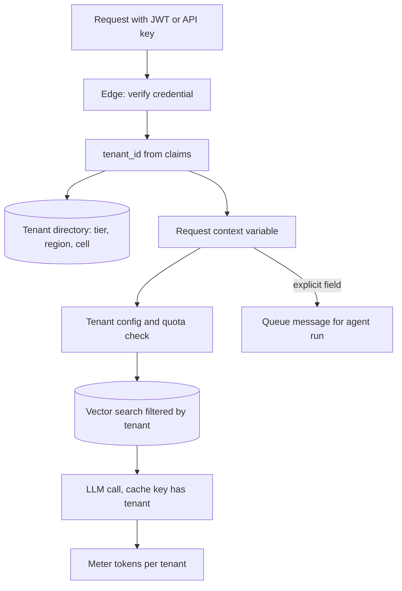

## TL;DR
A multi-tenant agent platform runs every customer's agents on one system while keeping their data, tools,
memory, quotas and bill separate. A tenant identity set at the edge reaches every agent step: retrieval,
prompt, memory, tool credentials, caches and the token meter.

## For agent builders
- **Why it matters for agents.** An agent touches more tenant-scoped state than a chat endpoint: it
  retrieves, reads and writes memory, calls tools with a customer's OAuth tokens, and runs in the
  background for minutes. Every one of those is a place the tenant can be lost.
- **Where it shows up in your stack.** The auth dependency that resolves the tenant, the vector-store
  filter, memory and checkpoint namespaces, the connector or secrets vault holding per-tenant tool
  tokens, the queue message that starts a background run, and the token meter.
- **What you control.** Pool, bridge or silo per resource; a tenant config record (model, prompt
  version, enabled tools, step and token budgets); per-tenant concurrency caps on agent runs; and the
  offboarding workflow that reaches every store.
- **What you can skip.** Cell-based routing details until you run many independent stacks. Know the
  three sharing models, the tenant directory and the AI-specific places the tenant must reach.

## Decision case
### Scenario
An HR-assistant agent SaaS answers policy questions and files requests in each customer's HR system
through per-tenant OAuth connectors. It must choose the sharing model for its data and agent runtime
before signing its first enterprise deals. All figures are illustrative.
- **Tenants:** 600 at launch: 560 self-serve, 36 mid-market, 4 enterprise. 30 tenants, one of them
  enterprise, require EU data residency.
- **Load:** a pooled worker fleet with 300 concurrent agent-run slots; runs average 15 steps.
- **Constraints:** all 4 enterprise contracts require a dedicated database and vector index; 6
  engineers run the whole platform with one on-call rotation; schema releases go out weekly; offboarding
  must reach backups within the contract's retention window.

### Options
| Option | How it works | Enterprise dedicated stores | EU residency | Database stacks to migrate per weekly release |
|---|---|---|---|---|
| A. Pool everything | One pooled stack per region with `tenant_id`, row-level security and a tenant-filtered vector index | Fails the 4 contracts | One EU pool | 2 |
| B. Tiered pool plus silo | Self-serve and mid-market in a US pool and an EU pool; each enterprise tenant gets a silo database and index; shared model fleet and workers with per-tenant caps; placement in the tenant directory | Passes | EU pool plus the EU enterprise silo | 2 + 4 = 6 |
| C. Silo every tenant | A dedicated database and index per tenant, placed by region | Passes | Passes | 600 |

### Decision
Choose **B, pooled tiers with an enterprise silo tier**, because:
- **The contracts rule out A:** physical separation is a written requirement for 4 tenants, and no amount
  of row-level security satisfies it.
- **The team rules out C:** 600 migrations a week, 600 restores to test and 600 sets of alerts for 6
  engineers is per-customer operations again, for 596 tenants that never asked for it.
- **B keeps operations at 6 stacks** while the tenant directory makes a silo a placement, not a code
  path; the same agent code runs everywhere, with model, tools and budgets read from tenant config.
- **Fairness is solved in the pooled runtime:** a cap of 25 concurrent runs per pooled tenant means even
  the 12 busiest tenants at their cap hold all 300 slots, so pair the cap with weighted fair queueing.

**What would change it:** dozens of tenants demanding dedicated stores would justify bridge (a schema
per tenant) or cells; a tenant whose long agent transcripts dominate the shared model fleet's KV cache
would justify dedicated serving capacity.

### Trade-offs accepted
- **Pooled isolation rests on software.** Watch: two-tenant isolation tests in CI for every endpoint,
  job and tool, and queries that run without the tenant setting (should be zero).
- **Silos run a slower release lane.** Watch: schema version drift between the pools and each silo.
- **Shared model fleet across tiers.** Watch: p95 latency and token share per tenant, top tenant first.
- **Offboarding spans many stores.** Watch: time from offboarding request to verified deletion, with
  per-tenant keys crypto-shredded for backups.

### Review rubric
- **Sharing model is chosen per resource and per tier**, not once for the system, with the tier that
  pays for a silo named.
- **Operational cost is counted:** stacks to migrate, back up and alert on, recomputed for each option.
- **Contracts and residency are mapped to placements** in a tenant directory, with a written promotion
  path from pool to silo.
- **Tenant identity reaches every agent surface:** retrieval filter, memory namespace, cache keys,
  connector tokens and queued runs.
- **Noisy-neighbour arithmetic is shown:** run caps and queueing are checked against total worker slots.
- **Reversal triggers are concrete**, and each accepted trade-off names a metric.

## Why it exists
- **One deployment per customer does not scale.** Fine for three customers; for three hundred it means
  three hundred databases to migrate, three hundred model-version rollouts and three hundred sets of
  alerts. GPUs sit idle in most of them because no single customer's traffic fills a card.
- **Cost should track usage, not customer count.** Per-customer stacks make cost scale with customers and
  turn every upgrade into a campaign. Single-tenant deployments stay right for a few regulated or very
  large customers, but cannot be the product's default shape.
- **"Add a `customer_id` column" fails twice.** The filter is a convention, so one forgotten `WHERE`
  clause returns another customer's records; in an LLM product that record lands in a prompt and is
  paraphrased back to the wrong user, or an agent acts on it.
- **A column only separates data.** Tenants also need separate configuration (model, system prompt,
  features, tools), performance envelopes (one tenant's bulk ingestion or batch of agent runs must not
  starve another's chat), cost accounting (who used which tokens) and sometimes jurisdictions (EU data
  stays in the EU).
- **What the discipline buys.** All of those answered with one identity and a few explicit sharing
  decisions, rather than rediscovered one by one in incidents.

## How it works
### Tenant identity, established once and carried everywhere
1. **Credential in.** Every request carries a JWT from the identity provider, an API key or an SSO
   assertion.
2. **Resolve at the edge.** The tenant comes from that credential, never from a request body, query
   parameter or anything the model produced, *because* anything the caller (or a prompt injection) can
   type is something it can change.
3. **Carry it with the work:**
   - in a request-scoped context variable inside the process;
   - as a header or message attribute when work crosses into a queue, such as a background agent run;
   - as a field on every log line, trace span and metric, including each agent step.
4. **Never re-derive it.** No layer may need to work out the tenant from data, *because* re-derivation is
   where mistakes hide. Tools receive the tenant from the run context, not from model arguments.

### Three sharing models, chosen per resource
The AWS SaaS Lens vocabulary names the options precisely:

| Model | What it looks like | Gains | Costs |
|---|---|---|---|
| **Pool** | Shared resource with a tenant key: one PostgreSQL schema with `tenant_id` on every table, one vector index with tenant metadata, one model-serving fleet | Cheapest, simplest to operate | Isolation rests entirely on correct filtering and quotas |
| **Bridge** | Shared infrastructure, partitioned structure: a schema or namespace per tenant in a shared database, a collection per tenant in the vector store | Stronger separation; per-tenant backup, restore and migration timing | Every migration runs N times; catalog grows with N × tables; connection pools multiply if each tenant gets its own credentials |
| **Silo** | Dedicated database, cluster or whole stack per tenant | Strongest isolation | Highest cost; operations drift back toward one deployment per customer |

- **Mix them per resource and per tier.** Pooled compute and a pooled vector index for self-serve, bridge
  databases for mid-market, silo for the enterprise tier that pays for it.
- **The real decision** is not "which model" but "which model for which resource, and what moves a
  tenant between tiers".

### The tenant directory: placement as data
- **A control-plane tenant directory** maps each tenant to its tier, region, cell, database or schema,
  index namespace and encryption-key ID.
- **The data plane looks it up (and caches it) on every request**, *because* that indirection lets you
  move a tenant without touching callers.
- **Moving a tenant from pool to silo has a fixed shape:**
  1. Provision the new placement.
  2. Copy the data.
  3. Dual-write, or freeze writes for the cut-over window.
  4. Verify row and vector counts.
  5. Flip the directory entry.
  6. Only then delete from the old placement.
- **Cells extend this at scale.** Several identical, independently deployed pooled stacks each hold a
  subset of tenants, so a bad deploy or runaway tenant hurts one cell, not everyone. The price is a
  routing layer and N fleets to deploy.

### Tenant is a boundary, not an authorisation model
- **Outer boundary only.** Inside a tenant, users still have roles and documents still have ACLs.
- **Necessary, not sufficient.** Scoping retrieval by tenant does not stop an intern and the CFO of the
  same tenant retrieving the same board minutes, or an agent acting for the intern doing so.
- **Pick the isolation level early** (reseller, organisation, workspace), *because* it is the key every
  store is partitioned by, and changing it later means re-keying everything.

### Lifecycle: onboarding and offboarding
- **Onboarding is one idempotent workflow** that creates the directory entry, configuration, keys and any
  dedicated resources, so a half-failed signup can simply be retried.
- **Offboarding is where audits find gaps.** Deletion must reach the primary database, vector index,
  object storage, caches, queues, logs and traces, agent memory and checkpoints, stored tool tokens,
  evaluation samples, fine-tuned adapters and, on their retention schedule, backups.
- **Silo vs pool.** In a silo this is "drop the stack"; in a pool it is a delete keyed by tenant across
  every store, which only works if every store carries the key.
- **Crypto-shredding.** Per-tenant encryption keys turn the backup problem into deleting one key.

### Tenant-aware configuration
- **The tenant record carries:** allowed model (or model tier), system prompt and prompt version, enabled
  features and tools, rate and token quotas, max agent steps, retention period, data-residency region,
  allowed connectors.
- **Load once per request and pass explicitly**, rather than sprinkling `if tenant == "acme"` through the
  code, *because* that is what keeps a hundred tenants from becoming a hundred code paths.

### Fairness and noisy neighbours
Pooled resources need fair-share mechanisms *because* the model-serving queue and the database do not
know tenants exist:
- **Per-tenant rate limits and concurrency caps** at the gateway, including a cap on concurrent agent runs.
- **Per-tenant queues or weighted scheduling** for background work and background agent runs.
- **Token budgets per billing period**, so one tenant's batch job does not become everyone's latency
  incident. Agents make this sharper: one run can make 10-20 model calls.

### Metering and cost allocation
- **Record per LLM call:** input tokens, output tokens, model and tenant (plus run ID for agents).
- **Why:** token spend is the dominant variable cost of an AI product and is invisible without per-tenant
  attribution.
- **What it feeds:** billing, quota enforcement, and the margin analysis that decides which tier a
  tenant belongs in.

### What is specific to AI systems
Tenant identity must reach places a classic SaaS never had:

| Place | Rule |
|---|---|
| Retrieval filter | The vector query carries the tenant key, and the index enforces it rather than relying on a post-filter |
| Prompt assembly | Tenant-specific instructions; no cross-tenant few-shot examples |
| Semantic and prompt caches | Keys include the tenant, or a cache hit becomes a leak |
| Agent memory and tool credentials | A tenant's connector token is used only for that tenant's runs |
| Fine-tuned adapters | A LoRA trained on one tenant's data is that tenant's asset |
| Evaluation sets | Per-tenant golden sets, because quality differs by corpus |

## Diagram
Follow the tenant ID from the verified credential: it is resolved once, then every store, cache, meter and
queued agent run receives it explicitly.



## Examples
### FastAPI slice: tenant from the token, carried to every layer
- **What it shows:** the tenant is resolved from a verified token and stored in a context variable, so
  deeper layers and `asyncio` tasks inherit it. Retrieval, configuration and token metering are scoped by
  it; nothing downstream takes `tenant_id` from user input.
- **The detail that matters:** the dependency is `async def`. FastAPI runs a plain `def` dependency in a
  worker thread with a *copy* of the context, so a `ContextVar.set` made there is silently discarded
  before the endpoint runs.

```python
from contextvars import ContextVar
import jwt                                    # PyJWT
from fastapi import Depends, FastAPI, Header

tenant_ctx: ContextVar[str] = ContextVar("tenant_id")
app = FastAPI()

async def current_tenant(authorization: str = Header(...)) -> str:
    token = authorization.removeprefix("Bearer ")
    claims = jwt.decode(token, PUBLIC_KEY, algorithms=["RS256"], audience="assistant-api")
    tenant_id = claims["tenant_id"]           # minted by the IdP, never read from the body
    tenant_ctx.set(tenant_id)                 # async dep: same context as the endpoint and its tasks
    return tenant_id                          # (a sync `def` dep would set it in a thread's copy)

@app.post("/v1/chat")
async def chat(req: ChatRequest, tenant_id: str = Depends(current_tenant)):
    cfg = await tenant_config.load(tenant_id)              # model, prompt version, quotas, region
    await quotas.check(tenant_id, cfg)                     # fail fast before spending tokens
    passages = await vector_store.search(
        req.message, top_k=8, filter={"tenant_id": tenant_id}   # enforced in the index, not after
    )
    result = await llm.complete(
        model=cfg.model, system=cfg.system_prompt, context=passages, user=req.message,
        cache_key=f"{tenant_id}:{cfg.prompt_version}",          # cache never crosses tenants
    )
    await meter.record(tenant_id, model=cfg.model,
                       input_tokens=result.usage.input_tokens,
                       output_tokens=result.usage.output_tokens)
    return {"answer": result.text}

# Work handed to a queue must carry the tenant explicitly: context does not cross processes.
async def enqueue_ingestion(doc_id: str):
    await queue.send({"tenant_id": tenant_ctx.get(), "doc_id": doc_id})
```

### Background agent run: tenant in the job, not in the model's arguments
A queued run rebuilds its tenant scope from the message, then every step uses it: tools get the tenant's
own connector token, memory is namespaced, and the step and token budget come from tenant config.
`vault`, `memory`, `meter` and `llm` are your application's own clients.

```python
async def run_agent_job(msg: dict):
    tenant_id, run_id = msg["tenant_id"], msg["run_id"]     # set by the API from the verified token
    if not tenant_id:
        raise RuntimeError("no tenant: refuse to run")        # fail closed
    cfg = await tenant_config.load(tenant_id)
    mem = memory.namespace(f"{tenant_id}:{msg['user_id']}")   # memory never shared across tenants
    messages = [{"role": "system", "content": cfg.system_prompt},
                *await mem.recall(msg["task"]),
                {"role": "user", "content": msg["task"]}]
    for step in range(cfg.max_steps):
        await quotas.check_tokens(tenant_id)                   # stop a runaway run mid-loop
        reply = await llm.complete(model=cfg.model, messages=messages,
                                   tools=[t for t in TOOLS if t.name in cfg.enabled_tools])
        await meter.record(tenant_id, run_id=run_id, model=cfg.model,
                           input_tokens=reply.usage.input_tokens,
                           output_tokens=reply.usage.output_tokens)
        messages.append(reply.message)                         # assistant turn incl. tool calls
        if not reply.tool_calls:
            await mem.save(msg["task"], reply.text)
            return reply.text
        for call in reply.tool_calls:
            token = await vault.get(tenant_id, connector=call.name)   # this tenant's OAuth token only
            out = await TOOLS_BY_NAME[call.name].run(call.args, token=token, tenant_id=tenant_id)
            messages.append({"role": "tool", "tool_call_id": call.id, "content": out})
    return "stopped: step budget reached"
```

### Runnable: a per-tenant fair queue for ingestion and agent runs
A FIFO queue puts a bulk upload in front of everyone. Round-robin across tenants means a small tenant
waits at most one turn per active tenant, not behind 1,000 queued chunks or agent runs.

```python
from collections import deque, defaultdict

class FairQueue:
    """Round-robin across tenants so one tenant's backlog cannot starve the rest."""
    def __init__(self):
        self.queues = defaultdict(deque)   # tenant_id -> pending jobs
        self.turns = deque()               # tenants with pending work, in turn order

    def put(self, tenant_id: str, job: str) -> None:
        if not self.queues[tenant_id]:
            self.turns.append(tenant_id)   # tenant joins the rotation
        self.queues[tenant_id].append(job)

    def get(self) -> tuple[str, str]:
        tenant_id = self.turns.popleft()
        job = self.queues[tenant_id].popleft()
        if self.queues[tenant_id]:
            self.turns.append(tenant_id)   # back of the line, not the front
        return tenant_id, job

q = FairQueue()
for i in range(1000):                       # enterprise bulk upload arrives first
    q.put("enterprise", f"chunk-{i}")
for t in ("small-a", "small-b", "small-c"):
    q.put(t, "chunk-0")
print([q.get()[0] for _ in range(6)])
# ['enterprise', 'small-a', 'small-b', 'small-c', 'enterprise', 'enterprise']
```

Weighted fair scheduling generalises this by giving paying tiers more turns per round.

### Worked scenario: one tenant launches 500 background agent runs
A pooled worker fleet has 200 concurrent run slots. One tenant submits 500 research runs at once; each
takes about 15 steps. Figures are illustrative.

| Policy | Slots the big tenant holds | Slots left for 399 other tenants | Effect |
|---|---|---|---|
| FIFO, no cap | 200 | 0 until its runs drain | every other tenant's agents queue for the duration |
| Per-tenant cap of 20 concurrent runs | 20 | 180 | big tenant's batch takes longer; nobody else notices |
| Cap plus weighted fair queue | 20 | 180, served round-robin | small tenants wait at most one turn per active tenant |

The cap and the step budget both live in the tenant config, so raising them is an enterprise-tier
decision, not a code change.

### Worked scenario: promoting a tenant from pool to silo
An enterprise customer's contract now requires a dedicated database. The directory makes it a runbook,
not a code change.

| Step | Action | Check before moving on |
|---|---|---|
| 1 | Provision a dedicated database and index namespace | Directory still points at the pool |
| 2 | Copy rows and vectors keyed by the tenant | Copy completes without errors |
| 3 | Dual-write, or freeze writes for the cut-over window | Row and vector counts match; no writes lost |
| 4 | Flip the directory entry | Cached directory lookups expire; traffic lands on the silo |
| 5 | Delete the tenant's rows from the pool | Pool queries for that tenant return nothing |

## Production patterns
- **Row-level security as a backstop.** Use when pooled tables share a schema. Enable PostgreSQL row
  security on each table with a policy comparing `tenant_id` to a per-transaction setting the app sets
  with `SET LOCAL` from the verified tenant. The table owner bypasses policies unless row security is
  forced, and superusers or `BYPASSRLS` roles always do, so the app must not connect as either. Monitor
  queries that run without the setting.
- **Tenant on every signal, including every agent step.** Use from day one. Add the tenant ID as a
  structured log field and a trace span attribute on every request, job and agent step, and as a metric
  label while tenant count stays modest (thousands of label values strain most metrics backends). Monitor
  per-tenant p95 latency, errors and token spend.
- **Gateway quotas and run caps per tenant.** Use for any pooled API. Keep a token-bucket or
  sliding-window counter keyed by tenant (for example in Redis) for requests, LLM tokens and concurrent
  agent runs, returning 429 with a retry hint. Monitor 429 rate per tenant and the share of tokens used by
  the top tenant.
- **Per-tenant tool credentials in a vault.** Store each tenant's connector OAuth tokens keyed by tenant
  and connector, fetch them inside the tool from the run's tenant, and never put them in the prompt.
  Monitor token fetches whose tenant differs from the run's tenant (should be zero).
- **Two-tenant isolation tests in CI.** Use for every endpoint, background job and agent tool. Seed two
  tenants with look-alike data, run each flow as tenant A, and assert nothing from tenant B appears in
  responses, caches, memory or retrieved passages. Monitor coverage of endpoints by this suite.
- **Per-tenant data keys for deletion.** Use when offboarding must reach backups. Encrypt each tenant's
  data with its own key held in a KMS, record the key ID in the tenant directory, and delete the key at
  offboarding. Monitor time from offboarding request to verified deletion across all stores.

## Trade-offs
- **Pooling: utilisation vs software-only isolation.** It maximises utilisation and minimises operations,
  but isolation rests on software correctness. It flips to bridge or silo when a tenant's contract or
  regulator demands physical separation.
- **Siloing: strongest isolation vs linear cost.** It gives the strongest isolation and simplest
  per-tenant customisation, but cost grows with tenant count and upgrades become fleets. Sustainable only
  for a small, high-value tier.
- **Per-tenant configuration: cheap customisation vs test matrix.** Every knob (model, prompt, enabled
  tools, step budget) multiplies the test matrix. It pays off when tenants differ in policy rather than in
  code.
- **Carrying tenant identity everywhere: plumbing vs forensics.** It costs discipline and a little
  plumbing, but is far cheaper than the forensic work of finding which code path lost it after a leak.
- **Shared model-serving fleet: amortised GPUs vs KV-cache contention.** One tenant's long-context
  traffic, such as long agent transcripts, can dominate the KV cache. Dedicated capacity becomes worth it
  when a tenant's load is both large and latency-sensitive.

## Pitfalls
- **Accepting `tenant_id` from a request body, query string or tool argument.** Symptom: a penetration
  test, a curious customer or a prompt injection reads another tenant's conversations by editing one
  field. Fix: derive it from the verified credential at the edge and pass it to tools from the run context.
- **Forgetting the tenant key on the vector search or a semantic cache.** Symptom: an answer cites a
  document the user's organisation never uploaded. Fix: enforce the filter in the index and put the
  tenant in every cache key.
- **Letting tenant context evaporate at a process or thread boundary.** Queues, cron jobs, thread pools,
  or a sync FastAPI dependency that sets a `ContextVar` in a worker thread. Symptom: background jobs,
  agent runs or handlers run as "no tenant" and either fail or write into the wrong partition. Fix: put
  the tenant explicitly on every message and job, use `async def` for context-setting dependencies, and
  fail closed when no tenant is set.
- **Hard-coding exceptions for a big customer.** Symptom: a release breaks only for them, discovered in
  production because the test suite has no such tenant. Fix: express the difference as tenant
  configuration.
- **Offboarding by deleting database rows only.** Symptom: a departed customer's document resurfaces
  from the vector index, agent memory or a cached answer, or a deletion audit finds it in traces and eval
  samples. Fix: one offboarding workflow that deletes by tenant key in every store, plus crypto-shredding
  for backups.
- **Measuring cost per model but not per tenant.** Symptom: a tenant on a flat plan quietly consumes most
  of the token budget with long agent runs, with no alarm until the invoice. Fix: meter tokens per tenant
  at the call site and alert on spend against plan.

## When to use
- **Design for it from the first commit** of any agent product that will serve more than a handful of
  customers, *because* retrofitting tenant identity into an existing schema, index, memory store and
  prompt pipeline is one of the most expensive migrations there is.
- **Choose the sharing model per resource:** start pooled for compute and bridge or pooled for data, and
  write down what promotes a tenant to a dedicated tier.
- **Keep single-tenant deployment as an explicit product option** for regulated buyers, not an accident.
- **Measure:** per-tenant latency percentiles, error rates, token spend, agent runs in flight and quota
  hits. If you cannot break a dashboard down by tenant, you cannot run the product.
- **Interviews:** expect to be asked how the tenant ID reaches the vector store, the cache and a tool
  call, and what happens when one tenant uploads a million documents or launches hundreds of runs at once.

## Role lens
- **Engineer:** Threads the tenant through request context, queue messages, retrieval filters, cache
  keys and meter calls, and writes tests that run as two tenants and assert they never see each other.
- **Architect:** Decides the pool/bridge/silo model per resource and per tier, the quota and fairness
  policy, and the promotion path from shared to dedicated capacity.
- **FDE:** Maps a customer's requirements (residency, SSO, dedicated GPUs, retention) onto the tenant
  configuration and tier model, and knows when the honest answer is a single-tenant install.

## Check yourself
**Q:** Your pooled RAG product has 400 tenants. One enterprise tenant uploads 2 million documents
overnight and complains the next morning that chat is slow for them, while three small tenants also open
latency tickets. Diagnose the mechanism and propose a fix at each layer.
**A:** The bulk ingestion flooded shared resources with no tenant-aware fairness. The embedding queue was
FIFO, so the enterprise tenant's two million chunks sat in front of everyone else's small jobs; the
embedding model server and the database write path were saturated; and the vector index was being
rebuilt or compacted under load, slowing searches for all tenants. Fixes: per-tenant queues with weighted
fair scheduling and a per-tenant ingestion concurrency cap; separate worker pools or at least priority
for interactive traffic over batch; an ingestion quota per hour in the tenant configuration with a
back-pressure response rather than silent queuing; and, for a tenant of this size, a bridge or silo tier
for the index so its compaction cannot affect others. The dashboard should show queue depth and p95
latency per tenant so this is seen before the tickets.

## Interview questions
### What are pool, bridge and silo, and why choose per resource rather than per system?
- **Definition:** pool shares a resource with a tenant key, bridge partitions structure (schema or
  collection per tenant) on shared infrastructure, silo dedicates the resource to one tenant.
- **Why per resource:** compute, data and indexes have different isolation and cost needs, so a typical
  system pools compute, bridges or pools data, and silos only the tier that pays for it.

### How does the tenant ID reach the vector store, agent memory, a tool call and a background run?
- **Edge:** resolved from the verified token, then set in a request-scoped context variable.
- **Stores and caches:** passed as an index-enforced filter on every vector query, a namespace on memory,
  and included in every semantic or prompt cache key.
- **Tools and jobs:** tools receive it from the run context (never from model arguments) to fetch that
  tenant's credentials; queued runs carry it as an explicit message field, because context variables do
  not cross process boundaries.

### One tenant's batch of agent runs is slowing every other tenant. What do you put in place?
- **Per-tenant concurrency cap on runs** at the gateway or scheduler, from tenant config, so one tenant
  holds at most a fixed share of worker slots.
- **Weighted fair queueing** for queued runs, and a step and token budget per run checked inside the loop.
- **Watch** runs in flight, queue wait and token share per tenant, and alert before latency tickets arrive.

### A customer reports an answer citing a document they never uploaded. How do you debug it?
- **Treat it as a leak first:** find the request's trace, the retrieved passage IDs and their owning
  tenant.
- **Check the usual paths:** a vector search without the tenant filter, a cache key without the tenant,
  a background job that ran with no tenant context, shared agent memory, or a few-shot example drawn from
  another tenant.
- **Then close the class of bug:** add a two-tenant test for that path and a database or index-level
  backstop.

### When would you not use a pooled database for tenant data?
- **When a contract or regulator demands physical separation**, or a tenant needs its own backup,
  restore and migration timing.
- **When one tenant is large enough to dominate** shared write paths or index compaction.
- **The cost of leaving the pool:** migrations run N times, the catalog and connection pools grow, and a
  silo tier drifts back toward per-customer operations.

### How would you allocate LLM cost to tenants on a pooled serving fleet?
- **Meter every call:** input tokens, output tokens, model, tenant and run, recorded at the call site.
- **Price by model:** multiply token counts by each model's per-token price to get spend per tenant per
  period, and per agent run.
- **Act on it:** feed billing and quotas, and compare spend with plan revenue to decide tier moves before
  a flat-plan tenant erodes margin.

## Quiz
### Q: Where should a multi-tenant API derive the tenant identity for a request?
- [ ] From a `tenant_id` field in the JSON body, validated against a list of known tenants
- [x] From the verified credential (token claims, API key record) at the edge, then propagated
- [ ] From the first row returned by the user's query
- [ ] From the subdomain, with the body value taking precedence if both exist
> The tenant must come from something the caller cannot forge. A body field is attacker-controlled even
> when validated against known tenants, because the attacker simply names another valid tenant.

### Q: A team uses a shared semantic cache keyed only by the normalised question text. What is the risk?
- [ ] Cache hit rate will be too low to justify the cache
- [ ] Embeddings will drift between tenants
- [x] One tenant can receive an answer generated from another tenant's documents
- [ ] The cache will store duplicate entries per tenant
> A cached answer embeds the context it was generated from; without the tenant in the key, a similar
> question from a different tenant returns content grounded in someone else's data.

### Q: Which statement about pool, bridge and silo is correct?
- [ ] Silo is always the right choice for data because it is most secure
- [ ] Pool must be used for every resource or the system is not multi-tenant
- [x] The model is chosen per resource and per tier, and tenants may move between tiers
- [ ] Bridge means one database per tenant on dedicated hardware
> The models describe degrees of sharing for a single resource. Real systems pool compute, bridge or
> pool data, and silo for the tier that pays for it; bridge is partitioned structure on shared
> infrastructure, not dedicated hardware.

## Use cases & projects
### Use cases
- **B2B support-agent SaaS.** Many customers' agents share one pooled stack, with each tenant's
  knowledge base, memory and tool connectors scoped by a tenant id resolved at the edge.
- **Enterprise tier on a silo.** A regulated customer gets dedicated data stores or a dedicated stack
  while smaller tenants stay pooled, driven by the same tenant config record.
- **Per-tenant agent configuration.** Each tenant picks a model tier, prompt version, enabled tools and
  step and token budgets, so one codebase serves different agent behaviour per customer.
- **Fair use and billing.** Per-tenant concurrency caps on agent runs and a token meter per tenant stop
  one customer's batch job from starving others and feed the invoice.

### Mini project
**Make a tiny agent tenant-aware end to end (2-3 hours).**
- **Goal:** carry one tenant id from the request through retrieval, memory, tool credentials and metering.
- **Steps:** build a small agent API with a tenant dependency that resolves the tenant from an API key;
  seed two tenants with different documents and a per-tenant tool token in a config dict; filter
  retrieval and key memory by tenant; record tokens per tenant per run; cap concurrent runs per tenant.
- **Done when:** the same question returns different grounded answers for the two tenants, a test proves
  tenant A can never retrieve or remember tenant B's data, and a per-tenant usage table prints after a
  batch of runs.
