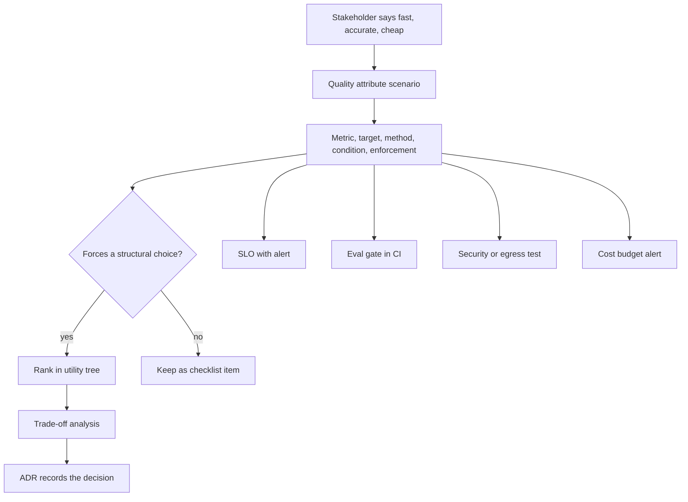

## TL;DR
NFRs state how well an agent must work: task success, run latency, cost per successful task,
availability, safety and freshness. They shape the agent's architecture, so each must be a measurable
scenario traced to a test, SLO or eval gate.

## For agent builders
- **Why it matters for agents.** "The agent should be smart, fast and cheap" cannot be built. A step
  budget, a cost ceiling per successful task and a task-success threshold on a golden set decide the model
  tier, the number of tool calls you can afford and whether you need routing or caching.
- **Where it shows up in your stack.** Eval gates in CI over agent traces, SLOs on time-to-first-token and
  end-to-end run time, per-tenant token meters and budget alerts, step and token caps in the agent loop,
  and load tests at the stated concurrency.
- **What you control.** The metric, target, measurement method, condition and enforcement point for each
  NFR; the written priority between quality, latency and cost; and how an end-to-end target is split into
  per-step budgets.
- **What you can skip.** Filling in every ISO/IEC 25010 category. Rigour goes on the five to eight NFRs
  that force a structural choice in the agent; the rest stay a checklist.

## Why it exists
- **Features do not determine architecture; quality attributes do.** Two agents with the same tool list
  can be completely different: one serves ten internal users from a single process, the other ten
  thousand tenants across regions at 99.9% availability. That is why experienced architects say the NFRs
  *are* the architecture.
- **Adjectives cannot be designed or tested.** "Fast, accurate, secure and scalable": fast for whom, at
  what load, at which percentile? Accurate on which tasks, measured how, against what threshold?
- **Vagueness is paid late, in production.** A pilot that works for five users streams its first token
  in eight seconds at five hundred; a security review surfaces a residency requirement the model
  provider cannot meet; cost per conversation exceeds the price per seat.
- **Agents add statistical requirements.** Task success, answer quality and safety (harmful output rate,
  prompt-injection resistance) can only be stated over a defined evaluation set, with a threshold and a
  tolerance.
- **The big three conflict.** Quality, latency and cost pull against each other, and an agent multiplies
  all three by its step count, so an unprioritised list cannot resolve the first real design conflict.
  Writing NFRs properly makes trade-offs explicit before the code does.

## How it works
### From adjective to scenario
The quality attribute scenario format (Bass, Clements and Kazman) has six parts, each closing a loophole:

| Part | Example | Loophole it closes |
|---|---|---|
| **Source** | A logged-in support agent | Whose experience counts |
| **Stimulus** | Submits a chat message | What triggers the behaviour |
| **Environment** | Normal operation, 50 concurrent sessions | "It was fast in the demo" |
| **Artifact** | The chat API | Arguments about where latency is counted |
| **Response** | First token streamed back | What "done" means |
| **Response measure** | Within 1.5 seconds at the 95th percentile over any five-minute window | Averages hiding tail pain |

- **For an agent, state the response precisely.** "First token streamed" and "task completed, all tool
  calls done" are different responses with very different budgets; write a scenario for each that matters.

### The categories, and what agents add
- **ISO/IEC 25010 as a discovery checklist:** functional suitability, performance efficiency,
  compatibility, usability, reliability, security, maintainability and portability (a later revision adds
  safety and renames some). It is a checklist, not a template to fill in full.
- **AI and agent attributes classic software never specified:**

| Attribute | What to specify |
|---|---|
| **Answer quality** | Faithfulness or groundedness, task success rate, citation correctness, on a versioned golden set with a threshold and minimum sample size |
| **Tool use** | Correct tool and arguments chosen, steps per task, share of runs hitting the step cap |
| **Safety** | Harmful or policy-violating output rate, refusal correctness, resistance to a prompt-injection test suite, no unapproved write actions |
| **Freshness** | Maximum lag between a source document changing and the index reflecting it |
| **Consistency** | How much output may vary for the same input; whether a run can be reproduced |
| **Cost** | Cost per successful task or conversation, including retries and tool calls |
| **Data handling** | Residency, retention, no-training clauses, what may appear in logs and traces |
| **Operability** | Time to roll back a prompt or model version, and to re-index after an embedding change |

### Making each one measurable and owned
Every NFR gets five fields: **metric, target, measurement method, condition** (load, data, time window)
and **enforcement point**. The last is most often missing, and it exists *because* an NFR with no
enforcement point is a wish.

| Attribute type | Becomes |
|---|---|
| Runtime (latency, availability, freshness) | SLOs with alerts |
| Quality, tool use and safety | Evaluation gates in CI and release pipelines |
| Security and residency | Review checklist items and automated tests |
| Cost | A per-tenant, per-feature dashboard with budgets, plus step and token caps in the loop |

- **Percentiles, never averages**, for anything latency-shaped, and state the window over which the
  percentile is computed.

### Statistical targets need their uncertainty
- **Standard error of a proportion** measured on *n* cases is about √(p(1−p)/n).
- **Worked:** at p = 0.90 and n = 300 that is ≈ 0.017, so the 95% interval is roughly ±3.4 points. A run
  scoring 0.91 cannot be told apart from one scoring 0.88.
- **Write the gate accordingly**, either:
  - "the lower bound of the interval is at least 0.90", or
  - "no statistically significant regression against the current release on the same cases".
- **The paired form needs far fewer cases** to detect a small drop, *because* each case is compared with
  itself. Agent golden sets are expensive to run, so this matters more for agents than for single calls.

### Decomposing a target into budgets
An end-to-end NFR is not actionable for one team until it is split along the request path.

**Latency budgets add.** A 1.5 s p95 time-to-first-token might be allotted (illustrative):

| Stage | Budget |
|---|---|
| Auth and tenant resolution | 50 ms |
| Query embedding | 100 ms |
| Vector search | 150 ms |
| Guardrails and prompt assembly | 200 ms |
| Model's own first token | about 1 s left |

- **Summed component p95s usually overestimate** the end-to-end p95, *because* components rarely hit their
  tails on the same request. Budgets set this way are conservative; the end-to-end measurement still
  counts.
- **An agent run adds a second budget: steps.** Total run time is roughly the sum of every model call and
  tool call in the loop, so a run-time NFR becomes a step cap and a per-step latency budget.

**Availability multiplies.**
- A chat path depending serially on your stack at 99.95% and a provider at 99.9% delivers about
  0.9995 × 0.999 ≈ 99.85%, below a 99.9% target before your own bugs.
- That one multiplication is why the availability row in the example below forces a provider fallback
  rather than a better runbook.
- **In an agent it multiplies per step.** A run of k model calls, each 99.9% available, succeeds about
  0.999^k of the time if failures are independent, so retries and fallbacks per step are architectural.
- A 99.9% monthly target is about 43 minutes of allowed unavailability in a 30-day month; stating the
  error budget in minutes makes each dependency's cost concrete.

### Prioritising, because they conflict
- **Architecturally significant requirements** are the handful whose satisfaction forces a design choice:
  - a 1.5-second time-to-first-token forces streaming and a model-tier decision;
  - EU residency forces region pinning and provider selection;
  - a cost ceiling forces routing, caching and a step cap.
- **ATAM's utility tree** ranks scenarios by business importance and architectural difficulty, so the team
  argues about the top five rather than the full list.
- **Order the conflicts explicitly.** If quality and latency collide, which gives? That written priority
  is trade-off analysis's tie-breaker; without it every design review reopens the question.

### Traceability
- **Forward** to the decision it drove (an ADR) and to the test, SLO or eval gate that verifies it.
- **Backward** to the stakeholder and business reason it came from.
- **Why:** requirements change. When the cost ceiling moves, you need to know which decisions and tests
  depended on the old number.

### Where they come from
| Source | Supplies |
|---|---|
| Finance and product | Cost and availability targets |
| Security and legal | Residency, retention, access and approval-for-actions requirements |
| Users | Latency tolerance, which differs: an agent drafting replies tolerates less than a batch summariser |
| Operations | Observability and rollback needs |
| Regulation | Audit and explainability demands |

- **A baseline of the current process** (how long a human takes, how often they are wrong) is often the
  most defensible source for a quality target.

## Diagram
An adjective becomes a scenario with five fields; the significant few go through prioritisation into
trade-offs and ADRs, and every agent NFR lands on an enforcement point.



## Examples
### Worked NFR set for a multi-tenant support assistant
The assistant drafts replies for human agents. Figures are illustrative targets for the scenario, not
benchmarks. Each row is measurable, has an enforcement point and visibly drives an architectural decision;
the last column is where trade-off analysis and ADRs begin.

| Attribute | Scenario and measure (illustrative) | Enforced by | Architectural consequence |
|---|---|---|---|
| Latency | First token within 1.5 s at p95, 50 concurrent sessions, 5-min window | SLO + load test in staging | Streaming responses; model tier chosen for TTFT; gateway timeout budget |
| Answer quality | Faithfulness ≥ 0.90 and citation correctness ≥ 0.95 on golden set v3 (≥ 300 cases) | Eval gate in CI; blocks release | RAG with mandatory citations; reranking; no release without eval run |
| Safety | Harmful-output rate ≤ 0.5% on red-team suite; ≥ 99% refusal of injection probes | Eval gate + quarterly red team | Input/output guardrails as a separate component; tool allow-lists |
| Availability | 99.9% monthly for the chat API; degraded mode allowed | SLO, error budget policy | Provider fallback via gateway; graceful degradation to retrieval-only |
| Cost | ≤ $0.04 per conversation averaged weekly, per tenant | Meter + budget alert | Model routing by difficulty; prompt caching; context trimming |
| Residency | EU tenants' prompts, documents and logs never leave EU regions | Architecture review + automated egress test | Region-pinned deployment; EU provider endpoint; log pipeline per region |
| Freshness | Knowledge-base edits searchable within 15 minutes at p95 | SLO on index lag | Incremental ingestion with change feed, not nightly rebuild |
| Operability | Prompt or model rollback in under 10 minutes without a deploy | Runbook drill | Versioned prompt registry; gateway config as the switch |

- **Read it against the conflicts.** The quality row wants a large model and long context; latency and
  cost want a small one and short prompts.
- **The written priority decides.** It was quality, then latency, then cost, so the consequence column
  resolves to routing (large model only for hard cases) rather than a single small model. Change the
  priority and the architecture changes with it.

### Agent scenario: what step count does to availability and cost
A tool-calling agent makes one model call per step. Assume each call is 99.9% available and failures are
independent (a simplification; real outages correlate). Cost figures are illustrative.

| Steps per run | Run succeeds, no retries | Run succeeds, one retry per call |
|---|---|---|
| 1 | 99.90% | 99.9999% |
| 10 | 99.00% | 99.9990% |
| 20 | 98.02% | 99.9980% |

- **Read it as an architecture input.** At 20 steps, one run in about 50 fails on availability alone, so
  per-step retries with idempotent tools are a requirement, not polish.
- **Cost per successful task, not per run.** A run costing $0.12 with 0.80 task success costs $0.15 per
  successful task; that is the number to hold against the cost NFR.
- **The step cap is an NFR enforcement point.** It bounds both the run-time budget and the worst-case cost.

### Runnable: the arithmetic behind the gates and budgets
Check an eval gate's uncertainty, a latency budget and a serial availability chain before committing to
the numbers.

```python
from math import sqrt

def interval(p: float, n: int, z: float = 1.96) -> tuple[float, float, float]:
    se = sqrt(p * (1 - p) / n)                    # standard error of a proportion
    return se, p - z * se, p + z * se

se, lo, hi = interval(0.90, 300)
print(f"SE {se:.3f}, 95% interval {lo:.3f} to {hi:.3f}")

def gate(score: float, n: int, target: float = 0.90) -> bool:
    return interval(score, n)[1] >= target        # lower bound must clear the target

print("0.91 on 300 passes:", gate(0.91, 300), "| 0.93 on 300 passes:", gate(0.93, 300))

budget_ms = {"auth + tenant": 50, "query embedding": 100, "vector search": 150,
             "guardrails + prompt": 200}
print("left for model first token:", 1500 - sum(budget_ms.values()), "ms")

serial = 0.9995 * 0.999                           # your stack x provider, in series
print(f"serial availability {serial:.2%} vs target 99.90%")
print("99.9% error budget:", round((1 - 0.999) * 30 * 24 * 60, 1), "min per 30-day month")
# SE 0.017, 95% interval 0.866 to 0.934
# 0.91 on 300 passes: False | 0.93 on 300 passes: True
# left for model first token: 1000 ms
# serial availability 99.85% vs target 99.90%
# 99.9% error budget: 43.2 min per 30-day month
```

The lower-bound gate is strict: to pass at 0.90 on 300 cases the run must score about 0.93. That is why
teams often prefer the paired "no significant regression" form for release gates.

```python
# Agent run: availability across steps and cost per successful task (illustrative inputs).
per_call = 0.999
for steps in (1, 10, 20):
    no_retry = per_call ** steps
    one_retry = (1 - (1 - per_call) ** 2) ** steps
    print(f"{steps:>2} steps: {no_retry:.2%} without retries, {one_retry:.4%} with one retry")

run_cost, task_success = 0.12, 0.80
print(f"cost per successful task: ${run_cost / task_success:.2f}")
#  1 steps: 99.90% without retries, 99.9999% with one retry
# 10 steps: 99.00% without retries, 99.9990% with one retry
# 20 steps: 98.02% without retries, 99.9980% with one retry
# cost per successful task: $0.15
```

## Production patterns
- **NFR register in the repository.** Use from the first design review of an agent. Keep one file listing
  each NFR with metric, target, method, condition, enforcement point and owner, reviewed in pull requests
  like code. Monitor NFRs with no enforcement point or owner; the count should be zero.
- **SLOs with error-budget alerts.** Use for latency, run time, availability and freshness. Define the SLO
  on the same percentile and window as the NFR and alert on error-budget burn rate over a short and a long
  window (the multi-window approach in the Google SRE workbook), not on single spikes. Monitor budget
  remaining per month.
- **Paired eval gate in CI.** Use for task success, quality and safety NFRs. Run the versioned agent golden
  set on the candidate and the current release, compare per case, and block the release on a
  statistically significant drop. Monitor gate flakiness; a gate that flips on reruns of one build is
  under-powered.
- **Load test at the stated condition.** Use before every launch and capacity change. Drive the staging
  stack at the NFR's concurrency (for example with Locust or k6) and record time-to-first-token p95 and
  run time from the client side, not server logs. Monitor the gap between staging and production p95.
- **Per-tenant cost budgets and step caps.** Use when a cost ceiling exists. Meter tokens and tool calls
  per run per tenant, compute weekly cost per successful task, cap steps and tokens per run in the loop,
  and alert at a fraction of the ceiling. Monitor the top tenants' share of spend and the share of runs
  hitting the cap.

## Trade-offs
- **Tight NFRs: unambiguous design vs real money.** Each tightened target costs capacity, bigger models or
  more regions. Negotiate the number with its cost attached rather than accept a round figure.
- **Percentile targets: protect the tail vs noise at low volume.** p99 on a low-traffic endpoint is noisy;
  use p95 or longer windows until volume justifies p99.
- **Long NFR list: thorough vs unread.** Only the architecturally significant few deserve scenario-level
  rigour; spreading effort evenly produces a document nobody reads.
- **Hard contracts (SLAs): certainty vs room to trade.** SLAs give customers certainty but remove room to
  trade; keep internal SLOs tighter than external SLAs so the trade-off space stays yours.
- **Early quality thresholds: release gates vs arbitrary bars.** A threshold set before a baseline exists
  is arbitrary; measure the human baseline first, then set the bar relative to it.
- **Tight step caps: bounded cost and latency vs lower task success.** A low cap protects the budget but
  fails hard tasks; set it from the step distribution of successful runs on the golden set.

## Pitfalls
- **Specifying latency as an average.** Symptom: a green dashboard while a fifth of users wait ten seconds
  for a first token.
- **A quality NFR with no named evaluation set or sample size.** Symptom: "accuracy 92%" that cannot be
  reproduced and silently changes when someone edits the test cases.
- **Gating releases on a point estimate from a small eval set.** Symptom: a gate that flips between pass
  and fail on reruns of the same build, and a team that learns to rerun until green.
- **A latency target with no load condition.** Symptom: a staging pass followed by a launch-day collapse
  at ten times the concurrency.
- **Copying "99.99% availability" from a template.** Symptom: a multi-region design and on-call rotation
  for an internal tool whose users go home at six.
- **Forgetting cost as an NFR.** Symptom: a successful pilot whose unit economics make the product
  unprofitable at scale, discovered from the invoice.
- **Measuring cost per call instead of per successful task.** Symptom: cost per call looks fine while a
  looping agent spends many calls per task. Fix: meter per run and divide by task success.
- **NFRs without an owner or enforcement point.** Symptom: a requirements document nobody has opened since
  the kickoff.

## When to use
- **Write them at the start** of any agent with real users, and revisit at every scope change, *because*
  they are the inputs to every architecture decision that follows.
- **Focus rigour** on the five to eight that are architecturally significant; keep the rest as a
  checklist.
- **Attach an enforcement mechanism to each:** an SLO, an eval gate, a security test, a budget alert, a
  step cap.
- **In an engagement**, get the customer to state and prioritise NFRs early, so residency or cost
  constraints do not surface in week ten.
- **Interviews:** before drawing anything, state the NFRs you are assuming, with numbers and percentiles,
  and name which one drives each structural choice. That is the difference between a feature sketch and
  an architecture.

## Role lens
- **Engineer:** Turns each NFR into a concrete check, a load test, an eval gate, an SLO alert, and
  knows the numeric target behind the component being built.
- **Architect:** Owns the elicitation, prioritisation and traceability of NFRs, and uses them as the
  scoring dimensions for every trade-off and the justification for every ADR.
- **FDE:** Extracts the customer's real constraints (residency, latency tolerance, budget, audit) early,
  writes them as measurable NFRs, and uses them to set acceptance criteria for the pilot.

## Check yourself
**Q:** A product manager says the new assistant must be "fast, accurate and cheap". Turn that into
NFRs, explain why they conflict, and say what you would ask the business to decide.
**A:** I would write each as a measurable scenario with an enforcement point. Fast: first token within
1.5 seconds at p95 under the expected peak concurrency, enforced as an SLO and a staging load test.
Accurate: faithfulness and task success above a threshold on a versioned golden set of at least a few
hundred representative cases, enforced as a release gate, with the threshold set relative to the measured
human baseline. Cheap: a cost per successful conversation ceiling, metered per tenant with alerts. They
conflict because quality pushes toward larger models and longer context, which raise latency and cost,
while the cost ceiling pushes toward smaller models and shorter prompts, which lower quality. I would ask
the business to rank the three explicitly, so the design can resolve the conflict, typically by routing
only hard cases to the expensive model, and to attach a cost to any tightening of the targets.

## Interview questions
### What makes an NFR testable, and why do architects say NFRs are the architecture?
- **Testable means a scenario:** source, stimulus, environment, artifact, response and a numeric response
  measure with percentile and window, plus an enforcement point.
- **Why they are the architecture:** the same features at 10 users or 10,000 tenants across regions need
  completely different structures; quality attributes, not features, force those choices.

### Which NFRs would you write for a tool-calling agent that a plain chat endpoint does not need?
- **Task success and tool use:** success rate on a versioned agent golden set, correct tool and arguments,
  and the share of runs hitting the step cap.
- **Run-level budgets:** end-to-end run time and cost per successful task, enforced by step and token caps
  in the loop, because both grow with the number of steps.
- **Action safety:** no write action without the required approval, tested by injection probes.

### Your agent's runs fail more often as tasks get longer. How do NFRs explain it and what do you change?
- **Availability multiplies per step:** at 99.9% per call and independent failures, a 20-step run succeeds
  about 98.02% of the time, so one run in about 50 fails on availability alone.
- **Fix it architecturally:** per-step retries with idempotent tools, a provider fallback through the
  gateway, and checkpointing so a failed step resumes instead of restarting the run.

### Your eval gate passes and fails on reruns of the same build. What is wrong and how do you fix it?
- **Diagnosis:** the gate compares a point estimate from a small set against a fixed threshold. At 300
  cases and p = 0.90 the 95% interval is about ±3.4 points, wider than the margin.
- **Fixes:** gate on the interval's lower bound, or better, on a paired comparison against the current
  release over the same cases; add cases if the paired test is still under-powered.

### The target is 99.9% availability and you depend on a provider at 99.9%. Is that achievable?
- **Not by runbooks:** your stack at 99.95% in series with the provider gives about 99.85%, already below
  target.
- **Architectural fix:** a provider fallback through the gateway and a degraded retrieval-only mode, so
  the provider is no longer a serial dependency for every request.
- **Make it concrete:** 99.9% is about 43 minutes a month of error budget.

### When would you deliberately not tighten an NFR the customer asks for?
- **When its cost outweighs its value:** "99.99%" for an internal tool used in office hours buys a
  multi-region design and on-call rotation nobody needs.
- **How to handle it:** attach the cost of each tightening (capacity, model size, regions) and let the
  business choose; keep internal SLOs tighter than any external SLA.

## Quiz
### Q: Which of these is a well-formed non-functional requirement?
- [ ] The system must be highly available
- [x] The chat API returns its first token within 1.5 s at p95 under 50 concurrent sessions, measured over any 5-minute window
- [ ] The model should be as accurate as possible on customer questions
- [ ] Latency must average under one second
> A testable NFR names the artifact, the condition, the percentile and the window. An average hides tail
> latency, and "highly available" or "as accurate as possible" cannot be verified or designed to.

### Q: Why should an AI quality requirement name a versioned evaluation set and a minimum sample size?
- [ ] Because model providers require it for support contracts
- [ ] To make the requirement shorter and easier to read
- [x] Because a statistical threshold is meaningless without the population it is measured on, and the gate must be reproducible as cases change
- [ ] Because regulators mandate exactly 300 test cases
> Quality is a probabilistic property; "92% accurate" means nothing without the set, its version and
> enough cases for the estimate to be stable. Versioning lets a release gate be re-run and compared over
> time.

### Q: What makes a requirement "architecturally significant"?
- [ ] It appears in the customer contract
- [ ] It concerns security rather than performance
- [x] Satisfying it forces a structural choice, such as streaming, region pinning or model routing
- [ ] It has the largest numeric target
> Architectural significance is about consequences for structure, not about the source or the domain
> of the requirement. Many contractual or security requirements are satisfied by configuration and do
> not shape the architecture.

## Use cases & projects
### Use cases
- **Scoping an agent pilot.** An FDE turns "fast, accurate, cheap" into task success on a golden set, run
  time at p95 and cost per successful task, which become the pilot's acceptance criteria.
- **Choosing a model tier and routing.** A cost ceiling per successful task plus a quality threshold
  forces routing hard cases to a larger model rather than one model for everything.
- **Setting step and token caps.** Run-time and cost NFRs become caps in the agent loop, set from the step
  distribution of successful runs.
- **Release gating.** A paired eval gate over agent traces blocks a prompt or model change that causes a
  significant drop in task success or safety.

### Mini project
**Write and enforce an NFR register for a small agent (2-3 hours).**
- **Goal:** turn five agent NFRs into checks that pass or fail automatically.
- **Steps:** pick a small tool-calling agent; write NFRs for task success, run time p95, cost per
  successful task, step cap and injection resistance, each with metric, target, method, condition and
  enforcement point; build a 30-case golden set; script a run that reports task success with its
  interval (expect it to be wide, about ±11 points at p = 0.90, which is the lesson), run-time p95, cost per successful task and runs hitting the cap.
- **Done when:** the script exits non-zero when any NFR fails, you can show one prompt change that the
  gate catches, and the register says which NFR drove each design choice.
