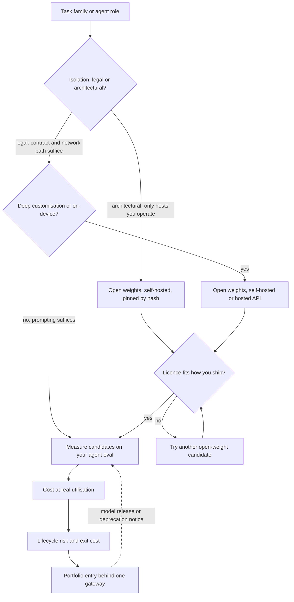

## TL;DR
Open-weight models publish parameters you can run, pin and fine-tune under a licence; proprietary
weights stay with the provider. For agents it decides tool-calling quality, data flow of tool results,
lifecycle control and cost shape, separately from self-host versus API.

## For agent builders
- **Why it matters for agents.** Agents send tool results, often internal data, to the model on every
  step, and depend on reliable tool-call formatting. The proprietary frontier usually leads on long
  multi-step tool use; open weights win when tool results cannot leave, behaviour must stay frozen, or
  a narrow agent step is worth fine-tuning.
- **Where it shows up in your stack.** A proprietary API, or open weights behind an OpenAI-compatible
  server (vLLM, SGLang, Ollama) or a hosting provider. The serving engine's tool-call parsing and
  structured-output support decide whether your agent loop works unchanged.
- **What you control.** Which agent roles use which weights, the pinned revision or version, the
  licence check, the guardrails you add when leaving an API, and the agent eval both candidates must
  pass.
- **What you can skip.** Licence law details (legal reviews them) and training-data provenance debates.
  Know the eight dimensions, the deployment combinations and the supply-chain gate.

## Why it exists
- **The real question is why anyone runs open weights.** The proprietary frontier usually leads on raw
  capability and an API is the lowest-effort way to use it. But an API bundles conditions you may not be
  able to accept.
- **What the API bundles.** Data, including every tool result your agent sees, leaves your environment
  (mitigable by contract, not architecture). The provider retires versions on its own schedule, taking
  the behaviour your prompts and evals were tuned to. You cannot see or change weights, tokenizer,
  sampling internals or more than a sliver of the logits.
- **And the commercial side.** Fine-tuning is what the provider offers. Price is per token, forever,
  set by someone else. Your core capability is a dependency you cannot fork.
- **Open weights invert each point.** The weights are a file you keep: the same bytes in five years. Data
  never has to leave. You can fully fine-tune, quantize, distil, prune, inspect and constrain decoding.
  Cost is hardware and people, not tokens. In exchange you own serving, safety tuning, upgrades and
  supply-chain checks, and usually accept a capability gap to the frontier.
- **Both naive positions fail.** "Open means free" ignores GPUs, utilisation, serving engineering,
  operations and the fact that the strongest open models trail the frontier. "Proprietary is best, so use
  it" breaks under residency rules, deprecation churn, scale economics and deep customisation needs.
- **"Open" is not open source.** Training data and code are usually withheld, and licences range from
  permissive (Apache-2.0, MIT) to custom community licences with acceptable-use policies and clauses that
  trigger at scale or restrict using outputs to train competitors. Read the licence; do not assume it.

## How it works
### The dimensions, and why each one matters
1. **Control and lifecycle.** An open-weight model is an immutable artefact you pin by content hash; a
   proprietary model is a versioned API with deprecations typically announced months ahead. This matters
   *because* an LLM system's behaviour is tuned to one model; when it changes, the prompts, tool
   descriptions, evals and parsers were written against something that no longer exists.
2. **Data governance.** Open weights on hosts you control mean data physically never leaves.
   Proprietary access relies on data-processing agreements, zero-retention options and regional
   endpoints. The deciding question: is the constraint legal (a contract and a network path can satisfy
   it) or architectural (only hardware you control can)?
3. **Customisation depth.** Open weights allow full fine-tuning, parameter-efficient adapters,
   quantization, distillation, raw logit access, custom constrained decoding, speculative decoding with
   your own draft model, and tokenizer work. Proprietary models offer prompting, structured output
   features and sometimes a fine-tuning API. The gap matters most for narrow, high-volume tasks, where
   deep customisation pays.
4. **Capability.** The proprietary frontier generally leads, most visibly on long multi-step tool use;
   the best open models trail by a margin that varies by task and shifts with every release. It is
   contested, so measure it on your own agent evaluation, not a leaderboard.
5. **Cost structure.** Proprietary is per-token operating cost that scales with usage. Self-hosted open
   weights are fixed cost per GPU-hour, so economics hinge on utilisation (the self-host versus API lesson
   works the break-even). Open weights served by a hosting provider turn back into per-token cost, often
   below frontier proprietary pricing, with less control than self-hosting and no operations.
6. **Licensing.** Permissive licences allow redistribution and commercial use with few conditions. Custom
   licences may add acceptable-use policies, attribution or naming rules, restrictions on training other
   models with outputs, and thresholds for very large deployments. The licence decides whether you can
   ship on-device, redistribute fine-tunes, or embed the model in a product you sell.
7. **Ecosystem and supply chain.** Mature serving engines, quantization formats and fine-tuning tooling
   are a large part of open weights' practical value; for agents, the engine's tool-call parsing and
   structured-output support matter most. The risk: hub weights can be tampered with, pickle-format
   checkpoints can execute code on load, and a popular fine-tune may carry behaviour nobody audited.
   Pin revisions, prefer safetensors, verify hashes, read the model card.
8. **Safety and support.** A proprietary API includes the provider's safety tuning, moderation layers,
   SLAs and someone to call. With open weights you own safety behaviour and guardrails, including
   resistance to prompt injection arriving through tool results, and outages are your outages.

### The governance middle ground
- **What it is.** A proprietary model offered as a managed service by the cloud provider you already use,
  reached over private networking in your region.
- **What it gives.** Traffic, including agent tool results, never crosses the public internet, and the
  processor is one you have already contracted.
- **What it does not.** Inference still runs on the provider's infrastructure, not on hosts you operate.

### Decoupling the axis from deployment
| Combination | Gives | Costs |
|---|---|---|
| Open weights, self-hosted | maximum control and isolation | maximum operations |
| Open weights through a hosting API | portability and lower price without hardware | the host's lifecycle and shared infrastructure |
| Proprietary through the public API | frontier capability, least effort | least control |
| Proprietary via your cloud provider's managed service, private endpoint | frontier-class capability with contractual and network isolation | often a premium; model availability lags the provider's own API |
| Proprietary weights licensed for deployment inside the customer's environment (rarer) | physical isolation | no right to modify or redistribute |

Four combinations exist and all are used, plus the rarer fifth. Choosing "open" does not force you to
run GPUs, and choosing "proprietary" does not force data onto the public internet.

### How the decision runs
1. **Constraints first:** isolation requirements, licence compatibility with how you ship, and the
   customisation the task needs.
2. **Capability** on your eval, scored on whole agent runs where the model drives a loop.
3. **Cost** at your real utilisation.
4. **Lifecycle risk and exit cost.**

The common outcome is a portfolio: proprietary frontier for the hardest and lowest-volume work, such as
agent planning, and open weights (hosted or self-hosted, often fine-tuned) for high-volume narrow tasks,
both behind a gateway so the split can move as the models do.

## Diagram
The decision runs constraints first (isolation, customisation, licence), then capability, cost and
lifecycle for every surviving candidate. The isolation question picks a deployment, not just a weight
type, and the licence check applies to every open-weight path.



## Examples
### Same agent loop, two backends: tool-call validity check
Open-weight models served by an OpenAI-compatible server (for example vLLM with tool calling enabled
for that model family) can be called with the same client code as a proprietary API, so one eval
compares them. URLs and model names are placeholders.

```python
import json
from openai import OpenAI

BACKENDS = {
    "proprietary": OpenAI(),                                              # key from the environment
    "open_weight": OpenAI(base_url="http://vllm.internal:8000/v1", api_key="unused"),
}
MODELS = {"proprietary": "<pinned dated model id>", "open_weight": "<served model name>"}
TOOLS = [{"type": "function", "function": {
    "name": "lookup_order", "description": "Fetch an order by id",
    "parameters": {"type": "object", "properties": {"order_id": {"type": "string"}},
                   "required": ["order_id"]}}}]

def tool_call_ok(backend, prompt, expected_tool):
    resp = BACKENDS[backend].chat.completions.create(
        model=MODELS[backend], messages=[{"role": "user", "content": prompt}], tools=TOOLS)
    calls = resp.choices[0].message.tool_calls or []
    if not calls or calls[0].function.name != expected_tool:
        return False
    try:
        args = json.loads(calls[0].function.arguments)   # malformed JSON counts as a failure
    except json.JSONDecodeError:
        return False
    return "order_id" in args

# for b in BACKENDS: print(b, sum(tool_call_ok(b, c["prompt"], c["tool"]) for c in cases) / len(cases))
```

A single-step check like this is the cheap first gate; the decision still rests on whole-run success
on your agent tasks, with tool results and errors in the loop.

### Pinned bytes and the full next-token distribution
Three things an open-weight artefact allows that an API-only model does not: pin the exact bytes, read
the full next-token distribution, and constrain the decision to an allowed set without generating text.
The restricted softmax yields a per-class score a cascade can route on, such as an agent's first
routing step.

```python
import torch
from transformers import AutoModelForCausalLM, AutoTokenizer

name = "Qwen/Qwen2.5-0.5B-Instruct"                 # any small open-weight chat model
revision = "<commit hash from the model page>"      # pin exact weights, never a moving branch
tok = AutoTokenizer.from_pretrained(name, revision=revision)
model = AutoModelForCausalLM.from_pretrained(
    name, revision=revision, torch_dtype=torch.bfloat16,
    use_safetensors=True,                           # refuse pickle checkpoints: they can run code on load
).eval()

labels = ["refund", "shipping", "other"]
# First token of each label, with no leading space: the chat template ends the assistant header with a
# newline, so the reply's first token is not space-prefixed. Check the ids are distinct for your tokenizer.
label_ids = [tok(l, add_special_tokens=False).input_ids[0] for l in labels]
assert len(set(label_ids)) == len(labels)

msgs = [{"role": "user", "content": "Classify this message: 'My parcel never arrived'. "
                                    "Reply with exactly one lowercase word: refund, shipping or other."}]
enc = tok.apply_chat_template(msgs, add_generation_prompt=True, return_tensors="pt", return_dict=True)

with torch.no_grad():
    next_logits = model(**enc).logits[0, -1]        # full-vocabulary distribution for the next token
probs = torch.softmax(next_logits[label_ids], dim=-1)   # renormalise over the allowed labels only
mass = torch.softmax(next_logits.float(), dim=-1)[label_ids].sum().item()
for label, p in zip(labels, probs.tolist()):
    print(f"{label:9s} {p:.3f}")
print(f"mass on allowed labels: {mass:.3f}")   # low mass: the model wanted to say something else
# No decoding loop and no parsing of free text. The renormalised probabilities are a confidence signal
# to calibrate on held-out data (not a calibrated probability as-is); low mass flags odd inputs.
```

Through a proprietary API the same classification needs a generated answer parsed from text, and any
confidence must be inferred from limited top-k log probabilities, if the provider exposes them at all.

### Supply-chain gate for open weights
Download only safetensors and config files at a pinned revision, then compare file hashes with a
manifest committed when the artefact was first reviewed. Run it in CI and at deploy time.

```python
import hashlib, json, pathlib
from huggingface_hub import snapshot_download

REPO, REV = "Qwen/Qwen2.5-0.5B-Instruct", "<commit hash from the model page>"
path = pathlib.Path(snapshot_download(
    REPO, revision=REV,
    allow_patterns=["*.safetensors", "*.json", "*.txt", "*.model"],   # no pickle (.bin/.pt) files
))

def sha256(p, chunk=1 << 20):
    h = hashlib.sha256()
    with open(p, "rb") as f:
        for block in iter(lambda: f.read(chunk), b""):
            h.update(block)
    return h.hexdigest()

actual = {p.name: sha256(p) for p in sorted(path.glob("*.safetensors"))}
pinned = json.loads(pathlib.Path("model-manifest.json").read_text())   # reviewed, committed
assert actual == pinned, "weights differ from the reviewed artefact"
```

### Worked decision: one company, three task families
Illustrative; each row applies "How the decision runs" in order.

| Task family | Binding constraint | Outcome |
|---|---|---|
| Complex contract analysis agent, low volume | capability on the agent eval | proprietary frontier via public API, pinned version |
| Patient-record extraction, high volume | legal residency: in-region, existing processor only | cloud provider's managed proprietary model over a private endpoint; a third-party open-weight host is excluded (new processor), self-hosted open weights only if volume keeps the GPUs busy |
| On-device intent classifier in a shipped product | licence must allow embedding and redistribution; behaviour frozen for years | permissively licensed open weights, fine-tuned, pinned by hash |

All three sit behind one gateway and one eval harness, so a row can change when the models do.

## Production patterns
- **One client interface for both weight types.** For any agent that may switch backends. Call open
  weights through an OpenAI-compatible server and proprietary models through their API behind the same
  gateway route, so a switch is configuration. Monitor tool-call parse failures per backend; engines
  differ in how they parse tool calls for each model family.
- **Revision pin plus hash manifest.** For every open-weight artefact. Pin the model repository commit,
  download only safetensors, and fail CI and deployment if file hashes differ from the reviewed manifest.
  Monitor manifest changes; each one needs a review and an eval run.
- **Licence register with legal sign-off.** Before any open-weight model reaches production. Record
  licence name, acceptable-use policy, attribution or naming rules, output-use restrictions and any scale
  thresholds, and how you ship (server, on-device, redistributed fine-tune). Monitor usage against scale
  thresholds and re-review on each new model version.
- **Isolation requirement classified in writing.** At the start of any regulated engagement. Get the
  customer to state whether the constraint is legal (contract and network path suffice) or architectural
  (only hosts they operate). Monitor that the chosen deployment still matches it after any vendor change.
- **Explicit guardrails when leaving an API.** When migrating a workload or agent to open weights. Add
  input and output moderation, tool-result injection checks and policy checks that the API model
  provided implicitly, and run a red-team and jailbreak eval before cutover. Monitor policy-violation and
  jailbreak success rates against the API baseline.
- **Deprecation calendar for proprietary models.** For every pinned API version. Track announced
  retirement dates, and open the migration eval the day a notice arrives. Monitor days of runway left
  versus the time your last migration took.

## Trade-offs
- **Open weights: control vs operations.** Lifecycle control and physical data isolation, but you take on
  serving, safety tuning, upgrades and supply-chain checks; it flips when the team lacks operations
  capacity or the volume cannot keep a GPU busy.
- **Proprietary: capability vs lifecycle.** Frontier capability with no infrastructure, but the behaviour
  you tuned to can be retired on the provider's schedule; it flips when behaviour must stay fixed for
  years, as in regulated workflows or embedded devices.
- **Agent planner on open weights vs run success.** Keeping every step inside your environment removes
  the data-flow question, but long multi-step tool use is where the gap to the frontier usually shows;
  it flips when isolation is architectural or the agent is narrow enough to fine-tune.
- **Deep customisation vs re-certification.** It buys quality on narrow tasks but creates artefacts you
  must retrain and re-certify when the base changes; it flips when the task is broad and prompting
  suffices.
- **Hosted open weights: middle path vs inherited lifecycle.** Portable and cheaper per token than
  frontier pricing with no operations, but you inherit the host's lifecycle and share its infrastructure;
  it fits when you want exit optionality without hardware.
- **Capability vs licence permissiveness.** The most capable open model may carry the most restrictive
  licence; this flips the moment you redistribute, embed on-device, or sell the model as part of a product.

## Pitfalls
- **Reading "open weights" as "open source" and skipping legal review.** Symptom: an acceptable-use or
  scale clause surfaces during a customer's due diligence or an acquisition.
- **Assuming the agent loop ports unchanged.** Symptom: after switching to an open-weight model the
  agent emits tool calls as plain text or malformed JSON. Fix: confirm the serving engine supports tool
  calling for that model family, use structured-output constraints, and re-run the agent eval.
- **Loading weights from an unverified source or in pickle format.** Symptom: code execution on load, or
  a fine-tune that behaves differently from its model card.
- **Assuming open weights are cheaper without a utilisation model.** Symptom: a GPU running at a small
  fraction of capacity costs more per task than the API would have.
- **Pointing a proprietary integration at a floating "latest" alias.** Symptom: outputs change overnight,
  evals fail, and there is nothing in the change log.
- **Expecting the provider's safety behaviour to follow you to open weights.** Symptom: jailbreak success
  and policy violations rise because the guardrails were implicit in the API model.
- **Choosing by public benchmark instead of your own eval.** Symptom: a migration that was "equivalent on
  benchmarks" loses several points on the task that matters.

## When to use
- **Choose open weights when:** data isolation must be architectural rather than contractual; behaviour
  must be frozen for years; high-volume narrow tasks or agent steps where fine-tuning pays; on-device or
  edge deployment; you need logits or custom decoding; or vendor exit is a board-level requirement.
- **Choose proprietary when:** you need frontier capability now (often the agent planner), volume is low
  or spiky, the team is small, and the provider's terms satisfy your governance.
- **Most organisations run both** through a portfolio.
- **Measure:** the eval delta between candidates, tool-call validity and run success for agents, GPU
  utilisation if self-hosting, cost per successful task, and time to migrate after a deprecation notice.
- **Interviews:** separate this axis from deployment, name the licence question, and make the lifecycle
  argument concretely.

## Role lens
- **Engineer:** Pins weights by revision, verifies safetensors and hashes, runs the same eval against
  the open and proprietary candidates, and keeps both behind one interface.
- **Architect:** Owns the decision per task family, the licence review with legal, the isolation
  requirement classification (legal versus architectural), and the exit plan.
- **FDE:** Translates a customer's "no data leaves" demand into the cheapest option that truly meets
  it, and sets expectations about capability, safety and operations when open weights are the answer.

## Check yourself
**Q:** A healthcare customer insists on open-weight models "so that no data leaves". Their platform
team is three engineers and expected volume is low. What do you advise, and how do you reason about it?
**A:** Separate the two axes first. The actual requirement is data isolation, and depending on what
"leaves" means it can be met by self-hosted open weights, or by a proprietary model through their
existing cloud provider's managed service over a private endpoint in-region, with contractual zero
retention. Which one depends on whether their constraint is legal, where a contract with an existing
processor and a private network path satisfy the regulator, or physical, where only hosts they operate
will do. I would get that definition in writing before choosing. With
three engineers and low volume, a self-hosted GPU fleet is an operations burden with poor utilisation
economics, so if the constraint is legal, the private endpoint or a hosted open model in-region is
likely cheaper and safer. If the environment is genuinely air-gapped, open weights are the only
option: pick a permissively licensed model, pin by hash, verify safetensors, serve with a standard
engine, size the GPU from the memory arithmetic, and add explicit guardrails because the API's implicit
safety tuning is gone. Either way, build the eval on their data first and keep the model behind a
gateway so the decision stays reversible.

## Interview questions
### Is open-weight the same as open source? Why does the difference matter?
- **No.** Open weights publish the parameters under a licence; training data and code are usually
  withheld.
- **Licences range widely,** from permissive (Apache-2.0, MIT) to custom community licences with
  acceptable-use policies, scale thresholds and limits on using outputs to train other models.
- **It matters because the licence decides how you can ship:** on-device, redistributed fine-tunes or
  embedded in a product you sell. Skipping legal review surfaces later in due diligence.

### Why is open-weight versus proprietary a separate axis from self-host versus API?
- **Open weights can be served by a hosting provider** as a per-token API, with no GPUs of your own.
- **Proprietary models can be reached through your cloud provider's managed service** over a private
  endpoint in-region, so data need not cross the public internet.
- **So "no data leaves" is a deployment requirement first.** Classify it as legal or architectural
  before picking a weight type.

### Your agent must run air-gapped on open weights. What do you check before trusting it with tools?
- **Tool-call reliability on your tasks:** valid tool names and JSON arguments per step, then whole-run
  success, served through an engine that supports tool calling for that model family.
- **Constrain what you can:** structured-output constraints on tool arguments, a small tool set per
  role, and a step cap, because open models usually trail the frontier on long tool use.
- **Replace the implicit safety layer:** input, output and tool-result injection checks, plus a
  red-team eval, since the API provider's moderation is gone.

### You migrated a workload from a proprietary API to an open-weight model and jailbreak success rose. What happened?
- **The API's safety tuning, moderation layers and policy checks were implicit,** and they did not come
  with the weights.
- **Fix it explicitly:** add input and output moderation and policy checks, then run a red-team and
  jailbreak eval against the API baseline before cutover.
- **Keep monitoring** policy-violation and jailbreak success rates after cutover.

### What supply-chain checks would you require before an open-weight model reaches production?
- **Pin the repository revision** to a commit hash, never a moving branch.
- **Download only safetensors,** because pickle-format checkpoints can execute code on load.
- **Verify file hashes against a reviewed, committed manifest** in CI and at deploy time, and read the
  model card; a popular fine-tune may carry behaviour nobody audited.

### When does proprietary win even for a company that wants vendor independence?
- **When frontier capability is needed now** and the open-weight gap on your own eval is material, as it
  often is for an agent's planner.
- **When volume is low or spiky and the team is small,** because self-hosted GPUs at a small fraction of
  capacity cost more per task than the API.
- **Contain the dependency instead:** pin versions, keep a deprecation calendar, and put the model
  behind a gateway with the same eval harness, so exit stays possible.

## Quiz
### Q: What does "open-weight" actually guarantee about a model?
- [ ] Its training data and training code are published
- [ ] It may be used for any purpose without restriction
- [x] Its parameters are published for download and use under a licence; training data, code and unrestricted use are not implied
- [ ] It is always cheaper to run than a proprietary model
> Open-weight releases publish the parameters, usually with a licence that may carry acceptable-use,
> attribution or scale conditions. Data and code are typically withheld, and cost depends entirely on
> how the weights are served and how busy the hardware is.

### Q: Which capability is available only with open weights, not through a proprietary API?
- [ ] Structured JSON output conforming to a schema
- [x] Pinning the exact model bytes by hash and keeping that behaviour indefinitely
- [ ] A service-level agreement on availability
- [ ] Lower latency on every request
> A provider can retire any API version; a downloaded artefact cannot be retired. Structured outputs
> and SLAs are things proprietary APIs commonly offer, and latency depends on serving, not on whether
> the weights are open.

### Q: A customer's rule is that data must stay in-region, never cross the public internet, and go to no processor other than their existing cloud provider. Which option is not automatically excluded?
- [ ] A proprietary model through its vendor's public API with a zero-retention agreement
- [ ] An open-weight model served by a third-party hosting provider's multi-tenant API
- [x] A proprietary model offered as a managed service by their existing cloud provider, reached through a private endpoint in-region
- [ ] None of these; only self-hosted open weights can satisfy the requirement
> The public API and the third-party host both add a new processor and a public network path, so they
> fail the stated rule. The cloud provider's managed service over private networking satisfies it,
> which shows the isolation requirement is separate from the open-versus-proprietary choice. A rule
> demanding hosts the customer operates would exclude it too.

## Use cases & projects
### Use cases
- **Agents over data that cannot leave.** Open weights served in your own environment keep every tool
  result inside the boundary.
- **Freezing agent behaviour.** A pinned open-weight revision keeps tool-call formatting stable for as
  long as you choose, independent of a provider's retirement schedule.
- **Fine-tuning a narrow agent step.** Open weights allow full fine-tuning or distillation of a step
  such as tool-argument filling.
- **Frontier planning with a private fallback.** A proprietary planner for hard steps plus an
  open-weight model for steps that touch restricted data, behind one gateway.

### Mini project
**Run one agent on both kinds of weights (2-3 hours).**
- **Goal:** measure what changes when an agent moves from a proprietary API to an open-weight model
  behind an OpenAI-compatible server.
- **Steps:** build a 3-tool agent against a proprietary API; serve an open-weight model locally with
  Ollama or vLLM and point the same loop at it; run 20 tasks on each; record run success, tool-call
  parse failures, latency and cost; read the open model's licence and note any clauses that matter.
- **Done when:** a table compares both setups on success, tool-call validity, p95 latency and cost per
  run, and a short note says which agent roles you would place on each and why.
