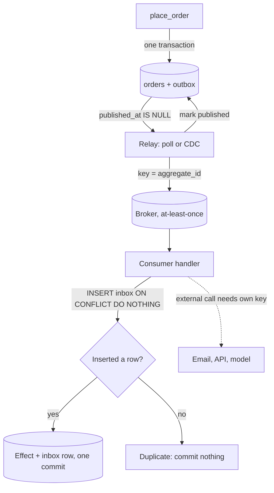

## TL;DR
The **outbox** commits an agent's state change and its message (a run event, a pending tool action) in
one transaction; the **inbox** records each processed message id with the consumer's effect.
Together: effectively-once processing between databases over an at-least-once broker.

## For agent builders
- **Why it matters for agents.** An agent runtime saves step results and also has to tell the world:
  emit `RunCompleted`, enqueue an email, notify a reviewer. Doing both as separate calls loses events on a
  crash, and the webhooks and events that trigger agents arrive more than once.
- **Where it shows up in your stack.** An outbox table next to your runs and checkpoints tables, a relay
  (polling or Debezium CDC) to Kafka or SQS, and an inbox table in front of every handler that starts a run
  or applies a webhook callback from a slow tool.
- **What you control.** Committing a pending side effect as an outbox row together with the agent state
  that decided it, keying the inbox on the producer's `event_id`, and passing that id as the idempotency
  key to external APIs, which the inbox cannot protect.
- **What you can skip.** WAL internals and Debezium connector tuning. Know the dual-write problem, why
  the relay must select `published_at IS NULL`, and where the guarantee ends.

## Why it exists
A service cannot atomically commit a database row and publish a message, yet every producer must commit
the order row *and* tell the world. All three naive orderings are wrong:
- **Commit, then publish.** The process crashes, is OOM-killed or loses its broker connection after the
  commit and before the publish. The row exists; the event never happens, so the search index, billing
  meter and audit log never hear about the order. A silent failure: nothing errors, data is just missing.
- **Publish, then commit.** The event is out; the commit fails on a constraint violation or a deadlock and
  rolls back. Consumers now act on an order that does not exist.
- **Publish inside the transaction, before commit.** The consumer queries the producer for details and
  finds nothing, because the transaction has not committed yet; or it later rolls back and the event is a
  phantom.
- **The frequency is not academic.** With a millisecond crash window, 1,000 transactions per second and an
  illustrative one restart per day, you lose about one event per day. At scale that is "the index is missing
  a few hundred documents and nobody knows which". Retrying in application code fails when the process
  itself is gone, and two-phase commit needs a broker that supports it (most do not) and blocks on
  coordinator failure.
- **The way out:** use the one atomic primitive you already have, the local database transaction, and make
  publishing a separate, retryable, idempotent step that reads from committed state.

## How it works
### The outbox table
- **Columns:** `id` (monotonic), `aggregate_type`, `aggregate_id`, `event_type`, `payload`, `created_at`,
  `published_at`, alongside the business tables.
- **Same transaction:** when the application commits a business change it inserts the event row *in the
  same transaction*, so the database guarantees both the order and its event row are durable, or neither.
- **Event as data:** the event is modelled as data, not as a side effect, *because* data is the only thing
  the transaction can protect.

### The relay
A separate process moves rows from the outbox to the broker.

| | Polling publisher | Log tailing (CDC) |
|---|---|---|
| Mechanism | loop runs `SELECT ... FROM outbox WHERE published_at IS NULL ORDER BY id LIMIT n FOR UPDATE SKIP LOCKED`, publishes, marks published (or deletes) | a connector such as Debezium reads the write-ahead log and forwards committed outbox inserts |
| Ordering | `id` order per relay | commit order |
| Latency | polling interval | milliseconds, no polling |
| Cost | polling latency and load on the table | operating a CDC pipeline and granting it replication access |
| Strength | simple, database-agnostic; `SKIP LOCKED` lets several relays run without double-claiming rows | single commit-ordered log |

- **The polling loop** claims a batch with `FOR UPDATE SKIP LOCKED`, publishes each row, then marks it
  published (or deletes it).
- **Query unpublished rows, never a high-water mark.** Ids come from a sequence assigned at insert time,
  but transactions commit in a different order, so row 101 can be visible while row 100's transaction is
  still open. A relay that advances "last id published" past 101 never returns for 100, and that event is
  lost without any error. Selecting by `published_at IS NULL` is deliberate.
- **At-least-once, never exactly-once.** The relay can crash after publishing and before marking the row,
  so it publishes that row again on restart. That is acceptable precisely *because* the inbox exists on the
  other side.

### Ordering
- **Per-aggregate order:** publish with `aggregate_id` as the partition key, and have the relay process rows
  in `id` order.
- **Several polling relays:** order across relays is not guaranteed unless rows are partitioned among
  relays by aggregate as well. CDC avoids the problem by reading a single commit-ordered log.

### Housekeeping
- **The outbox grows by one row per event forever** unless pruned. Delete or archive rows after publication
  with a lag that covers your debugging needs.
- **Index it:** a table with hundreds of millions of published rows makes the `WHERE published_at IS NULL`
  scan slow unless a partial index exists.

### The inbox table
Every message handler runs inside one database transaction that:
1. **Inserts the message's id first** into an `inbox` table with a unique constraint
   (`INSERT ... ON CONFLICT DO NOTHING`).
2. **Checks the result.** If the insert affects zero rows, the message was already handled and the handler
   commits nothing.
3. **Performs the business effect** and commits both together.

Why each choice:
- **Inbox insert first** also handles two copies arriving concurrently on different consumer instances: in
  Postgres the second insert waits on the unique index until the first transaction commits, then finds the
  conflict and does nothing. The unique constraint, not application logic, serialises the duplicates.
- **Same transaction** means a crash cannot leave the effect applied but unrecorded, or recorded but
  unapplied.
- **Key on the producer's `event_id`,** not the broker's delivery id, *because* a redelivery carries the
  same event with a new delivery id.
- **Variant:** store the full message in the inbox first, acknowledge to the broker, and process from the
  inbox asynchronously. This decouples receipt from processing and gives the consumer its own durable
  queue, at the cost of another relay-like loop.

### What the pair does and does not guarantee
- **Does:** outbox plus inbox plus an at-least-once broker gives effectively-once effects from the
  producer's database to the consumer's database.
- **Does not:** make effects outside the consumer's database idempotent. If the handler calls an external
  API, sends an email or invokes a model, a duplicate that slips in between the effect and the commit
  still repeats that call. Those effects need their own idempotency key at the external boundary.

### Where agents use the pair
| Agent moment | Pattern | Why |
|---|---|---|
| Step finished, state checkpointed, `StepCompleted` to emit | outbox row in the checkpoint's transaction | billing and eval consumers never miss a step, and never see one that rolled back |
| Agent decided to send an email or post a reply | "pending action" outbox row, executed by a worker with the row's id as idempotency key | the decision and the intent to act commit together; the send is retried, not lost |
| Webhook or event starts a run | inbox insert in the transaction that creates the run row | a redelivered webhook does not start a second paid run |
| Async tool calls back (a long OCR or a human approval) | inbox on the callback id before resuming the run | a repeated callback does not resume the run twice |

- **The model call itself is an external effect.** Re-running a handler re-asks the model and pays again,
  and may get a different answer; persist the model's output with the step so a redelivery reads it back.

## Diagram
The producer writes the order and its event in one transaction; the relay may publish twice, and the
consumer's inbox, committed with the effect, turns the duplicate into a no-op.



## Examples
### Postgres outbox, relay and inbox
Tables and the three code paths: the producer writes order and outbox row in one transaction, a polling
relay publishes with `SKIP LOCKED`, and a consumer deduplicates through the inbox. Uses psycopg 3; the
`broker.publish` call stands in for a Kafka or SQS client.

```sql
CREATE TABLE outbox (
  id BIGSERIAL PRIMARY KEY, aggregate_id TEXT NOT NULL, event_type TEXT NOT NULL,
  payload JSONB NOT NULL, created_at TIMESTAMPTZ DEFAULT now(), published_at TIMESTAMPTZ);
CREATE INDEX outbox_unpublished ON outbox (id) WHERE published_at IS NULL;
CREATE TABLE inbox (event_id UUID PRIMARY KEY, handled_at TIMESTAMPTZ DEFAULT now());
```

```python
import json, uuid, psycopg

def place_order(conn, order):                       # producer: one transaction, two inserts
    with conn.transaction():
        conn.execute("INSERT INTO orders (id, total) VALUES (%s, %s)", (order["id"], order["total"]))
        conn.execute("INSERT INTO outbox (aggregate_id, event_type, payload) VALUES (%s, %s, %s)",
                     (order["id"], "OrderPlaced",
                      json.dumps({"event_id": str(uuid.uuid4()), **order})))

def relay_once(conn, broker, batch=100):            # N copies won't double-claim, but can reorder
    with conn.transaction():
        rows = conn.execute("""SELECT id, aggregate_id, event_type, payload FROM outbox
                               WHERE published_at IS NULL ORDER BY id LIMIT %s
                               FOR UPDATE SKIP LOCKED""", (batch,)).fetchall()
        for id_, agg, etype, payload in rows:
            broker.publish(topic="orders", key=agg, value=json.dumps({"type": etype, **payload}))
            conn.execute("UPDATE outbox SET published_at = now() WHERE id = %s", (id_,))
    return len(rows)   # crash after publish, before commit => republish: at-least-once

def handle_order_placed(conn, msg):                 # consumer: effect + inbox in one transaction
    with conn.transaction():
        cur = conn.execute("INSERT INTO inbox (event_id) VALUES (%s) ON CONFLICT DO NOTHING",
                           (msg["event_id"],))
        if cur.rowcount == 0:
            return "duplicate"                      # already handled: commit nothing new
        conn.execute("INSERT INTO revenue_ledger (order_id, amount) VALUES (%s, %s)",
                     (msg["id"], msg["total"]))
    return "handled"
```

- **Relay crash:** kill the relay between `broker.publish` and the `UPDATE` and the row is published twice;
  the consumer's second `INSERT INTO inbox` conflicts, `rowcount` is zero, and the ledger is written
  exactly once.
- **Glossed detail 1, locks during publish:** the relay publishes while holding row locks, so a slow broker
  stretches the transaction, which is why real relays use small batches and a short publish timeout.
- **Glossed detail 2, ordering:** with several relays running, two events for the same order can be claimed
  by different relays and published in the wrong order, so either run one relay per partition of
  aggregates or use CDC.

### Runnable: relay crash and inbox dedupe with SQLite
The same three paths with the standard library only (SQLite 3.24+ for `ON CONFLICT DO NOTHING`). The relay
"crashes" after publishing, the restart republishes, and the ledger still has one row.

```python
import sqlite3, json, uuid

db = sqlite3.connect(":memory:", isolation_level=None)
db.executescript("""
CREATE TABLE orders (id TEXT PRIMARY KEY, total INT);
CREATE TABLE outbox (id INTEGER PRIMARY KEY, aggregate_id TEXT, payload TEXT, published_at TEXT);
CREATE TABLE inbox (event_id TEXT PRIMARY KEY);
CREATE TABLE ledger (order_id TEXT, amount INT);
""")

def place_order(oid, total):                        # both rows or neither
    with db:
        db.execute("BEGIN")
        db.execute("INSERT INTO orders VALUES (?, ?)", (oid, total))
        ev = {"event_id": str(uuid.uuid4()), "id": oid, "total": total}
        db.execute("INSERT INTO outbox (aggregate_id, payload) VALUES (?, ?)", (oid, json.dumps(ev)))

def relay(broker, crash_before_mark=False):         # at-least-once publication
    for id_, payload in db.execute("SELECT id, payload FROM outbox WHERE published_at IS NULL ORDER BY id").fetchall():
        broker.append(payload)
        if crash_before_mark:
            return                                  # simulated crash: row stays unpublished
        db.execute("UPDATE outbox SET published_at = datetime('now') WHERE id = ?", (id_,))

def handle(payload):                                # inbox insert first, then effect, one transaction
    msg = json.loads(payload)
    with db:
        db.execute("BEGIN")
        cur = db.execute("INSERT INTO inbox VALUES (?) ON CONFLICT DO NOTHING", (msg["event_id"],))
        if cur.rowcount == 0:
            return "duplicate"
        db.execute("INSERT INTO ledger VALUES (?, ?)", (msg["id"], msg["total"]))
        return "handled"

broker = []
place_order("o1", 30)
relay(broker, crash_before_mark=True)              # published, then "crashed"
relay(broker)                                      # restart republishes the same row
print([handle(m) for m in broker])                 # ['handled', 'duplicate']
print(db.execute("SELECT count(*), sum(amount) FROM ledger").fetchone())   # (1, 30)
```

### Agent scenario: committing an agent's decision to act
The agent decided, at step 7, to email a customer. The checkpoint and the pending action commit together;
a separate executor performs the send with the outbox row's id as the provider's idempotency key.
`email_api` stands in for any provider that accepts such a key.

```python
import json, psycopg

def commit_step(conn, run_id, step, state, action):    # agent runtime: one transaction
    with conn.transaction():
        conn.execute("INSERT INTO checkpoints (run_id, step, state) VALUES (%s, %s, %s)",
                     (run_id, step, json.dumps(state)))
        conn.execute("INSERT INTO outbox (aggregate_id, event_type, payload) VALUES (%s, %s, %s)",
                     (run_id, "SendEmailPending",
                      json.dumps({"to": action["to"], "body": action["body"], "step": step})))

def execute_pending(conn, email_api, batch=20):        # action executor: at-least-once
    with conn.transaction():
        rows = conn.execute("""SELECT id, aggregate_id, payload FROM outbox
                               WHERE published_at IS NULL AND event_type = 'SendEmailPending'
                               ORDER BY id LIMIT %s FOR UPDATE SKIP LOCKED""", (batch,)).fetchall()
        for id_, run_id, p in rows:
            email_api.send(to=p["to"], body=p["body"],
                           idempotency_key=f"outbox-{id_}")   # retry after a crash = same key
            conn.execute("UPDATE outbox SET published_at = now() WHERE id = %s", (id_,))
    return len(rows)
```

| Crash point | Naive agent (send inside the loop, then save) | Checkpoint + outbox |
|---|---|---|
| After send, before save | run resumes at step 7, model decides again, second email | send not yet attempted at commit; executor sends once |
| After commit, before send | n/a | executor picks the row up on restart |
| Executor dies after send, before mark | n/a | resend with the same key; provider dedupes |

The last row holds only if the provider honours the key; otherwise the executor needs its own record of
sends, and a small duplicate window remains.

### Worked scenario: the high-water-mark relay that loses one event forever
Two transactions take ids 100 and 101 but commit in the opposite order.

| Time | Transaction A (id 100) | Transaction B (id 101) | High-water-mark relay | `published_at IS NULL` relay |
|---|---|---|---|---|
| t1 | inserted, still open | inserted and committed | sees 101, publishes, mark = 101 | sees 101, publishes it |
| t2 | commits | | queries `id > 101`: never sees 100 | sees 100 unpublished, publishes it |
| Result | | | event 100 lost, no error | both published |

## Production patterns
- **CDC with Debezium's outbox event router.** When polling latency or table load becomes a problem, tail
  the WAL with Debezium and apply its outbox event router transform
  (`io.debezium.transforms.outbox.EventRouter`) so outbox rows are routed to topics by aggregate type and
  keyed by aggregate id. Monitor connector lag and replication slot growth, because a stopped connector
  makes Postgres retain WAL.
- **Outbox-lag alert from one query.** Export `SELECT now() - min(created_at) FROM outbox WHERE
  published_at IS NULL` as a metric and alert when it exceeds the freshness budget; it catches a dead relay
  long before consumers notice.
- **Small batches, short publish timeout.** Keep the relay's `LIMIT` small and set a short broker publish
  timeout so a slow broker does not hold row locks for long. Watch relay transaction duration and rows
  published per second.
- **Wake the poller with LISTEN/NOTIFY.** In Postgres, issue `NOTIFY` in the producing transaction (it is
  delivered on commit) and have the relay `LISTEN`, keeping a slow poll as the safety net. This cuts
  polling latency without hammering the table.
- **Batched retention jobs.** Delete published outbox rows and old inbox rows in small batches on a
  schedule, keeping inbox rows longer than the broker's maximum redelivery delay. Monitor table size and
  dead tuples.
- **Idempotency keys at external boundaries.** Where a handler calls an email or payment API, pass the
  `event_id` as the provider's idempotency key, or move the call after commit with its own retry loop.
  Track duplicate-send complaints and provider-side dedupe hits.
- **Pending-action outbox for agent tools.** For tools with consequential effects (email, payment,
  ticket), have the agent commit the intent as an outbox row with its checkpoint and let a dedicated
  executor perform it with the row id as the key. This also gives a natural place for an approval check
  before execution. Monitor pending-action age and executor failure rate per tool.
- **Inbox in front of agent triggers.** Every webhook or event that starts or resumes a run inserts its
  `event_id` into an inbox in the same transaction that creates or advances the run. Monitor inbox
  duplicate rate per source; a spike usually means the sender is retrying because you are slow to `200`.

## Trade-offs
- **Guarantee vs per-event cost.** You gain a hard guarantee that events match committed state, but every
  event costs a database write and a relay hop, adding tens of milliseconds with polling (less with CDC)
  compared with publishing directly.
- **Polling vs CDC.** A polling relay is trivial to run anywhere; CDC gives lower latency and commit
  ordering but requires replication privileges and a connector to operate. Polling flips to CDC once event
  volume or latency sensitivity makes table scans costly.
- **Inbox vs naturally idempotent effects.** The inbox makes any handler idempotent regardless of its
  logic, yet adds a write and a growing table per consumer. When the effect is naturally idempotent (an
  upsert keyed by aggregate id) the inbox is redundant and can be skipped.
- **Retention vs bloat.** Keeping outbox and inbox rows longer eases debugging and widens the dedupe window,
  but table size and index bloat grow linearly; retention must at least exceed the broker's maximum
  redelivery delay.
- **Coupling to the database vs reach.** The pattern couples publishing to the service's database schema
  and transaction, which is the point, but services without a relational store (or using a database per
  request) need a different mechanism, such as a broker with transactional producers.

## Pitfalls
- **Publishing from a trigger or ORM "after commit" hook that calls the broker directly.** Still a dual
  write; shows up as occasional missing events after deploys and failovers.
- **Multiple polling relays without `SKIP LOCKED` or partitioning.** The same event is published several
  times in a burst and per-aggregate order breaks, seen as out-of-order status transitions downstream.
- **Deduplicating on the broker's message or receipt id.** Redeliveries carry new ids and sail past the
  inbox, so duplicates reappear exactly when the broker retries. Use the producer's `event_id`.
- **A relay that tracks "last published id".** Events from transactions that committed out of sequence
  order are skipped forever, showing up as rare, permanent gaps that no retry ever fills.
- **An unbounded outbox with no partial index.** Relay latency creeps from milliseconds to seconds as the
  unpublished scan degrades.
- **Treating the inbox as protection for external calls.** The handler emails the customer, crashes before
  commit, the redelivery emails again, and support hears about duplicate messages.
- **Huge payloads per event.** Outbox rows bloat the primary database and the WAL, slowing every unrelated
  transaction, which argues for thin events with an id to fetch. Agent transcripts are the usual offender.
- **Tool side effects inside the agent loop, state saved afterwards.** A crash between them makes the
  resumed run re-decide and repeat the effect. Fix: commit the intent as a pending action with the
  checkpoint, execute it outside the loop with a key.

## When to use
- **Use the outbox when:** a service persists state in a transactional database and must publish messages
  about that state, which is nearly every service in an event-driven system: order services,
  document-ingestion services recording upload rows, agent runtimes persisting step results while emitting
  telemetry.
- **Use the inbox when:** the consumer's effect is not naturally idempotent (ledgers, counters, "send once"
  notifications, calls that append rather than upsert).
- **Skip both when:** there is no database in the loop, the broker itself is the system of record, or a lost
  message is genuinely harmless.
- **Measure:** outbox lag (oldest unpublished row age), relay throughput, duplicate rate at the inbox and
  table sizes.
- **Interviews:** raise the dual-write problem yourself, sketch the outbox with `SKIP LOCKED` or CDC, and
  state plainly that the result is at-least-once plus consumer-side deduplication rather than exactly-once
  delivery.

## Role lens
- **Engineer:** Adds the outbox insert to the same transaction as the business write, runs the relay as a
  separate process, and guards every handler with an inbox insert keyed by event id.
- **Architect:** Standardises the outbox and inbox schemas, event envelope and relay technology across
  services, and decides where CDC replaces polling.
- **FDE:** Recognises dual writes in a customer's integration code (webhook handlers that update their CRM
  then call the product) and introduces an inbox so redelivered webhooks do not double-process.

## Check yourself
**Q:** Your ingestion service writes a document row and then publishes `DocumentUploaded` to Kafka. After
a Kubernetes node failure, 37 documents exist in Postgres with no chunks in the vector index. Explain the
cause and redesign the write path so it cannot recur, including what happens on relay crashes.
**A:** The service committed rows and was killed before the publish calls completed, a textbook dual
write; nothing retried because the process was gone. Redesign: insert the `DocumentUploaded` event into
an outbox table inside the same transaction as the document row, so the pair is atomic. A relay, either a
polling loop using `FOR UPDATE SKIP LOCKED` or Debezium tailing the WAL, publishes unpublished rows to
Kafka keyed by document id and marks them published. If the relay crashes after publishing and before
marking, it republishes, so the indexer must be idempotent. If the chunks live in Postgres (pgvector),
the indexer inserts the event id into an inbox table in the same transaction as writing the chunks and
skips the work on conflict. If the vector store is a separate system, no shared transaction exists, so
idempotence has to come from the effect: deterministic chunk ids such as `doc_id:chunk_no` and upserts,
so a republished event overwrites instead of duplicating. Backfilling the 37 missing
documents is now a one-off insert of outbox rows for them. Add an alert on the age of the oldest
unpublished outbox row and on inbox duplicate rate.

## Interview questions
### What is the dual-write problem and why can't you fix it with retries?
- **Definition:** a service writes its database and publishes to a broker as two separate operations, and
  no ordering of the two is safe; a crash between them loses the event or emits one for a rolled-back
  change.
- **Retries do not help** because the failure that matters is the process dying; there is nothing left to
  run the retry.
- **The fix** moves the event into the database transaction (the outbox) and makes publishing a separate,
  retryable step reading committed rows.

### Your relay uses "select rows with id greater than the last published id". Events go missing rarely and permanently. Why?
- **Sequence order is not commit order.** A long transaction can hold id 100 while id 101 commits; the relay
  publishes 101, advances its mark, and never looks at 100 again.
- **Symptom:** rare gaps that no retry fills, with no error anywhere.
- **Fix:** select `WHERE published_at IS NULL` with a partial index, or switch to CDC, which reads the log in
  commit order.

### Your agent occasionally emails a customer twice after worker restarts. Where is the dual write, and what is the fix?
- **The dual write:** the loop calls the email tool, then saves the checkpoint; a crash between them
  resumes at the earlier step, the model decides again and the email goes out again.
- **Fix:** commit the checkpoint and a pending-action outbox row in one transaction; an executor sends
  with the row id as the provider's idempotency key.
- **When to skip the inbox here:** if the effect is a naturally idempotent upsert, a redelivery overwrites
  identical data; keep the inbox for ledgers, counters and "send once" effects.

### A webhook from a ticketing system starts an agent run. How do you make sure each ticket gets exactly one run?
- **Inbox on the sender's event id.** Insert it with `ON CONFLICT DO NOTHING` in the same transaction that
  creates the run row; zero rows inserted means a redelivery, so return `200` and stop.
- **Answer the webhook fast.** Persist and acknowledge before running the agent, because a slow response
  makes the sender retry and multiplies duplicates.
- **Protect what the run does.** The inbox stops a second run, not a repeated tool call inside one run;
  those still need idempotency keys at the external API.

### Polling relay or CDC: how do you choose, and what do you monitor?
- **Polling** is database-agnostic and easy to run; it costs polling latency and table load, and several
  relays need `SKIP LOCKED` plus partitioning by aggregate to keep order.
- **CDC** (for example Debezium on the WAL) gives millisecond latency and commit ordering, but needs
  replication access and a connector to operate.
- **Monitor** the age of the oldest unpublished outbox row for either; for CDC also watch replication slot
  lag, because a stalled connector makes the database retain WAL.

### Two copies of the same message arrive at two consumer instances at the same moment. What stops a double effect?
- **The unique constraint on `event_id`.** Both handlers insert into the inbox first; in Postgres the second
  insert blocks on the unique index until the first transaction commits.
- **Then it conflicts** and `ON CONFLICT DO NOTHING` affects zero rows, so the second handler commits nothing.
- **Why insert first:** checking with a `SELECT` before the effect would let both pass the check; the
  database index serialises the duplicates, not application logic.

## Quiz
### Q: What exactly does the transactional outbox guarantee?
- [ ] Each event is delivered to consumers exactly once
- [x] An event row is durable if and only if the business transaction that created it committed
- [ ] Events are delivered to consumers in global order
- [ ] Consumers never see duplicates
> The outbox moves the event into the same local transaction as the state change, which is the only
> atomicity the database can give. Publication by the relay is still at-least-once, so duplicates and
> consumer-side deduplication remain part of the design.

### Q: Why must the inbox deduplicate on the producer's event id rather than the broker's delivery id?
- [ ] Delivery ids are too long to index efficiently
- [ ] Producers never generate ids, so the broker id is the only option
- [x] A redelivered message carries the same event id but may carry a new delivery id
- [ ] The broker id changes when the consumer group rebalances, but the event id also changes
> Deduplication must identify "the same event", and only the producer-assigned id is stable across
> redeliveries, relay republishes and consumer rebalances. Keying on a per-attempt delivery id lets exactly
> the duplicates you wanted to catch through.

### Q: The consumer handler sends an email and then commits the inbox row. A redelivery arrives after a crash between the two. What happens?
- [ ] The inbox prevents the second email because the first send was recorded
- [x] The email is sent twice, because the inbox only protects effects inside the consumer's transaction
- [ ] The broker detects the duplicate and drops it
- [ ] The first email is automatically recalled
> Outbox and inbox give effectively-once effects between databases; an external side effect that happens
> before the commit is outside the transaction and repeats on redelivery. External calls need their own
> idempotency key at the provider or must be moved after the commit with their own at-least-once loop.
