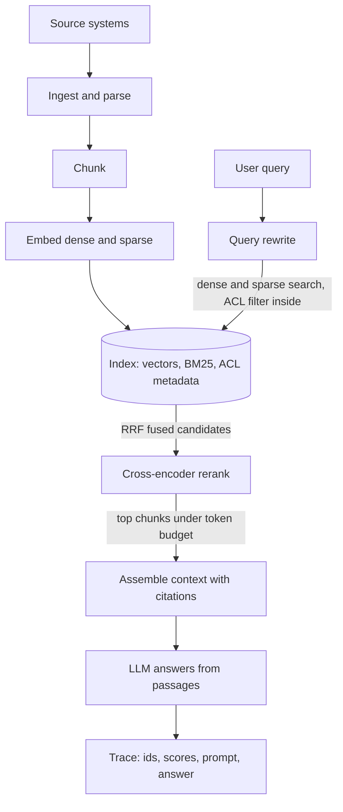

## TL;DR
RAG is two pipelines joined by an index: offline, documents become searchable chunks; online, a query
retrieves the few relevant chunks and the model answers from them. It exists because weights are
frozen and permission-blind, while product facts are changing, private and access-controlled.

## Why it exists
- **Weights are a frozen public snapshot.** A model answers from its weights and its context window.
  The weights do not contain your pricing table, last week's incident report or the customer's
  contract, and cannot be told that user A may see document X and user B may not.
- **Fine-tuning does not fix it.** It teaches style and format reliably and facts unreliably, is stale
  the moment a document changes, and has no notion of provenance or per-user access, so you can
  neither cite a source nor revoke one.
- **Stuffing the context window stops scaling.** Right for a handful of pages (see the
  long-context-vs-RAG lesson), but cost and latency scale with input tokens on every request: a 500-page
  knowledge base read on every question is unaffordable even when it fits.
- **More context can mean worse answers.** Attention quality degrades when relevant material is buried
  in the middle of a very long prompt (the lost-in-the-middle effect), and access control still has to
  happen somewhere before the prompt is built.
- **Retrieval solves selection.** Pick the few passages that matter for this query, for this user, right
  now, and let the model read and synthesize. The architecture makes that selection fast, fresh,
  permission-aware and measurable.

## How it works
### The offline pipeline: documents to index
1. **Ingest.** Connectors pull documents from sources (wikis, tickets, object storage, databases) with
   metadata: owner, ACL, timestamps, source URL. Ingestion is event- or schedule-driven *because*
   freshness is a property of this path and nothing downstream can repair a stale index.
2. **Parse and normalize.** PDFs, HTML and slides become clean text with structure preserved (headings,
   tables). Most silent quality loss happens here; garbage in here is unrecoverable at query time.
3. **Chunk.** Split text into retrieval units, typically a few hundred tokens, with overlap or
   parent–child linking. Chunks are the unit of retrieval *because* an embedding summarizes one idea
   well and a whole document badly, and you want to pay for a paragraph of context, not a chapter.
4. **Embed and index.** Each chunk gets a dense vector and usually a sparse (BM25) representation,
   stored with the chunk text and metadata in a store that supports approximate nearest-neighbour search
   plus filtering.
   - Record the embedding model version with every vector *because* vectors from different models are
     not comparable, so a model upgrade means a re-index.

### The online pipeline: query to answer
1. **Query understanding.** Optionally rewrite the query: expand acronyms, resolve "it" from the
   conversation, split multi-part questions. The raw user message is often a poor search query.
2. **Retrieve.** Run dense and sparse search with metadata and ACL filters applied *inside* the search,
   not after, *because* filtering after top-k can leave a user with zero permitted results and leaks the
   existence of forbidden ones. Fuse the ranked lists (see below).
3. **Rerank.** A cross-encoder scores (query, chunk) pairs jointly and reorders the top 50–100
   candidates. First-stage retrieval optimizes recall cheaply; the reranker buys precision for the
   handful of chunks you will actually pay to put in the prompt.
4. **Assemble context.** Select the top chunks under a token budget, drop near-duplicates, order them
   deliberately (most relevant first or last, never buried), and attach citation handles.
5. **Generate.** Instruct the model to answer only from the provided passages and to cite them;
   structured output can enforce the citation format. A grounding check (does each claim map to a
   passage?) can run as a post-step.
6. **Observe.** Log the query, retrieved ids, scores, the final prompt and the answer under one trace
   id. Without this you cannot distinguish "retrieval missed" from "model ignored the passage", and
   those are fixed in different places.

### Fusing ranked lists: reciprocal rank fusion
Reciprocal rank fusion is the common default:

`score(d) = Σ_lists 1 / (k + rank_list(d))` with k ≈ 60.

- **It fuses ranks, not raw scores,** *because* a BM25 score and a cosine similarity live on different
  scales and cannot be added.
- **Agreement beats a single strong vote.** With k = 60, a chunk ranked 1st by dense search only
  scores 1/61 ≈ 0.0164; a chunk ranked 3rd in both lists scores 2/63 ≈ 0.0317. Agreement between two
  independent retrievers is exactly the behaviour you want from fusion.
- **The large k flattens the curve,** so rank 1 versus rank 5 matters little and presence in a list
  matters a lot.

### Single-shot versus iterative retrieval
| | Single-shot | Iterative (agentic RAG, or decompose chain) |
|---|---|---|
| Retrievals per question | one | many |
| Right for | most lookups | multi-hop questions |
| Latency and cost | predictable | multiplied per question |

- **Why single-shot fails on multi-hop.** In "which of our customers on the legacy plan were affected
  by last week's incident?" the second hop's query depends on the first hop's answer, and no single
  embedding of the original question finds both.
- **Two fixes.** Expose `search` as a tool and let a model call it in a loop (agentic RAG), or run a
  fixed decompose → retrieve-per-sub-question → merge chain.
- **Route to them sparingly:** only when a classifier or the first pass signals that one retrieval was
  not enough.

### Where the boundaries go
- **Retrieval is its own service** with a typed interface, roughly `search(query, user, filters, k)
  -> [chunk]`, *because* it is shared by chat, agents and batch jobs, has its own scaling profile (CPU-
  and IO-bound, cacheable), and is the component you evaluate independently with recall@k.
- **The index is derived, never authoritative.** Source systems stay the source of truth and the index
  is a rebuildable cache, which makes re-chunking and re-embedding a routine job rather than a migration.

### Sizing intuition (illustrative)
| Quantity | Value |
|---|---|
| Corpus | 50,000 documents × 20 chunks each = 1,000,000 chunks |
| One 1024-dimension fp32 vector | 4 KB |
| Raw vectors | about 4 GB, before the ANN index and the chunk text |
| Prompt evidence | retrieve 50 candidates, keep 8 chunks of roughly 300 tokens ≈ 2,400 tokens |

- **pgvector is comfortable at this scale;** a dedicated vector database earns its keep one or two
  orders of magnitude later.
- **Evidence cost is fixed per question regardless of corpus size,** which is the whole economic
  argument for retrieval over stuffing.

## Diagram
The left branch is the offline pipeline that builds the index; the right branch is the online query
path, which meets the index and continues down to the answer. Note that the ACL filter runs inside the
search, before fusion and reranking.



## Examples
### The online path in code
Hybrid retrieval with reciprocal rank fusion, a cross-encoder reranker, and token-budgeted context
assembly with the ACL filter inside the search. The `store`, `reranker`, `embed` and `log_trace` calls
stand in for your vector database, BM25 index, embedding model and tracing; the pipeline shape is what
matters.

```python
from collections import defaultdict

def rrf(ranked_lists, k=60):
    """Reciprocal rank fusion: ids near the top of any list win."""
    score = defaultdict(float)
    for lst in ranked_lists:
        for rank, chunk_id in enumerate(lst, start=1):
            score[chunk_id] += 1.0 / (k + rank)
    return sorted(score, key=score.get, reverse=True)

def retrieve(query, user, store, reranker, k_dense=40, k_sparse=40, budget_tokens=2400):
    acl = {"tenant": user.tenant, "groups": user.groups}          # filter inside the search
    dense = store.vector_search(embed(query), k=k_dense, filters=acl)
    sparse = store.bm25_search(query, k=k_sparse, filters=acl)
    candidates = rrf([dense, sparse])[:60]
    chunks = store.fetch(candidates)                                # text + metadata
    scores = reranker.score(query, [c.text for c in chunks])       # joint (query, chunk) scoring
    ordered = [c for _, c in sorted(zip(scores, chunks), key=lambda p: -p[0])]
    context, used = [], 0
    for c in ordered:                                               # dedupe step omitted for brevity
        if used + c.tokens > budget_tokens:
            break
        context.append(c); used += c.tokens
    return context

def answer(query, user, store, reranker, llm):
    ctx = retrieve(query, user, store, reranker)
    passages = "\n\n".join(f"[{i+1}] ({c.source}) {c.text}" for i, c in enumerate(ctx))
    prompt = ("Answer using only the passages below and cite passage numbers. "
              "If the passages do not contain the answer, say so.\n\n"
              f"{passages}\n\nQuestion: {query}")
    out = llm(prompt)
    log_trace(query=query, chunk_ids=[c.id for c in ctx], answer=out)   # one trace id per request
    return out
```

### Runnable: why fusion rewards agreement
Pure Python, no dependencies. Chunk `a` is 1st in dense only; chunk `b` is 3rd in both lists.

```python
def rrf_scores(ranked_lists, k=60):
    s = {}
    for lst in ranked_lists:
        for rank, cid in enumerate(lst, start=1):
            s[cid] = s.get(cid, 0.0) + 1.0 / (k + rank)
    return dict(sorted(s.items(), key=lambda kv: -kv[1]))

dense  = ["a", "x", "b", "y"]
sparse = ["p", "q", "b", "z"]
for cid, sc in rrf_scores([dense, sparse]).items():
    print(cid, round(sc, 4))
# b 0.0317   <- 3rd in both lists: 2/63
# a 0.0164   <- 1st in one list only: 1/61
# p 0.0164
# ...
```

### Worked incident: contractors get "no information"
Same question, two user groups, post-filtering in place (global top-k = 8, then ACL filter). Numbers
are illustrative.

| Step | Employee query | Contractor query |
|---|---|---|
| Global top-8 retrieved | 8 employee-only HR chunks; public policy ranks 11th | same 8 chunks |
| ACL filter after top-k | 8 permitted | 0 permitted |
| Answer | correct, cited | "I don't have information on that" |
| After pushing ACL into search | unchanged | top-8 over permitted docs, public policy now in the set |

## Production patterns
- **ACL predicate inside the vector query.** When multiple tenants or groups share an index, put the
  filter in the same query as the similarity order (in pgvector, a `WHERE tenant_id = ...` clause next
  to `ORDER BY embedding <=> ...`). With HNSW and selective filters, enable pgvector's iterative index
  scans (0.8.0+, `SET hnsw.iterative_scan = relaxed_order`) so a filter cannot starve top-k. Monitor
  zero-result rate per user group.
- **Versioned embeddings with blue/green re-index.** Store the embedding model name on every row, build
  the new index side by side, run the golden query set against both, then switch the read alias.
  Monitor recall@k before and after cutover and keep the old index until it holds.
- **Golden query set as a CI gate.** Keep labeled (query, expected chunk ids) pairs per domain and
  compute recall@k and reranker precision on every chunking, embedding or prompt change. Fail the build
  on a regression beyond a threshold you set. Monitor faithfulness separately on sampled live traffic.
- **One trace per request.** Emit query, rewritten query, retrieved ids and scores, final prompt and
  answer under one trace id (for example as OpenTelemetry span attributes). Review traces tagged by
  user feedback and classify each failure as "retrieval missed" or "model ignored the passage".
- **Index lag and deletion tracking.** Drive ingestion from source change events where possible and
  propagate deletes as tombstones. Monitor lag as source `updated_at` minus indexed time, and alert
  when deleted documents still appear in citations.

## Trade-offs
- **Fresh, citable answers vs an extra hop.** You get fresh, citable, permission-aware answers but pay a
  retrieval hop on every request. When the corpus is small and static enough to fit the window cheaply,
  long context wins and the index is overhead.
- **Hybrid plus rerank vs operational load.** Answer quality rises measurably, but two more models and
  services must be operated. If queries are dominated by exact identifiers (SKUs, error codes), sparse
  retrieval alone may be enough.
- **Small chunks vs lost context.** Small chunks improve retrieval precision while losing surrounding
  context; parent–document retrieval buys both at the cost of a second lookup and more prompt tokens.
- **Derived index vs eventual consistency.** A rebuildable index makes re-embedding routine, but
  consistency with sources is eventual. Where staleness is a correctness bug (prices, permissions) you
  need synchronous invalidation or a live lookup tool instead.
- **Separate retrieval service vs a network boundary.** Independent scaling and evaluation, at the cost
  of a network boundary and a contract that must be versioned.

## Pitfalls
- **Filtering by ACL after retrieval.** Symptom: users get "no results" for questions the system clearly
  has documents about, or worse, a forbidden title appears in a citation. Fix: filter inside the search.
- **Treating parsing as solved.** Symptom: retrieval returns the right document but its chunk text is a
  mangled table, so the model answers confidently and wrongly. Fix: inspect parsed output per source type.
- **Upgrading the embedding model without re-indexing everything.** Symptom: a sudden recall collapse
  that only affects documents ingested after the upgrade, or only those before it. Fix: re-embed the
  whole corpus into a new index and cut over, never mix model versions.
- **Judging by end-to-end answer quality alone.** Without recall@k on a labeled query set you cannot
  tell retrieval failures from generation failures, and you end up tuning prompts to fix an index
  problem. Fix: measure retrieval and generation separately.
- **Adding chunks to paper over retrieval misses.** Symptom: cost per question climbs while faithfulness
  falls, because the right passage is now buried among near-misses and the model blends them. Fix:
  improve recall (parsing, chunking, hybrid, rerank) instead of widening the context.
- **Letting the index become the system of record.** Hand-edited chunks, data that exists nowhere else.
  Symptom: a re-chunking project that nobody dares to run. Fix: write corrections back to the source.

## When to use
- **Use when:** answers must come from content that is private, changing, large or access-controlled,
  and users need citations they can check.
- **Avoid when:** the knowledge is small and stable (a long system prompt with prompt caching is
  simpler), the task is precise querying of structured data (give the model a SQL or API tool), or the
  "knowledge" is really behaviour (prompt or fine-tune).
- **Measure:** retrieval and generation separately: recall@k and reranker precision on a golden query
  set, plus faithfulness of answers to the retrieved passages.
- **Day to day:** two deployables with different cadences, indexing jobs and a query service, sharing
  one contract.
- **Interviews:** draw both pipelines, place the ACL filter and the reranker correctly, and explain why
  the index is derived rather than authoritative.

## Role lens
- **Engineer:** Builds the chunk-embed-index jobs and the query service, wires hybrid search and
  reranking, and owns the retrieval eval harness that catches regressions before users do.
- **Architect:** Decides the service boundary, the vector store (pgvector versus dedicated), the freshness
  and consistency model, and how tenancy and ACLs are enforced inside search.
- **FDE:** Maps a customer's document sources, permissions and update frequency onto the pipeline, and
  explains why parsing quality and ACL propagation dominate the project timeline.

## Check yourself
**Q:** A customer reports that the assistant answers policy questions correctly for most employees but
tells contractors "I don't have information on that", even for public policies. Where in the RAG
architecture would you look first, and why?
**A:** The pattern, correct for one group and empty for another on the same public content, points at
access control interacting with retrieval, not at the model. The most likely cause is post-filtering:
the search returns a global top-k, then ACL filtering removes everything contractors cannot see, and
because employees' private documents outrank the public policy, contractors are left with nothing. The
fix is to push the ACL predicate into the search query so top-k is computed over permitted documents
only. I would verify by logging retrieved ids before and after filtering for a contractor query, and
check that public policies carry the correct ACL metadata at ingestion, since a mis-tagged document in
the offline pipeline would produce the same symptom.

## Interview questions
### Why use retrieval instead of fine-tuning the model on your documents?

- **Fine-tuning teaches style, not facts.** It is reliable for format and tone, unreliable for facts,
  and stale the moment a document changes.
- **It has no provenance or access control.** You cannot cite a fine-tuned fact or revoke it for one
  user, while retrieval selects permitted passages per request and attaches citation handles.

### Users say answers are wrong. How do you tell a retrieval failure from a generation failure?

- **Start from the trace.** Pull the logged query, retrieved chunk ids, scores and final prompt for
  the bad answers under their trace id.
- **Right passage absent:** a retrieval problem; check recall@k on the golden set, parsing quality and
  chunking before touching the prompt.
- **Right passage present but ignored or blended:** a generation or context-assembly problem; check
  ordering, the token budget and near-duplicate chunks crowding the evidence.

### Why fuse dense and sparse results with reciprocal rank fusion rather than adding their scores?

- **Scores live on different scales.** A BM25 score and a cosine similarity cannot be added, so RRF
  uses ranks: `score(d) = Σ 1 / (k + rank)` with k ≈ 60.
- **It rewards agreement.** A chunk ranked 3rd in both lists scores about 0.0317, beating a chunk
  ranked 1st in one list only at about 0.0164.

### When would you not build a RAG pipeline?

- **Small, stable knowledge:** a long system prompt with prompt caching is simpler than an index.
- **Structured data questions:** give the model a SQL or API tool instead of embedding rows.
- **Behaviour rather than knowledge:** if the gap is tone or format, change the prompt or fine-tune;
  retrieval only fixes what the model does not know.

### Roughly how big is the index for 50,000 documents, and what does each question cost in evidence?

- **Vectors:** 50,000 documents × 20 chunks is 1,000,000 chunks; at 4 KB per 1024-dimension fp32
  vector that is about 4 GB before the ANN index and chunk text, comfortable for pgvector.
- **Evidence per question:** retrieve 50 candidates, keep 8 chunks of about 300 tokens, roughly 2,400
  tokens, and that cost stays fixed as the corpus grows.

### How do you upgrade the embedding model without a recall outage?

- **Vectors from different models are not comparable,** so every vector must be re-embedded; mixing
  them collapses recall for one half of the corpus.
- **Blue/green re-index:** build the new index beside the old one, run the golden query set against
  both, switch the read alias, and keep the old index until recall@k holds in production.

## Quiz
### Q: Why is the index treated as derived data rather than the system of record?
- [ ] Vector databases cannot store the original text
- [x] It keeps re-chunking and re-embedding a safe, repeatable rebuild instead of a data migration
- [ ] Regulations prohibit storing documents in more than one place
- [ ] Derived indexes are faster to query than authoritative ones
> If sources remain authoritative, the index can be dropped and rebuilt whenever chunking or the
> embedding model changes. Making it authoritative turns every retrieval improvement into a risky
> migration.

### Q: Where should per-user access control be applied in the query path?
- [ ] After generation, by redacting the answer
- [ ] After top-k retrieval, by removing forbidden chunks
- [x] Inside the retrieval query, so top-k is computed over permitted documents only
- [ ] In the embedding model, by training it on permitted documents
> Filtering after top-k can leave a user with zero permitted results and still reveals what was ranked.
> Pushing the predicate into search keeps recall for permitted documents and leaks nothing.

### Q: What does a reranker add that first-stage hybrid retrieval does not?
- [ ] Higher recall across the whole corpus
- [x] Joint scoring of each (query, chunk) pair, buying precision for the few chunks that enter the prompt
- [ ] Access-control filtering
- [ ] Freshness, by re-fetching documents from their sources
> First-stage retrieval scores query and chunk independently for speed and recall. A cross-encoder
> reads them together and is more accurate, but is too slow to run over the whole corpus, so it is
> applied only to the shortlist.
