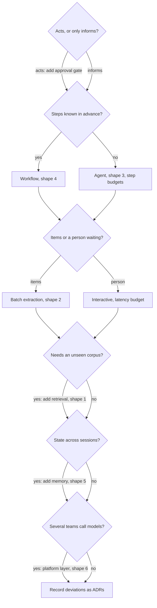

## TL;DR
A reference architecture is a validated, reusable blueprint for a recurring system shape (RAG assistant,
extraction pipeline, agent, workflow, gateway). Starting from the matching one means you deviate
deliberately instead of rediscovering missing pieces after launch.

## Why it exists
- **Every first team leaves out the same boxes.** The first document assistant omits evaluation,
  tracing, access control on retrieval, a gateway with version pinning and output validation, and finds
  out in production, one incident at a time. The second team repeats it with different names, so the
  two systems cannot share a review checklist, a monitoring dashboard or an engineer.
- **It solves three problems at once.** It is a **memory** of which components a shape needs and why,
  including ones invisible in a demo; a **vocabulary** ("where is your control layer" points at the
  diagram); and a **baseline for deviation**: a team that omits the reranker or approval gate must say
  why, which is exactly the conversation a review should be.
- **First principles per team fails.** It is slower and, worse, inconsistent where risk lives, because
  the omitted parts are precisely the ones that only hurt later (evals, guardrails, cost metering).
- **One mandated architecture fails too.** A batch extraction job and an interactive agent have
  different latency, state and risk profiles; forcing one shape onto both produces a bad version of
  each. A small catalogue, each entry matched to a problem shape, sits between the two.

## How it works
### What a reference architecture contains
More than a diagram. A useful one states:
- **Problem shape** it fits: interaction pattern, latency class, risk class.
- **Components** with one-line responsibilities.
- **Data flows**, including what reaches the model and what is stored.
- **Default NFRs**: typical latency budget, cost driver, availability target.
- **Variation points** where legitimate choices exist.
- **Anti-patterns** seen in the wild.

It should fit on a page and map directly onto a C4 container diagram; if it needs twenty pages it is a
design document, not a reference.

### The recurring shapes in AI systems
1. **Retrieval-augmented assistant.** Ingestion pipeline → chunk and embed → index with metadata and
   ACLs → query path: rewrite, retrieve, rerank, assemble context → model → cite and validate → UI.
   Interactive; risk is wrong or leaked information. Variation points: hybrid versus dense retrieval,
   reranker or not, long context versus retrieval. Deep treatment in `rag-architecture`; every box
   exists for a reason that surfaces only when it is missing.
2. **Extraction and classification pipeline.** Queue or batch scheduler → document parsing → model with
   a strict output schema → validation and confidence scoring → human review queue for low-confidence
   items → system of record. Batch; risk is silent data corruption. Variation points: small fine-tuned
   versus general model, review sampling rate. Small models and distillation pay off most here.
3. **Tool-using agent or copilot.** Orchestrator loop: plan, call tools through typed contracts,
   observe, repeat, with step budgets, approval gates before consequential actions and an execution
   sandbox. Seconds to minutes; risk is an unintended action. Variation points: single versus
   multi-agent, autonomy per action class. Deep treatment in `agentic-architecture`.
4. **Multi-step workflow.** A fixed DAG where some nodes are model calls and others code; each node has
   a contract and a test. Latency depends on the longest path; risk is low because control flow is
   deterministic. The default when steps are known in advance; `workflow-orchestration` covers engines.
5. **Conversational assistant with memory.** The RAG assistant plus session state, memory retrieval and
   update policies, context compaction for long sessions, and streaming. New risk: memory poisoning and
   stale personalisation; see `memory-architecture`.
6. **Platform layer.** A gateway in front of every model: authentication, routing, version pinning,
   rate limits, caching, cost attribution, tracing, central guardrails. It makes the other five
   governable at company scale; see `ai-gateway`.

| Shape | Latency class | Main risk |
|---|---|---|
| 1 RAG assistant | interactive | wrong or leaked information |
| 2 Extraction pipeline | batch | silent data corruption |
| 3 Agent / copilot | seconds to minutes | unintended action |
| 4 Workflow | longest path | low (deterministic control flow) |
| 5 Assistant with memory | interactive, streaming | memory poisoning, stale personalisation |
| 6 Platform layer | adds to every call | shared dependency |

- **Agents need a justification.** The agent shape is justified only when the steps cannot be
  enumerated up front; the Anthropic guidance on building effective agents is the standard argument for
  starting with the simplest shape that works.

### Cross-cutting components every shape shares
- **Evaluation harness and golden set,** because every shape's output is probabilistic and quality
  is only visible over a dataset.
- **Tracing with cost per call,** so failures and spend can be attributed to a route and a version.
- **A prompt and model registry,** so what is running in production is versioned, not folklore.
- **A control layer** for validation and policy, because every shape's output reaches something
  downstream.

They are drawn once in each reference so that no team can claim they were optional.

### How to apply one
Ask these in order, *because* each one removes shapes the later ones would otherwise have to rule out:
1. **Does the system act, or only inform?** Actions (writes to a system of record, money, messages
   sent) put an approval gate and a validation contract on the path regardless of shape.
2. **Can the steps be enumerated in advance?** Yes → workflow (shape 4), possibly with extraction or
   retrieval nodes. No → agent (shape 3), with step budgets.
3. **Is the input a stream of items or a person waiting?** Items → batch extraction (shape 2) with a
   review queue. A person → interactive, so a latency budget and streaming.
4. **Must answers be grounded in a corpus the model has not seen?** Yes → retrieval (shape 1).
5. **Does state persist across sessions?** Yes → add memory (shape 5).
6. **Is more than one team or product calling models?** Yes → the platform layer (shape 6) belongs
   underneath all of them.

### Compose, deviate, record, revisit
- **Real systems are compositions.** Most production assistants are a workflow whose nodes include a
  retrieval step and an extraction step, behind the platform layer.
- **Vendor references are inputs, not answers.** Cloud providers and vendors publish reference
  architectures, but they tend to put the vendor's product in every box; extract the shape and keep
  component names abstract.
- **Record each deviation as an ADR with the reason.** "No reranker because the corpus is 400
  documents and recall is already above the bar" is a fine decision; silence is not.
- **Use it in review.** The component list is the review checklist; the variation points are the
  agenda for the design discussion.
- **Keep it alive.** When a system fails in a way the blueprint did not anticipate, fold the lesson
  back in; a reference architecture that is never updated becomes folklore.

## Diagram
The six questions as a decision path: each answer adds a shape or a component, and the result is a
composition, not a single box.



## Examples
### Worked scenario: "AI to handle inbound supplier emails"
A logistics company asks for this. Discovery shows two distinct jobs:
- **(a)** classify each email (invoice, delay notice, dispute, other) and extract fields such as PO
  number and new delivery date into the ERP;
- **(b)** let a coordinator ask questions like "which suppliers have slipped twice this quarter" over the
  resulting data plus contracts.

**Job (a) is shape 2, the extraction pipeline.**
1. Mail connector → queue → parser for PDF attachments.
2. Model call with a JSON schema of about ten fields.
3. Validation: the PO number must exist in the ERP, dates must be in the future.
4. Confidence from a second, independent check: the model's PO number must also match a regex pass over
   the raw text, and the supplier on the PO must match the sender's domain.
5. Anything that fails a check or disagrees goes to a review queue; everything else writes to the ERP
   with provenance.

| Aspect | Decision |
|---|---|
| Default NFRs | processing within 15 minutes, zero silent writes of invalid data, cost dominated by attachment pages |
| Variation point taken | start with a general model, route *every* item to review for the first weeks |
| Lowering review | only as measured precision on reviewed items stays above the bar |
| Review queue role | simultaneously the safety net and the labelling pipeline |
| Next step | evaluate a small fine-tuned model once a few thousand reviewed examples exist |

**Job (b) is shape 1 plus a structured-data tool, not an agent.**
- The questions are answerable by retrieval over contracts plus a parameterised SQL query over the
  extracted table, so a two-node workflow (route, then answer with citations) is enough.
- ADR deviation: "no free-form SQL generation; queries are templates with parameters", because the risk
  class is read-only information but the coordinators are not able to check generated SQL.

**Shared:** both jobs sit behind the same gateway and tracing stack; each has its own golden set: 300
labelled emails for (a), 80 question-answer pairs for (b).

### Job (a)'s confidence check as code
Every independent check must agree before a write; anything else goes to review with its reasons. The
PO format is illustrative.

```python
import re
from datetime import date

PO_RE = re.compile(r"\bPO-\d{6}\b")          # illustrative PO format

def route(extracted, raw_text, sender_domain, erp, today=None):
    """Return ('erp', record) only if every independent check agrees, else ('review', reasons)."""
    today = today or date.today()
    po = extracted.get("po_number")
    failed = []
    if po not in erp:
        failed.append("po_not_in_erp")
    if po not in PO_RE.findall(raw_text):
        failed.append("po_not_in_raw_text")      # second, independent pass over the source
    if erp.get(po, {}).get("supplier_domain") != sender_domain:
        failed.append("supplier_mismatch")
    if not extracted.get("new_delivery_date") or extracted["new_delivery_date"] <= today:
        failed.append("date_not_in_future")
    if failed:
        return "review", failed
    return "erp", {**extracted, "provenance": {"source": "email", "checks": "all_passed"}}

erp = {"PO-123456": {"supplier_domain": "acme.example"}}
email = "Hi, PO-123456 will now ship on 2026-11-03."
print(route({"po_number": "PO-123465", "new_delivery_date": date(2026, 11, 3)},
            email, "acme.example", erp, today=date(2026, 10, 20)))
# ('review', ['po_not_in_erp', 'po_not_in_raw_text', 'supplier_mismatch']): a transposed digit is caught
```

### The six questions as a shape matcher
A runnable sketch of "How to apply one", fed the support-ticket refund case from Check yourself.

```python
def match_shapes(acts, steps_known, person_waiting, needs_corpus, persistent_state, many_teams):
    """The six questions, in order; returns the composition to start from."""
    plan = []
    if acts:
        plan.append("approval gate + validation contract on the action path")
    plan.append("workflow (4)" if steps_known else "agent (3) with step budgets")
    plan.append("interactive: latency budget + streaming" if person_waiting
                else "batch extraction (2) + review queue")
    if needs_corpus:
        plan.append("retrieval (1)")
    if persistent_state:
        plan.append("memory (5)")
    if many_teams:
        plan.append("platform layer (6) underneath")
    return plan

for line in match_shapes(acts=True, steps_known=True, person_waiting=False,
                         needs_corpus=True, persistent_state=False, many_teams=True):
    print("-", line)
```

## Production patterns
- **One-page catalogue entry.** When a shape has been built twice. Keep a template in the repo next to
  the ADRs with fixed headings: problem shape, components, data flows, default NFRs, variation points,
  anti-patterns. Monitor how often reviews find missing cross-cutting components; it should trend to zero.
- **Deviation requires an ADR link.** At every architecture review. The checklist lists each blueprint
  component; an omitted one needs a linked ADR with the reason or the review fails. Monitor deviations
  without ADRs, and the same unblessed deviation recurring across teams (the signal for a new entry).
- **Review everything, then sample.** For extraction pipelines that write to a system of record. Start
  with 100% of items routed to human review, lower the rate step by step only while measured precision
  on reviewed items stays above the bar. Monitor sampled precision, review queue depth and age.
- **Exploration variant versus production gate.** For prototypes. Allow a lighter variant (stubbed
  guardrails, no reranker) during exploration, and enforce the full shape, including eval set, tracing
  and gateway, as the production gate. Monitor how many prototypes reach users without passing the gate.
- **Platform layer as a shared dependency.** Once several products call models. Put one gateway
  underneath all of them and treat it as tier-0 infrastructure with its own SLO. Monitor added latency
  per call, gateway availability and per-product cost attribution.

## Trade-offs
- **Shared blueprint vs novelty.** It speeds design and review but biases teams toward the known shape;
  a genuinely new problem may need a new reference, and forcing it into an old one hides the novelty.
  The signal for a new entry is the same unblessed deviation recurring across teams.
- **Rich mandatory components vs prototype cost.** Many mandatory components raise the quality floor
  but also the cost of a prototype. Keep a lighter "exploration" variant and insist on the full shape
  only at the production gate.
- **Central gateway vs shared blast radius.** Standardising on the platform gateway centralises
  governance and cost control but creates a shared dependency whose outage or latency affects every
  product. It flips to per-team gateways only when teams have truly independent risk and release cadences.
- **Central vs incident-driven ownership.** Centrally owned catalogues stay consistent but go stale;
  ones owned by whoever last had an incident stay current but drift apart. A small owning group with a
  lightweight change process is the usual compromise.

## Pitfalls
- **Agent shape for known steps.** Symptom: unpredictable latency and cost, and debugging sessions that
  end in "the model decided to". Fix: a workflow with contracted nodes.
- **Dropping the cross-cutting boxes** because "we will add evals later". Symptom: the first model
  upgrade is a coin flip and nobody can say whether quality moved. Fix: the eval set, tracing and
  gateway are part of the production gate, not a follow-up.
- **Treating the reference as mandatory in every detail.** Symptom: a 400-document corpus gets a
  reranker, a query rewriter and a multi-hop planner, and the simplest question takes eight seconds.
  Fix: treat variation points as choices and record each omission as an ADR.
- **Reference describes a vendor's product, not a shape.** Symptom: switching a component requires
  rewriting the architecture document, and the exit cost is discovered at renewal. Fix: keep component
  names abstract and map vendors onto them per system.
- **Never recording deviations.** Symptom: six months later nobody knows whether the missing approval
  gate was a decision or an oversight. Fix: a review that fails any omitted component without an ADR.

## When to use
- **Use when:** starting any design, during an architecture review, and when onboarding an engineer to
  an existing system. The first question is always "which shape is this, and where does it deviate".
- **Avoid when:** you would use it as a substitute for discovery. The shape follows from the
  interaction pattern and risk class, which only requirements work can establish.
- **Measure:** how often reviews find missing cross-cutting components (should trend to zero) and how
  long design takes for a standard shape.
- **Interviews:** naming the shape, its components and its default risks in the first two minutes of a
  system-design question separates practised candidates from those who start with a box labelled "LLM".

## Role lens
- **Engineer:** Uses the blueprint as a build checklist and knows which components can be stubbed in a
  prototype and which must exist before anything is user-facing.
- **Architect:** Owns the catalogue, decides which shape a new problem belongs to, and insists that
  every deviation from the blueprint is written down as an ADR with its reasoning.
- **FDE:** Carries the blueprints into customer engagements to scope quickly, and adapts them to the
  customer's identity, data and deployment constraints without dropping the governance boxes.

## Check yourself
**Q:** A customer wants a system that reads incoming support tickets, looks up the customer's account,
decides whether to issue a refund under policy, and replies. Which reference shape or shapes apply, and
where would you place the human?
**A:** This is a workflow, not an agent: the steps are known in advance, so a fixed DAG with contracts
per node is the right shape. Classify the ticket and extract the claim (extraction shape with a strict
schema and validation), look up the account through a typed tool, evaluate the policy in code rather
than in the model because refund rules are deterministic and auditable, draft the reply with a model
grounded on the policy text and the account facts, and send. The human belongs at the action boundary:
the refund itself is a consequential, irreversible action, so it goes through an approval gate at
least until the system's precision on a golden set justifies auto-approval below a monetary threshold.
Replies that do not move money can be sent after output validation. Both halves share the gateway,
tracing and an evaluation set built from historical tickets with their resolutions.

## Interview questions
### What is a reference architecture, and why not just design each AI system from first principles?
- **A validated blueprint for a recurring shape:** problem shape, components, data flows, default NFRs,
  variation points and anti-patterns, on about one page.
- **First principles per team is slower and inconsistent where risk lives,** because the parts teams
  omit (evals, guardrails, cost metering) are exactly the ones that only hurt later.
- **It also gives a shared vocabulary and a baseline,** so a review discusses deliberate deviations
  instead of rediscovering missing boxes.

### A customer asks for "AI to process inbound supplier emails". How do you pick the shape?
- **Split the request into jobs first.** Classifying emails and writing fields to the ERP is the
  extraction pipeline; answering coordinators' questions over that data is retrieval plus a
  structured-data tool.
- **Walk the six questions for each job:** acts or informs, enumerable steps, items or a person
  waiting, corpus, state, number of teams.
- **Put the human at the action boundary:** a review queue for low-confidence extractions, which also
  becomes the labelling pipeline.

### When would you push back on a team that wants the agent shape?
- **When the steps can be enumerated up front.** A fixed workflow gives the same result with
  deterministic control flow, predictable cost and nodes you can test.
- **The symptom of the wrong choice** is unpredictable latency and cost, and debugging that ends in
  "the model decided to".
- **The agent is justified only when the path genuinely depends on what the model observes,** and then
  it comes with step budgets, approval gates and a sandbox.

### Which components must exist in every shape, and how do you enforce that in practice?
- **Cross-cutting boxes:** an evaluation harness with a golden set, tracing with cost per call, a prompt
  and model registry, and a control layer for validation and policy.
- **Enforce them through review:** the blueprint's component list is the checklist, and an omitted
  component needs a linked ADR or the review fails.
- **Measure the process:** missing cross-cutting components found in review should trend to zero.

### How do you keep a catalogue of reference architectures from going stale or becoming vendor brochures?
- **Fold incidents back in.** When a system fails in a way the blueprint did not anticipate, update the
  entry, or it becomes folklore.
- **Watch for recurring unblessed deviations** across teams; that is the signal a new entry is needed.
- **Keep component names abstract.** Vendor references put their product in every box; extract the
  shape so switching a component does not mean rewriting the architecture document.

## Quiz
### Q: What distinguishes a reference architecture from a design document for one system?
- [ ] A reference architecture names specific vendors for each component
- [x] A reference architecture describes a reusable shape with variation points and known failure modes, independent of any one system
- [ ] A reference architecture is produced after the system ships, as documentation
- [ ] A reference architecture only covers the model and prompt, not the infrastructure
> A reference is a blueprint for a class of problems: components, responsibilities, defaults and
> anti-patterns, with explicit places where choices are allowed. A design document instantiates one
> for a particular system and records its deviations.

### Q: A team proposes an autonomous agent for a process whose five steps are the same for every input. What is the architectural objection?
- [ ] Agents cannot call more than one tool per step
- [ ] Agents are only appropriate for batch workloads
- [x] A fixed workflow gives the same result with deterministic control flow, predictable cost and testable nodes, so the agent's flexibility buys nothing and costs reliability
- [ ] Agents require fine-tuned models, which the team does not have
> The agent shape is justified when the steps cannot be enumerated up front. When they can, a DAG of
> contracted nodes is cheaper to run, easier to test and easier to debug; choosing the agent adds
> variance without adding capability.

### Q: Which components appear in every AI reference architecture regardless of shape?
- [ ] A vector database and a reranker
- [ ] A planning loop and a sandbox
- [x] An evaluation harness with a golden set, tracing with cost attribution, and a control layer for validation and policy
- [ ] A fine-tuning pipeline and a distillation step
> Retrieval, planning and fine-tuning are shape-specific. Evaluation, tracing and output control are
> cross-cutting because every shape has probabilistic output whose quality must be measured and whose
> downstream effects must be bounded.
