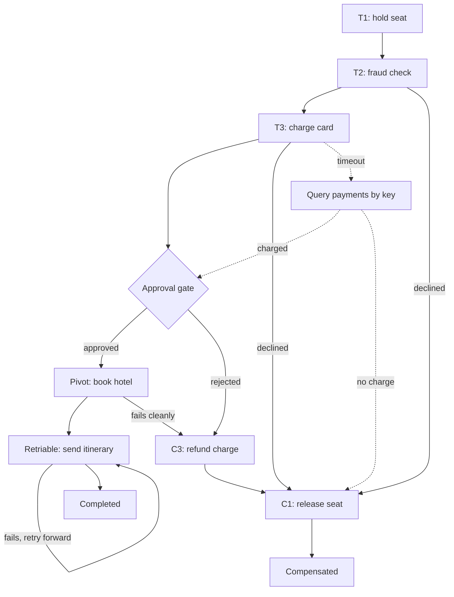

## TL;DR
An agent calling several side-effecting tools runs a saga: local steps, each paired with a
compensating action, with no shared transaction. It gives atomicity and durability but not isolation, so
order tools around the irreversible pivot, gate it, and make every call idempotent.

## For agent builders
- **Why it matters for agents.** A model decides which tools to call, in what order, with what arguments,
  and any step can fail part-way. Without a saga design, a failed step leaves a created ticket, a charged
  card and no record of what to undo.
- **Where it shows up in your stack.** Tool adapters that expose an undo (close ticket, void
  authorisation), a run log or checkpointer (LangGraph's checkpointer, a Temporal workflow history, or
  your own table), and a human-approval pause in front of irreversible tools.
- **What you control.** Classifying every tool as compensatable, pivot or retriable, the order the agent
  is allowed to call them in, idempotency keys of the form `{saga_id}:{step}`, the approval gate, and
  persisting the model's chosen arguments so retries replay them instead of re-asking the model.
- **What you can skip.** Three-phase commit and XA internals. Know why 2PC cannot include SaaS APIs, the
  compensatable, pivot and retriable split, and the unknown-outcome rule.

## Why it exists
- **No shared transaction across systems.** "Place order" reserves stock in inventory, charges the card
  through a payment provider, creates a shipment in logistics and records the order, each in its own
  database. If the charge succeeds and the shipment fails, the customer has paid for nothing, and there is
  no shared transaction to roll back.
- **Two-phase commit (2PC) is blocking.** A coordinator asks every participant to *prepare* (write durably,
  hold locks, promise it can commit), then tells them to *commit* once all vote yes. If the coordinator
  crashes after prepare, participants must hold their locks until it returns, *because* deciding alone
  could disagree with its decision. Rows stay locked for the whole outage.
- **2PC excludes the riskiest participants.** Stripe, Slack, Jira, a vector database and an LLM provider
  expose no "prepare", so the step with the most consequential side effect is exactly the one that cannot
  join. Availability compounds too: every participant must be up at the same moment, the temporal coupling
  event-driven designs try to remove.
- **The saga designs the undo explicitly.** Proposed in 1987 for long-lived database transactions, it
  accepts that there is no global rollback. Deciding what "undo a charge" means, and when undo is no longer
  possible, is the real content of the pattern.

## How it works
### Where 2PC still lives
2PC is not dead; it moved inside systems that can make its weak point safe.

| Variant | How it copes with the coordinator problem | Limit |
|---|---|---|
| Spanner-style databases | 2PC across shards, but each participant and the coordinator is a replicated consensus group; a new leader takes over with the decision already in its log | only inside that database |
| XA standard | exposes 2PC across a database and a broker that both implement it | works inside one organisation's infrastructure; excludes every SaaS API |
| Three-phase commit | adds a pre-commit round to avoid blocking under crash failures | can decide inconsistently under network partitions, so rarely deployed |

- **The lesson:** atomic commit across participants is available when you own all of them and replicate the
  coordinator. A business process across vendors is not that case.

### Structure
1. **Local transactions.** A saga is a sequence T₁ … Tₙ; each Tᵢ commits on its own, in its own service.
2. **Compensations.** Every Tᵢ that may need undoing has a compensating transaction Cᵢ.
3. **Failure path.** If Tₖ fails, the saga runs Cₖ₋₁, Cₖ₋₂, … C₁ in reverse order.
4. **Saga atomicity.** The end state is either "all Tᵢ committed" or "every committed Tᵢ compensated".
5. **Durability.** Each local commit plus a persisted saga log of which step the saga reached, *because* the
   coordinator may crash between steps and must resume rather than restart.
   - The log records intent before each step (`started charge_card`) and the outcome after
     (`done charge_card`).
   - On recovery, `started` with no `done` is the unknown-outcome case below: resolve it by querying the
     participant with the step's idempotency key, never by assuming either answer.

### Compensation is semantic, not physical
- **A rollback restores bytes; a compensation is a new business action** that cancels the effect.

| Step | Compensation | Visible to the customer? |
|---|---|---|
| Charge card | refund (not deleting the charge) | yes, on the statement |
| Reserve stock | release reservation | no |
| Send email | none; at best send a correction | yes |

- **This is why step ordering matters more in sagas than in transactions.**

### Try-Confirm-Cancel (TCC)
Split a step into a reservation and a confirmation so it is cheaper to undo:
1. **Try** places a hold that expires on its own (a seat hold, a card authorisation).
2. **Confirm** turns it into the real effect at the end of the saga.
3. **Cancel** releases it.

- **Why it helps:** most compensations become "let the hold lapse or release it", invisible to the
  customer, *because* nothing irreversible happened until confirm.
- **Cost:** the participant must support holds, and a hold's expiry must outlast the slowest path to confirm.

### Compensatable, pivot and retriable steps
| Class | Meaning | Examples |
|---|---|---|
| Compensatable | can be undone | seat hold, stock reservation |
| Pivot | the first action with no undo; after it the saga can no longer be abandoned | non-refundable booking, message delivered to a customer |
| Retriable | after the pivot; guaranteed to eventually succeed if retried | record the order, send the confirmation |

- **Charges are often the pivot.** Many payment flows treat the successful charge as the pivot even though
  refunds exist, *because* a refund is visible on the statement and costs fees.
- **The ordering rule:** put every step that might fail for business reasons (validation, stock check,
  fraud score) *before* the pivot, so compensation is rarely needed.
- **After the pivot:** make everything idempotent and retried forever, *because* you have promised the
  customer the outcome.

### No isolation
- **Partial results are visible.** Local transactions commit immediately, so other sagas and readers see
  intermediate state. Garcia-Molina and Salem's original paper already states this; Richardson summarises
  sagas as "ACD": atomicity, consistency and durability without isolation.
- **Lost update:** another saga modifies the same order between a step and its compensation.
- **Dirty read:** a dashboard shows an order as paid that is about to be refunded.

Countermeasures named in Richardson's treatment:

| Countermeasure | What it does |
|---|---|
| **Semantic lock** | write `status = PENDING` so other logic treats the record as in flight |
| **Commutative updates** | debit/credit rather than set-balance |
| **Pessimistic view** | reorder steps to shrink the window |
| **Re-reading values** | re-check before acting |
| **Version** check | reject stale writes |

### Coordination styles
- **Choreography:** each service listens for the previous step's event and emits its own; failure events
  trigger compensation. No central component, but the saga's logic is scattered across services.
- **Orchestration:** a saga orchestrator holds the state machine, sends commands, waits for replies and runs
  compensations. Beyond a handful of steps, or whenever someone must answer "which step is order 42 stuck
  on", orchestration wins.
- **Durable-execution engines** (Temporal and similar) are orchestrators with the saga log built in: your
  code is replayed from the log after a crash, and the compensation list is ordinary code.

### Unknown outcomes
- **A timeout is not a failure.** The charge may or may not have happened.
- **Compensating blindly is wrong** because it can refund a charge that never occurred.
- **Query first:** ask the participant with the step's idempotency key before deciding, which means every
  step must be issued with such a key. Timeouts become a reconciliation step, not an error branch.

### Agents are sagas
- An agent that creates a Jira ticket, posts to Slack and emails a customer is executing T₁, T₂, T₃ with no
  transaction.
- **Tool adapters** should expose compensations where they exist (close ticket, delete message).
- **The orchestrator** should place irreversible tools after a pivot, and **approval gates** belong exactly
  at the pivot.

What makes an agent saga harder than a classic one:

| Difference | Why it bites | What you do |
|---|---|---|
| The step list is chosen at run time | the model may call the irreversible tool first | enforce ordering in the tool layer: refuse pivot tools until required checks have succeeded in this run |
| Arguments are non-deterministic | a retry that re-asks the model gets different arguments | log each step's chosen tool and arguments before executing, replay them on recovery |
| Undo may be another tool call | compensation can itself fail or time out | key compensations too, and route repeated failures to a human queue |
| Long waits for approval | holds and authorisations can expire | pause the run durably and size hold expiry to the approval SLA |

## Diagram
An orchestrated saga: business checks come first, the pivot is gated, failures before the pivot unwind in
reverse (refund, then release), a timeout is reconciled by key before deciding, and failures after the
pivot are retried forward.



## Examples
### Orchestrator with compensations and a pivot
Steps run forward, each with an idempotency key derived from the saga id and step name, and committed
steps are compensated in reverse on failure. The persisted log is a list here; in production it is a table
or a durable-execution engine's history.

```python
import logging
log = logging.getLogger("saga")
NOOP = lambda ctx, idempotency_key: None      # step had no side effect worth undoing
IRREVERSIBLE = None                            # step cannot be undone: this is the pivot

class Step:
    def __init__(self, name, action, compensate):
        self.name, self.action, self.compensate = name, action, compensate

def run_saga(saga_id, steps, ctx, saga_log):
    done = []                                        # steps whose action committed
    for step in steps:
        key = f"{saga_id}:{step.name}"               # same key on every retry of this step
        saga_log.append(("started", step.name))      # intent first: recovery sees in-flight steps
        try:
            ctx[step.name] = step.action(ctx, idempotency_key=key)
            saga_log.append(("done", step.name)); done.append(step)
        except Exception as e:   # production: on a timeout, query the participant by key first
            if any(s.compensate is IRREVERSIBLE for s in done):   # pivot passed
                raise RuntimeError(f"cannot abandon saga; retry {step.name} forward") from e
            log.warning("step %s failed: %s; compensating", step.name, e)
            for prev in reversed(done):
                prev.compensate(ctx, idempotency_key=f"{saga_id}:{prev.name}:undo")
                saga_log.append(("undone", prev.name))
            return "compensated"
    return "completed"

def fraud_check(ctx, idempotency_key):
    if not fraud.passes(ctx["customer"]):            # flights, fraud, payments, hotel, mail: service clients
        raise ValueError("declined")

steps = [   # business failures first, the irreversible step as late as possible
    Step("hold_seat",   lambda c, idempotency_key: flights.hold(c["flight"], key=idempotency_key),
                        lambda c, idempotency_key: flights.release(c["hold_seat"], key=idempotency_key)),
    Step("fraud_check", fraud_check, NOOP),
    Step("charge_card", lambda c, idempotency_key: payments.charge(c["amount"], key=idempotency_key),
                        lambda c, idempotency_key: payments.refund(c["charge_card"], key=idempotency_key)),
    Step("book_hotel",  lambda c, idempotency_key: hotel.book(c["stay"], key=idempotency_key), IRREVERSIBLE),
    Step("send_itinerary", lambda c, idempotency_key: mail.send(c["employee"], key=idempotency_key), NOOP),
]
```

- **Declined charge:** if `charge_card` is declined, the seat hold is released and the saga ends as
  `compensated`.
- **Failure after the pivot:** if `send_itinerary` fails after the non-refundable hotel is booked, the
  orchestrator refuses to compensate and the caller re-runs the saga from the log.
- **Why the re-run is safe:** the idempotency keys make the hold, charge and booking no-ops on the second
  pass, so only the email is actually retried.

### Runnable: reverse compensation with idempotent undo
Self-contained fakes for a payment provider and an inventory service. The shipment step fails for a
business reason, and each compensation is deliberately run twice to show that keyed undo is safe to retry.

```python
class Payments:
    def __init__(self): self.charges, self.refunds = {}, {}
    def charge(self, amount, key):
        self.charges.setdefault(key, amount)        # same key => same charge, no double charge
        return key
    def refund(self, charge_id, key):
        self.refunds.setdefault(key, self.charges[charge_id])   # same key => one refund

class Stock:
    def __init__(self): self.held = {}
    def reserve(self, sku, key): self.held[key] = sku; return key
    def release(self, hold_id, key): self.held.pop(hold_id, None)

def ship(order, key):
    raise ValueError("address rejected")            # business failure, outcome known

pay, stock = Payments(), Stock()
saga, done = "order-42", []
steps = [("reserve", lambda: stock.reserve("sku-1", f"{saga}:reserve"),
                     lambda r: stock.release(r, f"{saga}:reserve:undo")),
         ("charge",  lambda: pay.charge(30, f"{saga}:charge"),
                     lambda r: pay.refund(r, f"{saga}:charge:undo")),
         ("ship",    lambda: ship("order-42", f"{saga}:ship"), None)]
try:
    for name, act, comp in steps:
        done.append((name, act(), comp))
except ValueError as e:
    for name, result, comp in reversed(done):      # undo in reverse order
        comp(result); comp(result)                  # run twice: a retried compensation
    print("compensated:", e)
print(stock.held, pay.charges, pay.refunds)
# compensated: address rejected
# {} {'order-42:charge': 30} {'order-42:charge:undo': 30}   one refund, not two
```

### Agent scenario: a tool layer that knows each tool's saga class
The model proposes tool calls; the tool layer enforces the saga rules, so the guarantees do not depend on
the prompt. `approve` stands in for a durable human-approval pause.

```python
TOOLS = {   # class, compensation tool (or None)
    "create_ticket": ("compensatable", "close_ticket"),
    "authorize_card": ("compensatable", "void_authorization"),
    "book_hotel":    ("pivot", None),          # non-refundable
    "send_email":    ("retriable", None),
}

def execute(run, call, impl, approve):
    cls, undo = TOOLS[call.name]
    if cls == "retriable" and not run.pivot_done:
        raise PermissionError("retriable tools run only after the pivot")   # keep emails last
    if cls == "pivot":
        if not run.checks_passed:
            raise PermissionError("pivot refused: policy and fraud checks not done")
        if not approve(run.id, call):                    # human gate exactly at the pivot
            run.compensate_all(); return "rejected"
    key = f"{run.id}:{call.name}:{run.step}"
    run.log("started", call.name, call.args, key)      # args persisted: replay, never re-ask the model
    out = impl[call.name](**call.args, idempotency_key=key)
    run.log("done", call.name, out, key)
    if undo:
        run.push_compensation(undo, out, key + ":undo")
    if cls == "pivot":
        run.pivot_done = True
    return out
```

| Run event | Classic code saga | Agent with this tool layer |
|---|---|---|
| Model calls `book_hotel` before the fraud check | not possible, order is in code | refused, the model gets the error and calls the check first |
| Worker crashes after `started book_hotel` | resume from log | resume, query partner by key, replay the logged arguments |
| Reviewer rejects at the gate | n/a | void the authorisation, close the ticket, end `compensated` |

- **Simplification.** The "retriable only after the pivot" rule assumes every run of this agent reaches a
  pivot. An agent whose runs may have no irreversible step needs a per-workflow policy for which tools must
  precede which, or it would never be allowed to send the email.

### Worked scenario: where the failure lands decides the outcome
The travel saga above, failing at each step in turn.

| Failure point | Committed so far | What the orchestrator does | Customer sees |
|---|---|---|---|
| Fraud check declines | seat hold | release hold | nothing |
| Charge declined | seat hold | release hold | a declined payment |
| Charge times out | seat hold, charge unknown | query payments by the `{saga_id}:charge_card` key, then continue if charged, release the hold if not | nothing extra, if reconciled |
| Hotel API fails cleanly | hold, charge | refund, release hold | a refund on the statement |
| Itinerary email fails | hold, charge, hotel (pivot) | retry the email forward, never compensate | a delayed email |

## Production patterns
- **Durable-execution workflow as the saga log.** When a saga has more than a few steps, write it as a
  workflow in an engine such as Temporal: after each activity succeeds, append its compensation to a list,
  and in the failure handler run that list in reverse. Configure per-activity retry policies (bounded
  attempts before the pivot, effectively unbounded after it). Monitor failed and long-running workflows.
- **Authorise now, capture later.** Use the payment provider's two-step flow (for example a Stripe
  PaymentIntent created with `capture_method="manual"`, captured at the end of the saga) so the charge is a
  TCC hold until confirm. Monitor authorisations nearing expiry, because a slow approval can outlive them.
- **Provider idempotency keys on every step.** Send the saga-derived key (`{saga_id}:{step}`) as the
  provider's idempotency key (Stripe accepts an `Idempotency-Key` header) and as the lookup for
  reconciliation after timeouts. Monitor the count of steps resolved by reconciliation.
- **Semantic lock plus version column.** Write `status = PENDING` on the aggregate when the saga starts and
  guard compensations with `UPDATE ... WHERE id = $1 AND version = $2`, so a compensation cannot silently
  overwrite a human's edit. Monitor rejected stale writes and records stuck in `PENDING`.
- **Stuck-saga reaper and repair queue.** A scheduled job finds sagas whose last log entry is older than a
  threshold, resumes them, and after N attempts routes them to a human queue. Track saga completion rate,
  compensation rate and manual-repair count.
- **Saga metadata on every agent tool.** Register each tool with its class (compensatable, pivot,
  retriable), its compensation tool and whether it accepts an idempotency key, and have the tool layer
  enforce ordering and gates. Review the registry when a tool is added. Monitor refused pivot calls,
  compensations per run and runs ending `compensated`.
- **Durable approval pause at the pivot.** Pause the agent run with its state checkpointed (frameworks
  such as LangGraph support pausing a graph for human input; durable engines wait on a signal), notify a
  reviewer, and resume with the decision. Monitor approval wait time against hold and authorisation expiry.

## Trade-offs
- **Independent availability vs visible intermediate state.** Sagas keep every service available on its own
  and need no shared lock manager, but they expose intermediate state to other readers. When an invariant
  must never be observably violated, keep those writes inside one database and one aggregate instead.
- **2PC atomicity vs blocking and reach.** 2PC gives true atomicity with no application-level compensation
  code, yet it blocks on coordinator failure and needs every participant to speak the protocol, which
  excludes external APIs and most SaaS systems.
- **Orchestration vs choreography.** Orchestration centralises visibility and compensation logic at the
  cost of a component every service depends on. Choreography removes that dependency but spreads the state
  machine across teams; it flips toward orchestration as step count or compensation complexity grows.
- **Explicit compensations vs actions with no undo.** Designing compensations forces the business to decide
  what "undo" means, which is valuable clarity, but some actions have no undo; for those the only levers
  are ordering and approval gates.
- **Forward-only retry vs a human escape hatch.** Retrying forward after the pivot guarantees completion
  without refunds, provided post-pivot steps are idempotent and the retry budget is effectively unbounded,
  which requires a dead-letter path to a human when a participant stays down.

## Pitfalls
- **Compensations that are not idempotent.** A retried refund refunds twice, discovered when finance
  reconciles payouts. Fix: key every compensation (`{saga_id}:{step}:undo`).
- **Compensating on timeout without querying the participant.** Refunds issued for charges that never
  happened, or shipments created twice, visible as unexplained negative balances. Fix: reconcile by key.
- **An irreversible step placed early.** When a later validation fails there is nothing to compensate it
  with, and the customer has an email or a ticket for an order that does not exist. Fix: move it to the
  pivot position.
- **Ignoring isolation.** A second saga (or a human in the admin panel) edits the record mid-flight and the
  compensation overwrites the change, surfacing as "the system reverted my edit". Fix: semantic lock and
  version check.
- **No saga log or heartbeat.** The orchestrator crashes between steps, nobody resumes, and orders sit in
  `PENDING` until a customer complains. Fix: persisted log plus a reaper.
- **Holds that expire before the saga confirms them.** Sagas that wait on a human approval or a slow partner
  fail at confirm with "hold not found", and the seat or authorisation is gone. Fix: size expiry to the
  slowest confirm path.
- **Treating the LLM as a step that can be redone freely.** Re-running a non-deterministic step on retry
  produces different tool arguments, so the compensation keyed to the first attempt no longer matches.
  Fix: persist the LLM's output in the log and replay it.

## When to use
- **Use when:** one business operation must update more than one service, database or external system and
  can legitimately fail part-way.
- **Avoid when:** all the data can live in a single database and a local transaction suffices, which is the
  better design more often than microservice enthusiasm suggests.
- **Before choosing:** write down each step's compensation and its idempotency key. A step with neither is
  your pivot and belongs as late as possible, possibly behind a human approval.
- **In practice:** a workflow definition in an orchestrator, a `compensate` method on a tool adapter, or a
  `status` column with `PENDING` values that other code must respect.
- **Measure:** saga completion rate, compensation rate, time stuck per step and the count of sagas needing
  manual repair.
- **Interviews:** state why 2PC is unsuitable across heterogeneous services, define compensation versus
  rollback, and bring up the lack of isolation and the pivot step without prompting.

## Role lens
- **Engineer:** Implements steps and compensations with idempotency keys, persists saga state, and
  writes reconciliation queries for steps whose outcome is unknown after a timeout.
- **Architect:** Decides aggregate boundaries so that most invariants stay inside one transaction,
  classifies steps as compensatable, pivot or retriable, and picks orchestration versus choreography.
- **FDE:** Maps a customer's cross-system process (CRM, billing, ticketing) onto a saga, identifies which
  of their systems cannot be undone, and places approval gates before those actions.

## Check yourself
**Q:** An agent books travel for an employee: it holds a flight seat, charges the corporate card, books a
non-refundable hotel through a partner API, and files an expense record. Order the steps, identify the
pivot, and describe what happens if the hotel API times out.
**A:** Everything that can fail for business reasons goes first: validate policy, hold the seat
(compensation: release the hold). The hotel booking is non-refundable, so it is the pivot and must come as
late as possible; the card charge is refundable, so it can precede the hotel. Order: policy check, seat
hold, card charge, hotel booking, then retriable steps: confirm the seat and file the expense. If the
hotel call times out, the outcome is unknown; the orchestrator must query the partner with the booking's
idempotency key before deciding. If the booking exists, the saga continues forward and retries the
remaining steps until they succeed. If it does not, the agent may retry the booking with the same key,
or compensate by refunding the charge and releasing the hold. Because the hotel is irreversible and
costly, an approval gate belongs immediately before it, and the saga log must persist each step so a
crashed worker resumes rather than rebooking.

## Interview questions
### What is the difference between a rollback and a compensation?
- **A rollback restores bytes.** Inside one database, the uncommitted change simply never becomes visible.
- **A compensation is a new business action.** A refund cancels a charge's effect but is itself visible on
  the statement, may cost fees, and can fail and need retrying.
- **Why it matters:** because compensations are visible and imperfect, sagas order steps so that the
  irreversible pivot comes last and most failures happen before anything needs undoing.

### Why not just use two-phase commit across your services?
- **It blocks.** If the coordinator crashes after prepare, participants hold locks until it recovers, since
  deciding alone could contradict it.
- **It needs every participant to speak the protocol.** Payment providers, ticketing SaaS and LLM APIs have
  no prepare phase.
- **Where it does fit:** inside one system that replicates the coordinator (Spanner-style shards) or across
  XA-capable components you own.

### Finance reports a customer was refunded for a charge that never happened. How did your saga do that?
- **Likely cause:** the charge step timed out and the orchestrator treated the timeout as a failure,
  running compensations without knowing the outcome.
- **Confirm in the saga log:** a `started charge_card` with no `done`, followed by `undone` entries.
- **Fix:** on timeout, query the provider by the step's idempotency key, then either continue forward or
  compensate; make the refund call keyed too so a retry cannot refund twice.

### An admin edits an order while a saga is compensating it, and the edit disappears. What is going on and what do you change?
- **No isolation.** Sagas commit each step immediately, so the compensation ran on a stale view and
  overwrote the admin's write (a lost update).
- **Semantic lock:** mark the order `PENDING` while the saga runs so the admin UI blocks or warns.
- **Version check:** compensations update with `WHERE version = $expected` and re-read on conflict instead
  of blindly writing the old state back.

### Where would you put a human approval gate in an agent that files a ticket, charges a card and emails a customer?
- **At the pivot.** Classify each tool call: ticket creation is compensatable (close it), the charge may be
  treated as the pivot because refunds are visible, and the delivered email has no undo.
- **Order around it:** run validation and compensatable steps first, gate before the first irreversible
  action, and retry everything after it forward.
- **Persist the agent's decisions** in the saga log, because re-running the LLM on retry can produce
  different arguments than the ones the compensation expects.

### Your agent sometimes calls the irreversible tool before the checks it depends on. How do you stop that without relying on the prompt?
- **Enforce order in the tool layer.** Tag tools with saga classes and refuse pivot tools until the
  required checks have succeeded in this run; return the refusal to the model as a tool error.
- **Gate the pivot.** Put a durable human or policy approval in front of it, and pause the run with its
  state checkpointed instead of holding a connection.
- **Test it.** Add eval cases where the model is nudged to call the pivot early, and assert the refusal and
  the absence of side effects.

## Quiz
### Q: Why is two-phase commit rarely used to coordinate a payment provider, a ticketing SaaS and an internal database?
- [ ] 2PC cannot guarantee atomicity across more than two participants
- [x] External services do not expose a prepare phase, and 2PC blocks participants if the coordinator fails after prepare
- [ ] 2PC requires all participants to use the same database engine
- [ ] 2PC is only defined for read-only transactions
> 2PC needs every participant to vote in a prepare phase and hold locks until the decision arrives; SaaS
> APIs offer no such phase, and a coordinator crash leaves prepared participants blocked. Atomicity across
> many participants is exactly what 2PC does provide where it applies.

### Q: In a saga, what does "no isolation" mean in practice?
- [ ] Steps cannot run on different machines
- [ ] Compensations must run in the same order as the original steps
- [x] Other transactions can observe and act on the intermediate state between a step and its compensation
- [ ] Each local transaction must use READ UNCOMMITTED
> Each local transaction commits immediately, so a saga's partial results are visible system-wide until it
> completes or compensates. Countermeasures such as semantic locks and version checks exist precisely
> because of this; compensations run in reverse order, not the same order.

### Q: A step after the pivot fails repeatedly. What should the orchestrator do?
- [ ] Run compensations for all earlier steps, including the pivot
- [ ] Abort the saga and leave the current state as is
- [x] Keep retrying the step forward, because post-pivot steps must be idempotent and eventually succeed
- [ ] Restart the saga from the first step with a new saga id
> Once the pivot has committed the saga has promised its outcome; earlier steps may be uncompensatable.
> Post-pivot steps are designed to be retriable and idempotent so the saga completes forward, with a
> dead-letter path to a human only when a participant stays unavailable.

## Use cases & projects
### Use cases
- **Travel or booking agents.** Hold a seat, hold a room, then charge: the holds are compensatable, the
  charge is the pivot, and confirmation emails after it are retriable.
- **Refund and support agents.** Creating a ticket and reserving credit can be undone, but issuing the
  refund cannot, so it sits behind a human-approval gate as the pivot.
- **Account provisioning agents.** Creating users across several SaaS tools has no shared transaction,
  so each create step records an id the compensation needs to delete it.
- **Multi-agent handoffs.** When a planner hands work to sub-agents, the saga log records which steps
  committed, so a failed sub-agent triggers compensation instead of an orphaned half-result.

### Mini project
**Build a compensating saga for a three-tool booking agent (2-3 hours).**
- **Goal:** an agent run that either completes all steps or undoes the ones it committed.
- **Steps:** write fake `hold_flight`, `hold_hotel` and `charge_card` tools, each accepting an
  idempotency key of the form `{saga_id}:{step}`; classify them as compensatable or pivot; store each
  step's arguments and result in a saga log; add a failure injector; on failure before the pivot, run
  compensations in reverse; on an unknown outcome, query status before retrying.
- **Done when:** injected failures at each step leave no held resources, a retried step never creates a
  second hold, and the log alone explains what happened in every run.
