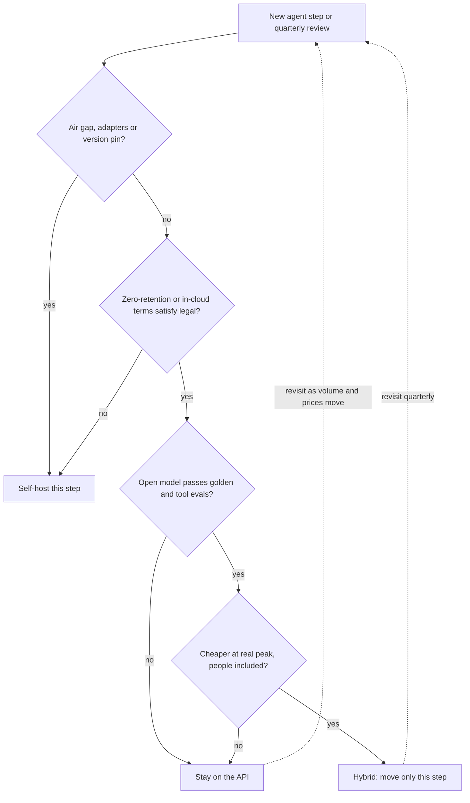

## TL;DR
Agents multiply tokens: every step re-sends a growing transcript. Start on an API (capability,
elasticity, no ops); self-host one high-volume narrow step only when residency, an air gap, adapters or
busy GPUs justify it, and re-run the numbers as traffic grows.

## For agent builders
- **Why it matters for agents.** An agent task is 5-30 model calls, not one, and each call re-sends the
  system prompt, tool schemas and transcript. Input tokens dwarf output tokens, so the bill and the GPU
  sizing are dominated by prefill and by how well the prefix is cached.
- **Where it shows up in your stack.** The `base_url` and model name in your OpenAI-compatible client,
  LangChain chat model or LiteLLM config; vLLM or SGLang if you host; LangSmith or your own tracing for
  per-step token counts that feed the cost model.
- **What you control.** Which agent steps run where (planner on a frontier API, a router or extractor
  self-hosted), a stable cacheable prefix, and keeping provider-specific tool-call formats behind one
  interface so a step can move.
- **What you can skip.** GPU kernel tuning and cluster scheduling until one step clearly dominates spend.
  Know the utilisation formula and the agent token multiplier; that settles most decisions.

## Why it exists
- **Opposite cost structures.** An API is pure variable cost: pay per token, scale to zero, someone else
  does capacity planning. A self-hosted cluster is mostly fixed cost: a GPU bills by the hour whether it
  serves 2,000 tokens per second or idles at 3 a.m., and it comes with an engineer on call.
- **"The GPU is cheaper" ignores utilisation.** Comparing X per million tokens with Y per GPU-hour fails,
  because a GPU averaging 20% of its peak throughput delivers tokens at five times its nominal price.
- **"Sensitive data, so self-host" is often wrong both ways.** Enterprise API terms with zero retention and
  in-region endpoints often satisfy legal. Some regulated environments genuinely cannot send data to any
  third party, which makes the API unavailable at any price.
- **"Open models are good enough now" is a per-task claim** that only your eval set can settle. For agents
  that includes tool-call accuracy and multi-step task success, not just answer quality.
- **Both sides hide costs, and the answer changes over a product's life.** Self-host: engine and driver
  upgrades, security patching, peak capacity, cold starts of minutes while a model loads, re-running evals
  after every change. API: deprecation schedules you do not control, rate limits during incidents,
  coupling to provider-specific features.

## How it works
### The cost model
- **API cost** = sum over calls of tokens × price, with separate prices for input, output and (often)
  cached input tokens. For an agent, "calls" means every step of every task.
- **Self-host cost** = fixed spend divided by useful work:

```
effective_$ per 1M tokens = gpu_hourly_cost × 1e6 / (tokens_per_second × 3600 × utilisation)
```

| Term | What it really means | Why it bites |
|---|---|---|
| `tokens_per_second` | Aggregate throughput of one GPU at *your* batch size and prompt/output mix, not a vendor headline | Decode is memory-bandwidth bound, so it rises with batching until the KV cache fills memory; agent transcripts fill it fast |
| `utilisation` | Average load ÷ provisioned capacity | Interactive traffic peaks several times its average; you provision for the peak and idle the rest of the day, unless batch work fills the valleys |
| People | A fraction of an engineer plus on-call | A fixed cost that does not shrink with traffic |

### Agent workloads change the inputs
- **Tokens per task, not per request.** Context at step *k* is prefix + all earlier tool calls and results,
  so a task's total input grows roughly quadratically with step count while output stays small.
- **Prefill-heavy mix.** Input-to-output ratios like the 37:1 in the example below are ordinary for
  agents, so a cost model sized on decode throughput alone underestimates GPUs. Prefix caching (provider
  prompt caching, or `enable_prefix_caching` in vLLM, on by default in recent releases) is the biggest
  lever on both sides.
- **Tool calling is a capability gate.** The hosted model must emit valid tool calls in the format your
  framework parses. vLLM's OpenAI-compatible server returns tool calls only when started with
  `--enable-auto-tool-choice` and a `--tool-call-parser` that matches the model; test it on your tool
  schemas before costing the move.
- **Per-step placement.** A planner that needs frontier reasoning and a high-volume classifier or
  extractor step are different decisions; most savings come from moving the narrow step.

### Break-even is a staircase, not a point
1. **The API bill is linear:** `api = V × p_blended`. `p_blended` weights input, output and cached-input
   prices by your real token mix. Prompt-heavy traffic blends close to the input price; the example below
   works out to about $0.23 per million tokens.
2. **The self-host bill is a staircase:**
   `ceil(peak_load / per_gpu_throughput) × gpu_hourly × 730 + people`. It is flat until peak load needs
   another GPU, then jumps.
3. **The first step is whatever the model needs to run at all:** one GPU for a quantised 8B model, a
   multi-GPU node for a 70B model at 16-bit precision.
4. **Below the first step the API almost always wins,** because you pay for a whole node to serve a
   fraction of its capacity.
5. **Above it, anything that raises per-GPU throughput or lowers the peak pulls the staircase down:**
   - a smaller or quantised model;
   - larger batches;
   - prefix caching for shared system prompts and tool schemas;
   - batch jobs (offline evals, trace replays) that fill night-time valleys, so the peak-to-average ratio
     falls.

So the comparison is really about model size and utilisation, which is why two teams quoting the same GPU
price reach opposite answers.

### The constraints that decide before cost does
| Constraint | Self-host offers | Check first |
|---|---|---|
| **Data** | Residency, retention, customer contracts, air gap | What the vendor's enterprise terms and in-cloud platforms (a model served inside your cloud account's boundary) actually provide; agents send tool results (customer records, files) too |
| **Control** | Pinning a version for a year, deterministic behaviour over time, custom fine-tunes or LoRA adapters, logit access, engine-level constrained decoding | APIs offer some of these; hosting offers all of them |
| **Latency** | No WAN hop inside your VPC; tunable time-to-first-token | A small, poorly utilised cluster has worse tail latency than a provider's large fleet, and an agent pays it once per step |
| **Capability** | Fine-tuned small models often match on narrow tasks (classification, extraction, routing) | Frontier proprietary models are usually ahead on open-ended planning; only your eval knows |
| **Elasticity** | Spikes absorbed up to your headroom; a new replica means minutes of model loading | APIs absorb spikes up to your quota |

### The middle options
- **Managed open-weight hosting:** a vendor serves open models per token.
- **Provisioned-throughput plans** from API vendors: fixed cost, no ops.
- **Cloud model platforms** inside your account boundary.
- **Serverless GPUs** for spiky loads.
- **The hybrid most agent teams end up with:** the API for the planner and low-volume frontier steps,
  self-hosted small models for one or two high-volume narrow steps that dominate spend.

### How the decision evolves
1. **Prototype on the API,** because it is the fastest way to learn whether the agent works at all.
2. **Instrument** tokens per month per step, prompt/output ratio, cached-token share, peak-to-average ratio
   and quality on a golden set.
3. **Move one step** when a single narrow step dominates spend and an open model clears the eval bar; keep
   the long tail on the API.
4. **Revisit quarterly,** because API prices and open-model quality both move, and the break-even point
   moves with them.

## Diagram
Read it top to bottom for one agent step: hard constraints (including a ban on any third-party processor)
decide first, then quality on your eval including tool calls, then the cost model at real peak and
utilisation with people included; most paths end in the API or a hybrid split.



## Examples
### Worked scenario: tokens for one support agent
A support agent has a 6k-token prefix (system prompt plus tool schemas), runs 8 steps per task, appends
~1.5k tokens per step and writes ~300 output tokens per step. Volume is 10,000 tasks a day. Prices are
illustrative: $0.15 input, $0.60 output per 1M tokens, cached input at 10% of the input price.

| Quantity | Value |
|---|---|
| Input per task | 8 × 6k + 1.5k × (0 + 1 + … + 7) = 90k tokens |
| Output per task | 8 × 300 = 2.4k tokens (input:output about 37:1) |
| Monthly tokens | 27B input, 0.72B output |
| API, no prefix caching | about $4,050 input + $432 output ≈ $4,482 |
| API, append-only transcript cached | 16.5k uncached + 73.5k cached per task ≈ $1,073 input + $432 ≈ $1,505 |

- **Lesson:** a stable, append-only prefix cuts this bill about 3× before hosting is even discussed.
- **Self-host caveat:** a GPU plan sized on 0.72B output tokens ignores 27B tokens of prefill; benchmark
  with your real transcripts and prefix caching on.

### Break-even calculator
Every figure is an illustrative assumption to replace with your own measurements; the point is the shape
of the result, not the numbers.

```python
# All numbers illustrative. Replace with your traces and a throughput benchmark on your prompt mix.
monthly_in, monthly_out = 40e9, 8e9           # tokens/month: 40B prompt, 8B completion
api_in_price, api_out_price = 0.15, 0.60      # $ per 1M tokens, small-model tier (illustrative)
api_cost = monthly_in / 1e6 * api_in_price + monthly_out / 1e6 * api_out_price

gpu_hourly = 2.50                             # $ per GPU-hour on demand (illustrative)
agg_out_tps = 1500                            # decode tokens/s per GPU at your batch size (measure it)
peak_to_avg = 3.0                             # interactive traffic: provision for the daily peak
eng_cost = 12000                              # $/month: part of an engineer plus on-call

avg_tps = monthly_out / (30 * 24 * 3600)      # ~3,086 output tokens/s averaged over the month
gpus = -(-avg_tps * peak_to_avg // agg_out_tps)          # ceil: GPUs needed at peak
gpu_cost = gpus * gpu_hourly * 730
utilisation = avg_tps / (gpus * agg_out_tps)
print(f"API ${api_cost:,.0f}/mo vs self-host ${gpu_cost + eng_cost:,.0f}/mo "
      f"({int(gpus)} GPUs at {utilisation:.0%} utilisation)")
```

### Worked scenario: what flips the answer
Change two things: five times the traffic, plus reserved GPUs at $1.50 per hour and batch jobs that
flatten the peak ratio to 1.5.

| Scenario | API / month | Self-host / month | GPUs | Utilisation | Winner |
|---|---|---|---|---|---|
| Base inputs above | about $10,800 | $24,775 | 7 | 29% | API |
| 5× traffic, $1.50/h reserved, peak ratio 1.5 | $54,000 | about $29,520 | 16 | 64% | Self-host |

- **Sweep the volume and the crossover is set by utilisation, not GPU price.** Same inputs, 5 prompt
  tokens per output token (API $1.35 per 1M output tokens):

| Output tokens / month | API | On-demand, peak ratio 3 | Reserved $1.50/h, peak ratio 1.5 |
|---|---|---|---|
| 8B | $10,800 | $24,775 (7 GPUs) | $16,380 (4 GPUs) |
| 20B | $27,000 | $41,200 (16 GPUs) | $20,760 (8 GPUs): self-host wins |

- **On-demand at peak ratio 3 never catches up in this model:** each extra 1B output tokens a month adds
  about $1,400 of GPUs against $1,350 of API, so higher volume alone does not flip it.
- **Caveat:** the model ignores prefill compute, which matters when prompts are five times longer than
  outputs, and matters far more for agents at 37:1. Benchmark aggregate throughput on your real traffic
  before trusting it.

### Moving one agent step behind the same client
The agent code never names a vendor; a step's entry in config decides where it runs. vLLM serves an
OpenAI-compatible API, so the hosted step is a `base_url` and model-name change.

```python
import os
from openai import OpenAI

STEPS = {   # per-step placement; edit config, not agent code, to move a step
    "plan":     {"base_url": None, "model": "frontier-model"},                       # provider API
    "classify": {"base_url": "http://vllm.internal:8000/v1", "model": "small-ft"},   # self-hosted
}
_clients = {}

def call(step, messages, tools=None):
    cfg = STEPS[step]
    key = cfg["base_url"] or "default"
    if key not in _clients:   # own key for vLLM (its --api-key), so the provider key never leaves for it
        _clients[key] = (OpenAI(base_url=cfg["base_url"], api_key=os.environ.get("VLLM_API_KEY", "none"))
                         if cfg["base_url"] else OpenAI())
    resp = _clients[key].chat.completions.create(model=cfg["model"], messages=messages,
                                                  **({"tools": tools} if tools else {}))
    u = resp.usage   # log per step: this feeds the break-even model
    print(step, cfg["model"], u.prompt_tokens, u.completion_tokens)
    return resp.choices[0].message
```

## Production patterns
- **Provider-agnostic client from day one.** Put every model call behind one internal interface that takes
  a step or task name (your own wrapper, LiteLLM, or a LangChain chat model built from config). vLLM serves
  an OpenAI-compatible HTTP API, so moving a step is a base URL and model-name change. Monitor tokens, cost
  and latency per step, not per provider.
- **Hybrid split by agent step.** When one narrow step (routing, classification, extraction) dominates
  spend, run it on a self-hosted small model and keep the planner and long tail on the API. Gate the move on
  that step's golden-set score and tool-call validity rate. Monitor end-to-end task success, not only the
  step's accuracy.
- **Shadow before you switch.** Mirror a sample of production agent steps to the hosted model
  asynchronously and score both outputs offline, including whether tool calls parse and pick the same tool.
  Monitor the quality delta and the hosted p95 time-to-first-token at the real daily peak, not at a quiet
  hour.
- **Fill the valleys.** When interactive traffic has a high peak-to-average ratio, schedule offline jobs
  (agent evals, trace replays, backfills, embedding refreshes) on the same GPUs overnight. Monitor average
  utilisation and the peak-to-average ratio, the two inputs that move the staircase.
- **Benchmark on your own mix.** Before trusting `tokens_per_second`, replay real agent transcripts at your
  target concurrency with the engine's serving benchmark (vLLM ships one) and prefix caching on. Monitor
  aggregate throughput and p95 latency together; one without the other misleads.
- **Decision record with a revisit date.** Write the constraints, the cost model inputs and the break-even
  volume into an ADR. Re-run it quarterly or after a provider price change. Monitor actual monthly volume
  against the break-even volume.

## Trade-offs
- **Marginal cost vs utilisation risk.** Self-hosting lowers marginal cost per token, but only above a
  utilisation threshold. Low or spiky traffic flips the advantage back to the API, and every provider price
  cut moves the break-even point.
- **Control vs upgrade burden.** Full control over model version and behaviour, in exchange for owning
  every upgrade. Providers deprecate on their schedule; self-hosted, you must re-evaluate each engine and
  model change yourself, including tool-call parsing.
- **Data inside your boundary vs operations.** Zero-retention terms and in-cloud model platforms often meet
  the same requirement without operations. It flips only when no third-party processor is permitted at
  all.
- **Frontier quality vs narrow-task fit.** Frontier APIs usually lead on open-ended planning. The gap
  narrows to nothing on narrow steps where a fine-tuned small model beats a general model on your eval,
  which is when hosting that step pays.
- **Quota vs headroom.** APIs absorb spikes up to the quota you negotiated; self-hosting needs idle headroom
  or a queue. It flips when provider rate limits themselves become the bottleneck during peaks, which agent
  fan-out reaches sooner than chat.

## Pitfalls
- **Comparing list prices without utilisation.** Symptom: projected savings never appear in the bill while
  dashboards show GPUs idling at 20%. Fix: use the utilisation formula with peak provisioning.
- **Costing an agent per request instead of per task.** Symptom: the forecast assumed one call per user
  action and the bill is 10-30× higher. Fix: cost from traced tokens per task, step by step.
- **Treating "sensitive data" as automatically meaning self-hosting.** Symptom: months of platform work for
  a requirement a contract addendum met. Or the reverse: learning at procurement review that data could
  never leave and the API prototype must be rebuilt. Fix: get the exact data rule in writing early.
- **Migrating on cost alone without a golden-set eval.** Symptom: spend falls while quality complaints and
  escalations rise within weeks, or the hosted model emits malformed tool calls the agent retries.
- **Omitting people and on-call from the model.** Symptom: a single engineer is the cluster's real single
  point of failure and cannot take holiday.
- **Hard-coding provider-specific features** (tool-call formats, cache controls, response schemas) deep in
  agent code. Symptom: "we can't switch" during a price negotiation.
- **Sizing for average load instead of peak.** Symptom: queueing and time-to-first-token collapse at the
  daily peak, exactly when the most users are present, and multiplied by every agent step.

## When to use
- **Default to the API** for new agents and for any step whose volume is small or whose quality bar needs a
  frontier model (planning, open-ended reasoning).
- **Self-host when a hard constraint applies:** air gap, strict residency with no acceptable in-cloud
  option, logit or adapter access, version pinning the vendor will not give you.
- **Or self-host one step** when it has high sustained volume, an open model passes your eval, and your
  utilisation model shows a clear margin after people cost.
- **Measure first:** tokens per step per month, prompt/output ratio, cached-token share, peak-to-average
  ratio, p95 latency and golden-set quality.
- **Interviews:** give the utilisation formula plus the constraint checklist, ending in a hybrid portfolio
  with a revisit cadence, not a one-word preference.

## Role lens
- **Engineer:** Builds behind a provider-agnostic interface from day one, instruments tokens and latency
  per task, and feeds real trace numbers into the break-even model rather than vendor estimates.
- **Architect:** Owns the decision record: constraints first, cost second, a hybrid split of tasks across
  API and hosted models, and a scheduled review as prices and model quality move.
- **FDE:** Maps a customer's residency, procurement and network rules to the deployment options, and
  often lands on an in-cloud managed model as the compromise between the API and a GPU cluster.

## Check yourself
**Q:** A customer insists on self-hosting a 70B-parameter model for a support assistant handling about
2,000 chats a day, because "APIs are too expensive and our data is sensitive". How do you evaluate the
request?
**A:** Quantify first. 2,000 chats at roughly 4,000 tokens each is about 8 million tokens a day, around
240 million a month, which is a modest API bill at any current price tier. A 70B model in 16-bit
precision has about 140 GB of weights, so it needs a multi-GPU node running around the clock; 240 million
tokens a month averages under 100 tokens per second against a node that can serve many times that, so
utilisation would be in the single-digit percent range and the per-token cost many times the API's. Then
test the data claim: what exactly may not leave, and would zero-retention enterprise terms or an
in-cloud model platform in their region satisfy legal? If a genuine air-gap requirement survives that
conversation, propose a smaller model on one GPU after an eval shows it meets the quality bar, budget the
on-call, and record the decision and its assumptions in an ADR so it can be revisited when volume grows.

## Interview questions
### Why is a cheaper GPU-hour not enough to say self-hosting is cheaper?
- **Self-host cost is fixed spend divided by useful work.** The effective price per million tokens is
  `gpu_hourly_cost × 1e6 / (tokens_per_second × 3600 × utilisation)`, so utilisation sits in the
  denominator.
- **Peaks force over-provisioning.** You size for the daily peak, so a GPU averaging 20% of peak throughput
  delivers tokens at five times its nominal price, before adding people and on-call.

### How would you estimate the monthly model cost of an agent before launch?
- **Trace a sample of tasks:** steps per task, prefix size, tokens appended per step and output per step;
  input grows with every step, so cost per task, not per call.
- **Apply the real price mix:** input, output and cached-input prices, with the cached share you expect
  from an append-only transcript; the gap is often around 3×.
- **Multiply by tasks per month and add headroom** for retries and longer-than-median tasks, then compare
  with a self-host staircase only for the step that dominates.

### Walk me through building a break-even model for moving one agent step off the API.
- **Inputs from traces:** tokens per month for that step, the prompt/output ratio, and the peak-to-average
  ratio; a blended API price from your real input, output and cached-input mix.
- **Throughput from a benchmark:** aggregate tokens per second per GPU on your own transcripts at target
  concurrency, not a vendor headline.
- **Model the staircase:** `ceil(peak_load / per_gpu_throughput) × gpu_hourly × 730 + people`, compared with
  the linear API bill across a range of volumes to find where it crosses.

### When would you recommend staying on the API even though the volume is high?
- **When the open model fails the eval.** Savings mean nothing if quality complaints and escalations rise
  within weeks, or if tool-call validity drops and the agent loops on retries.
- **When traffic is spiky and nothing fills the valleys.** A high peak-to-average ratio keeps utilisation
  low, so the staircase stays above the API line.
- **When the team cannot own operations.** Engine upgrades, patching, cold starts of minutes and on-call are
  real costs; a provisioned-throughput plan or managed open-weight hosting may be the better middle option.

### You moved an agent step to self-hosted and the bill did not drop. How do you debug it?
- **Check utilisation first:** GPUs idling at 20% on dashboards means you are paying for peak headroom all
  day; fix with batch jobs at night, reserved GPUs or fewer, larger batches.
- **Check throughput assumptions:** measured aggregate tokens per second on real transcripts may be far
  below the benchmark, because the cost model ignored prefill compute or prefix caching was off.
- **Check the people line and retries:** on-call and upgrade work were often left out, and malformed tool
  calls can add hidden extra steps.

### How do you keep an agent able to switch providers or self-host later?
- **One internal interface keyed by step name,** so agent code never calls a vendor SDK directly.
- **Avoid provider-specific features deep in code** (tool-call formats, cache controls, response schemas),
  or wrap them, because hard-coding them is what produces "we can't switch" during a price negotiation.
- **Use an OpenAI-compatible engine such as vLLM,** so moving a step is a base URL and model-name change,
  and keep a tool-call eval that runs against any candidate model.

## Quiz
### Q: Which parameter most often decides whether self-hosting beats the API on cost?
- [ ] The GPU's list price per hour
- [x] Average utilisation: served load divided by the capacity you had to provision for peak
- [ ] The number of parameters in the model
- [ ] The length of the system prompt
> Self-host cost is fixed spend divided by useful tokens, so idle capacity multiplies the effective
> price per token. GPU price and model size matter, but a cheap GPU at 15% utilisation still loses to the
> API, while an expensive one at 70% can win.

### Q: A prototype runs on a frontier API and one high-volume classification task is 70% of spend. What is the best next step?
- [ ] Move all traffic to a self-hosted frontier-class model to eliminate API spend
- [ ] Negotiate a discount and keep the architecture unchanged
- [x] Evaluate an open small model on that task's golden set and, if it passes, self-host only that task
- [ ] Switch the classification task to a larger API model to raise accuracy
> The hybrid split captures most of the saving with the least risk: one narrow task, measurable quality,
> predictable volume. Moving everything multiplies operational burden and puts the open-ended tasks on a
> weaker model.

### Q: Which requirement cannot be met by a hosted API regardless of contract terms?
- [ ] Zero retention of prompts and outputs by the provider
- [ ] Processing inside a specific cloud region
- [x] Inference inside an air-gapped network with no outbound connectivity
- [ ] Sub-second time to first token for short prompts
> Retention and regional processing are routinely covered by enterprise agreements and in-cloud
> platforms, and APIs can deliver fast first tokens. An air gap removes the network path the API needs,
> so hosting is the only option.

## Use cases & projects
### Use cases
- **High-volume extraction or routing steps.** A classifier or argument-filling step that runs on every
  agent turn is the usual first candidate to move to a self-hosted small model once volume is steady.
- **Air-gapped or regulated agents.** Agents inside a network with no outbound path must run on hosted
  open-weight models, whatever the cost comparison says.
- **Hybrid agent platforms.** Keep the planner on a frontier API and run cheap executor steps on vLLM
  behind the same OpenAI-compatible `base_url`, so either side can move.
- **Budget reviews.** Per-step token traces feed the break-even model that decides whether a GPU
  reservation pays for itself at the agent's real utilisation.

### Mini project
**Build a break-even sheet from real agent traces (1-2 hours).**
- **Goal:** decide, with your own numbers, whether one agent step should move from an API to self-hosting.
- **Steps:** run a small tool-calling agent on 20 tasks and log input, cached-input and output tokens per
  step; total them per step type; price each step at API rates and at a GPU hourly rate divided by
  measured or assumed throughput at three utilisation levels.
- **Done when:** you have a table of cost per 1,000 tasks per step for API versus self-hosted at each
  utilisation level, and a one-paragraph recommendation naming the step to move first, if any.
