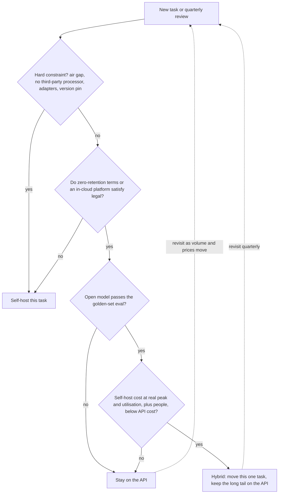

## TL;DR
An API buys capability, elasticity and zero operations per token; self-hosting buys control, data
locality and lower *marginal* cost, but only once GPUs are busy. Start on the API unless a hard
constraint forces hosting, and re-run the numbers as traffic grows.

## Why it exists
- **Opposite cost structures.** An API is pure variable cost: pay per token, scale to zero, someone else
  does capacity planning. A self-hosted cluster is mostly fixed cost: a GPU bills by the hour whether it
  serves 2,000 tokens per second or idles at 3 a.m., and it comes with an engineer on call.
- **"The GPU is cheaper" ignores utilisation.** Comparing X per million tokens with Y per GPU-hour fails,
  because a GPU averaging 20% of its peak throughput delivers tokens at five times its nominal price.
- **"Sensitive data, so self-host" is often wrong both ways.** Enterprise API terms with zero retention and
  in-region endpoints often satisfy legal. Some regulated environments genuinely cannot send data to any
  third party, which makes the API unavailable at any price.
- **"Open models are good enough now" is a per-task claim** that only your eval set can settle.
- **Both sides hide costs, and the answer changes over a product's life.** Self-host: engine and driver
  upgrades, security patching, peak capacity, cold starts of minutes while a model loads, re-running evals
  after every change. API: deprecation schedules you do not control, rate limits during incidents,
  coupling to provider-specific features.

## How it works
### The cost model
- **API cost** = sum over calls of tokens × price, with separate prices for input, output and (often)
  cached input tokens.
- **Self-host cost** = fixed spend divided by useful work:

```
effective_$ per 1M tokens = gpu_hourly_cost × 1e6 / (tokens_per_second × 3600 × utilisation)
```

| Term | What it really means | Why it bites |
|---|---|---|
| `tokens_per_second` | Aggregate throughput of one GPU at *your* batch size and prompt/output mix, not a vendor headline | Decode is memory-bandwidth bound, so it rises with batching until the KV cache fills memory |
| `utilisation` | Average load ÷ provisioned capacity | Interactive traffic peaks several times its average; you provision for the peak and idle the rest of the day, unless batch work fills the valleys |
| People | A fraction of an engineer plus on-call | A fixed cost that does not shrink with traffic |

### Break-even is a staircase, not a point
1. **The API bill is linear:** `api = V × p_blended`. `p_blended` weights input, output and cached-input
   prices by your real token mix. Prompt-heavy traffic blends close to the input price; the example below
   works out to about $0.23 per million tokens.
2. **The self-host bill is a staircase:**
   `ceil(peak_load / per_gpu_throughput) × gpu_hourly × 730 + people`. It is flat until peak load needs
   another GPU, then jumps.
3. **The first step is whatever the model needs to run at all:** one GPU for a quantised 8B model, a
   multi-GPU node for a 70B model at 16-bit precision.
4. **Below the first step the API almost always wins,** because you pay for a whole node to serve a
   fraction of its capacity.
5. **Above it, anything that raises per-GPU throughput or lowers the peak pulls the staircase down:**
   - a smaller or quantised model;
   - larger batches;
   - prefix caching for shared system prompts;
   - batch jobs that fill night-time valleys, so the peak-to-average ratio falls.

So the comparison is really about model size and utilisation, which is why two teams quoting the same GPU
price reach opposite answers.

### The constraints that decide before cost does
| Constraint | Self-host offers | Check first |
|---|---|---|
| **Data** | Residency, retention, customer contracts, air gap | What the vendor's enterprise terms and in-cloud platforms (a model served inside your cloud account's boundary) actually provide |
| **Control** | Pinning a version for a year, deterministic behaviour over time, custom fine-tunes or LoRA adapters, logit access, engine-level constrained decoding | APIs offer some of these; hosting offers all of them |
| **Latency** | No WAN hop inside your VPC; tunable time-to-first-token | A small, poorly utilised cluster has worse tail latency than a provider's large fleet |
| **Capability** | Fine-tuned small models often match on narrow tasks (classification, extraction) | Frontier proprietary models are usually ahead on open-ended tasks; only your eval knows |
| **Elasticity** | Spikes absorbed up to your headroom; a new replica means minutes of model loading | APIs absorb spikes up to your quota |

### The middle options
- **Managed open-weight hosting:** a vendor serves open models per token.
- **Provisioned-throughput plans** from API vendors: fixed cost, no ops.
- **Cloud model platforms** inside your account boundary.
- **Serverless GPUs** for spiky loads.
- **The hybrid most teams end up with:** the API for low-volume frontier tasks, self-hosted small models for
  one or two high-volume narrow tasks that dominate spend.

### How the decision evolves
1. **Prototype on the API,** because it is the fastest way to learn whether the product works.
2. **Instrument** tokens per month per task, prompt/output ratio, peak-to-average ratio and quality on a
   golden set.
3. **Move one task** when a single narrow task dominates spend and an open model clears the eval bar; keep
   the long tail on the API.
4. **Revisit quarterly,** because API prices and open-model quality both move, and the break-even point
   moves with them.

## Diagram
Read it top to bottom: hard constraints decide first, then quality on your eval, then the cost model at
real utilisation; most paths end in the API or a hybrid split, not a full migration.



## Examples
### Break-even calculator
Every figure is an illustrative assumption to replace with your own measurements; the point is the shape
of the result, not the numbers.

```python
# All numbers illustrative. Replace with your traces and a throughput benchmark on your prompt mix.
monthly_in, monthly_out = 40e9, 8e9           # tokens/month: 40B prompt, 8B completion
api_in_price, api_out_price = 0.15, 0.60      # $ per 1M tokens, small-model tier (illustrative)
api_cost = monthly_in / 1e6 * api_in_price + monthly_out / 1e6 * api_out_price

gpu_hourly = 2.50                             # $ per GPU-hour on demand (illustrative)
agg_out_tps = 1500                            # decode tokens/s per GPU at your batch size (measure it)
peak_to_avg = 3.0                             # interactive traffic: provision for the daily peak
eng_cost = 12000                              # $/month: part of an engineer plus on-call

avg_tps = monthly_out / (30 * 24 * 3600)      # ~3,086 output tokens/s averaged over the month
gpus = -(-avg_tps * peak_to_avg // agg_out_tps)          # ceil: GPUs needed at peak
gpu_cost = gpus * gpu_hourly * 730
utilisation = avg_tps / (gpus * agg_out_tps)
print(f"API ${api_cost:,.0f}/mo vs self-host ${gpu_cost + eng_cost:,.0f}/mo "
      f"({int(gpus)} GPUs at {utilisation:.0%} utilisation)")
```

### Worked scenario: what flips the answer
Change two things: five times the traffic, plus reserved GPUs at $1.50 per hour and batch jobs that
flatten the peak ratio to 1.5.

| Scenario | API / month | Self-host / month | GPUs | Utilisation | Winner |
|---|---|---|---|---|---|
| Base inputs above | about $10,800 | $24,775 | 7 | 29% | API |
| 5× traffic, $1.50/h reserved, peak ratio 1.5 | $54,000 | about $29,520 | 16 | 64% | Self-host |

- **Caveat:** the model ignores prefill compute, which matters when prompts are five times longer than
  outputs. Benchmark aggregate throughput on your real traffic before trusting it.

### Sweep the staircase
Same illustrative inputs, swept across volume. Higher utilisation, not a cheaper GPU alone, moves the
crossover.

```python
import math

def self_host(out_per_month, gpu_hourly, peak_to_avg, tps=1500, people=12000):
    avg_tps = out_per_month / (30 * 24 * 3600)
    gpus = max(1, math.ceil(avg_tps * peak_to_avg / tps))   # the staircase: whole GPUs only
    return gpus, gpus * gpu_hourly * 730 + people

P_OUT = 5 * 0.15 + 0.60      # API $ per 1M output tokens with 5 prompt tokens per output token
for b in (1, 8, 20, 40, 80):
    out = b * 1e9
    api = out / 1e6 * P_OUT
    g1, on_demand = self_host(out, 2.50, 3.0)    # on-demand GPUs, spiky interactive traffic
    g2, tuned = self_host(out, 1.50, 1.5)        # reserved GPUs, batch jobs fill the valleys
    print(f"{b:>2}B/mo  API ${api:>8,.0f}  on-demand ${on_demand:>8,.0f} ({g1:>2} GPUs)"
          f"  tuned ${tuned:>8,.0f} ({g2:>2} GPUs)")
# 1B: API wins easily (one GPU plus people is the first step).
# 8B: API $10,800 vs on-demand $24,775 vs tuned $16,380.
# 20B: tuned ($20,760) beats the API ($27,000); on-demand ($41,200) never does in this range.
```

## Production patterns
- **Provider-agnostic client from day one.** When starting on an API, put every call behind one internal
  interface that takes a task name. vLLM serves an OpenAI-compatible HTTP API, so moving a task is a base
  URL and model-name change. Monitor tokens, cost and latency per task, not per provider.
- **Hybrid split by task.** When one narrow task dominates spend, run it on a self-hosted small model and
  keep the long tail on the API. Gate the move on that task's golden-set score. Monitor quality per task
  and the share of spend still on the API.
- **Shadow before you switch.** Before migrating, mirror a sample of production requests to the hosted
  model asynchronously and score both outputs offline. Monitor the quality delta and the hosted p95
  time-to-first-token at the real daily peak, not at a quiet hour.
- **Fill the valleys.** When interactive traffic has a high peak-to-average ratio, schedule offline jobs
  (evals, backfills, embedding refreshes) on the same GPUs overnight. Monitor average utilisation and the
  peak-to-average ratio, the two inputs that move the staircase.
- **Benchmark on your own mix.** Before trusting `tokens_per_second`, replay your real prompt and output
  lengths at your target concurrency with the engine's serving benchmark (vLLM ships one). Monitor
  aggregate throughput and p95 latency together; one without the other misleads.
- **Decision record with a revisit date.** Write the constraints, the cost model inputs and the
  break-even volume into an ADR. Re-run it quarterly or after a provider price change. Monitor actual
  monthly volume against the break-even volume.

## Trade-offs
- **Marginal cost vs utilisation risk.** Self-hosting lowers marginal cost per token, but only above a
  utilisation threshold. Low or spiky traffic flips the advantage back to the API, and every provider price
  cut moves the break-even point.
- **Control vs upgrade burden.** Full control over model version and behaviour, in exchange for owning
  every upgrade. Providers deprecate on their schedule; self-hosted, you must re-evaluate each engine and
  model change yourself.
- **Data inside your boundary vs operations.** Zero-retention terms and in-cloud model platforms often meet
  the same requirement without operations. It flips only when no third-party processor is permitted at
  all.
- **Frontier quality vs narrow-task fit.** Frontier APIs usually lead on open-ended quality. The gap
  narrows to nothing on narrow tasks where a fine-tuned small model beats a general model on your eval,
  which is when hosting that task pays.
- **Quota vs headroom.** APIs absorb spikes up to the quota you negotiated; self-hosting needs idle headroom
  or a queue. It flips when provider rate limits themselves become the bottleneck during peaks.

## Pitfalls
- **Comparing list prices without utilisation.** Symptom: projected savings never appear in the bill while
  dashboards show GPUs idling at 20%. Fix: use the utilisation formula with peak provisioning.
- **Treating "sensitive data" as automatically meaning self-hosting.** Symptom: months of platform work for
  a requirement a contract addendum met. Or the reverse: learning at procurement review that data could
  never leave and the API prototype must be rebuilt. Fix: get the exact data rule in writing early.
- **Migrating on cost alone without a golden-set eval.** Symptom: spend falls while quality complaints and
  escalations rise within weeks.
- **Omitting people and on-call from the model.** Symptom: a single engineer is the cluster's real single
  point of failure and cannot take holiday.
- **Hard-coding provider-specific features** (tool-call formats, cache controls, response schemas) deep in
  application code. Symptom: "we can't switch" during a price negotiation.
- **Sizing for average load instead of peak.** Symptom: queueing and time-to-first-token collapse at the
  daily peak, exactly when the most users are present.

## When to use
- **Default to the API** for new products and for any task whose volume is small or whose quality bar
  needs a frontier model.
- **Self-host when a hard constraint applies:** air gap, strict residency with no acceptable in-cloud
  option, logit or adapter access, version pinning the vendor will not give you.
- **Or self-host one task** when it has high sustained volume, an open model passes your eval, and your
  utilisation model shows a clear margin after people cost.
- **Measure first:** tokens per task per month, prompt/output ratio, peak-to-average ratio, p95 latency and
  golden-set quality.
- **Interviews:** give the utilisation formula plus the constraint checklist, ending in a hybrid portfolio
  with a revisit cadence, not a one-word preference.

## Role lens
- **Engineer:** Builds behind a provider-agnostic interface from day one, instruments tokens and latency
  per task, and feeds real trace numbers into the break-even model rather than vendor estimates.
- **Architect:** Owns the decision record: constraints first, cost second, a hybrid split of tasks across
  API and hosted models, and a scheduled review as prices and model quality move.
- **FDE:** Maps a customer's residency, procurement and network rules to the deployment options, and
  often lands on an in-cloud managed model as the compromise between the API and a GPU cluster.

## Check yourself
**Q:** A customer insists on self-hosting a 70B-parameter model for a support assistant handling about
2,000 chats a day, because "APIs are too expensive and our data is sensitive". How do you evaluate the
request?
**A:** Quantify first. 2,000 chats at roughly 4,000 tokens each is about 8 million tokens a day, around
240 million a month, which is a modest API bill at any current price tier. A 70B model in 16-bit
precision has about 140 GB of weights, so it needs a multi-GPU node running around the clock; 240 million
tokens a month averages under 100 tokens per second against a node that can serve many times that, so
utilisation would be in the single-digit percent range and the per-token cost many times the API's. Then
test the data claim: what exactly may not leave, and would zero-retention enterprise terms or an
in-cloud model platform in their region satisfy legal? If a genuine air-gap requirement survives that
conversation, propose a smaller model on one GPU after an eval shows it meets the quality bar, budget the
on-call, and record the decision and its assumptions in an ADR so it can be revisited when volume grows.

## Interview questions
### Why is a cheaper GPU-hour not enough to say self-hosting is cheaper?
- **Self-host cost is fixed spend divided by useful work.** The effective price per million tokens is
  `gpu_hourly_cost × 1e6 / (tokens_per_second × 3600 × utilisation)`, so utilisation sits in the
  denominator.
- **Peaks force over-provisioning.** You size for the daily peak, so a GPU averaging 20% of peak throughput
  delivers tokens at five times its nominal price, before adding people and on-call.

### Walk me through building a break-even model for moving one task off the API.
- **Inputs from traces:** tokens per month for that task, the prompt/output ratio, and the peak-to-average
  ratio; a blended API price from your real input, output and cached-input mix.
- **Throughput from a benchmark:** aggregate tokens per second per GPU on your own prompt mix at target
  concurrency, not a vendor headline.
- **Model the staircase:** `ceil(peak_load / per_gpu_throughput) × gpu_hourly × 730 + people`, compared with
  the linear API bill across a range of volumes to find where it crosses.

### When would you recommend staying on the API even though the volume is high?
- **When the open model fails the eval.** Savings mean nothing if quality complaints and escalations rise
  within weeks.
- **When traffic is spiky and nothing fills the valleys.** A high peak-to-average ratio keeps utilisation
  low, so the staircase stays above the API line.
- **When the team cannot own operations.** Engine upgrades, patching, cold starts of minutes and on-call are
  real costs; a provisioned-throughput plan or managed open-weight hosting may be the better middle option.

### You moved a task to self-hosted and the bill did not drop. How do you debug it?
- **Check utilisation first:** GPUs idling at 20% on dashboards means you are paying for peak headroom all
  day; fix with batch jobs at night, reserved GPUs or fewer, larger batches.
- **Check throughput assumptions:** measured aggregate tokens per second on real traffic may be far below
  the benchmark, especially with long prompts, because the cost model ignored prefill compute.
- **Check the people line:** on-call and upgrade work were often left out of the original model.

### How do you keep the option to switch providers or self-host later?
- **One internal interface keyed by task name,** so application code never calls a vendor SDK directly.
- **Avoid provider-specific features deep in code** (tool-call formats, cache controls, response schemas),
  or wrap them, because hard-coding them is what produces "we can't switch" during a price negotiation.
- **Use an OpenAI-compatible engine such as vLLM,** so moving a task is a base URL and model-name change.

## Quiz
### Q: Which parameter most often decides whether self-hosting beats the API on cost?
- [ ] The GPU's list price per hour
- [x] Average utilisation: served load divided by the capacity you had to provision for peak
- [ ] The number of parameters in the model
- [ ] The length of the system prompt
> Self-host cost is fixed spend divided by useful tokens, so idle capacity multiplies the effective
> price per token. GPU price and model size matter, but a cheap GPU at 15% utilisation still loses to the
> API, while an expensive one at 70% can win.

### Q: A prototype runs on a frontier API and one high-volume classification task is 70% of spend. What is the best next step?
- [ ] Move all traffic to a self-hosted frontier-class model to eliminate API spend
- [ ] Negotiate a discount and keep the architecture unchanged
- [x] Evaluate an open small model on that task's golden set and, if it passes, self-host only that task
- [ ] Switch the classification task to a larger API model to raise accuracy
> The hybrid split captures most of the saving with the least risk: one narrow task, measurable quality,
> predictable volume. Moving everything multiplies operational burden and puts the open-ended tasks on a
> weaker model.

### Q: Which requirement cannot be met by a hosted API regardless of contract terms?
- [ ] Zero retention of prompts and outputs by the provider
- [ ] Processing inside a specific cloud region
- [x] Inference inside an air-gapped network with no outbound connectivity
- [ ] Sub-second time to first token for short prompts
> Retention and regional processing are routinely covered by enterprise agreements and in-cloud
> platforms, and APIs can deliver fast first tokens. An air gap removes the network path the API needs,
> so hosting is the only option.
