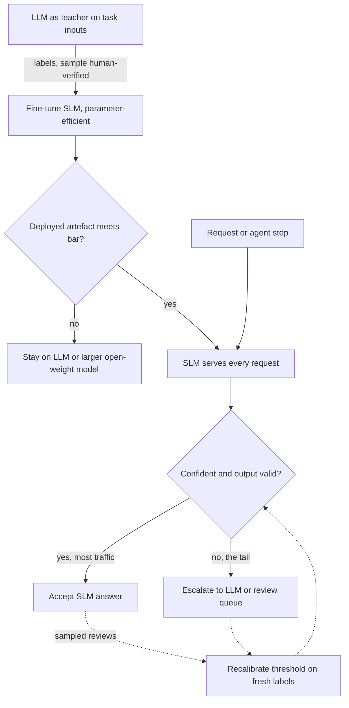

## TL;DR
In an agent, small models earn their place on the narrow, high-frequency steps (routing, guardrail
checks, extraction, tool-argument filling) where they match large models cheaply and fast; planning,
long tool use and world knowledge stay on the LLM. Decide per step.

## For agent builders
- **Why it matters for agents.** An agent makes many calls per task, and several are narrow and
  repeated on every step: intent routing, a PII or policy check, classifying a tool result. Moving
  those to a small model cuts cost and latency on every step, while the planner stays large.
- **Where it shows up in your stack.** A small open-weight model served by vLLM, Ollama or a hosted
  small-model API behind the same gateway, called by logical name from the agent loop; a cascade that
  escalates low-confidence steps to the LLM.
- **What you control.** Which step types are SLM-eligible, the distillation data (often your own agent
  traces), the calibrated confidence threshold for escalation, and which quantized artefact you
  evaluate and serve.
- **What you can skip.** Scaling-law fitting and the details of distillation losses. Know which
  capabilities shrink first, the bandwidth arithmetic, and how to calibrate a cascade.

## Why it exists
- **What "small" means.** Roughly up to the low tens of billions of parameters, runnable on one GPU or a
  laptop; a fuzzy, moving boundary.
- **The gap is not ten percent.** Between a 7B-class and a frontier model it is an order of magnitude or
  more in price per token, a similar factor in weight bytes read per generated token and therefore
  latency, and the difference between "fits in the customer's VPC on one GPU, or on the device" and
  "requires an external API". That leverage needs a reasoned basis, not a default.
- **"Always use the biggest model" is wrong.** It overpays on the large fraction of easy traffic and easy
  agent steps, blows latency budgets for interactive and on-device use, and is unavailable wherever data
  cannot leave the premises.
- **"Small models are good enough now" is wrong too.** It fails on the hard five percent of inputs where
  errors, incidents and compliance findings concentrate. Small models follow long, complex instructions
  less reliably, hallucinate more on knowledge (fewer facts fit in fewer parameters) and degrade more
  sharply in long contexts, which is exactly what a long agent transcript is.
- **The gap is task-dependent.** Pattern-following tasks (classify, extract, reformat, answer from
  supplied text) saturate early: beyond some size a bigger model does not do them measurably better,
  and fine-tuning closes the remaining gap. Broad reasoning and knowledge keep improving with scale.
  The question is "does this task saturate", and that must be measured.

## How it works
### Background: what shrinks when a model shrinks
- **Scaling laws.** Loss falls smoothly with parameters and training tokens. The compute-optimal
  follow-up showed smaller models trained on far more tokens recover much of the gap, which is why
  current small models are much stronger than their parameter count once suggested.
- **Capabilities do not shrink uniformly.** First to go:
  - **stored world knowledge**: facts live in parameters, so fewer parameters means fewer facts and more
    confident invention unless retrieval supplies them;
  - **multi-step reasoning and planning**, the core of an agent's outer loop;
  - **robustness to long or intricate instruction sets**, such as many tool definitions;
  - **long-context use**, such as a 30-step transcript.
- **What holds up:** in-distribution pattern behaviour, *because* a narrow task occupies a small region
  of input space that fine-tuning can cover directly.

### Mapping agent steps to sizes
| Agent step | Usual home | Why |
|---|---|---|
| Plan, choose among many tools, recover from errors | LLM | multi-step reasoning and long context |
| Route the request to a sub-agent or workflow | SLM (fine-tuned classifier) | closed label set, runs on every request |
| Guardrail check on input, tool result or output | SLM | narrow, high-frequency, latency adds up per step |
| Extract fields from a tool result into a schema | SLM, with schema validation | pattern-following over supplied text |
| Summarise a long tool result for the transcript | workhorse or SLM, measured | depends on how much judgement the summary needs |

### The physical arithmetic
| Quantity | 7B model | 70B model |
|---|---|---|
| Weights, fp16 (parameters × bytes per parameter) | about 14 GB | about 140 GB |
| Weights, 4-bit | roughly 3.5 to 4 GB: a consumer GPU or a laptop | needs several GPUs or aggressive quantization |
| Single-stream decode speed, same card | roughly ten times faster | baseline |

- **Decode is memory-bandwidth bound.** Every generated token reads the active weights once, so
  single-stream tokens per second ≈ bandwidth ÷ weight bytes. A model ten times smaller generates
  roughly ten times faster (approximate; batching, KV-cache traffic and mixture-of-experts designs
  change the constant).
- **The KV cache is smaller too,** since there are fewer layers and heads. So SLMs win on latency and
  edge deployment, not only on price.
- **Mixture-of-experts blurs the size label.** Decode speed tracks the *active* parameters read per
  token, but memory must hold *all* experts: an MoE with a small active count decodes like a small model
  but needs the memory of a large one.

### Closing the gap: fine-tuning and distillation
1. **Use the large model as a teacher.** Run it over your task's inputs to produce labels or target
   outputs; for agents, the logged LLM decisions for one step type are a ready-made source.
2. **Verify a sample by hand.**
3. **Fine-tune the small model** on the result, typically with a parameter-efficient method. Narrow
   tasks commonly need hundreds to a few thousand examples (an order of magnitude, not a rule).
4. **Test on human labels.** The student learns the **task behaviour**, not the teacher's general
   capability, so it matches in-distribution and falls off out of distribution. It also inherits the
   teacher's mistakes, which is why the test set must be human-labelled, not teacher-labelled.

### The decision dimensions
| Dimension | Favours SLM | Favours LLM (or cascade) |
|---|---|---|
| **Task breadth** | closed schema, bounded inputs | open-ended generation, agent planning |
| **Tail cost** | errors cheap and reviewable | one error in the hard cases is expensive |
| **Latency budget** | sub-second interactive or on-device targets usually force it | relaxed budgets |
| **Volume** | self-hosted SLM cost is fixed per GPU-hour and amortises only at volume | low volume |
| **Residency and connectivity** | on-prem, air-gapped or offline rules out external APIs | data may leave |
| **Knowledge need** | pair the SLM with retrieval | answers depend on facts the SLM lacks |
| **Change rate** | stable task | definition shifts monthly, so retraining is a treadmill |
| **Operational capacity** | someone owns serving, monitoring and upgrades | no one to run it |

### The hybrid: a cascade
- **Shape.** Run the SLM first; escalate to the LLM on low confidence, failed validation or a trigger
  condition. It captures most of the saving with LLM quality on the tail, at the price of a confidence
  signal that needs calibration.
- **Classification signal is cheap.** With a self-hosted SLM, read the probability assigned to the
  chosen label from the logits.
- **Set the threshold empirically,** because raw probabilities from fine-tuned models are often
  overconfident. On a held-out human-labelled set, sort by confidence and pick the cut-off at which
  accuracy on accepted items still meets the bar; everything below escalates.
- **The threshold is the dial.** It directly sets the trade between escalation rate (cost) and
  accepted-item accuracy (quality).
- **Free-form output** uses validators instead: schema checks on tool arguments, citation checks, or
  agreement between two samples.
- **Rarely binary.** Routing and cascading have their own lesson; the point here is the choice is
  rarely SLM-or-LLM, and in an agent it is made per step type.

## Diagram
The usual answer is a cascade: the distilled SLM takes every request or agent step first, and only
low-confidence or invalid outputs pay for the LLM. The gate before serving tests the exact quantized
artefact on a human-labelled set; the calibrated threshold on the confidence check is the cost-quality
dial.



## Examples
### Worked scenario: classifying 5M support messages a day
This classifier is the first step of a support agent: it routes each message to a sub-agent and flags
PII before anything else runs. **Illustrative figures.** The platform classifies 5,000,000 inbound
messages a day into intents and PII categories; each call is about 300 input and 10 output tokens.

**Evaluation on 1,000 human-labelled messages:**

| Candidate | Accuracy |
|---|---|
| Frontier API model | 97% |
| 7B open-weight, zero-shot | 90% |
| Same 7B fine-tuned on 3,000 teacher-labelled examples (500 of them human-verified) | 96%, 95% interval about ±1 point |

**Cost and load, step by step:**
1. **API cost** at an illustrative 1 unit per million input tokens and 3 per million output:
   5M × (300×1 + 10×3)/10⁶ = 1,650 units a day.
2. **Self-hosted SLM:** a GPU node at an illustrative fixed 100 units per day, capacity-planned
   separately. Naive saving: 1,550 units, about 94%.
3. **Break-even.** An API request costs 330 / 10⁶ ≈ 0.00033 units, so the GPU's fixed 100 units a day
   pays for itself only above about 300,000 requests a day: at 5M the SLM wins, at 100k it would lose.
4. **Load.** 5M a day is about 58 requests a second on average, roughly 17,000 input tokens a second
   of prefill, with peaks well above. Load-test whether one node carries the peak; if it takes two, the
   fixed term doubles and the break-even moves with it.
5. **Price the quality gap.** One point of accuracy on 5M messages is 50,000 misrouted messages a day.
   At 0.02 units of human rework each, the SLM-only path's extra point costs 1,000 units a day: the
   real saving is 550 units, and the interval means it could be close to zero.
6. **Cascade.** The fine-tuned SLM is confident (calibrated probability above threshold) on about 85%
   of traffic, with accuracy close to the LLM's; the remaining 15% escalates. API cost falls to
   0.15 × 1,650 ≈ 248 units, plus 100 for the GPU: ≈ 348 units a day, with overall accuracy
   indistinguishable from 97% on the test set. Saving about 79% with no measurable quality loss.

**Lesson:** the error-cost term, quality gap × volume × cost per error, must be in the comparison; once
it is, the cascade usually dominates both pure options at this volume.

### The comparison as a function
Reproduces the scenario, including the error-cost term and the break-even.

```python
def daily(volume, in_tok=300, out_tok=10, p_in=1, p_out=3, gpu_fixed=100,
          acc_gap=0.01, rework=0.02, escalate=0.0):
    api_per_req = (in_tok * p_in + out_tok * p_out) / 1e6
    api_only = volume * api_per_req
    slm_only = gpu_fixed + volume * acc_gap * rework          # error-cost term included
    cascade = gpu_fixed + escalate * api_only                  # tail goes to the API model
    return {"api": api_only, "slm": slm_only, "cascade": cascade,
            "break_even_req": gpu_fixed / api_per_req}

for v in (100_000, 5_000_000):
    r = daily(v, escalate=0.15)
    print(v, {k: round(x) for k, x in r.items()})
# 100000 {'api': 33, 'slm': 120, 'cascade': 105, 'break_even_req': 303030}   API wins
# 5000000 {'api': 1650, 'slm': 1100, 'cascade': 348, 'break_even_req': 303030} cascade wins
```

### An SLM-first guardrail step inside the agent loop
Sketch of the per-step cascade. `slm_classify` returns a label and its calibrated probability from the
self-hosted model; `llm_classify` is the API fallback. Both are your own wrappers, not a library API.

```python
THRESHOLD = 0.789          # from pick_threshold() below, recalibrated monthly

def check_step(text, slm_classify, llm_classify, trace):
    label, p = slm_classify(text)                 # e.g. "ok", "pii", "policy_violation"
    if p >= THRESHOLD:
        trace.append({"guard": "slm", "label": label, "p": round(p, 3)})
        return label
    label = llm_classify(text)                     # the tail pays for the LLM
    trace.append({"guard": "llm_escalation", "label": label, "slm_p": round(p, 3)})
    return label

def run_agent_step(tool_result, slm_classify, llm_classify, trace):
    if check_step(tool_result, slm_classify, llm_classify, trace) != "ok":
        return {"action": "block_and_review"}      # never feed a flagged result to the planner
    return {"action": "continue", "observation": tool_result}
```

| Per 8-step run (illustrative latencies) | LLM guardrail every step | SLM-first cascade |
|---|---|---|
| Guardrail latency per check | ~0.8 s | ~0.08 s, 10% escalated at ~0.8 s |
| Added latency per run | ~6.4 s | ~1.3 s (escalations pay both calls) |

### Calibrating the cascade threshold
Runnable, standard library only; the held-out set is synthetic. In production `scored` comes from the
SLM's top-label probability on human-labelled items.

```python
import random

def pick_threshold(scored, bar):
    """scored: (confidence, correct) pairs from a held-out human-labelled set.
    Returns (threshold, escalation_rate, accepted_accuracy) for the largest accepted share meeting the bar."""
    ranked = sorted(scored, key=lambda x: -x[0])
    best, correct = None, 0
    for i, (conf, ok) in enumerate(ranked, 1):
        correct += ok
        if correct / i >= bar:
            best = (conf, 1 - i / len(ranked), correct / i)
    return best

# Synthetic held-out set (illustrative): mostly easy, confident items plus a hard tail
random.seed(0)
held_out = [(random.uniform(0.90, 1.00), random.random() < 0.985) for _ in range(850)]
held_out += [(random.uniform(0.40, 0.95), random.random() < 0.70) for _ in range(150)]
t, esc, acc = pick_threshold(held_out, bar=0.97)
print(f"threshold {t:.3f}  escalate {esc:.0%}  accepted accuracy {acc:.1%}")
# threshold 0.789  escalate 10%  accepted accuracy 97.0%
```

Raising `bar` raises the threshold and the escalation rate; that is the cost-quality dial in one number.

## Production patterns
- **Prototype large, distil when stable.** For any new task or agent step type. Ship on the LLM first,
  log inputs and outputs per step, and distil into an SLM once the step's definition has stopped
  changing. Monitor how often the task's schema or labels change; frequent changes mean stay on the LLM.
- **Distil from your own agent traces.** For high-frequency steps such as routing or guardrails. Export
  the LLM's logged decisions for one step type, human-verify a sample, fine-tune, and compare on a
  human-labelled set. Monitor agreement with sampled human reviews, not with the teacher.
- **Evaluate the exact deployed artefact.** Whenever quantizing or changing the serving engine. Run the
  human-labelled set against the specific 4-bit (or other) build you will serve, not the fp16
  original. Monitor task accuracy per artefact version.
- **Recalibrate the cascade threshold on a schedule.** Monthly or after any retrain. Re-run the
  threshold search on fresh human-labelled samples and update the config value. Monitor escalation rate
  and accepted-item accuracy on sampled reviews; a drifting escalation rate signals input drift.
- **Load-test the peak before signing the cost case.** Before replacing an API with a self-hosted SLM.
  Replay peak-hour traffic at production prompt lengths against one node and record p95 latency and
  throughput. Monitor GPU utilisation and queue depth; under-utilised GPUs erase the saving.
- **Retrieval for facts, SLM for form.** For knowledge-heavy tasks on small models. Supply facts in the
  context and keep the SLM's job to formatting or extracting from them. Monitor answers without a
  supporting citation.

## Trade-offs
- **SLM cost and latency vs competence.** Roughly an order of magnitude lower cost and latency but a
  narrower competence; it flips as soon as the task needs world knowledge or multi-step reasoning that
  retrieval cannot supply, which is why the agent's planner rarely moves.
- **Fine-tuning vs maintenance.** It closes the in-distribution gap but creates an artefact to retrain
  when the input distribution shifts or the base model is retired; it flips when the task changes
  faster than you can label.
- **Self-hosting vs operations.** It delivers residency, offline operation and fixed cost, but needs
  operations capacity and pays only at volume; at low volume a small model behind a hosted API is the
  better middle.
- **LLM via API vs dependency.** Breadth and zero infrastructure, at the price of variable cost,
  external data flow and exposure to the provider's deprecation schedule.
- **Cascade vs complexity.** It captures most of the saving with LLM-level quality, but adds a
  confidence estimator to calibrate and monitor, and a second code path to operate.

## Pitfalls
- **Judging the SLM on zero-shot results and discarding it.** Symptom: the fine-tuned version would have
  matched the bar, but the comparison never got that far.
- **SLM for knowledge-heavy QA without retrieval.** Symptom: fluent, confident, wrong answers about facts
  the model never held.
- **Handing an SLM a 3,000-token instruction set written for a frontier model.** Symptom: rules late in
  the prompt are ignored and output format drifts. In agents the same happens with a long list of tool
  schemas: the SLM picks the wrong tool or invents arguments.
- **Putting an SLM in the planner seat of a long agent loop.** Symptom: runs wander, repeat tool calls
  or lose the goal after a dozen steps. Fix: keep planning on the LLM and move only narrow step types.
- **Comparing price per token only.** Symptom: the business case omits the cost of errors and
  escalations, and the GPU's fixed cost at low utilisation.
- **Assuming quantization is free.** Symptom: the 4-bit artefact that looked fine on a general benchmark
  loses several points on your task; always evaluate the exact artefact you deploy.
- **Distilling without a human-labelled test set.** Symptom: 99% agreement with the teacher, and the
  same systematic errors the teacher makes.

## When to use
- **Use an SLM for:** narrow, high-volume, latency-sensitive work: classification, routing, schema-bound
  extraction, guardrail checks on every agent step, on-device or on-prem features, and anywhere data
  cannot leave.
- **Use the LLM for:** open-ended generation, complex tool use and agent planning, low-volume
  high-value analysis, and any task still being discovered: prototype with the large model, distil once
  the definition is stable.
- **Measure:** accuracy with a confidence interval on your own set, cost per successful task including
  the cost of errors, p95 latency per step, and the escalation rate if you cascade.
- **Interviews:** name which capabilities degrade with size, the bandwidth arithmetic behind the latency
  gain, distillation with a human-labelled test set, and the cascade as the usual answer.

## Role lens
- **Engineer:** Builds the eval that compares the candidates on the real task, runs the distillation
  pipeline, and tests the quantized artefact rather than the fp16 original.
- **Architect:** Decides which task families are SLM-eligible, sets the quality bar and the error-cost
  model, and chooses between pure SLM, pure LLM and a cascade per family.
- **FDE:** Makes an SLM work inside a customer's VPC or air-gapped site when the API model cannot be
  used, and sets expectations about which capabilities will not carry over.

## Check yourself
**Q:** A customer requires that document extraction run entirely inside their VPC on a single GPU.
Your current pipeline uses a frontier API model. How do you assess whether a small model can replace
it, and what does the path look like if it can?
**A:** Characterise the task first: fixed-schema extraction over a known document population is narrow
and in-distribution, so it is a strong SLM candidate. Build a human-labelled golden set from the
customer's real documents, measure the frontier model on it as the ceiling, then measure candidate
open-weight models zero-shot. If there is a gap, generate training data by running the frontier model
over the customer's documents where terms permit, human-verify a sample, fine-tune with a
parameter-efficient method, and re-evaluate the exact quantized artefact on the human-labelled set.
Check the memory arithmetic: a 7B model at 4-bit is a few gigabytes of weights, but long documents
mean a large KV cache, so chunk pages and bound context. Plan operations: serving engine, monitoring,
a retraining trigger when templates change. Because there is no LLM to escalate to inside the VPC, add
a human review queue for low-confidence outputs, or budget a larger open-weight model for the tail.

## Interview questions
### When does a small language model match a large one, and when does it not?
- **It matches on narrow, in-distribution pattern tasks** such as classify, extract, reformat or answer
  from supplied text, because these saturate early and fine-tuning covers the small region of input
  space directly.
- **It falls behind on stored world knowledge, multi-step reasoning, long intricate instructions and
  long-context use,** because those keep improving with scale.
- **So the real question is whether this task saturates,** and that must be measured on your own data.

### Your agent runs on a frontier model for every step. Which steps would you move to a small model, and how?
- **Pick narrow, high-frequency step types:** request routing, guardrail checks on tool results,
  schema extraction. Keep planning, tool choice among many tools and error recovery on the LLM.
- **Distil from the agent's own traces** for that step type, human-verify a sample, and evaluate the
  quantized artefact on a human-labelled set.
- **Deploy as a cascade with a calibrated threshold,** then re-run the full agent eval, because a
  wrong route or a missed flag changes everything downstream.

### Explain where the latency advantage of a 7B model over a 70B model comes from.
- **Decode is memory-bandwidth bound.** Each generated token reads the active weights once, so
  single-stream tokens per second is roughly bandwidth divided by weight bytes.
- **Ten times fewer bytes is roughly ten times faster:** about 14 GB versus 140 GB at fp16, and the KV
  cache is smaller too.
- **Mixture-of-experts breaks the size label:** speed tracks active parameters, but memory must hold all
  experts.

### The self-hosted SLM looked 94% cheaper in the business case. Why might the real saving be near zero?
- **The error-cost term was missing.** One point of accuracy on 5M messages a day is 50,000 misrouted
  messages; at 0.02 units of rework each that is 1,000 units a day, cutting the saving to 550 units.
- **The interval matters:** with about ±1 point on the fine-tuned score, the saving could be close to
  zero.
- **The fixed GPU cost needs volume.** Break-even is about 300,000 requests a day in the scenario, and
  a second node for the peak doubles it.

### How do you set the confidence threshold for an SLM-first cascade?
- **Use a held-out human-labelled set,** because raw probabilities from fine-tuned models are often
  overconfident.
- **Sort by confidence and pick the cut-off** at which accuracy on accepted items still meets the bar;
  everything below escalates.
- **Recalibrate monthly or after any retrain,** and watch escalation rate: drift in it usually signals
  drifting inputs.

### When would you keep a task on the LLM even though an SLM scores well today?
- **When the task definition shifts monthly,** because retraining becomes a treadmill and the
  fine-tuned artefact goes stale.
- **When volume is low,** because a self-hosted SLM's fixed GPU-hour cost never amortises; a small model
  behind a hosted API is the better middle.
- **When no one owns serving, monitoring and upgrades,** since the operational capacity is part of the
  cost.

## Quiz
### Q: Which capabilities degrade first as a language model gets smaller?
- [ ] The ability to produce valid JSON for a fixed schema
- [x] Stored world knowledge and multi-step reasoning
- [ ] Tokenization accuracy on common words
- [ ] The ability to follow a single short instruction
> Facts are stored in parameters and reasoning depth grows with scale, so both fall off first. Format
> compliance and simple instruction following are narrow pattern behaviours that small models retain,
> especially after fine-tuning.

### Q: Why does a dense 7B model generate tokens roughly ten times faster than a dense 70B model on the same hardware at batch size 1?
- [ ] It uses a smaller vocabulary, so each token is shorter
- [ ] It produces fewer output tokens for the same prompt
- [x] Decode is memory-bandwidth bound and each token reads all the weights once, so ten times fewer weight bytes means roughly ten times more tokens per second
- [ ] Smaller models skip the attention layers during decoding
> Per-token decode time is dominated by streaming the weights from GPU memory, not by arithmetic.
> Fewer bytes per token means proportionally more tokens per second; vocabulary and output length do
> not change the per-token cost.

### Q: A team reports 99% agreement between a distilled small model and its large teacher on a held-out set labelled by the teacher. What is missing before shipping?
- [ ] A larger teacher model to generate more labels
- [x] A human-labelled test set, because the student inherits the teacher's systematic errors and agreement with the teacher cannot reveal them
- [ ] A longer fine-tuning run to reach 100% agreement
- [ ] A quantized version of the teacher for comparison
> Agreement measures how well the student copies the teacher, including its mistakes. Only labels
> from an independent source show whether either model is actually correct on the task.
