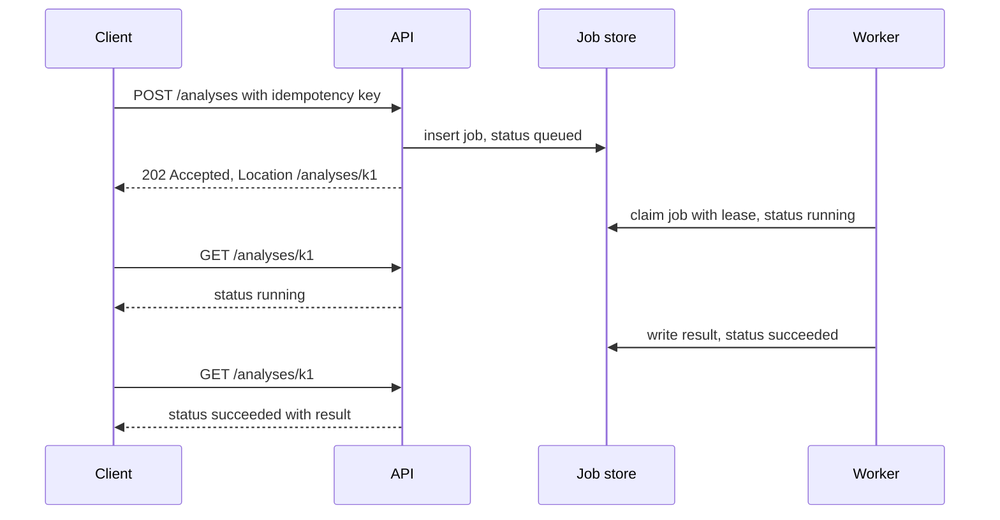

## TL;DR
Synchronous: the caller holds a connection until the result arrives. Asynchronous: it gets a job id and
the result later. LLM calls take seconds and agent runs minutes, longer than proxies and people wait, so
most AI work goes async, or streams when someone watches.

## Why it exists
- **AI work outlives connections.** A classic web request completes in tens of milliseconds, so holding
  the connection is free. An LLM completion takes seconds, a tool-using agent run minutes, a batch of a
  thousand document summaries an hour.
- **Every hop has an idle timeout you do not control.** Load balancers and reverse proxies commonly
  default to around a minute (the exact value varies by product); mobile networks drop connections when
  the device changes cells. On timeout the client sees an error and retries while the server is still
  working, so the same expensive run executes twice, tokens are paid twice, and side effects (a posted
  comment, a charged card) happen twice.
- **Capacity scales with run time, not work.** By Little's law, in-flight requests ≈ arrival rate × time
  in system. At 10 requests per second averaging 30 seconds, the fleet holds about 300 open connections,
  each with a goroutine, thread or coroutine, buffers and partial state. Double the run time and the count
  doubles though useful work is unchanged; a deploy that restarts an instance drops every run it held.
- **Synchronous work is lost on restart.** If the process restarts mid-request the run vanishes; the client
  only learns the socket closed. There is no record the work existed, so nothing to resume.
- **"Raise every timeout to ten minutes" only hides it.** Long-lived connections pile up, one deploy drops
  them all, and the client still cannot tell "slow" from "dead". The real fix separates *accepting* work
  from *doing* it, which is what asynchronous execution means.

## How it works
### Two meanings of "asynchronous"
- **Async I/O inside a process** (`asyncio`, Node's event loop) lets one thread wait on many sockets
  instead of blocking per request. It raises how many connections a server can hold but does not change
  the interaction model; the language modules cover it.
- **This lesson** is the *interaction* model between caller and service: does the caller wait for the
  result or not?

### The three shapes at a glance
| Shape | Caller's state lives in | Fits | Breaks when |
|---|---|---|---|
| Synchronous | the connection | work well inside every timeout, caller needs the answer to continue | p99 nears the shortest timeout |
| Streaming | the connection, with partial results | a person watching, seconds to about a minute | reconnects without resume re-run the generation |
| Asynchronous job | a durable job record | long, retried, restart-surviving or unattended work | sub-second work, where it is pure overhead |

### The synchronous shape
- Client sends a request, server does the work, response carries the result.
- **Failure semantics:** an error means the result was not delivered, *not* that the work did not happen.
  That is why even synchronous calls with side effects need an idempotency key.

### Streaming: synchronous with incremental delivery
- Server-sent events or chunked responses push partial results as produced (tokens, tool-call progress).
- Time-to-first-byte drops from full generation time to prefill time, which makes a 40-second answer
  tolerable to a person.
- The connection is still held, so timeouts and retries still apply. A reconnecting client needs a way to
  resume ("give me events after sequence 812") or it re-runs the generation.

### The asynchronous shape
1. **Submit.** The client sends the request with a client-generated idempotency key. The server validates
   it, persists a job record (`status=queued`, inputs, key, tenant, created_at) and returns `202 Accepted`
   with a job id and a status URL.
   - Only the job-store write must succeed inside the request, so it is fast, and the work survives a
     restart *because* it is durable before anyone starts on it.
   - A repeated key returns the existing job. A repeated key with a *different* body is rejected (`409`
     or `422`), because returning the old job would hand the client a result for a request it did not make.
2. **Execute.** A worker claims the job from a queue (Redis, SQS, Postgres with `SKIP LOCKED`), marks it
   `running` with a lease or heartbeat, does the work, and writes the result and `succeeded` or `failed`.
   The lease matters because a worker that dies mid-job must have its job reclaimed by another worker
   after the lease expires; without it the job stays `running` forever.
3. **Deliver.** The client learns the outcome by one of:

| Channel | Strength | Cost |
|---|---|---|
| Polling `GET /jobs/{id}` | simple, works through any proxy | costs requests |
| Webhook the server calls | efficient | server must retry; receiver must verify and deduplicate |
| Push (SSE or WebSocket) subscribed to the job | best UX for interactive clients | holds a connection |

- **Status model:** a small state machine, `queued → running → succeeded | failed | cancelled`, often with
  a `progress` field and an `attempt` counter.
- **Retention:** results need a policy; a job store that keeps every result forever becomes the biggest
  table in the system.

### Cancellation is a request, not a guarantee
- Detached work no longer stops when the browser tab closes, so the API needs `POST /jobs/{id}/cancel`.
- The server can only set `cancel_requested`. The worker checks it between steps (between tool calls,
  between document batches) and stops at the next safe point, *because* interrupting mid-step can leave a
  half-applied side effect.
- Effects already performed stay performed: a cancelled agent run may still have created a ticket.
  Cancelling multi-step work with effects is a saga question (compensate or leave), and the final status
  should say which steps completed.

### The hybrid: respond if fast, otherwise hand back a job
- Many APIs accept a `wait` budget. If the job finishes within, say, 20 seconds, the result returns inline;
  otherwise the job id does.
- Client code handles both outcomes. Short requests stay simple; long ones are not fragile.

### Backpressure
- An asynchronous front door accepts work faster than workers drain it, so the queue is where overload
  becomes visible.
- **Bound it:** reject submissions with `429` or `503` when queue depth or estimated wait exceeds a
  threshold, and expose that wait estimate to clients.
- An unbounded queue turns an outage into a multi-hour backlog that keeps failing after the cause is fixed.

## Diagram
The asynchronous shape: the request only has to persist a job, a worker does the work under a lease, and
the client learns the outcome by polling (or a webhook or push stream) instead of holding a connection.



## Examples
### FastAPI job service: submit, worker, status
Submit returns `202` and a job id, a worker drains a queue, a status endpoint reports progress. The
in-memory queue and dict are for illustration; production uses a durable queue and a table so jobs
survive restarts.

```python
import asyncio, uuid
from contextlib import asynccontextmanager
from fastapi import FastAPI, HTTPException, Response

jobs: dict[str, dict] = {}              # production: a table with status, result, attempt, lease
queue: asyncio.Queue[str] = asyncio.Queue(maxsize=1000)   # bounded => backpressure

async def run_analysis(text: str) -> str:
    await asyncio.sleep(5)              # stands in for a multi-second LLM/agent run
    return f"{len(text.split())} words"

async def worker():
    while True:
        job_id = await queue.get()
        jobs[job_id]["status"] = "running"
        try:
            jobs[job_id]["result"] = await run_analysis(jobs[job_id]["input"])
            jobs[job_id]["status"] = "succeeded"
        except Exception as e:          # production: retry with backoff, then dead-letter
            jobs[job_id].update(status="failed", error=str(e))
        queue.task_done()

@asynccontextmanager
async def lifespan(app):
    task = asyncio.create_task(worker()); yield; task.cancel()

app = FastAPI(lifespan=lifespan)

@app.post("/analyses", status_code=202)
async def submit(body: dict, response: Response):
    job_id = body.get("idempotency_key") or str(uuid.uuid4())
    if job_id in jobs and jobs[job_id]["input"] != body["text"]:
        raise HTTPException(409, "idempotency key reused with a different body")
    if job_id not in jobs:              # a retried submit returns the same job
        jobs[job_id] = {"status": "queued", "input": body["text"]}
        try:
            queue.put_nowait(job_id)
        except asyncio.QueueFull:
            del jobs[job_id]; raise HTTPException(503, "busy, retry later")
    response.headers["Location"] = f"/analyses/{job_id}"
    return {"job_id": job_id, "status": jobs[job_id]["status"]}

@app.get("/analyses/{job_id}")
async def status(job_id: str):
    if job_id not in jobs:
        raise HTTPException(404)
    return jobs[job_id]
```

Trace one request:
1. `POST {"text": "...", "idempotency_key": "k1"}` returns `202` with `Location: /analyses/k1` in a few
   milliseconds.
2. A `GET` one second later shows `running`.
3. The client's network drops and it re-sends the same `POST`; it gets the same job, still `running`,
   rather than a second five-second run. A full queue is refused immediately rather than growing silently.
4. A `GET` after five seconds returns `succeeded` with the result.

What the sketch omits is exactly what production needs:
- **Durability:** a restart loses `jobs` and the queue, so both must be durable.
- **Leases:** a crashed worker leaves the job `running` forever, so claims need a lease.
- **Cross-instance dedupe:** a key held only in memory cannot deduplicate across instances, so the key
  needs a unique constraint in the job table.

### Runnable: pick the shape from p99 and Little's law
```python
def in_flight(rate_per_s, avg_seconds):
    return rate_per_s * avg_seconds            # Little's law: L = lambda * W

def shape(p99_s, smallest_timeout_s, human_watching):
    if p99_s < 0.5 * smallest_timeout_s and p99_s <= 5:
        return "synchronous"
    if human_watching and p99_s < smallest_timeout_s:
        return "stream"
    return "async job"

print(in_flight(10, 30), in_flight(10, 60))    # 300 600 open connections
print(shape(2, 60, True))                      # synchronous
print(shape(40, 60, True))                     # stream
print(shape(120, 30, False))                   # async job
```
The thresholds (half the timeout, 5 seconds) are illustrative defaults to tune, not standards.

### Production snippet: claiming a job with a lease in Postgres
```sql
UPDATE jobs
SET status = 'running', attempt = attempt + 1,
    lease_until = now() + interval '60 seconds'
WHERE id = (
  SELECT id FROM jobs
  WHERE status = 'queued'
     OR (status = 'running' AND lease_until < now())   -- reclaim from a dead worker
  ORDER BY created_at
  LIMIT 1
  FOR UPDATE SKIP LOCKED
)
RETURNING id, input;
```
`SKIP LOCKED` lets many workers poll the same table without blocking on each other's rows; the worker
extends `lease_until` as a heartbeat while it runs.

## Production patterns
- **`202` plus `Location` plus `Retry-After`.** For any endpoint whose p99 nears a proxy timeout, return
  `202 Accepted` with a `Location` status URL and a `Retry-After` hint so clients poll at a sane interval.
  Monitor the ratio of status polls to submits; a high ratio is the cue for push delivery.
- **Idempotency key with a unique constraint.** Store the client key in the job table under a unique
  index scoped by tenant, plus a hash of the request body to detect reuse with a different body. Monitor
  retried submits versus unique jobs.
- **Leases and a reaper.** Workers set `lease_until` on claim and extend it on heartbeat; expired leases
  are reclaimed (as in the SQL above) with an `attempt` cap before dead-lettering. Alert on jobs whose
  `attempt` hits the cap and on the age of the oldest `running` job.
- **Resumable streams.** For SSE, give each event an `id:` so a reconnecting browser sends the standard
  `Last-Event-ID` header and the server replays from there instead of re-running generation. Monitor
  reconnect rate and duplicate-generation count.
- **Signed webhooks with retries.** Sign the payload with an HMAC over a timestamp and body, retry with
  exponential backoff for a bounded window, and include the job id so receivers deduplicate. Monitor
  delivery failure rate per receiver.
- **Bounded queue with load shedding.** Reject with `429` or `503` when queue depth or estimated wait
  exceeds the budget. Track queue depth, oldest-job age and estimated wait as first-class metrics.

## Trade-offs
- **Simplicity vs timeout ceiling.** Synchronous calls are simple to build, test and reason about, but
  their reliability is bounded by the shortest timeout in the path; once p99 work time approaches it, the
  shape must change.
- **Durability vs machinery.** Asynchronous jobs survive restarts and absorb bursts, but add a job store, a
  worker fleet, a status API and client polling or callback logic; for sub-second work that is pure overhead.
- **Perceived latency vs held connections.** Streaming gives the best perceived latency for a human, yet
  holds connections, complicates retries and resumption, and offers nothing to a machine caller that only
  wants the final answer.
- **Polling vs webhooks.** Polling is proxy-friendly and stateless but wastes requests and adds up to one
  interval of latency; webhooks are efficient but make you responsible for retries, signatures and the
  receiver's uptime.
- **Hybrid wait vs two response shapes.** "Wait up to N seconds" keeps simple cases simple, but clients
  must handle both shapes, and a poorly chosen N recreates the timeout problem it was meant to avoid.

## Pitfalls
- **Raising timeouts layer by layer instead of changing the shape.** Symptom: duplicate runs and double
  token spend after clients retry requests the server was still processing.
- **Accepting jobs without an idempotency key.** Every client retry of the submit creates a new job,
  visible as bursts of identical jobs seconds apart.
- **Workers with no lease or heartbeat.** A worker crash leaves jobs in `running` indefinitely and users
  see spinners that never resolve.
- **Unbounded queues.** An upstream outage builds a backlog that takes hours to drain, during which fresh
  requests wait behind stale ones nobody still wants.
- **Fixed short polling from thousands of clients.** Status endpoints become the top traffic source and
  the database behind them the bottleneck; add push delivery or backoff.
- **Results kept forever.** No TTL and no size limit make the jobs table the largest and slowest table and
  its backups the longest.
- **Treating a disconnect or cancel as "the work stopped".** Symptom: tickets or emails produced by runs
  the UI reports as cancelled, because the worker never checked the cancel flag or the effect had already
  happened.

## When to use
Decide from the p99 of the work, not the median, against the smallest timeout in the path and how long a
human will wait.
- **Synchronous:** work that finishes within a few seconds at p99.
- **Stream:** several seconds to roughly a minute with a person watching.
- **Asynchronous job:** anything longer, anything that must survive a restart, anything with retries and
  compensation, and anything with no human waiting (batch summarisation, re-indexing, nightly evaluations).
- **Measure:** time-to-first-byte, end-to-end completion time, queue depth and the ratio of retried
  submits to unique jobs.
- **Day to day:** whether an endpoint returns `200` with a body or `202` with a `Location` header, and
  whether your agent framework exposes a `run` call or a `submit` plus `events` pair.
- **Interviews:** name the three shapes, justify each with a timeout or human-attention argument, and
  mention idempotency keys and leases without being prompted.

## Role lens
- **Engineer:** Builds the `202` + status endpoint pair, adds idempotency keys to submits, implements
  worker leases and retries, and streams tokens over SSE for interactive paths.
- **Architect:** Sets the latency budget per interaction, chooses queue technology and delivery channel,
  and defines the job lifecycle, retention and backpressure policy as platform standards.
- **FDE:** Fits the product's job model to the customer's integration style, often replacing a
  synchronous call that times out through their gateway with polling or a signed webhook.

## Check yourself
**Q:** A customer's workflow calls your agent synchronously through their API gateway, which times out at
30 seconds. Agent runs take 5 to 120 seconds. They report intermittent "failures" and duplicate tickets
being created in their system. Diagnose the problem and propose a design.
**A:** The gateway closes the connection at 30 seconds, so every run longer than that looks like a failure
even though the agent keeps working and eventually creates the ticket; the customer's retry then starts a
second run that creates a second ticket. Two changes are needed. First, change the shape: `POST /runs`
persists the run and returns `202` with a run id inside the gateway's timeout, a worker executes it, and
the customer polls `GET /runs/{id}` or receives a signed webhook on completion. Second, make the ticket
creation idempotent by deriving its key from the run id and the step, so even a genuine retry cannot
create two tickets. Workers need leases so a crash reclaims the run, the queue should be bounded with a
clear `503` on overload, and run results need a retention window. If the customer wants progress, offer
an SSE stream keyed by run id rather than lengthening the gateway timeout.

## Interview questions
### What does "asynchronous" mean in API design, and how is it different from async I/O?
- **Interaction model, not runtime.** An asynchronous API accepts work, returns a job id (`202 Accepted`)
  and delivers the result later; the caller does not hold a connection while the work runs.
- **Async I/O is inside one process.** `asyncio` or Node's event loop lets one thread wait on many sockets,
  which raises connection capacity but still keeps the caller waiting on each request.
- **Why it matters:** async I/O does not survive a restart or a proxy timeout; a durable job record does.

### Your fleet serves 10 requests per second of agent runs averaging 30 seconds. How many connections are open, and what changes if runs double?
- **Little's law:** in-flight ≈ arrival rate × time in system = 10 × 30 = 300 open connections.
- **Doubling run time doubles it to 600** with no extra useful work, and a deploy that restarts an instance
  drops every run that instance held.
- **The async shape breaks the link.** Submits finish in milliseconds, so connections track request rate,
  and in-flight work lives in the job store where a restart cannot erase it.

### Users see spinners that never resolve on a job-based endpoint. What do you look for?
- **Jobs stuck in `running`.** A worker that crashed without a lease or heartbeat leaves its job claimed
  forever; query the age of the oldest `running` job.
- **Fix with leases.** Set `lease_until` on claim, extend it while working, and let other workers reclaim
  expired leases, capping `attempt` before dead-lettering.
- **Also check delivery.** A webhook that failed without retries, or a client that stopped polling, looks
  identical from the user's side; compare job status in the store with what the client last saw.

### When would you keep an endpoint synchronous even though you have a job system available?
- **When p99 is comfortably inside every timeout.** Sub-second or few-second work gains nothing from a job
  store, worker fleet and polling logic except latency and moving parts.
- **When the caller needs the answer to continue.** A classifier gating the next step of a request is
  simpler as a synchronous call with an idempotency key and a tight timeout.
- **Hybrid when in doubt.** Offer a `wait` budget so fast cases return inline and slow ones return a job id.

### How do you make a streaming chat response survive a dropped connection?
- **Number the events.** Give each SSE event an `id:`; a reconnecting browser sends `Last-Event-ID`.
- **Keep the generation server-side.** The server buffers the run's events by sequence so it can replay
  everything after the last id instead of starting a new, paid generation.
- **Measure** reconnect rate and duplicate-generation count; a rising duplicate count means resume is not
  working.

## Quiz
### Q: Why does raising the load balancer timeout from 60 s to 600 s not fix an endpoint whose agent runs take up to five minutes?
- [ ] Load balancers cannot be configured above 60 seconds
- [x] The work still vanishes on a restart, retries still duplicate it, and connection count grows with run time
- [ ] Longer timeouts increase token cost per request
- [ ] HTTP/1.1 does not permit responses slower than 60 seconds
> A longer timeout hides the symptom but keeps the synchronous shape: in-flight runs have no durable record,
> a client or proxy retry re-executes them, and each instance holds connections proportional to run time.
> Separating submission from execution addresses all three.

### Q: A client retries a job submission after a network error and the server creates a second identical job. What was missing?
- [ ] A longer polling interval
- [ ] A streaming response instead of a job id
- [x] A client-supplied idempotency key that the server uses to return the existing job
- [ ] A webhook so the client would not have retried
> The submit request itself can be duplicated by the network, so the server must recognise a repeat. An
> idempotency key stored with the job lets the retry return the original job id instead of enqueuing new work.
> Delivery channel and polling cadence do not affect submission duplicates.

### Q: When is streaming the right choice over a background job?
- [x] A person is watching and the work finishes within the connection's timeout budget
- [ ] The work must survive a server restart
- [ ] The caller is a batch process that only needs the final answer
- [ ] The result must be delivered to several consumers
> Streaming improves perceived latency for a human reader while keeping a synchronous connection, so it fits
> interactive work that still completes within timeouts. Durability, machine callers and fan-out all point to
> a persisted job with polling, push or events.
