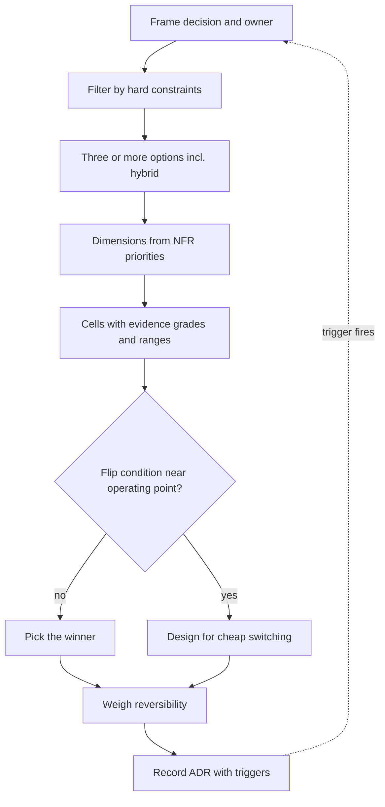

## TL;DR
Trade-off analysis chooses between options when none dominates: filter by hard constraints, score real
options on NFR evidence, find where the ranking flips, weigh reversibility, then record. In AI it is
usually quality vs latency vs cost, plus vendor risk.

## Why it exists
- **Everything is a trade-off.** Richards and Ford's first law; their corollary is that if you think a
  choice has none, you have not found it yet. The practice exists because teams keep deciding in ways that
  hide the cost until it is paid.
- **The common methods fail predictably.**
  - **Pros-and-cons lists** have no weights, evidence or conditions, so they can justify anything.
  - **Weighted scoring matrices** look rigorous but are usually built backwards: favourite first, weights
    tuned until it wins, single-digit precision pretending to be measurement.
  - **Best-practice and vendor-benchmark decisions** import someone else's context, the one thing a
    trade-off is sensitive to.
  - **Analysis paralysis:** with no method, every decision is a debate won by the loudest voice.
- **AI makes it worse.** Options change monthly and published benchmarks do not transfer to your data.
  Hosted or self-hosted, large or small model, long context or retrieval, fine-tune or prompt: the honest
  answer is "it depends on volume, quality threshold and how often you will need to switch".
- **What a good analysis outputs.** Not "we picked X", but what the choice depends on, at what value the
  answer changes, and how expensive being wrong is. That output survives contact with next quarter.

## How it works
### 1. Frame the decision
- **One sentence:** the decision, its scope, who decides, by when.
- **Separate hard constraints from dimensions.** Constraints (EU residency, a licence forbidding
  commercial use, a budget ceiling, a launch date) are filters: an option violating one is removed before
  scoring.
- **Why filter first:** treating a constraint as a weighted dimension is how a disqualified option "wins
  on points".
- **Constraints come from the NFRs**, which is why trade-off analysis without written NFRs degrades into
  opinion.

### 2. Enumerate real options
- **At least three**, including "do nothing or defer", and usually a hybrid.
- **Why:** one option is a ratification; two is often a false dichotomy.
- **The hybrid is frequently the answer** (hosted model for generation, self-hosted for embeddings; small
  model escalating to a large one), but only found if it is on the list.

### 3. Choose the dimensions from the NFR priorities
- **Four to seven dimensions**, drawn from the architecturally significant requirements, not a generic
  template: quality on your golden set, p95 latency, cost per successful task, operational burden, vendor
  or lock-in risk, time to deliver, reversibility.
- **Fewer dimensions with real evidence** beat a twelve-column matrix of guesses.
- **The priority order is the one the business already agreed in the NFRs**, so the tie-breaker is not
  invented during the analysis.

### 4. Fill each cell with evidence, and label its grade
| Grade | Source |
|---|---|
| **Measured** | Your workload, your eval set |
| **Prototyped** | A spike on representative data |
| **Estimated** | Back-of-envelope from known prices and throughput |
| **Asserted** | Someone's belief |

- **Write the grade next to the number.**
- **Spend a prototyping day on the two cells with the highest weight and lowest grade**, *because* they
  decide the outcome and are the most likely to be wrong.
- **Carry ranges, not points:** "cost per 1k conversations $30–55 depending on cache hit rate" beats
  "$42".

### 5. Find the sensitivity points and the flip conditions
This step distinguishes analysis from scoring.
- **For each important input, ask at what value the ranking changes:** monthly volume, GPU utilisation,
  provider price, the quality threshold, team size.
- **ATAM vocabulary:** these are sensitivity points; a parameter that moves two quality attributes in
  opposite directions is a trade-off point.
- **A flip condition close to your expected operating point means the decision is fragile.** The right
  output is then not a winner but a design that makes switching cheap (an abstraction such as a gateway)
  plus a trigger to re-run the analysis.

### 6. Weigh reversibility and the cost of being wrong
- **Two-way doors** (swap the model behind a gateway, change a chunking strategy) can be decided quickly on
  thin evidence, because the cost of error is small.
- **One-way doors** (train on customer data, commit to an embedding model that fixes a billion-vector
  index, sign a multi-year commitment) deserve prototypes, ranges and a pre-mortem.
- **Under uncertainty, reversibility has option value** that a static matrix does not show, so give it
  explicit credit.

### 7. Decide, record, schedule the revisit
- **Write the outcome as an ADR:** constraints, options, the matrix with evidence grades, flip conditions
  and revisit triggers.
- **Record the inputs, or the analysis is not reusable.** "We chose hosted" is unreproducible; "we chose
  hosted because break-even was 18B tokens a month at 50% utilisation and we expect 2B" can be re-run in
  five minutes next year.

### Techniques that fit inside the steps
| Technique | Use it for |
|---|---|
| Break-even arithmetic | Cost cells |
| Scenario walkthroughs (top NFR scenarios through each option on a whiteboard) | Availability and operability |
| Utility tree | Agreeing which dimensions matter |
| Pre-mortem ("a year later this choice failed, why?") | Risks the matrix missed |
| Halving test ("still choose this if volume halved or doubled?") | A cheap sensitivity check |

### Scoring under forecast uncertainty: regret
When the forecast itself is the uncertainty, score per scenario rather than at one point:
1. Compute each option's cost at the low, expected and high ends of the range.
2. Its **regret** in each scenario is its cost minus the best option's cost in that scenario.
3. Choose the option whose worst-case regret is smallest.

This is a defensible rule when nobody can honestly narrow the range, and the table makes visible which
scenario each option is betting on.

## Diagram
The seven steps as a pipeline; the sensitivity check decides whether you pick a winner or design for cheap
switching, and the revisit trigger loops back to the start.



## Examples
### Break-even: the cost cell of hosted vs self-hosted
- **Illustrative figures only:** replace them with your own quotes and a load-tested throughput number.
  The script is the shape of the reasoning, not a benchmark.
- **The finding:** at these inputs self-hosting only wins above roughly 18 billion tokens a month, and a
  drop in utilisation from 50% to 40% makes it never win, *because* idle GPUs still bill.
- **That utilisation sensitivity belongs in the ADR**, alongside the quality and risk dimensions this cell
  says nothing about.

```python
# Illustrative figures only. Replace with your provider quote and your measured throughput.
HOSTED_PER_M  = 2.00         # $ per 1M tokens, blended input/output
GPU_HOUR      = 2.50         # $ per GPU-hour, on-demand
TOK_PER_GPU_H = 3_000_000    # tokens one GPU serves per hour on YOUR workload (load-tested)
OPS_PER_MONTH = 6_000        # $ people + tooling to run serving, paid regardless of volume

def monthly(tokens: float, util: float) -> tuple[float, float]:
    hosted = tokens / 1e6 * HOSTED_PER_M
    self_hosted = tokens / (TOK_PER_GPU_H * util) * GPU_HOUR + OPS_PER_MONTH
    return hosted, self_hosted

def break_even_tokens(util: float) -> float:
    # hosted == self_hosted  =>  tokens * (price_per_token - gpu_cost_per_token) == fixed ops cost
    gap = HOSTED_PER_M / 1e6 - GPU_HOUR / (TOK_PER_GPU_H * util)
    return OPS_PER_MONTH / gap if gap > 0 else float("inf")

for util in (0.5, 0.4):
    be = break_even_tokens(util)
    verdict = f"{be / 1e9:.1f}B tokens/month" if be != float("inf") else "never (GPU cost/token exceeds hosted)"
    print(f"utilisation {util:.0%}: self-hosting pays off above {verdict}")
    for t in (5e8, 5e9, 5e10):
        h, s = monthly(t, util)
        print(f"   {t / 1e9:>5.1f}B tokens   hosted ${h:>9,.0f}   self-hosted ${s:>9,.0f}")

# utilisation 50%: self-hosting pays off above 18.0B tokens/month
#      0.5B tokens   hosted $    1,000   self-hosted $    6,833
#      5.0B tokens   hosted $   10,000   self-hosted $   14,333
#     50.0B tokens   hosted $  100,000   self-hosted $   89,333
# utilisation 40%: self-hosting pays off above never (GPU cost/token exceeds hosted)
#      0.5B tokens   hosted $    1,000   self-hosted $    7,042
#      5.0B tokens   hosted $   10,000   self-hosted $   16,417
#     50.0B tokens   hosted $  100,000   self-hosted $  110,167
```

**Utilisation is not a free parameter.** It is served tokens divided by the capacity you pay for, and two
things cap it:
- **Peak sizing.** A fleet sized for peak idles off-peak, so with a peak-to-average ratio of 2 and no
  autoscaling, utilisation cannot exceed 50%.
- **A minimum fleet.** Say two GPUs for redundancy running 24/7 (~1,460 GPU-hours, ~$3,650 a month here),
  billed at any volume. At 0.5B tokens it would run about 11% utilised, so the real self-hosted cost is
  ~$9,650, not $6,833.
- **What it changes.** The floor does not move the 18B break-even, where the fleet is already ~16 GPUs,
  but it shows why the utilisation cell should be derived from a traffic profile, not typed in.

### Runnable: minimax regret when the forecast is a range
Same illustrative cost model at 50% utilisation, scored across a low, expected and high volume. The choice
flips with the high end of the forecast, which is exactly what the ADR must record.

```python
# Illustrative: same cost model as the break-even script, at 50% utilisation.
def hosted(t):      return t / 1e6 * 2.00
def self_hosted(t): return t / (3_000_000 * 0.5) * 2.50 + 6_000

OPTIONS = {"hosted": hosted, "self-hosted": self_hosted}

def minimax_regret(scenarios: dict[str, float]) -> str:
    cost = {o: {s: f(t) for s, t in scenarios.items()} for o, f in OPTIONS.items()}
    best = {s: min(cost[o][s] for o in OPTIONS) for s in scenarios}
    worst_regret = {o: max(cost[o][s] - best[s] for s in scenarios) for o in OPTIONS}
    for o in OPTIONS:
        print(f"  {o:<12}" + "".join(f"{s}: ${cost[o][s]:>7,.0f}  " for s in scenarios)
              + f"worst regret ${worst_regret[o]:,.0f}")
    return min(worst_regret, key=worst_regret.get)

for high in (30e9, 50e9):
    print(f"forecast 1B / 5B / {high / 1e9:.0f}B tokens per month")
    pick = minimax_regret({"low": 1e9, "expected": 5e9, "high": high})
    print("  minimax-regret choice:", pick)
```

| Forecast (tokens/month) | Hosted worst regret | Self-hosted worst regret | Choice |
|---|---|---|---|
| 1B / 5B / 30B | $4,000 | $5,667 | Hosted |
| 1B / 5B / 50B | $10,667 | $5,667 | Self-hosted |

- **Read it as a sensitivity finding**, not a verdict: the answer depends on how plausible the high
  scenario is.
- **Add the minimum-fleet floor** from the note above and self-hosting's low-volume regret grows, which
  pushes back toward hosted behind a gateway plus a volume trigger.

## Production patterns
- **Evidence-graded matrix in the ADR.** Use for every one-way door. Each cell holds a range and a grade
  (measured, prototyped, estimated, asserted), and the ADR template has a column for both. Monitor the
  share of high-weight cells still graded "asserted" at decision time.
- **Time-boxed spike on the riskiest cells.** Use when the two highest-weight, lowest-grade cells could
  flip the result. Run the spike on your golden set and your traffic shape, not a vendor demo. Monitor
  whether spike results changed the ranking; if they never do, the matrix is being built backwards.
- **Pin priorities before scoring.** Use in every review. Commit the NFR priority order and the dimension
  list before any option is scored, so the history shows weights did not move afterwards. Monitor weight
  changes after the first scoring pass.
- **Gateway plus flip-input dashboard.** Use when the flip condition is near the operating point. Put the
  choice behind an abstraction (an LLM gateway, a retriever interface) and chart the flip input (monthly
  tokens, utilisation, price) against its threshold. Alert when it crosses and link the ADR.
- **Pre-mortem and halving test in the review agenda.** Use for one-way doors. Ask "a year later this
  failed, why?" and "would we still choose this at half or double the volume?" before deciding. Monitor
  risks raised there that later appear in incidents.

## Trade-offs
- **Full matrix: decisions that survive review vs days of work.** For two-way doors, a one-paragraph
  analysis with a named flip condition is the right amount of rigour.
- **Prototyping uncertain cells: measurements vs unrepresentative spikes.** A spike on unrepresentative
  data is worse than an honest estimate; the prototype must use your golden set and your traffic shape.
- **Explicit weights: arguable priorities vs tuning toward a favourite.** The defence is fixing the
  priority order in the NFRs before any option is scored.
- **Optimising for reversibility: open options vs abstraction cost.** Every switching abstraction costs
  something and can hide capabilities of what sits behind it. It pays off when the flip condition is near,
  not when one option clearly dominates.
- **Sensitivity analysis: knowing what matters vs needing real inputs.** It needs volume forecasts,
  utilisation and prices; with none, say so and set a short revisit date instead of inventing them.

## Pitfalls
- **Weights adjusted after the first scoring pass.** Symptom: the matrix history shows the favourite
  losing, then the weights changing, then the favourite winning.
- **Dimensions copied from a generic template, not the NFRs.** Symptom: a column such as "community size"
  outweighs the quality threshold the product will be judged on.
- **Point estimates with false precision.** Symptom: a decision resting on a 7.4 versus 7.1 total that no
  one can reproduce.
- **A provider's or paper's benchmark as the quality cell.** Symptom: a model wins on the leaderboard and
  loses on your golden set after the contract is signed.
- **Forgetting the fixed operational cost of running things yourself.** Symptom: a self-hosting plan
  whose per-token cost looked lower and whose monthly bill is higher.
- **Typing in a utilisation figure instead of deriving it from the traffic profile.** Symptom: a GPU bill
  well above plan, because the fleet is sized for peak and idles overnight and at weekends.
- **Treating a hard constraint as a weighted dimension.** Symptom: a vendor that "scored best" cannot
  satisfy the customer's residency requirement.
- **Never recording the inputs.** Symptom: the same debate, from scratch, every time a new model or price
  list appears.

## When to use
- **Full method:** one-way doors and any choice whose flip condition is plausibly near your operating
  point: hosted versus self-hosted, embedding model and vector store, tenancy model, fine-tune versus
  retrieval, build versus buy on a core capability.
- **Short form for everything else:** constraints, three options, one flip condition, a reversibility
  note.
- **Skip it** for decisions that are cheap to undo.
- **Measure:** your own quality on your own golden set, your own throughput under your own load, and your
  own volume forecast with a range.
- **Interviews:** the strongest answers to "would you use X or Y" name the dimensions, state the deciding
  assumption, give the value at which the answer flips, and say how they keep the choice reversible until
  the data arrives.

## Role lens
- **Engineer:** Produces the measured cells, latency under load, eval scores, token counts, cache hit
  rates, and builds the spike that turns the riskiest estimate into a measurement.
- **Architect:** Owns the framing, the constraint-versus-dimension split, the priority order inherited
  from the NFRs, the sensitivity analysis and the written ADR with revisit triggers.
- **FDE:** Runs the analysis with the customer's real volumes, prices and constraints, and shows them the
  flip condition so the recommendation is understood as conditional rather than as vendor preference.

## Check yourself
**Q:** A customer asks whether they should self-host an open-weight model or keep using a hosted API,
and wants a yes or no. How do you structure the answer so it is both decisive and honest?
**A:** I would first apply the hard constraints: residency, licence, security review, and whether they
have anyone to operate GPUs. If self-hosting survives those, I would score the live options, hosted,
self-hosted and a hybrid, on the dimensions their NFRs prioritise: quality on their golden set, p95
latency, cost per successful task, operational burden and reversibility, labelling each cell as measured,
prototyped or estimated. The decisive part is the flip condition: with their quotes and a load-tested
throughput, self-hosting breaks even above some monthly token volume at a given utilisation, and I would
compare that to their forecast range. If the forecast is well below it, the answer is hosted, behind a
gateway so the switch stays cheap, with a revisit trigger at a stated volume or when an open-weight model
reaches eval parity. If the forecast straddles the flip point, the recommendation is the hybrid and a
measured pilot rather than a bet.

## Interview questions
### Why is a weighted scoring matrix often worse than it looks?
- **It is usually built backwards:** the favourite is chosen first and weights are tuned until it wins.
- **It hides uncertainty:** single-digit totals such as 7.4 vs 7.1 pretend to be measurements when most
  cells are asserted.
- **Fix:** fix the priority order from the NFRs before scoring, grade every cell's evidence, carry ranges,
  and run a sensitivity analysis instead of trusting the total.

### Walk me through deciding between a large hosted model and a small self-hosted one.
- **Filter:** residency, licence, security review, and whether anyone can operate GPUs.
- **Options:** hosted large, self-hosted small, and a hybrid where the small model escalates hard cases.
- **Evidence:** quality on your golden set, p95 latency under load, cost per successful task, operational
  burden, each graded.
- **Decide on the flip:** compute break-even volume and utilisation, compare with the forecast range, and
  keep the choice behind a gateway.

### Self-hosting looked cheaper on paper but the bill is higher. What went wrong?
- **Utilisation was typed in, not derived:** a fleet sized for peak with a peak-to-average ratio of 2
  cannot exceed 50% utilisation without autoscaling.
- **Fixed costs were missed:** the operations team and a minimum redundant fleet bill at any volume; in the
  example, two GPUs 24/7 add ~$3,650 a month.
- **At 40% utilisation** the illustrative model never breaks even, because cost per served token exceeds
  the hosted price.

### When would you not run a full trade-off analysis?
- **For two-way doors**, such as swapping a model behind a gateway or changing a chunking strategy: the cost
  of being wrong is small, so a paragraph with one flip condition is enough.
- **When inputs do not exist yet:** say so, choose the most reversible option, and set a short revisit date
  rather than inventing numbers.

### What is a sensitivity point, and what do you do when one is near your operating point?
- **Definition (ATAM):** an input whose change shifts the ranking; one that moves two quality attributes in
  opposite directions is a trade-off point.
- **Near the operating point the decision is fragile:** design for cheap switching, monitor the input on a
  dashboard, and record a trigger to re-run the analysis when it crosses.

## Quiz
### Q: Why should hard constraints be applied as filters before scoring, rather than as heavily weighted dimensions?
- [ ] Because scoring matrices cannot represent more than five dimensions
- [x] Because an option that violates a constraint can still win on total points, producing a choice that cannot actually be deployed
- [ ] Because constraints always come from legal rather than engineering
- [ ] Because filtering is faster to compute
> A residency or licence violation is disqualifying regardless of how well the option scores elsewhere;
> giving it a weight lets strong scores on other columns outvote a requirement that has no
> compensation.

### Q: What is the most valuable output of a sensitivity analysis in an architecture decision?
- [ ] A more precise total score for the winning option
- [ ] A list of all the stakeholders consulted
- [x] The input values at which the ranking of options changes, compared with the expected operating point
- [ ] A ranking of dimensions by how hard they are to measure
> Knowing where the answer flips tells you whether the decision is robust or fragile and what to monitor
> as a revisit trigger. A more precise score does not reveal how much the result depends on uncertain
> inputs.

### Q: In the break-even example, why can lowering GPU utilisation from 50% to 40% make self-hosting never pay off?
- [ ] Because the hosted provider lowers its price at lower volumes
- [ ] Because lower utilisation increases the fixed operational cost
- [x] Because idle GPU time still bills, so the effective cost per served token rises above the hosted per-token price
- [ ] Because utilisation below 50% triggers autoscaling penalties
> Self-hosted cost per token is GPU cost per hour divided by tokens actually served per hour; serving
> fewer tokens on the same billed hardware raises it. Once it exceeds the hosted price per token, no
> volume recovers the fixed costs.
