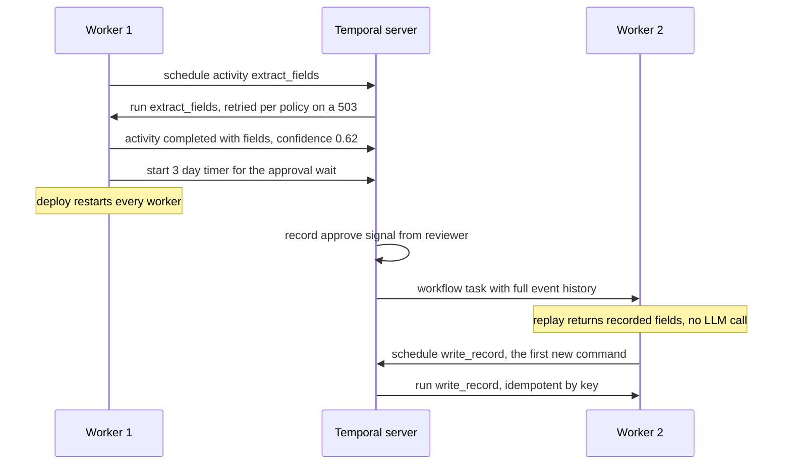

## TL;DR
Workflow orchestrators run your agent's multi-step work reliably outside a request. Airflow schedules
the batch DAGs that feed RAG indexes, Prefect runs dynamic Python dataflows, and Temporal replays durable
code, which fits long agent runs that wait for approvals.

## For agent builders
- **Why it matters for agents.** Two parts of an agent system outlive a request: the ingestion pipeline
  behind its retrieval, and agent runs that take hours, call flaky tools and wait for humans. Both need
  durable step state and retries, and neither may repeat a refund or an email.
- **Where it shows up in your stack.** Airflow or Prefect for nightly re-embedding and connector syncs;
  Temporal (or a similar durable engine) as the executor for long agent runs, with each model call and
  tool call as an activity; LangGraph's checkpointer covers lighter cases inside one service.
- **What you control.** Which work is an activity versus deterministic workflow code, retry policies and
  timeouts per tool, idempotency keys, how big the transcript in history may grow, and versioning when
  you change a running agent's code.
- **What you can skip.** Airflow executor internals and Temporal's server operations if you buy a hosted
  service. Know the three recovery models and the determinism rule.

## Decision case
### Scenario
An insurer runs two AI workloads and must decide which engine runs each. All figures are illustrative.
- **Ingestion:** nightly re-chunk and re-embed of changed policy documents behind the claims agent's
  retrieval, with occasional backfills over past days. The data team already operates Airflow.
- **Agent runs:** 4,000 claims a day, about 10 model and tool activities each, so about 40,000 activity
  completions a day. 30% of runs wait for an adjuster's approval, on average 2 days and at most 5,
  before a payment tool runs.
- **Waiting runs at any moment (Little's law):** 4,000 × 0.3 × 2 days = 2,400.
- **Constraints:** payments must never repeat; workers deploy daily, so every deploy meets in-flight
  runs; a platform team of 3; launch in one quarter.

### Options
| Option | Ingestion | Agent runs | Five-day waits and daily deploys | New to operate |
|---|---|---|---|---|
| A. Airflow for both | Strong fit: data intervals, backfills | Poor: batch scheduler, no durable signal per run | Fake it with polling DAGs | Nothing |
| B. Airflow plus Temporal | Unchanged | Activity per model and tool call, approval as a signal with a timeout | Native timers and signals; deploys need `workflow.patched` | A Temporal server, run or bought |
| C. Prefect for both | Good, after migrating DAGs | Suspended flows re-run from the top, skipping cached tasks | Workable, but not its design centre | Prefect, plus the migration |
| D. Airflow plus LangGraph with a Postgres checkpointer | Unchanged | Graph checkpoints per node, `interrupt()` for approval | Resume works; expiry timers and reminders are yours to build | Nothing beyond Postgres |

### Decision
Choose **B: keep Airflow for ingestion, run agent runs on Temporal**, because:
- **The workloads have different shapes:** scheduled batch with backfills versus long, stateful runs
  that wait on humans, and each engine fits one of them.
- **Waits of up to 5 days across daily deploys** are exactly what durable timers, signals and replay
  are for; 2,400 parked runs hold no worker.
- **Payment safety is explicit:** the payment activity carries a key built from the workflow id and
  step, so a retry after a crash is deduplicated by the provider.
- **The data team's working Airflow stays untouched,** which protects the quarter's deadline better than
  migrating ingestion (C).

D is the runner-up. It avoids a new engine, but expiry, reminders and per-tool retry policies would be
hand-built for runs the lesson's own rule says belong to a durable engine.

**What would change it:** approval waits of minutes rather than days, or a platform team that cannot run
or buy Temporal, would make D enough; ingestion that becomes event-driven per document would favour
Prefect for that side.

### Trade-offs accepted
- **Determinism discipline.** No clock, random or I/O in workflow code. Watch: non-determinism errors
  after each deploy.
- **Versioning on every deploy,** since some run is always in flight. Watch: open runs on old patch
  versions, and remove patches once they drain.
- **History grows with the transcript.** Watch: history event count and size per workflow; keep tool
  results as short summaries and use continue-as-new for long runs.
- **Two orchestrators to understand.** Watch: on-call incidents by engine, and keep one runbook each.

### Review rubric
- **Workloads are separated by shape** (batch, runtime-shaped pipeline, long-lived stateful run) before
  any tool is named.
- **Waiting load is computed:** runs per day, wait share and wait time give the number of parked runs.
- **The side-effect story is explicit:** which step can repeat after a crash and which key deduplicates
  it.
- **Deploys with in-flight runs are addressed:** versioning or draining is part of the plan.
- **The existing team and tools are weighed,** with the cost of migration stated.
- **Reversal conditions are concrete,** such as wait length or the ability to operate an engine.

## Why it exists
- **Multi-step processes all need the same machinery.** Remember which steps completed, retry failures
  without repeating successes, wait (timer, human, callback) without holding a process open, run on a
  schedule or event, and expose state. Teams starting from a cron job and a script reinvent this, badly,
  one incident at a time.
- **The naive job-plus-status-row breaks at five steps.** It needs per-step status, partial retries,
  idempotency for every side effect, resume after a worker dies between steps, and a dashboard.
- **The subtle failure is a wrong guarantee.** A job retried after a crash re-executes "send email"
  because the crash came after the send and before the status write. Exactly-once is impossible across
  systems; you get a durable record of attempted steps plus idempotent steps, which is what
  orchestrators provide.
- **AI systems make this acute.** Ingestion is multi-stage, scheduled and expensive to redo (parsing and
  embedding a million chunks). Agent runs take minutes to hours, wait for approvals, call flaky tools and
  must not repeat consequential actions. Different shapes, which is why the three tools coexist rather
  than compete.

## How it works
### The three at a glance
| | Airflow | Prefect | Temporal |
|---|---|---|---|
| Unit | scheduled DAG of coarse tasks | Python flow calling tasks | workflow code calling activities |
| Graph | static plan | ordinary code, data-dependent | ordinary code, deterministic |
| Recorded state | task instance states | task run states and persisted results | full event history |
| Recovery | retry the task for its interval | re-run flow, skip cached tasks | replay code against history |
| Fits | periodic batch, backfills | runtime-shaped pipelines | long-lived stateful runs, human waits |

### Airflow: scheduled DAGs of tasks
- **Model.** Airflow (started at Airbnb, now an Apache project) defines work as a directed acyclic graph
  of tasks in Python.
- **Execution.** A scheduler evaluates DAGs against their schedule, creates task instances per run and
  hands them to an executor (local, Celery, Kubernetes) that runs them on workers; a metadata database
  records every task state.
- **Coarse, idempotent tasks.** Run this SQL, launch this Spark job, call this API, exchanging only small
  values through XCom, *because* the DAG is a scheduling plan, not a data-flow program.
- **Data intervals make retries safe.** Each DAG run is bound to a *data interval* (its logical date).
  Well-written tasks read only that interval's data and overwrite only that interval's output, so
  re-running "2024-03-14" replaces that day's partition instead of appending a duplicate.
- **Strengths:** retries, SLAs, backfills over past dates and a mature UI. Fits nightly re-embedding,
  daily data-quality checks, hourly connector syncs.
- **Fits poorly** when the graph depends on runtime data or a run must wait on a human for days.

### Prefect: dynamic Python dataflows
- **Model.** A flow is a Python function and tasks are decorated functions called from it, so loops,
  conditionals and fan-out driven by runtime data are ordinary code rather than a static graph.
- **Hybrid execution.** The orchestration layer (Prefect server or Cloud) tracks states, retries, task
  result caching, schedules and concurrency limits, while your workers execute the code, *because* data
  and credentials then never leave your infrastructure.
- **Fits** the many AI pipelines whose number of documents, branches and parameters are discovered as
  the flow runs.
- **Still a pipeline tool.** A flow run can be paused or suspended for human input, but there is no
  replayable event history. Recovery is by retrying tasks and re-running the flow function while skipping
  tasks whose results were persisted under a cache key; a suspended run resumes by executing the flow
  from the top this way.
- **Works well** when tasks are coarse and results persisted; poorly for many small stateful steps that
  must survive anything for weeks, which is not its design centre.

### Temporal: durable execution
Temporal (descended from Uber's Cadence) makes ordinary code durable.
1. **Workflow and activities.** A *workflow* function orchestrates calls to *activities*, the functions
   that do side effects: call an LLM, write a database row, send an email.
2. **Event history.** The server records every event (started, activity scheduled, activity completed
   with its result, timer fired, signal received) in an append-only history.
3. **Replay.** Workers poll task queues and execute workflow code. When a worker crashes, another picks
   up the workflow and *replays* its code against the history; completed activity results come from
   history instead of re-execution, so the code deterministically reaches where it stopped and
   continues.

- **Determinism rule.** No wall-clock reads, random numbers or direct I/O in workflow code, only
  activities, timers and the SDK's side-effect APIs, *because* replay must reproduce the original
  decisions. Changing workflow code with runs in flight needs versioning (patch markers in the code).
- **Activity controls.** Retry policies, timeouts (schedule-to-start, start-to-close) and heartbeats for
  long tasks.
- **Workflow powers.** Sleep for days with no process alive, receive *signals* (an approval arrived),
  answer *queries* (which step are you on), start child workflows, and run indefinitely by
  continuing-as-new to keep history bounded.
- **Costs.** The determinism discipline, a server to run or buy, and small payloads (pass large data by
  reference), because every activity input and output lands in history.

### The same crash, three recovery models
A worker crashes in the middle of step 3 of a five-step run.

| Tool | What it knows | What happens | Correctness rests on |
|---|---|---|---|
| Airflow | task instances | tasks 1–2 are `success`; task 3 is marked failed (or found as a zombie and failed) and retried as a whole unit | task 3 idempotent for its interval |
| Prefect | task runs and persisted results | retry re-enters the flow from the top; steps 1–2 return cached results, step 3 runs again | cacheable tasks |
| Temporal | every decision the workflow made | a new worker replays; steps 1–2 return recorded results instantly; step 3's activity is retried after its timeout | deterministic workflow code |

- **The finer the recorded state, the smaller the unit of redo,** and the more discipline the code must
  obey.

### Which fits an AI system where
- **Nightly re-chunk and re-embed with backfill over past days:** **Airflow**.
- **Parse, enrich and index whatever arrived in the last hour, branching per document type:** **Prefect**
  (or Airflow with dynamic task mapping).
- **An agent run calling tools over an hour, pausing for a manager's approval until Monday, never issuing
  a refund twice, inspectable mid-run:** **Temporal**.
- **A ten-second chain of three model calls inside a request:** none of them; an in-process orchestrator
  is enough.

### Mapping an agent loop onto a durable engine
| Agent piece | Where it goes in Temporal | Because |
|---|---|---|
| Model call | an activity with a retry policy | non-deterministic, rate-limited, may return 429 or 503 |
| Tool call | an activity with an idempotency key | side effects must survive retries |
| Step and cost budget, routing | workflow code | deterministic decisions replay identically |
| Human approval | a signal plus `wait_condition` with a timeout | waits days without holding a worker |
| Transcript | workflow state, kept compact | every activity input lands in history |

- **LangGraph versus Temporal is not either-or.** A LangGraph checkpointer resumes a graph inside one
  service; Temporal adds replay, timers and signals across deploys. Teams sometimes run a LangGraph
  graph inside a Temporal activity, or write the loop directly as a workflow.

### What all three give you, and what none of them do
- **All three give:** persistence of step state, retries, scheduling, a UI and observability.
- **None make your steps idempotent, and none guarantee exactly-once side effects:** a retry after a
  crash between "effect done" and "result recorded" re-runs the step.
- **So:** every activity or task that acts on the outside world needs an idempotency key derived from the
  run and the step.

## Diagram
Temporal recovery for the extraction workflow in the examples. Watch the second worker: it replays
from history, gets the extraction result without calling the LLM again, and only `write_record` is new
work.



## Examples
### Temporal: document extraction with a durable approval wait
Activities carry the side effects and retry policies; the workflow carries only deterministic
orchestration; the approval wait is a durable signal rather than a blocked thread. `blob_store`, `db` and
`llm_extract` stand in for your own clients.

```python
import asyncio
from datetime import timedelta
from temporalio import activity, workflow
from temporalio.common import RetryPolicy

@activity.defn
async def extract_fields(doc_id: str) -> dict:
    text = await blob_store.read_text(doc_id)            # large payloads stay out of workflow history
    return await llm_extract(text)                        # non-deterministic work belongs in an activity

@activity.defn
async def write_record(doc_id: str, fields: dict) -> None:
    await db.upsert(key=f"extract:{doc_id}", value=fields)   # idempotent by key: safe to retry

@workflow.defn
class DocumentExtraction:
    def __init__(self) -> None:
        self.approved: bool | None = None

    @workflow.signal
    def approve(self, decision: bool) -> None:            # delivered durably whenever it arrives
        self.approved = decision

    @workflow.run
    async def run(self, doc_id: str) -> str:
        fields = await workflow.execute_activity(
            extract_fields, doc_id, start_to_close_timeout=timedelta(minutes=5),
            retry_policy=RetryPolicy(maximum_attempts=4, initial_interval=timedelta(seconds=5)))
        if fields.get("confidence", 1.0) < 0.8:
            try:   # durable wait: no worker is held; survives restarts and deploys
                await workflow.wait_condition(lambda: self.approved is not None, timeout=timedelta(days=3))
            except asyncio.TimeoutError:
                return "approval_timed_out"
            if not self.approved:
                return "rejected"
        await workflow.execute_activity(write_record, args=[doc_id, fields],
                                        start_to_close_timeout=timedelta(seconds=30))
        return "written"

# Worker(client, task_queue="extraction", workflows=[DocumentExtraction], activities=[extract_fields, write_record])
```

### Temporal: an agent loop as a durable workflow
Model and tool calls are activities; the step budget and the approval gate are deterministic workflow
code. `CONSEQUENTIAL`, `llm_step` and `tools.execute` stand in for your own tool registry and clients.

```python
@activity.defn
async def call_model(messages: list) -> dict:
    return await llm_step(messages)             # returns {"final": ...} or {"tool", "args", "message"}

@activity.defn
async def run_tool(name: str, args: dict, idem_key: str) -> dict:
    return await tools.execute(name, args, idempotency_key=idem_key)   # returns a short summary

@workflow.defn
class AgentRun:
    def __init__(self) -> None:
        self.approved: bool | None = None

    @workflow.signal
    def approve(self, decision: bool) -> None:
        self.approved = decision

    @workflow.run
    async def run(self, task: str) -> str:
        messages = [{"role": "user", "content": task}]
        for step in range(12):                                         # step budget: deterministic
            reply = await workflow.execute_activity(
                call_model, messages, start_to_close_timeout=timedelta(minutes=2),
                retry_policy=RetryPolicy(maximum_attempts=3))
            if reply.get("final"):
                return reply["final"]
            if reply["tool"] in CONSEQUENTIAL:                         # approval gate as a durable wait
                await workflow.wait_condition(lambda: self.approved is not None, timeout=timedelta(days=3))
                if not self.approved:
                    return "rejected"
                self.approved = None
            key = f"{workflow.info().workflow_id}:{step}"              # same key on every retry
            result = await workflow.execute_activity(
                run_tool, args=[reply["tool"], reply["args"], key],
                start_to_close_timeout=timedelta(minutes=5))
            messages += [reply["message"], {"role": "tool", "content": result["summary"]}]
        return "budget_exhausted"
```

- **History grows with the transcript.** Each `call_model` input carries the whole message list, so keep
  tool results as short summaries with references, and use continue-as-new for very long runs.
- **The wait timeout raises `asyncio.TimeoutError`;** catch it as in the extraction example and return a
  distinct status.

### Walking one low-confidence document through replay
The server's history for the run, simplified:

| Event | Recorded |
|---|---|
| (1) | workflow started with `doc_id` |
| (2) | activity `extract_fields` scheduled |
| (3) | activity started, recorded with attempt 2: the server retried a provider 503 per the retry policy (intermediate attempts are not written as separate events) |
| (4) | activity completed with result `{..., "confidence": 0.62}` |
| (5) | a 3-day timer started for the wait; no worker holds anything now |
| — | a deploy restarts every worker overnight |
| (6) | next morning a reviewer sends the `approve(True)` signal |

A fresh worker replays `run` from the top:
1. `execute_activity(extract_fields)` is matched to events 2–4 and returns the recorded fields without
   calling the LLM.
2. `wait_condition` is matched to the timer; the signal handler applies event (6), so the condition is
   now true.
3. The code reaches `write_record`, the first genuinely new command.

- **The bug the rule prevents.** Had someone put `datetime.now()` in the workflow to stamp the record,
  replay would compute a different value than the original run. The determinism rule and the SDK's
  `workflow.now()` exist to prevent exactly this class of bug.

### Airflow: an interval-scoped nightly re-embed
A TaskFlow-style DAG (Airflow 2.x imports) where each run touches only its own day, so retries and
backfills overwrite rather than duplicate. `docs`, `embed` and `index` stand in for your clients.

```python
from datetime import datetime, timedelta
from airflow.decorators import dag, task

@dag(schedule="@daily", start_date=datetime(2024, 1, 1), catchup=True,
     default_args={"retries": 3, "retry_delay": timedelta(minutes=5)})
def reembed_daily():
    @task
    def changed_ids(data_interval_start=None, data_interval_end=None):   # injected from the run context
        return docs.changed_between(data_interval_start, data_interval_end)  # ids only: XCom stays small

    @task
    def reembed(doc_ids, ds=None):
        index.overwrite_partition(ds, embed(doc_ids))   # overwrite this interval, never append

    reembed(changed_ids())

reembed_daily()
```

## Production patterns
- **Idempotency keys from workflow and step.** In every Temporal activity with an external effect, build
  the key from the workflow id and activity id (available from `activity.info()`) and send it to the
  downstream API. Monitor activity attempt counts per type; a rising average means retries, and each
  retry is a duplicate unless keyed.
- **One activity per model call and per tool call.** Agent teams on Temporal give the model activity a
  retry policy for provider 429s and 503s and each tool activity its own timeout and idempotency key,
  while budgets and approval gates stay in workflow code. Monitor activity attempts per tool, approval
  wait time, and runs ending in each terminal status.
- **Patch-based versioning for in-flight runs.** Wrap changed workflow logic in `workflow.patched("change-id")`
  so old histories replay the old branch and new runs take the new one; remove the patch once old runs
  finish. Monitor non-determinism errors after each deploy and the count of open runs on old versions.
- **Continue-as-new for long-lived workflows.** For workflows that loop for weeks (an agent that wakes
  daily), call `workflow.continue_as_new(...)` with compact state before history grows large. Monitor
  history event count and size per workflow against the server's limits.
- **Interval-scoped, overwrite-only Airflow tasks.** Read only `data_interval_start` to
  `data_interval_end` and overwrite that partition, with `catchup` set deliberately. Monitor row counts
  per partition before and after retries or backfills; any growth on a re-run is a bug.
- **Persisted, cache-keyed Prefect tasks.** Give expensive tasks (parse, embed) `retries`, a cache key
  derived from their inputs (for example `cache_key_fn=task_input_hash`) and persisted results, so a
  re-run flow skips finished work. Monitor cache-hit rate on retried flow runs.

## Trade-offs
- **Airflow's static DAGs vs runtime-shaped graphs.** Predictable scheduling, backfills and a mature
  ecosystem, but once the graph depends on runtime data you are fighting the model; dynamic task mapping
  helps, Prefect removes the constraint.
- **Prefect's plain Python vs long waits.** Fast to write and natural for data-dependent branching, but
  flows are expected to complete; a run that must wait weeks for an external event is not its design
  centre.
- **Temporal's durability vs discipline.** Long-lived, stateful processes become crash-proof and
  resumable, in exchange for determinism in workflow code, versioning for in-flight runs, and operating
  or buying a server.
- **Full history vs payload size.** Storing every activity input and output enables replay but caps
  payload sizes; passing blobs by reference keeps histories small at the cost of a second store to manage.
- **Any orchestrator vs simplicity.** It adds an operational component and a learning curve; for a short
  chain inside a request, in-process orchestration with good logging wins.

## Pitfalls
- **I/O, clock reads or random values inside Temporal workflow code.** Symptom: non-determinism errors
  on replay after a worker restart or a code deploy. Fix: move it into activities or SDK APIs.
- **Assuming the orchestrator makes side effects exactly-once.** Symptom: duplicate emails or writes
  after a retry, fixed only by idempotency keys in the activity or task.
- **Airflow for per-request or event-driven work.** Symptom: noticeable scheduler latency between tasks
  (it was built for batch, not milliseconds) and DAG files sprouting conditionals to fake dynamism. Fix:
  keep Airflow for scheduled batch and move event-driven work to Prefect, Temporal or in-process code.
- **Airflow tasks that append rather than overwrite their interval's output.** Symptom: doubled rows for
  exactly the days that were retried or backfilled. Fix: overwrite the interval's partition.
- **Megabytes of document text or embeddings through task results or workflow history.** Symptom: slow
  UIs, size limits being hit, and failed runs on large documents. Fix: pass references.
- **Calling the LLM directly from workflow code.** Symptom: on replay the agent "decides" something
  different from the recorded run, or a non-determinism error. Fix: every model call is an activity, so
  replay returns the recorded reply.
- **Deploying changed workflow code with runs in flight and no versioning.** Symptom: those runs fail or
  take a different path on replay than they did originally. Fix: guard the change with
  `workflow.patched`, or let old runs drain on the old code first.

## When to use
- **Use an orchestrator when:** a process has multiple steps with independent failure, runs longer than a
  request, needs scheduling or backfill, or waits on humans or external systems.
- **Pick Airflow** for scheduled batch with a fixed shape and a data-engineering team already running it.
- **Pick Prefect** when the pipeline's shape is decided at runtime and you want plain Python.
- **Pick Temporal** when runs are long-lived, stateful and must survive anything: production agent runs
  and approval-gated business processes.
- **Measure:** run success rate, retries per step, time spent waiting versus executing, and queue
  latency.
- **Interviews:** explain deterministic replay in one paragraph, say why exactly-once is still your job,
  and place each tool against an AI pipeline and an agent run.

## Role lens
- **Engineer:** Writes idempotent tasks and activities, keeps workflow code deterministic, sets retry
  policies and timeouts, and keeps large payloads in object storage rather than history.
- **Architect:** Chooses the engine per workload class, decides what state lives in history versus a
  database, and sets versioning policy and operational ownership of the orchestrator.
- **FDE:** Fits customer approval flows and nightly data syncs onto the engine the customer can operate,
  and explains replay and retries when they ask why a step ran twice.

## Check yourself
**Q:** An agent run calls an LLM activity, then a payment activity. A worker crashes immediately after
the payment succeeded but before the activity completion was recorded. What happens on Temporal, and
what must you have done to be safe?
**A:** Temporal replays the workflow on another worker from the event history. The LLM activity's result
is in history, so it is not called again. The payment activity has a scheduled event but no completion
event, so once its timeout elapses it is retried according to its retry policy, and the payment code
runs a second time. Temporal guarantees the workflow's progress is durable; it cannot know whether the
external side effect happened. Safety therefore depends on the payment activity being idempotent: it
must use an idempotency key derived from the workflow id and step so the payment provider deduplicates
the second call. This is the general rule for every orchestrator: durable progress plus idempotent steps
is the achievable form of exactly-once.

## Interview questions
### Explain deterministic replay. Why does Temporal need it?

- **Mechanism:** the server keeps an append-only event history; after a crash, a worker re-runs the
  workflow code from the top and completed activity results come from history instead of re-execution.
- **Why determinism:** replay only reaches the same point if the code makes the same decisions, so no
  wall-clock reads, random numbers or direct I/O in workflow code; use activities and SDK APIs such as
  `workflow.now()`.

### Place Airflow, Prefect and Temporal against three AI workloads.

- **Nightly re-chunk and re-embed with backfill over past days:** Airflow, because data intervals make
  retries and backfills overwrite one day's partition.
- **Hourly parse-and-index branching per document type:** Prefect, because the graph is ordinary Python
  shaped by runtime data (or Airflow with dynamic task mapping).
- **An agent run waiting days for approval that must never refund twice:** Temporal, with durable
  signals, timers and idempotent activities.

### After a deploy, in-flight workflows fail with non-determinism errors. What happened and how do you fix it?

- **Cause:** the workflow code changed while runs were in flight, so replaying old histories against new
  code produces different commands than were recorded.
- **Fix:** wrap the change in `workflow.patched("change-id")` so old histories take the old branch and new
  runs the new one, then remove the patch once old runs finish; monitor open runs on old versions.

### A backfill doubled the rows for exactly the days that were retried. What is the bug?

- **The task appends instead of overwriting its interval.** Airflow's retry safety rests on each run
  reading only its `data_interval_start` to `data_interval_end` and overwriting that partition.
- **Detect it** by comparing row counts per partition before and after retries or backfills; any growth
  on a re-run is the bug.

### When would you not put your agent on a workflow orchestrator at all?
- **Short chains inside a request:** a ten-second chain of three model calls needs only an in-process
  orchestrator with good logging.
- **The cost of adding one** is an operational component, a learning curve and, for Temporal, a server
  to run or buy plus determinism discipline.
- **Middle ground:** a framework checkpointer (for example LangGraph with a Postgres checkpointer) when
  runs must resume but never wait days.

### How would you run a tool-calling agent on Temporal, and what goes in history?
- **Activities for the non-deterministic parts:** each model call and each tool call, with retry
  policies, timeouts and an idempotency key built from the workflow id and step.
- **Workflow code for decisions:** the step budget, routing and the approval gate as a signal with a
  timeout, so replay reproduces them exactly.
- **History holds every activity input and output,** so megabyte transcripts or documents slow UIs and
  hit size limits; pass references, keep tool summaries short, and call `workflow.continue_as_new(...)`
  with compact state for long-lived loops, monitoring history event count and size per workflow.

## Quiz
### Q: Why must Temporal workflow code be deterministic?
- [ ] Because the server executes workflow code and cannot run arbitrary Python
- [x] Because a workflow is recovered by replaying its code against recorded history, which only works if the code makes the same decisions each time
- [ ] Because activities cannot be retried otherwise
- [ ] Because determinism is required for the UI to display progress
> Durable execution rebuilds in-memory state by re-running the workflow function and feeding it recorded
> results. Any divergence, from clocks, randomness or I/O, breaks the match between code and history.

### Q: Which workload is the poorest fit for Apache Airflow?
- [ ] Nightly re-embedding of a document corpus with backfill
- [ ] Hourly data-quality checks on ingested tables
- [x] An agent run that pauses for a human approval that may take days
- [ ] A weekly report-generation pipeline
> Airflow is a scheduler for batch DAGs with a fixed shape. Long-lived, event-driven runs that wait on
> humans belong to durable execution engines such as Temporal.

### Q: What does a workflow orchestrator NOT provide, regardless of which one you choose?
- [ ] Persisting which steps have completed
- [ ] Retrying failed steps with backoff
- [x] Exactly-once execution of side effects against external systems
- [ ] A view of where each run currently is
> Orchestrators make progress durable, but a crash between performing a side effect and recording its
> completion leads to a retry. Idempotent steps remain the application's responsibility.

## Use cases & projects
### Use cases
- **Long-running agent tasks.** A research or migration agent that runs for minutes or hours keeps its
  progress durable, so a deploy or crash resumes it instead of restarting it.
- **Human-in-the-loop approvals.** A workflow waits days for a manager's approval signal, then lets the
  agent continue, without holding a process or a connection open.
- **Batch agent jobs.** Nightly runs over thousands of documents or tickets fan out per item with retries
  and backoff, and failed items surface for review instead of vanishing.
- **Side-effecting tool calls.** Payments, emails and record updates run as idempotent steps with keys, so
  a retry after a crash does not repeat the action.

### Mini project
**Make an agent run survive a crash (2-3 hours).**
- **Goal:** run a multi-step agent task as a durable workflow that resumes after the worker is killed.
- **Steps:** start a local engine (for example the Temporal CLI's `temporal server start-dev`); model a
  four-step task (search, draft, wait for approval, send) as activities plus a signal-based approval
  wait, as in the agent-loop example; give the send step an idempotency key; add retries with backoff on the model
  call; kill the worker mid-run, restart it and send the approval signal.
- **Done when:** the run resumes at the step it reached, the email or message is sent exactly once in
  your logs, and you can show where the run is from the orchestrator's state.
