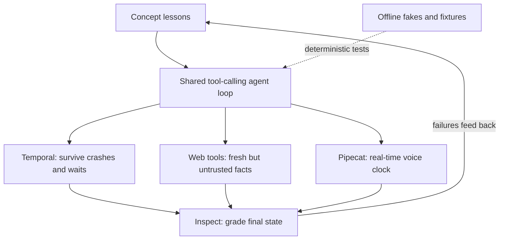

## Overview
This module is where the concept lessons meet real third-party tools. Each lab takes one agent
problem you already understand in principle and solves it with a named, widely used library, offline
and under tests, so you learn the tool's actual API and its failure modes rather than a sketch.

The four labs:

- **Temporal durable agent lab:** a refund agent runs as a Temporal workflow, with the model call and each tool call as activities, an approval signal, a 3-day durable timer and a patched v2 release. It builds on durable execution and checkpointing, durable workflow execution and workflow orchestration.
- **Web search and fetch tools for agents:** a research agent's web layer, with one search vendor (Tavily) behind a protocol, trafilatura extraction, domain and freshness rules you enforce yourself, and citation checks. It builds on tool calling, max step budgets, prompt injection and test doubles.
- **Inspect AI agent evals lab:** an Inspect eval that grades the order table an agent leaves behind and compares it with a final-answer scorer. It builds on the eval harness, tool calling and agent trajectory evaluation.
- **Pipecat voice agent lab:** a clinic booking voice agent as a Pipecat pipeline, with a tool call, per-stage latency records, turn-detection tuning and a barge-in fix. It builds on the voice-agent use case, asyncio and tool calling.

How they connect: Temporal makes the agent loop survive crashes and long waits, the web tool gives it
fresh but untrusted facts, Inspect measures whether it did the job, and Pipecat puts the same
tool-calling loop under a hard real-time clock.

Afterwards you can:

- Turn a concept lesson into running code on a production tool, with pinned versions and tests.
- Explain where each tool's guarantees stop (at-least-once activities, vendor-side filters, mock models, fake services).
- Swap the offline fakes for real services without changing the tested contract.

Versions used in the labs, checked against PyPI 2026-11: temporalio 1.35.0, tavily-python 0.8.5,
inspect-ai 0.3.287, pipecat-ai 1.15.0.

## Why it matters
- **Engineer:** You stop guessing at a library from its README: you have written a replay test for a Temporal workflow, a fixture-backed web tool, a state-grading Inspect scorer and a Pipecat pipeline test, and you know which behaviour each tool owns.
- **Architect:** You can place each tool deliberately in an agent platform, deciding what must be a durable activity, where web access is filtered and budgeted, which evals grade environment state, and which latency budget a voice path must meet.
- **FDE:** You can stand up a credible prototype on a customer's preferred stack in days, run it offline in their CI without keys, and explain in concrete terms what happens when a worker crashes, a page carries an injection, or a caller interrupts.

## Mental model
- **One loop, four pressures.** Every lab runs the same tool-calling agent loop; each tool answers a different pressure on it: time and crashes (Temporal), untrusted fresh input (web search and fetch), proof of correctness (Inspect), and a real-time clock (Pipecat).
- **Concept first, tool second.** Each lab names the concept lessons it rests on. The tool supplies the machinery; the concept tells you what the machinery guarantees and where it does not.
- **Offline by design.** Every lab replaces the model and paid services with scripted fakes or recorded fixtures (`FakeModel`, a fixture search provider, Inspect's `mockllm`, fake Pipecat services), so tests are deterministic and need no API keys.
- **Know the boundary.** Temporal activities are at least once, so tools need idempotency keys. Vendor search filters are hints, so you re-check domains and dates. A mock-model score tests the harness, not the agent. A 0 ms stage in a latency record usually means a fake, not a fast path.
- **Swap, then re-verify.** Moving from fakes to real services keeps the contract the tests pin down; the examples in each lab show that swap.

## Suggested order
1. web-search-and-fetch-tools-for-agents — core difficulty and the most common agent tool; it practises a vendor behind a protocol, fixtures and untrusted tool output, which every later lab reuses.
2. temporal-durable-agent-lab — makes the agent loop durable with activities, signals, timers and replay tests, the backbone for any long-running agent such as a research run.
3. inspect-ai-agent-evals-lab — once you have agents that act, learn to grade the state they leave behind instead of what they claim, and to test the eval harness itself with `mockllm`.
4. pipecat-voice-agent-lab — the most demanding lab: the same tool-calling loop under a latency budget, turn detection and barge-in, best attempted after the other three patterns are familiar.

## Capstone
### Brief
Build a durable, evaluated research agent for a security team. Given a question about a vendor
advisory, the agent searches the web, fetches and extracts pages, and writes a cited brief.

It runs as a Temporal workflow. Each model call, search and fetch is an activity with retries,
timeouts and idempotency keys. A human must approve the brief through a signal before it is
published to the team's store.

Web access goes through the protocol-based web tool from the web lab, with an allow-list, freshness
rules, a per-run call and credit budget, and page text framed as untrusted.

An Inspect suite then grades the agent. It checks citations against the fetched sources, scores the
final state of the store (published only after approval, nothing from disallowed domains), and
includes adversarial samples with an injected page and a lookalike domain.

Everything must run offline in CI using recorded search fixtures and a scripted model, and the
workflow must survive a worker kill mid-run.

### Deliverables
- A Temporal workflow and worker for the research agent, with activities for model, search, fetch and publish, an approval signal with a timeout, and time-skipping plus replay tests in CI.
- A web tool module behind a `SearchProvider` protocol with a live adapter, a fixture provider of recorded responses, allow-list and freshness enforcement, and a citation checker.
- An Inspect eval suite of at least 20 samples, including injected-page and lookalike-domain cases, with a state-based scorer on the store, a citation scorer, and a final-answer scorer for comparison.
- A short report: per-scorer results, the cases where final-answer and state grading disagree, cost per run in calls and credits, and a crash-recovery demonstration log.

### Rubric
- Killing the worker at any step and restarting it completes the run with no repeated model call and no duplicate publish, shown by a test or recorded history.
- The full test and eval suite runs offline with no API keys, and the same inputs give the same scores on two consecutive runs.
- No brief is published without an approval signal, and the state scorer fails any run that publishes early or cites a disallowed or lookalike domain.
- Every citation in a passing brief resolves to a fetched, allowed source whose extracted text contains the cited claim, and the injected-page samples never change the agent's tool calls.
- Each run stays within its configured search and fetch budget, and the report states the measured calls and credits per run.
