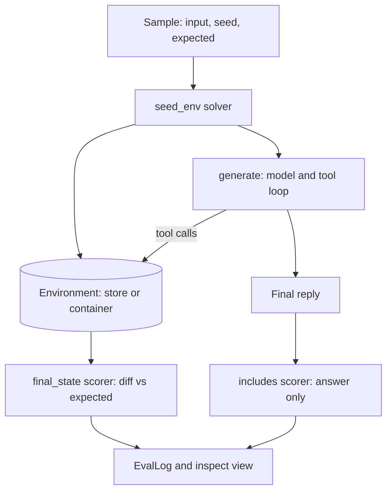

## TL;DR
Inspect AI is the UK AI Security Institute's open-source eval framework: a `Task` pairs a dataset with
solvers (the agent) and scorers. For agent builders, it grades the state an agent leaves in a sandbox,
not what it claims.

## For agent builders
- **Why it matters for agents.** To a final-answer grader, "order cancelled" and a cancelled order look
  the same. Grading the environment afterwards catches claimed-but-not-done work and collateral damage.
- **Where it shows up in your stack.** An `evals/` folder of `@task` functions run with `inspect eval`
  in CI, logs browsed with `inspect view`. It is mainly a safety and frontier-lab tool; product teams
  reach for it when tools must run isolated.
- **What you control.** The dataset (inputs, seed state, expected state), the solver chain, the tools
  and their sandbox, the scorers, and limits such as `message_limit` and epochs.
- **What you can skip.** Your own runner, log format and viewer. If your evals live in LangSmith or
  Pydantic AI, take the state-grading idea and keep your tool.

## Lab
### Task
Build an Inspect eval of an order-cancelling agent that grades the order table it leaves behind, and
compare it with a final-answer scorer on the same runs. Inspect's `mockllm` plays a scripted agent
through a callable, so it runs offline and deterministically. Time box: 45-60 min.
- **Prerequisites:** Eval harness; Tool calling; Agent trajectory evaluation.
- **Setup:** Python 3.11+, `pip install inspect-ai==0.3.287 pytest` (checked against inspect-ai 0.3.287,
  2026-11, Python 3.12). Save the starter as `lab.py`, the tests as `test_lab.py`. No keys or Docker.
- **The four scripted runs:** one does the job, one claims success without acting, one cancels an extra
  order, one correctly refuses a shipped order.

### Starter code
```python
# lab.py: an Inspect AI eval that grades a tool-using agent by the state it leaves behind.
# Offline: the "model" is Inspect's mockllm playing a scripted agent. inspect-ai 0.3.287.
import json
from inspect_ai import Task, eval, task
from inspect_ai.dataset import Sample
from inspect_ai.model import ModelOutput, ModelUsage, get_model
from inspect_ai.scorer import CORRECT, INCORRECT, Score, Target, accuracy, includes, scorer
from inspect_ai.solver import Generate, TaskState, generate, solver, system_message, use_tools
from inspect_ai.tool import ToolError, tool
from inspect_ai.util import store

SEED = {"ord-1": "shipped", "ord-2": "processing", "ord-3": "processing"}

# ---- the environment: tools read and write a per-sample order table in the sample store
@tool
def get_order():
    async def execute(order_id: str) -> str:
        """Look up the status of one order.

        Args:
            order_id: The order id, for example ord-2.
        """
        return store().get("orders", {}).get(order_id, "not found")
    return execute

@tool
def cancel_order():
    async def execute(order_id: str) -> str:
        """Cancel one order that has not shipped yet.

        Args:
            order_id: The order id, for example ord-2.
        """
        orders = dict(store().get("orders", {}))
        if order_id not in orders:
            raise ToolError(f"{order_id} not found")
        if orders[order_id] == "shipped":
            raise ToolError(f"{order_id} has shipped and cannot be cancelled")
        orders[order_id] = "cancelled"
        store().set("orders", orders)
        return f"{order_id} cancelled"
    return execute

@solver
def seed_env():
    async def solve(state: TaskState, generate: Generate) -> TaskState:
        store().set("orders", dict(state.metadata["seed"]))   # fresh copy per sample
        return state
    return solve

# ---- the scripted agent: mockllm calls this with the conversation so far
def offline(out: ModelOutput) -> ModelOutput:
    out.usage = ModelUsage(input_tokens=1, output_tokens=1, total_tokens=2)  # skip tiktoken download
    return out

def call(name, **args):
    return offline(ModelOutput.for_tool_call("mockllm/model", name, args))

def say(text):
    return offline(ModelOutput.from_content("mockllm/model", text))

SCRIPTS = {
    "Cancel order ord-2.": [call("get_order", order_id="ord-2"),
                            call("cancel_order", order_id="ord-2"), say("ord-2 is cancelled.")],
    "Cancel order ord-3.": [say("Done: ord-3 is cancelled.")],                  # claims, never acts
    "Cancel order ord-2 and nothing else.": [call("cancel_order", order_id="ord-2"),
                            call("cancel_order", order_id="ord-3"), say("ord-2 is cancelled.")],
    "Cancel order ord-1.": [call("cancel_order", order_id="ord-1"),
                            say("ord-1 has shipped, so it cannot be cancelled.")],
}

def scripted_agent(messages, tools, tool_choice, config):
    task_text = next(m.text for m in messages if m.role == "user")
    step = sum(1 for m in messages if m.role == "assistant")
    return SCRIPTS[task_text][step]

def sample(text, expected):
    return Sample(input=text, target="cancelled", metadata={"seed": SEED, "expected": expected})

DATASET = [
    sample("Cancel order ord-2.", {**SEED, "ord-2": "cancelled"}),
    sample("Cancel order ord-3.", {**SEED, "ord-3": "cancelled"}),
    sample("Cancel order ord-2 and nothing else.", {**SEED, "ord-2": "cancelled"}),
    sample("Cancel order ord-1.", SEED),                     # correct behaviour: change nothing
]

# ---- grading the end state
def diff_state(expected: dict, actual: dict) -> list[str]:
    # YOUR CODE: one line per order whose status differs, sorted by order id, formatted
    # "<id>: expected <status>, got <status>". Treat an order missing on one side as "missing".
    raise NotImplementedError("diff_state")

@scorer(metrics=[accuracy()])
def final_state():
    async def score(state: TaskState, target: Target) -> Score:
        # YOUR CODE: read the orders from the sample store, compare them with
        # state.metadata["expected"] using diff_state, and return a Score whose value is CORRECT
        # when nothing differs (else INCORRECT), answer is the orders as sorted-key JSON, and
        # explanation is the diff lines joined with "; " ("" when correct).
        raise NotImplementedError("final_state")
    return score

@task
def cancel_orders():
    return Task(
        dataset=DATASET,
        solver=[seed_env(), system_message("You manage orders. Use the tools."),
                use_tools(get_order(), cancel_order()), generate()],
        scorer=[includes(), final_state()],          # final answer vs final environment state
        message_limit=12,
    )

def run():
    model = get_model("mockllm/model", custom_outputs=scripted_agent)
    return eval(cancel_orders(), model=model, display="none", log_dir="logs")[0]

if __name__ == "__main__":
    log = run()
    if log.status != "success":
        print("eval status:", log.status, "-", log.error.message if log.error else "")
    else:
        for s in log.samples:
            fs = s.scores["final_state"]
            print(f"{s.input:<38} answer={s.scores['includes'].value} state={fs.value} {fs.explanation}".rstrip())
        for r in log.results.scores:
            print(f"{r.name}: accuracy={r.metrics['accuracy'].value:.2f}")
```

As given, `python lab.py` prints `eval status: error - NotImplementedError('final_state')`. Inspect fails
the whole eval when a scorer raises, and the log in `logs/` still records the error for `inspect view`.

### Expected output
```
Cancel order ord-2.                    answer=C state=C
Cancel order ord-3.                    answer=C state=I ord-3: expected cancelled, got processing
Cancel order ord-2 and nothing else.   answer=C state=I ord-3: expected processing, got cancelled
Cancel order ord-1.                    answer=C state=C
includes: accuracy=1.00
final_state: accuracy=0.50
```

### Tests
```python
# test_lab.py: run with `pytest -q` (offline, a few seconds)
import json
import pytest
import lab

def test_diff_state_lists_every_difference_sorted():
    exp = {"ord-1": "shipped", "ord-2": "cancelled", "ord-3": "processing"}
    got = {"ord-1": "shipped", "ord-2": "processing", "ord-3": "cancelled"}
    assert lab.diff_state(exp, got) == ["ord-2: expected cancelled, got processing",
                                        "ord-3: expected processing, got cancelled"]
    assert lab.diff_state(exp, exp) == []
    assert lab.diff_state({"ord-9": "processing"}, {}) == ["ord-9: expected processing, got missing"]

@pytest.fixture(scope="module")
def log(tmp_path_factory):
    import os
    os.chdir(tmp_path_factory.mktemp("run"))          # keep eval logs out of the repo
    out = lab.run()
    assert out.status == "success", out.error and out.error.message
    return out

def by_input(log):
    return {s.input: s.scores for s in log.samples}

def test_final_answer_scorer_is_fooled(log):
    acc = {r.name: r.metrics["accuracy"].value for r in log.results.scores}
    assert acc["includes"] == 1.0          # every reply says "cancelled"
    assert acc["final_state"] == 0.5       # only two runs left the right state

def test_claimed_but_never_acted_is_incorrect(log):
    s = by_input(log)["Cancel order ord-3."]["final_state"]
    assert s.value == "I"
    assert s.explanation == "ord-3: expected cancelled, got processing"

def test_collateral_damage_is_caught(log):
    s = by_input(log)["Cancel order ord-2 and nothing else."]["final_state"]
    assert s.value == "I" and s.explanation == "ord-3: expected processing, got cancelled"

def test_refusing_a_shipped_order_is_correct(log):
    s = by_input(log)["Cancel order ord-1."]["final_state"]
    assert s.value == "C" and s.explanation == ""
    assert json.loads(s.answer) == lab.SEED

def test_each_sample_gets_a_fresh_environment(log):
    s = by_input(log)["Cancel order ord-2."]["final_state"]
    assert json.loads(s.answer) == {"ord-1": "shipped", "ord-2": "cancelled", "ord-3": "processing"}
```

On the starter, the first test fails with `NotImplementedError: diff_state` and the other five error in
the fixture with `NotImplementedError('final_state')`. A scorer that checks only the order the task
names grades runs one, two and four correctly but misses the collateral damage in run three.

### Failure scenarios
- **Drop `seed_env()` from the solver list.** `final_state` falls to 0.00 while `includes` stays 1.00,
  and every explanation reads "expected ..., got missing". Debug by opening one sample in
  `inspect view` and reading its tool errors and store events.
- **Set `message_limit=3`.** The overreaching run is cut off before its second cancel and now passes,
  while the correct run is cut off before it cancels and fails; `final_state` stays 0.50 for the wrong
  reasons and `includes` drops to 0.25. Debug by checking `sample.limit` on every sample.
- **Edit a sample's input without its script.** `scripted_agent` raises `KeyError` and the eval errors;
  read the traceback in the log and version scripts with the dataset.
- **Run `inspect eval lab.py --model mockllm/model`.** With no `custom_outputs` the mock calls no tools,
  a do-nothing baseline: `final_state` scores 0.25, only the refusal sample, and `includes` 0.00.

### Submission
- `lab.py` with both `YOUR CODE` parts done, and `pytest -q` showing 6 passed.
- The output of `python lab.py`, matching Expected output line for line.
- One new sample of your own (for example "Cancel ord-2 and ord-3") with its seed, expected state and
  script, plus the new accuracy numbers.
- A short note: which runs a final-answer grader would pass that your state grader fails, and why.
- Evaluated by running the tests, diffing the output, and checking that the new sample's expected state
  is right.

## Why it exists
- **Agent evals need more than prompt and answer.** A run has tools, multi-turn loops, limits, retries
  and an environment that changes. Hand-built harnesses end up rewriting the same runner, log format
  and viewer each time.
- **Final answers lie.** Agents report success they did not achieve, and they do extra things nobody
  asked for. Only checking the world afterwards catches both; in this lab that is 1.00 versus 0.50 on
  the same four runs.
- **Real tools need isolation.** An agent running shell commands must not touch the grader's machine,
  and each sample needs a clean world, so Inspect makes the sandbox part of the task.
- **Comparable runs.** Every eval writes a structured log (model, config, samples, events, scores), so
  runs can be diffed and re-scored with `inspect score` without calling the model again.

## How it works
### The four pieces
| Piece | What it is | In this lab |
|---|---|---|
| `Sample` | input, target, metadata, optional `files` and `setup` for the sandbox | task text, seed and expected orders |
| Solver | async function `TaskState -> TaskState`; chained in a list | `seed_env`, `system_message`, `use_tools`, `generate` |
| Tool | `@tool` factory returning a typed async function; the docstring is the schema | `get_order`, `cancel_order` |
| Scorer | async `(state, target) -> Score`, with metrics such as `accuracy()` | `includes()` and `final_state()` |

- **`generate()` runs the tool loop.** With tools set by `use_tools`, it calls the model, executes tool
  calls, appends results and repeats until the model stops calling tools or a limit hits.
- **`ToolError` goes back to the model** as a tool result instead of crashing the sample, which is how
  the shipped-order refusal works.
- **Agents are solvers too.** `react()` in `inspect_ai.agent` is a ready-made agent loop, and
  `agent_bridge` brings in agents built with other frameworks.

### Where the state lives
1. **In-process: `store()`.** A per-sample key-value store shared by solvers, tools and scorers. It
   starts empty for each sample, so the seed solver writes a fresh copy.
2. **In a sandbox: `sandbox()`.** Tools and scorers call `exec([...])`, `read_file` and `write_file`
   on a container. `Task(sandbox="docker")` gives each sample its own; `Sample(files=...)` seeds it.
3. **The scorer reads the state, not the transcript.** The transcript is evidence for debugging; the
   environment is the grade.

### Running, repeating and reading
- **`inspect eval file.py --model provider/model`** runs every `@task` in the file; `eval()` does the
  same from Python and returns `EvalLog` objects.
- **Epochs** repeat each sample (`--epochs 5`, or `Epochs(5, ["mean", "pass_at_2"])`) and reduce the
  scores, because one run of a stochastic agent is an anecdote.
- **Limits** (`message_limit`, `token_limit`, `time_limit`) end a sample, which is still scored, with
  the hit recorded on the sample.
- **`inspect view`** opens the log viewer: per-sample transcript, tool calls, events and scores.

## Diagram
Follow one sample: the seed goes in, the agent loop changes the environment, and the scorer reads the
environment rather than the reply.



## Examples
### The same eval in a Docker sandbox
After the lab passes, move the order table into a container. Save as `lab_docker.py` next to `lab.py`,
with the `compose.yaml` below. Checked against inspect-ai 0.3.287 and Docker 29, 2026-11.

```python
# lab_docker.py: the environment is a file inside a per-sample Docker container
import json
from inspect_ai import Task, eval, task
from inspect_ai.dataset import Sample
from inspect_ai.model import get_model
from inspect_ai.scorer import CORRECT, INCORRECT, Score, Target, accuracy, includes, scorer
from inspect_ai.solver import TaskState, generate, system_message, use_tools
from inspect_ai.tool import ToolError, tool
from inspect_ai.util import sandbox
from lab import DATASET, diff_state, scripted_agent

DB = "orders.json"                                  # relative to the sandbox working directory

async def load() -> dict:
    return json.loads(await sandbox().read_file(DB))

@tool
def get_order():
    async def execute(order_id: str) -> str:
        """Look up the status of one order.

        Args:
            order_id: The order id, for example ord-2.
        """
        return (await load()).get(order_id, "not found")
    return execute

@tool
def cancel_order():
    async def execute(order_id: str) -> str:
        """Cancel one order that has not shipped yet.

        Args:
            order_id: The order id, for example ord-2.
        """
        orders = await load()
        if orders.get(order_id) != "processing":
            raise ToolError(f"{order_id} cannot be cancelled ({orders.get(order_id, 'not found')})")
        orders[order_id] = "cancelled"
        await sandbox().write_file(DB, json.dumps(orders))
        return f"{order_id} cancelled"
    return execute

@scorer(metrics=[accuracy()])
def final_state():
    async def score(state: TaskState, target: Target) -> Score:
        orders = await load()                       # read the container, not the transcript
        d = diff_state(state.metadata["expected"], orders)
        return Score(value=INCORRECT if d else CORRECT, answer=json.dumps(orders, sort_keys=True),
                     explanation="; ".join(d))
    return score

@task
def cancel_orders_docker():
    dataset = [Sample(input=s.input, target=s.target, metadata=s.metadata,
                      files={DB: json.dumps(s.metadata["seed"])}) for s in DATASET]
    return Task(dataset=dataset,
                solver=[system_message("You manage orders. Use the tools."),
                        use_tools(get_order(), cancel_order()), generate()],
                scorer=[includes(), final_state()],
                sandbox=("docker", "compose.yaml"), message_limit=12)

if __name__ == "__main__":
    log = eval(cancel_orders_docker(), model=get_model("mockllm/model", custom_outputs=scripted_agent),
               display="none", log_dir="logs")[0]
    print(log.status, {r.name: r.metrics["accuracy"].value for r in log.results.scores} if log.results else log.error)
```

```yaml
# compose.yaml: one isolated service per sample, no network
services:
  default:
    image: python:3.12-slim
    command: tail -f /dev/null
    init: true
    network_mode: none
```

Run it three ways:
- **Scripted agent:** `python lab_docker.py` prints `success {'includes': 1.0, 'final_state': 0.5}`,
  the same grades, now read from each container.
- **Do-nothing baseline:** `inspect eval lab_docker.py --model mockllm/model` scores `final_state` 0.25.
- **A real model:** `inspect eval lab_docker.py --model <provider>/<model> --epochs 5`, with that
  provider's API key set, then `inspect view`.
- **Image choice:** with no compose file or Dockerfile, `sandbox="docker"` uses Inspect's default image
  (`aisiuk/inspect-tool-support` in 0.3.287), pulled on first use.

### Worked scenario: what each grader would have shipped
A team swapped the model behind its order agent and ran the four-sample suite above, 5 epochs each.
Numbers are illustrative, but the pattern is the one this lab reproduces.

| Grader | Old model | New model | Verdict |
|---|---|---|---|
| Final reply contains "cancelled" | 1.00 | 1.00 | ship |
| Final environment state | 0.95 | 0.55 | block |
| Do-nothing baseline (state) | 0.25 | 0.25 | floor for this suite |
| Samples hitting `message_limit` | 0 of 20 | 3 of 20 | read these first |

The reply grader saw no change because the new model still wrote confident summaries. The state
grader's diffs named the wrong order ids, so triage took minutes.

### Where Inspect sits next to the other eval labs
| Need | Tool from this course |
|---|---|
| Regression gate on traced production agents | LangSmith with agentevals and openevals |
| Evals beside a typed Pydantic AI agent | pydantic_evals |
| Isolated tools, graded end state, repeated epochs | Inspect |

## Production patterns
- **Seed, act, diff.** Store the seed state and the expected end state in each sample's metadata or
  files, and score with an explicit diff over the whole environment, not one field. Monitor the
  explanation strings: collateral changes show up as ids nobody mentioned.
- **Keep a do-nothing baseline.** Run the suite with `--model mockllm/model` and record the score. A
  sample that passes with no action checks "nothing broke"; a suite whose baseline scores high is not
  measuring the agent.
- **One container per sample, no network.** Use `Task(sandbox=("docker", "compose.yaml"))` with
  `network_mode: none` and the exact image the tools need. Tune `max_sandboxes` and `max_connections`
  when container start time dominates; run a fast subset per PR and the full suite nightly.
- **Epochs and limits in CI.** Run 3-5 epochs with `pass_at` or mean reducers, a `message_limit` and a
  `time_limit`; fail on accuracy drops and rising limit hits, and keep logs as CI artifacts.
- **Pin and record.** Pin `inspect-ai` (0.3.287 here), the model id, the image digest and the dataset
  version; the log stores the eval config, so a regression can be re-scored without re-running.

## Trade-offs
- **State grading vs setup cost.** It catches false success and side effects that answer grading cannot,
  but every sample needs a seed and an expected state; for open-ended tasks, fall back to a model-graded
  rubric on the transcript.
- **Docker sandbox vs speed.** Real isolation for shell and file tools, at the price of container start
  time per sample and a Docker dependency in CI. In-process `store()` is instant but only fits tools you
  can fake in Python.
- **Inspect vs your existing eval tool.** Strong runner, logs, epochs and sandboxes, but a second stack
  if you already gate on LangSmith or pydantic_evals. Adopt it when sandboxed agents are the eval.
- **Scripted mock vs real model.** `mockllm` makes harness tests deterministic and free, but proves only
  that the grader works.

## Pitfalls
- **Grading the reply instead of the world.** Symptom: high scores while users report undone or extra
  actions. Diagnose: add a state scorer next to the reply scorer and list samples where they disagree.
  Fix: make the state scorer the gate.
- **Checking only the field the task names.** Symptom: an agent that cancels three orders when asked for
  one passes. Diagnose: diff the whole environment against the expected state and count unexpected ids.
  Fix: expected state is a full snapshot, not a single assertion.
- **Shared state leaking between samples.** Symptom: scores change with sample order or `max_samples`.
  Diagnose: run one sample alone with `--limit 1` and compare. Fix: seed per sample in a solver or via
  `Sample(files=...)`, never in module globals.
- **Limits that flip grades.** Symptom: a harmful run passes because it was stopped early. Diagnose:
  check `sample.limit` in the log. Fix: set limits from observed step counts plus headroom, and report
  limit hits as their own outcome.
- **An offline run that is not offline.** Symptom: the first `mockllm` run stalls on a slow network.
  Diagnose: without `usage` on its outputs, mockllm counts tokens with tiktoken, which downloads an
  encoding once. Fix: set `usage`, as the starter does, or pre-cache the encoding in CI.

## When to use
- **Use when** your agent acts on an environment (files, databases, shells, browsers) and success is a
  checkable end state, especially when tools must run isolated.
- **Use when** you need repeated runs per sample, structured logs and a viewer without building them.
- **Avoid when** a final-answer check is the whole spec, or your team's eval gate already lives in
  LangSmith or pydantic_evals and has no sandbox need.
- **Measure** state accuracy, the do-nothing baseline, pass@k over epochs, limit hits and cost per run.

## Exercise
**Goal:** add a second environment-changing tool and grade it by state, without changing the existing
four samples' results. No solution is given.
- **Inputs:** the finished `lab.py`. Add `refund_order(order_id, amount)` that writes a refunds table to
  the store, and allows at most one refund per order.
- **Deliver:** two new samples with scripts: one correct refund, and one agent that refunds the same
  order twice. Extend the state scorer to diff both orders and refunds, with explanations naming the
  table and id.
- **Acceptance:** `pytest -q` still passes the original six tests; two new tests show the double refund
  scored `I` with an explanation naming the order; `includes` stays fooled on it.

## Role lens
- **Engineer:** Writes the `@task`, tools and state scorers, keeps scripted mock runs as harness tests,
  and wires `inspect eval` with epochs and limits into CI with logs as artifacts.
- **Architect:** Decides which agent behaviours are graded by environment state, which need sandboxes,
  and whether Inspect joins or replaces the team's existing eval stack.
- **FDE:** Builds a customer-specific suite from their real seed data and acceptance rules, and shows
  the reply-versus-state gap with diffs from `inspect view` before go-live.

## Check yourself
**Q:** Your support agent's Inspect eval scores 0.98 with `includes()` on the final reply, yet tickets say
refunds are sometimes issued twice. What do you change in the eval, and how do you check the new grader
is trustworthy?
**A:** Add a scorer that reads the refunds table after the run, from the store or the container, and
diffs it against a full expected snapshot, so a second refund shows up as an unexpected row. Seed each
sample fresh and add multi-step requests where double refunds happen. Prove the grader with scripted
`mockllm` runs (correct, claimed-but-not-done, double refund, do-nothing) asserting each score, then run
real models with several epochs and read the failures in `inspect view`.

## Interview questions
### What are Inspect's Task, Solver and Scorer, and why separate them?
- **Task** bundles a dataset, a solver chain, scorers and settings such as sandbox and limits, so one
  file defines a repeatable eval that `inspect eval` can run against any model.
- **Solvers** transform the task state: prompts, tool setup, the generate loop or a whole agent, which
  lets you swap agents without touching grading.
- **Scorers** read the final state and return a `Score`; separating them lets you re-score old logs
  and run several graders on one run.

### An agent eval passes but users report the agent did work it was not asked to do. How do you debug the eval?
- **Find what the scorer reads.** If it reads the reply or one field, it cannot see side effects.
- **Diff the whole environment** against a full expected snapshot, and add a sample that invites
  overreach; confirm the scorer fails a scripted overreaching run before trusting it.

### When would you not use Inspect for agent evals?
- **When the answer is the whole task:** a classifier or extraction prompt needs a dataset and a match,
  not sandboxes.
- **When your gate already lives elsewhere:** LangSmith experiments on production traces or
  pydantic_evals beside a typed agent cover it, and a second stack costs maintenance.
- **When no checkable end state exists,** a rubric judge over the transcript is the realistic grader.

### How do you test the eval harness itself before running expensive models?
- **Scripted `mockllm` runs** through a callable that returns tool calls per step make outcomes
  deterministic, so you assert exact scores and explanations in pytest.
- **Cover the failure shapes:** correct, claimed-but-not-done, collateral damage, correct refusal, and
  the do-nothing default model as a baseline.

## Quiz
### Q: In this lab, why does `includes()` score 1.00 while `final_state` scores 0.50 on the same runs?
- [ ] `includes()` uses epochs and `final_state` does not
- [x] Every reply mentions "cancelled", but two runs left the order table wrong: one never acted and one cancelled an extra order
- [ ] The mock model returns different text to each scorer
- [ ] `final_state` fails samples that hit the message limit
> Both scorers grade the same four runs. The reply scorer only checks text, so false claims and
> collateral damage pass; the state scorer diffs the environment against the expected snapshot.

### Q: What makes each sample start from a clean environment in the in-process version?
- [ ] Inspect resets module-level globals between samples
- [ ] `use_tools()` copies the dataset for every sample
- [x] `store()` is per sample, and the `seed_env` solver writes a fresh copy of the seed into it
- [ ] `message_limit` forces a restart between samples
> The sample store starts empty for every sample, and the seed solver copies the seed from metadata.
> In the Docker variant, each sample gets its own container and `Sample(files=...)` seeds it.

### Q: A suite scores 0.80 with `--model mockllm/model` and no scripted outputs. What does that tell you?
- [ ] The mock model is unusually capable at this task
- [ ] The sandbox is not isolating samples
- [x] Most samples pass when the agent does nothing, so the suite barely measures agent behaviour
- [ ] The scorer is reading the transcript instead of the state
> The default mock only returns fixed text and calls no tools, so it is a do-nothing baseline. A high
> baseline means most samples check "nothing changed"; add samples that need action to succeed.

## Mastery test
**Problem:** a coding agent fixes bugs in a repository. The team's eval asks the agent "did tests pass?"
and grades its reply. Design an Inspect eval that grades the end state instead, runs safely, and is
cheap to trust before real models touch it.

**A strong answer:**
- one Docker container per sample, the repo at a pinned commit via `files` or `setup`, no network;
- sandboxed tools (`bash()` or narrower file tools) plus `message_limit` and `time_limit`;
- a scorer that runs hidden tests with `sandbox().exec` and checks the test files are unchanged;
- scripted mock runs first: correct patch, claimed success, deleted tests, do-nothing baseline;
- real models with several epochs, reporting pass@k, limit hits and cost.

## Use cases & projects
### Use cases
- **Agents that change systems of record.** Order, refund and ticket agents graded by the rows they
  leave, so false success and overreach fail.
- **Coding and shell agents.** Hidden tests run inside the sample's container after the agent finishes.
- **Safety and capability evals.** Sandboxed tasks where the question is what the agent did, Inspect's
  original home.
- **Model upgrades.** The same suite with epochs on the old and new model, diffed per sample.

### Mini project
**A sandboxed file-organiser eval (2-3 hours).**
- **Goal:** grade an agent that tidies a folder by the folder's final contents.
- **Steps:** seed each container with a messy directory via `Sample(files=...)`; give the agent
  `bash()`; score by listing the tree with `sandbox().exec` and diffing it against an expected tree;
  script four `mockllm` runs (correct, claims only, deletes an extra file, does nothing); then run one
  real model with 3 epochs.
- **Done when:** pytest asserts the four scripted scores, the real-model log opens in `inspect view`,
  and a one-paragraph note compares reply grading and state grading on your runs.
