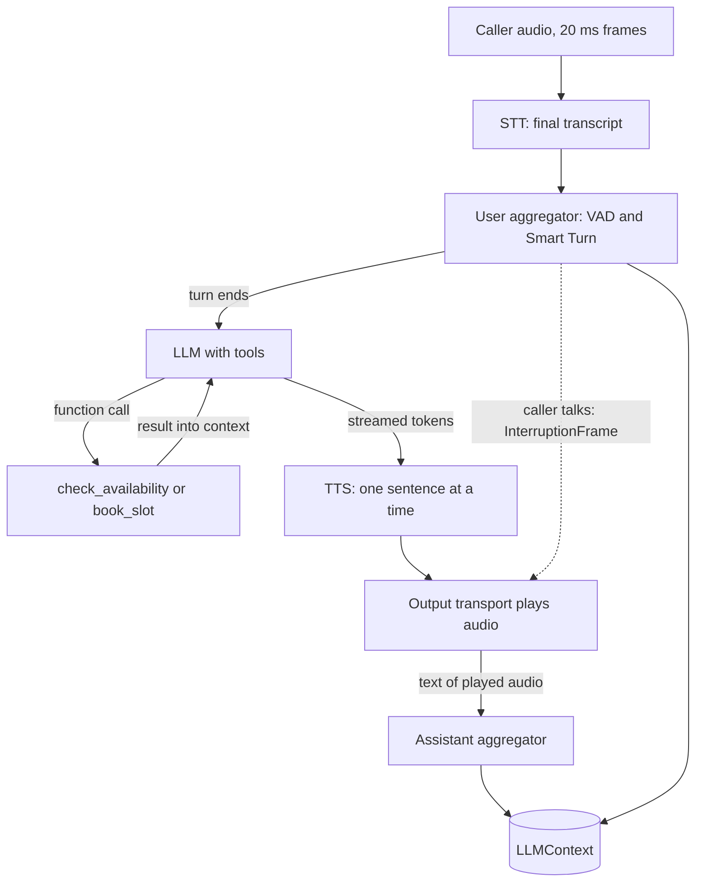

## TL;DR
Pipecat is an open-source Python framework that runs a voice agent as a pipeline of frame
processors. This lab builds the clinic booking agent in it, with tool calls, per-stage latency
records, a barge-in test and Smart Turn tuning, all offline.

## For agent builders
- **Why it matters for agents.** A voice agent is a tool-calling agent with a hard clock. Pipecat
  supplies the turn loop (VAD, turn detection, interruption, context updates), so your effort goes
  into tools, prompts, tuning and evals.
- **Where it shows up in your stack.** `pipecat-ai` 1.15.x in the bot process: a transport, one STT,
  LLM and TTS service, a `LLMContextAggregatorPair` holding the conversation, and observers.
- **What you control.** Pipeline order, `VADParams` and `SmartTurnParams`, the tools and whether
  they cancel on interruption, and what you measure per stage.
- **What you can skip.** Writing VAD, resampling, audio buffering or interruption logic yourself;
  know where each lives so you can tune and debug it.

## Lab
### Task
Build the voice-agent lesson's booking mini project as a Pipecat 1.15 pipeline that needs no API
keys. The caller, STT, LLM and TTS are fakes subclassing Pipecat's own services and transports, so
Pipecat's real aggregators, turn strategies, function calling and output transport run. You do four parts.
- **Tool:** `book_slot` refuses a taken slot and returns a booking reference.
- **Latency:** `LatencyObserver` yields per-stage ms per caller turn, checked against the 950 ms plan.
- **Turn tuning:** two `stop_secs` values that meet the 300 ms endpointing budget, survive a 0.8 s
  thinking pause, and bound dead air on a misjudged turn.
- **Barge-in:** fix the one wiring bug in `build()` that stores words the caller never heard.
- **Time box and prerequisites:** 90-120 minutes, after the voice-agent and asyncio lessons.
- **Needs:** `pip install "pipecat-ai==1.15.0" pytest`, Python 3.11+ (checked with Python 3.12.14
  and pytest 9.2.0, 2026-11). Calls run in real time; the suite takes about 30 s.

### Starter code
```python
# booking_bot.py: the clinic booking voice agent as a Pipecat pipeline, offline.
# Checked against pipecat-ai 1.15.0, Python 3.12, 2026-11. Fakes replace the caller, STT, LLM and TTS.
import asyncio, json, sys, time
from dataclasses import dataclass, field, fields
from loguru import logger
logger.remove(); logger.add(sys.stderr, level="WARNING")  # before pipecat logs its banner
from pipecat.adapters.llm.schemas.function_schema import FunctionSchema
from pipecat.adapters.llm.schemas.tools_schema import ToolsSchema
from pipecat.audio.turn.smart_turn.base_smart_turn import BaseSmartTurn, SmartTurnParams
from pipecat.audio.vad.vad_analyzer import VADAnalyzer, VADParams
from pipecat.frames.frames import (
    BotStartedSpeakingFrame, FunctionCallFromLLM, InputAudioRawFrame, LLMContextFrame,
    LLMFullResponseEndFrame, LLMFullResponseStartFrame, LLMTextFrame, TranscriptionFrame,
    TTSAudioRawFrame, TTSStartedFrame, UserStartedSpeakingFrame, UserStoppedSpeakingFrame,
    VADUserStoppedSpeakingFrame)
from pipecat.observers.base_observer import BaseObserver, FramePushed
from pipecat.pipeline.pipeline import Pipeline
from pipecat.pipeline.worker import PipelineParams, PipelineWorker
from pipecat.processors.aggregators.llm_context import LLMContext
from pipecat.processors.aggregators.llm_response_universal import (
    LLMContextAggregatorPair, LLMUserAggregatorParams)
from pipecat.services.llm_service import FunctionCallParams, LLMService
from pipecat.services.settings import LLMSettings, STTSettings, TTSSettings
from pipecat.services.stt_service import STTService
from pipecat.services.tts_service import TTSService
from pipecat.transports.base_input import BaseInputTransport
from pipecat.transports.base_output import BaseOutputTransport
from pipecat.transports.base_transport import TransportParams
from pipecat.turns.user_stop import TurnAnalyzerUserTurnStopStrategy
from pipecat.turns.user_turn_strategies import UserTurnStrategies
from pipecat.utils.time import time_now_iso8601
from pipecat.workers.runner import WorkerRunner

SR, CHUNK = 16000, 320                                    # 16 kHz audio in 20 ms chunks
LOUD, QUIET = b"\xff\x7f" * CHUNK, b"\x00\x00" * CHUNK
# The voice-agent lesson's EU clinic plan in ms (950 in total), plus "turn_wait", which is not in
# that plan: Pipecat closes a turn when the turn detector and the final transcript agree.
BUDGET_MS = {"endpointing": 300, "stt": 100, "turn_wait": 50, "llm": 250, "first_sentence": 100,
             "tts": 100, "transport": 100}
PLAN_MS = 950
MARKS = ["speech_end", "vad_stop", "stt_final", "turn_end", "llm_first_token", "tts_started",
         "tts_first_audio", "first_audio_played"]         # stage i runs from MARKS[i] to MARKS[i+1]

@dataclass
class Say:                       # one stretch of caller speech
    at: float                    # seconds after the call starts
    secs: float                  # how long it lasts
    text: str                    # what the fake STT returns for it
    done: bool = True            # what the fake Smart Turn predicts in the pause after it

@dataclass
class Call:
    script: list[Say]
    t0: float = 0.0
    onsets: list[float] = field(default_factory=list)    # wall-clock start of each Say
    def current(self) -> Say:
        now = time.time() - self.t0
        return [s for s in self.script if s.at <= now][-1]

# ---------- fakes: each is an ordinary Pipecat service or transport subclass
def unset(cls):                  # fakes have no model, voice or language
    return cls(**{f.name: None for f in fields(cls) if f.name != "extra"})

class EnergyVAD(VADAnalyzer):    # offline stand-in for SileroVADAnalyzer; same VADParams
    def num_frames_required(self): return 512
    def voice_confidence(self, buffer): return 1.0 if any(buffer[1::2]) else 0.0

class ScriptedSmartTurn(BaseSmartTurn):   # stand-in for LocalSmartTurnAnalyzerV3; same params
    def __init__(self, call, **kw): super().__init__(**kw); self.call = call
    def _predict_endpoint(self, audio):
        done = self.call.current().done
        return {"prediction": int(done), "probability": 0.9 if done else 0.2}

class FakeCaller(BaseInputTransport):     # plays the script as 20 ms audio chunks in real time
    def __init__(self, call, params): super().__init__(params); self.call = call
    async def start(self, frame):
        await super().start(frame); await self.set_transport_ready(frame)
        self._task = self.create_task(self._play())
    async def cancel(self, frame): await self.cancel_task(self._task); await super().cancel(frame)
    async def _play(self):
        c = self.call; c.t0 = time.time(); end = max(s.at + s.secs for s in c.script) + 4
        for i in range(int(end / 0.02)):
            t = i * 0.02
            if any(abs(s.at - t) < 0.01 for s in c.script): c.onsets.append(time.time())
            loud = any(s.at <= t < s.at + s.secs for s in c.script)
            await self.push_audio_frame(InputAudioRawFrame(LOUD if loud else QUIET, SR, 1))
            await asyncio.sleep(max(0, c.t0 + (i + 1) * 0.02 - time.time()))

class FakeSpeaker(BaseOutputTransport):   # "plays" audio in real time, logs when it wrote speech
    def __init__(self, params): super().__init__(params); self.writes = []
    async def start(self, frame): await super().start(frame); await self.set_transport_ready(frame)
    async def write_audio_frame(self, frame):
        await asyncio.sleep(len(frame.audio) / 2 / frame.sample_rate)
        if any(frame.audio): self.writes.append(time.time())
        return True

class FakeSTT(STTService):       # a final transcript 60 ms after VAD reports the end of speech
    def __init__(self, call, **kw):
        super().__init__(ttfs_p99_latency=0.3, settings=unset(STTSettings), **kw); self.call = call
    async def run_stt(self, audio): yield None
    async def process_frame(self, frame, direction):
        await super().process_frame(frame, direction)
        if isinstance(frame, VADUserStoppedSpeakingFrame): self.create_task(self._final())
    async def _final(self):
        text = self.call.current().text; await asyncio.sleep(0.06)
        await self.push_frame(TranscriptionFrame(text, "caller", time_now_iso8601(), finalized=True))

class FakeLLM(LLMService):       # scripted model: user turn -> tool call, tool result -> speech
    def __init__(self, **kw): super().__init__(settings=unset(LLMSettings), **kw)
    async def process_frame(self, frame, direction):
        await super().process_frame(frame, direction)
        if not isinstance(frame, LLMContextFrame):
            return await self.push_frame(frame, direction)
        await self.push_frame(LLMFullResponseStartFrame()); await asyncio.sleep(0.08)  # TTFT
        last = frame.context.get_messages()[-1]
        if last["role"] == "user":
            said = str(last["content"]).lower()
            name = "book_slot" if "yes" in said else "check_availability"
            args = {"day": "tuesday", "time": "11:00" if "eleven" in said else "10:00"}
            await self.run_function_calls([FunctionCallFromLLM(
                function_name=name, tool_call_id=f"call_{name}", arguments=args, context=frame.context)])
        else:
            r = json.loads(last["content"])
            r = r if isinstance(r, dict) else {"error": r}       # a failed tool returns a string
            if "booking_id" in r: reply = f"Done. You are booked for Tuesday, reference {r['booking_id']}."
            elif r.get("available"): reply = ("That slot is free. I can also offer two in the "
                                              "afternoon. Shall I book it for you?")
            elif "error" in r: reply = f"Sorry, I could not book that: {str(r['error']).rstrip('.')}."
            else: reply = "Sorry, that slot is taken. Would two in the afternoon work?"
            for word in reply.split():
                await self._push_llm_text(word + " "); await asyncio.sleep(0.015)
        await self.push_frame(LLMFullResponseEndFrame())

class FakeTTS(TTSService):       # first audio 60 ms after a sentence arrives, 120 ms of audio per word
    def __init__(self, **kw):
        super().__init__(push_start_frame=True, push_stop_frames=True, sample_rate=SR,
                         settings=unset(TTSSettings), **kw)
    async def run_tts(self, text, context_id):
        await asyncio.sleep(0.06)
        for _ in range(len(text.split()) * 6):
            yield TTSAudioRawFrame(LOUD, SR, 1, context_id=context_id)

# ---------- the agent: tools, turn tuning, latency
SLOTS = {("tuesday", "10:00"): True, ("tuesday", "11:00"): False}
BOOKINGS: dict[str, tuple[str, str]] = {}

async def check_availability(params: FunctionCallParams):
    a = params.arguments
    await params.result_callback({**a, "available": SLOTS.get((a["day"], a["time"]), False)})

async def book_slot(params: FunctionCallParams):
    # YOUR CODE: if the slot is not free, return {"error": "slot not available"} and change nothing.
    # Otherwise mark it taken, store it in BOOKINGS under "B001", "B002", ... and return
    # {"booking_id": ref, "day": ..., "time": ...} through params.result_callback.
    raise NotImplementedError("book_slot")

TOOLS = ToolsSchema(standard_tools=[FunctionSchema(
    name=n, description=d, properties={"day": {"type": "string"}, "time": {"type": "string"}},
    required=["day", "time"]) for n, d in [
        ("check_availability", "Check whether a slot is free"),
        ("book_slot", "Book a slot, only after the caller confirmed it aloud")]])

# YOUR CODE: tune these two numbers against the tests (endpointing budget, thinking pauses,
# a turn the model misjudges). The starter uses Pipecat's defaults.
VAD_STOP_SECS, SMART_TURN_STOP_SECS = 0.2, 3.0

def user_params(call: Call) -> LLMUserAggregatorParams:
    return LLMUserAggregatorParams(
        vad_analyzer=EnergyVAD(params=VADParams(stop_secs=VAD_STOP_SECS)),
        user_turn_strategies=UserTurnStrategies(stop=[TurnAnalyzerUserTurnStopStrategy(
            turn_analyzer=ScriptedSmartTurn(call, params=SmartTurnParams(stop_secs=SMART_TURN_STOP_SECS)))]))

class LatencyObserver(BaseObserver):
    """Per user turn, wall-clock time (time.time()) of each name in MARKS."""
    def __init__(self, **kw): super().__init__(**kw); self.turns: list[dict] = []
    async def on_push_frame(self, data: FramePushed):
        # YOUR CODE: open a new dict in self.turns on UserStartedSpeakingFrame (unless the
        # current turn has no "vad_stop" yet). On VADUserStoppedSpeakingFrame set "vad_stop"
        # = frame.timestamp and "speech_end" = frame.timestamp - frame.stop_secs (latest wins:
        # a pause inside a turn moves them). After that, record the FIRST time you see
        # TranscriptionFrame, UserStoppedSpeakingFrame, LLMTextFrame, TTSStartedFrame,
        # TTSAudioRawFrame and BotStartedSpeakingFrame as the remaining MARKS, in that order.
        pass
    def stage_ms(self, turn: dict) -> dict[str, int]:
        # YOUR CODE: {stage: ms} for each BUDGET_MS stage, plus "total" (speech_end to
        # first_audio_played), rounded to whole ms.
        raise NotImplementedError("stage_ms")

# ---------- wiring
def build(call: Call):
    tp = TransportParams(audio_in_enabled=True, audio_out_enabled=True,
                         audio_in_sample_rate=SR, audio_out_sample_rate=SR)
    caller, speaker = FakeCaller(call, tp), FakeSpeaker(tp)
    stt, llm, tts = FakeSTT(call), FakeLLM(), FakeTTS()
    llm.register_function("check_availability", check_availability)
    llm.register_function("book_slot", book_slot)
    context = LLMContext(messages=[{"role": "system", "content": "You book clinic appointments. "
                                    "Short spoken sentences. Read back before booking."}], tools=TOOLS)
    user_agg, assistant_agg = LLMContextAggregatorPair(context, user_params=user_params(call))
    pipeline = Pipeline([caller, stt, user_agg, llm, tts, assistant_agg, speaker])
    obs = LatencyObserver()
    worker = PipelineWorker(pipeline, observers=[obs], cancel_on_idle_timeout=False,
                            params=PipelineParams(audio_in_sample_rate=SR, audio_out_sample_rate=SR))
    return worker, context, obs, speaker

async def run_call(script: list[Say], seconds: float):
    call = Call(script); worker, context, obs, speaker = build(call)
    async def hang_up(): await asyncio.sleep(seconds); await worker.cancel()
    runner = WorkerRunner(handle_sigint=False); await runner.add_workers(worker)
    await asyncio.gather(runner.run(), hang_up())
    return call, context, obs, speaker

BOOKING = [Say(0.3, 0.8, "I'd like an appointment on Tuesday at ten."), Say(6.0, 0.5, "Yes please.")]

async def main():
    _, context, obs, _ = await run_call(BOOKING, seconds=9.0)
    print("bookings:", BOOKINGS, "| turns measured:", len(obs.turns))
    for m in context.get_messages():
        if m["role"] == "assistant" and m.get("content"): print("assistant:", m["content"])
    for i, turn in enumerate(obs.turns, 1):
        print(f"turn {i}:", " ".join(f"{k}={v}" for k, v in obs.stage_ms(turn).items()))

if __name__ == "__main__":
    try:
        asyncio.run(main())
    except NotImplementedError as e:
        print("not implemented yet:", e)
```

As given it prints `bookings: {} | turns measured: 0`, the first reply, and ``Sorry, I could not book
that: The function `book_slot` failed and returned no result.`` Pipecat logged the exception and
gave the model an error string, so the call went on: good in production, easy to miss in testing.

### Expected output
```
bookings: {'B001': ('tuesday', '10:00')} | turns measured: 2
assistant: That slot is free. I can also offer two in the afternoon. Shall I book it for you?
assistant: Done. You are booked for Tuesday, reference B001.
turn 1: endpointing=200 stt=61 turn_wait=1 llm=163 first_sentence=62 tts=61 transport=0 total=548
turn 2: endpointing=200 stt=61 turn_wait=1 llm=165 first_sentence=16 tts=60 transport=1 total=503
```
The millisecond values move by a few ms between runs; the text lines are exact.

### Tests
```python
# test_booking_bot.py: run with `pytest -q` (about 30 s: every call runs in real time)
import asyncio
from types import SimpleNamespace
import pytest
import booking_bot as m
from booking_bot import Say

def reset():
    m.SLOTS.update({("tuesday", "10:00"): True, ("tuesday", "11:00"): False}); m.BOOKINGS.clear()

def call(script, seconds):
    reset(); return asyncio.run(m.run_call(script, seconds))

def said(context, role):
    return [x["content"] for x in context.get_messages() if x["role"] == role and x.get("content")]

def first_bot_audio_after(speaker, t):
    return min(w for w in speaker.writes if w > t)

def test_book_slot_refuses_a_taken_slot():
    reset(); results = []
    async def cb(result, **kw): results.append(result)
    p = SimpleNamespace(arguments={"day": "tuesday", "time": "10:00"}, result_callback=cb)
    asyncio.run(m.book_slot(p)); asyncio.run(m.book_slot(p))
    assert results[0] == {"booking_id": "B001", "day": "tuesday", "time": "10:00"}
    assert results[1] == {"error": "slot not available"}
    assert m.BOOKINGS == {"B001": ("tuesday", "10:00")}

@pytest.fixture(scope="module")
def booking():
    return call(m.BOOKING, 9.0)

def test_booking_call_books_through_the_tool(booking):
    _, context, _, _ = booking
    assert m.BOOKINGS == {"B001": ("tuesday", "10:00")}
    assert said(context, "assistant")[-1] == "Done. You are booked for Tuesday, reference B001."

def test_every_stage_meets_the_budget(booking):
    _, _, obs, _ = booking
    assert len(obs.turns) == 2, "one latency record per caller turn"
    for turn in obs.turns:
        ms = obs.stage_ms(turn)
        assert set(ms) == set(m.BUDGET_MS) | {"total"}
        assert all(0 <= ms[s] <= m.BUDGET_MS[s] for s in m.BUDGET_MS), ms
        assert ms["total"] <= m.PLAN_MS, ms

def test_barge_in_stops_audio_and_keeps_only_spoken_text():
    script = [Say(0.3, 0.8, "I'd like an appointment on Tuesday at ten."),
              Say(2.5, 0.6, "Actually, make it eleven.")]
    c, context, _, speaker = call(script, 6.0)
    onset = c.onsets[1]
    after = [w for w in speaker.writes if w > onset]
    stopped = next(a for a, b in zip(after, after[1:]) if b - a > 0.1)
    assert stopped - onset < 0.5, "audio must stop within 500 ms of the caller's first word"
    replies = said(context, "assistant")
    assert replies[0] == "That slot is free.", "history keeps only what the caller heard"
    assert replies[-1].startswith("Sorry, that slot is taken")

def test_a_thinking_pause_does_not_end_the_turn():
    script = [Say(0.3, 0.6, "My appointment is on", done=False), Say(1.7, 0.6, "Tuesday at ten.")]
    _, context, _, _ = call(script, 5.0)
    assert said(context, "user") == ["My appointment is on Tuesday at ten."]

def test_a_misjudged_turn_does_not_leave_dead_air():
    c, context, _, speaker = call([Say(0.3, 0.8, "Tuesday at ten, um.", done=False)], 6.0)
    speech_end = c.onsets[0] + 0.8
    assert first_bot_audio_after(speaker, speech_end) - speech_end < 2.0
    assert m.VAD_STOP_SECS <= 0.3, "endpointing budget is 300 ms"
```

On the starter five tests fail, each for its own reason: `NotImplementedError`, `{}` bookings,
zero turns, the whole reply in history, and about 3.5 s of dead air. The pause test passes on
purpose; it guards against over-tuning Smart Turn's `stop_secs`.

### Failure scenarios
- **Set `VAD_STOP_SECS = 0.8`, the pre-1.0 default.** The budget test fails on `endpointing=800`
  (totals of about 1,100-1,150 ms) and Pipecat warns that `stop_secs` differs from the 0.2 s its STT
  figures assume. Debug by reading the endpointing stage: every turn pays it before any model runs.
- **Set `SMART_TURN_STOP_SECS = 0.4`.** The pause test finds two user turns, "My appointment is on"
  and "Tuesday at ten.", and the agent answers the half. Debug by logging `UserStoppedSpeakingFrame`
  times against the script: a turn ending inside a pause is the fallback timer.
- **Add `await asyncio.sleep(0.5)` to `check_availability`.** Turn 1 shows `llm` near 670 ms, turn 2
  is unaffected. The `llm` stage spans the tool round trip; fix with a spoken bridge or a faster lookup.
- **Put `stt` after `user_agg`.** `stage_ms` raises `KeyError: 'llm_first_token'`: the transcript
  went downstream of the aggregator that needed it. Debug by listing which processor pushes each frame type.

### Submission
- `booking_bot.py` with the four parts done and `pytest -q` showing 6 passed.
- The output of `python booking_bot.py`: exact text lines, every stage inside `BUDGET_MS`.
- Your two `stop_secs` values, each with the test that bounds it from above and from below.
- A note on the barge-in fix: what moved and why the old order stored unheard text.
- Evaluated by running the tests twice (timing must hold both times) and checking the notes.

## Why it exists
- **A voice turn is six streaming stages on a 1 s clock.** The voice-agent lesson's asyncio sketch
  shows the idea, but a real call also needs audio buffering, resampling, VAD, cancellation and
  context bookkeeping.
- **Interruption is the hard part.** Audio must stop, LLM, TTS and some tool calls must cancel,
  and history must keep only what was heard, consistently across three vendors.
- **Vendors change faster than the turn loop.** Providers sit behind the same frame interfaces, so
  switching STT vendor for EU residency is a constructor change.
- **Turn detection needed a model, not only a timer.** A silence threshold short enough for snappy
  replies cuts off people reading a date, so Pipecat 1.x defaults to Smart Turn v3, a local audio model.

## How it works
### Frames, processors, workers
- **Everything is a frame:** audio chunks, transcripts, tokens, function calls, TTS audio and
  control signals such as `InterruptionFrame`, all dataclasses in `pipecat.frames.frames`.
- **Processors handle frames and push them on,** linked in order by `Pipeline([...])`. System frames
  are queued ahead of data, so an interruption is not stuck behind seconds of audio.
- **A `PipelineWorker` runs the pipeline and a `WorkerRunner` runs workers.** They replace
  `PipelineTask` and `PipelineRunner`, deprecated since 1.3.0.
- **Observers see every push;** `BaseObserver.on_push_frame` feeds the lab's marks.

### The booking pipeline
| # | Processor | Job in this agent |
|---|---|---|
| 1 | transport input | 20 ms caller audio frames |
| 2 | STT | streaming transcription, a finalized `TranscriptionFrame` |
| 3 | user aggregator | VAD and turn strategies, adds the user message, triggers the LLM |
| 4 | LLM | streams tokens, runs registered tools, runs again on results |
| 5 | TTS | groups tokens into sentences, streams audio per sentence |
| 6 | transport output | plays audio, emits `BotStartedSpeakingFrame` |
| 7 | assistant aggregator | writes tool calls, results and spoken text to `LLMContext` |

- **VAD lives in the user aggregator in 1.x:** `LLMUserAggregatorParams(vad_analyzer=...)`. The old
  `TransportParams.vad_analyzer` is gone and pydantic drops it silently.

### Turn detection: VAD, Smart Turn and two `stop_secs`
1. **VAD decides speech versus silence.** `VADParams` defaults: `confidence` 0.7, `start_secs` 0.2,
   `stop_secs` 0.2, `min_volume` 0.6 (checked against pipecat-ai 1.15.0, 2026-11). In 1.0
   `stop_secs` dropped from 0.8 because turn timing moved to stop strategies.
2. **The stop strategy ends the turn.** The default is `TurnAnalyzerUserTurnStopStrategy` with
   `LocalSmartTurnAnalyzerV3`, a bundled ONNX model run on CPU over the turn's audio.
3. **Smart Turn's own `stop_secs` is a fallback.** `SmartTurnParams.stop_secs` (default 3 s) ends
   the turn after that much silence, counted from the VAD stop, while the model says "incomplete".
4. **The turn also waits for text:** it closes once the analyzer says complete and a finalized
   transcript arrives (or the STT's `ttfs_p99_latency` safety net expires). That is `turn_wait`.
5. **Last resort:** `user_turn_stop_timeout` (default 5.0 s) ends an open turn after that long
   without user activity, unless a stop strategy has a decision scheduled.

So VAD `stop_secs` is a floor every turn pays; Smart Turn `stop_secs` caps the worst case and must
exceed the thinking pauses you want to survive.

### Tool calls
- **Register on the LLM, advertise in the context.** `llm.register_function("book_slot", handler)`;
  the handler answers with `await params.result_callback(result)`. Schemas go in
  `LLMContext(tools=ToolsSchema(...))`, converted per provider by the adapter.
- **The loop is handled for you.** The assistant aggregator appends call and result, and the LLM
  runs again, so the `llm` stage spans two model passes plus the tool.
- **Tools cancel on interruption by default.** With `cancel_on_interruption=False` Pipecat runs
  the call asynchronously and injects its result later.

### Barge-in
1. **The caller speaks during playback:** VAD reports speech, a user turn opens, and Pipecat
   broadcasts an `InterruptionFrame`.
2. **Downstream work is dropped:** the output transport clears buffered audio, TTS stops, and the
   LLM cancels interruptible function calls.
3. **History keeps what played.** Each sentence's `TTSTextFrame` is queued behind its audio and
   passed on in order, so an assistant aggregator after the output transport sees only heard text.

On the fake, audio stopped 330-380 ms after the caller's first word: `start_secs` (200 ms), the
analyzer's smoothed volume gate and one 20 ms write. Reaching ~200 ms needs a lower `start_secs`,
which also lets coughs interrupt.

### Transports and deployment
- **SmallWebRTC for development.** `SmallWebRTCTransport` (extra `webrtc`, built on aiortc) connects
  a browser peer-to-peer with no media server; `pipecat.runner.run.main()` serves a prebuilt client
  at `/client` on port 7860 and builds the transport via `create_transport`.
- **Other transports swap in at positions 1 and 6:** Daily, LiveKit or telephony; nothing between changes.
- **Pipecat Cloud** is Daily's managed hosting: the Pipecat CLI's `pipecat cloud deploy` ships your
  container (pipecatcloud 1.4.0, checked 2026-11).

## Diagram
Follow one caller turn down the pipeline, then the dotted barge-in path: an interruption from the
user aggregator clears the output, so only played text reaches the context.



## Examples
### Swapping the fakes for real services over SmallWebRTC
The same tools, tuning and observer with Silero, Smart Turn v3, Deepgram, OpenAI and Cartesia.
Checked against pipecat-ai 1.15.0 for imports and construction with dummy keys, 2026-11; not run
against the vendors.

```python
# bot_live.py: pip install "pipecat-ai[webrtc,runner,deepgram]==1.15.0"; needs three API keys.
import os
from pipecat.audio.turn.smart_turn.base_smart_turn import SmartTurnParams
from pipecat.audio.turn.smart_turn.local_smart_turn_v3 import LocalSmartTurnAnalyzerV3
from pipecat.audio.vad.silero import SileroVADAnalyzer
from pipecat.audio.vad.vad_analyzer import VADParams
from pipecat.processors.aggregators.llm_response_universal import LLMUserAggregatorParams
from pipecat.services.cartesia.tts import CartesiaTTSService
from pipecat.services.deepgram.stt import DeepgramSTTService
from pipecat.services.openai.llm import OpenAILLMService
from pipecat.turns.user_stop import TurnAnalyzerUserTurnStopStrategy
from pipecat.turns.user_turn_strategies import UserTurnStrategies
import booking_bot as lab                       # tools, tuning and observer from the lab

def make_processors():                          # only these change; the lab's knobs stay
    stt = DeepgramSTTService(api_key=os.environ["DEEPGRAM_API_KEY"])
    llm = OpenAILLMService(api_key=os.environ["OPENAI_API_KEY"],
                           settings=OpenAILLMService.Settings(model=os.environ["OPENAI_MODEL"]))
    tts = CartesiaTTSService(api_key=os.environ["CARTESIA_API_KEY"],
                             settings=CartesiaTTSService.Settings(voice=os.environ["CARTESIA_VOICE_ID"]))
    for name in ("check_availability", "book_slot"):
        llm.register_function(name, getattr(lab, name))
    user_params = LLMUserAggregatorParams(
        vad_analyzer=SileroVADAnalyzer(params=VADParams(stop_secs=lab.VAD_STOP_SECS)),
        user_turn_strategies=UserTurnStrategies(stop=[TurnAnalyzerUserTurnStopStrategy(
            turn_analyzer=LocalSmartTurnAnalyzerV3(params=SmartTurnParams(stop_secs=lab.SMART_TURN_STOP_SECS)))]))
    return stt, llm, tts, user_params
```

The rest of `bot_live.py` wires them in the lab's order, with a WebRTC transport in place of the
fake caller and speaker. Run it with `python bot_live.py` and open the printed URL.

```python
from pipecat.pipeline.pipeline import Pipeline
from pipecat.pipeline.worker import PipelineWorker
from pipecat.processors.aggregators.llm_context import LLMContext
from pipecat.processors.aggregators.llm_response_universal import LLMContextAggregatorPair
from pipecat.runner.utils import create_transport
from pipecat.transports.base_transport import TransportParams
from pipecat.workers.runner import WorkerRunner

async def bot(runner_args):                     # called by Pipecat's runner for each session
    transport = await create_transport(runner_args, {"webrtc": lambda: TransportParams(
        audio_in_enabled=True, audio_out_enabled=True)})
    stt, llm, tts, user_params = make_processors()
    context = LLMContext(messages=[{"role": "system", "content": "You book clinic appointments. "
        "Speak in short sentences. Read the slot back and get a yes before booking."}], tools=lab.TOOLS)
    user_agg, assistant_agg = LLMContextAggregatorPair(context, user_params=user_params)
    pipeline = Pipeline([transport.input(), stt, user_agg, llm, tts, transport.output(), assistant_agg])
    runner = WorkerRunner(handle_sigint=runner_args.handle_sigint)
    await runner.add_workers(PipelineWorker(pipeline, observers=[lab.LatencyObserver()]))
    await runner.run()

if __name__ == "__main__":
    from pipecat.runner.run import main
    main()
```

- **On a real call** `transport` stays near zero unless you add a browser-side mark, because
  `BotStartedSpeakingFrame` fires when the server writes the first chunk.

### Reading three latency records
Measured on the lab's fakes (pipecat-ai 1.15.0, 2026-11), in ms. The fakes are tuned to fit the
plan, so read where each fault lands, not vendor speed.

| Stage (budget) | Booking turn | Slow tool (+500 ms) | Misjudged turn, Smart Turn `stop_secs` 1.0 |
|---|---|---|---|
| endpointing (300) | 200 | 200 | 200 |
| stt (100) | 61 | 62 | 61 |
| turn_wait (50) | 1 | 1 | 940 |
| llm (250) | 163 | 674 | 164 |
| first_sentence (100) | 62 | 65 | 64 |
| tts (100) | 61 | 61 | 62 |
| transport (100) | 0 | 1 | 1 |
| **total (plan 950)** | **548** | **1,063** | **1,491** |

- **Each fault lands in one stage:** a slow tool in `llm`, a misjudged turn in `turn_wait`, long
  VAD silence in `endpointing`. That is why you record stages, not one voice-to-voice number.
- **One knob, one stage.** With Smart Turn's default 3 s fallback the misjudged turn takes about
  3.5 s; 1.0 s brings it to about 1.5 s.

## Production patterns
- **Per-stage marks exported as metrics.** Keep the lab's observer, add
  `PipelineParams(enable_metrics=True)` for Pipecat's TTFB metrics, and chart p50 and p95 per stage.
  Alert on `turn_wait` and `llm` separately; their fixes differ.
- **Tune turn detection on recorded calls.** Replay phone-band calls, sweep both `stop_secs`
  values, and plot cut-off turns against p95 endpointing to pick the knee.
- **Pipeline order under test.** A barge-in replay test like the lab's runs in CI on every change to
  the pipeline builder.
- **Fakes in CI, vendors nightly.** Fake services make the turn loop testable without keys; a small
  nightly suite on real STT, LLM and TTS catches vendor regressions and real latency.
- **Explicit interruption policy per tool.** Keep lookups cancellable; decide per side-effecting tool
  whether `cancel_on_interruption=False` is safer, and make the backend idempotent either way.
- **Pin and deploy what you tested.** Pin `pipecat-ai` to a minor (1.15.x), since names still move
  between minors, then self-host near the telephony edge or use `pipecat cloud deploy`.

## Trade-offs
- **Framework vs hand-rolled asyncio.** Pipecat gives interruption, turn strategies, context
  bookkeeping and vendor adapters, but its API renamed core classes within 1.x. Hand-roll only for
  one fixed vendor and no barge-in.
- **Short VAD `stop_secs` vs STT margin.** 0.2 s keeps endpointing low and matches Pipecat's STT
  p99 figures; longer values suit noisy lines but every turn pays them.
- **Low Smart Turn `stop_secs` vs patient listening.** About 1 s caps dead air on misjudged turns,
  but it must exceed your callers' longest thinking pause.
- **Lower VAD `start_secs` vs false barge-ins.** Faster interruption feels responsive, but coughs
  stop the bot; `MinWordsUserTurnStartStrategy` trades speed for fewer false starts.
- **Cascade vs speech-to-speech.** Pipecat runs both, but the cascade keeps text between stages for
  redaction and audit, which decided the voice-agent lesson's EU case.

## Pitfalls
- **Upgrading 0.x code and losing VAD silently.** Symptom: turns end late or never and barge-in
  stops, with no startup error, because pydantic drops the removed `TransportParams.vad_analyzer`.
  Diagnose: check whether `VADUserStartedSpeakingFrame` ever appears in an observer log. Fix: move
  VAD to `LLMUserAggregatorParams(vad_analyzer=...)`.
- **Assistant aggregator before the output transport.** Symptom: after a barge-in the agent refers
  to offers the caller never heard. Diagnose: diff the last assistant message against the
  `TTSTextFrame`s the output transport released before the `InterruptionFrame`. Fix: place it last.
- **Dead air on hesitant callers.** Symptom: a 3 s silence after "Tuesday at ten, um" while other
  turns are fast. Diagnose: the `turn_wait` stage, or Smart Turn's `TurnMetricsData` showing
  "incomplete" before a silence-based end. Fix: lower `SmartTurnParams.stop_secs`, not VAD `stop_secs`.
- **Cutting callers off mid-date.** Symptom: one spoken sentence becomes two user messages and the
  agent answers half of it. Diagnose: count user messages per scripted utterance in replay tests and
  log turn-end times against pauses. Fix: raise the fallback above the pause length.

## When to use
- **Use when:** you build a cascaded voice agent in Python and want swappable vendors, plus
  interruption and turn detection you can tune and test, over WebRTC now and telephony later.
- **Avoid when:** a managed voice platform already meets your residency and contract terms and you
  do not need to own the turn loop, or your team cannot run a Python service.
- **Measure:** per-stage p50 and p95 against the plan, cut-off turns per call, barge-in stop time,
  and task success on replayed calls.

## Exercise
**Goal:** add a spoken bridge for slow tools and prove the caller never hears silence. No
solution is given.
- **Inputs:** your finished `booking_bot.py` with `check_availability` slowed to 800 ms.
- **Constraints:** keep the fakes' other delays; the bridge comes from the LLM side (say "Let me
  check that" before the tool call); history must still keep only spoken text after a barge-in.
- **Deliver:** the change, one new test, and the slow turn's latency record with a new mark for the
  bridge's first audio.
- **Acceptance:** first audio under 950 ms after speech end despite the 800 ms tool; the six
  original tests still pass; a barge-in during the bridge leaves no unplayed text in history.

## Role lens
- **Engineer:** Builds the Pipecat pipeline, writes tool handlers and fake services for tests,
  tunes VAD and Smart Turn on replayed calls, and keeps per-stage latency marks in every trace.
- **Architect:** Chooses Pipecat versus a managed platform, the transport per channel, where the bot
  runs relative to telephony and vendors, and which tools may finish after an interruption.
- **FDE:** Collects real caller audio to tune turn detection for the customer's callers, and reports
  latency per stage when a pilot misses the voice-to-voice target.

## Check yourself
**Q:** Your Pipecat booking agent's p95 voice-to-voice time is 3.4 s, but its p50 is 0.6 s. The
per-stage records show the tail sits almost entirely in `turn_wait`. What is happening, and how do
you fix it without making every turn slower?
**A:** A long `turn_wait` means VAD had reported silence and the transcript had arrived, but the
stop strategy had not ended the turn: Smart Turn kept predicting "incomplete" until
`SmartTurnParams.stop_secs` (3 s by default) of silence passed. The tail is hesitant or trailing-off
callers. Lower Smart Turn's `stop_secs` to about 1 s, keeping it above the longest thinking pause in
your replay set. Leave VAD `stop_secs` at 0.2 s, because it affects every turn. Then confirm on
replayed calls that cut-off turns do not rise.

## Interview questions
### What does Pipecat give you over a hand-written asyncio voice loop?
- **The turn loop as tested parts:** VAD, turn strategies, interruption broadcast, function calling
  and a context aggregator that records tool calls and spoken text.
- **Vendor adapters behind one frame interface,** so STT, LLM, TTS and transport swap without
  touching agent logic when residency forces a change.

### How would you test a voice agent's barge-in handling in CI without API keys?
- **Fakes as real processors:** subclass `STTService`, `LLMService`, `TTSService` and the base
  transports so Pipecat's own aggregators and output transport run.
- **Script the caller in real time** and start speaking mid-reply; assert that audio stops within a
  bound and the last assistant message holds only played sentences.

### Your agent cuts callers off when they pause while reading a date of birth. What do you change?
- **Find which timer fired:** VAD `stop_secs` alone ending turns means a missing Smart Turn stop
  strategy; a Smart Turn fallback firing means `SmartTurnParams.stop_secs` is below the pause.
- **Verify on recordings,** watching cut-off turns and p95 endpointing together.

### When would you set `cancel_on_interruption=False` on a tool?
- **When the side effect must finish,** such as a booking already sent to the clinic system;
  Pipecat then runs it asynchronously and injects the result later.
- **Pair it with idempotency** so a duplicate cannot double-book, and keep lookups cancellable.

### The pilot's dashboard shows a 0 ms transport stage. Do you believe it?
- **No:** `BotStartedSpeakingFrame` fires when the server writes the first chunk, before network,
  jitter buffer and playout.
- **Add a client-side mark** from the browser or telephony provider and budget the plan's 100 ms
  network line against it.

## Quiz
### Q: In Pipecat 1.x, where do you configure the Silero VAD analyzer for a cascaded agent?
- [ ] `TransportParams(vad_analyzer=...)` on the input transport
- [x] `LLMUserAggregatorParams(vad_analyzer=...)` passed to the context aggregator pair
- [ ] `PipelineParams(vad_analyzer=...)` on the worker
- [ ] On the STT service, which runs VAD before transcribing
> Since 1.0, VAD and turn strategies live in the user aggregator. The old transport field was
> removed, and pydantic drops it silently, so leftover 0.x code loses turn detection without an error.

### Q: A caller trails off with "um" and the bot stays silent for about three seconds. Which setting is the direct fix?
- [ ] Raise `VADParams.stop_secs` to 0.8
- [ ] Lower `VADParams.start_secs` to 0.1
- [x] Lower `SmartTurnParams.stop_secs`, keeping it above normal thinking pauses
- [ ] Raise `user_turn_stop_timeout` to 10 seconds
> Smart Turn predicted "incomplete", so the turn ended only on its silence fallback, 3 s by default.
> Raising VAD stop_secs slows every turn, and start_secs affects interruptions, not end of turn.

### Q: After a barge-in, the agent mentions an offer the caller never heard. What is the most likely cause?
- [ ] The TTS service does not support streaming
- [ ] The LLM was not cancelled on interruption
- [x] The assistant aggregator sits before the output transport, so it records text before it is played
- [ ] VAD `start_secs` is too long
> Spoken text reaches the context through frames the output transport releases after their audio
> plays. An aggregator upstream of the transport sees every generated sentence, heard or not.

## Mastery test
**Problem:** the clinics add a prescription-refill line. Callers read 8-digit prescription numbers
with pauses of up to 1.5 s between digit groups, and the 950 ms plan still applies to normal
turns. Design the turn-detection configuration and the tests that prove it.

**A strong answer:**
- sees that one Smart Turn `stop_secs` cannot serve both: above 1.5 s means that much dead air on
  misjudged turns, so it configures per line or per question type;
- keeps VAD `stop_secs` at 0.2 s for the 300 ms endpointing budget;
- adds replay tests where 1.5 s digit pauses stay one user turn, plus dead-air bounds per line;
- keeps read-back of the number and tracks `turn_wait` p95 per line after launch.

## Use cases & projects
### Use cases
- **Clinic and restaurant booking lines.** The lab's pipeline over a telephony transport, with the
  same tool handlers.
- **Voice front-end for an existing agent.** Reuse its tools, rewrite prompts for speech, and add
  the per-stage observer before the first pilot call.
- **Voice regression suite.** Fakes plus scripted callers turn barge-in, pauses and slow tools into
  CI tests that need no keys.
- **Vendor bake-offs.** Swap one STT or TTS at a time and compare the stage it owns on the same
  replay set.

### Mini project
**Run the lab agent on real audio (2-3 hours).**
- **Goal:** the booking agent over SmallWebRTC in your browser with real STT, LLM and TTS, and the
  `LatencyObserver` writing one JSON line per turn.
- **Steps:** start from the bot_live.py example; add a client-side "first audio heard" mark; make 10
  calls from the voice-agent lesson's scripts, including two with pauses and two barge-ins; tune
  both `stop_secs` values on what you hear.
- **Done when:** you have p50 and p95 per stage for the 10 calls, a note on which stage misses the
  plan, and the six offline tests still pass with your tuned values.
