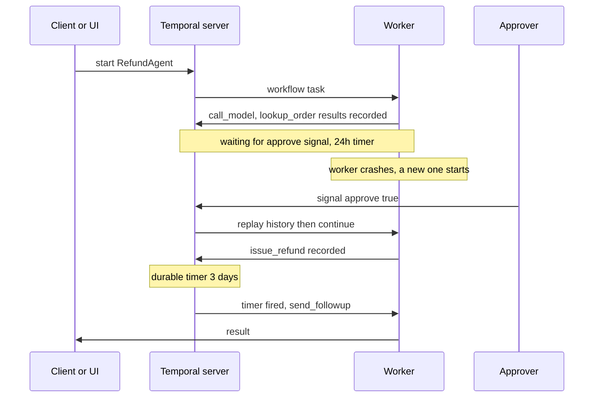

## TL;DR
Temporal runs an agent loop as a workflow whose model and tool calls are recorded activities, so a
crashed worker replays history instead of re-calling the model. You build one with approval, a 3-day
timer, time-skipping tests and replay tests.

## For agent builders
- **Why it matters for agents.** Refund and research agents run for days and wait on humans. With
  Temporal, "the pod restarted at step 14" is a non-event: the next worker rebuilds state from history.
- **Where it shows up in your stack.** The `temporalio` SDK, a Temporal server or Temporal Cloud, and
  plugins such as `temporalio-openai-agents` that make each model call an activity for you.
- **What you control.** What is an activity (model, tools, clocks, randomness), retries, timeouts,
  idempotency keys, and how you ship new code under running workflows.
- **What you can skip.** Server internals, sharding and Nexus. Replay, determinism and at-least-once
  activities explain every bug in this lab.

## Lab
### Task
Finish a refund agent that runs as a Temporal workflow, with the model call and each tool call as
activities. A refund needs an `approve` signal within 24 hours; afterwards the agent waits 3 days on a
durable timer and sends a follow-up. Then ship v2, which adds a fraud check, without breaking v1 runs.
- **Time box:** 75-90 minutes.
- **Prerequisites:** durable execution and checkpointing, durable workflow execution, and workflow
  orchestration.
- **Runs offline:** `FakeModel` scripts the model's choices, so no API key is needed.
- **One download:** `WorkflowEnvironment.start_time_skipping()` fetches a test-server binary into the
  temp directory on first use (about 65 MB on macOS arm64). Offline CI can pass `test_server_existing_path=`.
- **Needs:** `pip install temporalio==1.35.0 pytest pytest-asyncio`. Checked against temporalio 1.35.0,
  pytest 9.2.0, pytest-asyncio 1.4.1.post1 and Python 3.12.14, 2026-11.

You write three marked parts: the approval wait, the follow-up timer, and the patched v2 fraud check.

### Starter code
```python
# refund_agent.py: a durable refund agent on Temporal, offline with a scripted fake model.
# Checked against temporalio 1.35.0 on Python 3.12, 2026-11.
import asyncio
from dataclasses import dataclass, field
from datetime import timedelta

from temporalio import activity, workflow
from temporalio.client import WorkflowFailureError
from temporalio.common import RetryPolicy
from temporalio.worker import Worker

TASK_QUEUE = "refund-agent"
APPROVAL_TIMEOUT = timedelta(hours=24)
FOLLOWUP_DELAY = timedelta(days=3)
CALLS: dict[str, int] = {}          # activity executions, read by the tests


@dataclass
class Step:                          # what the model decided to do next
    kind: str                        # "tool" or "final"
    tool: str = ""
    args: list = field(default_factory=list)   # positional: payload JSON may reorder dict keys
    text: str = ""


class FakeModel:
    """Stands in for an LLM client: picks the next step from the transcript."""
    def next_step(self, transcript: list[str]) -> Step:
        seen = " ".join(transcript)
        if "order:" not in seen:
            return Step("tool", "lookup_order", ["A-1001"])
        if "refund:" not in seen:
            return Step("tool", "issue_refund", ["A-1001", 42.0])
        return Step("final", text="Refunded 42.00 on order A-1001.")


def _count(name: str) -> None:
    CALLS[name] = CALLS.get(name, 0) + 1


# ---- activities: every non-deterministic or side-effecting call lives here
@activity.defn
async def call_model(transcript: list[str]) -> Step:
    _count("call_model")
    return FakeModel().next_step(transcript)

@activity.defn
async def lookup_order(order_id: str) -> str:
    _count("lookup_order")
    return f"order:{order_id} total=42.00 status=delivered"

@activity.defn
async def issue_refund(order_id: str, amount: float) -> str:
    _count("issue_refund")
    info = activity.info()           # same on every retry of this step: use it as the idempotency key
    return f"refund:{order_id} {amount:.2f} key={info.workflow_id}/{info.workflow_run_id}/{info.activity_id}"

@activity.defn
async def fraud_check(order_id: str) -> str:
    _count("fraud_check")
    return f"fraud:{order_id} ok"

@activity.defn
async def send_followup(order_id: str) -> str:
    _count("send_followup")
    return f"followup:{order_id}"

ACTIVITIES = [call_model, lookup_order, issue_refund, fraud_check, send_followup]
TOOLS = {"lookup_order": lookup_order, "issue_refund": issue_refund}
NEEDS_APPROVAL = {"issue_refund"}
STEP_OPTS = dict(start_to_close_timeout=timedelta(seconds=30),
                 retry_policy=RetryPolicy(maximum_attempts=3))


# ---- workflow v1: the agent loop. Only deterministic code here.
@workflow.defn(name="RefundAgent", failure_exception_types=[NotImplementedError])
class RefundAgent:
    def __init__(self) -> None:
        self.transcript: list[str] = []
        self.approved: bool | None = None
        self.waiting_for_approval = False
        self.elapsed_hours = 0.0

    @workflow.signal
    def approve(self, ok: bool) -> None:
        self.approved = ok

    @workflow.query
    def status(self) -> dict:
        return {"waiting_for_approval": self.waiting_for_approval, "transcript": self.transcript,
                "elapsed_hours": self.elapsed_hours}

    @workflow.run
    async def run(self, request: str) -> str:
        return await self.agent_loop(request)

    async def agent_loop(self, request: str) -> str:
        t0 = workflow.now()                                     # workflow time, replay-safe
        try:
            return await self._loop(request)
        finally:
            self.elapsed_hours = (workflow.now() - t0) / timedelta(hours=1)

    async def _loop(self, request: str) -> str:
        self.transcript.append(f"user:{request}")
        for _ in range(8):                                      # step budget, replay-safe
            step = await workflow.execute_activity(call_model, self.transcript, **STEP_OPTS)
            if step.kind == "final":
                return f"{step.text} | {await self.follow_up('A-1001')}"
            if step.tool in NEEDS_APPROVAL:
                if not await self.wait_for_approval():
                    return "refund not approved"
                blocked = await self.before_refund(step.args[0])
                if blocked:
                    return blocked
            result = await workflow.execute_activity(
                TOOLS[step.tool], args=step.args, **STEP_OPTS)
            self.transcript.append(result)
        return "step budget exhausted"

    async def wait_for_approval(self) -> bool:
        # YOUR CODE (1): set self.waiting_for_approval, then wait for the approve signal for at most
        # APPROVAL_TIMEOUT with a durable wait (no worker blocks, survives restarts). Return the
        # decision, or False when the timeout fires first. Clear the flag before returning.
        raise NotImplementedError("wait_for_approval")

    async def follow_up(self, order_id: str) -> str:
        # YOUR CODE (2): sleep FOLLOWUP_DELAY with a durable timer, then run send_followup as an
        # activity and return its result.
        raise NotImplementedError("follow_up")

    async def before_refund(self, order_id: str) -> str | None:
        return None                                             # v1 has no fraud check


# ---- v2, deployed while v1 runs are still waiting. Same workflow type name.
@workflow.defn(name="RefundAgent", failure_exception_types=[NotImplementedError])
class RefundAgentV2Naive(RefundAgent):
    @workflow.run
    async def run(self, request: str) -> str:
        return await self.agent_loop(request)

    async def before_refund(self, order_id: str) -> str | None:
        # The deliberate break: a new activity call that v1 histories do not contain.
        r = await workflow.execute_activity(fraud_check, order_id, **STEP_OPTS)
        return None if r.endswith("ok") else "refund blocked by fraud check"


@workflow.defn(name="RefundAgent", failure_exception_types=[NotImplementedError])
class RefundAgentV2(RefundAgent):
    @workflow.run
    async def run(self, request: str) -> str:
        return await self.agent_loop(request)

    async def before_refund(self, order_id: str) -> str | None:
        # YOUR CODE (3): the same fraud check as RefundAgentV2Naive, but gated with
        # workflow.patched("fraud-check") so v1 histories replay cleanly and new runs check.
        raise NotImplementedError("before_refund")


def make_worker(client, workflow_cls=RefundAgent, **kw) -> Worker:
    return Worker(client, task_queue=TASK_QUEUE, workflows=[workflow_cls], activities=ACTIVITIES, **kw)


async def main() -> None:
    from temporalio.testing import WorkflowEnvironment
    async with await WorkflowEnvironment.start_time_skipping() as env:   # downloads a test server once
        async with make_worker(env.client):
            h = await env.client.start_workflow(
                RefundAgent.run, "Refund order A-1001, it arrived broken",
                id="refund-A-1001", task_queue=TASK_QUEUE)
            await h.signal(RefundAgent.approve, True)
            try:
                print("result:", await h.result())
            except WorkflowFailureError as e:
                print("not implemented yet:", e.cause.message)
                return
            hours = (await h.query(RefundAgent.status))["elapsed_hours"]
            print(f"workflow hours elapsed: {hours:.0f}")
            print("activity calls:", dict(sorted(CALLS.items())))


if __name__ == "__main__":
    asyncio.run(main())
```

As given, it prints `not implemented yet: wait_for_approval`. `failure_exception_types` makes that
error fail the workflow at once; otherwise a plain exception fails only the workflow task, which
Temporal retries until a fix ships, and `h.result()` waits forever.

### Expected output
```
result: Refunded 42.00 on order A-1001. | followup:A-1001
workflow hours elapsed: 72
activity calls: {'call_model': 3, 'issue_refund': 1, 'lookup_order': 1, 'send_followup': 1}
```

The 72 hours pass in about a second. One harmless SDK `WARN` line about a heartbeat capability of the
test server also appears.

### Tests
```python
# test_refund_agent.py: run with `pytest -q -o asyncio_default_fixture_loop_scope=function`
import asyncio
import uuid
import pytest
from temporalio.testing import WorkflowEnvironment
from temporalio.worker import Replayer
from temporalio.workflow import NondeterminismError

import refund_agent as m

pytestmark = pytest.mark.asyncio
REQUEST = "Refund order A-1001, it arrived broken"


@pytest.fixture(autouse=True)
def reset_calls():
    m.CALLS.clear()


async def start(env, wf=m.RefundAgent):
    return await env.client.start_workflow(wf.run, REQUEST, id=f"refund-{uuid.uuid4()}",
                                           task_queue=m.TASK_QUEUE)


async def v1_history(env):
    async with m.make_worker(env.client):
        h = await start(env)
        await h.signal(m.RefundAgent.approve, True)
        await h.result()
        return await h.fetch_history()


async def test_approved_run_waits_three_days_then_follows_up():
    async with await WorkflowEnvironment.start_time_skipping() as env:
        async with m.make_worker(env.client):
            h = await start(env)
            await h.signal(m.RefundAgent.approve, True)
            assert await h.result() == "Refunded 42.00 on order A-1001. | followup:A-1001"
            hours = (await h.query(m.RefundAgent.status))["elapsed_hours"]
    assert 72 <= hours < 73                                     # the 3-day timer, skipped in seconds
    assert m.CALLS == {"call_model": 3, "lookup_order": 1, "issue_refund": 1, "send_followup": 1}


async def test_no_approval_expires_after_24_hours_without_refunding():
    async with await WorkflowEnvironment.start_time_skipping() as env:
        async with m.make_worker(env.client):
            h = await start(env)
            assert await h.result() == "refund not approved"
            hours = (await h.query(m.RefundAgent.status))["elapsed_hours"]
    assert 24 <= hours < 25
    assert "issue_refund" not in m.CALLS


async def test_worker_restart_resumes_without_recalling_the_model():
    async with await WorkflowEnvironment.start_time_skipping() as env:
        # Worker 1 runs until the approval wait. No workflow cache: the time-skipping test server
        # never moves a sticky workflow off a stopped worker, so the next task must replay.
        async with m.make_worker(env.client, max_cached_workflows=0):
            h = await start(env)
            for _ in range(100):
                if (await h.query(m.RefundAgent.status))["waiting_for_approval"]:
                    break
                await asyncio.sleep(0.05)
            else:
                pytest.fail("workflow never reached the approval wait")
        assert m.CALLS == {"call_model": 2, "lookup_order": 1}  # worker 1 is gone now
        async with m.make_worker(env.client):                  # a fresh worker replays the history
            await h.signal(m.RefundAgent.approve, True)
            await h.result()
    assert m.CALLS["call_model"] == 3 and m.CALLS["lookup_order"] == 1


async def test_naive_v2_breaks_replay_of_v1_history():
    async with await WorkflowEnvironment.start_time_skipping() as env:
        history = await v1_history(env)
    with pytest.raises(NondeterminismError):
        await Replayer(workflows=[m.RefundAgentV2Naive]).replay_workflow(history)


async def test_patched_v2_replays_v1_and_checks_new_runs():
    async with await WorkflowEnvironment.start_time_skipping() as env:
        history = await v1_history(env)
        await Replayer(workflows=[m.RefundAgentV2]).replay_workflow(history)   # must not raise
        m.CALLS.clear()
        async with m.make_worker(env.client, m.RefundAgentV2):
            h = await start(env, m.RefundAgentV2)
            await h.signal(m.RefundAgentV2.approve, True)
            assert (await h.result()).startswith("Refunded 42.00")
    assert m.CALLS["fraud_check"] == 1
```

On the starter all five fail: four with `NotImplementedError: wait_for_approval` inside a
`WorkflowFailureError`, one with "workflow never reached the approval wait". A correct solution passes
in about 2 seconds.

### Failure scenarios
- **Read the clock in workflow code.** Swap `workflow.now()` for `datetime.now()`. The sandbox raises
  `RestrictedWorkflowAccessError`, the workflow task retries forever and `result()` never returns.
  Debug from worker logs ("Failed activation"), not the client.
- **Ship the naive v2 to live workers.** The replay test fails with `[TMPRL1100] Nondeterminism error:
  Activity type of scheduled event 'issue_refund' does not match activity type of activity command
  'fraud_check'`. Debug by replaying a saved production history in CI before every deploy.
- **Make the refund fail after charging.** Raise `ConnectionError` when `activity.info().attempt == 1`.
  The run succeeds, but `issue_refund` executes twice. Debug by counting side effects per idempotency
  key; the payment API must deduplicate on it.
- **Pass tool arguments as a dict.** Make `Step.args` a `dict` and pass `args=list(step.args.values())`.
  Each attempt fails with `TypeError: Expected value to be str, was <class 'float'>` ("Failed decoding
  arguments"), because the JSON converter sorts keys and `amount` comes first. Debug from the worker log.

### Submission
- `refund_agent.py` with the three `YOUR CODE` parts done, and the pytest run showing 5 passed.
- The output of `python refund_agent.py`, matching Expected output.
- One saved v1 history (`history.to_json()`) and a test that replays it from the file, loaded with
  `WorkflowHistory.from_json(workflow_id, text)`.
- A note of 5-8 lines: when you would use `workflow.patched` and when Worker Versioning for this change.
- Evaluated by running your tests, replaying your saved history, and checking the note.

## Why it exists
- **Agent runs outlive processes.** A run that waits days sees deploys and crashes mid-run. Status
  columns plus cron re-run steps, double-charge, or lose their place.
- **Re-running from the top is expensive and wrong.** It spends tokens again, and the model may now
  choose differently from what the approver saw.
- **The toy engine stops at one box.** The sqlite replay engine teaches the idea; Temporal adds task
  queues across workers, durable timers, signals, retries, history storage and replay tooling.
- **The hard lessons need hands-on breakage.** Non-determinism, at-least-once activities and versioning
  only become real when you break them yourself.

## How it works
### Workflow, activities, worker
1. **The workflow** is async Python that must be deterministic: same history in, same commands out. It
   holds the loop, step budget and approval decision.
2. **Activities** do everything else (model, tools, HTTP, databases); each result is recorded in the
   event history.
3. **A worker** polls a task queue and runs workflow code in a sandbox that blocks clocks, randomness and
   I/O.
4. **After a crash,** any worker replays the history: recorded results are returned without re-running,
   and execution continues from the first unrecorded step.

### The four primitives this lab uses
| Need | Primitive | What is recorded |
|---|---|---|
| Model or tool call | `workflow.execute_activity(fn, args, start_to_close_timeout=..., retry_policy=...)` | scheduled, started, completed or failed |
| Human approval | `@workflow.signal` plus `workflow.wait_condition(fn, timeout=...)` | the signal, and a timer for the timeout |
| Long wait | `workflow.sleep(timedelta(days=3))` | a durable timer; no worker is busy meanwhile |
| Status for a UI | `@workflow.query` | nothing; read-only |

- **The timeout raises `asyncio.TimeoutError`** from `wait_condition`, so "expired" is a branch.
- **Retries make activities at-least-once,** so consequential tools need idempotency keys built from
  `workflow_id`, `workflow_run_id` and `activity_id`.

### Testing with time skipping
- **`WorkflowEnvironment.start_time_skipping()`** starts a local test server that jumps virtual time to
  the next timer while you await a result. It downloads a binary on first use; plan for that in CI.
- **It is a legacy Java test server** without full parity, per the SDK docstring.
  `start_time_skipping_v2()` is marked experimental in temporalio 1.35.0.
- **Measure elapsed time with `workflow.now()`.** After a run completes the environment clock can jump
  far ahead (we saw about 10 years), so `env.get_current_time()` misleads.

### Changing code under running workflows
- **The rule:** new code must issue the same commands as old code for every recorded event. Adding,
  removing or reordering an activity, timer or wait breaks it.
- **`Replayer`** replays a saved history against new code and raises `NondeterminismError` on a
  mismatch: your CI gate.
- **`workflow.patched("id")`** is True for new runs and False when replaying older histories. Ship both
  branches, later call `workflow.deprecate_patch("id")`, then delete the old branch.
- **Worker Versioning** pins each run to the build that started it, so new code needs no branches. It is
  GA as of Temporal's March 2026 announcement.

| | `workflow.patched` | Worker Versioning |
|---|---|---|
| Where versions live | if-branches in one codebase | separate worker deployments (build IDs) |
| Old runs execute on | new workers, taking the old branch | the old build, if `PINNED` |
| Cost | branches accumulate; needs cleanup | run old and new workers side by side until old runs drain |
| Best for | small changes, very long runs | frequent deploys, multi-day agent runs, big refactors |

## Diagram
Follow one run: the model and tools run as activities, the approval wait and the 3-day wait are durable,
and a new worker after a crash replays recorded results instead of calling the model again.



## Examples
### The same agent through the OpenAI Agents SDK plugin
`temporalio-openai-agents` makes every model call of an Agents SDK run an activity
(`invoke_model_activity`), and `activity_as_tool` turns an existing activity into a tool.

Install with `pip install temporalio-openai-agents==1.1.0`. It pins `openai-agents>=0.22,<0.23` (0.22.3
resolved here) while openai-agents is at 0.24.0, so check your own pin first. Checked 2026-11.

```python
# agents_step.py: the same agent on the OpenAI Agents SDK, made durable by Temporal's plugin.
# Checked against temporalio-openai-agents 1.1.0 (openai-agents 0.22.3), 2026-11. Offline: TestModel.
import asyncio
from datetime import timedelta

from agents import Agent, Runner
from temporalio import workflow
from temporalio.openai_agents.testing import AgentEnvironment, ResponseBuilders, TestModel
from temporalio.openai_agents.workflow import activity_as_tool
from temporalio.testing import WorkflowEnvironment
from temporalio.worker import Worker

with workflow.unsafe.imports_passed_through():
    from refund_agent import CALLS, lookup_order


@workflow.defn
class SdkRefundAgent:
    @workflow.run
    async def run(self, request: str) -> str:
        agent = Agent(
            name="refunds",
            instructions="Look up the order before answering.",
            tools=[activity_as_tool(lookup_order, start_to_close_timeout=timedelta(seconds=30))],
        )
        result = await Runner.run(agent, request)      # each model call becomes an activity
        return result.final_output


async def main() -> None:
    model = TestModel.returning_responses([
        ResponseBuilders.tool_call('{"order_id": "A-1001"}', "lookup_order"),
        ResponseBuilders.output_message("Order A-1001 was delivered, so it is eligible for a refund."),
    ])
    async with await WorkflowEnvironment.start_time_skipping() as env:
        async with AgentEnvironment(model=model) as agent_env:
            client = agent_env.applied_on_client(env.client)     # adds OpenAIAgentsPlugin
            async with Worker(client, task_queue="sdk-refunds", workflows=[SdkRefundAgent],
                              activities=[lookup_order]):
                h = await client.start_workflow(SdkRefundAgent.run, "Can I get a refund on A-1001?",
                                                id="sdk-refund-A-1001", task_queue="sdk-refunds")
                print("result:", await h.result())
                kinds = [e.activity_task_scheduled_event_attributes.activity_type.name
                         for e in (await h.fetch_history()).events
                         if e.HasField("activity_task_scheduled_event_attributes")]
                print("activities:", kinds, "| tool runs:", CALLS)


if __name__ == "__main__":
    asyncio.run(main())
```

It prints the answer and `activities: ['invoke_model_activity', 'lookup_order',
'invoke_model_activity']`, plus a note that trace export is skipped without `OPENAI_API_KEY`. In
production, add `OpenAIAgentsPlugin(model_params=ModelActivityParameters(...))` to the client. The old
`temporalio.contrib.openai_agents` path only forwards to `temporalio.openai_agents`.

**Other first-party framework integrations (checked on PyPI and npm, 2026-11):**

| Framework | Package | Import or entry point | Status label |
|---|---|---|---|
| Pydantic AI | `pydantic-ai[temporal]` | `TemporalDurability` capability (the `TemporalAgent` wrapper is deprecated) | in Pydantic AI |
| LangGraph | `temporalio-langgraph` 0.1.0 | `temporalio.langgraph` | Beta |
| Strands Agents | `temporalio-strands-agents` 0.1.0 | `temporalio.strands_agents` | Beta |
| Google ADK | `temporalio-google-adk` 0.0.1 | `temporalio.google_adk` | Alpha |
| Google GenAI SDK | `temporalio-google-genai` 0.1.0 | `temporalio.google_genai` | Beta |
| LangChain Deep Agents | `temporalio-deepagents` 0.0.3 | `temporalio.deepagents` | Alpha |
| Claude Agent SDK | `temporalio-claude-agent-sdk` 0.0.3 | `temporalio.claude_agent_sdk` (`ClaudeAgentSDKPlugin`) | Alpha |
| Vercel AI SDK (TypeScript) | `@temporalio/vercel-ai-sdk` 1.0.0 | `@temporalio/ai-sdk` 1.25.0 now forwards to it | npm |
| MCP servers | inside `temporalio-openai-agents` | `StatelessMCPServerProvider`, `StatefulMCPServerProvider` | part of the 1.1.0 plugin |

### Worker Versioning for the fraud-check release
Instead of a patch branch, run v2 as a new build and pin each run to its starting build. The snippet
builds the config (checked against temporalio 1.35.0, 2026-11); deploying needs a server with Worker Deployments.

```python
from temporalio import workflow
from temporalio.common import VersioningBehavior, WorkerDeploymentVersion
from temporalio.worker import WorkerDeploymentConfig

DEPLOY = WorkerDeploymentConfig(
    version=WorkerDeploymentVersion(deployment_name="refund-agent", build_id="2026-11-05.1"),
    use_worker_versioning=True,
    default_versioning_behavior=VersioningBehavior.PINNED,
)

@workflow.defn(name="RefundAgent", versioning_behavior=VersioningBehavior.PINNED)
class RefundAgentPinned:
    @workflow.run
    async def run(self, request: str) -> str:
        return request          # the v2 loop goes here, with no patch branches

# Worker(client, task_queue=..., workflows=[...], activities=[...], deployment_config=DEPLOY)
# then promote the build:
#   temporal worker deployment set-current-version --deployment-name refund-agent --build-id 2026-11-05.1
```

- **Versioned workers get no new runs until promoted** with `set-current-version` (or
  `set-ramping-version`).
- **`AUTO_UPGRADE` runs move to the current version** on their next task, so they still need
  replay-safe changes; `PINNED` runs do not.

## Production patterns
- **Every model call is an activity.** Size `start_to_close_timeout` to the slowest call, use
  `non_retryable_error_types` for bad requests, and heartbeat streaming calls. Monitor retries per model.
- **Keep big payloads out of history.** Pass object-storage references, not transcripts, because history
  has size and event-count limits (see the docs), and use `workflow.continue_as_new` on long loops.
- **Replay tests in CI.** Export real histories per workflow type (`fetch_history()`, `to_json()`) and
  run `Replayer` on each release candidate; block the deploy on `NondeterminismError`.
- **Approval as signal plus timeout.** The UI signals; the workflow has an explicit expired branch that
  notifies someone, and exposes state through a query.
- **Pin long agent runs with Worker Versioning.** Promote each build with `set-current-version`, keep
  old builds until their pinned runs drain, and keep `workflow.patched` for hotfixes.

## Trade-offs
- **Durability vs an extra system.** Crash-proof runs, timers and signals cost a cluster or Temporal
  Cloud plus a new mental model. For short runs that are safe to repeat, a queue job wins.
- **Replay safety vs coding freedom.** Clocks, APIs and randomness all become activities, costing
  latency and history events per step.
- **Plugins vs control.** `temporalio-openai-agents` makes an Agents SDK agent durable in a few lines,
  but its pins lag the SDK (0.22.x vs 0.24.0 in 2026-11).
- **`patched` vs Worker Versioning.** Patches need no extra workers but leave branches to clean up;
  versioning keeps code clean but runs old builds until their runs drain.

## Pitfalls
- **Non-determinism hidden in workflow code.** Symptom: runs stuck after a deploy, "Failed activation" in
  worker logs. Diagnose: replay the stuck run's history with `Replayer` and read the `TMPRL1100`
  message. Fix: move the call into an activity, or gate the change with `workflow.patched`.
- **A plain exception in workflow code.** Symptom: `result()` hangs. Diagnose: repeated workflow task
  failed events in the history or UI. Fix: raise `ApplicationError` to fail the run on purpose, or list
  types in `failure_exception_types`.
- **Repeated side effects on retry.** Symptom: two refunds for one approval. Diagnose: count side effects
  per idempotency key and find attempts above 1. Fix: send the activity-derived key; the API deduplicates.
- **Tests that hang after a worker stops.** Symptom: a restart test never finishes. Diagnose: the run is
  sticky to the stopped worker's cache, and the time-skipping server never reroutes it. Fix:
  `max_cached_workflows=0` on the first test worker; a real server reroutes after the sticky timeout.

## When to use
- **Use when** agent runs last minutes to weeks, wait on people, call tools with real side effects, and
  must survive deploys without repeating model calls.
- **Avoid when** a run is a single request under a few seconds, or every step is cheap and safe to
  repeat; a queue with retries is simpler.
- **Measure** replay failures per deploy, activity retries, side effects per idempotency key, approval
  expiry rate and history size.

## Exercise
**Goal:** make the refund agent safe for a cancellation path and a long backlog, without the solution
given here.
- **Inputs:** your finished `refund_agent.py` and tests.
- **Task:** add a `cancel` signal that ends the run during the approval wait or the 3-day wait with
  "cancelled by customer". Add a `continue_as_new` after 5 tool steps, carrying the transcript reference.
- **Constraint:** v1 histories saved during the lab must still replay against your new code.
- **Deliver:** the code, three new tests, and a saved history replayed from a JSON file.
- **Acceptance:** a cancel at hour 30 of the timer returns in under 2 seconds of wall time, with no
  `send_followup`; the old history still replays; a continued run keeps its step count.

## Role lens
- **Engineer:** Writes workflows and activities, keeps workflow code deterministic, and adds replay and
  time-skipping tests so a deploy never strands running agents.
- **Architect:** Decides what runs on Temporal versus a queue, sets the versioning strategy, retry and
  timeout policy, and the payload limits that keep histories small.
- **FDE:** Explains to a customer why a crashed agent resumed without repeating a refund, and sizes how
  long old worker builds must stay up for their approval windows.

## Check yourself
**Q:** Your agent workflow waits up to 24 hours for approval. You deploy code that adds a fraud-check
activity before the refund. What happens to the runs already waiting, and how do you ship it safely?
**A:** Waiting runs replay on new workers. At the refund, the new code schedules `fraud_check` where the
history recorded `issue_refund`, so replay fails with a non-determinism error and the runs stall. Ship
it behind `workflow.patched("fraud-check")` so old histories take the old branch and new runs check, or
use Worker Versioning with `PINNED` runs so old runs finish on the old build. Either way, add a
`Replayer` test on a saved history to CI.

## Interview questions
### Why should the LLM call be a Temporal activity rather than code inside the workflow?
- **Determinism:** workflow code is replayed after crashes and must issue the same commands each time.
  A model call returns different text on each call, so replay would diverge.
- **Cost and consistency:** as an activity the result is recorded once, so replay reuses it. No tokens
  are spent again and the run keeps the decision the approver saw.

### A deploy left 300 agent runs stuck. How do you debug and recover?
- **Confirm the cause:** fetch a stuck run's history and replay it with `Replayer` against the new code;
  a `TMPRL1100` non-determinism message names the mismatched command.
- **Recover:** roll back or ship a `workflow.patched` branch that reproduces the old commands, then
  confirm the runs progress.
- **Prevent:** a CI replay test on saved histories for every workflow type.

### When would you choose Worker Versioning over `workflow.patched`?
- **Versioning:** for frequent deploys of long agent runs and big refactors, because pinned runs finish on
  their original build and the code carries no branches.
- **Patching:** for a small change when running two builds side by side is not worth it, accepting that
  branches must be deprecated and removed later.

### How do you stop a retried tool call from refunding twice?
- **Expect at-least-once:** an activity that times out after the side effect is retried, so it runs again.
- **Use a stable key:** derive it from `workflow_id`, `workflow_run_id` and `activity_id`, and send it to
  the payment API, which must deduplicate on it. Measure side effects per key to prove it.

## Quiz
### Q: What happens when a crashed worker's workflow is picked up by a new worker?
- [ ] The workflow restarts from the top and re-runs every activity
- [x] The new worker replays the event history, reusing recorded activity results, and continues from the first unrecorded step
- [ ] The server resumes the exact Python stack frame from a memory snapshot
- [ ] The workflow fails and must be started again by the client
> Temporal rebuilds state by replaying workflow code against the history. Completed activities return
> their recorded results, so the model is not called again.

### Q: Why does adding an activity call in the middle of an existing workflow break running workflows?
- [ ] Temporal cannot register new activities without a server restart
- [ ] New activities always need a new task queue
- [x] Replay of old histories meets a command the history never recorded, which raises a non-determinism error
- [ ] Activities added later are not covered by retry policies
> Replayed code must issue the same commands as the recorded events. A new activity at that point
> mismatches the history unless it is gated by `workflow.patched` or the run is pinned to the old build.

### Q: What does `WorkflowEnvironment.start_time_skipping()` give you in tests?
- [ ] A mock that skips activities entirely
- [x] A local test server that jumps virtual time to the next timer, so day-long waits finish in milliseconds
- [ ] A production cluster connection with timers disabled
- [ ] A way to replay histories without a worker
> The time-skipping server advances time when the test awaits a result. It downloads a test-server
> binary on first use and caches it in the temp directory.

## Mastery test
**Problem:** a research agent on Temporal runs up to 10 days, makes about 400 model calls, and waits
on two human reviews. After a month, deploys fail replay, histories are huge, and a reviewer approved a
run twice and got two published reports. Plan the fixes.

**A strong answer:**
- moves transcripts and documents out of history into object storage, passing references, and adds
  `continue_as_new` every N steps with the step count carried over;
- makes the publish activity idempotent with a key from workflow, run and activity identity, and makes
  the approval signal handler ignore a second approval;
- adopts Worker Versioning with `PINNED` for these 10-day runs, keeps old builds up until they drain,
  and keeps `workflow.patched` for hotfixes;
- adds CI replay tests on saved histories and tracks history size and side effects per key.

## Use cases & projects
### Use cases
- **Approval-heavy operations agents.** Refunds and account changes wait on a signal with a timeout and
  never repeat a payment on retry.
- **Long research or coding agents.** Hundreds of recorded model calls survive deploys.
- **Onboarding and follow-up agents.** Durable timers send day-3 and day-7 reminders without cron.
- **Framework agents made durable.** OpenAI Agents SDK, Pydantic AI or LangGraph agents gain crash
  recovery through Temporal's plugins.

### Mini project
**Run the lab agent on a real dev server and kill it (2-3 hours).**
- **Goal:** prove crash recovery outside the test server.
- **Steps:** run `temporal server start-dev`; split the lab into `worker.py` and `starter.py`; start a
  run, `kill -9` the worker during the approval wait, start a new worker, send the signal with
  `temporal workflow signal`, and inspect the history in the web UI.
- **Done when:** the history shows one `call_model` per step and one `issue_refund`, plus a short note
  on what the new worker replayed and how long rerouting took.
