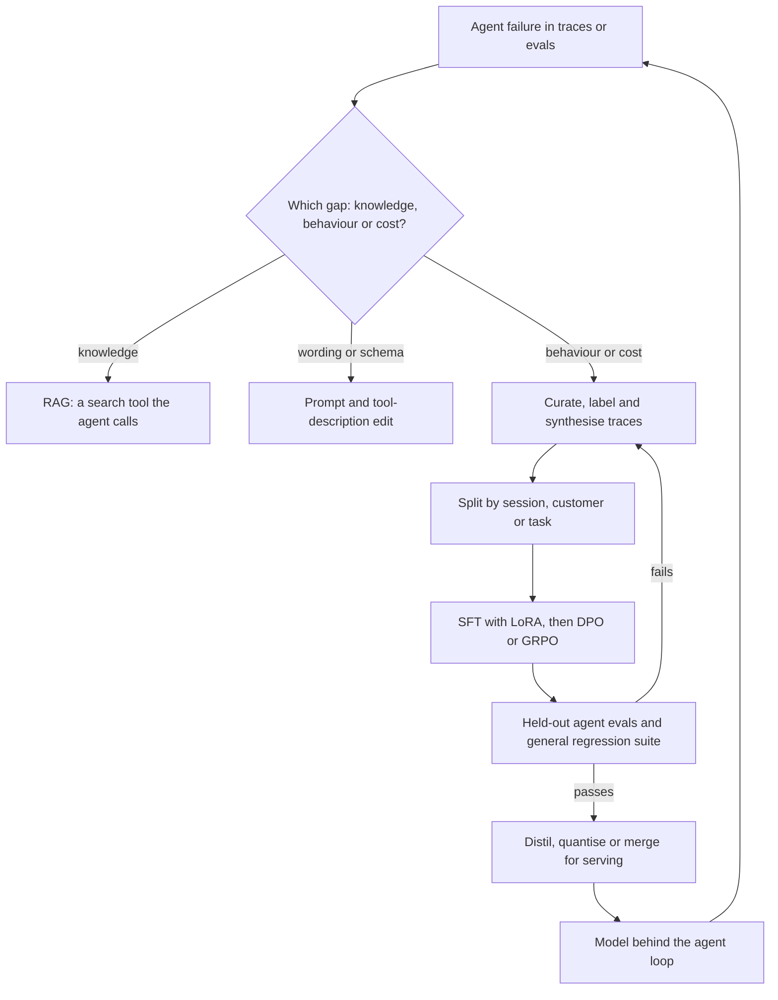

## Overview
This module follows a model from random weights to a deployed, adapted artifact, and teaches you when
each stage is worth paying for. For an agent builder the question is narrower: when should the model
behind your agent loop change its weights, and how do you do that without breaking tool calls?

The lifecycle frames everything. Pre-training produces a base model that knows language but does not
follow instructions. Post-training (supervised fine-tuning, instruction tuning, then preference and
reward optimisation with RLHF, DPO and GRPO) installs the behaviour users and agents actually rely on:
chat templates, tool-call formats, stopping and refusing.

Before any of that, the fine-tune-vs-RAG-vs-prompt decision asks whether your gap is knowledge,
behaviour or economics, because only the last two are good reasons to touch weights. The topic groups
then cover the rest of the path:

- **Data:** curation, labelling, synthetic generation and a split that follows the real unit of generalisation. This is where most fine-tunes are won or lost.
- **Training dynamics:** learning rate, epochs, overfitting, catastrophic forgetting and checkpointing explain how a small dataset quietly turns into memorisation or a regression on general skills.
- **Efficiency:** PEFT and QLoRA, gradient checkpointing, tooling such as TRL, Axolotl and Unsloth, and distributed training make a run fit the hardware you have.
- **Compression:** distillation, quantization, pruning and model merging turn a good model into one that is cheap to serve.

Which lessons matter most for agents:

- **Core (you use them directly):** fine-tune-vs-rag-vs-prompt-decision and synthetic-data-generation, because every agent team decides which lever fixes a failure and builds eval suites before real traffic exists.
- **Useful (you meet them when fine-tuning, serving or operating agents):** the data, SFT, PEFT, training-dynamics, DPO, GRPO, distillation, quantization and merging lessons.
- **Background (recognise them):** pre-training, rlhf, pruning and distributed-training.

Afterwards you can:

- Decide with evals whether to train at all, and pick the lever that fixes each agent failure.
- Build and audit a fine-tuning dataset from agent traces, and an eval suite with a clean split.
- Run a LoRA SFT and a DPO pass on one GPU for a small tool-calling model.
- Catch overfitting and forgetting before release, and ship a quantised or merged model whose quality loss you have measured on tool-call validity and task success.

It matters most for AI Engineers who own a fine-tune end to end, and gives Architects and FDEs the
numbers to approve or turn down one.

## Why it matters
- **Engineer:** When the model behind your agent mangles tool calls, you will format chat data through the right template, mask the loss to assistant turns, pick a learning rate and epoch count for a few thousand rows, attach LoRA to the right projections, read diverging train and validation curves, and resume a crashed run from the last good checkpoint without losing optimizer state.
- **Architect:** Whether to fine-tune, retrieve or prompt sets an agent's cost per request, freshness, tenant isolation and the redo bill on every base-model upgrade, and memory per parameter, adapter-per-tenant serving, quantised weight bytes and distillation targets decide hardware, per-step latency and the platform you commit to.
- **FDE:** Customers arrive saying "fine-tune it on our documents"; you need to show with a quick eval that RAG (a search tool the agent calls) fixes their knowledge gap, scope a small fine-tune for the format or cost problem that remains, audit their labels for agreement, and keep their private data inside their environment.

## Mental model
Hold one picture: training is a single dial, the gradient, applied to one shared set of weights. Every
lesson is about what you point it at, how hard you turn it, and what else moves.

Before any of it, ask
whether the weights are the object that needs changing, or whether the prompt, tool schemas or a
retrieval tool would fix your agent.

| Part of the picture | What it decides | Lessons |
|---|---|---|
| Data | The target: whatever is in the batch, including duplicates, label noise, leaked test items and synthetic artefacts, is what the model becomes | data-curation, data-labeling, synthetic-data-generation |
| Objective | The kind of signal: next-token imitation for pre-training and SFT, comparisons for RLHF and DPO, verifiable scores for GRPO, a teacher's distribution for distillation | pre-training, supervised-fine-tuning, rlhf, dpo, grpo, knowledge-distillation |
| Distance | Learning rate, epochs and trainable capacity set how far the weights travel from the base; too far on a small set means overfitting your rows and forgetting everything else | learning-rate, epochs, overfitting, catastrophic-forgetting |
| Instruments | Held-out splits are the only tools that tell you where you landed | train-val-test-split, checkpointing |
| Budget | Memory and compute: PEFT, gradient checkpointing, sharding and quantisation are ways to afford the turn | peft, gradient-checkpointing, distributed-training, tooling |
| After training | Compression and merging trade measured quality for serving cost | quantization, pruning, model-merging |

## Suggested order
1. fine-tune-vs-rag-vs-prompt-decision — agent core: decides whether training is the right lever at all before you spend anything on data or GPUs.
2. synthetic-data-generation — agent core: fills gaps in real data and builds eval suites before launch, and shows why verification filters decide its value.
3. train-val-test-split — cuts by the unit the model must generalise across, which every later evaluation and prompt comparison depends on.
4. data-curation — selection, deduplication and decontamination of agent traces set the ceiling no hyperparameter can raise.
5. data-labeling — turns raw inputs into targets with measured agreement, since the model learns the labelling function.
6. post-training — maps the SFT, preference and RL stages and why they run in that order, giving the module its backbone.
7. supervised-fine-tuning — the first and most predictable training step, with response-only loss on demonstrations such as successful tool-call traces.
8. instruction-tuning — extends SFT to a diverse task mixture for zero-shot instruction following, which every system prompt relies on.
9. peft — LoRA and QLoRA make fine-tuning fit one GPU and yield swappable adapters, limiting forgetting too.
10. learning-rate — the most sensitive knob in every run, including warmup, decay and fine-tuning ranges.
11. epochs — how many passes a small set can bear, and why fine-tuning counts epochs while pre-training counts tokens.
12. overfitting — reads diverging train and validation loss and applies early stopping and capacity limits.
13. catastrophic-forgetting — the regression your task eval cannot see, and the defences of data mixing and general suites.
14. checkpointing — saves full training state for resume, rollback and best-checkpoint selection, distinct from the next topic.
15. gradient-checkpointing — trades recomputation for activation memory so long-context fine-tunes on whole trajectories fit.
16. tooling — TRL, Axolotl and Unsloth package the loop you now understand, with the details that are easy to get wrong.
17. dpo — trains on chosen and rejected responses with one model and a simple loss; read rlhf later for the objective it simplifies.
18. grpo — replaces PPO's critic with group-relative baselines for verifiable rewards, the reasoning-model recipe and a fit for checkable agent tasks.
19. knowledge-distillation — trains a small student on a teacher's outputs, the bridge from quality to serving cost for high-volume agent steps.
20. quantization — cuts weight bytes for bandwidth-bound decode, measured against the unquantised model on tool-call validity.
21. model-merging — combines fine-tunes of one base by weight arithmetic, needing PEFT and forgetting intuition first.
22. rlhf — background: reward models and PPO turn comparisons into a training signal, and introduce reward hacking and the KL anchor that DPO removes.
23. pre-training — background: establishes what a base model is, the next-token objective and the compute scale every later stage adapts.
24. pruning — background: removes structure the model barely uses and repairs it, often with distillation.
25. distributed-training — background: closes with sharding and parallelism for runs that outgrow one GPU, vocabulary for most roles.

## Capstone
### Brief
**Use case.** A customer's support agent reads each incoming ticket and calls a `create_triage` tool
with a structured JSON triage record, plus a short reply draft. It runs on a frontier API, costs too
much per ticket, and the JSON breaks a few percent of the time. They ask whether a fine-tuned open
model can replace it.

This is the module's major project, a multi-day build of the agent's model component. Start by
building a held-out evaluation set split by customer account. Then run the decision honestly: measure a
prompted baseline and a RAG baseline over their help-centre articles on the same set, and name which gap
remains (knowledge, format or cost).

The build then follows the module end to end:

- **Data:** curate a training set from their historical tickets and agent traces. Deduplicate, strip personal data, decontaminate against the eval set, double-label a sample to measure agreement, and add verified synthetic examples for rare categories.
- **SFT:** train a QLoRA SFT adapter on a 3B to 8B open model with TRL, Axolotl or Unsloth, sweeping learning rate and epochs and keeping the best checkpoint on validation.
- **Preference:** collect preference pairs on reply drafts and run a DPO pass.
- **Release gate:** gate the result on a general regression suite to catch forgetting, then quantise the merged model to 4-bit and confirm quality on the test set before recommending it.

### Deliverables
- A decision memo comparing prompt-only, RAG and fine-tuned variants on the same held-out set, stating which gap each fixes and the cost per 1,000 tickets of each option.
- A versioned dataset with a datasheet recording sources, deduplication and decontamination counts, personal-data scrubbing, synthetic share and its verification filter, inter-annotator agreement on the double-labelled sample, and the account-level split.
- A reproducible training config (Axolotl YAML or a TRL script) for the SFT and DPO runs, with loss curves, the learning-rate and epoch sweep, and the selected checkpoint saved with full optimizer state.
- An evaluation report covering JSON and tool-call validity, field-level triage accuracy, a judged reply-quality score, a general-capability regression suite run on base and fine-tuned models, and results before and after 4-bit quantisation.
- A deployable artifact: the LoRA adapter and the merged, quantised weights, wired behind the agent's `create_triage` step, with a note on the serving setup and peak training and inference memory.

### Rubric
- The split is by customer account, a check shows no near-duplicate between training and test rows, and the test set is scored once, after every hyperparameter and checkpoint choice was made on validation.
- The fine-tune is justified only by a gap the prompt and RAG baselines leave open, and the memo shows that knowledge questions are still served by retrieval rather than baked into the weights.
- Loss curves show where validation loss bottomed out, and the chosen checkpoint and epoch count are taken from that point rather than the last step.
- The general regression suite shows the fine-tuned model within a stated tolerance of the base, or the report names the mitigation (data mixing, lower rank, fewer steps) and its measured effect.
- DPO's effect is reported as a win rate on reply drafts against the SFT-only model, with the reference model and beta stated, and any increase in length or refusals is called out.
- The quantised model's JSON validity and triage accuracy are reported next to the bf16 model's, and the recommendation states the accepted quality loss against the latency, memory and cost gained.
