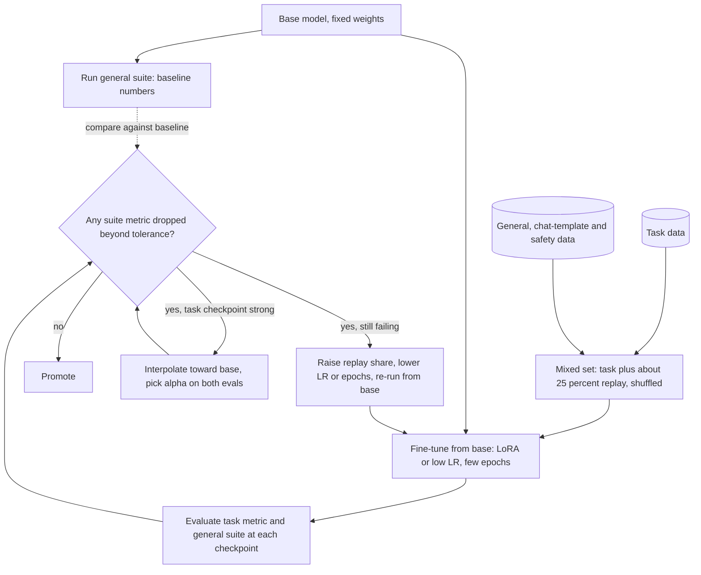

## TL;DR
Fine-tuning gradients see only the new loss, so they overwrite weights behind older capabilities. An LLM
fine-tune can silently lose instruction following, reasoning or safety. Defend with replay, small or
isolated updates, pulling back toward the original weights, and a regression gate.

## Why it exists
- **One shared set of weights.** There is no region for "French", one for "SQL" and one for "refusing
  dangerous requests"; the same matrices participate in all of them.
- **The new gradient has no term for old tasks.** Training on a new dataset computes the gradient of the
  new loss alone, so any weight the new task wants to move will move, however important it was to
  something the loss cannot see.
- **Scale does not remove it.** It was named in the connectionist literature in the late 1980s as the
  sequential learning problem. Some studies find larger models forget less per step, others the opposite,
  so treat model size as no protection. A small dataset repeated for several epochs at a healthy learning
  rate drags the whole network toward those rows.
- **For LLMs, what you forget is the product.** InstructGPT reported an "alignment tax": RLHF models
  regressed on public NLP benchmarks, and the authors mixed pretraining gradients back in to reduce it.
  Later work showed that fine-tuning an aligned chat model on benign task data can erode refusals, even
  when nobody intended that.
- **"My task evaluation went up, ship it"** is exactly how these regressions reach production: the metric
  that would have caught them was never run.

## How it works
### The mechanism in one line
- **Setup.** Let θ* be the weights after pretraining and alignment. Fine-tuning minimises *L_new(θ)*,
  moving θ along directions that reduce *L_new*. Where those directions also raise *L_old*, the old loss
  rises and nothing in the update notices.
- **Curvature picture.** Directions in which *L_old* is sharply curved matter to the old tasks (the
  Fisher information approximates this curvature). Near the old optimum, where the old gradient is
  roughly zero, a displacement δ along such a direction costs roughly `½·F·δ²` of old loss.
- **So forgetting depends on three things:**

| Factor | Controlled by |
|---|---|
| how far you move | steps × learning rate |
| in which directions | what the data asks for |
| how sharp the old loss is there | the old capabilities themselves |

### Mitigation families
1. **Replay (rehearsal).** Mix data representing the old behaviour into the fine-tuning set so the loss
   has a term for it. InstructGPT's PPO-ptx variant is this idea with pretraining data. In practice teams
   mix a share of general instruction, chat-formatted and safety examples into a task fine-tune, tuning
   the proportion on the regression suite. Limit: you need representative data, and for a closed base
   model you only have proxies.
2. **Constrain the move.** A lower learning rate, fewer epochs and early stopping judged on the general
   suite, not only the task, keep the model near θ*. Explicit distance penalties:
   - elastic weight consolidation weights each parameter's displacement by its Fisher importance,
     `λ/2 · Σ_i F_i (θ_i − θ*_i)²`;
   - L2-SP uses a plain quadratic;
   - RLHF and DPO carry a KL term to a reference policy, the same role at the level of outputs.

   At LLM scale the learning-rate and epoch controls plus the KL term are what is actually used;
   Fisher-weighted penalties are rare.
3. **Isolate the update.** LoRA and other adapters freeze the base weights and train a small set of new
   parameters. The base is untouched by construction, the adapter can be removed or swapped per task, and
   the low rank limits how far outputs move.
   - **Reduces, does not prevent.** Behaviour still changes wherever the adapter is active, and a
     high-rank adapter trained hard forgets too.
   - **The trade runs both ways.** Comparisons of LoRA against full fine-tuning on code and maths found
     LoRA forgets less of the source domain and also learns less of the target: the constraint that
     protects old skills caps new ones.
4. **Average back.** Interpolating the fine-tuned weights with θ* (weight-space ensembling, model
   merging) recovers much of the old behaviour while keeping most of the task gain. Choose the mixing
   coefficient on the two evaluations; see `training-adaptation/model-merging`.
5. **Measure it.** None of the above is a guarantee. Run a fixed general-capability suite (instruction
   following, a reasoning subset, format and chat-template adherence, refusal behaviour on a harmful
   prompt set) before and after every fine-tune, and block release on regression beyond a tolerance.

### What usually gets forgotten first
Behaviours rare in the fine-tuning data and sharply defined in the original. Each is invisible to a
task-only evaluation and obvious to a user.

| Training on | Tends to lose |
|---|---|
| raw completions | the chat template and system-prompt handling |
| compliant answers | refusals |
| one language | multilingual ability |
| prose | tool-call formatting |

### Continued pretraining forgets more
- **Bigger displacement.** Continued pretraining on a domain corpus (legal text, a new language, a
  codebase) runs far more tokens than a task fine-tune, usually full-parameter, so it moves further from
  θ* and forgets more.
- **The common recipe.** Re-warm the learning rate to a peak below the original pretraining peak, decay
  it again, and keep a share of general pretraining-style text in the mix as replay.
- **The shift is the point.** Moving the model's distribution is the goal; the question is how much
  general ability you will trade, which the regression suite answers.

### Sequential fine-tunes compound
- **Chaining forgets per hop.** Fine-tuning v2 from v1 on the second batch, then v3 from v2, forgets a
  little of each earlier batch at every hop.
- **Safer:** fine-tune from the base model on the union of all data each time, which also makes the run
  reproducible.

## Diagram
A guarded fine-tune: the general suite is measured on the base before training, replay and a bounded
update keep old behaviour in the loss, and the gate decides between shipping, interpolating back or
re-running.



## Examples
### Replay mix plus a regression gate
A team fine-tunes an instruct model on 5,000 legal-clause extraction examples.
- **Attempt 1** (full fine-tune, three epochs, task data only) lifts the extraction metric, but the
  general evaluation shows lower instruction following and a drop in refusal rate on harmful prompts.
- **Attempt 2** makes general instruction data a quarter of the training mix, shuffled through every part
  of the run, trains LoRA adapters for two epochs at an ordinary adapter rate, and gates on the suite.
- The helpers (`load_jsonl`, `run_suite`, `finetune`) stand in for the team's pipeline functions.

```python
import random
random.seed(0)

task = load_jsonl("legal_clauses.jsonl")            # 5,000 new-task examples
general = load_jsonl("general_chat_sample.jsonl")   # open instruction/chat data: the replay buffer

REPLAY = 0.25                                       # general data as a share of the mixed set
n_replay = int(len(task) * REPLAY / (1 - REPLAY))   # 1,666 rows so general = 25% of the total
mixed = task + random.sample(general, n_replay)
random.shuffle(mixed)                               # interleave; never train the sources in blocks

SUITE = ["ifeval_subset", "gsm8k_subset", "chat_template_adherence", "refusal_rate_harmful"]

def gate(before: dict, after: dict, max_drop: float = 0.02):
    regressions = {k: (before[k], after[k]) for k in before if after[k] < before[k] - max_drop}
    assert not regressions, f"general capability regressed: {regressions}"

before = run_suite(base_model, SUITE)
model = finetune(base_model, mixed, lr=1e-4, epochs=2, lora_r=16, eval_every_steps=100)
after = run_suite(model, SUITE)
gate(before, after)                                 # fails the release if any metric drops > 2 points
```

- **Starting points, not constants.** The replay share, the rank and the two-point tolerance are tuned on
  the suite.
- **The key design choice:** the suite runs before training too. A drop can only be recognised against
  the base model's own number.

### Averaging back toward the base
When a strong task checkpoint has already regressed, interpolate its weights with the base and pick the
mixing coefficient on both evaluations. This works for a full fine-tune of the same architecture; the two
state dicts must share keys and shapes.

- **For a LoRA adapter,** scale the adapter's contribution by alpha instead: interpolating the merged
  weights toward the base gives base plus alpha times the adapter delta.

```python
import torch

def interpolate(base_sd, ft_sd, alpha):
    """alpha=0 -> base model, alpha=1 -> fine-tuned model."""
    return {k: (1 - alpha) * base_sd[k] + alpha * ft_sd[k] if base_sd[k].is_floating_point() else ft_sd[k]
            for k in base_sd}

base_sd = torch.load("base.pt", map_location="cpu")
ft_sd = torch.load("finetuned.pt", map_location="cpu")
for alpha in (0.25, 0.5, 0.75, 1.0):
    model.load_state_dict(interpolate(base_sd, ft_sd, alpha))
    print(alpha, run_suite(model, SUITE), run_task_eval(model))   # pick alpha on both
```

Illustrative sweep (numbers are for shape only, not a benchmark):

| alpha | task metric | general suite (avg) | refusal rate |
|---|---|---|---|
| 0.0 (base) | 52 | 71 | 0.96 |
| 0.5 | 78 | 69 | 0.95 |
| 0.75 | 82 | 66 | 0.88 |
| 1.0 (fine-tuned) | 84 | 60 | 0.79 |

- **Reading it.** If the gate allows a 2-point drop, alpha = 0.5 passes (general −2, refusal −1) and keeps
  26 of the 32 points of task gain; 0.75 and 1.0 fail. Use it as a stopgap while a proper replay run is
  prepared.

## Production patterns
- **Before/after regression gate in CI.** Fix a general suite (instruction following, a reasoning subset,
  chat-template adherence, refusal rate on harmful prompts), record the base model's numbers, and fail
  promotion when any metric drops beyond a tolerance (the example uses 2 points as a start). Monitor the
  per-metric deltas for every release.
- **Replay share in the data mix.** Add general instruction, chat and safety examples to every task
  fine-tune, shuffled through the whole run, starting around a quarter of the mix and tuning on the suite.
  Monitor the general-suite score against the task gain as you vary the share.
- **Train in the serving chat template.** Format all training rows, replay included, with the same
  template the model is served with (for Hugging Face tokenizers, `apply_chat_template`), including
  system prompts. Monitor a template-adherence and system-prompt-following eval.
- **Retrain from base on the union.** For recurring releases, fine-tune from the base model on all
  versioned data each time instead of chaining from the last release. Monitor scores on each earlier
  batch's held-out set so erosion is visible.
- **Interpolation as a fallback.** When a good task checkpoint regresses, sweep the interpolation
  coefficient toward the base (for example 0.25, 0.5, 0.75) and ship the largest one that passes the gate.
  Monitor both the task metric and the gate at each coefficient.
- **Continued-pretraining recipe.** For domain continued pretraining, re-warm the learning rate to a peak
  below the original pretraining peak, decay it again, and keep general text as replay. Monitor general
  benchmark scores at each checkpoint, not only domain perplexity.

## Trade-offs
- **Replay vs cost and coverage.** It costs training tokens and needs data that represents the old
  behaviour; for a closed base model, open instruction sets are a proxy that protects general skills but
  not the vendor's specifics.
- **Small moves vs underfitting.** A lower learning rate and fewer steps reduce forgetting but may
  underfit; the balance tips toward more movement when the task is far from pretraining and old
  capabilities matter less.
- **Adapters vs deep changes.** Adapters bound the damage and keep the base swappable, but a task that
  needs deep changes may need full fine-tuning with heavier replay instead.
- **Pull toward the reference vs task gain.** A KL penalty or weight-space pull keeps behaviour close but
  caps the reward or task gain; raising the penalty trades task quality for retention.
- **Fisher penalties vs simplicity.** They are principled but need an extra pass to estimate importance,
  and are rarely worth it at LLM scale when replay and early stopping achieve the same retention.

## Pitfalls
- **Evaluating only on the task.** Symptom: a model that aces the fine-tuning benchmark and fails users on
  anything adjacent, discovered after release. Fix: a general suite before and after.
- **Training on raw completions without the chat template.** Symptom: the model ignores system prompts or
  produces malformed turns after the fine-tune. Fix: format every row with the serving template.
- **Fine-tuning on compliant answers only.** Symptom: a measurable rise in compliance with harmful
  requests even though the data was benign. Fix: include safety examples and a refusal eval.
- **Chaining fine-tunes v1 → v2 → v3.** Symptom: capabilities from the first batch quietly erode with
  each release. Fix: retrain from base on the union.
- **Treating LoRA as a guarantee.** Symptom: a high-rank adapter trained for many epochs shows the same
  regressions as a full fine-tune. Fix: gate adapter runs on the same suite as full fine-tunes.
- **Diagnosing forgetting as overfitting.** Adding regularisation does not help. Symptom: the task metric
  drops while the general metric does not recover, because the old data is still absent from the loss.
  Fix: add replay so the loss has a term for the old behaviour.

## When to use
Treat forgetting as a risk to manage on every fine-tune, including small adapter runs.
- **Before training:** fix the general suite and record the base model's numbers.
- **During training:** evaluate on both task and suite at the same cadence.
- **After training:** gate on the suite.
- **Order of mitigations:** replay first, because it attacks the cause; then a lower learning rate, fewer
  epochs and adapters; then weight averaging when a good task checkpoint regressed and you want most of
  it back cheaply. Skip heavier machinery unless the suite shows it is needed.
- **Day to day:** "what did we lose" is as routine a question as "what did we gain" in a fine-tune
  review.
- **Interviews:** explain the mechanism (no loss term for the old tasks) and the ordered set of
  mitigations; that is the expected depth.

## Role lens
- **Engineer:** Builds the data mix with a replay share, runs the general suite before and after, and
  implements the regression gate that blocks a fine-tune from being promoted.
- **Architect:** Owns the standing general-capability and safety suite every fine-tuned model must pass,
  and the rule that fine-tunes start from the base on the union of data rather than chaining.
- **FDE:** Shows a customer the before/after suite results alongside the task gain, so the decision to
  deploy weighs what the model lost in their environment and not only what it learned.

## Check yourself
**Q:** A customer fine-tuned a chat model on 8,000 of their internal Q&A pairs and reports it now answers
their questions well but "feels dumber", occasionally ignores the system prompt and answers questions it
previously refused. Explain what happened and lay out a recovery plan.
**A:** The fine-tune optimised only the Q&A loss, so weights supporting general instruction following,
system-prompt handling and refusal behaviour were overwritten; the internal data likely lacked system
prompts and refusals entirely, so those behaviours had no gradient keeping them in place. Recovery:
re-run from the base model, not from the damaged checkpoint; format the data with the chat template and
system prompts; mix in a share of general instruction data plus a safety set so the loss has a term for
the behaviours to keep; train adapters at a lower rate for fewer epochs with evaluation on a general suite
at every checkpoint; and gate deployment on that suite. If a strong task checkpoint already exists,
interpolating it toward the base can recover much of the lost behaviour quickly while the proper run is
prepared.

## Interview questions
### What causes catastrophic forgetting, and why does a bigger model not solve it?
- **Cause:** every capability shares one set of weights, and the fine-tuning gradient has no term for the
  old tasks, so any weight the new loss wants to move will move, however important it was elsewhere.
- **Scale is no protection:** some studies find larger models forget less per step and others the
  opposite. A small dataset repeated for several epochs at a healthy rate still drags the network toward
  those rows.

### How would you design the evaluation for a fine-tune so forgetting cannot reach production?
- **Fix a general suite first:** instruction following, a reasoning subset, chat-template adherence and
  refusal rate on a harmful prompt set.
- **Run it on the base model before training,** because a drop can only be recognised against the base's
  own numbers, then at every checkpoint alongside the task metric.
- **Gate promotion** on a per-metric tolerance (2 points is a reasonable starting value) and record the
  deltas for every release.

### Does training LoRA adapters instead of the full model prevent forgetting?
- **It reduces it, it does not prevent it.** The base weights are frozen and the adapter is removable, but
  behaviour still changes wherever the adapter is active.
- **High rank plus many epochs forgets too,** and shows regressions similar to a full fine-tune.
- **The trade runs both ways:** comparisons on code and maths found LoRA forgets less of the source domain
  and also learns less of the target.

### When would you pick weight interpolation over a replay re-run?
- **Interpolation is the quick fallback:** when a strong task checkpoint already exists and has regressed,
  sweep alpha (0.25, 0.5, 0.75) toward the base and ship the largest value that passes the gate.
- **Replay is the proper fix,** because it attacks the cause by giving the loss a term for the old
  behaviour; plan it as the next run.
- **Interpolation needs matching weights:** a full fine-tune of the same architecture, with state dicts
  that share keys and shapes. For a LoRA adapter, scaling its contribution by alpha does the same job.

### A customer chains monthly fine-tunes from last month's model. What breaks and what do you recommend?
- **What breaks:** each hop forgets a little of every earlier batch, so first-month capabilities erode
  quietly release by release, and no run is reproducible from scratch.
- **Recommendation:** fine-tune from the base model on the union of all versioned data each release, and
  monitor scores on each earlier batch's held-out set so any remaining erosion is visible.

## Quiz
### Q: What is the root cause of catastrophic forgetting during fine-tuning?
- [ ] The model's parameter budget is full, so new knowledge must evict old knowledge
- [x] The fine-tuning loss has no term for the old tasks, so gradients freely move weights those tasks depended on
- [ ] Adam's momentum carries the model past the optimum of the new task
- [ ] The tokenizer vocabulary is changed by the new data
> Shared weights are updated to reduce only the new loss; capacity is rarely the constraint, and neither
> momentum nor tokenisation explains why old capabilities degrade while new ones improve.

### Q: Which mitigation requires access to data representative of the capabilities you want to keep?
- [ ] Lowering the learning rate
- [ ] Training a low-rank adapter instead of the full model
- [x] Replay, mixing general data into the fine-tuning set
- [ ] Early stopping on the task metric
> Replay works by giving the loss a term for the old behaviour, which needs examples of it; the other
> options constrain the update without needing old data, and early stopping on the task metric alone does
> not detect forgetting at all.

### Q: A team ships monthly fine-tunes, each trained from the previous month's model on that month's new data. What should change?
- [ ] Increase the learning rate so each month's data is learned faster
- [x] Train each release from the base model on the union of all months' data, with a general regression suite
- [ ] Drop the evaluation suite because the task data is growing
- [ ] Use a larger rank for the adapters each month
> Chained fine-tunes forget a little of every earlier batch per hop; starting from the base on all data
> removes the compounding, makes runs reproducible, and the suite catches whatever is still lost.
