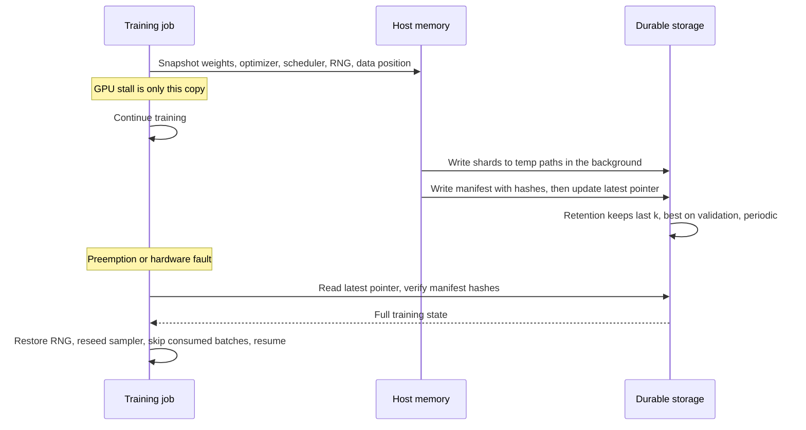

## TL;DR
Checkpointing saves the full training state (weights, optimizer, scheduler, RNG, data position) durably
so runs can resume, roll back and pick the best step. A 7B checkpoint is ~100 GB, so frequency, format
and retention are engineering decisions. Not gradient checkpointing, which recomputes activations.

## Why it exists
- **Long runs on failing hardware.** A single-GPU fine-tune runs for hours on a spot instance that can be
  reclaimed at any minute; a pretraining run occupies thousands of accelerators for weeks, where hardware
  faults are routine. The Llama 3 report counts hundreds of job interruptions in a 54-day pretraining
  window, most of them unexpected.
- **Without checkpoints, cost explodes.** Every failure restarts from zero. With independent failures the
  expected time to finish grows exponentially in run length over mean time between failures (roughly
  `MTBF·(e^(L/MTBF) − 1)`), so a run many times longer than the MTBF effectively never finishes.
- **With checkpoints, cost is bounded.** Saving every *T* minutes, a failure costs on average *T/2*
  minutes of recomputation plus the restart time.
- **Model selection and rollback.** The best model is usually not the last, because validation peaks and
  then overfitting sets in, so the peak's weights exist only if saved. A misbehaving deployed model needs
  a known-good predecessor, and a result nobody can reconstruct is not a result.
- **Weights at the end, or per epoch, fails all three.** It cannot resume correctly (optimizer state is
  gone), misses the peak, and leaves nothing to roll back to.

## How it works
### What a resumable checkpoint contains
Resuming means continuing the exact same trajectory, so everything that influences the next step must be
saved:

| Component | Why it is needed |
|---|---|
| **Model weights** (training precision, plus fp32 master weights under mixed precision) | the parameters themselves |
| **Optimizer state** (AdamW: two fp32 moments per parameter) | fresh moments after resume cause a loss spike, because Adam's first steps after a reset are badly scaled |
| **Scheduler state and step counter** | the learning rate continues instead of restarting warmup |
| **Mixed-precision loss-scaler state**, where used | keeps the scale where it was |
| **RNG states** (Python, NumPy, PyTorch CPU and CUDA) and **data-loader position** (epoch, batches consumed, sampler seed) | dropout masks and example order match an uninterrupted run; no example skipped or seen twice |
| **Config and tokenizer** | the artefact loads without the training code |

- **Size arithmetic.** In mixed precision a checkpoint holds about 14 bytes per parameter: 2 for
  bf16/fp16 weights plus 12 for the fp32 master copy and the two moments.
- **ZeRO's often-quoted 16 bytes** also counts the 2-byte gradients, which live only in memory.
- **So a 7B model's resumable state is roughly 100 GB,** most of it fp32 optimizer state.

### Frequency
- **The basic trade.** Expected loss from a failure is half the interval; each save costs write time
  during which GPUs may idle.
- **Example.** Saving 100 GB over a 1 GB/s link is about 100 seconds; saving every 30 minutes costs about
  5% of throughput in exchange for losing at most 30 minutes.
- **Asynchronous checkpointing** snapshots the state to host memory (a stall of seconds or less per GPU,
  bounded by device-to-host bandwidth) and writes to storage in the background while training continues.
- **Incremental or differential schemes** save only what changed; they pay off mainly when much of the
  state is static, such as large sparse embedding tables.

### The Young–Daly interval
If a save stalls training for *C* seconds and failures arrive with mean time *M* between them, overhead
per unit time is roughly `C/T` (saving) plus `T/(2M)` (expected recomputation). Minimising the sum gives:

```
T_opt ≈ sqrt(2 · C · M)
```

| Save stall C | M | T_opt | Total overhead |
|---|---|---|---|
| 100 s (synchronous) | 10,800 s (a failure every three hours) | ≈ 1,470 s, about 25 minutes | roughly 14% |
| 5 s (asynchronous snapshot) | 10,800 s | about 5.5 minutes | near 3% |

- **Cheaper saves buy both** more frequent saves and less waste.
- **The square root** says save cost matters as much as failure rate.
- **Caveats.** The formula ignores restart time and assumes memoryless failures. Treat it as the start,
  then save more often near the end of a run, where losing work costs the most.

### Distributed layout
- **Data parallelism:** every rank holds the same state and one rank writes it.
- **ZeRO or FSDP:** optimizer state and weights are sharded, so each rank writes its own shard in
  parallel. Fast, but it ties the checkpoint to that world size and sharding scheme.
- **Resuming on a different GPU count** requires a resharding step; PyTorch Distributed Checkpoint and
  DeepSpeed provide consolidation utilities.
- **Keep a consolidated, weights-only export** alongside the sharded training state for evaluation and
  serving.

### Atomicity and retention
1. **Temp path, then rename.** A crash mid-write never leaves a truncated file masquerading as the latest
   checkpoint.
2. **Manifest with a hash** catches silent corruption.
3. **Flush before rename** on a local or network filesystem, or a power loss can leave the new name
   pointing at incomplete data.
4. **Object stores have no atomic directory rename.** Upload every shard first and write a small manifest
   or "latest" pointer last; readers trust only checkpoints whose manifest exists.
5. **Retention:** keep the last *k* for resume, the best on validation for selection, and periodic ones
   (every *n* steps or every epoch) for analysis. Delete the rest, because 100 GB per save fills any disk
   quickly.

### Selection, averaging and formats
- **Record the validation metric with each checkpoint,** so "best" is a lookup, not a re-evaluation.
- **Average the last several checkpoints.** A cheap, old trick that often improves the final model; the
  original Transformer paper averaged the last 5 (base) or 20 (big) checkpoints.
- **Export as `safetensors`, not pickled `torch.save` files.** A pickle can execute arbitrary code on
  load, which is why `torch.load` defaults to `weights_only=True` since PyTorch 2.6 and why weights from
  untrusted sources should never be unpickled.
- **Adapters need their base.** The checkpoint is the adapter weights plus an exact reference (name and
  hash) to the base model they were trained on; without it the adapter is unusable.

## Diagram
One save and one resume: the GPU stalls only for the snapshot, the manifest is written last so a
half-written checkpoint is never trusted, and resume restores every piece of state, not just weights.



## Examples
### Save and load the full state in PyTorch
A compact pair for a single-process loop: full state, atomic rename, keep-last-*k* retention, and RNG
restoration. The Hugging Face `Trainer` does the same through `save_steps`, `save_total_limit`,
`load_best_model_at_end`, `metric_for_best_model` and `resume_from_checkpoint`.

```python
import os, random, numpy as np, torch

def save_checkpoint(dirpath, step, model, opt, sched, scaler, sampler_state, keep_last=3):
    state = {"step": step, "model": model.state_dict(), "optimizer": opt.state_dict(),
             "scheduler": sched.state_dict(), "scaler": scaler.state_dict() if scaler else None,
             "sampler": sampler_state,                                   # epoch, batches consumed, seed
             "rng": {"torch": torch.get_rng_state(), "cuda": torch.cuda.get_rng_state_all(),
                     "python": random.getstate(), "numpy": np.random.get_state()}}
    tmp, final = f"{dirpath}/ckpt-{step}.pt.tmp", f"{dirpath}/ckpt-{step}.pt"
    torch.save(state, tmp)
    os.replace(tmp, final)             # atomic rename: a crash mid-write never leaves a half file
    saved = sorted((int(f.split("-")[1].split(".")[0]), f) for f in os.listdir(dirpath) if f.endswith(".pt"))
    for _, old in saved[:-keep_last]:  # retention: keep the newest k; keep "best" elsewhere
        os.remove(f"{dirpath}/{old}")

def load_checkpoint(path, model, opt, sched, scaler):
    state = torch.load(path, map_location="cpu", weights_only=False)  # trusted file only: it is a pickle
    model.load_state_dict(state["model"]); opt.load_state_dict(state["optimizer"])
    sched.load_state_dict(state["scheduler"])
    if scaler and state["scaler"]:
        scaler.load_state_dict(state["scaler"])
    torch.set_rng_state(state["rng"]["torch"]); torch.cuda.set_rng_state_all(state["rng"]["cuda"])
    random.setstate(state["rng"]["python"]); np.random.set_state(state["rng"]["numpy"])
    return state["step"], state["sampler"]          # caller fast-forwards the data loader from these

# In the loop:  if step % SAVE_EVERY == 0: save_checkpoint(CKPT_DIR, step, model, opt, sched, scaler,
#                   {"epoch": epoch, "consumed": batches_this_epoch, "seed": 1234 + epoch})
# On startup:   step, sampler = load_checkpoint(latest, model, opt, sched, scaler); skip `consumed` batches.
```

- **The part most hand-written loops forget:** the caller restores data order by reseeding the sampler
  with the saved epoch seed and skipping the consumed batches.
- **What the sketch leaves out: the flush.** `os.replace` makes the rename atomic but not durable against
  power loss. On a local or network disk, save through an open file and call `f.flush()` and
  `os.fsync(f.fileno())` before the rename.
- **Retention here is keep-last-*k* only.** A best-on-validation checkpoint must be copied to a separate
  name, or this loop will eventually delete it.

### Choosing the save interval
A runnable Young–Daly calculator. The third scenario is a spot-GPU fine-tune with a three-minute
synchronous write, preempted about every four hours.

```python
from math import sqrt

def young_daly(save_stall_s, mtbf_s):
    t = sqrt(2 * save_stall_s * mtbf_s)                  # optimal interval between saves
    overhead = save_stall_s / t + t / (2 * mtbf_s)        # saving + expected recomputation
    return t, overhead

scenarios = {                                             # (stall per save, mean time between failures)
    "sync save, failure every 3 h": (100, 10_800),
    "async snapshot, failure every 3 h": (5, 10_800),
    "spot GPUs: 3-min sync save, preempted every 4 h": (180, 14_400),
}
for name, (c, m) in scenarios.items():
    t, ov = young_daly(c, m)
    print(f"{name:48s} save every {t / 60:5.1f} min  overhead ~{ov:.0%}")
# sync save, failure every 3 h          save every  24.5 min  overhead ~14%
# async snapshot, failure every 3 h     save every   5.5 min  overhead ~3%
# spot GPUs: 3-min sync save, ...       save every  37.9 min  overhead ~16%
```

- **Reading it.** Saving once per three-hour epoch on the spot fleet would lose about 1.5 hours per
  preemption on average; cutting the stall is worth more than tuning the interval.

## Production patterns
- **Trainer-managed checkpoints for fine-tunes.** In the Hugging Face `Trainer`, set `save_steps` from the
  interval calculation, `save_total_limit` for retention, and `load_best_model_at_end=True` with
  `metric_for_best_model` so the best checkpoint is retained. Resume with
  `trainer.train(resume_from_checkpoint=True)`. Monitor save time per checkpoint and free disk.
- **Asynchronous sharded saves at scale.** For FSDP or ZeRO jobs, write per-rank shards with PyTorch
  Distributed Checkpoint or DeepSpeed, using an asynchronous save so the GPU stall is only the copy to host
  memory. Monitor stall seconds per save, host-memory headroom, and background-write failures, which
  otherwise fail silently.
- **Manifest-last on object storage.** Upload all shards, then write a manifest listing files and hashes,
  then update a "latest" pointer. The resume logic reads only checkpoints with a valid manifest. Monitor
  for orphaned shard directories without a manifest.
- **Two artefacts per milestone.** Keep the full sharded training state for resume and a consolidated,
  weights-only `safetensors` export for evaluation and serving, registered with step, validation metric,
  data version and (for adapters) the base model's name and hash.
- **Kill-and-resume drill.** Before a long run, kill the job on purpose mid-epoch and check that the
  resumed loss curve overlays the uninterrupted one. Monitor recovery time after the simulated
  preemption.

## Trade-offs
- **Frequent saves vs write time and storage.** They bound the work lost to a failure; the balance moves
  toward more frequent saves as failure rates rise, and toward fewer as the save becomes slow relative to
  the interval.
- **Sharded vs consolidated.** Sharded checkpoints write in parallel and avoid gathering 100 GB onto one
  rank, but tie the artefact to a world size and need a resharding step to resume elsewhere.
- **Weights-only vs full state.** Weights-only exports are small and serve directly but cannot resume
  training; full state resumes exactly but is several times larger, so most teams keep both.
- **Many checkpoints vs storage bill.** Keeping many enables rollback, averaging and post-hoc analysis,
  but at 100 GB each storage becomes the constraint, which is what retention policies trade against.
- **Asynchronous vs complexity.** It hides write latency but needs host-memory headroom for a full copy
  of the state and adds a failure mode in which the background write itself fails silently.

## Pitfalls
- **Saving only weights and resuming with a fresh optimizer.** Symptom: a loss spike immediately after
  resume and a resumed run that never rejoins the original curve. Fix: save optimizer, scheduler and
  scaler state in every checkpoint.
- **Not saving the data-loader position.** Symptom: examples seen twice or never in the resumed epoch, and
  a loss curve after resume that differs from an uninterrupted run. Fix: save epoch, batches consumed and
  sampler seed.
- **Writing checkpoints in place without a temporary file and rename.** Symptom: a truncated latest
  checkpoint after a crash and no resumable state at all. Fix: temp path, flush, rename (or manifest last).
- **Letting the checkpoint directory fill the disk.** Symptom: the run dies during a save, often taking
  the latest good checkpoint with it. Fix: a retention policy and a free-disk alert.
- **A retention rule that deletes the best checkpoint because it is old.** Symptom: a final model worse
  than one that existed an hour earlier. The Hugging Face `Trainer` retains the best checkpoint when
  `load_best_model_at_end` is set; hand-written loops must do the same explicitly.
- **Saving adapters without the base model's exact version.** Symptom: an adapter that loads without error
  onto a different base and produces garbage. Fix: store the base model's name and hash with the adapter.
- **Loading pickled checkpoints from untrusted sources.** Symptom: arbitrary code running on load. Fix:
  `safetensors`, and `weights_only=True`.

## When to use
- **Always checkpoint** any training run longer than a few minutes; keep the best checkpoint by
  validation metric for every run whose output will be deployed.
- **Decide:** the interval from failure rate and save cost, the format from how the run is parallelised
  and who consumes the artefact, and retention from storage and the need for rollback.
- **Measure:** save time as a share of step time, and recovery time after a simulated preemption.
- **Day to day** it is a configuration task in the training framework; in a platform role it becomes
  storage layout, model registry integration and promotion rules.
- **Interviews:** list what a resumable checkpoint must contain and explain why weights alone are
  insufficient.

## Role lens
- **Engineer:** Configures save interval, retention and best-checkpoint selection in the trainer, tests a
  resume after a kill, and exports weights-only `safetensors` for evaluation and serving.
- **Architect:** Owns checkpoint storage layout, sharding strategy, the registry that records which
  checkpoint became which deployed model, and the rollback path to a previous one.
- **FDE:** On a customer's cluster, verifies resume works under their preemption policy and that
  checkpoints and adapter references are stored where the customer's governance requires.

## Check yourself
**Q:** A full fine-tune of a 7B model runs on spot GPUs that are preempted about every four hours. The job
saves `model.state_dict()` once per epoch (every three hours) with a three-minute synchronous write. After
a preemption at step 3,200 the resumed loss jumps from 0.9 to 1.6 and never rejoins the original curve.
Diagnose both problems and redesign the scheme.
**A:** Two separate failures. Correctness: a weights-only checkpoint restarts AdamW with empty moments,
so the first steps are badly scaled; the scheduler restarts warmup and resets its decay horizon; and the
sampler restarts, so the epoch's order is lost. The checkpoint must also hold both Adam moments and fp32
master weights, scheduler state and global step, scaler state if used, RNG states and the data position,
roughly 100 GB in total, written atomically with a manifest. Frequency: with failures every four hours,
a three-hour interval loses about 1.5 hours per preemption on average, and often the run is killed before
its first save. Young–Daly gives sqrt(2 × 180 s × 14,400 s) ≈ 2,280 s, about 38 minutes, at roughly 16%
total overhead; moving to an asynchronous snapshot with a stall of ten seconds or so brings the interval
under ten minutes and the overhead to a few percent. Finally, test the design by killing the job on
purpose and checking that the resumed loss curve overlays the uninterrupted one.

## Interview questions
### What must a resumable training checkpoint contain, and why is a weights file not enough?
- **Everything that influences the next step:** model weights (plus fp32 master weights under mixed
  precision), optimizer moments, scheduler state and step counter, loss-scaler state, RNG states and
  data-loader position, plus config and tokenizer.
- **Why weights alone fail:** fresh Adam moments make the first steps badly scaled, the scheduler
  restarts warmup, and the sampler loses the epoch's order, so the run never rejoins its original curve.

### How big is the checkpoint for a 7B full fine-tune, and how often would you save it?
- **Size:** about 14 bytes per parameter in mixed precision (2 for bf16 weights plus 12 for the fp32
  master copy and two moments), so roughly 100 GB.
- **Interval:** Young–Daly, `T_opt ≈ sqrt(2 · C · M)`. A 100 s synchronous save with a failure every three
  hours gives about 25 minutes and roughly 14% overhead.
- **Better lever:** an asynchronous snapshot with a 5 s stall cuts the interval to about 5.5 minutes and
  overhead to near 3%.

### A crash during a save left your latest checkpoint truncated. How do you design so this cannot happen?
- **Local or network filesystem:** write to a temp path, flush, then atomically rename, so the final name
  only ever points at a complete file.
- **Object stores have no atomic directory rename:** upload every shard, then write a manifest with hashes,
  then update a "latest" pointer. Resume trusts only checkpoints with a valid manifest.
- **Monitor** for orphaned shard directories and failed background writes.

### When would you not keep sharded checkpoints as your only artefact?
- **When anything other than the same training job must read them.** Sharded ZeRO or FSDP state is tied
  to a world size and sharding scheme, and resuming on a different GPU count needs a resharding step.
- **So keep two artefacts:** the full sharded state for resume and a consolidated weights-only
  `safetensors` export for evaluation, serving and the model registry.

### Why should you avoid loading `.pt` checkpoints from an untrusted source?
- **They are pickles:** a pickle can execute arbitrary code on load.
- **That is why** `torch.load` defaults to `weights_only=True` since PyTorch 2.6, and why weights from
  untrusted sources should be exported and loaded as `safetensors`.
- **Only your own trusted training state** should be loaded with `weights_only=False`, as in the resume
  example.

## Quiz
### Q: Why does resuming from a weights-only checkpoint typically produce a loss spike?
- [ ] The weights are saved in lower precision and lose information
- [x] The optimizer's moment estimates and the scheduler step are reset, so the first updates are badly scaled and warmup restarts
- [ ] The data loader starts from the first example of the dataset again
- [ ] Gradient checkpointing must be re-enabled after a resume
> Adam's steps depend on accumulated moments and the schedule position; fresh moments and a restarted
> warmup change the step size abruptly. Data order matters for reproducibility but does not by itself
> cause a spike.

### Q: Which practice prevents a crash during a save from destroying the latest usable checkpoint?
- [ ] Saving checkpoints more frequently
- [ ] Using sharded checkpoints across ranks
- [x] Writing to a temporary file and atomically renaming it on completion
- [ ] Compressing the checkpoint before writing
> A crash mid-write leaves a truncated file; writing to a temporary path and renaming means the final
> name only ever points at a complete file. Frequency and sharding change cost, not atomicity.

### Q: How is checkpointing related to gradient checkpointing?
- [ ] Gradient checkpointing saves gradients to disk between steps
- [ ] They are the same feature enabled by one flag in most trainers
- [x] They are unrelated: checkpointing persists training state, gradient checkpointing recomputes activations to save memory
- [ ] Gradient checkpointing is the sharded form of checkpointing
> The shared name is historical. One is about durability and resume; the other trades compute for
> activation memory during backward and writes nothing to storage.
