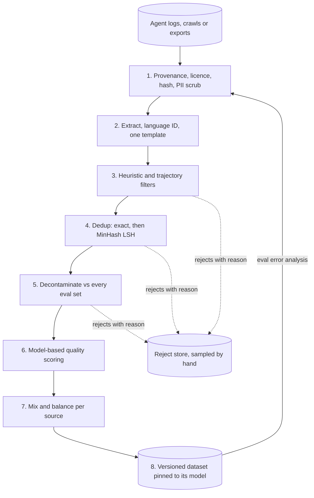

## TL;DR
For agent builders, curation means turning raw agent logs into training and eval sets: filter by outcome,
deduplicate, decontaminate, scrub PII and balance. Models learn whatever is in the batch, so a few
thousand curated trajectories beat a hundred thousand scraped ones.

## For agent builders
- **Why it matters for agents.** Agent logs are full of loops, failed tool calls, retries, macros and
  tool results with customer data. Fine-tune on them raw and the agent learns to loop and leak; build
  evals from them raw and your eval set overlaps your training set.
- **Where it shows up in your stack.** Trace stores and observability exports (the source), JSONL
  pipelines with `datasketch` or `datatrove` for dedup, the eval suite you decontaminate against, and
  the RAG index, where near-duplicate chunks waste retrieval slots.
- **What you control.** The outcome filter (task passed, user rated, resolved), trajectory hygiene rules
  (no unrecovered tool errors, no loops), dedup thresholds, PII scrubbing of tool results, the
  task-type and tool mix, and dataset versioning.
- **What you can skip.** Web-scale pretraining filters and annealing schedules unless you pretrain. Know
  MinHash and LSH, dedup before split, decontamination, and LIMA's lesson.

## Why it exists
- **A model is a compressed copy of its training distribution.** Gradient descent learns boilerplate,
  duplicates, leaked test sets and labelling noise with equal diligence, and no architecture or
  hyperparameter choice recovers what bad data teaches.
- **Raw data is full of junk.** A crawl or log export holds navigation menus repeated across ten thousand
  pages, the same licence header in every file, cookie banners, SEO spam, half-translated listings,
  benchmark test questions, customer emails with phone numbers, and transcripts where the agent's
  "resolution" was wrong.
- **Duplicates are the quietest problem.** A passage repeated a thousand times is a thousand gradient steps
  toward memorising it, not "more evidence". Deduplicating a web corpus gave better perplexity and an
  order-of-magnitude drop in verbatim regurgitation.
- **"Get more data" and "the model will figure it out" both fail.** More data means more of the same
  distribution, more compute on repeats, and no fix for contamination. Every published ablation shows the
  same architecture on a filtered subset beating the whole corpus on knowledge and reasoning, by margins
  that would otherwise cost a much larger model or far more tokens.
- **For fine-tuning it is sharper still.** LIMA fine-tuned a 65B model on about a thousand curated
  prompt–response pairs and was competitive with models trained on orders of magnitude more. Alignment
  mostly teaches format and style; a small diverse, uniformly excellent set teaches it cleanly, a huge noisy
  set teaches the average of its noise. Curation decides what the model becomes; architecture decides how
  well it can become it.

## How it works
A pipeline is a sequence of filters, each cheap enough to run on everything surviving the previous one,
with expensive judgement calls last. Every stage also loses good data, so measure drop rates per stage and
sample the rejects by hand.

| # | Stage | Main tool | Why here |
|---|---|---|---|
| 1 | Provenance and permission | metadata, content hash, PII scrub | needed for deletion and audit |
| 2 | Extraction and normalisation | HTML extraction, language ID, one template | everything later assumes clean text |
| 3 | Heuristic filters | Gopher/C4 rules | cheap, high precision |
| 4 | Deduplication | hash, MinHash + LSH, suffix arrays | stops memorisation |
| 5 | Decontamination | n-gram and embedding overlap | keeps evals valid |
| 6 | Model-based scoring | quality classifier | judges content, costly |
| 7 | Mixing and curriculum | per-source weights | sets what the model sees most |
| 8 | Fine-tuning specifics | verification, coverage sampling, reading | quality of each example |

### 1. Provenance and permission
- **Record first:** source, licence, collection date and a content hash for every document, because you
  will need to delete by source (a takedown, a customer leaving), reweight by source, and explain where a
  behaviour came from.
- **Scrub PII here:** pattern rules plus a named-entity model. A model trained on real emails will emit
  real emails.

### 2. Extraction and format normalisation
- Pull main text out of HTML, fix encodings, and identify language with a fast classifier, keeping the
  ones you intend to serve.
- **Fine-tuning data:** parse every example into one fixed structure (system, user, assistant turns) and
  one template, and drop anything that does not parse, because the model learns the template as rigidly as
  the content.

### 3. Heuristic quality filters
Cheap, high-precision rules that remove boilerplate (the Gopher and C4 style rules):
- document length bounds;
- mean word length in a sane range;
- a cap on the symbol-to-word ratio;
- a cap on the fraction of lines that are bullets or end in an ellipsis;
- common function words must appear;
- lines must end in terminal punctuation.

They work because machine-generated junk and navigation chrome fail them while prose passes. **Caveat:**
they are deliberately blunt; some rules (bad-word lists, punctuation requirements) over-remove dialects and
informal text, a bias you must know you are introducing.

### 4. Deduplication
1. **Exact duplicates:** a hash of normalised text.
2. **Near-duplicates with MinHash:** represent each document as its set of word 5-gram shingles, apply *k*
   hash functions (128 is typical), and keep each function's minimum. Each signature position matches with
   probability equal to the Jaccard similarity of the shingle sets.
3. **LSH banding:** all-pairs comparison is O(n²), impossible at billions of documents. Split the signature
   into *b* bands of *r* rows and compare only documents colliding in at least one band.
4. **Within-document repeats** (boilerplate pasted into otherwise unique pages) need a suffix-array pass.
5. **Fine-tuning sets:** deduplicate *prompts*, not just whole examples, and add an embedding pass to
   catch paraphrases.

The candidate probability for similarity *J* is an S-curve:

```
P(candidate) = 1 − (1 − Jʳ)ᵇ        threshold ≈ (1/b)^(1/r)
```

With *r* = 8, *b* = 16: about 0.95 at *J* = 0.8 and 0.06 at *J* = 0.5, threshold near
(1/*b*)^(1/*r*) ≈ 0.71.

### 5. Decontamination
- **Index every eval set you will ever report** and remove training documents sharing long n-grams with
  any of them. 13-gram overlap was the GPT-3 rule; 8–13 remains common.
- **Include internal golden sets**, not just public benchmarks: the goal is a valid measurement, not a
  clean public record.
- **Add an embedding pass.** N-gram overlap misses paraphrases and translations, so a similarity search
  against eval embeddings is a worthwhile second pass.

### 6. Model-based quality scoring
- **Why:** heuristics cannot judge content.
- **How:** train a small classifier on "good" versus "random" (early LLM corpora used reference text as the
  positive class), or have a strong LLM score a sample for educational value and distil that into a fast
  classifier run over everything, as FineWeb-Edu did. Keeping only high scores gave large gains on
  knowledge benchmarks.
- **Cost:** the labeller's taste is imported at scale. A classifier tuned for textbook prose quietly
  down-weights code, forums and dialects unless you score those domains separately.

### 7. Mixing and curriculum
- **Weights per source** (web, code, books, maths, your domain). Up-sample small high-quality sources, but
  repeating data beyond a few epochs returns little.
- **Tuning:** learned weighting with a proxy model exists, but most teams tune mixes empirically on a small
  run.
- **Annealing:** pretraining runs commonly anneal onto the highest-quality slice at the end.
- **Fine-tuning:** balance task types and response lengths to match production, because the model learns
  the length distribution as surely as the content.

### 8. Fine-tuning specifics
- **Verify** responses where you can (execute code, check answers).
- **Remove** hedging or refusals you do not want; **enforce** one style.
- **Check** inter-annotator agreement on a sample.
- **Select for coverage as well as quality:** embed prompts, cluster them, and sample across clusters,
  because a quality-only filter collapses onto the most common, easiest request types and leaves the long
  tail untaught.
- **Look at the data:** a few hundred examples read by a human expose systematic problems no metric
  reports.
- **Version** the dataset, pin it to the model it produced, and feed eval error analysis into the next
  version.

### Agent trajectories: the extra rules
Agent logs need checks that chat data does not:
- **Outcome first.** Keep trajectories whose task verifiably passed (tests green, ticket resolved, user
  confirmed); a polished-looking run that failed teaches failure.
- **Trajectory hygiene.** Drop runs with unrecovered tool errors, repeated identical tool calls (loops),
  or step counts far above the task's norm, because the model imitates the path, not just the ending.
- **Schema validity.** Every tool call must parse and match the current tool schemas; runs using removed
  tools or old argument names teach stale APIs.
- **Scrub tool results.** Tool outputs carry customer records and secrets, so PII and credential scrubbing
  must cover them, not only user turns.
- **Dedup by task, split by task.** Near-duplicate user requests make train and eval overlap; split by
  user, tenant or task cluster.
- **Balance by tool and task type**, so rare tools and hard tasks are not drowned out by the most common
  lookup.
- **RAG corpora too.** Near-duplicate documents in a retrieval index fill the top-k with copies; the same
  MinHash pass applies before indexing.

## Diagram
The same pipeline applies to web data and agent logs: cheap, high-precision filters run first and costly
judgement last, and for agent logs stage 3 adds the outcome, loop and schema rules. Every stage logs its
rejects with a reason, and agent eval error analysis feeds the next dataset version.



## Misconceptions
- **"More logged runs make a better fine-tune."** The model learns whatever is in the batch, loops and
  failed runs included; LIMA got competitive results from about a thousand curated pairs. In the
  illustrative coding-agent funnel only 18,000 of 50,000 logged runs survive the outcome, loop, schema
  and dedup filters, and 16,200 of those go to training after a by-repository eval hold-out.
- **"Exact-hash dedup is enough."** Support macros with a name swapped, templated bot prompts and
  paraphrases survive hashing; MinHash with LSH (and an embedding pass for paraphrases) removes far more.
- **"Clean the data, then split it however you like."** Split before dedup, or by run, and near-copies of
  the same task sit on both sides, inflating eval scores. Dedup first, then split by tenant, repository or
  task cluster.
- **"Decontaminating against public benchmarks protects my evals."** The leak that hurts is usually your
  own golden set sampled from the same export, and 13-gram matching misses paraphrases, so register
  internal evals and add an embedding check.
- **"Scrubbing PII from user turns is enough."** Tool results carry customer records and secrets, and a
  model trained on them recites them, so the PII and secrets pass must cover tool turns too.

## Examples
### Compact curation pass
Gopher-style heuristics, exact deduplication, MinHash/LSH near-deduplication via `datasketch`, and
13-gram decontamination against eval sets. Each stage returns early so you can count what it dropped.

```python
import re, hashlib
from datasketch import MinHash, MinHashLSH

def shingles(text, n=5):
    toks = re.findall(r"\w+", text.lower())
    return {" ".join(toks[i:i + n]) for i in range(max(1, len(toks) - n + 1))}

def passes_heuristics(text):
    w = re.findall(r"\w+", text)
    if not 50 <= len(w) <= 100_000: return False                   # length bounds
    if not 3 <= sum(map(len, w)) / len(w) <= 10: return False      # mean word length
    lines = [l for l in text.splitlines() if l.strip()]
    if sum(l.lstrip().startswith(("-", "*", "•")) for l in lines) > 0.9 * len(lines): return False
    if sum(l.rstrip().endswith("...") for l in lines) > 0.3 * len(lines): return False
    return True

def curate(docs, eval_texts, num_perm=128, threshold=0.7):
    eval_grams = set().union(*(shingles(t, 13) for t in eval_texts))   # decontamination index
    seen, lsh, kept, dropped = set(), MinHashLSH(threshold=threshold, num_perm=num_perm), [], {}
    for i, text in enumerate(docs):
        if not passes_heuristics(text): dropped["heuristic"] = dropped.get("heuristic", 0) + 1; continue
        h = hashlib.sha1(" ".join(text.lower().split()).encode()).hexdigest()
        if h in seen: dropped["exact"] = dropped.get("exact", 0) + 1; continue
        seen.add(h)
        if shingles(text, 13) & eval_grams: dropped["contaminated"] = dropped.get("contaminated", 0) + 1; continue
        m = MinHash(num_perm=num_perm)
        for g in shingles(text): m.update(g.encode())
        if lsh.query(m): dropped["near_dup"] = dropped.get("near_dup", 0) + 1; continue
        lsh.insert(str(i), m)
        kept.append(text)
    return kept, dropped

# kept, dropped = curate(raw_docs, eval_texts); print(len(kept), dropped)
# Then: read 100 random rejects per stage and 100 random keeps, run a quality classifier on the keeps,
# and only afterwards split train/validation, so near-duplicates cannot straddle the split.
```

### Choose LSH bands for your duplicate threshold
Pure Python. Same 128 hash functions, three band layouts: the S-curve's threshold moves with *r* and *b*.

```python
def p_candidate(J, r, b):
    """Probability two docs with Jaccard J share at least one LSH band of r rows (b bands)."""
    return 1 - (1 - J ** r) ** b

for r, b in [(8, 16), (16, 8), (4, 32)]:
    thresh = (1 / b) ** (1 / r)
    row = "  ".join(f"J={J:.1f}:{p_candidate(J, r, b):.2f}" for J in (0.5, 0.6, 0.7, 0.8, 0.9))
    print(f"r={r:2d} b={b:2d} (k={r * b}) threshold~{thresh:.2f}  {row}")
# r= 8 b=16 (k=128) threshold~0.71  J=0.5:0.06  J=0.6:0.24  J=0.7:0.61  J=0.8:0.95  J=0.9:1.00
# r=16 b= 8 (k=128) threshold~0.88  J=0.5:0.00  J=0.6:0.00  J=0.7:0.03  J=0.8:0.20  J=0.9:0.81
# r= 4 b=32 (k=128) threshold~0.42  J=0.5:0.87  J=0.6:0.99  J=0.7:1.00  J=0.8:1.00  J=0.9:1.00
```

- **r = 16, b = 8** keeps templated contracts and forms that differ in a few fields.
- **r = 4, b = 32** catches loose paraphrases but floods you with candidates to verify.

### Worked scenario: a support-log funnel
An illustrative stage report for 200,000 support conversations (the numbers show the shape to expect, not
a benchmark):

| Stage | Dropped | Remaining | What a reject sample showed |
|---|---|---|---|
| Parse into one template | 6,000 | 194,000 | truncated exports, mixed formats |
| Heuristics (empty, one-line, auto-replies) | 38,000 | 156,000 | macros and "ticket closed" bots |
| Exact dedup | 21,000 | 135,000 | copy-pasted macro replies |
| MinHash near-dedup | 47,000 | 88,000 | the same macro with a name swapped |
| Decontamination vs eval set | 400 | 87,600 | eval tickets pulled from the same logs |
| Outcome filter (rated or resolved) | 52,000 | 35,600 | unresolved or low-rated threads |

The lesson: macros dominate support logs, so near-dedup and outcome filtering remove far more than
expected, and the eval set leaked because it was sampled from the same export.

### Trajectory filter for agent logs
Pure Python over exported traces. Each rule returns early with a reason, so the reject store explains
every drop.

```python
import json

def reject_reason(trace, tool_schemas, max_steps=25):
    if not trace["task_passed"]:
        return "failed_task"
    calls = [t for t in trace["turns"] if t["role"] == "assistant" and t.get("tool_call")]
    if len(trace["turns"]) > max_steps:
        return "too_many_steps"
    seen = set()
    for c in calls:
        name, args = c["tool_call"]["name"], c["tool_call"]["arguments"]
        if name not in tool_schemas or not set(tool_schemas[name]) <= set(args):
            return "stale_or_invalid_call"
        key = name + json.dumps(args, sort_keys=True)
        if key in seen:
            return "repeated_call_loop"
        seen.add(key)
    if any(t["role"] == "tool" and t.get("error") for t in trace["turns"][-3:]):
        return "unrecovered_tool_error"
    return None

# kept = [t for t in traces if reject_reason(t, schemas) is None]; store the rest with their reason,
# then PII-scrub user and tool turns, dedup by user request, and split by tenant or task cluster.
```

### Worked scenario: a coding-agent trace funnel
Illustrative numbers for 50,000 logged coding-agent runs being turned into an SFT set and a held-out eval:

| Stage | Dropped | Remaining | What a reject sample showed |
|---|---|---|---|
| Task failed (tests red) | 19,000 | 31,000 | agent gave up or patched the wrong file |
| Repeated call loops, over 25 steps | 4,500 | 26,500 | the same `grep` re-run with identical arguments |
| Stale or invalid tool calls | 2,100 | 24,400 | a renamed tool from last quarter |
| Near-duplicate user requests | 6,400 | 18,000 | the same CI-failure prompt from one bot |
| Held out by repository for eval | 1,800 | 16,200 | split by repository, not by run |

About a third of the logs survive (16,200 of 50,000), and that third is what you want the agent to
imitate.

## Production patterns
- **Curate agent traces with a reject store.** Run the outcome, hygiene and schema rules on every export,
  store rejects with their reason, and sample them weekly. Monitor the share of runs dropped for loops or
  stale tools; a rise is often a production agent regression, not a data problem.
- **Per-stage drop dashboard plus reject sampling.** Emit counts per stage and source on every run and
  alert when a stage's drop rate shifts sharply between versions. Store each reject with its reason so
  thresholds can be tuned and audited.
- **Provenance manifest with deletion by source.** Keep a table of document hash, source, licence and
  collection date, so a takedown or a departing customer becomes a filter and a rebuild, not a forensic
  search. Monitor how many rows lack provenance.
- **Dedup before split, then split by group.** Deduplicate first, then split by conversation, customer or
  near-duplicate cluster (for example scikit-learn's `GroupShuffleSplit`) so near-copies cannot straddle
  train and validation.
- **Protected eval registry.** Every eval set, public or internal, is registered once and every training
  build is checked against it with n-gram and embedding overlap; the build fails on hits above a threshold.
  Track hits per eval set over time.
- **Datasets versioned like code, on existing tooling.** Record a content hash of the final JSONL, the
  pipeline commit and the stage counts in the model's registry entry, so every model points to the exact
  data that made it. For web-scale corpora use a pipeline library built for it, such as Hugging Face's
  `datatrove`, which was used for FineWeb, instead of hand-rolled loops.

## Trade-offs
- **Quality vs volume and diversity.** Aggressive filtering raises average quality but shrinks volume and
  narrows diversity (dialects, code, niche domains). When data-constrained, a cleaner smaller set repeated
  a few times beats a larger noisy one; beyond a few repeats, fresh data wins again.
- **Dedup threshold: templates vs memorisation.** A low threshold removes legitimate templated text such as
  contracts and forms you may want learned; a high one keeps near-copies that drive memorisation. Tune per
  source.
- **Model scoring vs heuristics.** Far better at judging content, but it imports the labeller's
  preferences at scale, costs a classifier pass over everything, and can over-select benchmark-like prose.
- **Decontamination vs useful data.** It protects eval validity but deletes useful documents quoted in
  benchmarks, and cannot catch paraphrased leaks without an embedding pass.
- **Strict outcome filtering vs coverage.** Keeping only passed agent runs gives clean behaviour but
  under-represents hard tasks the agent usually fails; supplement them with teacher-generated or
  human-corrected trajectories rather than training on failures.
- **Small curated SFT sets vs knowledge.** Cheap and effective for format, tone and task structure, but
  they cannot inject much new knowledge; for that, volume and pretraining-style data come back into play.

## Pitfalls
- **Deduplicating only exact matches.** Near-duplicate boilerplate survives. Symptom: the model
  regurgitates licence headers, cookie notices and canned openings, and validation scores are inflated.
- **Splitting train/validation before deduplicating.** Near-duplicates straddle the split. Symptom:
  excellent validation loss that production performance does not match.
- **Selecting by length or surface polish.** The model learns to be long and ornate. Symptom: responses
  grew after fine-tuning with no gain on task metrics.
- **Mixing templates.** Some examples with system prompts, some without, or two turn formats. Symptom:
  instruction adherence varies with the prompt's shape.
- **Decontaminating against public benchmarks only.** The internal golden set leaks in, so your own
  numbers are the ones you cannot trust.
- **Training on logs without PII scrubbing.** Symptom: the model emits real names, emails or account
  numbers, found by a customer or an auditor.
- **Discarding rejects without the reason.** You cannot audit a missing behaviour, tune a threshold, or
  explain to a reviewer what was excluded.
- **Fine-tuning on every logged agent run.** Failed runs, loops and retries look like normal trajectories.
  Symptom: the fine-tuned agent repeats tool calls and gives up the way old runs did. Fix: filter by
  verified outcome and trajectory hygiene first.
- **Scrubbing user turns but not tool results.** Tool outputs hold customer records and secrets. Symptom:
  the agent recites account details it saw in training traces. Fix: run the PII and secrets pass over
  tool turns too.

## When to use
Curation is not optional; what varies is the effort.
- **One-off fine-tune on a few thousand examples:** a human read of all of them, a dedup pass and template
  enforcement.
- **Production pipeline regenerating sets from logs:** the full staged pipeline with per-stage drop
  metrics, contamination checks against every eval set, PII scrubbing and dataset versioning.
- **Agent fine-tunes and agent evals:** the outcome, hygiene and schema rules on trajectories, split by
  tenant or task, before any trace becomes training data or an eval case.
- **Measure:** drop rate per stage, duplicate rate, contamination hits, inter-annotator agreement, and the
  downstream eval delta between dataset versions, the only number that matters in the end.
- **Day to day:** scripts over JSONL, a dashboard of stage counts and a habit of reading samples.
- **Interviews:** explain MinHash and LSH, why deduplication reduces memorisation, what LIMA showed, and
  how you would decontaminate.

## Role lens
- **Engineer:** Owns the filter, dedup and decontamination code, versions each dataset with its stage
  counts, and reads samples of what every stage rejected before trusting the pipeline.
- **Architect:** Sets the data policy: licensing and PII rules, which eval sets are protected by
  decontamination, retention and deletion paths, and the versioning contract between datasets and models.
- **FDE:** Turns a customer's messy export (tickets, documents, logs) into a clean, deduplicated,
  de-identified training set inside their environment and documents exactly what was removed and why.

## Check yourself
**Q:** You inherit 200,000 customer support conversations to fine-tune a drafting model. What do you do
before you train, and what do you measure to know the data is ready?
**A:** First provenance and PII: confirm the data may be used, then scrub names, emails, phone and account
numbers. Parse every conversation into one turn template and drop the unparseable. Filter by heuristics
(empty or one-line replies, macros, auto-responses) and by outcome where available, keeping conversations
with good customer ratings or verified resolutions. Deduplicate exactly, then near-deduplicate with
MinHash on both whole conversations and customer prompts, since macros produce thousands of near-copies.
Decontaminate against the evaluation set built with the support leads. Read a few hundred examples with
an SME and label a sample for quality to check agreement. Balance ticket categories and response lengths
to the production distribution, then version the set. I would measure per-stage drop counts, duplicate
rate, contamination hits, agreement on the quality sample, and finally the eval delta versus the base
model, which decides whether the data is ready.

## Interview questions
### Why does deduplication make a model better, not just a dataset smaller?
- **Repeats are not evidence:** a passage seen a thousand times is a thousand gradient steps toward
  memorising it, and compute spent on repeats is compute not spent on new content.
- **Measured effect:** deduplicating a web corpus gave better perplexity and an order-of-magnitude drop
  in verbatim regurgitation.
- **It also protects measurement:** near-duplicates straddling train and validation inflate validation
  scores.

### Validation loss looks excellent but production quality is poor. Where do you look in the data?
- **Split order:** if you split before deduplicating, near-copies sit on both sides; deduplicate first,
  then split by conversation, customer or cluster.
- **Contamination:** check internal golden sets as well as public benchmarks, with n-gram and embedding
  overlap, because evals sampled from the same export leak.
- **Distribution mismatch:** compare template, task-type and response-length mix with production, since
  the model learns all three.

### How aggressively should you filter with a model-based quality classifier? When would you hold back?
- **The gain:** it judges content, which heuristics cannot; keeping only high educational-value scores
  gave FineWeb-Edu large knowledge-benchmark gains.
- **The cost:** it imports the labeller's taste at scale, quietly down-weighting code, forums and dialects
  and narrowing diversity.
- **Hold back** when those domains matter to your product: score them separately or set per-source
  thresholds, and compare downstream evals across filter levels.

### You have 50,000 logged agent runs and want to fine-tune on them. Which runs do you keep?
- **Verified outcome:** only runs whose task passed (tests green, ticket resolved), because a failed run
  that looks fluent teaches failure.
- **Trajectory hygiene:** drop loops (repeated identical calls), unrecovered tool errors, abnormal step
  counts and calls to tools or arguments that no longer exist.
- **Then the usual pipeline:** PII and secrets scrubbing including tool results, dedup by user request
  with MinHash at a threshold near 0.7 (r = 8, b = 16 on 128 permutations), balance by tool and task type.

### Your agent eval scores jumped after a fine-tune, but users see no change. What do you suspect in the data?
- **Contamination:** eval tasks sampled from the same logs as training traces, with near-duplicate
  requests on both sides.
- **Split unit:** splitting by run instead of by tenant, repository or task cluster lets the same task
  appear in train and eval.
- **Fix:** register the agent eval suite, check every training build with n-gram and embedding overlap,
  and re-split by group after dedup.

### A customer leaves and asks that their data be removed from future models. What does your pipeline need?
- **Provenance from stage one:** source, licence, collection date and content hash per document, so the
  request becomes a filter and a rebuild, not a forensic search.
- **Versioned datasets pinned to models:** you can say which models contained the data and rebuild the
  dataset without it.
- **Monitor coverage:** track rows lacking provenance, because those are the ones you cannot delete.

## Quiz
### Q: What problem do MinHash and locality-sensitive hashing solve together?
- [ ] Removing PII from documents at scale
- [x] Finding near-duplicate documents without comparing every pair
- [ ] Scoring documents for educational quality
- [ ] Measuring n-gram overlap with evaluation sets
> MinHash signatures estimate Jaccard similarity, and LSH banding only compares documents that collide in
> a band, turning an O(n²) pairwise search into a near-linear candidate-generation step.

### Q: Why can 13-gram overlap decontamination still miss contamination?
- [ ] Because 13 is too short to match any real sentence
- [x] Because paraphrased or translated copies of a test item share no long exact n-gram with it
- [ ] Because evaluation sets are never public
- [ ] Because n-gram checks only run on the validation split
> Exact n-gram matching catches verbatim leaks. A benchmark question rewritten in different words, or
> translated, carries the same answer with no shared 13-gram, so an embedding-similarity pass is needed.

### Q: What did LIMA demonstrate about fine-tuning data?
- [ ] That more instruction data always improves alignment
- [ ] That synthetic data outperforms human-written data
- [x] That around a thousand diverse, uniformly high-quality examples can teach format and style competitively
- [ ] That pretraining data should be deduplicated before fine-tuning
> LIMA's claim is that alignment mostly teaches format and style, so a small set with diverse prompts and
> excellent responses suffices; large noisy sets teach the average of their noise.

## Use cases & projects
### Use cases
- **Fine-tuning data from agent logs.** Teams filter production traces by outcome and hygiene to build an
  SFT set of successful trajectories instead of training on raw logs.
- **Building a clean agent eval set.** Real tasks are deduplicated, scrubbed of PII and decontaminated
  against training data before they become the regression suite.
- **RAG index hygiene.** Near-duplicate chunks are removed so retrieval slots go to distinct evidence.
- **Customer deletion requests.** A provenance manifest turns "remove this customer's data" into a
  filter and a rebuild of both the training set and the eval set.

### Mini project
**Curate agent traces into a training set (2-3 hours).**
- **Goal:** turn a raw export of agent runs into a versioned, deduplicated, PII-scrubbed JSONL set.
- **Steps:** generate or export a few hundred agent traces with outcome labels; drop failed, looping and
  unrecovered-error runs into a reject store with reasons; scrub emails and phone numbers from tool
  results; deduplicate user requests with MinHash; split by task cluster or tenant, not by run; record
  stage counts and a content hash.
- **Done when:** you have train and eval JSONL files, a per-stage drop table, a sample of rejects with
  reasons, and a check showing no near-duplicate crosses the split.
