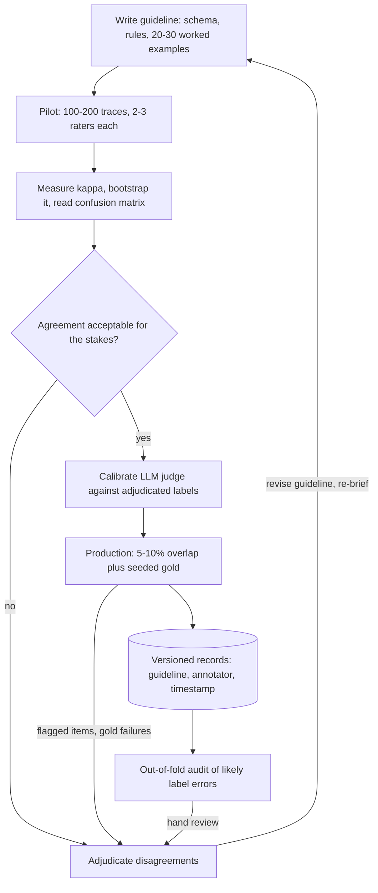

## TL;DR
Labeling turns tickets and agent traces into measurable targets: classes, demonstrations, preferences,
per-step grades (right tool, right arguments, run succeeded). They become your eval set, LLM-judge
calibration and fine-tuning data, so human agreement caps everything you measure.

## For agent builders
- **Why it matters for agents.** Agent quality is judged per step and per run, and nobody can grade that
  automatically until humans have defined it. A golden set of labeled trajectories is what tells you
  whether a prompt change, a new model or a fine-tune made the agent better.
- **Where it shows up in your stack.** Annotation queues and datasets in tracing tools (LangSmith and
  Langfuse both offer them), feedback buttons in your product, LLM-as-judge evaluators, and the JSONL
  files you send to a fine-tuning job.
- **What you control.** The rubric per step (tool choice, arguments, use of the result, final answer),
  who labels, how much overlap you keep, and whether an LLM judge is trusted only after it agrees with
  adjudicated human labels.
- **What you can skip.** Krippendorff's alpha internals and confident-learning theory. Know Cohen's kappa,
  the overlap-plus-gold loop, and that an LLM judge is just one more rater to measure.

## Why it exists
- **Everything downstream needs targets.** Supervised fine-tuning, reward models, the small classifiers
  that route requests or enforce guardrails, and the LLM judges that score agent runs all learn or
  apply the mapping in the labeled set, noise included. The model does not learn "the task".
- **Noise has a direction.** If 15% of labels are wrong in a consistent direction, the model learns that
  direction. If they are wrong at random, achievable accuracy drops and more data is needed to reach any
  given level.
- **Small sets do not average errors away.** Pretraining averages any single document away across
  billions of tokens. A fine-tuning set of 2,000 examples has no such averaging, so one annotator's habit
  of filing every ambiguous ticket under "billing" becomes model behaviour, and one reviewer's habit of
  passing any agent run that ends politely becomes your eval's definition of success.
- **A one-line instruction to whoever is free fails three ways.** Real tasks are underspecified ("was
  this agent run helpful?" means different things to different people), so labels encode the annotator.
  One labeler per item cannot measure noise, so an 80% plateau is unattributable. And rare, borderline
  items are exactly where untrained labelers disagree most.
- **Labeling as a discipline fixes this.** The target becomes defined (guidelines with worked edge
  cases), measurable (agreement on overlapping items) and improvable (adjudicated disagreements feed
  back into the guidelines).

## How it works
### What a label is in agent work
| Label type | What it is | Cost and use |
|---|---|---|
| **Categorical** | intent, topic, toxicity, routing class, "right tool: yes or no" per step | cheapest per item; feeds routers, guardrails and step-level evals |
| **Span or structured** | entities, citations, JSON fields, corrected tool arguments | needs a schema and tooling that enforces it |
| **Demonstrations** | a complete target response or corrected trajectory, written or edited by an expert | SFT data; most expensive, because the annotator produces rather than judges |
| **Preferences** | a prompt plus two candidates (two answers, or two trajectories): which is better, optionally why | feeds reward models, RLHF and DPO |
| **Rubric scores** | 1–5 on named criteria, such as groundedness of a RAG answer | convenient; hardest to keep consistent unless every level has anchor examples |

- **Why preferences dominate RLHF data.** Comparing is easier and more consistent than writing, and a
  comparison stays informative even when both candidates are flawed. That is why InstructGPT-style
  pipelines collect far more comparisons than demonstrations.
- **Label agent traces per step and per run.** A run can reach the right answer through a wasted or
  unsafe step, so a single pass/fail label hides the failures you most need to fix.

### The loop
1. **Define the task on paper.** Label schema, decision rules, and 20–30 worked examples that include
   the boundary cases and an explicit "if unsure, do X" rule. Ambiguity left here gets resolved
   differently by every annotator later.
2. **Pilot.** 100–200 items (tickets, or agent traces), each labeled independently by two or three
   people.
3. **Measure agreement.** Use chance-corrected agreement (formula and bands below), bootstrap it, and
   read the confusion matrix.
4. **Adjudicate and rewrite.** Every disagreement is a guideline gap or an annotator error. Fix the
   guideline, re-brief, re-pilot until agreement is acceptable.
5. **Produce with QA.** Single-label most items, but keep 5–10% overlap to track agreement, seed gold
   items with known answers to catch drift and inattention, and route anything flagged to adjudication.
6. **Version and freeze.** Store guideline version, annotator id and timestamp on every record. A
   guideline change mid-project silently splits the dataset into two tasks.

### Measuring agreement
For two raters on categorical labels use Cohen's kappa:

```
κ = (p_o − p_e) / (1 − p_e)
p_o = observed fraction of items the raters agree on
p_e = agreement expected by chance from each rater's label frequencies
```

- **Why correct for chance.** Two raters who both say "not spam" 95% of the time agree about 90% of the
  time by luck alone. The same happens when most agent steps are fine and both raters mostly say "ok".
- **More raters or other scales.** Fleiss' kappa extends this to many raters; Krippendorff's alpha also
  handles missing labels and ordinal scales.
- **Landis–Koch bands (the common reading):**

| κ | Reading |
|---|---|
| below 0 | poor |
| 0–0.20 | slight |
| 0.21–0.40 | fair |
| 0.41–0.60 | moderate |
| 0.61–0.80 | substantial |
| above 0.80 | almost perfect |

- **The bands are a convention, not a test.** Set the acceptable bar by the stakes of the task.
- **Pilot kappa is noisy.** Kappa from a 150-item pilot is itself noisy; bootstrap the items for an
  interval before declaring victory.
- **One number hides where disagreement lives.** Also read the rater-by-rater confusion matrix to see
  which pairs of classes the guideline fails to separate.

### Who labels, and how much a model should help
- **Domain experts** are the only option for specialised demonstrations and for judging whether an agent
  took a correct action in their system.
- **Crowd or vendor workforces** scale categorical tasks once guidelines are solid.
- **Model-assisted labeling** (an LLM proposes a label or drafts a response, a human verifies) cuts cost
  sharply but introduces anchoring. People accept plausible suggestions, so confident model errors pass
  through, and a model later trained on that data is partly trained on its own output.
- **Keep overlap and gold subsets blind** to the suggestion, so you can measure the acceptance bias.
- **Active learning** chooses which items to label next: those where the current model is uncertain or
  annotators disagreed, because labels on items the model already handles add little. For agents, that
  means traces with low judge confidence, user thumbs-down or retries.

### LLM judges are raters too
- **Treat an LLM labeler as one more rater.** Compute its agreement with adjudicated human labels on the
  pilot, and only then decide where to trust it.
- **Check it per label value, not overall.** A judge that marks nearly every step "ok" can show high raw
  agreement while catching few of the failures, which is exactly the skew problem kappa exists for.
- **Recalibrate when the agent changes.** A new tool or prompt produces new failure modes the judge was
  never checked on, so re-run its agreement on a fresh labeled slice.

### Finding label errors after the fact
Agreement measures noise on the overlap; it does not tell you *which* single-labeled items are wrong.
1. **Train with k-fold cross-validation** so every item gets a prediction from a model that never saw it.
2. **Rank items** where the out-of-fold model confidently disagrees with the given label. Confident
   learning formalises this by estimating, per class, the threshold above which a disagreement is likely
   a label error.
3. **Review the top of the list by hand** rather than auto-relabeling, because the model's confident
   disagreements also include genuinely hard cases it gets wrong. A confident-learning library such as
   cleanlab automates the ranking; track the fraction of reviewed items that are actually relabeled.

### Why agreement rather than accuracy
- **There is no external truth.** The labels are the truth you are constructing.
- **Agreement is the observable proxy** for whether the task is defined well enough to be learnable.
- **It sets a ceiling.** A model, or an agent, cannot be meaningfully evaluated above the level at which
  humans agree with each other.

## Diagram
Follow the loop: guidelines are not finished until a pilot's agreement is acceptable, and production
labeling (including LLM-judge labels) keeps feeding overlap, gold and audit results back into the guideline.



## Misconceptions
- **"High raw agreement means the labels are reliable."** On skewed tasks raters agree by chance on the
  common class; 96% raw agreement on a rare fraud class can be kappa 0.31. Report chance-corrected
  agreement and read where the disagreements sit.
- **"An LLM judge that matches humans 85% of the time can gate releases."** Most agent steps are fine, so
  a lenient judge scores high while catching half the failures. Measure its kappa and its recall on
  human-flagged failures against adjudicated labels.
- **"Low kappa means careless annotators."** It usually means the guideline does not separate two classes.
  The confusion matrix shows which pair; worked boundary cases fix it, not stricter supervision.
- **"Label noise averages out with more data."** Only random noise does, and only slowly; consistent noise
  becomes model behaviour, and a 2,000-example fine-tuning set has no averaging to hide it.
- **"Model pre-fill gives the same labels, faster."** Annotators anchor on plausible suggestions, so
  agreement measures agreement with the model. Keep a blind subset, and keep the eval set human-only.
- **"A run that ends with the right answer needs one pass/fail label."** A correct final answer can hide a
  refund issued before the eligibility check. Label each step as well as the run.

## Examples
### Calibrating an LLM judge on agent steps
A support agent's traces are exported from an annotation queue. A human and an LLM judge each label
every step "right" or "wrong" for tool choice. Before the judge grades thousands of runs, measure it as a
rater: kappa, how many human-flagged failures it catches, and which steps go to adjudication.

```python
from collections import Counter

def cohen_kappa(a, b):
    n = len(a)
    p_o = sum(x == y for x, y in zip(a, b)) / n
    ca, cb = Counter(a), Counter(b)
    p_e = sum((ca[k] / n) * (cb[k] / n) for k in set(ca) | set(cb))
    return (p_o - p_e) / (1 - p_e)

steps = [  # (trace_id, step, tool called, human label, judge label) for "right tool?"
    ("tr1", 1, "search_orders", "right", "right"),
    ("tr1", 2, "issue_refund", "wrong", "right"),   # refunded before checking eligibility
    ("tr2", 1, "search_kb", "right", "right"),
    ("tr2", 2, "search_kb", "wrong", "wrong"),      # repeated the same search
    ("tr3", 1, "get_invoice", "right", "right"),
    ("tr3", 2, "send_email", "right", "wrong"),
    ("tr4", 1, "search_orders", "right", "right"),
    ("tr4", 2, "escalate", "wrong", "right"),
]
human = [s[3] for s in steps]; judge = [s[4] for s in steps]
print(f"kappa(human, judge) = {cohen_kappa(human, judge):.2f}")   # 0.14: slight
bad = [s for s in steps if s[3] == "wrong"]
caught = sum(s[4] == "wrong" for s in bad)
print(f"judge caught {caught} of {len(bad)} human-flagged wrong steps")   # 1 of 3
for t, i, tool, h, j in steps:
    if h != j:
        print(f"ADJUDICATE {t} step {i} ({tool}): human={h} judge={j}")
```

- **Reading it.** The judge agrees on 5 of 8 steps but kappa is only 0.14, and it misses two of three
  bad steps. It is too lenient to gate releases; fix its rubric and re-measure on a larger pilot.
- **Keep provenance.** When adjudicated steps become eval or SFT records, store guideline version,
  annotators and an `adjudicated` flag in each record's metadata.

### Worked scenario: a judge at 85% raw agreement
200 agent steps, each labeled by a human and by an LLM judge for "right tool".

| Quantity | Value |
|---|---|
| Both "right" / both "wrong" | 150 / 20 |
| Human "right", judge "wrong" | 10 |
| Human "wrong", judge "right" | 20 |
| Raw agreement p_o | 170 / 200 = 0.85 |
| Chance agreement p_e | 0.80 × 0.85 + 0.20 × 0.15 = 0.71 |
| κ | (0.85 − 0.71) / (1 − 0.71) ≈ 0.48, "moderate" |
| Judge recall on human-flagged failures | 20 / 40 = 50% |

- **Reading it.** 85% sounds fine, but the judge passes half the steps humans call wrong. Used as a
  release gate it would report an agent better than it is.
- **Fix.** Add the missed failure types as worked examples in the judge prompt, then re-measure on a
  fresh slice the judge's author never saw.

### Worked scenario: 96% agreement, kappa 0.31
Two raters label 1,000 tickets for a rare "fraud" class; each marks 30 items as fraud, but they agree on
only 10 of them.

| Quantity | Value |
|---|---|
| Both "not fraud" / both "fraud" | 950 / 10 |
| Disagreements | 40 (20 each way) |
| Raw agreement p_o | 960 / 1,000 = 0.96 |
| Chance agreement p_e | 0.03 × 0.03 + 0.97 × 0.97 = 0.9418 |
| κ | (0.96 − 0.9418) / (1 − 0.9418) ≈ 0.31, "fair" |

- **Reading it.** Every disagreement sits on the rare class. The guideline does not define "fraud"
  well enough; the workforce is not careless. Rare agent failures (an unsafe action, a wrong refund)
  behave the same way.
- **Fix.** Add worked fraud and not-fraud boundary cases to the guideline, then re-pilot with the rare
  class oversampled.

### Ranking likely label errors with out-of-fold predictions
A sketch with scikit-learn: every item is scored by a model that never trained on it, then the items
whose given label gets the lowest predicted probability go to a human review queue. It works the same for
ticket labels and for a router that picks which agent or tool handles a request.

```python
import numpy as np
from sklearn.linear_model import LogisticRegression
from sklearn.model_selection import cross_val_predict

# X: features (e.g. text embeddings), y: annotator labels encoded as integers 0..K-1
# (so column k of probs is class k; give every class at least as many items as folds)
probs = cross_val_predict(LogisticRegression(max_iter=1000), X, y, cv=5, method="predict_proba")
given_label_prob = probs[np.arange(len(y)), y]      # model's belief in the label it was given
suspects = np.argsort(given_label_prob)[:200]       # lowest-confidence labels first
# Send `suspects` to adjudication; do not overwrite labels automatically.
```

## Production patterns
- **Trace annotation queues.** Route sampled production traces, thumbs-down runs and judge low-confidence
  runs into an annotation queue in your tracing tool, labeled per step against a written rubric. Fill it
  by quotas per task type and failure class, not uniformly, so rare failures get enough items. Monitor
  queue age, per-class counts and the share of labeled traces that become golden-set items.
- **Overlap plus seeded gold.** During production labeling, give 5–10% of items to two annotators and
  mix in gold items with known answers. Monitor kappa on the overlap per week and the gold pass rate per
  annotator; a falling pass rate flags drift or inattention before the batch is accepted.
- **Judge calibration before judge gating.** Before an LLM judge scores agent runs in CI, measure its
  kappa and failure recall against adjudicated human labels, and re-measure on every rubric, tool or
  prompt change. Monitor judge-human agreement on a small weekly human-labeled sample.
- **Provenance on every record.** Store guideline version, annotator id, timestamp and an `adjudicated`
  flag in each record's metadata. When a batch turns out bad, filter it out by annotator or guideline
  version instead of discarding the dataset.
- **Blind subset for model-assisted labeling.** When an LLM pre-fills labels, route a slice of items to
  annotators without the suggestion. Compare agreement and label distribution between the blind and
  assisted slices; a large gap is acceptance bias, not quality.
- **Redact before export.** Agent traces carry tool results full of customer data. Strip PII and sign a
  data-processing agreement before anything reaches a vendor; monitor redaction coverage with a sampled
  audit of exported items.

## Trade-offs
- **Expert quality vs cost and throughput.** Domain experts give the highest label quality and are
  mandatory for specialised demonstrations and for judging agent actions in their systems, but cost and
  throughput push most categorical work to trained crowds once agreement is stable.
- **Overlap vs budget.** Overlapping annotators multiplies cost, but it is the only way to measure label
  noise. Reduce overlap to 5–10% only after the pilot shows agreement has stabilised.
- **Model assistance vs anchoring.** It cuts cost and time sharply but anchors humans to the model's
  errors; the saving is real only if a blind subset shows acceptance is not inflating agreement.
- **LLM judge vs human labels.** A judge scores every run cheaply and instantly, but only within the
  failure types it was calibrated on; the balance flips back to humans for new tools, new risks and
  any release decision with real stakes.
- **Detailed guidelines vs drift.** They raise consistency but freeze a definition. When production
  inputs drift, agreement on new items falls and the guideline must be reopened rather than defended.
- **Preferences vs demonstrations.** Preference labels are cheaper per item and tolerate imperfect
  candidates, but each carries less information, so you need many more and a reward model or DPO to
  use them.

## Pitfalls
- **One annotator per item, no overlap.** Symptom: a validation plateau nobody can attribute to the model
  or the labels. Fix: overlap in the pilot and 5–10% in production.
- **Trusting an uncalibrated LLM judge.** Symptom: agent eval scores climb release after release while
  user complaints do not fall. Fix: measure the judge's kappa and failure recall against human labels.
- **Same model-assisted pipeline for the eval set.** Symptom: inflated scores that collapse on a
  human-only audit. Fix: label the evaluation set human-only, blind to suggestions.
- **Changing guidelines mid-project without relabeling.** Symptom: agreement with gold items drifts over
  time and the model learns a blend of two definitions. Fix: relabel earlier items or split by version.
- **Uniform sampling from production.** Rare classes and rare agent failures get a handful of examples.
  Symptom: high overall accuracy with near-zero recall on the class you built the model for. Fix:
  stratify.
- **Reading low kappa on a skewed task as careless raters.** With a 97% majority class, kappa can be low
  even at very high raw agreement. Symptom: the confusion matrix shows all disagreement on the rare
  class, a guideline problem for that class, not a workforce problem. Fix: add boundary cases for that
  class and re-pilot with it oversampled.
- **Rubric scores without anchor examples per level.** Symptom: one annotator's "4" is another's "2",
  hidden because most items cluster in the middle. Fix: anchor every score level.
- **Raw customer text or traces to a vendor without PII redaction and a data-processing agreement.**
  Symptom: a compliance incident rather than a model problem. Fix: redact and contract first.

## When to use
- **Use when:** you need an agent eval set, a calibrated LLM judge, or behaviour the base model cannot
  be prompted into reliably: a routing classifier, a reward model for your domain, SFT demonstrations of
  correct tool use, or a golden evaluation set.
- **Check first:** whether a few hundred high-quality examples plus a strong prompt gets you there. In
  LLM fine-tuning, quality and coverage beat volume; a smaller set of clean, diverse demonstrations
  routinely outperforms a much larger noisy one.
- **Measure:** kappa on the pilot, the gold-item pass rate during production, judge-human agreement, and
  the model's accuracy on a human-only held-out set.
- **Interviews:** explain why chance-corrected agreement matters, how adjudication improves guidelines,
  and what model-assisted labeling and LLM judges do to the data they produce.

## Role lens
- **Engineer:** Builds the labeling export and import, computes agreement in the pipeline, stores
  guideline version and annotator ids on each record, and keeps the gold subset blind to model
  suggestions.
- **Architect:** Decides what gets labeled and by whom, where labeled data lives and how it is versioned,
  and which tasks justify expert annotators versus crowd or model-assisted labeling.
- **FDE:** Runs the pilot with the customer's own domain experts, turns their disagreements into
  guidelines, and sets the expectation that labeling quality, not model choice, is usually the
  bottleneck.

## Check yourself
**Q:** A vendor offers to label 20,000 historical support tickets into eight routing classes in a week,
one annotator per ticket. How would you structure the engagement so that the result is trustworthy?
**A:** Start with a written guideline and a pilot of about 200 tickets labeled by three annotators
independently, compute Fleiss' kappa or Krippendorff's alpha, and adjudicate every disagreement into
guideline revisions before releasing the full batch. Insist on 5–10% ongoing overlap and a seeded gold
set so drift and inattention are measurable during the week. Stratify the sample so the rare classes get
enough items, redact PII before export, and label a separate human-only evaluation set that never sees
any model suggestion. Finally, record guideline version and annotator id on every record so later
analysis can isolate a bad batch instead of discarding the whole dataset.

## Interview questions
### Cohen's kappa, Fleiss' kappa or Krippendorff's alpha: which do you use, and when?
- **Cohen's kappa:** exactly two raters on nominal labels, every item labeled by both. It is
  κ = (p_o − p_e) / (1 − p_e), observed agreement corrected for chance agreement given each rater's own
  label frequencies, which matters because skewed labels inflate raw agreement.
- **Fleiss' kappa:** three or more raters on nominal labels, the usual choice for a multi-rater pilot.
- **Krippendorff's alpha:** when some items are missing labels, or the scale is ordinal (rubric 1–5),
  because it can count a 4-vs-5 disagreement as smaller than a 1-vs-5 one.
- **Whichever you pick:** bootstrap an interval on a small pilot and read the confusion matrix, because
  one number hides which classes the guideline fails to separate.

### You want an LLM judge to grade every agent run in CI. How do you decide whether to trust it?
- **Treat it as a rater:** have humans label a pilot of a few hundred steps or runs, adjudicate, and
  compute the judge's kappa against the adjudicated labels, not raw agreement.
- **Check failure recall separately:** most steps are fine, so a lenient judge can reach 85% raw
  agreement while catching only half the failures.
- **Keep checking:** re-measure on a weekly human sample and after every new tool or rubric change,
  because new failure modes are exactly the ones it was never calibrated on.

### How would you design the labeling rubric for a tool-calling agent's traces?
- **Label per step and per run:** right tool, correct arguments, correct use of the result, and whether
  the run reached the goal safely, because a correct final answer can hide a wasted or unsafe step.
- **Write worked boundary cases:** a repeated search, an action taken before a required check, a correct
  escalation. Ambiguity left out of the guideline is resolved differently by every rater.
- **Pilot with overlap,** compute kappa per dimension, and only then scale labeling or hand it to a judge.

### Your classifier plateaus at 80% validation accuracy. How do you tell whether the labels or the model are the limit?
- **Measure label noise first:** have two or three people independently relabel a few hundred validation
  items and compute agreement. If humans agree only about as often as the model is right, the ceiling is
  the task definition, not the model.
- **Locate the disagreement:** read the confusion matrix to find which class pairs the guideline fails to
  separate, then add worked boundary cases for them.
- **Audit single-labeled items:** rank out-of-fold predictions that confidently contradict the given label
  and hand-review the top of the list before relabeling anything.

### When would you not use an LLM to pre-fill labels?
- **For the evaluation set:** keep it human-only and blind to suggestions, because anchoring inflates
  agreement with the model and the eval score with it.
- **When you cannot measure acceptance bias:** without a blind subset you cannot tell agreement with each
  other from agreement with the suggestion, so confident model errors pass through unnoticed.
- **When the next model trains on it:** that model is partly trained on its predecessor's output, so its
  errors compound rather than average out.

### How do you keep label quality from drifting over a multi-week production labeling run?
- **Ongoing overlap:** 5–10% of items double-labeled, with kappa tracked per week.
- **Seeded gold items:** known answers mixed into the queue, with a pass rate tracked per annotator; a
  falling rate flags drift or inattention before a batch is accepted.
- **Versioned guidelines:** store guideline version and annotator id on every record, and relabel or split
  by version when the guideline changes, so the model does not learn a blend of two definitions.
- **Recheck any LLM judge in the loop:** compare it with the weekly human overlap, because a judge that
  drifts or meets a new tool silently changes what "pass" means.

## Quiz
### Q: Why report Cohen's kappa instead of the raw percentage of items two annotators agree on?
- [ ] Kappa is easier to compute for more than two annotators
- [x] Raw agreement is inflated when labels are skewed, because raters agree by chance on the common class; kappa subtracts that chance agreement
- [ ] Kappa measures accuracy against the ground truth, which raw agreement cannot
- [ ] Raw agreement cannot be computed for categorical labels
> With a 95% "not spam" base rate, two raters who ignore the text would still agree about 90% of the
> time. Kappa removes the expected-by-chance share, so it reflects agreement on the decisions that
> actually required judgement. Neither metric measures accuracy, since there is no external truth.

### Q: What is the main risk of having an LLM pre-fill labels for human review?
- [ ] It makes the labels incompatible with the fine-tuning format
- [ ] Human annotators become slower because they must read two things
- [x] Annotators tend to accept plausible suggestions, so the model's confident errors pass through and the next model is partly trained on its own output
- [ ] The model's labels are always worse than human labels, so pre-filling never helps
> Pre-filling genuinely cuts cost, which is why it is common. The problem is anchoring: agreement looks
> high because humans agree with the suggestion, not with each other. Keeping a blind subset lets you
> measure how much acceptance bias the suggestions introduce.

### Q: Why do RLHF-style pipelines collect many more preference comparisons than written demonstrations?
- [ ] Preference labels are the only kind a transformer can learn from
- [ ] Demonstrations cannot be stored in the chat format used for training
- [x] Comparing two responses is faster and more consistent across annotators than writing a good response, and it still gives signal when both candidates are imperfect
- [ ] Preference comparisons carry more information per item than a demonstration
> Each comparison carries less information than a full demonstration, which is why many are needed.
> They win on cost and consistency: judging is easier than producing, and a reward model can aggregate
> thousands of noisy comparisons into a usable signal.

## Use cases & projects
### Use cases
- **Building a golden eval set for a new agent.** Domain experts grade 100-300 real traces per step (tool
  choice, arguments, use of the result, final answer) so prompt and model changes have a trusted score.
- **Calibrating an LLM judge.** Adjudicated human labels on an overlap set tell you whether the judge
  agrees well enough with people to replace them on the bulk of traffic.
- **Turning production feedback into training data.** Thumbs-down runs go into an annotation queue, get
  corrected trajectories or preference pairs, and feed the next fine-tune or few-shot pool.
- **Labeling guardrail and router classifiers.** Small models that route requests or block unsafe tool
  calls need clean, agreed labels because their mistakes show up directly as wrong actions.

### Mini project
**Label agent traces and measure agreement (2-3 hours).**
- **Goal:** produce a small labeled trace set and know how much to trust it and an LLM judge.
- **Steps:** collect 50 traces from a toy tool-calling agent; write a one-page rubric with per-step labels;
  have two people label all 50 independently (alone, relabel a day later without looking); compute Cohen's kappa per label; adjudicate
  disagreements and refine the rubric; then run an LLM judge with the same rubric and compute its kappa
  against the adjudicated labels.
- **Done when:** you have a JSONL of adjudicated labels, a table of kappa per label for human-human and
  judge-human, and a short note on which labels the judge may own and which still need people.
