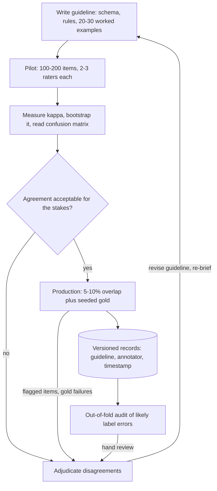

## TL;DR
Data labeling turns raw inputs into measurable targets (classes, spans, demonstrations, preferences). A
fine-tuned model learns the labeling function, inconsistencies included, and at fine-tuning scale a few
thousand examples carry the whole signal, so quality is measured by agreement.

## Why it exists
- **Everything downstream needs targets.** Supervised fine-tuning, reward models, and the small
  classifiers that route requests or enforce guardrails all learn to reproduce the mapping in the labeled
  set, noise included. The model does not learn "the task".
- **Noise has a direction.** If 15% of labels are wrong in a consistent direction, the model learns that
  direction. If they are wrong at random, achievable accuracy drops and more data is needed to reach any
  given level.
- **Small sets do not average errors away.** Pretraining averages any single document away across
  billions of tokens. A fine-tuning set of 2,000 examples has no such averaging, so one annotator's habit
  of filing every ambiguous ticket under "billing" becomes model behaviour.
- **A one-line instruction to whoever is free fails three ways.** Real tasks are underspecified ("is
  this answer helpful?" means different things to different people), so labels encode the annotator. One
  labeler per item cannot measure noise, so an 80% validation plateau is unattributable. And rare,
  borderline items are exactly where untrained labelers disagree most.
- **Labeling as a discipline fixes this.** The target becomes defined (guidelines with worked edge
  cases), measurable (agreement on overlapping items) and improvable (adjudicated disagreements feed
  back into the guidelines).

## How it works
### What a label is in LLM work
| Label type | What it is | Cost and use |
|---|---|---|
| **Categorical** | intent, topic, toxicity, routing class | cheapest per item; feeds classifiers and guardrails |
| **Span or structured** | entities, citations, JSON fields | needs a schema and tooling that enforces it |
| **Demonstrations** | a complete target response, written or edited by an expert | SFT data; most expensive, because the annotator produces rather than judges |
| **Preferences** | a prompt plus two candidates: which is better, optionally why | feeds reward models, RLHF and DPO |
| **Rubric scores** | 1–5 on named criteria | convenient; hardest to keep consistent unless every level has anchor examples |

- **Why preferences dominate RLHF data.** Comparing is easier and more consistent than writing, and a
  comparison stays informative even when both candidates are flawed. That is why InstructGPT-style
  pipelines collect far more comparisons than demonstrations.

### The loop
1. **Define the task on paper.** Label schema, decision rules, and 20–30 worked examples that include
   the boundary cases and an explicit "if unsure, do X" rule. Ambiguity left here gets resolved
   differently by every annotator later.
2. **Pilot.** 100–200 items, each labeled independently by two or three people.
3. **Measure agreement.** Use chance-corrected agreement (formula and bands below), bootstrap it, and
   read the confusion matrix.
4. **Adjudicate and rewrite.** Every disagreement is a guideline gap or an annotator error. Fix the
   guideline, re-brief, re-pilot until agreement is acceptable.
5. **Produce with QA.** Single-label most items, but keep 5–10% overlap to track agreement, seed gold
   items with known answers to catch drift and inattention, and route anything flagged to adjudication.
6. **Version and freeze.** Store guideline version, annotator id and timestamp on every record. A
   guideline change mid-project silently splits the dataset into two tasks.

### Measuring agreement
For two raters on categorical labels use Cohen's kappa:

```
κ = (p_o − p_e) / (1 − p_e)
p_o = observed fraction of items the raters agree on
p_e = agreement expected by chance from each rater's label frequencies
```

- **Why correct for chance.** Two raters who both say "not spam" 95% of the time agree about 90% of the
  time by luck alone.
- **More raters or other scales.** Fleiss' kappa extends this to many raters; Krippendorff's alpha also
  handles missing labels and ordinal scales.
- **Landis–Koch bands (the common reading):**

| κ | Reading |
|---|---|
| below 0 | poor |
| 0–0.20 | slight |
| 0.21–0.40 | fair |
| 0.41–0.60 | moderate |
| 0.61–0.80 | substantial |
| above 0.80 | almost perfect |

- **The bands are a convention, not a test.** Set the acceptable bar by the stakes of the task.
- **Pilot kappa is noisy.** Kappa from a 150-item pilot is itself noisy; bootstrap the items for an
  interval before declaring victory.
- **One number hides where disagreement lives.** Also read the rater-by-rater confusion matrix to see
  which pairs of classes the guideline fails to separate.

### Who labels, and how much a model should help
- **Domain experts** are the only option for specialised demonstrations.
- **Crowd or vendor workforces** scale categorical tasks once guidelines are solid.
- **Model-assisted labeling** (an LLM proposes a label or drafts a response, a human verifies) cuts cost
  sharply but introduces anchoring. People accept plausible suggestions, so confident model errors pass
  through, and a model later trained on that data is partly trained on its own output.
- **Keep overlap and gold subsets blind** to the suggestion, so you can measure the acceptance bias.
- **Active learning** chooses which items to label next: those where the current model is uncertain or
  annotators disagreed, because labels on items the model already handles add little.

### Finding label errors after the fact
Agreement measures noise on the overlap; it does not tell you *which* single-labeled items are wrong.
1. **Train with k-fold cross-validation** so every item gets a prediction from a model that never saw it.
2. **Rank items** where the out-of-fold model confidently disagrees with the given label. Confident
   learning formalises this by estimating, per class, the threshold above which a disagreement is likely
   a label error.
3. **Review the top of the list by hand** rather than auto-relabeling, because the model's confident
   disagreements also include genuinely hard cases it gets wrong.
4. **Treat an LLM labeler as one more rater.** Compute its agreement with adjudicated human labels on the
   pilot, and only then decide where to trust it.

### Why agreement rather than accuracy
- **There is no external truth.** The labels are the truth you are constructing.
- **Agreement is the observable proxy** for whether the task is defined well enough to be learnable.
- **It sets a ceiling.** A model cannot be meaningfully evaluated above the level at which humans agree
  with each other.

## Diagram
Follow the loop: guidelines are not finished until a pilot's agreement is acceptable, and production
labeling keeps feeding overlap, gold and audit results back into the guideline.



## Examples
### Pilot round: kappa, adjudication and SFT records
Two annotators label support tickets; kappa is computed by hand, disagreements are listed for
adjudication, and the adjudicated result is written as SFT records with provenance. On this data it
prints kappa ≈ 0.48, "moderate" on the Landis–Koch scale, which means the guidelines are not finished.

```python
from collections import Counter
import json

pilot = [  # (item_id, text, label_from_annotator_a, label_from_annotator_b)
    ("t1", "Card charged twice this month", "billing", "billing"),
    ("t2", "App crashes when I open invoices", "bug", "billing"),
    ("t3", "How do I export my data?", "howto", "howto"),
    ("t4", "Refund still not received after 10 days", "billing", "billing"),
    ("t5", "Login page blank on Safari", "bug", "bug"),
    ("t6", "Can I pay yearly instead of monthly?", "billing", "howto"),
]

def cohen_kappa(a, b):
    n = len(a)
    p_o = sum(x == y for x, y in zip(a, b)) / n
    ca, cb = Counter(a), Counter(b)
    p_e = sum((ca[k] / n) * (cb[k] / n) for k in set(ca) | set(cb))
    return (p_o - p_e) / (1 - p_e)

a = [r[2] for r in pilot]; b = [r[3] for r in pilot]
print(f"kappa = {cohen_kappa(a, b):.2f}")          # 0.48 on this pilot
for item_id, text, la, lb in pilot:
    if la != lb:
        print(f"ADJUDICATE {item_id}: {text!r}  A={la}  B={lb}")

# After adjudication the agreed label is the target. Keep provenance on every record.
gold = {"t2": "bug", "t6": "billing"}
with open("tickets_sft.jsonl", "w") as f:
    for item_id, text, la, lb in pilot:
        label = gold.get(item_id, la)
        record = {
            "messages": [{"role": "user", "content": f"Classify this support ticket: {text}"},
                         {"role": "assistant", "content": label}],
            "meta": {"guideline": "v3", "annotators": ["a", "b"], "adjudicated": item_id in gold},
        }
        f.write(json.dumps(record) + "\n")
```

### Worked scenario: 96% agreement, kappa 0.31
Two raters label 1,000 tickets for a rare "fraud" class; each marks 30 items as fraud, but they agree on
only 10 of them.

| Quantity | Value |
|---|---|
| Both "not fraud" / both "fraud" | 950 / 10 |
| Disagreements | 40 (20 each way) |
| Raw agreement p_o | 960 / 1,000 = 0.96 |
| Chance agreement p_e | 0.03 × 0.03 + 0.97 × 0.97 = 0.9418 |
| κ | (0.96 − 0.9418) / (1 − 0.9418) ≈ 0.31, "fair" |

- **Reading it.** Every disagreement sits on the rare class. The guideline does not define "fraud"
  well enough; the workforce is not careless.
- **Fix.** Add worked fraud and not-fraud boundary cases to the guideline, then re-pilot with the rare
  class oversampled.

### Ranking likely label errors with out-of-fold predictions
A sketch with scikit-learn: every item is scored by a model that never trained on it, then the items
whose given label gets the lowest predicted probability go to a human review queue.

```python
import numpy as np
from sklearn.linear_model import LogisticRegression
from sklearn.model_selection import cross_val_predict

# X: features (e.g. text embeddings), y: integer labels from annotators
probs = cross_val_predict(LogisticRegression(max_iter=1000), X, y, cv=5, method="predict_proba")
given_label_prob = probs[np.arange(len(y)), y]      # model's belief in the label it was given
suspects = np.argsort(given_label_prob)[:200]       # lowest-confidence labels first
# Send `suspects` to adjudication; do not overwrite labels automatically.
```

## Production patterns
- **Overlap plus seeded gold.** During production labeling, give 5–10% of items to two annotators and
  mix in gold items with known answers. Monitor kappa on the overlap per week and the gold pass rate per
  annotator; a falling pass rate flags drift or inattention before the batch is accepted.
- **Provenance on every record.** Store guideline version, annotator id, timestamp and an
  `adjudicated` flag in each record's metadata (as in the pilot example). When a batch turns out bad,
  filter it out by annotator or guideline version instead of discarding the dataset.
- **Blind subset for model-assisted labeling.** When an LLM pre-fills labels, route a slice of items to
  annotators without the suggestion. Compare agreement and label distribution between the blind and
  assisted slices; a large gap is acceptance bias, not quality.
- **Out-of-fold label audit.** After the first model, score every item with cross-validated predictions
  (as in the scikit-learn sketch, or a confident-learning library such as cleanlab) and hand-review the
  lowest-confidence labels. Track the fraction of reviewed items that are actually relabeled.
- **Stratified, uncertainty-driven queues.** Fill the labeling queue by class quotas and by model
  uncertainty or past disagreement, not uniformly from production. Monitor per-class item counts and
  recall on the rare class you built the model for.
- **Redact before export.** Strip PII from customer text and sign a data-processing agreement before
  anything reaches a vendor. Monitor redaction coverage with a sampled audit of exported items.

## Trade-offs
- **Expert quality vs cost and throughput.** Domain experts give the highest label quality and are
  mandatory for specialised demonstrations, but cost and throughput push most categorical work to
  trained crowds once agreement is stable.
- **Overlap vs budget.** Overlapping annotators multiplies cost, but it is the only way to measure label
  noise. Reduce overlap to 5–10% only after the pilot shows agreement has stabilised.
- **Model assistance vs anchoring.** It cuts cost and time sharply but anchors humans to the model's
  errors; the saving is real only if a blind subset shows acceptance is not inflating agreement.
- **Detailed guidelines vs drift.** They raise consistency but freeze a definition. When production
  inputs drift, agreement on new items falls and the guideline must be reopened rather than defended.
- **Preferences vs demonstrations.** Preference labels are cheaper per item and tolerate imperfect
  candidates, but each carries less information, so you need many more and a reward model or DPO to
  use them.

## Pitfalls
- **One annotator per item, no overlap.** Symptom: a validation plateau nobody can attribute to the model
  or the labels. Fix: overlap in the pilot and 5–10% in production.
- **Same model-assisted pipeline for the eval set.** Symptom: inflated scores that collapse on a
  human-only audit. Fix: label the evaluation set human-only, blind to suggestions.
- **Changing guidelines mid-project without relabeling.** Symptom: agreement with gold items drifts over
  time and the model learns a blend of two definitions. Fix: relabel earlier items or split by version.
- **Uniform sampling from production.** Rare classes get a handful of examples. Symptom: high overall
  accuracy with near-zero recall on the class you built the model for. Fix: stratify.
- **Reading low kappa on a skewed task as careless raters.** With a 97% majority class, kappa can be low
  even at very high raw agreement. Symptom: the confusion matrix shows all disagreement on the rare
  class, a guideline problem for that class, not a workforce problem.
- **Rubric scores without anchor examples per level.** Symptom: one annotator's "4" is another's "2",
  hidden because most items cluster in the middle. Fix: anchor every score level.
- **Raw customer text to a vendor without PII redaction and a data-processing agreement.** Symptom: a
  compliance incident rather than a model problem. Fix: redact and contract first.

## When to use
- **Use when:** the behaviour you need is not in the base model or cannot be prompted reliably, and you
  will measure the result: a routing classifier, a reward model for your domain, SFT demonstrations in a
  house style, or a golden evaluation set.
- **Check first:** whether a few hundred high-quality examples plus a strong prompt gets you there. In
  LLM fine-tuning, quality and coverage beat volume; a smaller set of clean, diverse demonstrations
  routinely outperforms a much larger noisy one.
- **Measure:** kappa on the pilot, the gold-item pass rate during production, and the model's accuracy
  on a human-only held-out set.
- **Interviews:** explain why chance-corrected agreement matters, how adjudication improves guidelines,
  and what model-assisted labeling does to the data it produces.

## Role lens
- **Engineer:** Builds the labeling export and import, computes agreement in the pipeline, stores
  guideline version and annotator ids on each record, and keeps the gold subset blind to model
  suggestions.
- **Architect:** Decides what gets labeled and by whom, where labeled data lives and how it is versioned,
  and which tasks justify expert annotators versus crowd or model-assisted labeling.
- **FDE:** Runs the pilot with the customer's own domain experts, turns their disagreements into
  guidelines, and sets the expectation that labeling quality, not model choice, is usually the
  bottleneck.

## Check yourself
**Q:** A vendor offers to label 20,000 historical support tickets into eight routing classes in a week,
one annotator per ticket. How would you structure the engagement so that the result is trustworthy?
**A:** Start with a written guideline and a pilot of about 200 tickets labeled by three annotators
independently, compute Fleiss' kappa or Krippendorff's alpha, and adjudicate every disagreement into
guideline revisions before releasing the full batch. Insist on 5–10% ongoing overlap and a seeded gold
set so drift and inattention are measurable during the week. Stratify the sample so the rare classes get
enough items, redact PII before export, and label a separate human-only evaluation set that never sees
any model suggestion. Finally, record guideline version and annotator id on every record so later
analysis can isolate a bad batch instead of discarding the whole dataset.

## Interview questions
### What is Cohen's kappa and why not just report percent agreement?
- **Definition:** κ = (p_o − p_e) / (1 − p_e), observed agreement corrected for the agreement two raters
  would reach by chance given their own label frequencies.
- **Why it matters:** on skewed labels raw agreement is inflated. Two raters who both say "not spam" 95%
  of the time agree about 90% of the time by luck, so kappa shows whether the judgement calls agree.
- **Beyond two raters:** Fleiss' kappa for many raters, Krippendorff's alpha for missing labels or ordinal
  scales.

### Your classifier plateaus at 80% validation accuracy. How do you tell whether the labels or the model are the limit?
- **Measure label noise first:** have two or three people independently relabel a few hundred validation
  items and compute agreement. If humans agree only about as often as the model is right, the ceiling is
  the task definition, not the model.
- **Locate the disagreement:** read the confusion matrix to find which class pairs the guideline fails to
  separate, then add worked boundary cases for them.
- **Audit single-labeled items:** rank out-of-fold predictions that confidently contradict the given label
  and hand-review the top of the list before relabeling anything.

### When would you not use an LLM to pre-fill labels?
- **For the evaluation set:** keep it human-only and blind to suggestions, because anchoring inflates
  agreement with the model and the eval score with it.
- **When you cannot measure acceptance bias:** without a blind subset you cannot tell agreement with each
  other from agreement with the suggestion, so confident model errors pass through unnoticed.
- **When the next model trains on it:** that model is partly trained on its predecessor's output, so its
  errors compound rather than average out.

### Should you collect demonstrations or preference pairs for an assistant in your domain?
- **Demonstrations** teach the format and house style directly through SFT, but they are the most
  expensive label because the annotator produces rather than judges, and they need domain experts.
- **Preferences** are cheaper and more consistent per item and still informative when both candidates are
  flawed, but each carries less information, so you need many more plus a reward model or DPO.
- **Typical answer:** a smaller expert demonstration set to establish behaviour, then preference
  comparisons at scale to refine it, the shape InstructGPT-style pipelines use.

### How do you keep label quality from drifting over a multi-week production labeling run?
- **Ongoing overlap:** 5–10% of items double-labeled, with kappa tracked per week.
- **Seeded gold items:** known answers mixed into the queue, with a pass rate tracked per annotator; a
  falling rate flags drift or inattention before a batch is accepted.
- **Versioned guidelines:** store guideline version and annotator id on every record, and relabel or split
  by version when the guideline changes, so the model does not learn a blend of two definitions.

## Quiz
### Q: Why report Cohen's kappa instead of the raw percentage of items two annotators agree on?
- [ ] Kappa is easier to compute for more than two annotators
- [x] Raw agreement is inflated when labels are skewed, because raters agree by chance on the common class; kappa subtracts that chance agreement
- [ ] Kappa measures accuracy against the ground truth, which raw agreement cannot
- [ ] Raw agreement cannot be computed for categorical labels
> With a 95% "not spam" base rate, two raters who ignore the text would still agree about 90% of the
> time. Kappa removes the expected-by-chance share, so it reflects agreement on the decisions that
> actually required judgement. Neither metric measures accuracy, since there is no external truth.

### Q: What is the main risk of having an LLM pre-fill labels for human review?
- [ ] It makes the labels incompatible with the fine-tuning format
- [ ] Human annotators become slower because they must read two things
- [x] Annotators tend to accept plausible suggestions, so the model's confident errors pass through and the next model is partly trained on its own output
- [ ] The model's labels are always worse than human labels, so pre-filling never helps
> Pre-filling genuinely cuts cost, which is why it is common. The problem is anchoring: agreement looks
> high because humans agree with the suggestion, not with each other. Keeping a blind subset lets you
> measure how much acceptance bias the suggestions introduce.

### Q: Why do RLHF-style pipelines collect many more preference comparisons than written demonstrations?
- [ ] Preference labels are the only kind a transformer can learn from
- [ ] Demonstrations cannot be stored in the chat format used for training
- [x] Comparing two responses is faster and more consistent across annotators than writing a good response, and it still gives signal when both candidates are imperfect
- [ ] Preference comparisons carry more information per item than a demonstration
> Each comparison carries less information than a full demonstration, which is why many are needed.
> They win on cost and consistency: judging is easier than producing, and a reward model can aggregate
> thousands of noisy comparisons into a usable signal.
