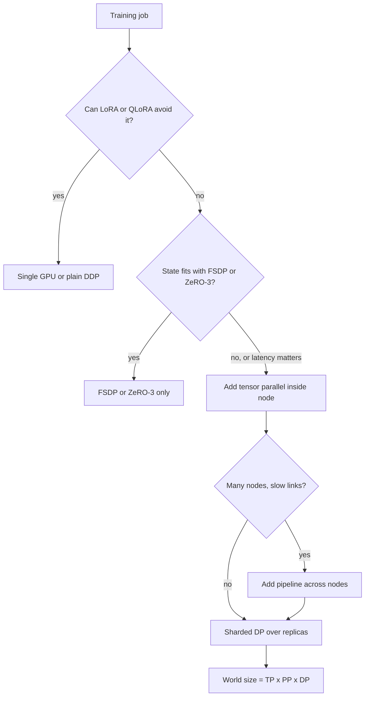

## TL;DR
Caveat: this matters only for training-heavy roles; application roles need the vocabulary, not the
practice. One GPU cannot hold big-model training state or finish pretraining in time, so data, tensor
and pipeline parallelism plus FSDP/ZeRO split the work; interconnect decides the mix.

## Why it exists
- **Two separate limits: memory and time.** Either one alone forces training across GPUs.
- **Memory: 16 bytes per parameter.** Mixed-precision Adam keeps a bf16 weight (2 bytes), a bf16 gradient
  (2), an fp32 master weight (4) and two fp32 Adam moments (8), the accounting the ZeRO paper uses. A 7B
  model is ~112 GB of state before a single activation; a 70B model is ~1.1 TB. Even a LoRA fine-tune of
  70B needs its 140 GB of bf16 base weights to live somewhere.
- **Time: about 6 × parameters × tokens FLOPs.** A 7B model on one trillion tokens is about 4.2 × 10²²
  FLOPs. At an illustrative sustained 400 TFLOP/s on one GPU (an H100's dense bf16 peak is about
  989 TFLOP/s; 40% utilisation is a realistic ballpark) that is ~10⁸ seconds, over three years.
  Pretraining is a thousands-of-GPUs problem by arithmetic, not ambition.
- **Each naive fix solves one limit only.** Plain data parallelism (replicate on N GPUs, split the batch)
  divides time by nearly N but every replica still holds the full 112 GB. Naive model parallelism (layers
  on different GPUs) divides memory but runs one GPU at a time while the others idle.
- **The design space:** ways to split both state and work so GPUs stay busy and the communication they
  need fits the links between them.

## How it works
### The four schemes at a glance
| Scheme | What is split | What it communicates | Link it needs |
|---|---|---|---|
| Data parallel (DDP) | The batch | Gradient all-reduce once per step | Modest; overlaps with backward |
| ZeRO / FSDP | Optimizer state, gradients, parameters | Per-layer all-gather and reduce-scatter | Good; prefer intra-node for gathers |
| Tensor parallel | Each matrix | Activation all-reduces inside every layer | NVLink-class, within a node |
| Pipeline parallel | Contiguous layers | Stage-boundary activations per micro-batch | Tolerates slower inter-node links |

### Data parallelism (DDP)
- **Mechanism.** Every GPU holds a full replica and processes a different micro-batch. After backward,
  gradients are averaged with an all-reduce.
- **Volume.** In a ring all-reduce each GPU sends and receives about `2·(N−1)/N` times the gradient size,
  roughly two gradient-sized transfers per step regardless of N.
- **Overlap.** DDP buckets gradients and reduces early buckets while later layers are still in backward,
  hiding most of the cost.
- **Scaling.** Throughput scales with N; memory per GPU does not change.
- **Global batch** becomes N × micro-batch × accumulation steps, which is why learning rate and warmup
  must be re-tuned when the GPU count changes.

### Sharded data parallelism: ZeRO and FSDP
The waste in DDP is that all N replicas store identical optimizer state and gradients. ZeRO partitions
them across the data-parallel group and gathers only what each step needs. Per GPU, with Ψ parameters
and N ranks:

```
DDP            16Ψ
ZeRO stage 1   2Ψ + 2Ψ + 12Ψ/N     optimizer state sharded
ZeRO stage 2   2Ψ + 14Ψ/N          gradients sharded too
ZeRO stage 3   16Ψ/N               parameters sharded too
```

| 7B on 8 GPUs, before activations | Per GPU |
|---|---|
| DDP | 112 GB |
| ZeRO stage 1 | ~38.5 GB |
| ZeRO stage 2 | ~26 GB |
| ZeRO stage 3 | 14 GB |

- **What stage 3 pays.** It all-gathers each layer's parameters just before use in forward and again in
  backward, then reduce-scatters its gradients: about 1.5× DDP's communication volume, spread through the
  step and overlapped by prefetching the next layer.
- **PyTorch FSDP is the native implementation.** `SHARD_GRAD_OP` is roughly stage 2, `FULL_SHARD` is
  stage 3, and `HYBRID_SHARD` shards within a node and replicates across nodes, so the frequent
  all-gathers stay on fast intra-node links.
- **The wrapping unit sets peak memory** (usually one transformer block), because one unit is held
  unsharded at a time.
- **When it still does not fit.** DeepSpeed adds ZeRO-Offload (optimizer state and gradients to CPU RAM)
  and ZeRO-Infinity (NVMe), at a large bandwidth cost.

### Tensor parallelism
- **When.** A single layer is too large, or per-GPU activation memory and latency must fall without idle
  time: split the matrices themselves (Megatron-LM).
- **MLP split.** The first linear is split by columns, so each GPU computes its slice and applies GELU
  independently. The second is split by rows, so each GPU produces a partial sum, combined with one
  all-reduce. Attention splits heads across GPUs the same way.
- **Cost.** Two all-reduces per layer in forward and two in backward, each moving an `s·b·h` activation.
- **So** it is bandwidth- and latency-hungry, and is kept inside a node over NVLink-class links,
  typically at degree 2–8.

### Pipeline parallelism
1. **Assign** contiguous groups of layers to stages on different GPUs.
2. **Split** the batch into m micro-batches that stream through, so stages work concurrently (GPipe).
3. **Accept the bubble,** the idle fraction, roughly `(p−1)/(m+p−1)` for p stages.

| Four stages | Bubble |
|---|---|
| Sixteen micro-batches | about 16% idle |
| Four micro-batches | about 43% idle |

- **1F1B schedule.** Interleaves forward and backward so each stage holds at most about p micro-batches'
  activations instead of all m. It does not shrink the bubble by itself.
- **Interleaved variant (Megatron).** Gives each GPU several non-contiguous chunks of layers, which divides
  the bubble by the number of chunks at the price of more stage-to-stage messages.
- **Why it tolerates slower links:** only stage-boundary activations cross GPUs, once per micro-batch.
- **Its costs:** the bubble, stage imbalance, and the engineering of partitioning a model.

### 3D parallelism and the choice procedure
- **Composition.** Tensor parallelism inside a node, pipeline across nodes, data or sharded-data
  parallelism over the remaining replicas: world size = TP × PP × DP.
- **Long contexts** add sequence or context parallelism, which splits the sequence dimension (ring
  attention).

The decision order for most teams:
1. **If the state fits with FSDP or ZeRO-3** across the available GPUs, use only that; it covers nearly
   all fine-tuning.
2. **If a layer or its activations still do not fit, or step latency matters,** add tensor parallelism
   within the node.
3. **If the job spans many nodes with slow interconnect,** add pipeline parallelism rather than stretching
   tensor parallelism across the network.

### What the frameworks provide
| Framework | Provides |
|---|---|
| PyTorch | DDP, FSDP (and the newer `fully_shard` FSDP2 API), the `torchrun` launcher, the NCCL backend |
| DeepSpeed | ZeRO stages 1–3, offloading and a pipeline engine behind a JSON config; plugs into the Hugging Face Trainer and Accelerate |
| Megatron-LM/Megatron-Core | Tensor, pipeline and sequence parallelism for pretraining |
| Accelerate, Axolotl | FSDP or DeepSpeed as configuration, so the training script does not change |

A ZeRO-3 run with optimizer offload is a few lines:

```json
{
  "bf16": {"enabled": true},
  "zero_optimization": {
    "stage": 3,
    "overlap_comm": true,
    "offload_optimizer": {"device": "cpu"},
    "stage3_gather_16bit_weights_on_model_save": true
  },
  "train_micro_batch_size_per_gpu": 1,
  "gradient_accumulation_steps": 16
}
```

- **FSDP vs DeepSpeed at stage 3.** FSDP `FULL_SHARD` and ZeRO-3 shard the same things and communicate the
  same way, so the choice is mostly about the stack.
- **FSDP** is native PyTorch and tracks its newest features.
- **DeepSpeed** has the more mature CPU/NVMe offload and a single config that people already know how to
  read.

## Diagram
The choice procedure as a decision path: try not to need it, then shard, then split matrices inside the
node, then split layers across nodes.



## Examples
### FSDP full fine-tune of a 7B model on eight GPUs
A minimal full-parameter fine-tune with FSDP in `FULL_SHARD` mode (the ZeRO-3 equivalent), wrapping per
decoder block and checkpointing activations per block. The model is loaded in bf16 to keep the example
short; production runs usually keep fp32 master weights through the mixed-precision policy. Launch with
`torchrun --nproc_per_node=8 train.py`.

```python
import os, functools, torch, torch.distributed as dist
from torch.distributed.fsdp import FullyShardedDataParallel as FSDP, MixedPrecision, ShardingStrategy
from torch.distributed.fsdp.wrap import transformer_auto_wrap_policy
from transformers import AutoModelForCausalLM, AutoTokenizer
from transformers.models.qwen2.modeling_qwen2 import Qwen2DecoderLayer

dist.init_process_group("nccl")
rank = int(os.environ["LOCAL_RANK"]); torch.cuda.set_device(rank)
name = "Qwen/Qwen2.5-7B"
tok = AutoTokenizer.from_pretrained(name)
model = AutoModelForCausalLM.from_pretrained(name, torch_dtype=torch.bfloat16)
model.gradient_checkpointing_enable(gradient_checkpointing_kwargs={"use_reentrant": False})

model = FSDP(
    model,
    auto_wrap_policy=functools.partial(transformer_auto_wrap_policy,
                                      transformer_layer_cls={Qwen2DecoderLayer}),
    sharding_strategy=ShardingStrategy.FULL_SHARD,      # params, grads, optimizer state all sharded
    mixed_precision=MixedPrecision(param_dtype=torch.bfloat16, reduce_dtype=torch.bfloat16),
    device_id=rank, use_orig_params=True,
)
opt = torch.optim.AdamW(model.parameters(), lr=1e-5)

batch = tok(["Replace me with a sharded DataLoader."] * 4, return_tensors="pt", padding=True).to(rank)
labels = batch["input_ids"].clone(); labels[batch["attention_mask"] == 0] = -100
for step in range(10):
    loss = model(**batch, labels=labels).loss
    loss.backward(); opt.step(); opt.zero_grad(set_to_none=True)
    if rank == 0: print(step, round(loss.item(), 4))
dist.destroy_process_group()
# Per-GPU budget, roughly: Qwen2.5-7B is ~7.6B params. With everything in bf16 (weights, grads,
# two AdamW moments = 8 bytes/param) that is ~61 GB of state / 8 ranks ≈ 7.6 GB per GPU; with fp32
# master weights and moments it is the 16-byte budget, ~15 GB per GPU. On top sit one gathered block
# (~233M params ≈ 0.47 GB in bf16, two with prefetch), checkpointed block inputs and one live block's
# activations. Note every rank first loads the full 15 GB on CPU: 8 × 15 GB of host RAM.
```

### Planning calculator: memory, bubble and calendar time
Pure Python, no GPU. It reproduces the lesson's numbers so you can plug in your own model and cluster.

```python
GB = 1e9

def state_gb(params, n, scheme):
    """Per-GPU training state in GB, Adam in mixed precision (16 bytes/param), before activations."""
    p = params
    per = {
        "DDP":    16 * p,
        "ZeRO-1": 2 * p + 2 * p + 12 * p / n,   # optimizer state sharded
        "ZeRO-2": 2 * p + 14 * p / n,           # gradients sharded too
        "ZeRO-3": 16 * p / n,                   # parameters sharded too
    }[scheme]
    return per / GB

def bubble(p_stages, m_micro):
    return (p_stages - 1) / (m_micro + p_stages - 1)

def train_years(params, tokens, flops_per_gpu, gpus=1):
    return 6 * params * tokens / (flops_per_gpu * gpus) / (3600 * 24 * 365)

for s in ("DDP", "ZeRO-1", "ZeRO-2", "ZeRO-3"):
    print(f"7B on 8 GPUs, {s:6s}: {state_gb(7e9, 8, s):6.1f} GB")
print(f"70B ZeRO-3: 8 GPUs {state_gb(70e9, 8, 'ZeRO-3'):.0f} GB, 16 GPUs {state_gb(70e9, 16, 'ZeRO-3'):.0f} GB")
print(f"bubble p=4: m=16 {bubble(4, 16):.0%}, m=4 {bubble(4, 4):.0%}")
print(f"7B x 1T tokens at 400 TFLOP/s: {train_years(7e9, 1e12, 400e12):.1f} years on 1 GPU, "
      f"{train_years(7e9, 1e12, 400e12, gpus=1024) * 365:.1f} days on 1,024")
# 7B on 8 GPUs, DDP   :  112.0 GB
# 7B on 8 GPUs, ZeRO-1:   38.5 GB
# 7B on 8 GPUs, ZeRO-2:   26.2 GB
# 7B on 8 GPUs, ZeRO-3:   14.0 GB
# 70B ZeRO-3: 8 GPUs 140 GB, 16 GPUs 70 GB
# bubble p=4: m=16 16%, m=4 43%
# 7B x 1T tokens at 400 TFLOP/s: 3.3 years on 1 GPU, 1.2 days on 1,024
```

The 1,024-GPU figure assumes perfect scaling; real runs lose some of it to communication, which is why
scaling efficiency is measured, not assumed.

### Worked scenario: a multi-node run that scaled badly
A team moved a ZeRO-3 fine-tune from one node of eight GPUs to four nodes (illustrative).

| Observation | Cause | Fix |
|---|---|---|
| Tokens per second per GPU fell sharply | Every per-layer all-gather now crossed the slower inter-node network | Hybrid sharding: shard within the node, replicate across nodes |
| Loss curve no longer matched the one-node run | Global batch grew 4× with the same learning rate and warmup | Re-tune learning rate and warmup for the new global batch |
| Resume from the old checkpoint failed | Sharded checkpoint was tied to world size 8 | A resharding distributed checkpoint format, or consolidate on save |

## Production patterns
- **Hybrid sharding across nodes.** When a sharded job spans several nodes, use FSDP's
  `ShardingStrategy.HYBRID_SHARD` so all-gathers stay on intra-node links and only gradient reduction
  crosses the network. Monitor step time split between compute and communication, and model FLOPs
  utilisation.
- **Load once, shard, broadcast.** For 70B-class models, build the model on the meta device and load real
  weights on rank 0 only, then broadcast (FSDP's `sync_module_states=True`; Accelerate exposes this as
  CPU-RAM-efficient loading). Monitor host RAM during initialisation, which otherwise peaks at ranks ×
  model size.
- **Resharding checkpoints.** Save with PyTorch distributed checkpointing (`torch.distributed.checkpoint`),
  which can load into a different world size, or consolidate with DeepSpeed's `zero_to_fp32.py` script.
  Test a resume on a different GPU count before the run matters.
- **Scaling-efficiency gate.** Before a long run, measure tokens per second per GPU at one node and at the
  target size. Re-tune learning rate and warmup whenever the global batch changes, and compare loss curves
  against the smaller run for the first few hundred steps.
- **Make hangs diagnosable.** Set a finite collective timeout in `dist.init_process_group(timeout=...)`,
  run with `NCCL_DEBUG=INFO` while debugging, and use `drop_last=True` on the sampler so ranks see equal
  batch counts. Alert on a step-time heartbeat, not GPU utilisation, because a hung collective can still
  show 100%.
- **Keep tensor parallelism inside the node.** In Megatron-LM, set `--tensor-model-parallel-size` no
  larger than GPUs per node and use `--pipeline-model-parallel-size` to span nodes. Monitor MFU; a drop to
  single digits signals TP traffic on a slow link.

## Trade-offs
- **DDP: simplest vs full state on every GPU.** The simplest and most compute-efficient scheme, but every
  GPU holds the full state. It flips to FSDP or ZeRO the moment weights plus optimizer state exceed one
  card, or batch is memory-limited.
- **ZeRO-3/FSDP: memory ÷ N vs gathers on the critical path.** It divides memory by N but adds all-gathers
  on the critical path and is sensitive to the interconnect; across slow inter-node links use hybrid
  sharding so gathers stay inside the node.
- **Tensor parallelism: no bubble vs bandwidth every layer.** It cuts per-GPU weight and activation memory
  with no bubble, but needs NVLink-class bandwidth every layer. It flips to pipeline parallelism as soon as
  the split crosses a node boundary.
- **Pipeline parallelism: light communication vs the bubble.** The bubble only shrinks when micro-batches
  far outnumber stages; it flips against you when the global batch is small or stages are unbalanced.
- **Offload: fits the impossible vs speed.** CPU or NVMe offload fits otherwise impossible jobs on few GPUs
  at a large speed cost; it pays only when wall-clock is cheap and GPUs are not.

## Pitfalls
- **Scaling GPUs without re-tuning for the larger global batch.** Symptom: a loss curve that no longer
  matches the single-GPU run, usually because learning rate and warmup were left unchanged. Fix: re-tune
  both for the new global batch.
- **Materialising the full model on every rank before sharding.** Symptom: host-RAM or GPU OOM during
  initialisation of a 70B model. Fix: meta-device init and syncing weights from rank 0.
- **Wrapping the whole model as one FSDP unit.** Symptom: OOM at the first all-gather despite
  `FULL_SHARD`, because the entire parameter set is gathered at once instead of one block. Fix: wrap per
  decoder block.
- **Uneven data across ranks so one rank skips a collective.** Symptom: a run that hangs at 100% GPU
  utilisation with no progress. Fix: `drop_last`, a join context or an explicit barrier.
- **Sharded checkpoints tied to one world size.** Symptom: resume fails after changing the GPU count. Fix:
  distributed checkpoint formats that reshard, or consolidating on save.
- **Tensor parallelism across GPUs connected only by PCIe or Ethernet.** Symptom: single-digit model FLOPs
  utilisation while the links sit saturated. Fix: keep TP within an NVLink domain.

## When to use
- **Application roles:** you need the vocabulary and arithmetic, not the practice: enough to read a
  DeepSpeed or FSDP config, to know why a 70B full fine-tune needs more than one 80 GB node, and to
  recognise that the cheapest "distributed" option is usually to not need it (LoRA, QLoRA, a smaller base).
- **Training roles decide:** the ZeRO stage or sharding strategy, the FSDP wrap unit, whether to add tensor
  parallelism inside the node, the global batch and learning-rate schedule, and checkpoint format.
- **Measure:** tokens per second per GPU against the single-GPU baseline (scaling efficiency) and model
  FLOPs utilisation.
- **Interviews:** say what each scheme communicates, how often, and which link it needs; and derive the
  16-bytes-per-parameter memory budget on the spot.

## Role lens
- **Engineer:** Picks the sharding strategy and wrap policy, launches with `torchrun` or Accelerate, and
  checks scaling efficiency and MFU before trusting that eight GPUs are doing eight GPUs' worth of work.
- **Architect:** Owns the training topology and cost model: node interconnect, GPU count, whether full
  fine-tuning is justified over PEFT at all, and the `6 × params × tokens` estimate behind every schedule.
- **FDE:** Rarely runs this, but reads a customer's DeepSpeed or FSDP config to explain why their
  eight-GPU ZeRO-3 fine-tune will not reproduce on the four-GPU staging box they want to use.

## Check yourself
**Q:** A team wants a full-parameter SFT of a 70B model on one node of eight 80 GB GPUs. Does it fit, and
what are their options if not? Show the arithmetic.
**A:** With Adam in mixed precision the state is 16 bytes per parameter, so 70B × 16 ≈ 1.12 TB. ZeRO-3 or
FSDP across eight GPUs leaves 140 GB per GPU before activations, which exceeds 80 GB, so it does not fit.
Options: offload the 12 bytes-per-parameter of fp32 master weights and Adam moments to CPU (about 840 GB
of host RAM, and much slower); add a second node so sixteen GPUs hold 70 GB each, which is tight and
needs gradient checkpointing, a small micro-batch and hybrid sharding to keep all-gathers intra-node; or
change the problem to LoRA on a bf16 base (140 GB of weights sharded to ~17.5 GB per GPU plus a tiny
optimizer state) or QLoRA. The arithmetic decides, not the framework.

## Interview questions
### What do the ZeRO stages shard, and what does stage 3 cost?
- **Stage 1** shards optimizer state, **stage 2** adds gradients, **stage 3** adds parameters, so per-GPU
  state falls from 16Ψ to 16Ψ/N; for 7B on 8 GPUs, 112 GB down to 14 GB.
- **Why it works:** in DDP all N replicas store identical state, so sharding removes pure duplication.
- **The cost:** stage 3 all-gathers each layer's parameters in forward and backward and reduce-scatters
  gradients, about 1.5× DDP's volume, hidden by prefetching when the interconnect is fast enough.

### A multi-GPU run hangs at 100% GPU utilisation with no progress. How do you debug it?
- **Suspect a mismatched collective:** one rank skipped or reordered an all-reduce or all-gather, often
  because ranks got different numbers of batches.
- **Confirm:** set a finite process-group timeout and `NCCL_DEBUG=INFO`, then find which rank is waiting
  on which collective.
- **Fix:** `drop_last` on the sampler, a join context for uneven inputs, or an explicit barrier, and alert
  on step-time heartbeats rather than utilisation.

### When would you choose pipeline parallelism over tensor parallelism?
- **When the split must cross nodes,** because tensor parallelism all-reduces activations in every layer
  and needs NVLink-class links, while pipeline parallelism only sends stage-boundary activations.
- **Not when the global batch is small,** because the bubble `(p−1)/(m+p−1)` is about 43% with four stages
  and four micro-batches.
- **Usual answer:** both, tensor parallelism inside the node and pipeline across nodes.

### Why can't you pretrain a 7B model on one trillion tokens with a single GPU?
- **Compute:** 6 × 7B × 1T ≈ 4.2 × 10²² FLOPs.
- **Throughput:** at an illustrative sustained 400 TFLOP/s that is ~10⁸ seconds, over three years.
- **So** it needs on the order of a thousand GPUs for a run of days, and memory (112 GB of state) rules out
  one GPU anyway.

### You moved from 8 to 32 GPUs and the loss curve changed. What happened?
- **The global batch changed:** N × micro-batch × accumulation grew 4×, while learning rate and warmup were
  tuned for the smaller batch.
- **Fix:** re-tune learning rate and warmup, or lower accumulation steps to keep the global batch
  constant.
- **Then check scaling efficiency:** tokens per second per GPU against the 8-GPU run, to confirm the
  extra GPUs are doing useful work.

## Quiz
### Q: Which parallelism scheme communicates activations in every layer and therefore needs NVLink-class bandwidth?
- [ ] Data parallelism, which all-reduces gradients once per step
- [x] Tensor parallelism, which all-reduces partial results inside every layer
- [ ] Pipeline parallelism, which sends activations only at stage boundaries
- [ ] ZeRO stage 1, which shards only the optimizer state
> Splitting a matrix across GPUs means each layer's output must be combined before the next layer runs,
> so the traffic is per layer and latency-sensitive; the other schemes communicate far less often.

### Q: A 7B model trained with Adam in mixed precision across 8 GPUs under ZeRO stage 3 needs roughly how much state per GPU, before activations?
- [ ] About 112 GB, the same as data parallelism
- [ ] About 56 GB, because only the optimizer state is split
- [x] About 14 GB, since all 16 bytes per parameter are sharded across the 8 ranks
- [ ] About 1.75 GB, since only the bf16 weights are sharded
> Stage 3 shards weights, gradients and optimizer state, so per-GPU memory is 16Ψ/N = 112 GB / 8. The
> 1.75 GB figure counts only the bf16 weights and forgets the other 14 bytes per parameter.

### Q: In a four-stage pipeline, what most directly reduces the idle bubble?
- [ ] Using fewer micro-batches so each stage finishes sooner
- [x] Using more micro-batches per step, since the bubble fraction is about (p−1)/(m+p−1)
- [ ] Adding more pipeline stages to spread the work
- [ ] Enabling gradient checkpointing inside each stage
> The bubble is the time stages wait for work to arrive; more micro-batches in flight keep every stage busy
> for a larger share of the step, while more stages or checkpointing make the bubble worse or leave it alone.
