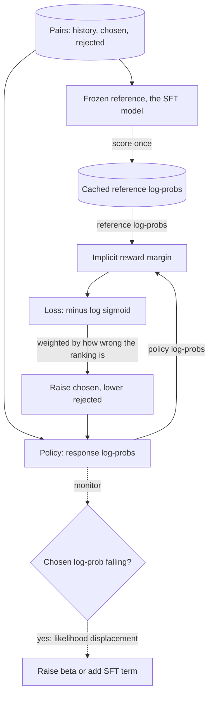

## TL;DR
DPO trains on preference pairs with a classification-style loss, no reward model or RL loop. For agent
teams it is the practical way to teach "this trajectory beats that one" after SFT, at SFT cost, but
offline.

## For agent builders
- **Why it matters for agents.** SFT on traces teaches an agent to call tools; it cannot teach that a
  three-step trajectory beats a seven-step one, or that answering beats a needless clarifying question.
  DPO on pairs of agent responses or trajectories does, with one node and a simple loss.
- **Where it shows up in your stack.** TRL's `DPOConfig` and `DPOTrainer` (conversational prompt,
  chosen and rejected message lists), provider preference fine-tuning APIs, and KTO when your product
  only logs thumbs-up and thumbs-down on agent answers.
- **What you control.** How pairs are built (same history, different next step), who labels them (users,
  experts or a calibrated judge), β, epochs, and whether pairs come from your own current agent model so
  they stay on-policy.
- **What you can skip.** Re-deriving the partition-function algebra and every variant paper. Know the
  implicit reward, what β does in numbers, and the likelihood-displacement signal to watch.

## Why it exists
- **PPO's machinery is heavy.** Four models resident, two training; a generation loop dominating
  wall-clock time; interacting hyperparameters (clip range, value loss weight, KL coefficient, learning
  rate schedule) that take experienced teams weeks to stabilise; and a reward model to train, validate
  and keep current.
- **The tool outsizes the problem.** For a team with ten thousand preference pairs and one node of GPUs,
  that is a mismatch. Most agent teams are that team.
- **SFT on chosen responses wastes half the signal.** The model learns what good looks like but nothing
  about bad, and cannot push probability *away* from rejected answers such as a wrong tool choice.
- **A naive contrastive loss has no leash.** Raising chosen and lowering rejected log-probability can be
  satisfied by driving the rejected sequence to zero probability, trashing everything nearby.
- **DPO combines leash and comparison analytically.** Invert the exact optimum of "reward minus β·KL",
  substitute into Bradley–Terry, and you get a policy-only loss for the same optimisation problem, with
  no reward model and no sampling. The leash is inside the formula.

## How it works
### Background: the derivation in four lines
1. The KL-regularised objective `max_π E_y~π[r(x,y)] − β·KL(π ‖ π_ref)` is maximised by
   `π*(y|x) = π_ref(y|x)·exp(r(x,y)/β) / Z(x)`, where Z(x) normalises over all responses.
2. Solve for the reward: `r(x,y) = β·log(π*(y|x)/π_ref(y|x)) + β·log Z(x)`.
3. Put that into the Bradley–Terry probability that y_w beats y_l. The `β·log Z(x)` term is the same for
   both responses to the same prompt, so it cancels in the difference.
4. The resulting loss over the policy θ is:

```
L_DPO(θ) = − E [ log σ( β·log π_θ(y_w|x)/π_ref(y_w|x)  −  β·log π_θ(y_l|x)/π_ref(y_l|x) ) ]
```

- **Implicit reward:** each log-ratio term is `r̂(x,y) = β·log(π_θ(y|x)/π_ref(y|x))`, how much more the
  policy likes this response than the reference does, scaled by β.
- **Goal:** make the implicit reward margin between chosen and rejected large and positive.
- **Agent reading:** x is the shared agent history (system prompt, tools, turns so far); y_w and y_l are
  two continuations, such as two different next tool calls.

### What the gradient does
Differentiating the loss gives `−β·σ(r̂_l − r̂_w)·[∇log π_θ(y_w|x) − ∇log π_θ(y_l|x)]`.

- **The bracket** raises the chosen sequence's likelihood and lowers the rejected one's.
- **The weight in front** is the sigmoid of how wrong the current implicit ranking is.
- **So correctly ranked, well-separated pairs contribute almost nothing; backwards pairs contribute most.**
  That weighting is what the naive contrastive loss lacks, and it stops DPO endlessly pushing
  already-separated pairs.

### The role of β
- **Same KL coefficient as RLHF, read the other way round:** it scales how large a log-ratio is needed for
  a given preference probability.
- **Small β (TRL's default is 0.1)** lets the policy move far from the reference to separate pairs;
  **large β** keeps it close.
- **No explicit KL term**, but reference log-probabilities appear in every pair, so drift is penalised
  implicitly.

### Sequence log-probabilities
- **Each term is a sum** of per-token log-probabilities over response tokens only, prompt masked. In
  agent pairs, keep tool results out of the response: standard DPO trainers score every response token,
  so end each pair at the diverging assistant turn, or mask tool tokens yourself as in SFT.
- **Cache the reference.** It is frozen, so its log-probs for the dataset can be computed once. Training
  memory drops to one trainable model plus stored numbers, versus RLHF's four networks.
- **LoRA trick:** disable the adapter for the reference forward pass instead of loading a second copy.

### Why "offline" matters
- **DPO uses whichever pairs you give it.** Pairs from a different model compare sequences the policy
  would rarely generate, so the gradient's effect on its actual outputs is indirect: the
  distribution-shift cost of dropping the sampling loop.
- **The reference should sit near the data.** The derivation treats π_ref as the distribution the pairs
  live near; with only someone else's pairs, the DPO paper advises first SFT-ing the reference on the
  chosen responses.
- **The better fix: go on-policy in rounds.** Generate candidates with the policy (or its SFT ancestor),
  label those, and iterate (often called iterative or online DPO). This recovers much of on-policy RLHF's
  advantage with the simple loss. For agents: run the current model on real tasks, label its own runs.

### Known failure: likelihood displacement
- **The loss only sees the *difference* in log-ratios.** The margin can grow while both chosen and
  rejected probabilities fall, as long as rejected falls faster.
- **In practice chosen log-probability often decreases** during DPO, and the mass goes somewhere
  unobserved, sometimes to worse responses (for agents, malformed or invented tool calls).
- **Detect** by monitoring chosen log-probability, not just the margin. **Mitigate** by mixing in a small
  SFT term on chosen responses, or by switching to a variant.

### The variants, and what each one changes
| Variant | Change | Because |
|---|---|---|
| **IPO** | squared loss pulling the margin toward a fixed target, not infinity | with near-deterministic preferences DPO keeps rewarding ever-larger margins and overfits |
| **KTO** | no pairs: each response labelled desirable or undesirable | fits thumbs-up / thumbs-down product feedback that never comes as matched comparisons |
| **ORPO** | no reference; odds-ratio penalty added to an ordinary SFT loss | folds SFT and preference training into one stage |
| **SimPO** | no reference; *length-normalised* average log-prob as implicit reward, plus a target margin | directly attacks the length bias of summed log-probs |

All four keep DPO's shape: an offline loss on preference data, no reward model, no sampling. Which one
wins is data-dependent, so treat them as ablations to run, not upgrades to assume.

## Diagram
One DPO step: the frozen reference is scored once and cached, the policy is scored every step, and the
loss pushes the implicit reward margin up, weighted by how wrong the current ranking is. For agents the
pairs are two continuations of the same history.



## Misconceptions
- **"DPO is just SFT on the chosen responses."** It also pushes probability away from the rejected one,
  and weights each pair by how wrong the current ranking is, so well-separated pairs contribute almost
  nothing. SFT on chosen alone learns nothing about the wrong tool choice.
- **"No reward model means no KL leash."** The leash is inside the loss: reference log-probs appear in
  every pair, and β sets how far the policy may move. At β = 0.1 reaching a 0.9 preference needs a
  log-ratio margin (chosen minus rejected) of about 22 nats; at β = 0.5, about 4.4.
- **"A growing margin means good responses are getting more likely."** The margin can grow while both
  log-probs fall, as long as rejected falls faster. Plot chosen log-prob beside the margin to catch
  likelihood displacement.
- **"Any good preference dataset will do."** DPO is offline: pairs from a different, stronger model
  compare sequences your policy rarely writes, so the loss moves while outputs barely change. Build pairs
  from your own agent's runs and iterate in rounds.
- **"Pair the whole good run against the whole bad run."** Whole trajectories blur which step mattered,
  and runs that differ because a tool returned different data teach nothing about the agent. Pair at the
  first diverging assistant turn.
- **"Training accuracy near 100% means it worked."** On a small pair set it usually means memorised
  surface features such as length. Train one epoch and stop on held-out reward accuracy and win rate.

## Examples
### The DPO loss from sequence log-probs
Reference log-probs are precomputed. Shapes are `[batch]` after summing per-token log-probs over
response tokens; the helper shows the masked sum.

```python
import torch, torch.nn.functional as F

def seq_logprob(logits, ids, response_mask):
    """Sum of log p(token) over response tokens. logits [B,T,V], ids [B,T], mask [B,T] (1 on response)."""
    lp = torch.log_softmax(logits[:, :-1].float(), -1).gather(-1, ids[:, 1:, None])[..., 0]
    return (lp * response_mask[:, 1:]).sum(-1)                          # [B]

def dpo_loss(pol_w, pol_l, ref_w, ref_l, beta=0.1):
    """pol_*/ref_*: sequence log-probs of chosen (w) and rejected (l) under policy / reference."""
    margin = beta * ((pol_w - ref_w) - (pol_l - ref_l))                 # implicit reward margin
    loss = -F.logsigmoid(margin).mean()
    reward_acc = (margin > 0).float().mean()                            # fraction of pairs ranked right
    return loss, margin, reward_acc

# One pair, numbers illustrative. Policy has drifted toward chosen and away from rejected.
pol_w, ref_w = torch.tensor([-40.0]), torch.tensor([-42.0])            # chosen: +2 nats vs reference
pol_l, ref_l = torch.tensor([-35.0]), torch.tensor([-33.0])            # rejected: -2 nats vs reference
loss, margin, acc = dpo_loss(pol_w, pol_l, ref_w, ref_l)
print(f"margin={margin.item():.2f} loss={loss.item():.3f} reward_acc={acc.item():.0%}")
# margin = 0.1 * (2 - (-2)) = 0.40 ; loss = -log sigma(0.40) = 0.513 ; accuracy 100%

# Watch during training: loss falling, reward_acc rising toward ~0.7-0.9 on a held-out set,
# and chosen log-prob (pol_w) NOT falling steadily. If pol_w drops while margin grows,
# probability mass is leaving both responses: likelihood displacement.
```

- **Note the scale.** A 4-nat total swing across responses of dozens of tokens is a small per-token
  change, yet with β = 0.1 it already yields a 60/40 preference.
- **β turns modest log-probability shifts into decisive preferences**; lowering it lets the model move
  further.

### Worked numbers: what β does to the same 4-nat swing
Preference probability is σ(β × log-ratio margin). Computed for the 4-nat swing above:

| β | Margin β×4 | P(chosen beats rejected) | Loss | Log-ratio margin needed for P = 0.9 |
|---|---|---|---|---|
| 0.05 | 0.2 | 0.55 | 0.598 | ~44 nats |
| 0.1 | 0.4 | 0.60 | 0.513 | ~22 nats |
| 0.5 | 2.0 | 0.88 | 0.127 | ~4.4 nats |

- **Small β means the loss keeps pulling** until the policy has moved tens of nats from the reference on
  each pair: big behaviour change, more drift risk.
- **Large β is satisfied after small moves:** the policy stays close to the reference, which is what you
  want when pairs are noisy or off-policy, as user thumbs often are.

### Turning agent runs into DPO pairs
Two runs of the same task that share a history and then diverge make a natural pair: the shared prefix
is the prompt, and each run's first diverging assistant turn is chosen or rejected. The output is the conversational
prompt / chosen / rejected format TRL's DPO trainer accepts.

```python
def shared_prefix(a, b):
    n = 0
    while n < min(len(a), len(b)) and a[n] == b[n]:
        n += 1
    return n

def runs_to_pair(run_good, run_bad):
    """Each run is a list of chat messages. Pair only the first diverging step, and only if both
    sides of it are assistant turns (a tool result that differed is not the agent's decision)."""
    n = shared_prefix(run_good, run_bad)
    if n == min(len(run_good), len(run_bad)):
        return None                                   # the runs never diverge
    if run_good[n]["role"] != "assistant" or run_bad[n]["role"] != "assistant":
        return None
    return {"prompt": run_good[:n], "chosen": [run_good[n]], "rejected": [run_bad[n]]}

history = [{"role": "system", "content": "Support agent. Tools: get_order, refund."},
           {"role": "user", "content": "Refund order A-1042, it arrived broken."}]
good = history + [{"role": "assistant", "content": "", "tool_calls": [{"type": "function",
                   "function": {"name": "refund", "arguments": {"order_id": "A-1042"}}}]}]
bad = history + [{"role": "assistant", "content": "Could you confirm your order number?"}]  # needless ask

pair = runs_to_pair(good, bad)
call = pair["chosen"][0]["tool_calls"][0]["function"]["name"]
print(len(pair["prompt"]), "shared messages; chosen calls", call, "| rejected:", pair["rejected"][0]["content"])
# 2 shared messages; chosen calls refund | rejected: Could you confirm your order number?
# Label which run is better with users, experts or a calibrated judge. Only the step where they diverge
# is kept, so the pair isolates one decision and contains no tool-result tokens to score.
```

### Production run with TRL
A typical first round on the SFT checkpoint. Argument names follow recent TRL releases; check your
installed version.

```python
from datasets import load_dataset
from transformers import AutoModelForCausalLM, AutoTokenizer
from trl import DPOConfig, DPOTrainer

name = "my-org/support-sft"                      # the SFT checkpoint: policy init and reference
model = AutoModelForCausalLM.from_pretrained(name)
tok = AutoTokenizer.from_pretrained(name)
pairs = load_dataset("json", data_files="pairs.jsonl", split="train")   # prompt / chosen / rejected
split = pairs.train_test_split(test_size=0.05, seed=0)

args = DPOConfig(
    output_dir="dpo-round1",
    beta=0.1,                        # the KL leash
    num_train_epochs=1,              # small pair sets overfit fast
    learning_rate=5e-7,              # far below SFT rates; tune per model
    per_device_train_batch_size=4,
    precompute_ref_log_probs=True,   # reference scored once, not every step
    eval_strategy="steps", eval_steps=100,
)
trainer = DPOTrainer(model=model, ref_model=None,   # None: TRL builds the frozen reference itself
                     args=args, train_dataset=split["train"], eval_dataset=split["test"],
                     processing_class=tok)
trainer.train()
```

### Worked scenario: cutting needless steps from a support agent
Illustrative numbers for one DPO round on an SFT-tuned 8B agent.

| Metric on 500 held-out tasks | After SFT | After DPO (β = 0.1, 1 epoch, 6,000 pairs) |
|---|---|---|
| Task success | 78% | 80% |
| Mean tool calls per task | 4.6 | 3.1 |
| Needless clarifying questions | 14% of tasks | 5% of tasks |
| Mean final-answer length | 95 words | 120 words, flagged for a length audit |

Pairs were built from the SFT agent's own runs, diverging at one step and labelled by support leads.
The length creep is the warning sign to check the chosen-to-rejected length ratio before round two.

## Production patterns
- **Build pairs at the divergence point.** Run the current agent several times per task, keep pairs of
  runs that share a history and then differ, and compare only the diverging step. Monitor the share of
  pairs per decision type (tool choice, ask versus act, final answer) so one kind does not dominate.
- **Cache or share the reference.** Precompute reference log-probs once (`precompute_ref_log_probs=True`
  in TRL), or with LoRA pass no separate reference so the adapter is disabled for the reference pass.
  Monitor GPU memory and step time; a second full copy is the usual reason a run does not fit.
- **Plot chosen log-prob next to the margin.** TRL logs implicit rewards, margins, accuracies and chosen
  and rejected log-probs at each logging step. Alert when chosen log-prob falls steadily while margins
  grow, the likelihood-displacement signature, and respond with larger β or an SFT term on chosen.
- **One epoch, early stop on held-out reward accuracy.** Hold out a few percent of pairs and evaluate
  every few hundred steps. Stop when held-out accuracy plateaus, because training accuracy near 100% with
  flat held-out accuracy means the pairs are being memorised.
- **Regenerate pairs on-policy each round.** Sample candidates from the current checkpoint, have the
  judge or experts label them, and run the next DPO round with that checkpoint as the new reference.
  Monitor win rate and agent task success against the previous round's model on a fixed task set.
- **Audit length before training.** Compute the chosen-to-rejected length ratio over the dataset and the
  share of pairs where chosen is longer. If it is heavily skewed, rebalance pairs or try SimPO, and
  monitor mean output length every round.

## Trade-offs
- **Cheap and stable vs offline.** One trainable model and a cached reference instead of four networks
  makes DPO cheap and stable, but its advantage shrinks when the pairs came from a model far from the
  one you are training.
- **Small vs large β.** Small β separates pairs faster and allows larger behaviour changes; large β
  preserves the reference. The right value flips toward large β when pairs are noisy or off-policy.
- **No reward model vs no reusable scorer.** Dropping it removes an artefact to maintain, but also a
  scorer for rejection sampling, data filtering and monitoring, which matters once you run many rounds.
- **Reference-free variants vs leash.** ORPO and SimPO save memory and can reduce length bias, but give up
  the explicit leash and need their own margin or length terms to stay stable.
- **Step-level vs whole-trajectory pairs.** Pairs that diverge at one step isolate a decision and need
  fewer labels per lesson learned; whole-trajectory pairs are easier to collect from end users but blur
  which step made the difference.

## Pitfalls
- **Several epochs on a small pair set.** Symptom: reward accuracy near 100% on training pairs, falling
  held-out win rate, and verbose or strangely confident outputs.
- **Ignoring chosen log-probability.** Margin and loss look healthy while the likelihood of good responses
  falls and mass migrates to unobserved, often degenerate, outputs.
- **Treating pairs from a stronger, different model as on-policy.** The loss moves but the trained model's
  outputs barely change, because it never produced sequences like those.
- **Length-confounded pairs** where chosen is usually longer. The model learns length: answers grow every
  round with no quality gain.
- **Mismatched tokenisation or chat template** between stored reference log-probs and policy inputs. The
  implicit rewards are noise; training appears to work while nothing improves.
- **Pairs that differ in the tool result, not the agent's choice.** If two runs diverge because a tool
  returned different data, the pair teaches nothing about the agent's decision. Fix: pair only runs whose
  first difference is an assistant turn.

## When to use
- **Use as the default first preference method** for an application team: a few thousand to a few hundred
  thousand pairs, one node, and a need for reproducible runs.
- **Run it after SFT**, on pairs generated by the SFT model or by the previous round's policy, and iterate
  in rounds if you can afford fresh labelling.
- **Prefer RLHF with PPO or GRPO when** you need on-policy exploration, a reusable reward model, or a
  programmatic reward (such as a sandbox task check), and have the engineering to run the loop.
- **Measure** held-out reward accuracy, chosen log-probability, judge or human win rate against the SFT
  model, agent task success and steps per task, and a general capability suite.
- **Interviews:** sketch the derivation, name the implicit reward, and explain why DPO is offline and what
  that costs.

## Role lens
- **Engineer:** Precomputes reference log-probs, verifies the response mask and chat template match,
  and plots margin, chosen log-prob and held-out reward accuracy together each run.
- **Architect:** Picks DPO over PPO when pair data is fixed and budgets are modest, and sets the
  iteration policy: how often fresh on-policy pairs are collected before the next round.
- **FDE:** Sets up pairwise review with a customer's experts on the model's own outputs, since pairs
  about the model's actual mistakes are worth far more than imported preference datasets.

## Check yourself
**Q:** A team runs DPO for three epochs on 8,000 pairs. Training loss falls to near zero and
reward accuracy is 99%, but a held-out judge prefers the SFT model and outputs have become long and
oddly phrased. Diagnose and propose fixes.
**A:** The run overfit the pairs: three epochs on 8k pairs lets the model separate every training pair
by memorising surface features, and length is the easiest such feature if chosen responses tend to be
longer. The near-zero loss means pairs are separated by huge margins, which with β = 0.1 implies large
log-ratio shifts from the reference, and that drift is what the held-out judge is penalising. I would
check chosen log-probability over training for likelihood displacement and check the length ratio of
chosen to rejected in the data. Fixes: one epoch with early stopping on held-out reward accuracy,
larger β or an added SFT term on chosen responses, balancing or length-normalising the pairs, and
regenerating pairs on-policy so they describe this model's real errors rather than the dataset's
artefacts.

## Interview questions
### How does DPO get rid of the reward model and the RL loop?
- **The KL-regularised objective has a closed-form optimum**, π* proportional to π_ref·exp(r/β), so the
  reward can be written as β·log(π/π_ref) plus a prompt-only term.
- **Substituted into Bradley–Terry**, the prompt-only β·log Z(x) term cancels between chosen and
  rejected, leaving a loss over the policy alone.
- **The leash is inside the formula**, because reference log-probs appear in every pair.

### Your agent works but takes too many steps. How would you use DPO to fix it?
- **Build pairs from its own runs:** for each task, keep runs that share a history and then diverge, and
  label the shorter successful path as chosen over the detour or needless question.
- **Train one round** at β around 0.1 with one epoch, with each pair ending at the diverging assistant
  turn so no tool results are scored, and watch chosen log-prob alongside the margin.
- **Gate on held-out tasks:** steps per task must fall without task success or a capability suite
  regressing, then regenerate pairs from the new model for the next round.

### Your product only collects thumbs-up and thumbs-down on single responses. Can you still do DPO?
- **Not directly:** DPO needs a chosen and a rejected response to the *same* prompt, and unpaired
  feedback rarely gives you that.
- **KTO fits the data as it comes:** each response is labelled desirable or undesirable, with no matched
  pairs required.
- **Or build pairs on purpose:** sample two responses per prompt from the current model and ask raters or
  a calibrated judge to compare them, which also makes the data on-policy.

### When would you choose PPO or GRPO over DPO?
- **When you need on-policy exploration**, because DPO only learns from the pairs you give it.
- **When you want a reusable scorer** (a reward model) for rejection sampling, filtering and monitoring
  across many rounds.
- **When the reward is programmatic**, such as unit tests, a schema check or an agent sandbox's end-state
  check, which GRPO uses directly.

### What does β = 0.1 versus β = 0.5 mean in numbers?
- **Preference probability is σ(β × log-ratio margin).** A 4-nat swing gives 0.60 at β = 0.1 and 0.88 at
  β = 0.5.
- **To reach P = 0.9** the policy needs about 22 nats of margin at β = 0.1 but only about 4.4 at β = 0.5.
- **So small β permits more drift** from the reference; prefer larger β when pairs are noisy or
  off-policy.

### Your pairs come from a public dataset generated by a different, stronger model. Is that a problem?
- **Yes, it is off-policy:** the pairs compare sequences your policy rarely produces, so the loss moves
  while outputs barely change.
- **Mitigate** by first SFT-ing the reference on the chosen responses, as the DPO paper advises.
- **Better:** generate candidates with your own SFT model, label those, and iterate in rounds.

## Quiz
### Q: Why does the partition function Z(x) disappear from the DPO loss?
- [ ] It is assumed to equal one for a well-normalised language model
- [x] It depends only on the prompt, so it is identical for the chosen and rejected responses and cancels in their difference
- [ ] It is absorbed into the learning rate
- [ ] The reference model is trained to make it constant
> Z(x) sums over all possible responses to the prompt, which is intractable, but Bradley–Terry only
> uses the difference of rewards for two responses to the same prompt, and the same Z(x) appears in both.

### Q: What is the "implicit reward" in DPO?
- [ ] The output of a frozen reward model used to label the pairs
- [x] β times the log-ratio of policy to reference probability for a response
- [ ] The number of pairs the policy ranks correctly
- [ ] The negative of the KL divergence between policy and reference
> Inverting the optimal policy of the KL-regularised objective gives r(x,y) = β·log(π/π_ref) up to a
> prompt-only constant. DPO optimises the margin of this quantity between chosen and rejected responses.

### Q: Which observation most directly indicates likelihood displacement during DPO?
- [ ] Reward accuracy on training pairs stays below 60%
- [ ] The margin between chosen and rejected stops increasing
- [x] The chosen response's log-probability falls steadily even as the margin grows
- [ ] The reference model's log-probabilities change between epochs
> The loss rewards a growing difference, which can be achieved by lowering both responses' probability
> as long as the rejected one falls faster. Falling chosen log-probability means mass is moving to
> sequences the loss never sees.

## Use cases & projects
### Use cases
- **Shorter agent trajectories.** Pairs where the direct three-step path is chosen and the detour is
  rejected teach the agent to stop wandering.
- **Fewer needless clarifying questions.** Pairs with the same history, one answering and one asking an
  unneeded question, shift the agent toward acting.
- **Learning from product feedback.** Thumbs-up and thumbs-down on agent answers feed KTO, or become pairs
  when two answers to the same prompt exist.
- **Tone and policy alignment.** Expert-labelled pairs move a support agent toward the company's
  escalation and refusal style without a reward model.

### Mini project
**Build on-policy DPO pairs from agent rollouts (2-3 hours).**
- **Goal:** produce a clean preference dataset for one agent behaviour you want to change.
- **Steps:** pick one behaviour (for example, asking unneeded clarifying questions); sample 4 next steps
  from your current agent model for 50 shared histories; label the best and worst step with a rubric or a
  calibrated judge; write conversational prompt, chosen and rejected records; hold out 10 pairs and note
  the β you would start with.
- **Done when:** you have a pairs file, a held-out set, an agreement rate between your own labels and
  the judge's (or a second rater's) on 10 pairs, and a short plan for the metrics you would watch,
  including chosen log-probability.
