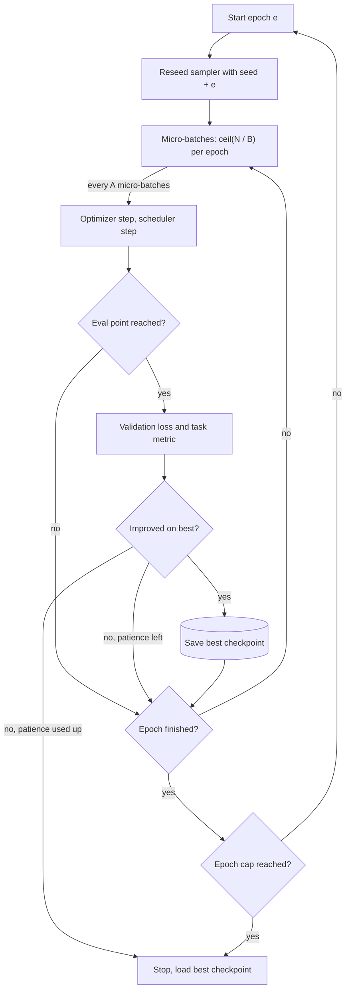

## TL;DR
An epoch is one full pass of the optimiser over the training set, the natural unit for reshuffling,
evaluating and stopping. More epochs help a small fine-tuning set until the model starts memorising;
pretraining counts tokens and rarely completes one pass.

## Why it exists
- **Minibatches consume data piecewise.** Gradient descent updates on minibatches of *B* examples, so
  after `ceil(N / B)` steps every one of the *N* training examples has contributed once. "Every example
  seen once" is the natural unit for reshuffling, evaluating and stopping.
- **One pass is not enough on small sets.** With a small learning rate each example nudges the weights
  only slightly, so for a few thousand rows one pass leaves the model far from the best fit. Repeating
  passes extracts more gradient signal from data you cannot get more of.
- **Repetition eventually fits the particulars.** After the shared pattern is learned, only label noise,
  phrasing and field order are left to fit. The epoch count is a knob on how much to trust these exact
  examples versus the model's prior.
- **Naive stopping rules fail.** "Until training loss stops falling" never stops, because loss on repeated
  data falls all the way to memorisation. "Always one epoch" leaves small sets underfit; "always ten"
  overfits most. The honest control is the validation curve: train while it improves, stop when it turns.
- **Pretraining is the opposite regime.** The corpus is so large relative to compute that the run ends
  before one pass, and unique tokens are worth more than repeats. A data-constrained scaling study found
  repeating data for up to roughly four passes costs little compared with fresh data.

## How it works
### Accounting
With *N* examples, micro-batch size *B* and gradient accumulation over *A* micro-batches:

```
micro_batches_per_epoch = ceil(N / B)
optimizer_steps_per_epoch = micro_batches_per_epoch / A
total_optimizer_steps = epochs × optimizer_steps_per_epoch
```

- **Schedulers run on optimizer steps,** so changing the epoch count silently changes the decay horizon.
  A cosine schedule over 375 steps reaches a given fraction of peak LR at a different point than one
  over 1,250 steps.
- **Hugging Face default.** The `Trainer` derives `max_steps` from `num_train_epochs` (default 3) unless
  `max_steps` is set explicitly, in which case it wins.
- **So different epoch counts are different schedules,** not "the same run for longer".

### Reshuffling every epoch
- **Order sets batch composition.** A fixed order makes the gradient noise identical in every pass, and
  the same examples are always freshest at the end of the epoch when you evaluate.
- **Reseed the sampler per epoch** (`seed + epoch`): different batch compositions each pass, while the
  run stays reproducible and resumable.
- **Resume exactly.** A checkpoint that records the epoch and the number of batches consumed can
  regenerate the exact remaining order.

### Where evaluation and checkpoints go
| Epoch length | Evaluate | Because |
|---|---|---|
| ~125 steps | at each epoch boundary | every example has been seen an equal number of times |
| hours long | every *n* steps | the model can overfit or diverge mid-epoch, and an end-of-epoch check would miss the best checkpoint |
| a handful of steps (200 fine-tuning examples) | per epoch | it is the only granularity that is not noise |

### Why the number matters so much in fine-tuning
- **Each pass moves away from the prior.** A pretrained model is a strong prior; each pass over a small
  instruction set moves it toward the specifics of those rows.
- **Illustrative arithmetic.** 1,000 examples at batch 8 give 125 steps per epoch; three epochs are 375
  steps, and a 3% warmup is about eleven steps (frameworks round 11.25 differently).
- **Common practice** for supervised fine-tuning is a small number of epochs, rising only for tiny sets
  where each epoch is a few steps.
- **The real control** is total steps × learning rate judged against the validation curve, not a magic
  integer.

### Reading the curve across epochs
1. **The staircase.** Once the model starts memorising, training loss is roughly flat within an epoch and
   then drops abruptly at the start of the next one.
2. **Why it drops.** The model now sees examples it has already seen, and predicts them better than the
   unseen remainder of the first pass.
3. **The diagnosis.** A staircase on training loss with flat or rising validation loss is direct
   evidence that further epochs buy memorisation, not skill.
4. **The decision.** Early stopping with patience: evaluate at a fixed cadence, keep the best checkpoint,
   stop after *p* evaluations without improvement. The configured epoch count becomes an upper bound,
   not a commitment.

### What "an example" means with packing
- **Packing** puts several short examples into one fixed-length sequence to avoid padding waste.
- **An epoch is still one pass over the examples,** but steps per epoch follow from total tokens divided
  by tokens per batch, not from `N / B`.
- **Same rows, different steps.** Many short examples and a few long ones can share a row count but
  differ widely in step count, so compute steps from tokens when packing is on.

### Pretraining counts tokens
- **No meaningful epoch.** A corpus of trillions of tokens with a budget covering a fraction of it has its
  schedule, warmup and evaluation cadence defined in tokens or steps.
- **Reuse is a choice.** Partial reuse of data is made under data constraints, not a default.

### Which unit to compare on
- **Same dataset:** compare by epochs.
- **Different dataset sizes:** compare by optimizer steps or tokens seen. "Two epochs on 10,000
  examples" and "two epochs on 1,000" differ by 10× in updates.

## Diagram
One fine-tuning run with early stopping: each epoch reshuffles, updates and evaluates, and the epoch
count only caps the loop while the validation curve decides when it ends.



## Examples
### A training loop with explicit accounting
Epochs, micro-batches, accumulation, a per-epoch reseeded sampler, and a linear schedule defined over
optimizer steps. The printed step counts show why the schedule length depends on the epoch count.

```python
import math, torch
from torch.utils.data import DataLoader, TensorDataset

N, B, EPOCHS, ACCUM = 1000, 8, 3, 4
x = torch.randn(N, 16); y = (x.sum(1) > 0).float()
xv = torch.randn(200, 16); yv = (xv.sum(1) > 0).float()            # held-out
model = torch.nn.Sequential(torch.nn.Linear(16, 32), torch.nn.ReLU(), torch.nn.Linear(32, 1))
opt = torch.optim.AdamW(model.parameters(), lr=1e-3)
loss_fn = torch.nn.functional.binary_cross_entropy_with_logits

micro_per_epoch = math.ceil(N / B)                                 # 125
total_steps = math.ceil(EPOCHS * micro_per_epoch / ACCUM)          # 94 optimizer steps, incl. final flush
sched = torch.optim.lr_scheduler.LambdaLR(opt, lambda s: max(0.0, 1 - s / total_steps))

micro, step = 0, 0
for epoch in range(EPOCHS):
    g = torch.Generator().manual_seed(1234 + epoch)                # new order every epoch, reproducible
    loader = DataLoader(TensorDataset(x, y), batch_size=B, shuffle=True, generator=g)
    model.train()
    for xb, yb in loader:
        (loss_fn(model(xb).squeeze(1), yb) / ACCUM).backward()
        micro += 1
        if micro % ACCUM == 0:                                     # one update per ACCUM micro-batches
            opt.step(); sched.step(); opt.zero_grad(); step += 1
    model.eval()
    with torch.no_grad():
        val = loss_fn(model(xv).squeeze(1), yv).item()
    print(f"epoch {epoch+1}: micro-batches={micro} optimizer steps={step} "
          f"lr={sched.get_last_lr()[0]:.2e} val_loss={val:.3f}")

# 375 micro-batches is not divisible by 4: three gradients are still pending. Flush them.
if micro % ACCUM:
    opt.step(); opt.zero_grad(); step += 1
```

The leftover micro-batches are the kind of accounting detail epochs hide:
- **Without the final flush,** three batches of data contribute nothing.
- **If the schedule is sized to 93 steps instead of 94,** the flush runs at a learning rate of zero and
  still contributes nothing.
- **With accumulation that does not divide an epoch,** gradients from the last batches of one epoch land
  in the first update of the next.

### Worked scenario: converting configs to optimizer steps
Before judging a config, turn it into steps. Packing assumes 2,048-token sequences.

| Config | Steps per epoch | Total steps |
|---|---|---|
| 1,000 examples, batch 8, no accumulation, 3 epochs | 125 | 375 (3% warmup ≈ 11) |
| same, accumulation 4 | 125 micro-batches → 31.25 updates | 94 with the final flush |
| 10,000 examples, batch 8, 2 epochs | 1,250 | 2,500 |
| 10,000 examples × ~200 tokens, packed, batch 8, 2 epochs | 2,000,000 tokens ÷ 2,048 ≈ 977 sequences → 123 | 246 |

- **Reading it.** The packed run has the same rows as the unpacked 10,000-example run but about a tenth
  of its steps, so its schedule and warmup must be sized on 246 steps, not 2,500.

### Production snippet: epochs as an upper bound
Hugging Face `Trainer` with step-based evaluation and early stopping, so the epoch count caps the run
rather than fixing it.

```python
from transformers import Trainer, TrainingArguments, EarlyStoppingCallback

args = TrainingArguments(
    output_dir="out",
    num_train_epochs=5,                 # upper bound; early stopping decides
    eval_strategy="steps",              # named evaluation_strategy in older releases
    eval_steps=50,
    save_strategy="steps",
    save_steps=50,                      # must line up with eval for load_best_model_at_end
    load_best_model_at_end=True,
    metric_for_best_model="eval_loss",
    greater_is_better=False,
    save_total_limit=3,
)
trainer = Trainer(model=model, args=args, train_dataset=train_ds, eval_dataset=val_ds,
                  callbacks=[EarlyStoppingCallback(early_stopping_patience=3)])
trainer.train()
```

## Production patterns
- **Epoch cap plus early stopping.** For any fine-tune, set the epoch count as a ceiling and attach
  early stopping with patience (for example `EarlyStoppingCallback(early_stopping_patience=3)` with
  `load_best_model_at_end=True`). Monitor validation loss and the task metric per evaluation, and the
  step at which the best checkpoint was taken.
- **Step-based evaluation for long epochs.** When an epoch takes hours, evaluate and save every fixed
  number of steps (`eval_strategy="steps"`, matching `save_steps`). Monitor whether the best checkpoint
  falls mid-epoch; if it often does, epoch-boundary evaluation would have lost it.
- **Log steps and tokens, not just epochs.** Record optimizer steps, tokens seen and the current learning
  rate in the experiment tracker for every run. Compare runs across dataset sizes on those axes, and
  re-derive warmup and decay length whenever the epoch count or packing changes.
- **Resumable, reseeded sampler.** Seed the sampler with `seed + epoch` and save the epoch and batches
  consumed in each checkpoint; the Hugging Face `Trainer` skips already-consumed batches on resume unless
  `ignore_data_skip` is set. Monitor that a resumed run's loss curve matches an uninterrupted one.
- **Staircase alert.** Flag runs where training loss drops sharply at an epoch boundary while
  validation loss is flat or rising. Monitor the train-validation gap per epoch and stop or cut epochs
  when it widens.

## Trade-offs
- **More epochs vs memorisation.** They lower training loss and improve the fit on small sets, but each
  extra pass fits more of the rows' particulars; the balance flips where the validation curve turns
  upward.
- **Repeated vs new data.** Repeating data is free while new data costs money, but unique tokens are worth
  more per token, so repetition is a fallback for data-constrained regimes, not a substitute for
  collection.
- **Per-epoch vs step-based evaluation.** Per-epoch is cheap and conventional but coarse for long epochs;
  step-based evaluation finds the best checkpoint at the cost of extra evaluation compute.
- **Dropping the last partial batch.** It keeps tensor shapes uniform but leaves a few examples unseen
  each pass; irrelevant at scale, measurable with a few hundred examples.

## Pitfalls
- **Copying a fixed epoch count from a tutorial.** Symptom: held-out loss rising through the second half
  of the run while training loss keeps falling. Fix: early stopping on the validation curve.
- **Changing epochs without noticing the LR schedule changed.** Symptom: runs that are "longer" but
  incomparable, with different LR at the same step. Fix: log the LR per step and re-derive warmup and
  decay for the new step count.
- **Accumulation that does not divide the epoch.** Symptom: an optimizer step count that does not match
  the expected arithmetic, and gradients leaking across epoch boundaries. Fix: size the schedule with
  `ceil` and flush pending gradients at the end.
- **Comparing runs by epoch when dataset sizes differ.** Symptom: a "two-epoch" run on ten times the data
  credited to the data rather than to ten times the updates. Fix: compare on optimizer steps or tokens.
- **Resuming without the sampler position.** Symptom: some examples seen twice and others never in that
  epoch, and a resumed run that no longer matches an uninterrupted one. Fix: checkpoint the epoch and
  batches consumed.
- **Reading the staircase as "learning more".** The symptom that shows it is memorisation is validation
  loss flat or rising across the same epoch boundaries. Fix: stop early and keep the best checkpoint.
- **Evaluating only at epoch boundaries on a large dataset.** Symptom: the best checkpoint sits between
  two evaluations and is never saved. Fix: step-based evaluation and saving.

## When to use
- **Think in epochs when:** the dataset is fixed and small enough to be seen several times: supervised
  fine-tuning, reward-model training, classifier heads. Start low, evaluate at least once per epoch, and
  save a checkpoint at each evaluation so the best can be recovered.
- **Let the curve decide:** the validation curve, not a convention, decides when to stop.
- **Think in steps or tokens when:** data streams or is far larger than the budget: pretraining and
  continued pretraining.
- **Reading someone else's config:** convert epochs into optimizer steps before judging it, and check
  whether the schedule length was tied to that number.
- **Interviews:** derive steps from examples, batch size and accumulation, and explain why pretraining
  uses tokens while fine-tuning uses epochs; that is the expected baseline.

## Role lens
- **Engineer:** Sets `num_train_epochs` or `max_steps`, wires per-epoch reseeding and evaluation, and
  checks that accumulation divides the epoch so step counts match the plan.
- **Architect:** Defines the training budget in steps or tokens and the evaluation cadence, so epoch
  counts across teams and datasets translate into comparable compute and comparable schedules.
- **FDE:** Explains to a customer with 800 labelled examples why the fine-tune is run for a few epochs with
  validation checks rather than "until the loss is zero", and what the curve they are shown means.

## Check yourself
**Q:** A colleague reports that the fine-tune run with five epochs reached a lower loss than the run with
two, so five epochs is better. What would you ask to see before agreeing?
**A:** First, which loss: training loss on repeated data always falls with more epochs, so only the
held-out loss or the task metric can support the claim. Second, the validation curve across the whole run,
to see whether held-out performance peaked earlier and the five-epoch endpoint is already past the turn.
Third, the schedule: with step-based decay the five-epoch run spent its learning rate differently, so the
comparison mixes epochs with schedule shape; comparing the best checkpoint of each run is fairer than
comparing endpoints. Finally, a check on the task metric and on general capability, because a lower token
loss after many passes often comes with memorised phrasing and brittleness on paraphrased inputs.

## Interview questions
### What is an epoch, and why does fine-tuning use epochs while pretraining uses tokens?
- **Definition:** one full pass of the optimiser over the training set, `ceil(N / B)` micro-batches, the
  natural unit for reshuffling, evaluating and stopping.
- **Fine-tuning:** a small fixed set must be seen several times to extract enough gradient signal, so
  epochs are a meaningful count.
- **Pretraining:** the corpus is larger than the compute budget, so the run ends before one pass and
  schedules, warmup and evaluation are defined in tokens or steps.

### Your training loss drops sharply at each epoch boundary. What is happening and what do you do?
- **The staircase signals memorisation starting.** The model now sees examples it has already seen and
  predicts them better than the unseen remainder of the first pass.
- **Confirm with validation:** if validation loss is flat or rising across the same boundaries, further
  epochs buy memorisation, not skill.
- **Act:** keep the best checkpoint, stop with patience, or reduce epochs or learning rate for the next run.

### You change a run from 3 to 6 epochs and keep everything else. What else changed?
- **The schedule did.** Schedulers run on optimizer steps, so total steps double and warmup and decay
  stretch over a different horizon; the learning rate at step 300 is no longer the same.
- **So the runs are not comparable** as "the same run for longer". Compare best checkpoints on
  validation, and re-derive warmup and decay length explicitly.

### How many optimizer steps does a packed run take, and why does it matter?
- **Compute from tokens:** with packing, steps per epoch are total tokens divided by tokens per batch, not
  `N / B`.
- **Example:** 10,000 examples of about 200 tokens packed into 2,048-token sequences at batch 8 give about
  977 sequences, 123 steps per epoch, so two epochs are 246 steps rather than 2,500.
- **Why it matters:** warmup, decay and evaluation cadence sized for 2,500 steps would be badly wrong.

### When would you not evaluate at epoch boundaries?
- **When an epoch takes hours.** The model can overfit or diverge mid-epoch, and the best checkpoint can
  sit between two end-of-epoch evaluations and never be saved.
- **Instead evaluate every *n* steps** and save at the same cadence so the best can be loaded at the end,
  paying extra evaluation compute for it.

## Quiz
### Q: 4,000 examples, micro-batch 16, gradient accumulation 2, three epochs. How many optimizer steps?
- [ ] 750
- [x] 375
- [ ] 250
- [ ] 1,500
> Each epoch has 4000 / 16 = 250 micro-batches, and accumulation over two makes 125 optimizer steps per
> epoch; three epochs give 375. The tempting 750 forgets accumulation, which halves the update count.

### Q: Why is LLM pretraining usually described in tokens rather than epochs?
- [ ] Tokenisation makes examples variable-length so epochs cannot be counted
- [x] The corpus is larger than the compute budget can cover, so the run ends before one full pass and unique data is preferred over repeats
- [ ] Optimizers require a token budget to compute the learning rate
- [ ] Epochs only apply to classification tasks
> A pass over trillions of tokens rarely completes, so the schedule and evaluation cadence are set in
> tokens or steps. Variable-length examples are easily counted; the issue is scale, not tokenisation.

### Q: What goes wrong if the training set is presented in the same order every epoch?
- [ ] The learning rate schedule resets at every epoch boundary
- [ ] Gradient accumulation stops working across epochs
- [x] Batch compositions and gradient noise repeat exactly, and the same examples are always freshest at evaluation time
- [ ] The validation loss can no longer be computed
> Reseeding the sampler each epoch gives different batch groupings and decorrelated noise between passes
> while staying reproducible; a fixed order biases what the model has just seen when it is evaluated.
