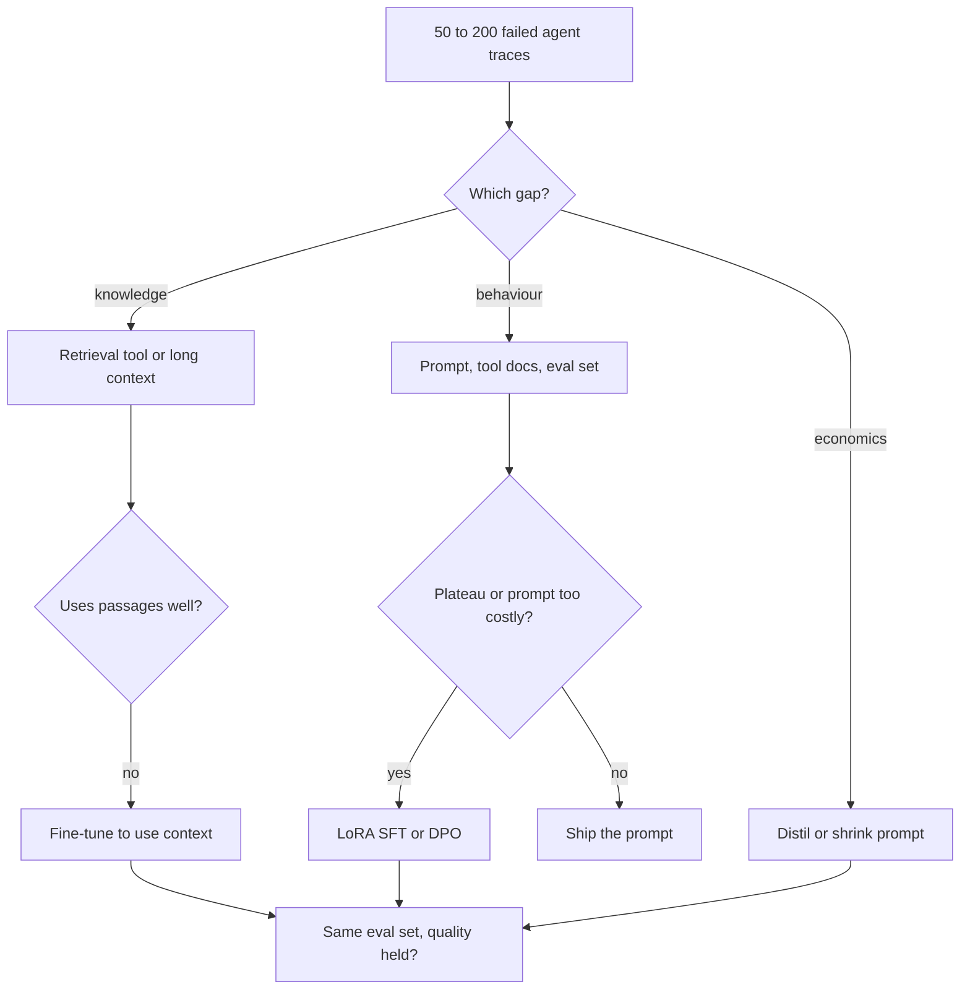

## TL;DR
When an agent fails, name the gap first. Prompts and tool descriptions fix behaviour cheaply, retrieval
tools add missing knowledge, and fine-tuning changes weights for tool-calling skill, format and cost,
not facts. Climb only when evals prove the cheaper rung insufficient.

## For agent builders
- **Why it matters for agents.** Every agent failure ("wrong tool", "made up the policy", "too slow per
  step") is one of three gaps, and each gap has one right lever. Picking the wrong one costs weeks: a LoRA
  that a tool-description edit would have fixed, or a vector index built to fix a formatting bug.
- **Where it shows up in your stack.** Prompt rung: the system prompt and tool schemas in your agent loop
  (plain SDK code, LangGraph, or another framework). RAG rung: a search tool the agent calls. Fine-tune
  rung: a provider fine-tuning API or TRL/Axolotl on traces. The eval set lives wherever you keep traces,
  such as LangSmith or Langfuse.
- **What you control.** The failure labels, the golden set built from real agent runs, the order you
  climb, and the break-even arithmetic, which multiplies per call by steps per task.
- **What you can skip.** Fine-tuning mechanics until the prompt rung has plateaued on a measured eval;
  most agent teams never need to leave the first two rungs.

## Why it exists
- **The same requests arrive every week.** "Make the agent know our stuff", "make it sound like us",
  "make it stop calling the wrong tool". The reflex answer is "fine-tune it", because training feels like
  the real engineering. That reflex is expensive and usually wrong for the first request.
- **Fine-tuning on documents does not reliably inject them.** The loss is next-token prediction over a
  handful of phrasings, nothing like the massive repetition and paraphrase of pretraining. Ovadia et al.
  found retrieval consistently beat unsupervised fine-tuning on new facts; fine-tuning improved only when
  each fact was shown in many paraphrases, so the problem is exposure and phrasing, not effort.
- **Even knowledge that sticks is frozen.** It is fixed at training time, cannot be scoped per tenant or
  deleted, carries no citation, and must be redone when the base model is upgraded.
- **"Just prompt harder" has ceilings too.** Prompts grow to thousands of tokens, costing money and
  latency on every call, and an agent pays that on every step; few-shot examples cannot pin a precise
  output distribution; some behaviours (strict schema compliance in a small model, a domain's tone, a
  tool-calling idiom) never stabilise by instruction alone.
- **RAG fixes only one gap, and adds a failure mode.** It helps when the model is *missing* information
  that exists in retrievable text, not when it has the information and still does the wrong thing, and
  retrieval quality becomes a new risk. Without a framework, teams spend two weeks on a LoRA that a
  200-token system prompt edit would have fixed, or build retrieval to fix formatting.

## How it works
### Three levers, three different objects
| Lever | What it changes | Good at | Weak at | Cost shape |
|---|---|---|---|---|
| Prompt (system prompt, tool descriptions, few-shot, structured output) | The input of this request | Instructions, format, tool choice, small behaviour shifts, per-deployment config | Precise distributions, very long rule sets, small-model compliance | Tokens × requests × agent steps, partly offset by prompt caching |
| RAG (often a search tool the agent calls) | The input, with retrieved evidence | Facts, freshness, per-user/tenant scoping, citations, deletion | Behaviour the model already gets wrong with the facts in hand | Index, embeddings, retrieval quality, ops |
| Fine-tune (SFT/DPO, usually LoRA) | The weights | Default style, format, task skill, tool idiom, compressing a long prompt, distilling into a smaller model | Facts that change, facts needing attribution, anything still being redesigned | Data, GPU time, evals, re-doing on base-model upgrades, forgetting risk |

### The decision procedure
1. **Name the gap with failing examples.** Collect 50–200 real failures (for agents, whole traces) and
   sort them:
   - *knowledge gap:* the model lacked information;
   - *behaviour gap:* it had the information and still answered wrongly, in the wrong form or tone, or
     picked the wrong tool or arguments;
   - *economics gap:* it was right but too slow or expensive.
   Most requests contain two gaps tangled together, and the lever differs for each.
2. **Knowledge gap → RAG.** Or long context, if the corpus is small, static and the token cost is
   acceptable. Do not fine-tune to inject the content. If the model handles retrieved passages badly
   (ignores them, cannot say "not in the documents"), that is a behaviour gap: fine-tune it to *use*
   retrieved context (the RAFT idea), still keeping the facts in the index.
3. **Behaviour gap → prompt first.** System prompt, tool descriptions, a few curated examples,
   structured-output mode. Build the eval set from the failures and score it. If the score plateaus below
   target, or the prompt needed to reach it dominates per-request cost, move to a LoRA SFT on the same
   reviewed examples. Use DPO when failures are preference-shaped (two answers, one better) rather than
   right/wrong.
4. **Economics gap → fine-tune.** Distil the big model's outputs into a smaller model, or train the
   few-shot block into the weights so the prompt shrinks; verify on the same eval set that quality held.
   In agents, a common first target is the high-volume, narrow step (routing or argument extraction).
5. **Combine.** The usual production end state is RAG for facts, a fine-tuned or well-prompted model for
   behaviour, and a prompt for per-deployment configuration. The levers are not exclusive; the mistake is
   using the wrong one for a given gap.

### Background: why fine-tuning is weak at facts
- **SFT shifts probability mass toward the sequences it sees.** A fact seen a few times in one phrasing
  does not become reliably retrievable under other phrasings, which question answering requires.
- **RAG puts the fact in the context window,** where attention can copy it directly, so no memorisation
  is needed.
- **Fine-tuned "knowledge" fails silently,** because the model produces plausible details in the style of
  the training data rather than refusing.

### The economics, as arithmetic
The cost case for fine-tuning is a break-even, not a feeling. For an agent, requests per month means
tasks × model calls per task, because every step re-sends the prompt.

```
monthly saving   = tokens removed per request × requests per month × price per input token
                   − (any extra per-token or hosting cost of serving the tuned model)
cost per cycle   = data review + training runs + eval runs, repeated at every base-model upgrade
fine-tune pays   when monthly saving × months between upgrades > cost per cycle
```

- **The second term of the saving is the one people forget.** Some hosted fine-tuning products price
  tuned models above the base model per token.
- **Self-hosting has its own cost.** A tuned model needs its own GPUs unless the serving stack can load
  many LoRA adapters onto one shared base (multi-adapter serving).
- **Prompt caching shrinks the first term,** because a cached prefix is already billed at a discount, and
  an agent's stable prefix (system prompt plus tool schemas) is exactly what caches well.
- **Run the numbers** with your vendor's current prices before arguing either way.

### Reversibility and the upgrade tax
| Lever | Change and rollback | On a new base model |
|---|---|---|
| Prompt | One deploy, instant rollback | Transfers largely unchanged |
| RAG index | Incremental updates, supports deletion | Transfers to any model |
| Fine-tune | New artifact to re-evaluate; roll back by swapping adapters | Re-train for every release; with proprietary APIs, may lock you to one vendor's fine-tuning product |

That tax is why "prompt until proven insufficient" is the default ordering, not a statement that
fine-tuning is bad.

## Diagram
Start from labelled agent failures, route each gap to its lever, and only climb to fine-tuning when the
eval set plateaus on the cheaper rung.



## Examples
### Support agent: sorting the gaps
A support agent for a SaaS product (all numbers illustrative) handles 250,000 tickets a month at about
eight model calls each, so 2 million requests a month. Each call carries a 5,000-token prompt of
instructions, tool schemas and twelve examples.

| Complaint from trace review | Gap | Lever |
|---|---|---|
| Does not know the product docs, which change weekly | Knowledge | A `search_docs` retrieval tool over the docs, weekly re-indexing, so new pages are answerable the day they ship and retired pages stop being cited |
| Calls `refund_order` when policy says escalate | Behaviour | Sharpen the tool descriptions and the escalation rule in the system prompt, then measure |
| Should answer in brand voice | Behaviour | Tighten the system prompt, then measure |
| Must return a fixed JSON object | Behaviour | Structured-output mode, then measure on 200 reviewed cases |

- **Pick the right metric.** Structured output guarantees the JSON parses and matches the schema, not
  that the right fields carry the right content. So the metric is field-level correctness (right
  `category` enum, `escalate` set when policy requires it).
- **The prompt plateaus.** It reaches 97% field-level correctness and a tone score of 4.1/5 on a rubric,
  against targets of 99.5% and 4.5.
- **So fine-tune.** A LoRA SFT on 1,500 reviewed answers reaches 99.7% and 4.6, and the twelve examples
  leave the prompt, which shrinks to 800 tokens.
- **Division of labour.** Knowledge stayed in the index behind the tool; the weights only learned
  behaviour; the system prompt still carries per-customer configuration.

### The economics of that fine-tune
| Quantity | Before | After |
|---|---|---|
| Prompt tokens per request | 5,000 | 800 |
| Input tokens per month (× 2M requests) | 10 billion | 1.6 billion |
| Reduction | | about 6× fewer, an 8.4-billion-token saving |

- **Caching discounts the win.** With prompt caching the cached share is already discounted, so the
  realised saving is smaller but still material.
- **Plug in the serving price.** If the tuned model costs more per token, part of that 8.4-billion-token
  saving is handed straight back.
- **Count the cycle cost.** A few GPU-hours per iteration plus the eval harness, repeated at each
  base-model upgrade.

### Triage script: route labelled agent failures to a lever
Run after a trace review in which each failed run got one gap label. The output tells you which rung to
work on first and how big each pile is.

```python
import json
from collections import Counter

LEVER = {
    "knowledge": "add or fix a retrieval tool (index, chunking, filters)",
    "wrong_tool": "rewrite tool names/descriptions, add an example, re-score",
    "bad_args": "strict tool schema or structured output, re-score",
    "ignores_context": "prompt to answer only from results; RAFT-style SFT if it plateaus",
    "economics": "prompt caching first, then distil the narrow step",
}

with open("failed_traces.jsonl") as f:          # rows: {"trace_id": ..., "gap": "wrong_tool", ...}
    gaps = Counter(json.loads(line)["gap"] for line in f)

total = sum(gaps.values())
for gap, n in gaps.most_common():
    print(f"{gap:16s} {n:4d} ({n / total:.0%})  -> {LEVER.get(gap, 'relabel: unknown gap')}")
# If knowledge failures dominate, no amount of fine-tuning helps. If wrong_tool dominates,
# start with the tool descriptions: they are part of the prompt the model reads every step.
```

### Break-even calculator
The formula above as runnable Python. The prices are placeholders; replace them with your vendor's
current list prices before deciding anything.

```python
def monthly_saving(tokens_removed, requests, price_per_mtok,
                   cached_share=0.0, cached_price_ratio=1.0, extra_serving=0.0):
    # Removed tokens that would have been cached were already billed at a discount,
    # so they save less than full price.
    blended = price_per_mtok * ((1 - cached_share) + cached_share * cached_price_ratio)
    return tokens_removed * requests * blended / 1e6 - extra_serving

def pays_off(saving, months_between_upgrades, cost_per_cycle):
    return saving * months_between_upgrades > cost_per_cycle

# Placeholder prices: replace with your vendor's current list prices.
base = dict(tokens_removed=5000 - 800, requests=2_000_000, price_per_mtok=3.00)
cycle, months = 15_000, 6          # review + training + evals per cycle; months per base model

for label, kw in [
    ("no caching, same price",         dict()),
    ("80% cached at 10% price",        dict(cached_share=0.8, cached_price_ratio=0.1)),
    ("cached + tuned model +$6k/month", dict(cached_share=0.8, cached_price_ratio=0.1, extra_serving=6000)),
]:
    s = monthly_saving(**base, **kw)
    print(f"{label:34s} saving ${s:>9,.0f}/mo  pays off: {pays_off(s, months, cycle)}")
# no caching, same price             saving $   25,200/mo  pays off: True
# 80% cached at 10% price            saving $    7,056/mo  pays off: True
# cached + tuned model +$6k/month    saving $    1,056/mo  pays off: False
```

The same 8.4 billion removed tokens go from an easy win to a loss once caching and a tuned-model
serving premium are counted, which is why the second term matters. An agent's stable prefix caches
well, so the middle row is the realistic one.

## Production patterns
- **Eval-gated lever ladder.** When any "know / sound like / stop doing" request arrives, build one
  golden set from the labelled failed traces and score every rung (prompt, RAG, LoRA) on it. Block
  promotion in CI unless the new rung beats the previous one on the target metric. Monitor score per rung,
  task success rate, and regressions on unrelated tasks.
- **Tool descriptions are the first prompt to fix.** Agent teams treat tool names, descriptions and
  argument schemas as prompt text: when traces show wrong-tool or bad-argument failures, edit those
  first, re-run the golden set, and only then consider training on tool-call traces. Monitor
  tool-selection accuracy and argument-validation errors per tool.
- **Facts in the index, behaviour in the weights.** Re-index on every document change (weekly at minimum
  for the support case) and delete retired pages from the index, never from weights. Monitor retrieval
  recall on the golden set, citation rate and "not in the documents" answers.
- **Cache before you train.** Put stable instructions, tool definitions and few-shot examples first and
  byte-identical so provider prompt caching applies (Anthropic's `cache_control` breakpoints, OpenAI's
  automatic prefix caching). Monitor cached-token share in the usage fields, then redo the break-even.
- **Multi-adapter serving for many tunes.** When several teams or tenants each need a LoRA, serve them on
  one shared base, for example vLLM started with `--enable-lora` and `--max-loras`, choosing the adapter
  per request. Monitor adapter load latency and per-adapter error rates.
- **Budget the upgrade tax up front.** Version the training data, adapter and eval harness together. On
  each base-model release, first rerun the prompt-only baseline: if the new base closes the gap, retire the
  adapter. Track months between upgrades as an input to the break-even.

## Trade-offs
- **Prompting: free to try vs paid on every request.** It rolls back instantly, but every request pays for
  the prompt and quality plateaus. In an agent the bill multiplies by steps per task. It flips to
  fine-tuning when a multi-thousand-token prompt runs at high volume or evals stall below target.
- **RAG: freshness vs owning retrieval.** It gives freshness, citations, access control and deletion, but
  you now own a retrieval system whose recall becomes the dominant failure mode. It flips to plain long
  context when the corpus is small and rarely changes, and it never flips to fine-tuning for facts.
- **Fine-tuning: behaviour and cost vs upkeep.** It gives behaviour you cannot prompt into existence and a
  cheaper per-request path, but costs data, evals, forgetting risk and re-training at every base-model
  release. It flips back to prompting when the task or tool set is still changing or the model is
  upgraded often.
- **RAG plus a fine-tuned model: strongest vs most moving parts.** It is the strongest configuration but
  doubles the moving parts, so it only pays off when the team can run the same eval set across both layers
  after every change.

## Pitfalls
- **Fine-tuning to inject facts.** Symptom: confident, plausible details that match the training data's
  style but not its content, and no way to answer questions about last week's changes. Fix: move the
  facts to retrieval.
- **Skipping the eval set.** Symptom: "the fine-tuned model feels better" with no number attached, and
  regressions on other tasks discovered by users rather than by the team. Fix: build the set from real
  failures before the first change.
- **Building RAG for a behaviour gap.** Symptom: retrieval returns the right passage while the model still
  answers in the wrong format or ignores the passage. Fix: treat it as behaviour (prompt, then fine-tune
  to use context).
- **Training on tool-call traces while the tool set is still changing.** Symptom: the tuned agent keeps
  calling a renamed or retired tool, or misses a new one. Fix: stabilise tool schemas first; tool
  descriptions in the prompt change with one deploy, weights do not.
- **Fine-tuning before the prompt has been seriously tried.** Symptom: a two-week training project that a
  short system-prompt edit would have resolved. Fix: prompt until the eval plateaus.
- **Ignoring the upgrade tax.** Symptom: a fine-tuned model blocks a migration to a stronger base model for
  months because nobody budgeted to re-train and re-evaluate. Fix: budget it in the break-even.
- **Treating long context as free RAG.** Symptom: per-request cost blows up and lost-in-the-middle errors
  appear on the documents that matter most. Fix: retrieve, or keep long context for small static corpora.

## When to use
- **Use the procedure:** every time someone asks for an agent to "know", "sound like" or "stop doing"
  something. Classify failures, then prompt, then RAG for knowledge, then LoRA for behaviour or cost, and
  measure the same eval set at every rung.
- **Reach for fine-tuning when:** the behaviour is stable and the prompt has plateaued or become the
  dominant per-request cost; a smaller model must match a larger one on a narrow task (an agent's router
  or extraction step); or the output distribution must be precise.
- **Avoid fine-tuning when:** the task or tool set is still being designed, facts must be fresh or
  attributable, or you cannot afford to re-train at the next base-model release.
- **Interviews:** the expected answer is never "fine-tune" or "RAG" alone; it is the gap classification,
  the ordering, and the measurement loop that justifies each step.

## Role lens
- **Engineer:** Builds the eval set from real failures first, ships the prompt, then the retrieval
  layer, then a LoRA, scoring the same set at every rung and owning the prompt-token budget.
- **Architect:** Owns the lever policy: which knowledge must stay in retrieval for freshness, access
  control or compliance, which behaviours may move into weights, and the plan for base-model upgrades.
- **FDE:** Translates the customer's "it doesn't know our business" into the knowledge/behaviour split in
  week one, and declines the request to fine-tune on the company wiki with the reasoning to back it.

## Check yourself
**Q:** A customer says: "The model doesn't know our product catalogue and keeps answering in the wrong
tone, so let's fine-tune it on our docs." How do you respond, and what plan do you propose?
**A:** Separate the two gaps. The catalogue is knowledge that changes, must be scoped and must be
attributable, so it belongs in retrieval: fine-tuning on the docs will not make SKUs reliably recallable,
cannot remove discontinued items, and gives no citations. Tone is behaviour: tighten the system prompt
with a few curated examples first and score it on a rubric over 100–200 real conversations. If that
plateaus below target, train a LoRA on reviewed answers for tone only, keeping facts in the index. Later,
if the model mishandles retrieved passages, fine-tune it to use context rather than to contain it.
Propose the measurement plan up front so each step is justified by a number, not a feeling.

## Interview questions
### Why doesn't fine-tuning on a company's documents make the model know them?
- **Next-token training sees few phrasings.** SFT shifts probability toward the exact sequences it saw,
  which does not build the paraphrase-invariant recall that question answering needs.
- **Evidence:** Ovadia et al. found retrieval consistently beat unsupervised fine-tuning for new facts,
  and fine-tuning helped only with many paraphrases per fact.
- **And it fails silently:** the model invents plausible details in the training data's style instead of
  refusing, with no citation and no way to delete a retired fact.

### Your agent keeps calling the wrong tool in 8% of traces. The team wants to fine-tune. What do you do first?
- **Classify it:** the model has the information it needs, so this is a behaviour gap, and the cheapest
  lever is the prompt the model reads every step, which includes the tool names and descriptions.
- **Fix and measure:** disambiguate overlapping tools, state when each one applies, add one example, then
  re-score tool-selection accuracy on a golden set built from the failing traces.
- **Fine-tune only on a plateau:** if accuracy stalls below target with a stable tool set, SFT on reviewed
  correct trajectories, scored on the same set.

### The agent's search tool returns the right passage but answers still ignore it. What do you do?
- **Classify it correctly:** retrieval works, so this is a behaviour gap, not a knowledge gap. More
  retrieval tuning will not help.
- **Prompt first:** instruct the model to answer only from the passages and to say "not in the
  documents" otherwise, then score faithfulness on the golden set.
- **If that plateaus:** fine-tune the model to use retrieved context (the RAFT idea) while the facts stay
  in the index.

### The prompt has plateaued below target. When would you still not fine-tune?
- **When the task is still changing,** because every redesign means new data, a new run and a new eval.
- **When the base model upgrades often,** because the upgrade tax repeats each release and a newer base
  may close the gap on its own.
- **When you cannot evaluate,** because without a golden set you cannot tell a better adapter from a
  regression on other tasks.

### 2M requests a month carry a 5,000-token prompt. Is fine-tuning it down to 800 tokens worth it?
- **Token arithmetic:** 4,200 tokens removed × 2M requests = 8.4 billion input tokens a month, from 10
  billion to 1.6 billion. For an agent, 2M requests may be only 250,000 tasks at eight calls each.
- **Then subtract:** the cached share was already discounted, and a tuned model may cost more per token
  or need its own GPUs.
- **Compare with the cycle cost:** review, training and evals, multiplied by how often you re-train. It
  pays only if monthly saving × months between upgrades exceeds that.

### A legal team wants answers from internal policies, scoped by department, with citations. Design it.
- **RAG is the core,** because the requirements (freshness, per-department access control, citations,
  deletion) are exactly what retrieval gives and weights cannot.
- **Enforce scoping at retrieval time** with metadata filters per user's department, so restricted text
  never reaches the prompt.
- **Behaviour via prompt:** a system prompt requiring citations and refusals outside the documents, scored
  on a golden set; fine-tune only if that set plateaus.

## Quiz
### Q: Which situation is RAG the right lever for?
- [ ] The model has the facts but formats answers inconsistently
- [x] The model lacks information that exists in documents and changes over time
- [ ] The model is accurate but too slow and expensive at current volume
- [ ] The model refuses too many legitimate requests
> RAG supplies missing, changing, attributable information at request time. Formatting and refusal are
> behaviour gaps for prompting or fine-tuning; cost is an economics gap for distillation or prompt compression.

### Q: Why is supervised fine-tuning a poor way to inject facts?
- [ ] Fine-tuning cannot modify attention-layer weights, only the output head
- [x] Next-token training on a few phrasings does not make facts reliably retrievable, and it offers no freshness or citation
- [ ] LoRA's low rank is too small to store any factual content
- [ ] Fine-tuning only changes the tokenizer vocabulary, not the model
> SFT shifts probabilities toward seen sequences; it does not build the robust, paraphrase-invariant recall
> that pretraining's massive repetition produces. Retrieval puts the fact in context, where attention can copy it.

### Q: When does fine-tuning beat prompting on cost?
- [ ] Always, because fine-tuned models are inherently smaller
- [ ] When the task definition changes every week
- [x] When a long few-shot prompt at high volume dominates per-request cost and the behaviour is stable
- [ ] When the base model is upgraded every month
> Training the examples into the weights removes thousands of tokens from every request, which pays off at
> volume; frequent task or base-model changes mean re-training repeatedly, which erases that saving.

## Use cases & projects
### Use cases
- **Triage after an agent eval regresses.** Label each failed trace as a behaviour, knowledge or
  capability gap, then pick prompt, retrieval or fine-tune per label instead of one fix for everything.
- **"Make the agent know our docs" requests.** Route them to a search tool with citations and per-tenant
  filters, because fine-tuning facts is weak, frozen and impossible to delete.
- **Cutting cost on a high-volume agent step.** A router or extraction step with a long few-shot prompt is
  the classic case where fine-tuning a small model pays back, once the behaviour is stable.
- **Planning a base-model upgrade.** Prompt and retrieval rungs carry over almost for free, while every
  fine-tune must be retrained and re-evaluated, so the decision record tells you the upgrade bill.

### Mini project
**Build a failure-to-lever triage report for one agent (1-3 hours).**
- **Goal:** turn a pile of failed agent runs into a ranked list of fixes, each tied to the right rung.
- **Steps:** collect 30-50 failed traces from a small agent you own (or a sample tool-calling agent);
  label each as wrong tool, missing knowledge, ignored context, format or cost; route labels with the
  triage script from Examples; apply the cheapest fix for the top label (a tool-description edit or a
  search tool) and re-run the same traces as an eval.
- **Done when:** you have a table of failure counts per label and per lever, a before/after pass rate for
  the fix you applied, and a written break-even estimate for the one case where fine-tuning might win.
