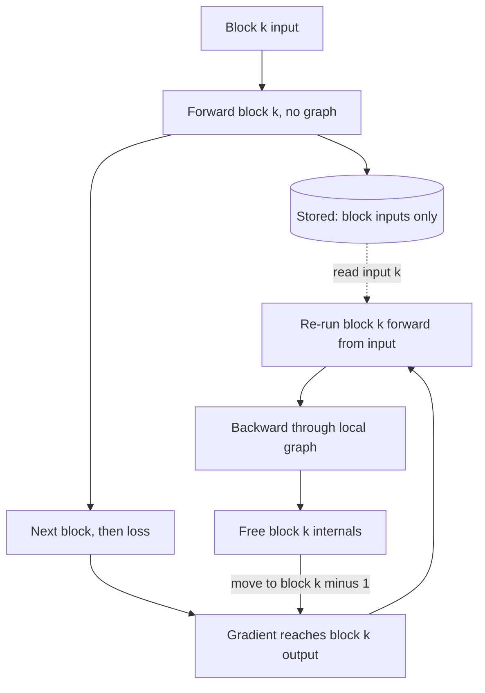

## TL;DR
Agent trajectories are long, so fine-tuning on them is activation-bound. Gradient checkpointing
(recomputation, not saving to disk) keeps only each block's input and rebuilds the rest in backward,
costing one extra forward pass so 8k-16k-token traces fit on one GPU.

## For agent builders
- **Why it matters for agents.** A tool-calling trace is system prompt plus tool schemas plus every call
  and result, often 8k-16k tokens. Activations grow with sequence length, so this flag (with
  FlashAttention) decides whether you can fine-tune on whole trajectories or must truncate them.
- **Where it shows up in your stack.** One line in a TRL `SFTConfig` or `TrainingArguments`, an Axolotl
  YAML key, or Unsloth's `use_gradient_checkpointing="unsloth"`. Managed fine-tuning APIs handle it for
  you.
- **What you control.** The maximum training sequence length, attention implementation, micro-batch and
  the reentrant setting. The silent-zero-gradient trap in LoRA runs is the one bug worth memorising.
- **What you can skip.** It has no effect on serving: inference never stores activations for backward,
  so your agent's latency and the KV cache are untouched. The √n proof is interview trivia, not
  something you tune.

## Why it exists
- **Training memory has four parts.** Weights, gradients, optimizer state and activations. The first
  three are a fixed number of bytes per parameter (about 16 with AdamW in mixed precision), and PEFT and
  quantization attack them.
- **Activations scale with the workload, not the model.** They grow with batch × sequence length ×
  hidden size × layers, and they exist only because backprop needs them: for `y = xW` the weight gradient
  is `xᵀ · dL/dy`, so `x` must be kept; GELU needs its input; softmax needs its output.
- **All of them are live at once.** Autograd holds every intermediate tensor until backward consumes it,
  and backward runs last-layer-first, so at the end of the forward pass *all* of them are alive. At long
  sequence lengths, which agent traces always reach, they outweigh the weights.
- **The naive alternatives fail here.** Gradient accumulation shrinks the micro-batch, but you are already
  at b = 1. Shortening the sequence changes the task: a truncated trajectory loses the final answer the
  agent was supposed to learn. A bigger GPU is a procurement ladder, not an engineering answer.
- **What it buys.** It trades the one resource GPUs have in abundance, compute, for the one they lack,
  memory.

## How it works
### Background: how big activations are
Korthikanti et al. estimate one transformer layer's activations in bf16, without FlashAttention, at
roughly `s·b·h·(34 + 5·a·s/h)` bytes (s = sequence, b = batch, h = hidden, a = heads).

| 7B-class model (h = 4096, a = 32, 32 layers), s = 4096, b = 1 | Size |
|---|---|
| Linear term 34·s·b·h | about 570 MB per layer |
| Attention-score term 5·a·s²·b | about 2.7 GB per layer |
| Whole model, eager attention | ~105 GB |
| Whole model, FlashAttention (no s² term, score matrix never materialised) | ~18 GB, doubling at 8k |

- **Consequence:** a QLoRA run whose weights plus adapter plus optimizer state fit in 6 GB still cannot
  fit on a 24 GB card at 8k context, because of activations alone (all figures illustrative, from the
  formula above).
- **Caveat on the constant:** 34 was derived for a GPT-style block with a 4h-wide GELU MLP and dropout. A
  Llama-style SwiGLU MLP or a dropout-free recipe changes it somewhat, so use the formula for orders of
  magnitude, not for a precise budget.

### Background: the observation and the algorithm
- **The observation.** A block's internal activations are a deterministic function of its input (dropout
  aside, which is handled by replaying the RNG state). With the input kept, you can rebuild the internals
  during that block's own backward step instead of holding them across the whole forward pass.

1. **Partition** the network into segments. In transformers the common choice is one decoder block per
   segment, because block boundaries are where the activation tensor is smallest (just `s·b·h`).
2. **Forward:** run each segment without recording the autograd graph. Keep only the segment's input
   tensor; let its internal activations be freed.
3. **Backward:** when the gradient reaches segment *k*'s output, re-run segment *k*'s forward from its
   stored input with graph recording on, backpropagate through that local graph, free it, and move on to
   segment *k − 1*.

### Memory and compute cost
- **Peak activation memory** becomes (all segment inputs) + (one segment's full internals).
- **The √n result:** with n layers and segments of √n layers each, both terms are O(√n), the "sublinear
  memory" result of Chen et al.
- **Per-block in a transformer:** n block inputs, each `s·b·h·2` bytes, plus one block's internals. In the
  7B example at 4k: 32 × 33.5 MB ≈ 1.1 GB of inputs plus ~570 MB for the live block, down from ~18 GB.
- **Compute:** each segment's forward runs twice. Forward is roughly a third of a step's FLOPs (backward
  is about twice forward), so the worst case is about a third more compute.
- **Wall clock:** the commonly quoted slowdown is 20–30% (illustrative; it depends on how much of the step
  is communication or data loading rather than math).

### Selective recomputation
- **Not every activation costs the same.** Korthikanti et al. point out that the attention scores and
  their softmax/dropout outputs are the entire s² term yet cheap to recompute. Recomputing *only* those
  gives most of the memory benefit for a fraction of the overhead.
- **FlashAttention does this implicitly:** it saves the per-row log-sum-exp and rebuilds score tiles in
  backward.
- **The two compose.** Per-block checkpointing cuts *both* terms from "n layers' worth" to "one live
  layer's worth"; FlashAttention then removes the s² term from that one live layer too.
- **Why the second step matters:** the live block's eager-attention score tensors are `5·a·s²·b` bytes,
  about 2.7 GB for one 7B layer at 4k and ~10.7 GB at 8k. Without FlashAttention that single block sets a
  memory floor no amount of checkpointing lowers. At agent-trace lengths of 16k it is ~43 GB, so eager
  attention is simply off the table.

### Framework mechanics and the reentrant trap
PyTorch exposes `torch.utils.checkpoint.checkpoint(fn, *args, use_reentrant=False)`, with two
implementations:

| Mode | How it works | Behaviour with frozen inputs |
|---|---|---|
| Reentrant (older) | Runs the segment under `no_grad`, re-enters autograd in backward | If **no input requires grad**, the segment is never recorded and its parameters silently get no gradient |
| Non-reentrant (recommended) | Uses saved-tensor hooks | Handles inputs without grad correctly |

- **The LoRA case:** the embedding output does not require grad because the embeddings are frozen. PEFT
  recipes work around reentrant mode with `model.enable_input_require_grads()`. Most agent fine-tunes are
  LoRA on tool-call traces, so this is the case you will hit.
- **In Transformers:**
  `model.gradient_checkpointing_enable(gradient_checkpointing_kwargs={"use_reentrant": False})` or
  `TrainingArguments(gradient_checkpointing=True)`.
- **KV cache off:** Transformers forces `use_cache=False` when checkpointing is on, because the cache
  generation builds is pointless during training and conflicts with recomputation. Your serving stack
  keeps its KV cache; this is training-only.

### Where it sits among the other levers
| Lever | What it cuts |
|---|---|
| Gradient accumulation | the b in `s·b·h` |
| Sequence or context parallelism | the s, split across GPUs |
| FlashAttention | the s² term |
| CPU offloading of activations | moves them across PCIe, usually slower than recomputing |
| Gradient checkpointing | the "× layers" factor |

- **With FSDP:** checkpoint per block *inside* each FSDP unit, so recomputation does not trigger extra
  parameter all-gathers.

## Diagram
Forward keeps only each block's input; backward re-runs one block at a time from that input, so only
one block's internals are ever alive while training on a long agent trace.



## Examples
### Worked scenario: fine-tuning a 7B tool-calling agent on full trajectories
A team has 2,000 successful agent runs: a 6k-token prefix (system prompt plus tool schemas) and tool
calls and results that bring the p95 trace to ~16k tokens. Target: QLoRA on one 24 GB card (~4 GB of
4-bit weights). Activation estimates from the formula, h = 4096, 32 layers, b = 1 (illustrative):

| Setup at s = 16,384 | Activations | Verdict |
|---|---|---|
| Eager attention + checkpointing | one live block's scores alone ~43 GB | hopeless |
| FlashAttention, no checkpointing | ~73 GB (2.3 GB per layer × 32) | OOM |
| FlashAttention + checkpointing | ~4.3 GB of block inputs + ~2.3 GB live block ≈ 6.6 GB | fits |
| Truncate to 4k instead | ~1.6 GB with both on | fits, but drops the final tool calls and answer |

- **The decision:** keep whole trajectories and turn both levers on, because truncation trains the model
  on agents that never finish.
- **What remains to check:** the logits tensor over the vocabulary also grows with s, so verify the real
  peak with `torch.cuda.max_memory_allocated()` on the longest trace before the full run.

### Pre-flight: size the run from your agent traces
Pure Python with a tokenizer, no GPU: measure trace lengths the way the trainer will render them, then
estimate activations before booking hardware.

```python
import json
from transformers import AutoTokenizer

tok = AutoTokenizer.from_pretrained("Qwen/Qwen2.5-7B-Instruct")

def act_gb(s, layers=32, h=4096, a=32, flash=True, ckpt=True):
    per_layer = (34 * s * h + (0 if flash else 5 * a * s * s)) / 1e9   # bf16, b = 1
    return layers * s * h * 2 / 1e9 + per_layer if ckpt else per_layer * layers

lengths = []
with open("agent_traces.jsonl") as f:          # rows: {"messages": [...], "tools": [...]}
    for line in f:
        row = json.loads(line)
        ids = tok.apply_chat_template(row["messages"], tools=row.get("tools"), tokenize=True)
        lengths.append(len(ids))

lengths.sort()
p95, longest = lengths[int(0.95 * len(lengths))], lengths[-1]
print(f"p95 {p95} tokens, max {longest} tokens")
for s in (p95, longest):
    print(f"s={s}: flash {act_gb(s, ckpt=False):.1f} GB | flash+ckpt {act_gb(s):.1f} GB")
# Pick max_length at or above p95 so most trajectories keep their final answer, and drop
# (do not truncate) the few that are longer still.
```

### Residual MLP stack with and without checkpointing
Work the budget out before running it:
- **Parameters:** each block has 8·d² ≈ 33.5M parameters at d = 2048, so 24 blocks are ~805M: ~3.2 GB of
  fp32 weights and, by the end of backward, ~3.2 GB of gradients.
- **Without checkpointing:** autograd keeps per block the `[4096, 2048]` input (for the first Linear's
  weight gradient), the `[4096, 8192]` pre-GELU tensor (for GELU's derivative) and the `[4096, 8192]` GELU
  output (for the second Linear).
- **That totals** 9 × 4096 × 2048 × 4 bytes ≈ 0.3 GB per block, ~7.2 GB for 24 blocks, all alive at the
  start of backward.
- **With checkpointing:** only the 24 block inputs survive (~0.8 GB), and one block's 0.3 GB is rebuilt
  at a time.

```python
import torch, torch.nn as nn
from torch.utils.checkpoint import checkpoint

class Block(nn.Module):
    def __init__(self, d):
        super().__init__()
        self.ff = nn.Sequential(nn.Linear(d, 4 * d), nn.GELU(), nn.Linear(4 * d, d))
    def forward(self, x):
        return x + self.ff(x)

class Net(nn.Module):
    def __init__(self, d, n, ckpt):
        super().__init__()
        self.blocks = nn.ModuleList(Block(d) for _ in range(n))
        self.ckpt = ckpt
    def forward(self, x):
        for b in self.blocks:
            x = checkpoint(b, x, use_reentrant=False) if self.ckpt else b(x)
        return x

def peak_gb(ckpt, d=2048, n=24, tokens=4096):
    torch.cuda.empty_cache(); torch.cuda.reset_peak_memory_stats()
    net = Net(d, n, ckpt).cuda()
    x = torch.randn(tokens, d, device="cuda", requires_grad=True)
    net(x).sum().backward()
    return torch.cuda.max_memory_allocated() / 2**30

for flag in (False, True):
    print(f"checkpointing={flag}: peak {peak_gb(flag):.1f} GB")
# Rough expectation: ~10-11 GB without (weights + all activations) vs ~7 GB with (weights +
# gradients + block inputs + one live block). Double `tokens` and the unchecked peak grows by ~7 GB
# while the checkpointed one grows by about 1 GB: activations scale with tokens, weights do not.
# Hugging Face equivalent: model.gradient_checkpointing_enable(
#     gradient_checkpointing_kwargs={"use_reentrant": False})
```

### Activation budget calculator for a 7B fine-tune
Plug the Korthikanti estimate into a planning script before you book hardware.

```python
def act_gb_per_layer(s, b=1, h=4096, a=32, flash=False):
    linear = 34 * s * b * h                    # bytes, bf16, Korthikanti et al.
    scores = 0 if flash else 5 * a * s * s * b # the s^2 attention-score term
    return (linear + scores) / 1e9

def budget(s, layers=32, h=4096, a=32, flash=True, ckpt=False):
    per_layer = act_gb_per_layer(s, h=h, a=a, flash=flash)
    if not ckpt:
        return per_layer * layers               # every layer's activations live at once
    inputs = layers * s * h * 2 / 1e9           # one bf16 block input per layer
    return inputs + per_layer                   # plus one live block during recompute

for s in (4096, 8192):
    print(f"s={s}: eager {budget(s, flash=False):.0f} GB | flash {budget(s):.1f} GB"
          f" | flash+ckpt {budget(s, ckpt=True):.1f} GB | eager+ckpt {budget(s, flash=False, ckpt=True):.1f} GB")
# s=4096: eager 104 GB | flash 18.3 GB | flash+ckpt 1.6 GB | eager+ckpt 4.3 GB
# s=8192: eager 380 GB | flash 36.5 GB | flash+ckpt 3.3 GB | eager+ckpt 14.0 GB
```

Reading the output for a QLoRA run on a 24 GB card (~4 GB of 4-bit weights):

| Setup at 8k | Activations (estimate) | Verdict |
|---|---|---|
| Eager attention, no checkpointing | ~380 GB | hopeless |
| FlashAttention, no checkpointing | ~36 GB | still OOM |
| Eager attention + checkpointing | ~14 GB, of which ~10.7 GB is one block's scores | marginal; backward also needs gradient buffers for those score tensors |
| FlashAttention + checkpointing | ~3.3 GB | fits, with room to raise the micro-batch |

## Production patterns
- **Checkpointing plus fused attention as the agent-trace default.** For any 4k+ fine-tune on one GPU,
  which covers nearly every tool-calling dataset, set
  `TrainingArguments(gradient_checkpointing=True, gradient_checkpointing_kwargs={"use_reentrant": False})`
  and load the model with `attn_implementation="sdpa"` (or `"flash_attention_2"`). Monitor peak memory per
  step and tokens per second.
- **Size max length from the trace distribution, not a default.** Agent teams render every trajectory
  through the chat template with its tool schemas, take the p95 length, and set the training max length
  at or above it. Drop the rare outliers rather than truncating them, because a cut trace teaches an agent
  that never answers. Monitor the share of rows dropped.
- **Re-tune the micro-batch after enabling it.** Raise `per_device_train_batch_size` and lower
  `gradient_accumulation_steps` so the effective batch is unchanged, until memory is nearly full. Compare
  tokens per second and GPU utilisation against the uncheckpointed baseline, not seconds per step.
- **Guard LoRA/QLoRA runs against silent zero gradients.** Use non-reentrant mode, or PEFT's
  `prepare_model_for_kbit_training(model, use_gradient_checkpointing=True)`, which also enables input
  gradients. After the first step, assert every trainable parameter has a non-`None` gradient and that the
  logged gradient norm is non-zero.
- **Wrap blocks inside FSDP units; selective recompute at scale.** With FSDP, apply checkpointing per
  decoder block (PyTorch's `apply_activation_checkpointing` with a `check_fn` matching the block class) so
  recompute reuses gathered parameters. In Megatron-LM prefer `--recompute-granularity selective` and fall
  back to `full` only when memory still does not fit. Monitor step time and model FLOPs utilisation.
- **Measure before and after in a smoke test.** Run one step each way on the longest agent trace, log
  `torch.cuda.max_memory_allocated()`, and keep the numbers next to the config so regressions show up when
  sequence length, tool count or model changes.

## Trade-offs
- **Compute vs memory.** You pay roughly one extra forward pass per step (20–30% wall-clock,
  illustrative) for a large cut in activation memory. If you are compute-bound with memory to spare, as
  with short single-turn classification data, it is pure loss and should be off.
- **Slower steps vs higher throughput.** The freed memory usually lets you raise the micro-batch, and a
  GPU at micro-batch 1 is badly under-utilised, so tokens/second often goes *up* overall despite the
  recompute. This flips once the batch already saturates the GPU.
- **Whole trajectories vs truncation.** Checkpointing lets you keep full agent runs, so the model learns
  how runs end, at the cost of slower steps. Truncating is cheaper but flips the training signal toward
  half-finished tool loops; only accept it when the final steps are not what you need to teach.
- **Per-block vs coarser segments.** Per-block is simple and matches FSDP wrapping. Coarser segments store
  fewer boundary inputs but hold a larger live segment during recompute (total recompute is one extra
  forward either way); the √n split that balances the two is rarely worth the engineering.
- **Non-reentrant vs reentrant.** Non-reentrant handles frozen inputs and nested checkpoints correctly.
  Reentrant can have slightly lower overhead in some stacks but fails silently in the LoRA case, so the
  default should be non-reentrant.

## Pitfalls
- **Confusing it with model checkpointing (saving state to disk).** Symptom: someone enables
  "checkpointing" for resumability, loses a multi-day run, and discovers nothing was ever written. Fix:
  configure save checkpoints separately.
- **Reentrant mode with frozen embeddings in a LoRA run.** Symptom: a flat loss curve on your tool-call
  traces and adapter gradients that are `None`. Fix: `enable_input_require_grads()` or
  `use_reentrant=False`.
- **Still OOM at long context after enabling it.** Symptom: the peak fell a lot but stalls at a floor of
  several GB per live block, because eager attention materialises that block's s² score tensors (~10 GB
  for one 7B layer at 8k) during recompute. Fix: only FlashAttention/SDPA removes them.
- **Silently truncating trajectories to dodge OOM.** Symptom: the tuned agent calls tools plausibly but
  rarely stops or answers, because the final turns were cut from most training rows. Fix: checkpointing
  plus fused attention, and a max length set from the p95 trace.
- **Switching it off because "steps got slower".** Symptom: lower throughput after reverting. Fix: raise
  the micro-batch to recover utilisation; the right metric is tokens per second, not seconds per step.
- **Side effects inside a checkpointed function run twice.** Counters, logging, in-place updates and custom
  RNG not covered by `preserve_rng_state` repeat. Symptom: doubled metrics or a gradient mismatch versus
  the uncheckpointed run. Fix: keep checkpointed functions pure.

## When to use
- **Use when:** activation memory is the thing that does not fit. Diagnose it by computing the `s·b·h·34`
  estimate or by comparing `torch.cuda.max_memory_allocated()` with and without the flag.
- **Default on:** for any fine-tune at 4k+ context on a single GPU, which includes almost every agent
  trajectory dataset; it is what makes QLoRA on a 24 GB card at 8k realistic.
- **Avoid when:** small models and short sequences, where the GPU is compute-bound and memory is
  plentiful.
- **Ignore when:** you only call hosted models or serve your agent; this setting never touches inference.
- **Always:** pair it with FlashAttention or SDPA, re-tune the micro-batch after enabling it, and judge
  the result by tokens/second.
- **Interviews:** separate per-parameter memory (weights, gradients, optimizer) from activation memory,
  state what checkpointing trades, explain the √n argument, and name the reentrant trap.

## Role lens
- **Engineer:** Flips the flag in `TrainingArguments`, Axolotl or Unsloth, pairs it with FlashAttention,
  raises the micro-batch until memory is full again, and checks tokens/second against the baseline.
- **Architect:** Sets the sequence-length-versus-GPU-tier policy knowing that checkpointing lets a 24 GB card
  handle an 8k QLoRA, so the capacity plan is not "buy 80 GB cards" by default.
- **FDE:** Fits a customer's long-document fine-tune onto the fixed GPU quota in their VPC instead of
  waiting on a procurement cycle, and explains the 20–30% step-time cost up front.

## Check yourself
**Q:** A team runs QLoRA on a 7B model at 8k context on a 24 GB GPU. The 4-bit weights are ~4 GB and the
adapter plus optimizer state is tiny, yet they OOM at micro-batch 1. Explain what is using the memory and
what you would change, with rough numbers.
**A:** The rest is activations. With h = 4096 and 32 layers, the linear term 34·s·b·h at s = 8192 is about
1.1 GB per layer, roughly 36 GB across the model even with FlashAttention; without it the attention-score
term 5·a·s²·b adds about 10 GB per layer. So first turn on FlashAttention or SDPA to delete the s² term,
then enable gradient checkpointing in non-reentrant mode (or call `enable_input_require_grads()`), which
cuts stored activations to one block input per layer (~67 MB each, ~2 GB total) plus a single live block
(~1.1 GB). That fits with room to raise the micro-batch, at roughly a 20–30% per-step cost. Verify with
`max_memory_allocated()` before and after, and judge the change by tokens per second.

## Interview questions
### What is gradient checkpointing, and why does it save memory?
- **Definition:** activation recomputation. The forward pass keeps only each segment's (usually each
  block's) input and frees the internals; backward re-runs that segment's forward to rebuild them.
- **Why it saves memory:** autograd otherwise keeps every layer's activations alive until backward, so
  peak memory scales with layers. Checkpointing turns that into "all block inputs plus one live block".
- **Not to be confused with** saving model state to disk, which is a separate setting, and it has no
  effect on how the model serves your agent.

### You want to fine-tune a 7B agent on 16k-token tool-calling trajectories with one 24 GB GPU. How do you make it fit?
- **Name the consumer:** at 16k, activations dominate. With FlashAttention but no checkpointing they are
  ~73 GB; eager attention adds ~43 GB of scores per layer.
- **Apply both levers:** FlashAttention or SDPA plus non-reentrant checkpointing brings it to ~6.6 GB
  (block inputs plus one live block) next to ~4 GB of 4-bit weights.
- **Do not truncate:** cutting traces to 4k drops the final tool calls and answers. Set max length from
  the p95 trace and verify the peak on the longest row.

### A LoRA run on agent traces with checkpointing on shows a flat loss. How do you debug it?
- **Check gradients first:** after one step, list trainable parameters whose `.grad` is `None` or whose
  gradient norm is zero. All adapter gradients missing points at the reentrant trap.
- **Cause:** reentrant mode only records a segment when an input requires grad, and frozen embeddings
  produce inputs that do not.
- **Fix:** pass `use_reentrant=False`, or call `model.enable_input_require_grads()`, then rerun the
  one-step assertion before the full run on your tool-call data.

### When would you turn gradient checkpointing off?
- **When memory is not the constraint:** small models or short sequences where the GPU is compute-bound,
  because the extra forward pass (roughly a third more compute in the worst case) is then pure loss.
- **When the batch already saturates the GPU:** the usual win, a bigger micro-batch, is gone, so the
  20–30% step-time cost (illustrative) is not repaid.
- **Prefer selective recompute** at pretraining scale, recomputing only attention internals, when full
  recompute costs too much model FLOPs utilisation.

### Peak memory dropped sharply but the run still OOMs at 8k. What is going on?
- **The live block sets a floor.** With eager attention, the block being recomputed still materialises
  its `5·a·s²·b` score tensors, about 10.7 GB for one 7B layer at 8k.
- **Checkpointing cannot remove that,** because it only cuts the "× layers" factor. Switch to
  FlashAttention or SDPA so the score matrix is never materialised.
- **Then verify** with `torch.cuda.max_memory_allocated()` before and after.

### Steps got 25% slower after enabling it. Is that a regression?
- **Not necessarily.** Seconds per step is the wrong metric; tokens per second is the right one.
- **Spend the freed memory:** raise `per_device_train_batch_size` and lower
  `gradient_accumulation_steps` to keep the effective batch, because a GPU at micro-batch 1 is badly
  under-utilised.
- **Compare against the baseline** in tokens per second and GPU utilisation; throughput often rises
  despite the recompute.

## Quiz
### Q: What does gradient checkpointing trade, and for what?
- [ ] Disk space for GPU memory, by paging activations to NVMe
- [x] Extra forward compute for activation memory, by recomputing block internals during backward
- [ ] Numerical precision for memory, by storing activations in 8-bit
- [ ] Communication bandwidth for memory, by sharding activations across GPUs
> Checkpointing keeps only block inputs and re-runs each block's forward during the backward pass. Nothing
> leaves the GPU and nothing changes precision; the price is roughly one additional forward pass of compute.

### Q: A LoRA run with reentrant checkpointing shows a flat loss and `None` adapter gradients. Why?
- [ ] LoRA adapters cannot be placed inside a checkpointed segment
- [ ] 4-bit base weights cannot be recomputed during the backward pass
- [x] No segment input requires grad because embeddings are frozen, so autograd never records the segment
- [ ] The RNG state is not restored, so dropout masks differ between the two forward passes
> In reentrant mode the segment is only attached to the graph through inputs that require grad. Frozen
> embeddings produce inputs that do not, so the adapters inside get no gradient. `enable_input_require_grads()`
> or `use_reentrant=False` fixes it.

### Q: A 7B QLoRA run at 8k context enables per-block checkpointing; peak memory drops sharply but the run still OOMs on a 24 GB card during backward. What is the most likely cause?
- [ ] Optimizer state dominates and checkpointing does not touch it
- [x] The one live block being recomputed still materialises its s² attention-score tensors because FlashAttention/SDPA is off
- [ ] Too many gradient-accumulation steps are keeping old activations alive
- [ ] The checkpoint files on disk are too large for the page cache
> Per-block checkpointing shrinks stored activations to the block inputs plus one live block, but inside that
> live block eager attention still builds the full `5·a·s²·b` score tensors, about 10 GB for a single 7B layer
> at 8k, so the floor is set by one block and only a kernel that never materialises the matrix removes it.
> Optimizer state in QLoRA is tiny, and accumulation steps do not keep activations alive between micro-batches.
