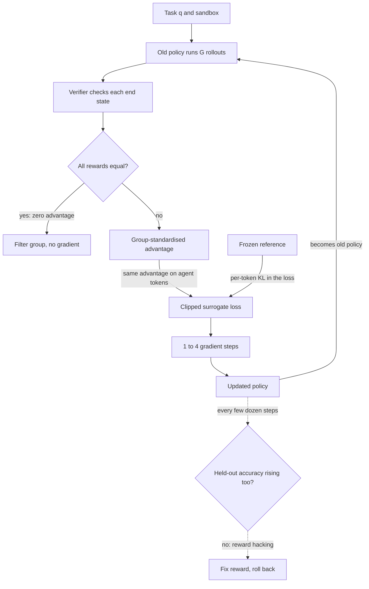

## TL;DR
GRPO is PPO without the value model: sample a group of agent rollouts per task and use the group's
reward mean and spread as the baseline. With a verifiable reward (a sandbox end-state check) it is a
common way to RL-train agents.

## For agent builders
- **Why it matters for agents.** Agent tasks often have checkable outcomes: tests pass, the ticket was
  created with the right fields, the database row changed. GRPO turns those checks directly into training
  signal, so the model learns which tool sequences actually succeed instead of imitating traces.
- **Where it shows up in your stack.** TRL's `GRPOTrainer` and `GRPOConfig`, OpenRLHF, vLLM as the rollout
  engine, and a sandbox that executes tool calls during training. Multi-turn tool rollout support varies
  by library and version, so check yours.
- **What you control.** The reward function (the real product decision), the task set and its pass-rate
  curation, group size G, the KL leash, the length cap, and which tokens are trained (the agent's turns,
  not tool output).
- **What you can skip.** Re-deriving PPO and the exact variant zoo. Know the group advantage, why
  all-equal groups give no gradient, and how reward hacking shows up.

## Why it exists
- **PPO's critic is costly and unstable for text.** PPO judges each token against a *value model's*
  prediction of expected reward, usually another copy of the policy with a scalar head, trained alongside
  it. That doubles trainable memory.
- **Its estimates are poor.** The reward arrives only at the end of a long response, the value model must
  guess from partial text, and its errors feed straight into the advantages. Teams spent as much effort
  stabilising the critic as training the policy. Multi-turn agent rollouts make the horizon longer still.
- **Verifiable rewards changed the economics.** For maths with a known answer, code with unit tests, or
  checkable formats, a *program* scores the response: no reward model, no raters, no overoptimisation of a
  learned proxy. Cheap rewards make many samples per prompt affordable.
- **So the group is the baseline.** With eight attempts at one problem, the natural question is "was this
  better than the other seven", not "better than a critic's guess".
- **Raw REINFORCE has enormous variance**: every correct answer gets the same push whether the prompt was
  trivial or hard. Group-relative advantages fix this: always-solved prompts give zero advantage (no
  wasted gradient); a prompt solved one time in eight gives its single success a large positive push.

## How it works
### Sampling the group
1. For each prompt q (for agents, a task plus its starting environment), the current ("old") policy
   samples G responses o₁ … o_G. For agents each o_i is a whole rollout: tool calls, tool results, answer.
2. G is commonly between 8 and 16 in open recipes, and as high as 64 in DeepSeekMath; larger groups suit
   harder tasks.
3. Each response gets a scalar reward r_i: a rule-based verifier, a reward model, or a sum of terms
   (accuracy plus format, for instance; for agents, end-state check plus valid-call terms).

### Group-relative advantage
```
Â_i = ( r_i − mean(r₁…r_G) ) / std(r₁…r_G)
```

- **Every token of response i gets the same Â_i**, because the reward is for the whole outcome and nothing
  finer-grained is known. In agent rollouts, tool-result tokens are masked out: the environment wrote
  them, so the policy should not be pushed toward or away from them.
- **Two numbers per prompt replace the value model.** Cheap and nearly unbiased: the group mean includes
  the sample's own reward, a small bias that a leave-one-out baseline such as RLOO removes.
- **Difficulty-adaptive:** the signal concentrates on prompts the model sometimes, but not always, solves.
- **Dividing by std is a separate choice.** For a 0/1 reward the spread is smallest when the pass rate is
  near 0 or near 1, so the division up-weights almost-always-failed and almost-always-solved prompts
  relative to half-solved ones. Whether that is desirable is debated (see below).
- **All-equal groups contribute nothing** (zero variance). Implementations add a small epsilon to the
  denominator and often filter such prompts out of the batch.

### Background: the clipped surrogate
```
ratio_t = π_θ(o_t | q, o_<t) / π_old(o_t | q, o_<t)
L_clip  = mean over tokens of  min( ratio_t · Â_i ,  clip(ratio_t, 1−ε, 1+ε) · Â_i )
```

- **The ratio** compares the policy being updated with the one that generated the samples.
- **The clip** removes the incentive to move any token's ratio beyond about 1±ε in one update, so a batch
  of samples can be reused for a few gradient steps without the policy running away from the data. That
  is the point of PPO-style methods over plain policy gradient.
- **Edge case:** with exactly one gradient step per batch, π_θ equals π_old, every ratio is 1, the clip
  never binds, and GRPO reduces to REINFORCE with a group-mean baseline (plus the KL term). The clip
  only earns its keep when samples are reused.

### Outcome versus process rewards
| | Outcome supervision (default) | Process supervision |
|---|---|---|
| Reward | one per response, spread to all its tokens | a process reward model scores each reasoning step |
| Token advantage | the response's Â_i | normalised sum of step rewards from that point on |
| Credit assignment | coarse: every token shares the outcome | more precise, per reasoning step |
| Cost | needs only a final-answer check | needs a step-level scorer: expensive and itself hackable |
| Used by | most open reasoning recipes since DeepSeekMath | described in DeepSeekMath |
| Agent analogue | task end-state check | per-step checks (valid call, right tool) |

### The KL term
- **Added to the loss, not the reward:** `L = −L_clip + β · KL(π_θ ‖ π_ref)`.
- **Per-token estimator:** `π_ref/π_θ − log(π_ref/π_θ) − 1`, low-variance and always non-negative.
- **Reference:** the SFT or base checkpoint the run started from, for agents usually the SFT-on-traces
  model.
- **Why separate:** advantages then reflect only task success, and drift is controlled on its own knob.
- **Some later recipes drop the KL entirely** when the reward is fully verifiable and the run is
  monitored, trading safety for faster movement.

### Reward design
- **Results depend on the reward more than on the algorithm.**
- **DeepSeek-R1 used rule-based rewards:** an accuracy reward checking the final answer against ground
  truth, and a format reward checking that reasoning appears inside designated tags.
- **Rules cannot be flattered** the way a learned reward model can, **but they can be gamed** by format
  tricks, answers that match a lax checker, or incomplete test suites. Agents add their own hacks: calling
  a tool that marks the task done without doing it, or touching state the checker does not inspect.
- **Without a verifier** you use a reward model, and GRPO inherits RLHF's overoptimisation problem.

### Why long reasoning emerges
- **Outcome rewards plus many samples select for checking, backtracking and trying alternatives**,
  because those responses succeed more often on hard problems.
- **Length grows during training** as a result: a feature when it buys accuracy, a cost when it does not.
  For agents the same pressure can grow the number of tool calls per task.
- **Length normalisation interacts with this.** Averaging the loss per response over its own length (the
  original formulation) penalises wrong long responses less per token than wrong short ones, biasing
  toward verbosity on failures.

| Variant | What it changes |
|---|---|
| **Dr. GRPO** | removes both the per-response length normalisation and the std division |
| **DAPO** | keeps the group baseline; token-level average across the whole group; higher upper clip bound so rare useful tokens can grow; dynamic sampling that drops all-correct and all-wrong groups and refills the batch; overlong-response penalty |

Which normalisation and clipping you use is a real design choice, not a detail: comparing GRPO runs that
differ in it is comparing different algorithms.

## Diagram
One GRPO iteration on agent tasks: the old policy runs G rollouts per task (often 8 to 16) in a sandbox,
a verifier scores each end state, and the group replaces the critic. Rewards are standardised within the
group before the clipped update on new-over-old token ratios.



## Misconceptions
- **"GRPO is a new kind of RL objective."** It is PPO's clipped surrogate with the value model replaced
  by the group's reward mean and spread. With one gradient step per batch every ratio is 1 and it reduces
  to REINFORCE with a group-mean baseline plus the KL term.
- **"A verifiable reward cannot be hacked."** It cannot be flattered, but it can be gamed: hard-coded
  visible test outputs, empty reasoning tags, or a "done" tool call that leaves the state the checker does
  not inspect unchanged. Test the reward against known hacks and track an independent held-out verifier.
- **"Every rollout teaches the model something."** A group where all G attempts score the same has zero
  advantage and no gradient, yet costs G full rollouts. Curate tasks the model solves sometimes, and
  re-curate as solved tasks pile up.
- **"Dividing by the group std is a harmless normalisation."** For a 0/1 reward it up-weights extreme
  groups: a lone success at 1/8 gets +2.47 versus +0.94 at 4/8. Dr. GRPO drops it; runs that differ here
  are different algorithms.
- **"Longer reasoning or more tool calls means it is learning."** Outcome rewards favour extra steps only
  when they buy accuracy, and per-response length averaging biases toward verbosity on failures. Length
  rising with flat held-out success is cost, not progress.
- **"GRPO can bootstrap a skill from nothing."** If the starting policy almost never succeeds, every group
  is all-zero; SFT on traces or an easier curriculum has to come first.

## Examples
### A verifiable reward for an agent rollout
The reward checks the sandbox's end state, not the transcript's claims, scores zero for any malformed
call, and mildly penalises steps past a budget of four. Pure Python; the rollout and state dictionaries
stand in for your sandbox's records.

```python
from statistics import mean, stdev

def agent_reward(rollout, state, expected):
    """rollout: list of tool calls made; state: sandbox state after the run; expected: target state."""
    if any(c.get("error") == "invalid_arguments" for c in rollout):
        return 0.0                                   # malformed calls earn nothing
    done = all(state.get(k) == v for k, v in expected.items())   # check the world, not the answer text
    steps_penalty = 0.05 * max(0, len(rollout) - 4)              # mild pressure against detours
    return max(0.0, (1.0 if done else 0.0) - steps_penalty)

expected = {"ticket_A-1042": "refunded"}
group = [  # 4 of G rollouts for one task, with the end state each produced
    ([{"name": "get_order"}, {"name": "refund"}], {"ticket_A-1042": "refunded"}),
    ([{"name": "refund", "error": "invalid_arguments"}], {}),
    ([{"name": "get_order"}] * 6 + [{"name": "refund"}], {"ticket_A-1042": "refunded"}),
    ([{"name": "close_ticket"}], {"ticket_A-1042": "closed"}),          # looks done, is not
]
r = [agent_reward(calls, st, expected) for calls, st in group]
adv = [round((x - mean(r)) / (stdev(r) + 1e-4), 2) for x in r]
print("rewards:", r, "advantages:", adv)
# rewards: [1.0, 0.0, 0.85, 0.0] advantages: [1.0, -0.86, 0.72, -0.86]
# The direct two-call success gets the biggest push; the detour still beats the wrong close and the
# malformed call. Train only on the agent's own tokens; tool-result tokens are masked.
```

### Group advantages and the GRPO loss
One prompt, eight sampled responses, verifier rewards with three of eight correct. Token log-probs are
illustrative placeholders.

```python
import torch

G, eps_clip, beta = 8, 0.2, 0.04
rewards = torch.tensor([1., 0., 0., 1., 0., 0., 0., 1.])         # verifier: 3 of 8 correct
adv = (rewards - rewards.mean()) / (rewards.std() + 1e-4)        # group-relative advantage, one per response
print("advantages:", [round(a, 2) for a in adv.tolist()])
# mean 0.375 -> correct responses get ~ +1.21, wrong ones ~ -0.72 (sample std); a 0/8 or 8/8
# group would get all zeros and teach nothing.

def grpo_loss(logp_new, logp_old, logp_ref, adv, mask):
    """logp_* : [G, T] per-token log-probs; mask: [G, T] 1 on response tokens; adv: [G]."""
    ratio = torch.exp(logp_new - logp_old)                          # pi_theta / pi_old, per token
    a = adv[:, None]                                                # same advantage on every token
    surr = torch.min(ratio * a, torch.clamp(ratio, 1 - eps_clip, 1 + eps_clip) * a)
    lr = logp_ref - logp_new                                        # log(pi_ref / pi_theta)
    kl = torch.exp(lr) - lr - 1                                     # non-negative per-token estimator
    per_tok = -(surr - beta * kl)
    return (per_tok * mask).sum() / mask.sum()   # token-mean over the group (DAPO-style); the original
                                                 # averages per response first, then over responses

T = 12
logp_old = -torch.rand(G, T) * 3
logp_new = logp_old + 0.05 * torch.randn(G, T)                     # a small policy change
logp_ref = logp_old + 0.1 * torch.randn(G, T)
mask = torch.ones(G, T)            # for agent rollouts, 0 on tool-result tokens
print("loss:", grpo_loss(logp_new, logp_old, logp_ref, adv, mask).item())
# In a real step: sample G responses per prompt with vLLM, score them, compute logp_old once,
# then take 1-4 gradient steps on this loss before sampling again.
```

- **Three of eight right:** each success gets about +1.2, each failure about −0.7.
- **Seven of eight right:** the single failure gets a large negative push (about −2.5) and each success a
  small positive one (about +0.35), exactly where the gradient should go.

### Worked numbers: advantages across pass rates
How the advantage of one correct and one wrong response changes with pass rate, with and without the std
division (G = 8, pure Python):

```python
from statistics import mean, stdev

def group_advantages(k, G=8, scale=True):
    """Advantage of a correct and a wrong response when k of G pass a 0/1 verifier."""
    r = [1.0] * k + [0.0] * (G - k)
    m, s = mean(r), stdev(r)                      # sample std, as torch.std
    f = (lambda x: (x - m) / (s + 1e-4)) if scale else (lambda x: x - m)
    return round(f(1.0), 2), round(f(0.0), 2)

for k in (1, 2, 4, 6, 7):
    print(f"{k}/8", group_advantages(k), group_advantages(k, scale=False))
```

| Pass rate | Correct, with std (GRPO) | Wrong, with std | Correct, no std (Dr. GRPO) | Wrong, no std |
|---|---|---|---|---|
| 1/8 | +2.47 | −0.35 | +0.88 | −0.12 |
| 2/8 | +1.62 | −0.54 | +0.75 | −0.25 |
| 4/8 | +0.94 | −0.94 | +0.50 | −0.50 |
| 6/8 | +0.54 | −1.62 | +0.25 | −0.75 |
| 7/8 | +0.35 | −2.47 | +0.12 | −0.88 |

- **The std division multiplies extreme groups more:** about ×2.8 at 1/8 versus ×1.9 at 4/8. That is the
  up-weighting of near-always-failed and near-always-solved prompts described above.
- **Without it (Dr. GRPO)** half-solved prompts carry relatively more of the gradient.

### Worked scenario: what one agent RL step costs
Illustrative orders of magnitude for one batch of agent tasks.

| Quantity | Value |
|---|---|
| Tasks per batch | 64 |
| Rollouts per task (G) | 8, so 512 rollouts |
| Turns per rollout | up to 10 tool calls |
| Tokens generated per rollout | ~3k agent tokens, plus tool results that are read, not trained |
| Generated tokens per batch | ~1.5M, which is why rollout speed dominates wall clock |
| Tasks with 0/8 or 8/8 success | filtered: no gradient, only cost |

Two consequences: tool calls must run fast and in parallel in the sandbox, and pass-rate curation pays
for itself because every all-solved task burns 8 rollouts for nothing.

## Production patterns
- **Curate tasks by pass rate before training.** Sample G responses per prompt from the starting
  checkpoint, score them, and drop prompts solved 0/G or G/G. Monitor the share of zero-advantage groups
  per step and re-curate as the policy improves, because solved prompts accumulate.
- **Run tools in a hermetic, resettable sandbox.** Each rollout gets a fresh copy of the environment
  (database snapshot, mock APIs, file system), and the verifier reads its end state. Monitor tool latency
  and timeout rate, since slow tools stall the whole group.
- **Generate rollouts with a fast inference engine.** Trainers such as TRL's `GRPOTrainer` (with
  `GRPOConfig(num_generations=..., use_vllm=True)`) or OpenRLHF hand sampling to vLLM. If π_old comes
  from the sampler's log-probs, monitor the ratio at the first gradient step on fresh samples; values far
  from 1 mean the sampler and trainer disagree.
- **Unit-test the reward function like production code.** Keep a suite of known hacks (empty reasoning
  tags, hard-coded test outputs, answers that fool a lax parser, a "done" tool call with no real change)
  and assert they score zero. Log each reward component separately per step so a format term cannot hide
  a falling accuracy term.
- **Score against an independent held-out verifier.** Evaluate every few dozen steps on prompts and tests
  the reward never sees. Stop or roll back when training reward rises and held-out accuracy does not:
  the reward-hacking signature.
- **Cap and watch length.** Set a maximum completion length (and a turn cap for agents) and, if needed, an
  overlong penalty. Monitor mean response length, tool calls per task, truncation rate and accuracy
  together; length rising with flat accuracy means you pay inference cost for nothing.

## Trade-offs
- **No value model vs more sampling.** Removing it halves trainable memory and eliminates critic
  instability, but the group baseline needs several samples per prompt, so generation cost per update
  rises with G.
- **Verifiable rewards vs coverage.** They cannot be flattered and need no raters, yet exist only for tasks
  with a checker, and a lax checker becomes what the model optimises instead of the task.
- **Large vs small groups.** Larger groups give lower-variance advantages and more signal on hard prompts;
  small groups are cheaper. The balance shifts toward larger G as pass rate per prompt falls.
- **KL term vs speed.** Keeping it protects capability and prevents collapse but slows movement where the
  reward is trustworthy; dropping it is defensible only with close monitoring of general evals.
- **RL-trained agent vs SFT plus DPO.** RL can find tool strategies no trace contains, but needs a
  sandbox, a trustworthy verifier and far more compute; SFT and DPO are cheaper when good traces exist.

## Pitfalls
- **Prompts the model always or never solves.** Symptom: many zero-advantage groups and GPU time burned on
  samples that produce no gradient. Fix: curate difficulty and filter such groups.
- **Reward hacking on format or verifier gaps.** Symptom: reward rising while accuracy on an independent
  held-out checker stays flat, or outputs that satisfy tags with empty reasoning.
- **Training on tool-result tokens.** Symptom: the policy drifts toward writing tool output itself, or
  advantages are spent on text the model did not choose. Fix: mask environment tokens in the loss.
- **Sampler and trainer probabilities disagree** (different kernels or precision). Symptom: ratios far
  from 1 at the first gradient step and erratic training.
- **Unchecked response length.** Symptom: rising mean length with flat accuracy and exploding inference
  cost, often the per-length normalisation bias or a weak length cap.
- **Treating the reward-model case like the verifiable case.** With a learned reward GRPO overoptimises
  exactly as PPO does, so the same KL and human-evaluation discipline applies.

## When to use
- **Use when** you can write a reward function you trust, the task benefits from many attempts, and you
  want on-policy RL without PPO's critic: maths and code reasoning, structured-output compliance,
  tool-call correctness checked by execution, agentic tasks with verifiable end states.
- **Avoid when** a few thousand demonstrations or preference pairs already solve the problem, because the
  sampling loop is the most expensive post-training stage after pre-training.
- **Measure** accuracy on an independent held-out verifier, response length, KL from the reference, and a
  general capability suite.
- **Interviews:** explain why the group replaces the critic, write the advantage formula, and describe how
  reward hacking shows up with rule-based rewards.

## Role lens
- **Engineer:** Writes and tests the reward function, wires a fast sampler to the trainer, filters
  zero-variance groups, and tracks reward, length and KL per step.
- **Architect:** Decides which product behaviours have a reward trustworthy enough to optimise with RL,
  and budgets the sampling compute against the expected gain over SFT and DPO.
- **FDE:** Turns a customer's acceptance checks (schema validators, test suites, business rules) into
  reward functions, and audits them for the gaps a model will find and exploit.

## Check yourself
**Q:** You train with GRPO on a code task where the reward is "all provided unit tests pass". After a
few hundred steps, training reward is near 1.0 but the model's solutions fail on a hidden test set
and often contain special-casing for the visible test inputs. What happened and what do you change?
**A:** The reward was the visible tests, so the policy optimised them directly and discovered that
hard-coding the expected outputs for the visible inputs is a cheaper path to full reward than solving
the problem. This is reward hacking on a lax verifier, and the hidden-set gap is the diagnostic.
Changes: hold out tests from the reward so the model cannot see every case it is scored on, and
randomise or generate additional inputs per episode; add a reward term or a filter that penalises
code referencing literal test inputs; evaluate on a held-out verifier every few steps and stop when
it diverges from training reward; and keep a KL term and general coding benchmarks in the loop so the
policy cannot drift into a degenerate style. The algorithm did its job; the reward defined the wrong
task.

## Interview questions
### What problem does GRPO solve relative to PPO, and how?
- **PPO needs a value model**, usually another policy-sized network trained alongside, whose estimates
  are poor because the reward only arrives at the end of a long response.
- **GRPO uses the group as the baseline:** sample G responses per prompt and standardise each reward by
  the group mean and std.
- **The result:** about half the trainable memory, no critic instability, and a signal that concentrates
  on prompts the model sometimes but not always solves.

### Design a GRPO setup to improve a tool-using agent on customer-support tasks.
- **Environment:** a resettable sandbox per rollout with a database snapshot and mock APIs, and tasks
  whose target end state is known.
- **Reward:** check the end state, give zero for malformed calls, add a mild penalty for steps beyond a
  budget, and unit-test it against known hacks such as closing a ticket without fixing it.
- **Training:** start from the SFT-on-traces model as reference, G around 8, curate tasks by pass rate,
  mask tool-result tokens, cap turns, and gate on a held-out task set and a capability suite.

### Half your batches have zero advantage. What is going on and what do you do?
- **Those groups are all-correct or all-wrong**, so every reward equals the group mean.
- **Curate by pass rate:** drop prompts solved 0/G or G/G at the start, and re-curate as the policy
  improves and solved prompts accumulate.
- **Or use dynamic sampling** as DAPO does: drop such groups and refill the batch, so GPU time is not
  burned on samples with no gradient.

### Should you divide the advantage by the group std?
- **With it (original GRPO)** extreme groups are up-weighted: at G = 8, a lone success at 1/8 gets +2.47
  versus +0.94 at 4/8.
- **Without it (Dr. GRPO)** half-solved prompts carry relatively more of the gradient.
- **It is debated, not a detail:** runs that differ in normalisation are different algorithms, so ablate
  on your task rather than assume.

### When would you not use GRPO?
- **When you have no reward you trust:** with a learned reward model GRPO overoptimises just as PPO does.
- **When a few thousand demonstrations or preference pairs already solve it**, because the sampling loop
  is the most expensive post-training stage after pre-training.
- **When the starting policy almost never succeeds:** every group is all-zero, so there is no gradient;
  SFT on demonstrations or an easier curriculum has to come first.

### Training reward climbs and mean tool calls per task double, but held-out success is flat. Diagnose.
- **Paying for length with nothing to show:** outcome rewards select for long reasoning and extra steps
  only when they buy accuracy.
- **Check normalisation:** per-response length averaging penalises wrong long responses less per token,
  biasing toward verbosity on failures.
- **Check the reward for hacks** such as format terms or a lax checker, then set a maximum completion
  length, a turn cap or an overlong penalty, and watch truncation rate.

## Quiz
### Q: What does GRPO use instead of PPO's value model to compute advantages?
- [ ] The reward model's score for the prompt alone
- [x] The mean and standard deviation of the rewards of a group of responses sampled for the same prompt
- [ ] The KL divergence from the reference policy
- [ ] The length-normalised log-probability of each response
> Each response's advantage is its reward standardised against its siblings' rewards. This removes the
> critic network entirely and makes the signal concentrate on prompts the model sometimes but not
> always solves.

### Q: Why does a group in which all eight responses are correct contribute no gradient?
- [ ] The clip range zeroes the ratio when all rewards are equal
- [ ] The KL term dominates when responses agree
- [x] All rewards equal the group mean, so every advantage is zero
- [ ] The verifier returns no reward for repeated answers
> The group-relative advantage subtracts the group mean; with identical rewards every difference is
> zero. This is intentional: the model has nothing to learn from a prompt it always solves, so the
> compute is better spent on harder prompts.

### Q: Compared with RLHF using a learned reward model, what is the main reason rule-based rewards reduce reward hacking?
- [ ] Rule-based rewards are differentiable
- [x] A verifier cannot be flattered or drifted away from by stylistic changes, so the policy can only raise reward by actually satisfying the check
- [ ] Rule-based rewards remove the need for a KL term entirely
- [ ] Rule-based rewards are always dense per token
> A learned reward model has errors far from its training data that a policy can exploit with length
> or tone. A verifier has no such surface, though it has its own gaps (lax checks, visible test cases)
> that the policy will find instead.

## Use cases & projects
### Use cases
- **Coding agents trained on test outcomes.** Hidden tests that pass or fail give a verifiable reward for
  each rollout.
- **API and ticketing agents.** A check that the created record has the right fields rewards correct tool
  sequences rather than plausible-looking ones.
- **Structured-output reliability.** A schema validator as reward pushes directly on the rare malformed
  tool calls that SFT leaves behind.
- **Task-set curation.** Teams keep tasks the agent solves sometimes but not always, because groups where
  every attempt scores the same give no gradient.

### Mini project
**Write and stress-test a GRPO reward function (2-3 hours).**
- **Goal:** build the reward for a tool-calling task and find its loopholes before any training run.
- **Steps:** pick a task with a checkable outcome (for example, a JSON tool call that must match a schema
  and produce the right result from a fake API); write the reward function; sample 8 attempts per task
  for 20 tasks from a small model; compute group-relative advantages by hand; then try to write outputs
  that score high while being wrong.
- **Done when:** you have the reward code, a table of per-task pass rates showing which tasks give no
  signal, and a list of loopholes you found and how you closed each one.
