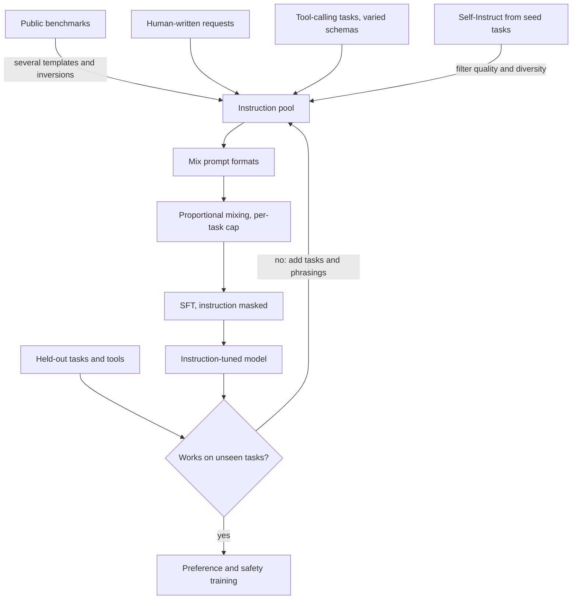

## TL;DR
Instruction tuning is SFT on many tasks phrased as natural-language instructions, so the model learns
"read an instruction, do what it says" zero-shot. It is why an agent follows a system prompt or tool
description it never saw; task diversity drives it.

## For agent builders
- **Why it matters for agents.** Every agent relies on zero-shot instruction following: a system prompt
  you just wrote, a tool description added this morning, a user request no one anticipated. That
  generalisation is what instruction tuning buys, and it is why you start from an instruct checkpoint.
- **Where it shows up in your stack.** The "-Instruct" or chat variant you deploy, and your own
  fine-tuning mixtures: if you tune an agent model, its data mix decides whether it still follows
  instructions outside your traces.
- **What you control.** The mixture when you extend an instruct model: tool-calling task families with
  varied tool schemas, several phrasings per request, multi-turn and refusal data, a general replay
  slice, and per-task caps.
- **What you can skip.** Building a FLAN-scale mixture from public benchmarks. Agent teams extend an
  existing instruct model; know why diversity beats depth and how to hold out task families.

## Why it exists
- **The capability exists; the interface does not.** A base model does many tasks given few-shot
  examples, because such patterns are common in its training data. But users write "summarise this in two
  lines" or "translate to French, formal register", and a base model may echo that, answer something
  adjacent, or continue the document.
- **One task at a time does not scale.** A summarisation model and a translation model each worked on its
  task and not at all on the next, and the number of tasks users (and agent planners) invent is unbounded.
- **Dozens of instruction-phrased tasks transfer.** FLAN and T0 showed that fine-tuning on many tasks
  teaches instruction following on unseen ones, and the effect grows with distinct tasks and model size.
  The model learns the mapping from instruction text to behaviour, which transfers.
- **One huge single-task dataset fails** because the model overfits to that phrasing and task, and there
  is nothing to generalise across. Instruction tuning works precisely because the data is wide and
  shallow.

## How it works
### The data unit
- **Instruction, optional input, output:** "Classify the sentiment of the following review. Review: ...
  Answer: positive". For agents the "output" may be a tool call: instruction plus tool schemas in, a
  JSON call out.
- **Templates convert academic datasets.** A sentiment set becomes instruction data through several
  phrasings ("Is this review positive or negative?", "What is the sentiment of this text?") and often
  inversion ("Write a negative review about a laptop").
- **Multiple templates per task matter** because the model must not key on exact wording; it has to learn
  the intent. The same holds for tool descriptions: vary names, wording and argument order.

### Why diversity beats depth
- **The finding (FLAN line):** more *tasks* improve held-out performance more than more examples of the
  same tasks, and per-task gains saturate quickly.
- **The mechanism:** each task is one more point in "instruction space"; generalisation is interpolation
  between those points. Each distinct tool schema is a point too.
- **The rule of thumb:** past a modest number of examples per task, a new task (or new tool) is worth more
  than more rows of an old one.
- **Balance the mixture.** Sample tasks roughly in proportion to size but cap the large ones
  (examples-proportional mixing with a cap, as the FLAN work did), so a giant dataset does not dominate
  the gradient.

### Mixing prompt formats, not just tasks
| Format | Prompt contains | Agent analogue |
|---|---|---|
| Zero-shot | instruction only | new tool, description only |
| Few-shot | instruction plus worked examples | system prompt with example calls |
| Chain-of-thought | an answer with reasoning steps | plan or reasoning before a tool call |

Later FLAN work found that training on a mix of these improved both zero-shot and few-shot use versus a
single format, for the same reason as templates: learn the intent, not one surface layout.

### Where the instructions come from
| Source | How | Strength | Risk |
|---|---|---|---|
| **Converted benchmarks** | re-template public NLP datasets | cheap, broad | academic in style |
| **Human-written** | annotators write realistic requests and answers | most useful per example; the only way to get genuine user-style prompts | expensive |
| **Model-generated (Self-Instruct)** | seed tasks → strong model invents and answers new instructions → filter for quality and diversity → repeat | how most open instruction datasets scaled: a few hundred seeds become tens of thousands of examples | student inherits teacher's errors and style; instructions cluster around what the teacher finds easy |

### Reasoning and format data
- **Keep chain-of-thought in the mixture.** It preserves and strengthens multi-step reasoning. Mixtures
  without any reasoning data were found to *hurt* reasoning benchmarks, because the model learns to answer
  tersely, and an agent planner needs that reasoning.
- **Whatever is absent drifts away:** code, long-form answers, refusals, tool calls. If it is not in the
  mixture, the model drifts from it. Tuning an agent only on single-turn calls erodes multi-turn chat.

### How it relates to SFT and chat tuning
- **Mechanically it *is* SFT:** next-token loss on output tokens, instruction masked.
- **The difference is intent and data.** SFT covers any demonstration-based fine-tuning, including narrow
  single-task adaptation; instruction tuning targets broad instruction following.
- **Modern chat models** are instruction-tuned with multi-turn conversational data through a chat
  template, including tool definitions and calls; the single-turn instruction/input/output format is its
  ancestor.

### Scale dependence
- **The original FLAN finding:** the benefit appeared only above a certain model size; small models got
  *worse* on held-out tasks.
- **The usual reading:** small models lack spare capacity for both the tasks and the meta-skill, so they
  overfit the seen tasks.
- **Later work with better mixtures narrowed the gap**, but the lesson stands: instruction tuning surfaces
  latent ability, it does not create it. A small agent model tuned on your tools may follow them and
  little else.

## Diagram
Follow how many narrow sources, including tool-calling tasks, become one wide, balanced mixture: formats
are mixed, large tasks are capped before proportional mixing, and the SFT loss masks the instruction.
Evaluation holds out whole task families and unseen tools, not rows; only a model that passes moves on to
preference and safety training.



## Examples
### A miniature mixture with a tool-calling task family
Two task families, several templates each, balanced with a per-task cap. The tool family varies the
tool's name, wording and argument order so the model learns "read the schema, call it", not one tool. FLAN-style
pipelines do this at a scale of hundreds of tasks.

```python
import json, random
random.seed(0)

sentiment = [("The battery lasts two days, love it.", "positive"),
             ("Screen cracked in a week.", "negative")]
tool_rows = [("What's the weather in Pune tomorrow?", {"city": "Pune", "day": "tomorrow"}),
             ("Will it rain in Oslo today?", {"city": "Oslo", "day": "today"})]
tool_variants = [("get_weather", "Get the forecast for a city and day."),   # same task, varied name and wording
                 ("weather_lookup", "Look up weather. Args: city, day."),
                 ("forecast", "Returns a forecast for the given city on the given day.")]

templates = {
    "sentiment": ["Classify the sentiment of this review as positive or negative.\nReview: {x}",
                  "Is the following text positive or negative?\n{x}",
                  "What sentiment does this review express?\n{x}"],
    "tool_call": ["Tools: {tools}\nUser: {x}\nRespond with one JSON tool call.",
                  "You can call these tools: {tools}\nRequest: {x}"],
}

def build(cap=1000):
    out = []
    for x, y in sentiment[:cap]:                          # cap large tasks so no task dominates
        for t in random.sample(templates["sentiment"], k=2):
            out.append({"instruction": t.format(x=x), "output": y, "task": "sentiment"})
    for x, args in tool_rows[:cap]:
        name, desc = random.choice(tool_variants)
        params = random.sample(list(args), k=len(args))   # vary argument order too
        tools = json.dumps([{"name": name, "description": desc, "parameters": params}])
        for t in templates["tool_call"]:
            out.append({"instruction": t.format(tools=tools, x=x),
                        "output": json.dumps({"name": name, "arguments": args}), "task": "tool_call"})
    random.shuffle(out)
    return out

for ex in build()[:3]:
    print(ex["task"], "|", ex["instruction"].split("\n")[0][:60], "->", ex["output"])
# Each example is then rendered through the chat template and trained with the SFT loss
# (instruction masked, output supervised). Hold out whole tasks, and whole tools, to measure generalisation.
```

- **Hold out entire tasks for evaluation.** If the model handles a task family it never saw, the skill
  transferred; if it only handles seen tasks, you have a multi-task model, not an instruction-following
  one. For agents, hold out whole tools and check calls against schemas the model never trained on.

### Worked numbers: why the cap matters
Suppose the real mixture has three tasks with 500,000, 20,000 and 2,000 examples: say general QA,
extraction, and a small task such as your agent's tool-calling traces (`rewrite` in the code below).

| Mixing rule | Task A (500,000) | Task B (20,000) | Task C (2,000) | Effect |
|---|---|---|---|---|
| Proportional to size | ~96% | ~4% | ~0.4% | effectively single-task; tool calls barely trained |
| Cap each at 10,000 | ~45% | ~45% | ~9% | small task becomes visible |

The large task loses examples it did not need. The cap is a knob you tune by watching per-task held-out
scores, not a constant. The same arithmetic as a function:

```python
def mixing_rates(sizes, cap=None):
    """Examples-proportional mixing, optionally capping each task's size first."""
    eff = {t: min(n, cap) if cap else n for t, n in sizes.items()}
    total = sum(eff.values())
    return {t: round(100 * n / total, 1) for t, n in eff.items()}

sizes = {"qa": 500_000, "extraction": 20_000, "rewrite": 2_000}
print(mixing_rates(sizes))              # {'qa': 95.8, 'extraction': 3.8, 'rewrite': 0.4}
print(mixing_rates(sizes, cap=10_000))  # {'qa': 45.5, 'extraction': 45.5, 'rewrite': 9.1}
```

## Production patterns
- **Extend an instruct checkpoint, do not start from scratch.** Most teams take an already
  instruction-tuned open model and add their tasks (agent traces, tool calls) to a general instruction
  mixture to keep breadth. Monitor a general benchmark suite before and after; a drop means the general
  share is too small.
- **Hold out task families and tools, not rows.** Tag every example with a task id and tool name and
  reserve whole families, a few whole tools, and a sample of real user requests for evaluation. Monitor
  the gap between seen and unseen scores; a large gap means a multi-task model, not an instruction
  follower.
- **Write several templates per task, including inversions.** Generate at least two or three phrasings
  per task (and per tool description) and evaluate on paraphrases never used in training. Monitor score
  variance across phrasings of the same request; high variance means the model keys on wording.
- **Filter generated instructions for diversity.** When bootstrapping with Self-Instruct, drop a new
  instruction that is too similar to existing ones (the paper used a ROUGE-L overlap threshold of 0.7),
  and have humans review a sample. Monitor the task-type distribution so it does not collapse toward
  what the teacher finds easy.
- **Keep reasoning, long-form and refusal data in every mix.** Reserve a fixed slice for chain-of-thought,
  code, long answers, multi-turn chat and refusals. Monitor multi-step reasoning benchmarks, mean output
  length and refusal rate, which fall first when these slices are dropped.

## Trade-offs
- **Broad and shallow vs narrow and deep.** Broad mixtures generalise to unseen instructions; narrow ones
  excel at the seen task. When you only ever need one task, the narrow fine-tune wins on that task; an
  agent with a changing tool set needs breadth.
- **Model-generated scale vs teacher limits.** Generated instructions scale cheaply and widen coverage but
  import the teacher's errors and style; the saving reverses if the teacher is weaker than your target or
  your domain is unusual.
- **Templated benchmarks vs real requests.** Templating public benchmarks gives thousands of tasks for
  free, but academic phrasings differ from real user requests, so a slice of genuine human-written
  prompts (or logged agent requests) is worth more per example.
- **Reasoning and long-form data vs cost.** Including them keeps those abilities but lengthens average
  outputs and training cost; omit them only when the deployment never needs them.

## Pitfalls
- **One template per task.** Symptom: the model follows training phrasings exactly and fails when a user
  words the same request differently.
- **One tool schema per capability.** Symptom: the tuned agent calls its trained tools well but misuses a
  newly added tool or a renamed argument. Fix: vary names and descriptions and hold out tools.
- **Only zero-shot prompts.** Symptom: confusion, or copying the examples' format, when a user pastes a
  few demonstrations into the prompt.
- **One huge dataset dominating the mixture.** Symptom: excellent at that task, quietly regressed on
  everything else, visible only if you evaluate per task family.
- **Held-out rows of seen tasks called generalisation.** The number looks great and says nothing about
  unseen instructions, which is what users send.
- **No chain-of-thought or long answers in the data.** Symptom: terse replies and a drop on multi-step
  reasoning benchmarks after tuning.
- **Treating "instruction tuned" as "aligned".** An instruction-tuned model follows harmful instructions
  as readily as benign ones until preference training and safety data add a refusal policy, which matters
  more once it holds tools.

## When to use
- **Use when** you need a model that follows a wide range of requests it has not seen verbatim: a general
  assistant, an internal copilot or agent fielding open-ended tasks, or a base for later preference
  training.
- **Avoid when** the product has one fixed task; a narrow SFT on that task is simpler and better.
- **In practice** start from an already instruction-tuned open model and add your tasks to a general
  mixture to keep breadth, rather than building the mixture from scratch.
- **Measure** with held-out *task families*, held-out tools and a general benchmark suite.
- **Interviews:** explain why diversity beats depth, how Self-Instruct bootstraps data, and how
  instruction tuning differs from plain SFT and from preference optimisation.

## Role lens
- **Engineer:** Builds the template and mixing pipeline, caps task sizes, holds out task families, and
  verifies the chat template renders every example the way serving will.
- **Architect:** Chooses between adopting an instruction-tuned open model and extending it with domain
  tasks versus narrow tuning, based on how open-ended the product's requests really are.
- **FDE:** Collects the real phrasings a customer's users send and converts them into instruction
  data, because academic templates rarely match how a procurement analyst actually asks.

## Check yourself
**Q:** Your instruction-tuned model scores well on held-out examples from all 40 training tasks, but
users complain it misunderstands simple requests. What is the likely gap in your evaluation and data,
and what would you change?
**A:** Held-out rows from seen tasks only measure multi-task performance; they never test whether the
model generalises to new instructions, which is what users send. The likely causes are too few
distinct tasks and too few phrasings per task, so the model keys on training wording. I would first
re-evaluate on entirely held-out task families and on a sample of real user requests to confirm the
gap, then widen the mixture: add tasks, write several templates per task including inverted forms,
and add a slice of genuine user-style instructions, possibly bootstrapped with Self-Instruct and
filtered by humans. I would also check that the mixture is balanced, since one large task can crowd out
the generalisation signal, and confirm the model is large enough to benefit, because small models
tend to overfit seen tasks.

## Interview questions
### What is instruction tuning, and how is it different from plain SFT?
- **Mechanically it is SFT:** next-token loss on the output, with the instruction masked.
- **The difference is the data and the goal.** It trains on many tasks phrased as natural-language
  instructions, so the model learns the mapping from instruction to behaviour and follows unseen ones
  zero-shot.
- **Plain SFT** also covers narrow single-task adaptation, which does not generalise to new requests.

### You fine-tuned an agent model on traces for your 12 tools. It now fails on a 13th tool added last week. What went wrong?
- **The mixture was deep, not broad.** Twelve fixed schemas teach those tools, not "read a schema and call
  it"; the model keys on familiar names and wording.
- **Fix the data:** vary tool names, descriptions and argument order, add general tool-calling data with
  many different schemas, and keep a general instruction slice.
- **Fix the eval:** hold out whole tools and score valid-call rate on them before every release.

### You add 2,000 agent tool-calling traces to a mix with a 500,000-example task and a 20,000-example one. How do you build the mixture?
- **Proportional mixing** gives the big task about 96% of samples and the traces about 0.4%, so the
  result is effectively single-task and tool calling is barely trained.
- **Cap each task** (for example at 10,000) before proportional mixing; the smaller tasks then become
  visible at about 45% and 9%.
- **Tune the cap** by watching per-task held-out scores, including valid-call rate on held-out tools,
  because it is a knob, not a constant.

### When would you not instruction-tune, and do a narrow fine-tune instead?
- **When the product has one fixed task**, because a narrow SFT on that task is simpler and wins on it.
- **When an existing instruct model already passes your evals** with prompting, since owning a tuned
  model is a maintenance cost.
- **Instruction tuning pays** when requests are open-ended and users will word them in ways you cannot
  enumerate, which is the normal case for agents.

### In the original FLAN work, small models got worse on held-out tasks after instruction tuning. Why, and what does it imply?
- **The usual reading is capacity:** small models lack room to learn both the seen tasks and the
  meta-skill of following instructions, so they overfit the seen tasks.
- **Instruction tuning surfaces latent ability; it does not create it.** If the base cannot do a task
  few-shot, tuning on instructions will not make it appear.
- **Implication:** check the base's few-shot ability on your task families before tuning, and expect
  better mixtures to narrow, not erase, the gap for small models.

### What are the risks of scaling instruction data with Self-Instruct, and how do you control them?
- **The student inherits the teacher's errors and style**, and generated tasks cluster around what the
  teacher finds easy.
- **Controls:** filter new instructions that are too similar to existing ones (the paper used a ROUGE-L
  threshold of 0.7), have humans review a sample, and keep human-written seeds.
- **Monitor** the task-type distribution across bootstrap rounds so diversity does not collapse.

## Quiz
### Q: Why does adding more distinct tasks help instruction tuning more than adding more examples of existing tasks?
- [ ] Larger datasets cause overfitting regardless of task count
- [x] Each new task adds a point in instruction space, and generalisation comes from covering that space, not from depth on one task
- [ ] More tasks reduce the learning rate needed
- [ ] Examples of the same task are usually duplicates
> The target skill is "map an instruction to a behaviour" in general. Depth on one task refines that
> task; breadth across tasks teaches the mapping itself, which is what transfers to unseen instructions.

### Q: What is the main risk of building an instruction dataset with Self-Instruct from a strong teacher model?
- [ ] The resulting data cannot be used with a chat template
- [ ] It produces too few examples to be useful
- [x] The student inherits the teacher's mistakes and style, and generated tasks cluster around what the teacher finds easy
- [ ] The loss must be computed on instruction tokens as well
> Bootstrapping scales data cheaply, but every error and bias in the teacher's answers becomes a training
> target, and diversity narrows toward the teacher's comfort zone unless filtering and human-written
> seeds counteract it.

### Q: After instruction tuning, a model answers multi-step maths questions worse than the base model did with few-shot prompts. What most likely happened?
- [ ] The learning rate was too low to change behaviour
- [x] The mixture contained no chain-of-thought or long-form data, so the model learned to answer tersely
- [ ] Instruction tuning always reduces reasoning ability
- [ ] The chat template removed the ability to use few-shot prompts
> Whatever is absent from the mixture drifts away. Without reasoning traces in the data the model learns
> that outputs are short answers, which suppresses the step-by-step behaviour the base model would show
> when prompted.

## Use cases & projects
### Use cases
- **Choosing the right checkpoint.** Agent teams start from the instruct or chat variant because the
  agent must follow a system prompt and tool descriptions it has never seen.
- **Extending an instruct model for agents.** A mixture of tool-calling task families with varied
  schemas keeps zero-shot instruction following while adding agent skills.
- **Guarding against narrow fine-tunes.** A general replay slice in the mixture stops an agent model from
  forgetting how to handle requests outside its traces.
- **Testing generalisation to new tools.** Held-out task families show whether the agent will cope when
  a new tool is added next week.

### Mini project
**Test zero-shot generalisation to unseen tools (1-2 hours).**
- **Goal:** measure whether an instruct model follows tool descriptions it was never tuned on.
- **Steps:** write 5 tool schemas the model is unlikely to have seen; phrase 4 requests per tool in
  different styles; run a base and an instruct checkpoint of the same model with the same prompt; score
  whether each output picks the right tool and produces arguments that validate against the schema.
- **Done when:** you have a table of tool choice accuracy and schema-valid rate per checkpoint and per
  phrasing, plus a note on which phrasings broke each model.
