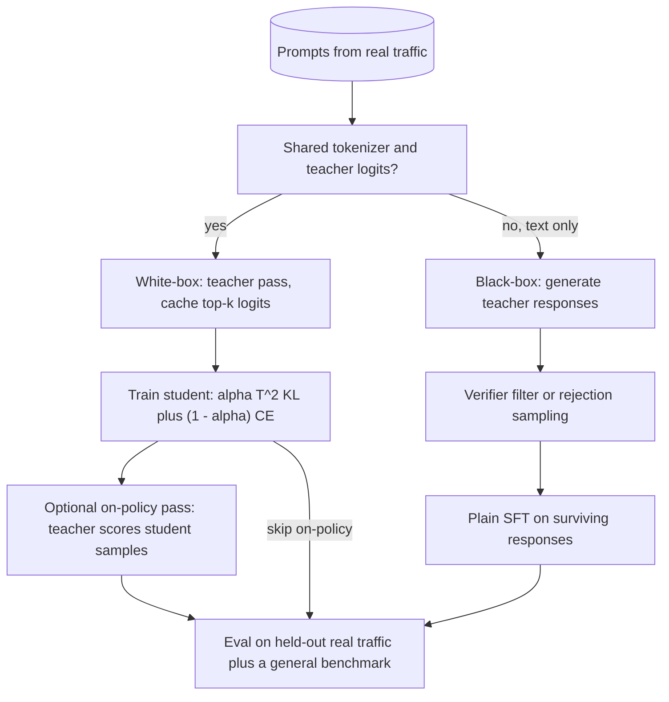

## TL;DR
Knowledge distillation trains a small student to match a large teacher's outputs (soft probability
distributions or generated text) instead of one-hot labels. Each example carries far more signal, so the
student usually beats the same architecture trained on labels alone.

## Why it exists
- **The best model is the one you cannot afford to serve.** A 70B-class model costs roughly ten times the
  GPU time per token of a 7B one. "Train a 7B model on the same data" loses much of that accuracy, partly
  from capacity and, surprisingly, partly from the training signal.
- **One-hot labels throw away knowledge.** A label says "the next token is ` Paris`" and nothing else.
  The large model says ` Paris` 0.9, ` the` 0.05, ` located` 0.02, ` Berlin` 0.0001. That ranking of wrong
  answers is knowledge about the world and the language; Hinton called it *dark knowledge*.
- **The teacher works on any input.** The student reproduces the teacher's function, which is smoother,
  lower-variance and available for unlabelled prompts. You can run it on millions of prompts from real
  traffic that you could never pay humans to label.
- **It changes architecture, unlike compression.** Quantization and pruning keep the architecture and
  shave a constant factor. Distillation can go to fewer layers, narrower width or a different family, and
  combines with both: prune a big model, then distil from the original to repair it.

## How it works
### Classic logit distillation
Teacher and student each produce logits **z** over the vocabulary (or classes). Soften both with a
temperature *T*:

```
p_i(T) = exp(z_i / T) / Σ_j exp(z_j / T)
```

Why temperature matters, for teacher logits [6, 2, 1]:

| *T* | Distribution | Mass on the two wrong answers | p₂/p₃ = e^(1/T) |
|---|---|---|---|
| 1 | [0.976, 0.018, 0.007] | about 2.5%: almost no gradient | about 2.7 |
| 4 | [0.605, 0.222, 0.173] | 40%: the student learns the ranking | 1.3 |

- **At *T* = 1** a confident teacher is almost one-hot, so information in small probabilities is invisible.
- **Raising *T*** flattens the distribution and amplifies the ratios between wrong answers. The ranking
  is compressed but never inverts.
- **Too high a *T*** approaches uniform, washing out which alternative is *more* plausible. That is why
  small values (roughly 1–4 for LLMs) are the usual search range, not a rule.

The loss mixes two terms:

```
L = α · T² · KL( p_teacher(T) ‖ p_student(T) )  +  (1 − α) · CE( y, p_student(1) )
```

- **The *T²* factor:** the soft-term gradient scales roughly as 1/*T²*; multiplying back keeps the soft
  and hard terms' relative weight stable when you change *T*.
- **The hard-label term:** kept because the teacher is sometimes wrong, and ground truth, where you have
  it, corrects that.
- **High-*T* limit:** Hinton showed matching softened distributions becomes matching logits directly (an
  MSE on **z**), which is why "logit distillation" and "soft-target distillation" are used interchangeably.

### Three regimes for language models
| Regime | Needs | Signal | Main cost |
|---|---|---|---|
| White-box, token-level | shared tokenizer, logits | full distribution per token | teacher pass over all data |
| Black-box, sequence-level | teacher text only | one sampled sequence | teacher generation |
| On-policy | live teacher scoring | teacher's view of student's own text | generation inside training |

1. **White-box, token-level.**
   - Teacher and student share a tokenizer; at every position the student minimises a divergence to the
     teacher's next-token distribution.
   - Per token the signal is a distribution over 100k+ entries instead of one index.
   - Teams precompute the teacher's top-*k* logits (say 64 per position, renormalised), because full
     distributions would be hundreds of kilobytes per token.
   - Several recent small models were pretrained with a larger sibling's logits as targets, not only hard
     tokens.
2. **Black-box, sequence-level.**
   - Generate teacher responses for many prompts, then run ordinary SFT on (prompt, teacher response).
     This is "distilled" in most product announcements; technically it is SFT on synthetic data.
   - The framing changes what you optimise: prompt coverage of the deployment distribution, samples per
     prompt, and verifier filtering (rejection sampling) so the student learns correct reasoning, not the
     average output.
   - Reasoning-model distillates released in 2025 fine-tuned open 1.5B–70B checkpoints on hundreds of
     thousands of teacher-generated traces.
3. **On-policy.**
   - Both regimes above train on prefixes the *teacher* wrote. At inference the student sees its own
     prefixes and mistakes and never learned to recover (exposure bias).
   - On-policy distillation samples from the student, has the teacher score every token, and trains toward
     the teacher on the student's own trajectories.
   - It costs generation in the loop and a live teacher, but attacks exactly that train/inference mismatch.

### Which divergence
- **Forward KL(teacher ‖ student) is mode-covering.** It punishes near-zero mass on anything the teacher
  finds plausible, so a small student spreads mass thinly; samples look hedged and low quality.
- **Reverse KL(student ‖ teacher) is mode-seeking.** The student concentrates on the teacher's dominant
  modes, which suits a student with less capacity. MiniLLM uses it.
- **Generalised-KD** interpolates between the two with a Jensen–Shannon style divergence.
- **Treat it as a tunable.** Whichever you choose, the teacher is the student's ceiling on the covered
  distribution.

### Feature (intermediate-layer) distillation
- **What:** losses pulling the student's hidden states (via a learned projection if widths differ) or
  attention maps toward the teacher's at chosen layers. DistilBERT added a cosine loss on hidden states to
  its soft-target loss.
- **Why:** every layer gets a direct target instead of only the last, which speeds recovery.
- **Catch:** needs white-box access to both models and a layer mapping (student layer *i* ↔ teacher layer
  *2i*, say), so it is used mostly when the student was built by shrinking the teacher.

### Why it pairs with pruning
- A randomly initialised student must relearn everything.
- A student made by structurally pruning the teacher (dropping layers, heads or MLP width) already sits
  near a good solution; distillation adds a dense correction signal.
- The pair recovers most of the teacher's quality with a small fraction of pretraining's tokens. That is
  the recipe behind several open small-model families, and why the two topics sit together here.

## Diagram
The decision path for a distillation pipeline: tokenizer and logit access pick the regime, and every
regime ends in the same held-out evaluation on real traffic. The on-policy pass hangs off the white-box
branch because the teacher must score every token the student writes.



## Examples
### Token-level distillation loss in PyTorch
Both models must use the same tokenizer so vocabulary positions line up; the teacher is frozen. The `T²`
scaling and mixed hard/soft objective follow Hinton; padded positions are masked out of the soft term.

```python
import torch
import torch.nn.functional as F

def kd_loss(student_logits, teacher_logits, labels, T=2.0, alpha=0.5, ignore_index=-100):
    """student/teacher logits: [batch, seq, vocab]; labels: [batch, seq], a copy of input_ids with
    ignore_index at masked positions (HF convention: unshifted, the shift happens below)."""
    s = student_logits[:, :-1].float()          # position t predicts token t+1
    t = teacher_logits[:, :-1].float()
    y = labels[:, 1:]
    mask = (y != ignore_index).float()
    # soft term: KL(teacher || student) at temperature T, scaled by T^2
    log_p_s = F.log_softmax(s / T, dim=-1)
    p_t = F.softmax(t / T, dim=-1)
    soft = F.kl_div(log_p_s, p_t, reduction="none").sum(-1)      # [batch, seq-1]
    soft = (soft * mask).sum() / mask.sum() * (T * T)
    # hard term: ordinary next-token cross-entropy against the ground-truth tokens
    hard = F.cross_entropy(s.reshape(-1, s.size(-1)), y.reshape(-1), ignore_index=ignore_index)
    return alpha * soft + (1 - alpha) * hard

# one training step; `teacher` is in eval mode with requires_grad disabled
with torch.no_grad():
    t_out = teacher(input_ids=batch["input_ids"], attention_mask=batch["attention_mask"])
s_out = student(input_ids=batch["input_ids"], attention_mask=batch["attention_mask"])
loss = kd_loss(s_out.logits, t_out.logits, batch["labels"], T=2.0, alpha=0.7)
loss.backward(); optimizer.step(); optimizer.zero_grad()
# For sequence-level distillation there is no kd_loss at all: generate teacher responses offline,
# filter them with a verifier, and run plain SFT on the survivors.
```

### See temperature expose dark knowledge
Pure Python; runs anywhere. Same teacher logits as the table above.

```python
import math

def softmax(z, T=1.0):
    e = [math.exp(x / T) for x in z]
    s = sum(e)
    return [x / s for x in e]

teacher = [6, 2, 1]
for T in (1, 2, 4, 20):
    p = softmax(teacher, T)
    tail = p[1] + p[2]
    print(f"T={T:>2}: p={[round(x, 3) for x in p]}  tail mass={tail:.1%}  p2/p3={p[1]/p[2]:.2f}")
# T= 1: p=[0.976, 0.018, 0.007]  tail mass=2.4%  p2/p3=2.72
# T= 2: p=[0.821, 0.111, 0.067]  tail mass=17.9%  p2/p3=1.65
# T= 4: p=[0.604, 0.222, 0.173]  tail mass=39.6%  p2/p3=1.28   (0.6045 before rounding)
# T=20: p=[0.385, 0.315, 0.3]  tail mass=61.5%  p2/p3=1.05    <- near uniform, ranking washes out
```

### Worked scenario: why teams cache top-k logits
Storage for teacher targets over 100M training tokens with a 128k-entry vocabulary (illustrative sizing):

| Option | Bytes per token | Total for 100M tokens |
|---|---|---|
| Full distribution, fp16 | 128,000 × 2 = 256 KB | ~25.6 TB |
| Top-64: int32 index + fp16 value | 64 × 6 = 384 bytes | ~38.4 GB |

Top-64 is about 670× smaller and fits on one disk, at the cost of dropping the long tail beyond rank 64,
which is why the kept entries are renormalised.

## Production patterns
- **Offline teacher pass with cached targets.** When the tokenizer is shared, run the teacher once over
  the prompt corpus and write top-*k* indices and log-probs to sharded files keyed by example id, so
  student runs never wait on the teacher. Monitor the probability mass the top-*k* captures per position.
- **Rejection-sample before sequence-level SFT.** Generate several teacher samples per prompt and keep
  only those that pass a verifier (unit tests, schema check, ground-truth label match). Track pass rate
  per prompt category so thin categories are visible.
- **Student-first cascade with teacher fallback.** Serve the student and escalate to the teacher when a
  confidence signal or a validator fails. Monitor escalation rate and task metric on escalated versus
  non-escalated traffic.
- **Mix general data into the student's training set.** Keep a slice of general instruction data so the
  narrow capability does not erode other skills. Run the same general benchmark before and after every
  distillation run.
- **Teacher licence register.** Record for every teacher model or API whether its terms permit training
  other models on its outputs, and block pipelines that use unapproved teachers.

## Trade-offs
- **Accuracy per parameter vs teacher compute.** You pay a teacher forward pass over the whole training
  set, plus storage if you cache logits; for sequence-level distillation the bill is teacher generation,
  the expensive direction.
- **Token-level vs black-box.** Token-level carries far more signal per example but needs a shared
  tokenizer and logits. Black-box works across families and APIs but transfers less per example and
  copies the teacher's mistakes verbatim.
- **Off-policy vs on-policy.** Off-policy sequence distillation is simple and embarrassingly parallel.
  On-policy fixes exposure bias but needs generation in the loop and a teacher at training time, roughly
  turning a data-processing job into an RL-shaped one.
- **Narrow strength vs breadth.** A student is strong on the covered prompt distribution and degrades
  faster than the teacher outside it: fine for a narrow product, a problem for a general assistant.
- **API teachers vs terms of service.** Distilling from a third-party API may be forbidden by its terms
  for training competing models; check before building a pipeline around it.

## Pitfalls
- **Leaving *T* = 1 and α high.** Soft targets are nearly one-hot, so the student learns nothing beyond
  SFT. Symptom: the distilled model matches the plain fine-tuning baseline exactly.
- **Distilling across tokenizers with a naive logit loss.** Vocabularies do not align, so the KL is
  meaningless. Symptom: loss plateaus high or goes NaN. Fix: align tokens or use sequence-level
  distillation.
- **Training on unfiltered teacher generations.** The student inherits hallucinations and verbosity.
  Symptom: confidently wrong in exactly the teacher's way. Fix: verifier or rejection sampling first.
- **Measuring agreement with the teacher on training prompts.** Use task metrics on held-out real
  traffic instead. Symptom: a high "fidelity" number and unhappy users.
- **Choosing the biggest teacher regardless of the gap.** A student far smaller than its teacher can
  learn *less* from it than from a mid-sized intermediate (the teacher-assistant effect). Symptom: a larger
  teacher produces a worse student.
- **Forgetting general data in the mix.** Distilling a narrow capability into a small instruct model
  erodes other skills. Symptom: a drop on a general benchmark run before and after.

## When to use
- **Use when:** a strong model is too slow or costly for deployment, you have many prompts (labelled or
  not) representing real usage, and the target surface is narrower than the teacher's.
- **Right tool for:** turning a frontier model's behaviour on *your* task into a small model on one GPU,
  and building reasoning-capable small models from a reasoning-capable large one.
- **Avoid when:** the product needs the teacher's full breadth, or you cannot evaluate the student on
  real held-out data.
- **Measure:** student versus teacher on your task metric, latency and cost per thousand requests, and a
  general benchmark for collateral damage.
- **Interviews:** explain dark knowledge and the *T²* factor, say when sequence-level distillation is
  just SFT on synthetic data, and argue why on-policy distillation exists.

## Role lens
- **Engineer:** Builds the pipeline that runs the teacher over prompt logs, stores top-*k* logits or filtered
  generations, and trains the student with a temperature-scaled loss, verifying gains on held-out tasks.
- **Architect:** Decides which capabilities justify a frontier model and which should be distilled into a
  small hosted one, and owns the policy on which teachers are legally and contractually usable.
- **FDE:** Distils a customer's expensive prompt-chain into a small model trained on their own traffic
  inside their environment, so the solution survives their cost and data-residency constraints.

## Check yourself
**Q:** A team runs a 70B model for ticket triage plus a short drafted reply, at a cost they cannot sustain.
They want an 8B replacement. Lay out how you would distil it and what could go wrong.
**A:** Collect several hundred thousand real tickets from logs, deduplicated and scrubbed of PII, and run
the 70B teacher over them to produce triage labels and drafts. Filter: drop drafts failing a format check
and, where ground-truth triage labels exist from agents, drop teacher outputs that disagree. If both models
share a tokenizer, store the teacher's top-64 logits per position and train the 8B student with a
temperature-scaled KL plus cross-entropy; otherwise run SFT on the filtered teacher text. Evaluate on a
held-out month of tickets against the teacher's metrics, not against the teacher's outputs. Risks: the
student copies teacher hallucinations if filtering is weak; it degrades on ticket types rare in the sample;
and on-policy problems appear in long drafts, which argues for a final on-policy distillation pass or at
least rejection sampling with the teacher as judge.

## Interview questions
### What is "dark knowledge", and why does distillation raise the softmax temperature?
- **Definition:** the teacher's ranking of wrong answers (` the` 0.05, ` Berlin` 0.0001) carries
  information about language and the world that a one-hot label throws away.
- **Why temperature:** at *T* = 1 a confident teacher is almost one-hot, so the tail gives almost no
  gradient; raising *T* flattens it and exposes the ranking without inverting it.
- **The correction:** the soft term is multiplied by *T²* because its gradient shrinks roughly as 1/*T²*.

### Your distilled student scores exactly the same as a plain SFT baseline. What do you check?
- **Temperature and mixing weight:** with *T* = 1 and a high α the soft targets are nearly one-hot, so
  the student learns nothing beyond SFT; try *T* in roughly 1–4.
- **Tokenizer alignment:** a naive logit loss across different tokenizers is meaningless, so confirm both
  models index the same vocabulary or switch to sequence-level distillation.
- **The pipeline:** log the soft and hard terms separately to confirm the soft term is non-zero and
  weighted in, and that only padded positions are masked out of it.

### Forward or reverse KL for a small student: which, and why?
- **Forward KL(teacher ‖ student)** is mode-covering: it punishes near-zero mass anywhere the teacher is
  plausible, so a low-capacity student spreads thin and samples look hedged.
- **Reverse KL(student ‖ teacher)** is mode-seeking: the student commits to the teacher's dominant modes,
  which usually suits a much smaller model (MiniLLM's choice).
- **Treat it as a tunable:** generalised-KD interpolates between them, and either way the teacher caps
  the student on the covered distribution.

### Why do teams cache only the teacher's top-k logits? Give rough numbers.
- **Full distributions are huge:** a 128k-entry vocabulary in fp16 is 256 KB per token, about 25.6 TB for
  100M training tokens.
- **Top-64 is about 670× smaller:** 64 × (int32 index + fp16 value) = 384 bytes per token, about 38.4 GB.
- **The cost:** the tail beyond rank 64 is dropped, so the kept entries are renormalised; track how much
  probability mass the top-*k* captures.

### A bigger teacher gave you a worse student. Why might that happen, and when would you not distil?
- **Capacity gap:** a student far smaller than its teacher can learn less from it than from a mid-sized
  intermediate, the teacher-assistant effect; try distilling through a middle model.
- **Avoid distilling** when the product needs the teacher's full breadth, because students degrade faster
  outside the covered prompt distribution.
- **Also avoid** when you cannot evaluate on held-out real data, or the teacher's terms forbid training on
  its outputs.

## Quiz
### Q: Why does Hinton's distillation loss multiply the soft-target term by T²?
- [ ] To penalise the student more heavily for confident mistakes
- [x] Because the soft-term gradient shrinks roughly as 1/T², so T² keeps its weight stable across temperatures
- [ ] To convert the KL divergence into a cross-entropy
- [ ] Because the teacher's logits are stored at temperature T
> Softening by T scales the logit gradients down by about 1/T². Without the correction, raising T to expose
> dark knowledge would also silently shrink the soft term relative to the hard-label term.

### Q: Which distillation regime requires the teacher and student to share a tokenizer?
- [ ] Sequence-level distillation on generated text
- [x] Token-level distillation that matches next-token distributions
- [ ] Rejection-sampled SFT on teacher outputs
- [ ] Any distillation from an API-only teacher
> Matching distributions position by position only makes sense if the vocabulary indices mean the same
> thing in both models. Text-based regimes transfer through tokens, so any tokenizer pair works.

### Q: What problem does on-policy distillation solve that sequence-level distillation leaves open?
- [ ] The teacher's outputs are too long to fit the student's context
- [ ] The student cannot see the teacher's logits
- [x] The student only ever trains on teacher-written prefixes and never learns to recover from its own errors
- [ ] The teacher must be re-run every epoch
> Training on teacher trajectories creates exposure bias: at inference the student conditions on its own
> imperfect prefixes. Sampling from the student and scoring with the teacher trains on exactly that situation.
