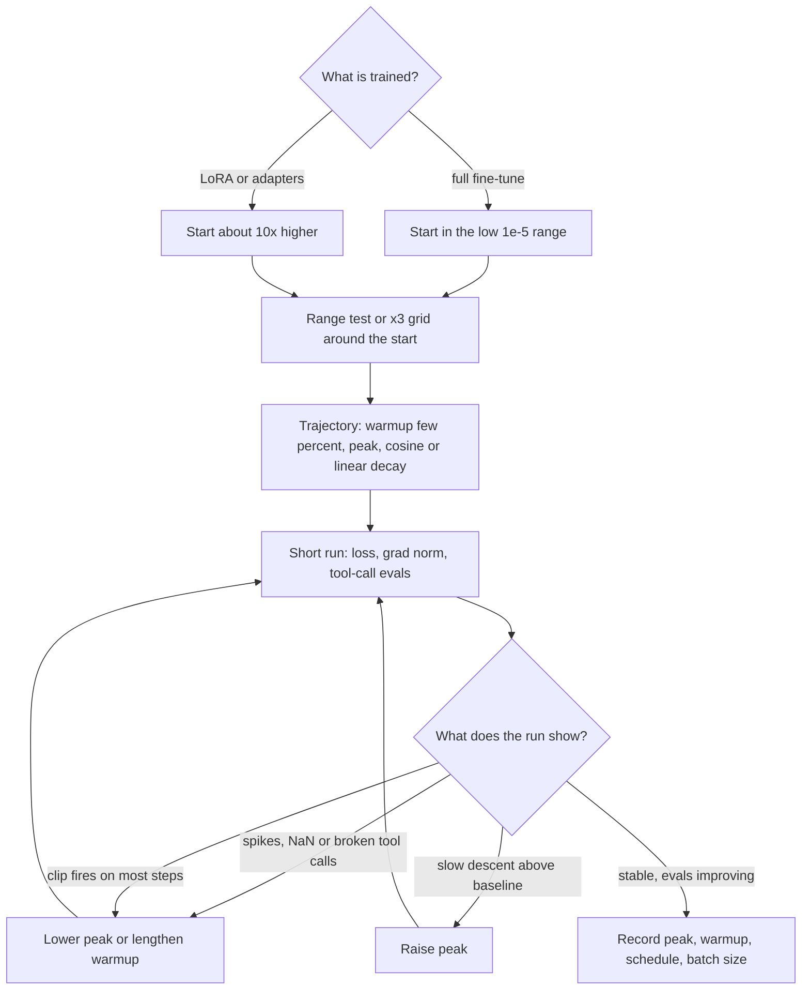

## TL;DR
The learning rate is the optimiser's step size, the first knob to check when an agent fine-tune
misbehaves: too high and the model forgets its tool-call format or diverges, too low and LoRA learns
nothing. Peak, warmup and decay are set together.

## For agent builders
- **Why it matters for agents.** When you fine-tune a model on agent trajectories (tool selection,
  argument formatting, a house style for final answers), the rate decides how far the model moves from
  the instruction-tuned base. Too far and it loses the general skills and chat format your agent relies on.
- **Where it shows up in your stack.** A learning-rate multiplier on hosted fine-tuning jobs (OpenAI's
  API calls it `learning_rate_multiplier`), `learning_rate`, `warmup_ratio` and `lr_scheduler_type` in
  Hugging Face and TRL trainers, and the rate you pick for LoRA adapters you serve behind the agent.
- **What you control.** The peak rate per parameterisation (full fine-tune versus LoRA), the warmup as a
  share of a short run, and a small grid scored on held-out tool-call accuracy and a general suite.
- **What you can skip.** Deriving schedules and μP in depth. Know the 2/λ intuition, that Adam makes η
  roughly a per-parameter step, and the full fine-tune versus LoRA starting points.

## Why it exists
- **A gradient is local.** Gradient descent is `θ ← θ − η·∇L(θ)`. The gradient says which direction is
  downhill here, not how far downhill continues; how far is governed by curvature.
- **There is a hard stability bound.** For a one-dimensional quadratic `L = ½λθ²` the update multiplies
  θ by `(1 − ηλ)`, so it converges only when `η < 2/λ`. Above that, each step overshoots the minimum by
  more than it approached it and the loss grows without bound.
- **One η must serve every direction.** A real loss surface has many curvatures; a single η must be small
  enough for the sharpest while still progressing along the flat ones. That is why it must be tuned, and
  why adaptive optimisers, which rescale each coordinate, exist. Even with them, the global η sets how far
  every weight can move.
- **"Small to be safe" wastes the budget.** Distance travelled is roughly steps × step size, so a rate
  ten times too small ends with the loss of a much shorter run. It also tends to generalise worse, an
  empirical regularity whose explanation is still debated.
- **"Large to go fast" breaks things.** Loss spikes, NaNs, and pretrained features destroyed in the first
  hundred steps, which in an agent model shows up as broken tool-call JSON. So the learning rate is a
  trajectory, not a constant: warmup, peak and decay, each answering a different failure.

## How it works
### Fine-tuning rates for agent models
| Setting | Typical peak (starting point, not a law) | Why |
|---|---|---|
| Full fine-tune of an LLM | low 1e-5 range | every weight moves, and large moves erase pretrained knowledge (see catastrophic forgetting) |
| LoRA and other adapters | around ten times higher | the trainable set is small and its contribution starts at zero (LoRA's B matrix is zero-initialised), so the update must grow from nothing within the run |
| Hosted fine-tuning API | a multiplier on a provider-chosen base | you never see the absolute rate, so grid the multiplier the same way |

- **The exact ratio is empirical.**
- **LoRA's α/r interacts with η.** LoRA's output is multiplied by a scaling factor α/r, so changing the
  rank or α changes the effective step on the model's outputs at the same nominal η. That is one reason
  a LoRA rate rarely transfers between configurations unchanged.
- **What a wrong rate looks like in an agent.** Too high: malformed tool calls, ignored system prompts,
  regressions on a general suite. Too low on LoRA: the adapter barely changes behaviour and the agent
  acts like the base model.

### Background: what η means under SGD versus Adam
| Optimiser | Update | Consequence |
|---|---|---|
| SGD | `Δθ = −η·g` | step scales with gradient magnitude, which differs across layers by orders of magnitude, so a good rate is specific to the architecture and even the initialisation |
| Adam / AdamW | `Δθ ≈ −η·m̂ / (√v̂ + ε)` | m̂ and v̂ are running estimates of the gradient's mean and squared magnitude; the division normalises scale away |

- **Adam steps are about η per parameter** for a consistently signed gradient, regardless of the raw
  gradient size, and smaller when the gradient flips sign.
- **So transformer rates cluster in a narrow band.** The Llama 2 report trained its 7B and 13B models
  with a peak of 3e-4 and the 34B and 70B with 1.5e-4, with cosine decay to 10% of peak.
- **Weight decay rides on η.** In PyTorch's AdamW and most framework implementations the weight-decay
  step is multiplied by η (`θ ← θ·(1 − η·λ)`), so raising the learning rate strengthens regularisation at
  the same time.

### Warmup: why the first steps are special
Runs start with η near zero and ramp linearly to the peak: over thousands of steps in pretraining, or a
few percent of the steps in fine-tuning. Two reasons:
1. **Adam's statistics are immature.** The second-moment estimate is built from very few samples at the
   start, so normalisation is unreliable and a full-size step can land anywhere.
2. **Early gradients are large and uninformative.** In a full fine-tune, a freshly attached, randomly
   initialised head sends large, essentially random gradients into the pretrained body, which would tear
   through pretrained features at full rate.

Warmup lets the statistics and the representation settle before committing to large moves. Depth on the
mechanism lives in `ml-fundamentals/warmup`.

### Decay: why the last steps are special
- **A fixed rate hits a noise floor.** Minibatch gradients are noisy, so parameters jitter inside a
  region whose size grows with η, and the loss plateaus above the minimum.
- **Shrinking η late** (cosine or linear decay to a fraction of peak) lets the parameters settle into the
  basin.
- **Constant-then-decay.** Some recent recipes hold the rate constant and decay only in a final phase, so
  a run can be extended without replaying the schedule.
- Schedule shapes are covered in `ml-fundamentals/learning-rate-schedulers`.

### Scaling with batch size
- **Larger batches tolerate larger steps,** because averaging more samples reduces gradient noise.
- **SGD:** the linear scaling rule (multiply η by *k* when the batch grows by *k*, with warmup) is well
  established.
- **Adam:** the right exponent is contested; square-root scaling is often recommended.
- **Either way,** a rate copied from a run with a different batch size is a different hyperparameter.

### One rate or several
- **Discriminative (layer-wise) rates** give a freshly initialised head a higher rate than the pretrained
  body, because the head starts from nothing while the body only needs nudging. Optimisers take this as
  separate parameter groups.
- **Width-aware parameterisations such as μP** rescale initialisation and per-layer rates so the best
  rate found on a small model transfers to a wider one. That is how some labs tune large runs without
  sweeping at full size.

### Finding the rate
1. **Range test.** Increase η exponentially over a short run and plot loss. The usable region ends just
   before the loss explodes; the best peak sits somewhat below that edge.
2. **Coarse grid.** ×3 spacing (1e-5, 3e-5, 1e-4) resolves most fine-tuning questions. For an agent model,
   pick on held-out tool-call accuracy and a general suite, not training loss.
3. **Read the diagnostics:**

| Symptom | Meaning |
|---|---|
| spikes or NaN | too high |
| slow, monotone descent that ends above the baseline | too low |
| gradient clipping firing on most steps | the rate is leaning on the clip rather than being right |
| tool-call validity falls while task loss improves | too high: the model is drifting from its base format |

## Diagram
The path to a usable rate: pick a starting band by parameterisation, probe it, then read the curves and
agent evals and move the peak or warmup until neither spikes nor a flat plateau appears.



## Examples
### A ×3 grid for a LoRA agent fine-tune, scored on tool calls
The grid is judged on what the agent needs: held-out tool calls that parse, name a real tool and carry
every required argument. `finetune_lora` and `generate_calls` stand in for the team's training and
inference helpers; the scorer is runnable as written.

```python
import json

TOOLS = {"search_orders": {"required": ["customer_id"]},
         "issue_refund": {"required": ["order_id", "amount"]}}

def tool_call_validity(outputs, tools=TOOLS):
    """Share of predicted tool calls that parse, name a real tool and include all required args."""
    ok = 0
    for out in outputs:
        try:
            call = json.loads(out)
            ok += all(k in call["arguments"] for k in tools[call["name"]]["required"])
        except (json.JSONDecodeError, KeyError, TypeError):
            pass
    return ok / len(outputs)

print(tool_call_validity([
    '{"name": "search_orders", "arguments": {"customer_id": "c-42"}}',
    '{"name": "issue_refund", "arguments": {"order_id": "o-9"}}',      # missing amount
    'I will now call issue_refund',                                    # not a tool call at all
]))                                                                    # 0.333...

# The grid itself, around the usual adapter starting point (about 10x a full fine-tune rate):
# for lr in (3e-5, 1e-4, 3e-4):
#     adapter = finetune_lora(base, train_traces, lr=lr, warmup_ratio=0.03, scheduler="cosine")
#     print(lr, tool_call_validity(generate_calls(adapter, heldout_prompts)), run_suite(adapter))
```

In a Hugging Face fine-tune the same ideas appear as `learning_rate=2e-5`, `warmup_ratio=0.03` and
`lr_scheduler_type="cosine"`; the peak, the ramp and the decay are three settings of one trajectory.

### Worked scenario: reading the grid
Illustrative numbers (shape only, not a benchmark) for LoRA on 3,000 support-agent trajectories, scored on
200 held-out tool calls and a general instruction-following suite.

| Peak LR | End train loss | Tool-call validity | General suite |
|---|---|---|---|
| 3e-5 | 0.71 | 86% | 70 |
| 1e-4 | 0.44 | 95% | 69 |
| 3e-4 | 0.21 | 93% | 64 |
| 1e-3 | spiky | 61% | 52 |

- **Reading it.** Training loss keeps falling as the rate rises, but tool-call validity peaks at 1e-4
  and the general suite drops sharply above it. Pick 1e-4; 3e-4 buys loss, not agent behaviour.

### The stability bound and Adam's normalisation
The bound is easiest to see on the quadratic, and Adam's normalisation by feeding it two gradients that
differ by 1000× and watching the parameter move by the same amount.

```python
import torch

def gd(lr, curvature=4.0, theta=1.0, steps=10):
    # Loss L = 0.5 * curvature * theta**2, gradient = curvature * theta
    for _ in range(steps):
        theta = theta - lr * curvature * theta          # = theta * (1 - lr * curvature)
    return theta

for lr in (0.05, 0.1, 0.45, 0.5, 0.6):
    print(f"lr={lr:<5} factor={1 - lr * 4:+.2f}  theta after 10 steps={gd(lr):+.4f}")
# lr=0.05  factor=+0.80  0.1074   slow, monotone
# lr=0.1   factor=+0.60  0.0060   fast, monotone
# lr=0.45  factor=-0.80  0.1074   oscillates, still converges
# lr=0.5   factor=-1.00  1.0000   bounces forever: exactly the 2/curvature limit
# lr=0.6   factor=-1.40  28.925   diverges

# Adam normalises the gradient scale away, so the first step is ~lr whatever the gradient size.
w = torch.nn.Parameter(torch.tensor([1.0]))
opt = torch.optim.Adam([w], lr=1e-3)
for scale in (1.0, 1000.0):
    w.data.fill_(1.0); opt.state.clear()
    w.grad = torch.tensor([scale])
    opt.step()
    print(f"gradient={scale:>6}: moved by {1.0 - w.item():.6f}")   # both ~0.001
```

### A learning-rate range test in plain Python
Minibatch SGD on a one-weight regression, with η ramped exponentially from 1e-4 to 10 and the run stopped
when the smoothed loss explodes. The loss curvature here is λ = 2·E[x²] ≈ 0.67, so theory puts the edge
near 2/λ = 3.

```python
import math, random

random.seed(0)
data = [(x, 3 * x + random.gauss(0, 0.1)) for x in (random.uniform(-1, 1) for _ in range(2000))]

def range_test(lr_min=1e-4, lr_max=10.0, steps=200, batch=16):
    w, best, smooth, history = 0.0, float("inf"), None, []
    for i in range(steps):
        lr = lr_min * (lr_max / lr_min) ** (i / (steps - 1))       # exponential ramp
        xb = random.sample(data, batch)
        grad = sum(2 * (w * x - y) * x for x, y in xb) / batch      # d/dw of mean squared error
        loss = sum((w * x - y) ** 2 for x, y in xb) / batch
        w -= lr * grad
        smooth = loss if smooth is None else 0.7 * smooth + 0.3 * loss
        history.append((lr, smooth))
        best = min(best, smooth)
        if smooth > 4 * best or math.isnan(smooth):                 # loss has exploded: stop
            break
    return history

edge = range_test()[-1][0]
print(f"loss exploded near lr={edge:.2f}; try a peak around {edge / 10:.2f}")   # conservative: ~10x below
# The edge lands between about 3 and 6 depending on the seed (smoothing lags the blow-up).
```

### Worked scenario: warmup copied from a pretraining config
A team fine-tunes on 2,400 examples at batch 16 for 2 epochs and copies a fixed warmup of 500 steps.

| Quantity | Value |
|---|---|
| Steps per epoch | 2,400 ÷ 16 = 150 |
| Total steps | 300 |
| Copied warmup | 500 steps: the peak is never reached |
| `warmup_ratio=0.03` instead | 9 steps, then cosine decay over the remaining 291 |

- **Symptom.** The run "learns almost nothing", which looks like a too-low rate.
- **Fix.** Express warmup as a ratio of total steps for fine-tunes, and recompute it when epochs or
  dataset size change.

## Production patterns
- **Score the grid on agent behaviour.** For a new agent fine-tune, run a short ×3 grid (1e-5, 3e-5, 1e-4
  for full fine-tunes, or ten times higher for LoRA, or three multipliers on a hosted job) and pick on
  held-out tool-call validity and a general suite. Monitor for spikes at the top and a flat curve at the
  bottom.
- **Record the trajectory as one unit.** In every training config and experiment record, store peak
  `learning_rate`, warmup (`warmup_ratio` or steps), `lr_scheduler_type`, effective batch size and
  optimiser together. Log the actual learning rate per step (the Hugging Face `Trainer` logs it) and
  check it matches the plan.
- **Gradient-norm and clip-rate dashboard.** Keep clipping on (`max_grad_norm=1.0` is the Hugging Face
  default) but chart the pre-clip gradient norm and the fraction of steps clipped. A clip rate near 100%
  means the rate is too high, not that clipping is working.
- **Separate parameter groups for head and body.** When a new head is attached (for example a router or
  reward head), give it a higher rate:
  `torch.optim.AdamW([{"params": body_params, "lr": 1e-5}, {"params": head_params, "lr": 1e-4}])`.
  Monitor per-group update norms so the body is not drifting more than intended.
- **Spike rollback.** On a loss spike or NaN in a long run, restore the last good checkpoint and resume
  with a lower peak or longer warmup rather than pushing through. Monitor loss spikes per thousand steps
  and alert on the first NaN.
- **Re-tune on any structural change.** Treat a new batch size, optimiser, LoRA rank or α, base model or
  model width as invalidating the old rate; rerun the grid. Track the rate alongside these settings so
  drift in one is visible.

## Trade-offs
- **Higher peak vs stability.** A higher peak reaches a lower loss within a fixed budget and often
  generalises better, but instability grows with it; the balance flips as soon as loss spikes appear,
  which happens more readily at larger model scale.
- **Longer warmup vs lost learning.** It protects against early divergence and feature damage but delays
  learning; in a short fine-tune of a few hundred steps, a long warmup can consume a large share of the
  run.
- **Decay to near zero vs extensibility.** It gives the best final weights but a finished run cannot be
  extended; a constant phase with a late decay keeps that option at the cost of a slightly less settled
  endpoint.
- **Low fine-tuning rate vs underfitting.** It preserves pretrained knowledge, chat format and general
  tool use, and reduces forgetting, but may underfit the new task; the balance shifts toward a higher rate
  when the task is far from the pretraining distribution.

## Pitfalls
- **Copying a rate across optimisers, batch sizes or parameterisations** (SGD versus AdamW, full
  fine-tune versus LoRA). Symptom: a run that diverges immediately or one that barely moves in the
  budget. Fix: re-run a short grid for the new setup.
- **Choosing the rate on training loss for an agent model.** Symptom: the lowest-loss run emits more
  malformed tool calls and ignores system prompts. Fix: select on held-out tool-call validity and a
  general suite.
- **Changing step count while the schedule is defined in steps** (epochs, dataset size). Symptom: two
  "identical" configs with different effective rates at the same step and incomparable results. Fix:
  define warmup as a ratio and log the per-step rate.
- **Letting gradient clipping hide an excessive rate.** Symptom: the clip triggers on almost every step
  while the loss creeps rather than drops. Fix: lower the peak until clipping is occasional.
- **Skipping or truncating warmup with Adam.** Symptom: divergence or a permanent loss plateau in the
  first few hundred steps that no later schedule repairs. Fix: restore a warmup of a few percent.
- **Raising the rate without noticing AdamW's decay scales with it.** Symptom: weights shrinking faster
  than intended and underfitting that looks like a data problem. Fix: re-check weight decay when the
  best rate moves.
- **Reporting "learning rate 2e-5" with no warmup, schedule or batch size.** Symptom: nobody, including
  you, can reproduce the run. Fix: record the whole trajectory with the batch size.

## When to use
Every training run sets a learning rate; the decision is how to choose it and its trajectory.
- **New agent fine-tuning task:** start from a common rate for your parameterisation, run a short range
  test or a ×3 grid, and read the loss curve for spikes (too high) or a flat, early plateau (too low)
  alongside tool-call and general evals.
- **Pair and record:** a peak with a warmup of a few percent of the steps and a decay that fits the run
  length; record all three with the batch size.
- **Measure:** the gradient norm alongside the loss. A healthy run has a stable norm, not one rescued by
  clipping.
- **Interviews:** derive the 2/λ bound, explain why Adam makes rates transferable across layers, and say
  why fine-tuning rates are lower than pretraining rates; that chain distinguishes understanding from a
  remembered number.

## Role lens
- **Engineer:** Picks the peak rate, warmup ratio and schedule in the training config, runs the range test
  or grid, and reads loss and gradient-norm curves to diagnose a rate that is too high or too low.
- **Architect:** Sets the policy that learning rate, warmup, schedule and batch size are recorded together
  for every run so results are reproducible and comparable across teams and model sizes.
- **FDE:** When a customer's fine-tune on their data diverges or regresses on general ability, the learning
  rate and its warmup are the first settings to inspect and the easiest to explain.

## Check yourself
**Q:** Your full fine-tune at a peak rate of 2e-5 learns the task but regresses on general instruction
following; your LoRA run at the same 2e-5 learns almost nothing. Explain both outcomes and what you would
change.
**A:** The full fine-tune moves every weight by about the learning rate per step under AdamW, so even a
modest rate accumulated over hundreds of steps shifts the whole network away from the pretrained solution;
the regression is forgetting, and the fixes are a lower rate, fewer steps, early stopping on a general
evaluation, or mixing general data into the set. The LoRA update is the product B·A scaled by α/r, and B
starts at zero, so the change to the model begins at exactly zero and can only grow as fast as B's
entries move, about η per step under Adam. At 2e-5 over a few hundred steps those entries stay tiny and
the product barely affects the outputs; adapter training commonly uses rates around ten times higher,
and the right value also depends on the chosen α and rank. The change is to tune the rate per parameterisation, run a
quick grid at ×3 spacing for each, and watch both the task metric and the general evaluation rather than
training loss alone.

## Interview questions
### Why is the learning rate usually the most sensitive hyperparameter?
- **A gradient gives direction, not distance.** How far downhill continues is set by curvature, and the
  update `θ ← θ − η·∇L(θ)` only converges on a quadratic when `η < 2/λ`.
- **One η must serve every direction:** small enough for the sharpest curvature, large enough to progress
  along flat ones. Too large diverges, too small spends the budget crawling, so small changes in η move
  the outcome more than most other settings.

### After fine-tuning your agent model, tool calls are more often malformed than with the base model. Is it the learning rate?
- **Likely suspect:** a peak too high (or too many steps) moves the model away from the base's format
  skills; check whether the regression grows with the rate across your grid.
- **Check the data too:** training traces formatted differently from the serving chat template, or
  without tool calls, push the format away whatever the rate.
- **Fix:** lower the rate or use LoRA, mix in general tool-use data, and gate on held-out tool-call
  validity measured against the base model's own number.

### Your hosted fine-tuning job only exposes a learning-rate multiplier. How do you tune it?
- **Treat it like any rate:** you do not see the absolute value, so run a ×3 grid of multipliers on a
  fraction of the data or budget.
- **Pick on agent evals:** held-out tool-call validity, task success on a small sandbox set and a general
  suite, not the training loss the job reports.
- **Re-tune when anything structural changes:** base model, dataset size, epochs or batch size.

### Why do we warm up the learning rate, and what goes wrong if you copy a warmup from pretraining?
- **Warmup exists because** Adam's second-moment estimate is built from very few samples at the start,
  and early gradients (for example from a new random head) are large and uninformative.
- **Copied fixed warmup:** a 500-step warmup on a 300-step fine-tune never reaches the peak, so the run
  learns almost nothing and looks like a too-low rate.
- **Fix:** express warmup as a ratio of total steps (for example `warmup_ratio=0.03`) and recompute it when
  epochs or dataset size change.

### You double the batch size. Should you change the learning rate?
- **Probably, because larger batches reduce gradient noise and tolerate larger steps.**
- **SGD:** the linear scaling rule (multiply η by *k* with warmup) is well established.
- **Adam:** the right exponent is contested, and square-root scaling is often recommended. Either way, treat
  the old rate as a different hyperparameter and re-run a short grid.

### Your long run shows a loss spike followed by NaN at step 40,000. What do you do?
- **Do not push through.** Restore the last good checkpoint and resume with a lower peak or a longer
  warmup.
- **Diagnose with the gradient norm** and clip rate around the spike: a norm that climbs before the spike,
  or clipping firing on most steps, says the rate is too high for that phase.
- **Monitor afterwards:** loss spikes per thousand steps and an alert on the first NaN; and remember AdamW
  decay scales with η, so re-check weight decay if the new peak differs a lot.

## Quiz
### Q: For the loss L = ½λθ² with λ = 4, which learning rate makes plain gradient descent diverge?
- [ ] 0.1
- [ ] 0.25
- [ ] 0.45
- [x] 0.6
> The update multiplies θ by (1 − ηλ), which must stay inside (−1, 1), so η must be below 2/λ = 0.5. At 0.45
> the iterate oscillates but shrinks; at 0.6 the factor is −1.4 and the loss grows every step.

### Q: Why do Adam learning rates transfer across layers and architectures better than SGD rates?
- [ ] Adam ignores the gradient and moves every weight by exactly η
- [x] Adam divides by a running estimate of gradient magnitude, so the step is roughly η per parameter regardless of raw gradient scale
- [ ] Adam automatically performs a learning-rate range test during warmup
- [ ] Adam applies weight decay, which cancels differences in gradient scale
> Normalisation by the second-moment estimate removes the layer-to-layer scale differences that make SGD
> rates architecture-specific. Adam does not ignore gradients; sign changes and noise still shrink its steps.

### Q: A bf16 fine-tune shows loss spikes and then NaN within the first 50 steps. Which learning-rate issue is most likely?
- [ ] The rate is too low, so the loss cannot leave its plateau
- [x] The peak rate is too high or the warmup too short, so early unreliable Adam steps are taken at full size
- [ ] The decay schedule ended too early
- [ ] Weight decay was set to zero
> Early steps combine the largest gradients with the least reliable second-moment estimates; a full-size
> step there overshoots sharply curved directions. Decay is irrelevant that early, and a too-low rate
> produces slowness, not spikes.
