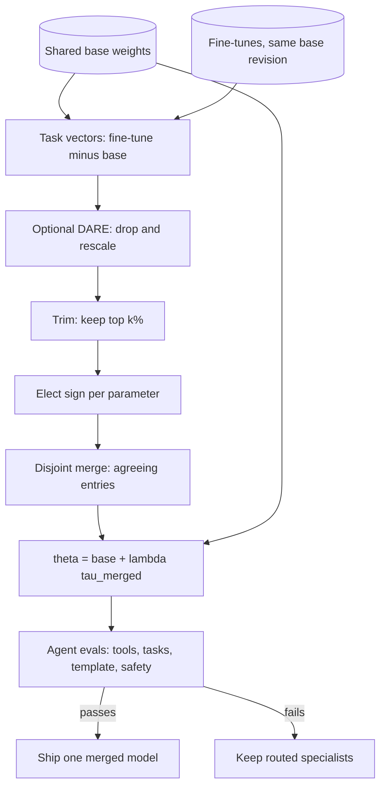

## TL;DR
Model merging combines fine-tunes of one base, such as a tool-calling tune and a chat tune, into one
agent model by weight arithmetic (averaging, task vectors, trimming, sign-voting) with no training. One
model's serving cost, but interference nothing corrects.

## For agent builders
- **Why it matters for agents.** A self-hosted agent often needs several skills in one model: reliable
  tool-call formatting, your domain, and good conversation. Merging a tool-use fine-tune with an instruct
  tune can give one model all three without routing every step or retraining on data you do not have.
- **Where it shows up in your stack.** mergekit YAML configs for full checkpoints, PEFT's
  `add_weighted_adapter` (linear, TIES and DARE combination types) for LoRA adapters, and many community
  "merged" models on model hubs that you might be tempted to put behind an agent.
- **What you control.** Which parents (same base revision only), the method and density, λ, and the eval
  gate: tool-call validity, task success, chat-template behaviour and refusals, scored against each
  parent.
- **What you can skip.** Linear mode connectivity theory and DARE's proof. Know task vectors, why TIES
  elects a sign, and that a merge is unverified until your agent suite passes.

## Why it exists
- **Serving several fine-tunes is costly.** Three fine-tunes of one 8B base (support domain, tool-call
  formats, a community instruct tune with better conversation) mean three copies of the weights, a router,
  and no way for one answer to use two skills at once.
- **Multi-task training is often impossible.** You need all three datasets (the community one is not yours
  to have), must rebuild the mix whenever one changes, and pay a training run per iteration. Ensembling
  costs three forward passes per token.
- **Merging is a fourth option.** Every model is `base + small delta`, so you add the deltas and get one
  model in minutes on a CPU.
- **Why it is not absurd.** Fine-tunes from the same pretrained weights stay in the same loss basin, so the
  straight line between them has no loss barrier (linear mode connectivity). Averaging two good solutions
  tends to land on a third, often better than either.
- **The evidence.** Model soups: averaging fine-tunes with different hyperparameters improved accuracy and
  out-of-distribution robustness at zero inference cost. Task arithmetic: deltas behave like vectors you
  can add, scale and even negate to remove a behaviour.
- **Plain averaging breaks on disagreement.** One tune pushes a weight up, another down, and the average
  cancels both. Later methods all answer that interference problem.

## How it works
### Task vectors
- **Definition:** τ_i = θ_i − θ_base, computed tensor by tensor for base θ_base and fine-tune θ_i.
- **Uses:**
  - multi-task merging: θ = θ_base + λ Σ τ_i;
  - forgetting: θ_base − λ τ (negating a toxicity fine-tune reduces toxicity);
  - even analogies.
- **λ** is one scalar (or one per task) tuned on a validation set. Deltas are additive approximations, so
  λ around 0.3–1.0 in total usually works; larger sums push activations out of the range the base was
  trained in.

### Linear averaging and soups
- **Formula:** θ = Σ w_i θ_i with Σ w_i = 1.
- **Uniform soups** average everything; **greedy soups** add a model only if the validation metric improves.
- **Right tool when** models learned the *same* thing differently (same data, different seeds or learning
  rates). Checkpoint averaging at the end of a long run is the same idea along one trajectory.
- **Wrong tool when** the models learned different things.

### SLERP
Spherical linear interpolation treats each tensor (or the whole flattened model) as a vector and moves
along the arc between two, with cos Ω = a·b / (‖a‖‖b‖) and

```
slerp(a, b, t) = sin((1 − t)Ω) / sin Ω · a  +  sin(tΩ) / sin Ω · b
```

- **Why: norm preservation.** A straight-line midpoint between two vectors at an angle is *shorter* than
  either, shrinking activation scales layer by layer; SLERP keeps the magnitude.
- **Limit:** two models at a time. The usual choice for blending two closely related instruct tunes.

### TIES-Merging: trim, elect sign, disjoint merge
TIES names two sources of interference:
- **Noise:** most entries of a task vector are tiny but still perturb other tasks when summed.
- **Sign conflicts:** when τ_A and τ_B disagree on direction, averaging cancels useful movement.

Three steps, in order, each removing one failure mode:
1. **Trim.** Keep only the top *k*% of each τ_i by magnitude (20% is common); zero the rest. Fine-tuning
   changes concentrate in a few parameters, so this removes noise without losing much.
2. **Elect.** Per parameter, pick the sign carrying more total magnitude: sign(Σ_i τ_i) after trimming.
   This decides which way the merged model moves.
3. **Disjoint merge.** Average only task vectors agreeing with the elected sign there, ignoring dissenters
   instead of letting them cancel the majority. Then θ = θ_base + λ τ_merged.

Four-parameter walkthrough (trim to top 50%, two entries each):

| | p1 | p2 | p3 | p4 |
|---|---|---|---|---|
| τ_A | +0.30 | −0.02 | +0.10 | −0.40 |
| τ_B | −0.25 | +0.01 | +0.12 | −0.05 |
| τ_C | +0.05 | 0.00 | −0.08 | −0.30 |
| Plain mean | +0.03 | 0.00 | +0.05 | −0.25 |
| Trimmed A / B / C | +0.30 / −0.25 / 0 | 0 / 0 / 0 | 0 / +0.12 / −0.08 | −0.40 / 0 / −0.30 |
| Elected sign | + | 0 | + | − |
| τ_merged | +0.30 | 0 | +0.12 | −0.35 |

- **Agreement survives at full strength.** It is not divided by the number of tasks, which is why λ for
  TIES sits near 1 rather than 1/N.
- **Conflicts are decided, not resolved.** On p1, B loses outright because A's magnitude was larger, so
  B's skill pays wherever it depended on that weight.

### DARE: drop and rescale
- **Observation:** SFT deltas are extremely redundant. Zero a random 90% (or more, on large models) of a
  task vector's entries and multiply survivors by 1/(1 − p): behaviour barely changes.
- **Why:** the rescaling keeps the expected delta identical, and the redundancy covers dropped entries.
- **Use:** sparsified deltas from different tasks collide far less, so DARE is preprocessing before
  summing or before TIES ("dare_ties").
- **Limit:** works when deltas are small relative to the base; fails on continued-pretraining deltas,
  which are large and not redundant.

### Passthrough and frankenmerges
- Stacking layers from different models, or repeating a block to make a deeper model (depth up-scaling),
  is merging without arithmetic.
- The result is broken until healed with continued training, so this is model building, not a free
  combination step.

### Constraints that follow from the mechanism
- **Same architecture, shapes and lineage.** Everything is elementwise arithmetic, so it needs identical
  tensor shapes (hence the same tokenizer and vocabulary size) and the same base.
- **Different base checkpoints:** deltas measured from different origins.
- **Different random initialisations:** related by hidden permutations of neurons; they average into
  noise unless aligned first.
- **LoRA adapters are task vectors** in a low-rank subspace, so adapter merging (a weighted sum of B_iA_i
  products, with the same TIES/DARE options) has the same interference problems.
- **Nothing is trained, so nothing is verified.** Every merge needs the full eval suite, including chat
  template, end-of-turn behaviour and safety checks, before anyone calls it a model.

### What it means for an agent model
- **Tool-call formatting is a fragile skill.** It lives in exact token patterns around the tool-call
  markers, so a parent whose template differs, or a merge whose weights lean toward the chat parent, can
  silently stop emitting parseable calls.
- **Keep the tool-use parent's template.** Serve the merge with the chat template and tool-call format the
  tool-use parent was trained on, and test that end-of-turn and tool-call tokens still appear.
- **Merging adapters is the cheap path.** A tool-format adapter and a tenant-tone adapter on one base
  can be combined into one adapter with the same TIES/DARE choices, then evaluated per tenant.
- **Score per skill, then end to end.** Measure tool-call validity, conversation quality and refusals
  separately against each parent, then replay full agent tasks, because a merge that wins on chat but
  loses a few points of valid calls fails more multi-step tasks.

## Diagram
Follow one tensor through a TIES or dare_ties merge of, say, a tool-use tune and a chat tune: deltas are
taken against the shared base, optionally DARE-dropped and rescaled by 1 / (1 - p), trimmed, sign-voted
and averaged among agreeing tasks. The result is added back and gated by agent evals before it replaces
routed specialists.



## Misconceptions
- **"Any two models with the same architecture can be merged."** Arithmetic only makes sense for
  fine-tunes of the identical base revision with matching tokenizer and vocabulary. Models from different
  initialisations have permuted hidden units and average into noise.
- **"Averaging two fine-tunes gives you both skills."** Plain averaging works for soups of the same task;
  for different skills, deltas that disagree in sign cancel, which is the interference TIES and DARE exist
  to reduce.
- **"TIES resolves conflicts, so no skill is lost."** It decides them: per parameter the sign with more
  magnitude wins and dissenting entries are dropped, so the losing parent's skill pays wherever it
  depended on those weights.
- **"Giving each parent a full weight keeps more of each skill."** Weights summing well above one, or too
  high a λ, push activations out of the range the base expects and produce degenerate, repetitive text.
- **"No training means a low-risk change."** Nothing in a merge is trained, so nothing is verified:
  tool-call formatting, the chat template and refusals can all erode silently. A merge needs the same
  release gate as a trained model, including replayed agent tasks.

## Examples
### TIES merge over Hugging Face state dicts
PyTorch. All checkpoints must share the base model and tensor shapes. It works tensor by tensor, so the
extra working memory is one tensor times the number of models (the loaded state dicts themselves must
still fit in CPU RAM), and it copies non-float buffers unchanged.

```python
import torch

def ties_merge(base, finetunes, k=0.2, lam=1.0):
    """base, finetunes: state dicts (name -> tensor) of the same architecture and base lineage.
    Returns base + lam * TIES-merged task vector."""
    merged = {}
    for name, w0 in base.items():
        if not w0.is_floating_point():                       # token ids, buffers: pass through
            merged[name] = w0.clone(); continue
        taus = torch.stack([ft[name].float() - w0.float() for ft in finetunes])   # [n_tasks, ...]
        # 1. Trim: keep the top-k fraction of each task vector by magnitude
        flat = taus.abs().flatten(1)
        n_keep = max(1, int(k * flat.shape[1]))
        thresh = flat.kthvalue(flat.shape[1] - n_keep + 1, dim=1).values  # per-task cutoff
        taus = taus * (taus.abs() >= thresh.view(-1, *([1] * (taus.dim() - 1))))
        # 2. Elect: the sign with more total magnitude at each parameter wins
        sign = torch.sign(taus.sum(0))
        # 3. Disjoint merge: average only the entries that agree with the elected sign
        agree = (torch.sign(taus) == sign) & (taus != 0)
        tau = (taus * agree).sum(0) / agree.sum(0).clamp(min=1)
        merged[name] = (w0.float() + lam * tau).to(w0.dtype)
    return merged

# usage sketch (every path must be a fine-tune of exactly the same base revision):
# from transformers import AutoModelForCausalLM
# base = AutoModelForCausalLM.from_pretrained("org/base-8b").state_dict()
# fts = [AutoModelForCausalLM.from_pretrained(p).state_dict() for p in ("org/support-sft", "org/tools-sft")]
# model = AutoModelForCausalLM.from_pretrained("org/base-8b"); model.load_state_dict(ties_merge(base, fts))
# Then: run the per-task evals, a general benchmark, the chat-template smoke test and the safety suite.
# mergekit expresses the same recipe as a YAML config (merge_method: ties, density: 0.2, weight: ...).
```

### Reproduce the four-parameter walkthrough
Pure Python; runs anywhere and prints the table's last row.

```python
tau = {"A": [+0.30, -0.02, +0.10, -0.40],
       "B": [-0.25, +0.01, +0.12, -0.05],
       "C": [+0.05, 0.00, -0.08, -0.30]}

def trim(v, keep=2):                       # keep the top-`keep` entries by magnitude
    top = sorted(range(len(v)), key=lambda i: abs(v[i]), reverse=True)[:keep]
    return [x if i in top else 0.0 for i, x in enumerate(v)]

sign = lambda x: (x > 0) - (x < 0)
mean = [round(sum(c) / 3, 2) for c in zip(*tau.values())]
trimmed = [trim(v) for v in tau.values()]
merged = []
for col in zip(*trimmed):
    s = sign(sum(col))                                   # elect
    agree = [x for x in col if x != 0 and sign(x) == s]  # disjoint merge
    merged.append(round(sum(agree) / len(agree), 2) if agree else 0.0)
print("plain mean:", mean)      # [0.03, -0.0, 0.05, -0.25]
print("TIES      :", merged)    # [0.3, 0.0, 0.12, -0.35]
```

### The same merge as a mergekit config
The declarative form teams usually commit to version control; run it with `mergekit-yaml config.yml
./merged`.

```yaml
merge_method: ties
base_model: org/base-8b
models:
  - model: org/support-sft
    parameters:
      density: 0.2      # TIES trim: keep the top 20% of each task vector
      weight: 0.5
  - model: org/instruct-tune
    parameters:
      density: 0.2
      weight: 0.5
parameters:
  normalize: true
dtype: bfloat16
```

### Worked scenario: one agent model instead of a router
A team self-hosts an agent on an 8B base with two fine-tunes: a tool-use SFT (trained on agent traces) and
a community instruct tune with better conversation. Today a router sends every agent step to one of
them. Scores below are illustrative, to show how the decision is made.

| Candidate | Valid tool calls | Agent task success (20-step suite) | Chat quality | Refusals kept | GPUs |
|---|---|---|---|---|---|
| Router over both parents | 97% | 81% | 8.1 | yes | 2 copies |
| Linear average 0.5/0.5 | 91% | 70% | 7.9 | yes | 1 |
| TIES, density 0.2, λ near 1 | 96% | 79% | 8.0 | yes | 1 |
| TIES, chat weight raised | 89% | 66% | 8.3 | partly | 1 |

- **The decision:** ship the TIES candidate only if a 1-point drop in valid calls and 2 points of task
  success are inside your tolerance; otherwise keep the router.
- **Why task success moves more than call validity:** a per-step loss compounds over a 20-step task.

## Production patterns
- **Merge agent skills with a tool-call gate.** When combining a tool-use tune with a chat or domain tune,
  score every candidate on schema-valid tool calls, full replayed agent tasks and refusals, against each
  parent. Monitor tool-call parse failures per model version after rollout.
- **Merge recipes as code.** Keep each merge as a versioned config (method, parent revisions, density,
  weights, λ) next to its eval report, so any registered model can be rebuilt exactly. Monitor that parent
  revisions in the config match the registry.
- **Lineage check before merging.** Verify every parent was fine-tuned from the same base revision and
  shares tokenizer and vocabulary size; refuse the merge on any shape mismatch instead of padding tensors.
- **Small hyperparameter grid on a mixed validation set.** Sweep density (for example 0.2 to 0.5) and
  weights or λ, plus a SLERP candidate for two-model merges, scoring every parent's task. Pick the point
  where no parent's metric drops beyond tolerance.
- **Full release gate, like a trained model.** Per-task evals against each parent, a general benchmark, a
  chat-template smoke test (end-of-turn, role tags, system prompt) and the safety suite. Track refusal
  rate on a fixed red-team set across every merge.
- **Routing fallback.** If the merge cannot hold every parent's quality, keep the specialists behind a
  router and treat the merge as an experiment. Compare cost per request and quality across both paths.

## Trade-offs
- **No training compute vs no training signal.** No datasets or GPUs needed, but nothing guarantees the
  merge works, so evaluation effort replaces training effort. When you own the data and compute, multi-task
  SFT is more reliable.
- **One model vs interference.** One model for several skills saves GPUs and routing, but interference
  grows with task count and delta size; past a handful of tasks, per-task quality usually slips below the
  specialists.
- **Averaging vs TIES/DARE.** Plain averaging improves robustness for near-duplicates but cancels
  conflicting updates; TIES and DARE fix that at the cost of hyperparameters (k, p, λ) tuned on a
  validation set.
- **SLERP vs N-way methods.** SLERP preserves norms and often beats linear interpolation for two models,
  but does not extend to many; linear and TIES scale to N at the cost of norm drift.
- **Negation power vs governance.** Task-vector negation removes unwanted behaviour cheaply, but the same
  mechanism can strip safety tuning, deliberately or by accident, making merges a governance problem too.

## Pitfalls
- **Wrong origin for deltas.** Merging fine-tunes of different base revisions, or treating an instruct
  model as the base for deltas computed against the pretrained one. Symptom: incoherent or garbage output.
- **Vocabulary mismatch from added special tokens.** Embedding and output-head shapes differ. Symptom: a
  shape error, or, if someone pads the tensors, wrong tokens at generation time.
- **Weights summing well above one, or λ too high.** Activations leave the range the base expects.
  Symptom: repetitive, degenerate text and logits that blow up.
- **Mixed chat templates.** Each parent learned its own, and the merge gets a mixture. Symptom: leaked
  role tags, never emitting end-of-turn, or ignoring the system prompt.
- **Trusting leaderboard scores for merges.** Benchmark contamination accumulates across parents.
  Symptom: tops a public board, underperforms its parents on your tasks.
- **Skipping the safety regression.** Merging can quietly undo refusal training. Symptom: complies with
  requests every parent refused, discovered by a user rather than a test.
- **Judging an agent merge on chat benchmarks.** Conversation scores rise while tool-call formatting
  erodes. Symptom: more parse failures, retries and stalled agent loops after the swap. Fix: gate on
  schema-valid calls and full replayed tasks.

## When to use
- **Use when:** you have several fine-tunes of the same base and need one artifact; you want a community
  tune's conversational quality for your domain model without its data; you are averaging checkpoints or
  seeds from your own run; or you want a fast experiment before a multi-task training job.
- **Agent use:** one self-hosted model that must both call tools reliably and converse well, when the
  router over specialists costs too many GPUs.
- **Avoid when:** you own the data, so training is the better substitute; also when your agent runs on a
  hosted API, where there are no weights to merge.
- **Never ship** a merge without per-task evals, a general benchmark, a template smoke test and the
  safety suite.
- **Measure:** each parent's task metric before and after; treat any drop as the merge's cost, not noise.
- **Interviews:** explain task vectors, why TIES elects a sign, why DARE's rescaling preserves behaviour,
  and why two models from different initialisations cannot simply be averaged.

## Role lens
- **Engineer:** Computes task vectors, tunes density and λ on a validation set, and runs the full eval and
  safety suite on the merged checkpoint before registering it like any trained model.
- **Architect:** Decides whether a merged generalist or routed specialists better fit the serving budget and
  risk posture, and sets provenance rules for which parent checkpoints may be merged into production.
- **FDE:** Combines a customer's domain fine-tune with a stronger instruct tune when retraining is not an
  option on site, and proves the result against the customer's own regression suite.

## Check yourself
**Q:** A team has a support-domain SFT of an 8B base and wants the conversational quality of a newer
community instruct tune built on the same base. What are their options, and how would you merge safely?
**A:** Options are routing between the two models, retraining on the instruct data (unavailable), or
merging. For merging, first confirm both checkpoints derive from the exact same base revision and share
the tokenizer and vocabulary size. Compute both task vectors against the base, then try TIES with density
around 0.2 and λ near 1, and SLERP between the two as a second candidate. Tune on a validation set holding
support tickets and general chat prompts. Evaluate per-task metrics against each parent, a general
benchmark for collateral damage, a chat-template smoke test for end-of-turn behaviour, and the safety
suite, because merging can erode refusals. Ship only if support quality holds within tolerance and the
conversational gain is measurable; otherwise fall back to routing.

## Interview questions
### What is a task vector, and why can you add fine-tunes together at all?
- **Definition:** τ_i = θ_i − θ_base, computed tensor by tensor; merging is θ_base + λ Σ τ_i, and
  θ_base − λ τ removes a behaviour.
- **Why it works:** fine-tunes from the same pretrained weights stay in one loss basin, so the line
  between them has no loss barrier (linear mode connectivity) and the deltas behave like additive vectors.
- **Tuning:** λ around 0.3–1.0 in total usually works; bigger sums push activations out of range.

### Your merged model produces repetitive, degenerate text. Walk through the debugging.
- **Check the weights first:** merge weights summing well above one, or λ too high, push activations out
  of the range the base expects.
- **Check lineage:** parents fine-tuned from different base revisions, or deltas taken against the wrong
  origin, give incoherent output.
- **Check the template:** a mixture of parents' chat templates shows up as leaked role tags and never
  emitting end-of-turn.

### Each tenant's agent has a tone LoRA, and all share a tool-format LoRA on one base. Would you merge the adapters?
- **Adapters are task vectors:** the B_iA_i products can be combined with weights and the same TIES or
  DARE options, so one combined adapter per tenant replaces stacking two at request time.
- **Interference risk:** a tone adapter can override weights the tool-call format depends on, so the
  tool-format adapter needs enough weight; SLERP is an option only for two at a time.
- **Gate per tenant:** schema-valid tool calls, replayed agent tasks and refusals against the unmerged
  pair; keep serving them separately if the combined adapter regresses.

### After deploying a merged model, your agent retries tool calls far more often. What happened?
- **Formatting eroded:** the chat parent's delta overrode weights the tool-call format depended on, or
  the merge mixed two chat templates so tool-call markers are emitted inconsistently.
- **Diagnose:** compare parse-failure rate per model version, and diff the served template against the
  tool-use parent's template.
- **Fix:** raise the tool-use parent's weight or lower density, use the tool-use template, and gate the
  next candidate on tool-call validity and full tasks, or fall back to routing.

### When would you not merge, and what would you do instead?
- **When you own the data and compute:** multi-task SFT is more reliable, because merging has no
  training signal to fix interference.
- **When there are many tasks:** past a handful, per-task quality usually slips below the specialists, so
  keep them behind a router.
- **When parents differ in lineage or vocabulary:** different initialisations average into noise unless
  aligned, and shape mismatches should block the merge rather than be padded.

### A merge tops a public leaderboard. Why might you still refuse to ship it?
- **Contamination accumulates:** each parent may have seen benchmark data, so the merge can top a board
  and still underperform its parents on your tasks.
- **Safety can silently erode:** merging can undo refusal training, so run the red-team set and track
  refusal rate across merges.
- **Ship on your own gate:** per-task evals against each parent, a general benchmark and a template smoke
  test, with any parent's drop counted as the merge's cost.

## Quiz
### Q: Why does TIES-Merging elect a sign per parameter before averaging?
- [ ] To make the merged weights sparse enough for fast kernels
- [x] Because task vectors that disagree in direction cancel under plain averaging, so only the majority direction is kept
- [ ] Because negative deltas are usually noise
- [ ] To normalise each task vector to unit length
> Sign conflicts are a main source of interference: averaging +0.3 and −0.3 yields zero and loses both
> tasks' progress. Electing the dominant sign and averaging only agreeing entries preserves movement.

### Q: DARE drops 90% of a task vector's entries and rescales the rest by 10×. Why does the model still work?
- [ ] Because 90% of fine-tuned weights are exactly zero already
- [ ] Because the base model ignores small deltas
- [x] Because SFT deltas are highly redundant and rescaling keeps the expected delta unchanged
- [ ] Because dropped entries are recovered during the first inference pass
> Random dropping with 1/(1 − p) rescaling is unbiased, and small fine-tuning deltas carry redundant
> information, so the behaviour survives; the method fails on large, non-redundant continued-pretraining deltas.

### Q: Which pair can be safely merged by weight averaging?
- [ ] Two 7B models of the same architecture trained from different random initialisations
- [x] Two fine-tunes that started from the identical pretrained checkpoint
- [ ] A 7B and a 13B model from the same family
- [ ] Any two models that share a tokenizer
> Linear mode connectivity holds for models sharing an initialisation. Independently trained models have
> permuted hidden units and different basins, and different sizes do not even have matching tensor shapes.

## Use cases & projects
### Use cases
- **One model with tool use and conversation.** Merging a tool-calling fine-tune with an instruct tune
  of the same base avoids routing every agent step between two specialists.
- **Adding a domain skill without retraining.** A domain fine-tune merged into the agent's tool-use
  model brings vocabulary in when the original training data is unavailable.
- **Vetting community merges.** Before putting a hub "merged" model behind an agent, teams check its
  lineage and run their tool-call and refusal suites against the parents.
- **Cheap experiments before a real fine-tune.** A merge grid costs minutes of CPU or GPU time, so it is
  a quick test of whether combined skills are reachable at all.

### Mini project
**Merge two adapters and gate the result on an agent suite (2-3 hours).**
- **Goal:** combine a tool-use skill and a style or domain skill into one model and prove whether it
  holds both.
- **Steps:** take two LoRA adapters trained from the same base revision (yours from the PEFT mini
  project, or two public adapters for one small base); build a small grid with PEFT's
  `add_weighted_adapter` (linear plus TIES at two densities); score each candidate and both parents on 40
  tool-calling tasks, 20 style or domain prompts and 15 refusal prompts.
- **Done when:** a table shows every candidate against both parents, and you either ship the best merge
  or document why a router over the two specialists is the better path.
