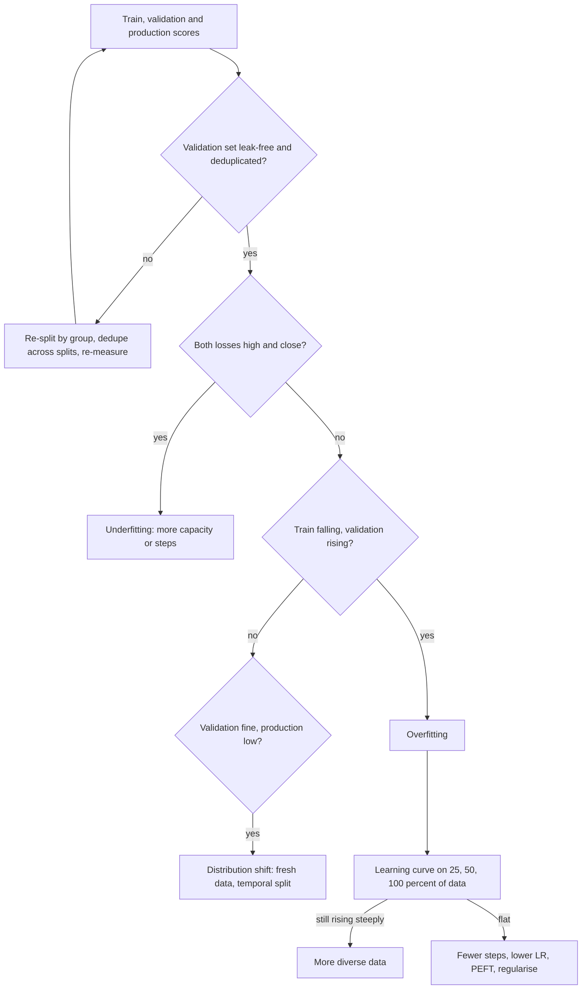

## TL;DR
Overfitting is fitting the particulars of training examples (label noise, phrasing) instead of the
transferable pattern: training loss keeps falling while held-out loss stalls then rises. Fine-tuning a
small set for many epochs is the commonest way to overfit an LLM.

## Why it exists
- **The objective cannot tell rule from rows.** Training asks only "lower the loss on these examples".
  A model with enough capacity can learn the rule or learn the examples; both reach low training loss,
  only the rule reaches low loss on unseen examples.
- **Capacity makes memorising possible.** A network with far more parameters than examples can memorise
  anything.
- **Memorising is often easier.** Every dataset carries in-set-only signals: an annotator who filed
  ambiguous tickets under "billing", a template whose phrasing differs by class, an id or timestamp that
  sorts with the answer. Gradient descent has no reason to prefer the rule, and once it is learned, the
  shortcuts and noise are the only loss left.
- **Both naive fixes fail.** "Train until the loss stops falling" is the recipe for overfitting, because
  on repeated data training loss falls to zero. "Use a smaller model" throws away the capacity that makes
  the model good at the rule.
- **What you want:** enough capacity to learn the pattern and a procedure that stops, or is held back,
  before it learns the noise. Measuring that needs unseen data, which is why overfitting and the
  train/validation/test split are inseparable.

## How it works
### The generalisation gap
1. **Early:** *L_train* (loss on training data) and *L_val* (loss on fresh data from the same
   distribution) fall together, because the model learns shared structure.
2. **Later:** *L_train* keeps falling while *L_val* flattens. The difference is the generalisation gap,
   and it grows with every step that fits something specific to the training rows.
3. **What widens it:** the ratio of effective capacity to effective data. More trainable parameters, more
   steps, higher learning rate and less diverse data all widen the gap.
4. **The noise floor.** Label noise sets a floor on achievable *L_val*; a model that goes below it on
   training data has memorised the noise.

### How it looks in LLM fine-tuning
- **Held-out loss turns up after one or two passes** while training loss keeps dropping, often with a
  staircase: an abrupt training-loss drop at each epoch boundary, because the model now predicts rows it
  has already seen.
- **Verbatim reproduction.** The model reproduces training completions, including names, numbers and
  boilerplate, and can be prompted to regurgitate training records: a privacy incident as well as a
  modelling failure.
- **Style collapse.** Outputs converge on one style or length regardless of the prompt, because the
  fine-tuning set had one.
- **Paraphrase brittleness.** Accuracy is high on prompts phrased like the training data and collapses on
  paraphrases.
- **Loss and metric can disagree.** It is common for held-out loss to rise while the task metric is flat
  or improving, because loss penalises every token including stylistic ones. Pick checkpoints on the
  metric you ship, with loss as the early-warning signal.

### Levers, and why each one works
| Lever | How | Why it works |
|---|---|---|
| **Data** | more examples, deduplication, cleaner labels | memorisation becomes harder than the rule; duplicates stop being seen several times per epoch; cleaner labels lower the noise floor |
| **Steps** | fewer epochs, lower learning rate, early stopping | limits how far the model travels from the pretrained prior, stopping after shared structure and before particulars |
| **Capacity** | parameter-efficient fine-tuning (low-rank adapters, a few trainable layers); a smaller model, more bluntly | constrains the update to a small subspace |
| **Regularisation** | weight decay, dropout, label smoothing, mixing in general-purpose data | penalises large weights, forces redundancy, stops probabilities being driven to exactly one, dilutes row-specific shortcuts |

- **Data is the only lever here that raises the ceiling** as well as closing the gap. A stronger base
  model can raise the ceiling too, but that is a model choice, not an overfitting remedy.
- Regularisation details are in `ml-fundamentals/dropout-regularization`.

### Diagnosing with a learning curve
1. **Retrain on 25%, 50% and 100%** of the training set and plot the best validation score against data
   size.
2. **Steep improvement and a narrowing gap:** the model is variance-limited; more (diverse) data is the
   lever worth paying for.
3. **Flat validation with train and validation close:** more of the same data will not help; the limit
   is label noise, task definition or model capacity.
4. **Why it matters:** this is the bias-variance decomposition turned into an experiment. It replaces an
   argument about whether to label another 5,000 rows with a chart.

### What overfitting is not
| Condition | Signature | Implication |
|---|---|---|
| **Underfitting** | both losses high and close together | model lacks capacity or steps |
| **Distribution shift** | gap between validation and production, not training and validation | more training on the same data will not help |
| **Contamination or leakage** | held-out data duplicates training data | makes overfitting invisible rather than curing it |
| **Catastrophic forgetting** | losing capabilities the fine-tuning set never measured | often accompanies overfitting, but diagnosed on a different evaluation |

### A caveat on the classic picture
- **The U-curve is not the whole story.** The textbook curve (error falls, then rises with capacity)
  does not fully describe modern networks.
- **Double descent.** Heavily over-parameterised models can fit training data exactly and still
  generalise well, and test error can fall again past the interpolation point.
- **Practical consequence:** do not rely on a rule of thumb about model size; rely on the held-out curve
  for the model and data in front of you.

## Diagram
A diagnostic path: compare the three scores first, because the gap that is large tells you whether the
problem is underfitting, overfitting or something that only looks like it.



## Examples
### Worked scenario: ten epochs on 2,000 support replies
Illustrative numbers. A team fine-tunes a 7B instruct model on 2,000 support replies for ten epochs at a
modest learning rate and evaluates after each epoch:

| epoch | train loss | val loss | task metric (human-rated usefulness, %) |
|---|---|---|---|
| 1 | 1.42 | 1.38 | 71 |
| 2 | 1.10 | 1.21 | 78 |
| 3 | 0.95 | 1.18 | 80 |
| 4 | 0.82 | 1.19 | 80 |
| 5 | 0.70 | 1.25 | 78 |
| 8 | 0.41 | 1.52 | 69 |
| 10 | 0.28 | 1.71 | 63 |

- **Training loss falls monotonically** all the way.
- **Validation loss bottoms at epoch 3,** and the task metric plateaus across epochs 3 and 4 before
  falling.
- **By epoch 10** the model answers training-set questions word for word and gives a boilerplate reply
  to anything else.
- **The verdict:** the right checkpoint is epoch 3 or 4, and the run should have stopped around epoch 6.

### Early-stopping monitor
The rule from the scenario as code: stop after three evaluations without improvement and reload the best
checkpoint.

```python
class EarlyStopping:
    """Stop when the validation metric has not improved by min_delta for `patience` evaluations."""
    def __init__(self, patience=3, min_delta=0.005, mode="min"):
        self.patience, self.min_delta = patience, min_delta
        self.sign = 1 if mode == "min" else -1
        self.best, self.best_step, self.bad_evals = None, None, 0

    def update(self, value, step) -> bool:
        improved = self.best is None or self.sign * (self.best - value) > self.min_delta
        if improved:
            self.best, self.best_step, self.bad_evals = value, step, 0
        else:
            self.bad_evals += 1
        return self.bad_evals >= self.patience      # True -> stop and reload best_step's checkpoint

stop = EarlyStopping(patience=3)
for epoch, val_loss in enumerate([1.38, 1.21, 1.18, 1.19, 1.25, 1.33, 1.44, 1.52, 1.61, 1.71], start=1):
    if stop.update(val_loss, step=epoch):
        print(f"stop at epoch {epoch}; best was epoch {stop.best_step} (val {stop.best})")
        break
# -> stop at epoch 6; best was epoch 3 (val 1.18)
```

### Verbatim-overlap check before release
Flags held-out generations that copy a long word span from any training target, the memorisation
symptom that loss curves do not show. A flag is a prompt for review, not proof of harm.

```python
def ngrams(text, n):
    words = text.lower().split()
    return {tuple(words[i:i + n]) for i in range(len(words) - n + 1)}

def verbatim_rate(generations, train_targets, n=8):
    """Share of generations that copy at least one n-word span from any training target."""
    seen = set().union(*(ngrams(t, n) for t in train_targets))
    flagged = [g for g in generations if ngrams(g, n) & seen]
    return len(flagged) / len(generations), flagged

train_targets = [
    "Thanks for reaching out. I have refunded the duplicate charge to your card ending 4417 today.",
    "Please clear your browser cache and sign in again; the invoice page should then load normally.",
]
generations = [  # model outputs on held-out prompts
    "Thanks for reaching out. I have refunded the duplicate charge to your card ending 4417 today.",
    "You can export your data from Settings, then Account, then Download archive.",
    "Please clear your browser cache and sign in again; that usually fixes a blank login page.",
]
rate, flagged = verbatim_rate(generations, train_targets)
print(f"verbatim rate = {rate:.0%}")          # 67%: two of three held-out answers copy training text
for g in flagged:
    print("COPIED:", g[:60])
```

## Production patterns
- **Best-checkpoint selection on the shipped metric.** Evaluate at a fixed cadence, save at each
  evaluation and reload the best (in Hugging Face, `load_best_model_at_end=True` with
  `metric_for_best_model` set to your task metric). Monitor the epoch or step of the best checkpoint;
  if it is always the first, cut epochs or the learning rate.
- **Deduplicate before training and across splits.** Remove exact duplicates by hashing normalised text
  and near-duplicates with a similarity method such as MinHash, then check that no validation row has a
  near-copy in training. Monitor the duplicate rate per data release.
- **Verbatim-overlap gate.** Run an n-gram overlap check (as above) between held-out generations and
  training targets as part of release evaluation, with extra scrutiny on records containing personal
  data. Monitor the flagged share per model version and block release on any PII copy.
- **Learning curve before buying labels.** Before commissioning another labeling batch, retrain on 25%,
  50% and 100% of the data and plot validation against size. Fund more data only if the curve is still
  rising steeply.
- **Paraphrase and general-capability evals.** Keep a held-out set of paraphrased prompts and a small
  general-skills set alongside the task set. Monitor the gap between original-phrasing and paraphrase
  accuracy, which widens as the model memorises surface form.

## Trade-offs
- **Less variance vs more bias.** Regularisation and fewer steps reduce variance but add bias; pushed
  too far they produce underfitting, so the balance flips when training and validation loss both sit
  high together.
- **Early stopping vs validation quality.** It is nearly free but only as good as the validation set;
  with a leaky or tiny validation set it stops at the wrong place, and the real cost moves to building
  that set properly.
- **PEFT vs learning genuinely new tasks.** Parameter-efficient fine-tuning limits how much the model can
  memorise, but equally how much of a new task it can learn; for tasks far from pretraining, full
  fine-tuning with more data wins.
- **More data vs cost.** Among the levers, more data is the only one that improves the achievable
  ceiling, but it costs labelling time, and synthetic data that shares one template can add rows while
  adding little diversity.

## Pitfalls
- **Judging a run by training loss.** Symptom: a proud "loss went to 0.1" followed by a model that cannot
  handle a rephrased question. Fix: judge on held-out loss and the task metric.
- **A validation set that near-duplicates training rows.** Symptom: validation loss tracking training
  loss downward forever, with overfitting surfacing only in production. Fix: deduplicate across splits.
- **Stopping on the wrong signal.** Stopping on token loss when the task metric matters, or the reverse.
  Symptom: a checkpoint one or two epochs away from the best one on the metric customers see.
- **Mistaking distribution shift for overfitting.** Adding regularisation does not help. Symptom:
  validation numbers stay fine while production keeps degrading.
- **Tuning dozens of hyperparameters on one validation set.** Symptom: a validation score that improves
  with every experiment and a test score that does not, because you have overfit the validation set.
- **Fine-tuning on personal-data records for many epochs.** Symptom: the model regurgitates names,
  addresses or account numbers verbatim when prompted with a prefix.

## When to use
Overfitting is not something you choose; every sufficiently long run does it, so the decision is how to
detect and bound it.
- **Always:** train with a held-out set that respects the unit of generalisation, evaluate at least once
  per epoch, save a checkpoint at each evaluation and keep the best one.
- **Start small:** few epochs and a low learning rate; lengthen only if validation is still improving.
- **Reach for data first:** more or cleaner data before regularisation knobs, and a smaller trainable
  footprint when data is scarce. A learning curve over data fractions tells you whether more data pays.
- **Measure:** the train-validation gap at the chosen checkpoint, the task metric on held-out data, and a
  verbatim-overlap check between generations and training targets.
- **Day to day:** the gap between training and validation curves is the first chart in any run review.
- **Interviews:** explain the gap, the levers, and why the classic U-curve is only a guide for modern
  networks.

## Role lens
- **Engineer:** Wires held-out evaluation, early stopping and best-checkpoint loading into the training
  job and reads the train/validation gap before believing any loss number.
- **Architect:** Sets the policy that every fine-tuned model ships with a validation curve, a held-out
  task metric and a data-deduplication step, so overfit models are caught before deployment.
- **FDE:** Explains to a customer why a model trained longer on their 500 examples got worse, and why the
  cure is more diverse examples and an honest evaluation set rather than more epochs.

## Check yourself
**Q:** A fine-tuned classifier shows 99% training accuracy, 97% validation accuracy, and 81% accuracy
in production two weeks after launch. Is this overfitting, and what would you check before changing the
training recipe?
**A:** The small train-validation gap argues against classic overfitting; the big validation-production
gap points elsewhere. Check first whether the validation set shares sources with training (same users,
documents or templates), since leakage would hide overfitting and make 97% meaningless; a grouped
re-split answers that. Then compare the production input distribution with the training data: new
customers, new product names or a changed upstream pipeline mean distribution shift, which more
regularisation will not fix and which calls for fresh data and a temporal validation set. Only if a
leak-free validation set also drops would I treat it as overfitting and reduce epochs, add data or
constrain the trainable parameters.

## Interview questions
### What is overfitting, and why can a model with low training loss still be bad?
- **Definition:** fitting the particulars of the training rows (label noise, phrasing, in-set-only
  shortcuts) instead of the transferable pattern, so training loss falls while held-out loss stalls and
  then rises.
- **Why low training loss proves little:** the objective cannot tell rule from rows. Both reach low
  training loss; only the rule reaches low loss on unseen examples, which is why held-out data is required.

### Validation loss rises after epoch 2 but your task metric keeps improving until epoch 4. Which checkpoint do you ship?
- **Usually the one that is best on the metric you ship,** because token loss penalises every token,
  including stylistic ones that do not affect usefulness.
- **Treat the rising loss as an early warning:** check paraphrase accuracy and verbatim overlap on the
  later checkpoint, since memorised phrasing often shows up there first.
- **Set it up so this is automatic:** `metric_for_best_model` set to the task metric with best-checkpoint
  loading.

### Your team wants to label another 5,000 rows to fix overfitting. How do you decide if it is worth it?
- **Run a learning curve:** retrain on 25%, 50% and 100% of the current data and plot the best validation
  score against size.
- **Steep improvement and a narrowing gap** means the model is variance-limited, and more diverse data pays.
- **Flat validation with train and validation close** means more of the same data will not help; the limit
  is label noise, task definition or model capacity.

### When would you not reach for more regularisation?
- **When the gap is between validation and production,** not training and validation: that is
  distribution shift, which needs fresh data and a temporal validation set.
- **When both losses are high and close:** that is underfitting, and regularisation adds more bias.
- **When the validation set leaks:** fix the split first, because leakage makes overfitting invisible
  rather than curing it.

### How would you check that a fine-tuned support model is not regurgitating customer data?
- **Run a verbatim-overlap check:** compare held-out generations against training targets for long shared
  n-gram spans (8 words in the example) and review every flag.
- **Probe with prefixes** of training records that contain personal data and see whether the model
  completes names, addresses or account numbers.
- **Prevent it:** fewer epochs, deduplication, PII redaction before training, and a release gate that
  blocks any PII copy.

## Quiz
### Q: Which pattern in the training curves most clearly indicates overfitting?
- [ ] Training and validation loss both high and close together
- [x] Training loss falling steadily while validation loss has turned upward
- [ ] Validation loss falling faster than training loss
- [ ] Both losses falling together throughout the run
> A widening gap with validation loss rising means the model is fitting particulars of the training rows
> that do not transfer. Both losses high and close is underfitting, and both falling together is healthy.

### Q: A 2,000-example fine-tune overfits after two epochs. Which single change most directly raises the achievable quality rather than just closing the gap?
- [ ] Training for more epochs with a lower learning rate
- [ ] Raising the LoRA rank so the adapter has more trainable capacity
- [x] Adding more deduplicated, diverse training examples
- [ ] Increasing weight decay
> More diverse data makes the rule cheaper to learn than the rows and lowers the noise floor, improving
> the ceiling. Weight decay and a lower rate only trade variance for bias, and a higher LoRA rank adds
> trainable capacity without adding information, which makes memorising the 2,000 rows easier, not harder.

### Q: The validation set contains near-duplicates of training examples. What happens to overfitting detection?
- [ ] Overfitting is detected earlier because duplicates are easier to fit
- [ ] Nothing changes as long as the test set is clean
- [x] Validation loss tracks training loss downward, so overfitting becomes invisible until production
- [ ] The model cannot overfit because duplicates act as regularisation
> Memorised rows score well on their near-copies, so the gap that reveals overfitting never appears. A
> clean test set would show the truth, but only once, at the end, after every decision was already made.
