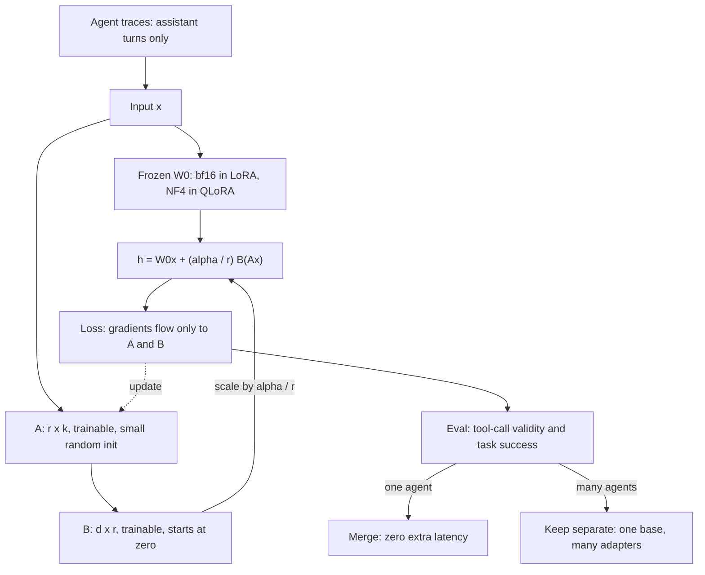

## TL;DR
When prompting cannot make an open model call your tools reliably, PEFT fine-tunes it cheaply: LoRA
trains two thin matrices per layer, QLoRA keeps the base in 4-bit, so one GPU suffices and each agent or
tenant gets a swappable adapter.

## For agent builders
- **Why it matters for agents.** Hosted frontier models usually need no fine-tune. You reach for LoRA
  when a small self-hosted model must emit your tool-call format, follow your agent's policy or match a
  customer's tone at a fraction of the frontier price per step.
- **Where it shows up in your stack.** A `LoraConfig` in PEFT or TRL, an adapter directory in object
  storage, and multi-adapter serving in vLLM (`--enable-lora`) or SGLang, where one base model serves a
  different adapter per agent, task or tenant.
- **What you control.** Which traces you train on (successful trajectories, assistant turns only), the
  chat template and tool schemas used in training, rank and target modules, the learning rate, and
  whether the adapter ships merged or unmerged.
- **What you can skip.** The intrinsic-dimension theory and the NF4 quantile math. Know the
  16-bytes-per-parameter figure, why B starts at zero, and that adapters are deltas pinned to one base.

## Why it exists
- **Full fine-tuning does not fit.** Updating every weight of a 7B model needs on the order of 100 GB of
  GPU memory for weights, gradients and optimizer state.
- **AdamW in mixed precision costs ~16 bytes per parameter.** The bf16 weight (2 bytes), its gradient
  (2 bytes), and an fp32 master copy plus the two Adam moments (12 bytes), before activations. For 7B that
  is roughly 112 GB, which does not fit on one 80 GB GPU.
- **"Just fine-tune it" is expensive twice.** It means multi-GPU sharding, a bigger bill, and a 14 GB
  checkpoint for every task or customer. You cannot keep ten copies resident on one server, cannot A/B two
  variants cheaply, and rollback means moving tens of gigabytes.
- **The update has low intrinsic rank.** The *change* a fine-tune makes to a pretrained matrix lives
  mostly in a small subspace, so you can parametrize ΔW directly in that subspace and train only it.
- **LoRA beats earlier PEFT on serving cost.** Earlier methods work, but adapter layers between blocks
  add inference latency and learned "virtual tokens" (prefix and prompt tuning) eat context. LoRA's update has exactly the shape of
  the original matrix, so it folds back in and inference cost is unchanged, while keeping most of full
  fine-tuning's quality.

## How it works
### LoRA: the update as a low-rank product
For a frozen weight W₀ of shape d×k, the fine-tuned weight is W₀ + ΔW with ΔW = B·A:
- A is r×k, B is d×r, and the rank r is small (8–64 is typical, versus d = 4,096).
- Only A and B receive gradients. The forward pass becomes:

```
h = W₀x + (α / r) · B(Ax)
```

Three design choices, each with its reason:
- **B starts at zero, A at small random values.** ΔW = BA is exactly zero at step 0, so training begins
  at the pretrained model's function; the first steps cannot wreck what pretraining built.
- **The α/r scale.** Keeps the update's magnitude roughly independent of r, so you can change rank
  without retuning the learning rate. (rsLoRA argues α/√r is better when r is large.)
- **Which matrices get an adapter.** The original paper adapted only attention query and value. Later
  evidence, including the QLoRA paper's ablations, showed adapters on *all* linear layers, MLP included,
  matter more for quality than raising r. Knowledge-heavy tasks especially need the MLP capacity.

### Parameter arithmetic (Llama-2-7B-style, r = 16)
Layer shape: d = k = 4,096, MLP width 11,008, 32 layers.

| Item | Count |
|---|---|
| One 4,096×4,096 attention matrix | 16.8M weights |
| Its adapter: 16 × (4,096 + 4,096) | ≈ 131k (under 1%) |
| 32 layers × 4 attention matrices | 16.8M adapter params |
| Plus 3 MLP matrices: 16 × (4,096 + 11,008) | ≈ 242k each |
| Total trainable | about 40M, roughly 0.6% of 6.7B |
| fp32 Adam state | 40M × 16 bytes ≈ 640 MB instead of ~107 GB |

### What LoRA does *not* save
- **The frozen base stays in memory.** ≈13.4 GB in bf16 for 7B.
- **Compute per step drops only modestly.** Backprop still flows through every layer to reach the
  adapters. Only the weight-gradient matmuls for frozen matrices are skipped: about half of the backward
  FLOPs, or a third of the forward-plus-backward total.
- **Activation memory is unchanged.** Every frozen layer's activations are needed to backpropagate to the
  adapters below it. At long sequence lengths activations, not weights, OOM, which is why LoRA recipes
  almost always switch on gradient checkpointing.
- **The win:** optimizer state, master weights and weight gradients, plus a checkpoint of tens to a few
  hundred megabytes (40M adapter parameters are about 80 MB in bf16 or 160 MB in fp32, against 13.4 GB).

### Why rank 16 suffices
- A gradient step on W₀ for a narrow task mostly pushes in a few consistent directions.
- LoRA bets the full ΔW is well approximated by its top r singular directions.
- The bet holds for style, format and behaviour shifts and weakens as the task demands genuinely new
  information. That condition decides LoRA versus full fine-tuning.

### Export: merge or keep separate
- **Merge:** W = W₀ + (α/r)BA, a dense matrix of the original shape, zero extra latency.
- **Keep separate:** one base and many adapters on a server, batching requests for different adapters
  together; vLLM, SGLang and similar engines support this.

### QLoRA: shrinking the frozen base
LoRA leaves one large term: 2 bytes per parameter for the frozen weights. QLoRA attacks it with three
pieces:
1. **4-bit NormalFloat (NF4).** Pretrained weights are roughly normal, so NF4 puts its 16 levels at
   quantiles of a standard normal instead of evenly spaced. Each bin holds about equal probability mass,
   minimizing expected rounding error. Quantization is block-wise (blocks of 64 weights, one absmax scale
   each).
2. **Double quantization.** The per-block scales are quantized to 8-bit with a second-level scale,
   because at block size 64 the fp32 scales alone cost 0.5 bits per weight. Saves a few tenths of a bit
   per parameter on average.
3. **Paged optimizers.** Optimizer state lives in CUDA unified memory and pages to CPU RAM during the
   memory spikes long sequences cause, turning a hard OOM into a slowdown.

During training:
- Each 4-bit block is dequantized to bf16 on the fly and multiplied as usual; LoRA matrices stay in bf16
  with full-precision gradients.
- The base is never updated, so its quantization error is fixed and the adapter learns around it.
- **Headline:** fine-tuning a 65B model on a single 48 GB GPU, matching 16-bit fine-tuning on the paper's
  benchmarks.
- **Costs:** a slower step (dequantization on every matmul), and a coupling: the adapter was trained
  against *this* quantized base, so merging into a bf16 copy gives a slightly different model.

### Other PEFT methods
| Method | Idea | Catch |
|---|---|---|
| Adapter layers | bottleneck MLPs inserted into each block | extra latency |
| Prefix / prompt tuning | learned virtual tokens | consume context; weak on small models |
| (IA)³ | learned per-channel rescaling vectors | small capacity |
| DoRA | split W into magnitude and direction, LoRA on direction | often tracks full FT closer at same rank |

LoRA remains the default because it merges away.

### Applying it to an agent model
What an agent fine-tune teaches is mostly behaviour, which is exactly where low rank holds:
1. **Collect trajectories.** Successful agent runs from logs or a stronger teacher model: system prompt,
   tool schemas, user turn, assistant tool calls, tool results, final answer.
2. **Render them with the serving chat template**, tools included, because the adapter learns the exact
   token patterns around tool-call markers.
3. **Mask the loss to assistant tokens.** Tool results and user turns are inputs the model never has
   to produce, so training on them wastes capacity and teaches it to hallucinate tool output.
4. **Train LoRA on all linear layers**, then evaluate on an agent suite (tool-name accuracy, argument
   validity, task success), not only held-out loss.
5. **Ship** merged for a single agent, or unmerged when one base serves many agents or tenants.

## Diagram
Agent traces train only the low-rank pair A then B; the frozen base is shared. After an agent eval gate,
the update is either merged into W₀ or kept as one swappable adapter per agent or tenant.



## Examples
### QLoRA setup with adapters on all linear layers
Load in NF4, attach LoRA to all linear projections, inspect. On an 8B Llama-3-style model with r = 16
this yields on the order of 42M trainable parameters (about 0.5%).

```python
import torch
from transformers import AutoModelForCausalLM, BitsAndBytesConfig
from peft import LoraConfig, get_peft_model, prepare_model_for_kbit_training

name = "meta-llama/Llama-3.1-8B"                       # any causal LM; ~6 GB VRAM for the base in 4-bit
bnb = BitsAndBytesConfig(
    load_in_4bit=True, bnb_4bit_quant_type="nf4",       # NormalFloat4 for the frozen base
    bnb_4bit_use_double_quant=True,                      # quantize the quantization constants too
    bnb_4bit_compute_dtype=torch.bfloat16)               # dequantize to bf16 for the matmuls
model = AutoModelForCausalLM.from_pretrained(name, quantization_config=bnb, device_map="auto")
model = prepare_model_for_kbit_training(model)          # fp32 norms, gradient-checkpointing hooks

cfg = LoraConfig(
    r=16, lora_alpha=32, lora_dropout=0.05, bias="none", task_type="CAUSAL_LM",
    target_modules=["q_proj", "k_proj", "v_proj", "o_proj", "gate_proj", "up_proj", "down_proj"])
model = get_peft_model(model, cfg)
model.print_trainable_parameters()                      # trainable ~0.5% of total

q = model.base_model.model.model.layers[0].self_attn.q_proj
print(q.lora_A["default"].weight.shape, q.lora_B["default"].weight.shape)   # [16, 4096], [4096, 16]
print(float(q.lora_B["default"].weight.abs().max()))     # 0.0: training starts at the base model

# ... train with TRL's SFTTrainer or a plain loop; LoRA LRs of 1e-4 to 2e-4 are typical ...
model.save_pretrained("adapter/")                        # only A and B: ~85 MB bf16 / ~170 MB fp32, not 16 GB
# To ship without the peft runtime: load the base in bf16, attach the adapter, then
# merged = model.merge_and_unload(); merged.save_pretrained("merged/")  -> re-evaluate after merging
```

### Memory calculator: full FT vs LoRA vs QLoRA
Pure Python, runnable anywhere. Static memory only; activations come on top.

```python
def ft_memory_gb(params_b, method, trainable_frac=0.006):
    p = params_b * 1e9
    if method == "full":                     # bf16 weight + grad, fp32 master + 2 Adam moments
        return p * 16 / 1e9
    base = p * (2 if method == "lora" else 0.5)   # bf16 vs ~4-bit NF4 frozen base
    adapter = p * trainable_frac * 16             # adapters keep the full 16 bytes/param
    return (base + adapter) / 1e9

for size in (7, 8, 70):
    row = {m: round(ft_memory_gb(size, m), 1) for m in ("full", "lora", "qlora")}
    print(size, "B:", row, "GB before activations")
# 7 B: {'full': 112.0, 'lora': 14.7, 'qlora': 4.2} GB before activations
# 8 B: {'full': 128.0, 'lora': 16.8, 'qlora': 4.8} GB before activations
# 70 B: {'full': 1120.0, 'lora': 146.7, 'qlora': 41.7} GB before activations
```

Reading the output (the 0.5 bytes per weight ignores scale overhead, so real NF4 bases run a little
larger):

| Model | Fits one 24 GB card? | Fits one 80 GB card? |
|---|---|---|
| 8B full FT | no | no |
| 8B bf16 LoRA | tight, with gradient checkpointing | yes |
| 8B QLoRA | yes, with room for activations | yes |
| 70B QLoRA | no | yes |

### Loss mask for agent trajectories
Pure Python, runnable anywhere. Only assistant tokens (tool calls and final answers) get labels; system,
user and tool-result tokens get -100, the index PyTorch's cross-entropy ignores.

```python
IGNORE = -100   # torch.nn.CrossEntropyLoss default ignore_index

def build_labels(segments):
    """segments: list of (role, token_ids) in rendered chat-template order."""
    input_ids, labels = [], []
    for role, ids in segments:
        input_ids += ids
        labels += ids if role == "assistant" else [IGNORE] * len(ids)
    return input_ids, labels

trace = [("system", [1] * 900),      # policy plus tool schemas
         ("user", [2] * 60),
         ("assistant", [3] * 40),    # tool call: search_orders(...)
         ("tool", [4] * 700),        # tool result: the model must not learn to produce this
         ("assistant", [5] * 120)]   # final answer
ids, labels = build_labels(trace)
trained = sum(l != IGNORE for l in labels)
print(len(ids), trained, f"{trained / len(ids):.0%}")   # 1820 160 9%
```

### Worked scenario: per-tenant support agents on one base
A platform runs a customer-support agent for 30 tenants on an 8B model. Each tenant wants its own tone
and ticket format; tool schemas are shared.

| Option | Storage | GPUs to keep all resident | Notes |
|---|---|---|---|
| 30 full fine-tunes | 30 × 16 GB = 480 GB | many cards, or cold loads | 128 GB each to train |
| 30 merged LoRA models | 480 GB | same as above | zero adapter latency |
| 1 base + 30 unmerged adapters (r = 16) | 16 GB + 30 × ~85 MB ≈ 18.6 GB | one 80 GB card, room for KV cache | small extra matmul per request |

The unmerged design wins until one tenant's traffic is large enough to justify its own merged
deployment. Rollback for a tenant is swapping an ~85 MB directory.

## Production patterns
- **Train on successful trajectories, assistant turns only.** Filter logs to runs that reached the goal,
  render them with the serving template and tool schemas, and mask non-assistant tokens. Monitor the
  share of trained tokens per example; a very low share means tool output dominates the context.
- **Gate adapters on an agent eval suite.** Before release, replay a fixed set of tasks and score
  tool-name accuracy, schema-valid arguments and task success against the base model and the previous
  adapter. Block the release on any regression, not only on held-out loss.
- **One base, many adapters.** When tenants or tasks share a base, serve unmerged adapters: vLLM's
  `--enable-lora` with `--max-loras` and `--max-lora-rank` sized to your adapters. Monitor per-adapter
  latency and adapter load/evict churn.
- **Pin the base revision with the adapter.** Load the base with `revision="<commit sha>"` and store
  that sha next to the adapter directory, because an adapter is a delta against exact weights. Alert in
  CI if the serving base differs from the training base.
- **Merge-then-eval release gate.** Before shipping a merged or re-quantized model, re-run the task eval
  and a small general benchmark on the final artifact and block release if it drops below the
  unmerged adapter's numbers. Track task metric, general metric and the merged-versus-unmerged gap.
- **Small rank sweep, all linear layers, checkpointing on.** Fix `target_modules` to all projections and
  sweep r over 8, 16 and 32 with the LR held near 1e-4 to 2e-4; keep the smallest r where the agent eval
  stops improving. Agent traces are long, so set `gradient_checkpointing=True`, because activations, not
  adapters, are what OOM. Monitor peak memory, step time and train-versus-eval loss.

## Trade-offs
- **Memory vs speed.** Memory falls by an order of magnitude and checkpoints by about two, but per-step
  compute barely drops because backprop still traverses the frozen base; PEFT makes fine-tuning *fit*,
  not fast.
- **Learns less, forgets less.** On narrow tasks that is a feature (base capabilities survive). For large
  shifts such as a new language or heavy code pretraining, full fine-tuning or a much higher rank on all
  layers pulls ahead.
- **QLoRA vs bf16 LoRA.** QLoRA cuts base-model memory roughly 3–4× relative to bf16, at the cost of
  slower steps and a fixed quantization error. When bf16 LoRA fits, it is simpler and faster.
- **Unmerged vs merged adapters.** Unmerged lets one base serve many tenants, but each request pays a
  small extra matmul and the engine must support multi-adapter batching. Merged gives zero overhead and
  one model per adapter.
- **Higher rank vs diminishing returns.** Past the point where training loss stops improving with r,
  extra rank only adds memory and overfitting risk.
- **Fine-tuned small model vs prompted frontier model.** An adapter on an 8B model can make each agent
  step far cheaper and faster, but you now own data collection, evals and retraining whenever tools
  change. It flips toward prompting when tools or policies change weekly.

## Pitfalls
- **Copying a full fine-tuning learning rate (≈1e-5).** LoRA parameters are tiny and need a larger LR.
  Symptom: training loss barely moves across epochs. Fix: start in the 1e-4 to 2e-4 range.
- **Adapting only `q_proj` and `v_proj` because an old tutorial did.** Tasks needing new knowledge or
  formats underfit. Symptom: good style, wrong facts. Fix: target the MLP projections too.
- **Merging a QLoRA adapter into a bf16 base without re-evaluation.** The adapter compensated for a
  specific quantized base, so the merged model drifts slightly. Re-run evals after merging, or after
  re-quantizing the merged model to GPTQ/AWQ for serving.
- **Training with one chat template, serving with another.** The adapter learned token patterns around
  the template. Symptom: rambling, never emitting the end token, or ignoring the system prompt.
- **Training on tool results as targets.** Without a loss mask the model learns to write tool output
  itself. Symptom: the agent invents a result instead of emitting a tool call. Fix: label assistant
  tokens only.
- **Shipping an adapter after the tool set changed.** It memorised the old tool names and schemas.
  Symptom: calls to removed tools or stale argument names. Fix: retrain or refresh traces when schemas
  change, and keep schema-validation errors on a dashboard.
- **Not pinning the exact base model revision.** Adapters are deltas against specific weights, so a
  silently updated base produces a quietly different model.
- **Forgetting `prepare_model_for_kbit_training` or input-gradient hooks with gradient checkpointing on
  a frozen base.** Symptom: "element 0 of tensors does not require grad", or an adapter whose loss never
  changes.

## When to use
- **Try prompting first:** a frontier model with good tool descriptions and few-shot examples usually
  beats a fine-tune you have not evaluated; fine-tune when cost, latency or data residency forces a
  smaller self-hosted model.
- **Use LoRA when:** fine-tuning a model larger than a few hundred million parameters for a style,
  format, domain-vocabulary or behaviour shift: support-ticket tone, structured output, a house-specific
  classifier, tool-call formatting.
- **Use QLoRA when:** the bf16 base does not fit your GPU alongside activations; accept the slower step.
- **Use full fine-tuning when:** you have the hardware and the task is a large shift that LoRA
  demonstrably underfits on your eval set.
- **Measure:** task metric versus the base model, a held-out general benchmark to catch forgetting, and
  the merged model's metric versus the unmerged one.
- **Day to day:** PEFT shows up as a `LoraConfig` block, an adapter directory in object storage, and a
  serving decision about merging.
- **Interviews:** derive the 16-bytes-per-parameter figure, explain why B is zero-initialized, and say
  where QLoRA's savings come from and what they cost.

## Role lens
- **Engineer:** Writes the `LoraConfig`, picks rank and target modules, sets a LoRA-appropriate learning
  rate, and verifies the merged checkpoint matches the adapter's eval numbers before handing it to serving.
- **Architect:** Decides between one merged model per task and one base with hot-swapped adapters, based
  on tenant count, GPU budget and latency, and owns the base-model version pinning policy.
- **FDE:** Fine-tunes on a customer's data inside their VPC on whatever GPU they have, often a single
  24–48 GB card, which is precisely the regime QLoRA was built for.

## Check yourself
**Q:** You have one 24 GB GPU and 20k support transcripts, and you need to adapt an 8B model to the
customer's tone and ticket format. Walk through what fits in memory and what you would choose.
**A:** Full fine-tuning is out: 8B × 16 bytes ≈ 128 GB for weights, gradients and Adam state. bf16 LoRA
needs the frozen base at ≈16 GB plus adapter state (tens of MB) plus activations; with gradient
checkpointing and short sequences it might squeeze into 24 GB but it is tight. QLoRA stores the base in
NF4 at roughly 5–6 GB, leaving ample room for activations at longer sequence lengths, so that is the
practical choice. I would target all linear projections at r = 16, LR around 1e-4 to 2e-4, train one to
three epochs while watching a held-out slice of transcripts and a small general benchmark for forgetting,
then merge into a bf16 base for serving and re-run the evals on the merged model, because the adapter was
trained against the quantized base.

## Interview questions
### What is LoRA, and why does a rank-16 update work at all?
- **Definition:** LoRA freezes W₀ and learns the update as ΔW = B·A, with A of shape r×k and B of shape
  d×r, so only a tiny fraction of parameters train and the update can be merged back into W₀.
- **Why it works:** the change a fine-tune makes to a pretrained matrix has low intrinsic rank, so the
  top r directions capture most of it for style, format and behaviour shifts.
- **Init detail:** B starts at zero, so training begins exactly at the base model's function.

### Your LoRA run's training loss barely moves after an epoch. How do you debug it?
- **Learning rate first:** a full fine-tuning LR near 1e-5 is too small for LoRA; move to the typical
  1e-4 to 2e-4 range.
- **Check gradients reach the adapters:** with a k-bit base and gradient checkpointing, a missing
  `prepare_model_for_kbit_training` call or input-gradient hook leaves the adapter's loss flat.
- **Check capacity:** if only `q_proj` and `v_proj` are targeted, add the MLP projections before raising r.

### When would you not use LoRA, and when would you pick bf16 LoRA over QLoRA?
- **Skip LoRA for large shifts:** a new language or heavy code pretraining is where full fine-tuning or a
  much higher rank on all layers pulls ahead, so use it when your eval shows LoRA underfitting.
- **Prefer bf16 LoRA when it fits:** it is simpler and faster per step, with no fixed quantization error.
- **Reach for QLoRA** only when the bf16 base plus activations does not fit the GPU you have.

### Roughly how many parameters does LoRA train on a 7B model at r = 16 on all linear layers?
- **Count:** about 40M trainable parameters, roughly 0.6% of 6.7B, from 16.8M on attention plus about
  242k per MLP matrix per layer.
- **Optimizer state:** 40M × 16 bytes ≈ 640 MB instead of ~107 GB for full fine-tuning.
- **Checkpoint:** about 80 MB in bf16 against 13.4 GB for the base, which is what makes per-tenant
  adapters cheap to store and roll back.

### You want an 8B model to replace a frontier model in your tool-calling agent. How do you build the LoRA training set and judge success?
- **Data:** successful trajectories from production logs or a stronger teacher, rendered with the exact
  serving chat template and tool schemas, with loss on assistant turns only.
- **Training:** LoRA on all linear layers at r = 16 and an LR near 1e-4 to 2e-4, QLoRA if the bf16 base
  does not fit.
- **Success:** replay a held-out task suite and compare tool-name accuracy, schema-valid arguments, task
  success and cost per task against the frontier baseline, not just held-out loss.

### You must serve fine-tuned agent variants for 50 tenants on a shared base. How do you design it?
- **Serve unmerged adapters:** one base resident on the GPUs, adapters loaded on demand, with an engine
  that batches requests across adapters (vLLM's `--enable-lora`, `--max-loras`, `--max-lora-rank`).
- **Pin the base revision:** every adapter is a delta against exact weights, so store the base commit
  sha with each adapter and fail deploys on a mismatch.
- **Watch the costs:** each request pays a small extra matmul, and adapter load/evict churn shows up as
  latency; merge only the few highest-traffic tenants if that overhead matters.

## Quiz
### Q: Why is LoRA's B matrix initialized to zero while A is random?
- [ ] Zero initialization keeps the adapter sparse so it can be stored compactly
- [x] So the update BA is zero at step 0 and training starts from the exact pretrained function
- [ ] Because gradients cannot flow through two randomly initialized matrices
- [ ] To make the rank r adjustable without changing α
> With B = 0 the product BA vanishes, so the model behaves identically to the base model before training
> and early updates cannot damage it. Random A still gives B a non-degenerate gradient, so learning proceeds.

### Q: Where does QLoRA's memory saving over plain LoRA come from?
- [ ] It trains fewer adapter parameters by using a smaller rank
- [ ] It drops the optimizer state entirely
- [x] It stores the frozen base weights in 4-bit NF4 and dequantizes them on the fly during matmuls
- [ ] It offloads activations to CPU memory
> LoRA already removed optimizer state and gradients for the base; what remained was the 2-byte-per-weight
> frozen model. QLoRA shrinks that term to about half a byte per weight; paged optimizers only handle
> transient spikes.

### Q: What happens to inference latency after a LoRA adapter is merged into the base weights?
- [ ] It increases slightly because of the extra rank-r projection
- [ ] It decreases because the merged matrix is lower rank
- [x] It is unchanged, because W₀ + BA is a dense matrix of the original shape
- [ ] It depends on whether the base was quantized during training
> Merging adds BA into W₀, producing one dense d×k matrix, so the forward pass performs exactly the same
> matmul as the base model. Only an *unmerged* adapter adds the extra low-rank computation.

## Use cases & projects
### Use cases
- **Teaching a small open model your tool-call format.** When a self-hosted 7B-class model keeps
  emitting malformed JSON or wrong argument names, a LoRA on successful trajectories fixes the format
  without touching the base weights.
- **Per-tenant agent behaviour on one GPU fleet.** Each customer gets an adapter for tone, policy or
  domain vocabulary, and one base model serves them all as unmerged adapters.
- **Cheap high-volume agent steps.** Routers, query rewriters and tool selectors run on a small base
  plus a task adapter instead of a frontier API call on every step.
- **Fast iteration on agent policy.** An adapter retrains in hours on one GPU, so a policy change can be
  trained, gated on the agent eval suite and rolled back as a small file.

### Mini project
**LoRA a small model to call your tools (2-3 hours).**
- **Goal:** raise schema-valid tool-call rate of a small open instruct model on a fixed agent task set.
- **Steps:** write 3 tool schemas and 50 held-out tasks; collect or write a few hundred successful
  trajectories rendered with the model's chat template; train a QLoRA adapter with assistant-only loss;
  score base and adapter on tool-name accuracy, schema-valid arguments and task success.
- **Done when:** you have a before/after table for the 50 tasks, the adapter directory with the pinned
  base revision recorded next to it, and a note on the rank and learning rate you chose and why.
