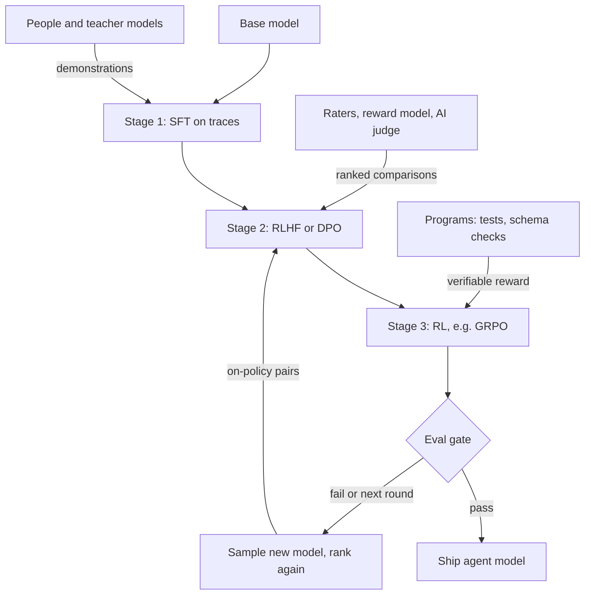

## TL;DR
Post-training turns a base model into one that can drive an agent: SFT on tool-call traces, preference
optimisation (RLHF, DPO) on comparisons, and RL on verifiable rewards. Cheap next to pre-training, it
decides how well your agent calls tools.

## For agent builders
- **Why it matters for agents.** Chat templates, tool-call formats, stopping after a call, refusing or
  escalating, and multi-step reasoning are all installed in post-training. When a hosted model is good
  at agents, that is a post-training result; when your open-weight agent is not, post-training is the fix.
- **Where it shows up in your stack.** The instruct or chat checkpoint you deploy, its chat template
  (`apply_chat_template` in Transformers), and the trainers you would use yourself, such as TRL's SFT,
  DPO and GRPO trainers or provider fine-tuning APIs.
- **What you control.** Whether to post-train at all versus prompting and RAG, which stage fixes which
  agent failure (format, quality, or a checkable skill), the eval gate between rounds, and the data:
  traces, rankings and reward functions.
- **What you can skip.** Reproducing a full frontier recipe. Agent teams usually run one targeted stage
  (SFT on traces, then maybe DPO or GRPO) on top of an existing instruct model.

## Why it exists
- **A base model is a very good autocomplete.** Asked a question, it may continue with more questions, a
  forum thread, or an answer in the wrong register, because all are likely continuations of web text.
- **The knowledge is there; the behaviour is not.** It has no notion of "user" and "assistant", no reason
  to be concise, no reason to decline a harmful request, and no habit of showing its reasoning.
- **Prompting helps but is fragile.** Few-shot Q&A examples work surprisingly well (evidence the skills are
  latent), but they eat context and cannot teach what is not an obvious pattern: a consistent refusal
  policy, a house JSON format, calling a tool when unsure.
- **Next-token loss cannot express preference.** "This answer is better than that one" has no place in it.
- **So post-training adds layers, each past the previous one's limit.** Demonstrations teach format and
  basic behaviour. Comparisons teach quality, because most prompts have no single correct answer, only
  better and worse ones. Checkable-reward RL teaches behaviours that need many attempts to discover, such
  as multi-step reasoning and multi-step tool use.

## How it works
### The three stages at a glance
| Stage | Signal | Teaches (agent view) | Limit |
|---|---|---|---|
| 1. SFT | demonstrations | chat template, persona, tool-call syntax, "answer the question" | can only imitate |
| 2. Preference optimisation | comparisons | quality, tone, refusals, when to ask versus act | only reranks answers the SFT policy already produces; cannot discover behaviours that need many attempts |
| 3. RL on verifiable rewards | programmatic checks | multi-step reasoning, exact formats, task success in a sandbox | only for checkable tasks |

The stages are ordered because each one needs the behaviour the previous one installed.

### Stage 1: supervised fine-tuning on demonstrations
1. Humans (or a stronger model) write prompt-response pairs in the target format: system prompt, user
   turn, assistant turn, and for agents the tool calls and tool results in between.
2. Train with the same next-token loss as pre-training, but only on the assistant tokens (not on tool
   results the environment returned).
3. Result: the chat template, the assistant persona, tool-call syntax and basic answering behaviour.

- **It comes first because it is cheap and stable**, and later stages need a policy that already
  produces plausible candidate answers and well-formed tool calls.
- **Its limit:** it cannot tell the model that one of two fluent answers is wrong. See *supervised
  fine-tuning* and *instruction tuning* for mechanics and data design.

### Stage 2: preference optimisation on comparisons
- **Data:** raters see two or more responses to the same prompt and rank them. Cheaper than
  demonstrations, and it captures judgements people find easy to make but hard to write down, such as
  "this agent asked a needless clarifying question".
- **RLHF:** train a reward model on the comparisons, then optimise the policy against it with PPO and a
  KL penalty that stops it drifting too far from the SFT model.
- **DPO:** skip the reward model; optimise the policy directly on the pairs with a classification-style
  loss derived from the same KL-constrained objective.
- **Choosing is an engineering call.** RLHF is on-policy and can keep improving as the policy changes; DPO
  is simpler, cheaper and offline.
- **Effect:** both raise the quality of answers the SFT model already produces; refusal behaviour and tone
  are mostly shaped here.

### Stage 3: reinforcement learning on verifiable rewards
1. Pick tasks with a checkable answer: maths with a known result, code with unit tests, output that must
   parse as JSON, or an agent task whose end state a script can verify.
2. Compute the reward with a program rather than learning it from humans.
3. Sample many attempts per prompt, reward the correct ones, push toward whatever reasoning got there.

- **GRPO is the common algorithm** in open recipes because it needs no value model.
- **This stage is credited with long chain-of-thought** in reasoning models such as DeepSeek-R1.
- **It is usually the most expensive post-training stage**, because generating many long samples per
  prompt dominates the cost, though it remains orders of magnitude below pre-training. Multi-turn agent
  rollouts with real tool calls are longer still.

### Where the signal comes from
The mix of sources is the main cost lever:

| Source | Examples | Strength | Weakness |
|---|---|---|---|
| **People** | annotators, domain experts | highest trust; the only source that can define "good" for a new domain | slowest |
| **Stronger models** | teacher writes SFT responses (distillation through data); judge ranks pairs (RL from AI feedback, LLM-as-a-judge) | cheap, scalable | student inherits teacher's blind spots and judge's biases (e.g. preferring longer answers), so keep a human-labelled slice to calibrate |
| **Programs** | verifiers, schema validators, unit tests, sandbox end-state checks | free per sample, impossible to flatter | only for checkable tasks; reward exactly what they check, gaps included |

**Rejection sampling bridges the stages.** Sample several responses (or whole agent trajectories) from
the current model, keep the ones a reward model, judge or verifier scores highest, and SFT on them. It
reuses cheap SFT machinery while learning from a quality signal, which is why many recipes run it before
or instead of full RL.

### Recurring design constraints
- **A reference model and a KL leash.** Nearly every stage after SFT penalises distance from the previous
  checkpoint, because an unconstrained optimiser finds degenerate outputs that score well on the reward
  and badly with users. The leash strength is the central hyperparameter.
- **Iteration.** Production recipes run several rounds: train, sample from the new model, collect new
  comparisons on those samples, train again. Off-policy data from an old model loses value as the policy
  moves.
- **Evaluation per stage.** Forgetting after SFT, verbosity after preference training and reward hacking
  after RL each get their own gates: capability benchmarks (the loss is the *alignment tax*), preference
  win rates, task-specific checks such as valid tool-call rate.
- **Safety and policy.** Refusals, sensitive topics and tool-use permissions are trained in with targeted
  SFT data and preference pairs, then red-teamed, because a helpful but unsafe model cannot ship, and an
  agent with tools can act on its mistakes.

### What post-training costs
| Stage | Compute |
|---|---|
| Pre-training (for scale) | GPU-years |
| SFT on tens of thousands of examples | GPU-hours on one node |
| DPO on a comparable set | similar to SFT |
| RLHF or GRPO | more, because sampling dominates; still orders of magnitude below pre-training |

The expensive part is the data: demonstrations and comparisons written or reviewed by people, plus the
evaluation sets that tell you whether a round helped.

## Diagram
Read it top to bottom: each stage consumes a different signal, and each round ends at an eval gate
(tool-call format, win rate, refusals on harmful and benign sets, length, capability delta). A failed or
unfinished round samples the new model and feeds fresh on-policy comparisons back into stage 2.



## Examples
### Worked scenario: post-training a support agent
A team post-trains an open-weight 8B base model as a support agent for a software product. The agent
answers questions and opens help-desk tickets through a tool call. All sizes are illustrative.

1. **SFT.** 6,000 demonstrations: real support tickets paired with answers by senior agents, rendered
   through a chat template with a fixed system prompt and the ticket tool's schema. After two epochs it
   answers in the right voice and format.
   - Held-out eval: fluent, but invents feature names about one time in eight.
   - It answers "how do I delete my account" with a wall of text where policy is a short, specific
     procedure.
2. **Preference optimisation.** For 2,000 held-out tickets, sample four responses each from the SFT model;
   agents rank them with a rubric that penalises invented features and rewards concision.
   - DPO on the pairs (top-ranked against each of the other three, 6,000 in all) cuts hallucinated
     feature names by more than half on the held-out set and shortens answers.
   - A capability benchmark before and after confirms general question-answering has not regressed.
3. **Verifiable rewards.** Some answers must emit a JSON block (the ticket tool's arguments). Reward: +1 if
   the JSON parses and matches the schema, +1 if the category is correct per a lookup table, 0 otherwise.
   - A few hundred GRPO steps with 8 samples per prompt raise schema validity from 91% to above 99%.
   - SFT alone never got there because the few malformed examples were drowned out.
4. **Iteration.** Collect fresh rankings on the *new* model's outputs, because the old pairs no longer
   describe its mistakes, and run one more DPO round before release.

| Cost line | Size |
|---|---|
| Compute | a few hundred GPU-hours |
| People | several weeks of agent time, the line that dominates the budget |

### The data plumbing behind steps 2 and 3
Rankings become DPO pairs, and the tool-argument check becomes a reward function. Pure Python, runnable
as is; the same `ticket_reward` doubles as an offline eval of tool-call validity.

```python
import json

# 1) Turn agent rankings into DPO pairs: best response vs each of the others.
def rank_to_pairs(prompt, ranked):              # ranked: best first
    best, *rest = ranked
    return [{"prompt": prompt, "chosen": best, "rejected": r} for r in rest]

pairs = rank_to_pairs("How do I reset my password?", ["A", "B", "C", "D"])
print(len(pairs), "pairs per ticket ->", 2000 * len(pairs), "pairs for 2,000 tickets")

# 2) Verifiable reward for the ticket tool's arguments (0, 1 or 2).
CATEGORY = {"login": "account", "invoice": "billing", "crash": "bug"}   # lookup table
REQUIRED = {"title": str, "category": str, "priority": int}

def ticket_reward(completion: str, keyword: str) -> int:
    try:
        obj = json.loads(completion)
    except json.JSONDecodeError:
        return 0
    if not isinstance(obj, dict) or any(not isinstance(obj.get(k), t) for k, t in REQUIRED.items()):
        return 0                                  # does not match the schema
    return 1 + int(obj["category"] == CATEGORY.get(keyword))

samples = ['{"title": "Cannot log in", "category": "account", "priority": 2}',
           '{"title": "Cannot log in", "category": "billing", "priority": 2}',
           '{"title": "Cannot log in", "category": "account"}',
           'Sure! Here is your ticket: {...}']
print([ticket_reward(s, "login") for s in samples])   # [2, 1, 0, 0]
```

The `{"prompt", "chosen", "rejected"}` record is the shape common preference trainers (for example TRL's
DPO trainer) consume.

### Which stage fixes which agent failure
| Agent failure seen in traces | Stage that fixes it | Signal |
|---|---|---|
| Wrong tool-call syntax, no stop after a call | SFT | correct traces |
| Valid calls, but needless steps or verbose answers | preference optimisation | ranked trajectories |
| Calls valid tools but the task still fails | RL on verifiable rewards | sandbox end-state check |
| Knows nothing about this week's prices | none: retrieval or a tool | not a training problem |

## Production patterns
- **Gate every round on a fixed agent eval suite.** Before promoting a checkpoint, run tool-call schema
  compliance, task success on held-out agent tasks, win rate against the previous checkpoint, refusal
  rate on harmful and benign borderline sets, mean response length and a general capability suite. Block
  promotion when the capability delta is negative, whatever the stage's own metric says.
- **Refresh preference data on-policy each round.** Sample the next batch of comparison prompts from the
  current checkpoint, not the one that produced the last dataset. Monitor the gap between training-set
  win rate and real-user complaint rate; a widening gap means the pairs have gone stale.
- **Use rejection sampling before full RL.** Sample several trajectories per task, score them with a
  verifier, judge or reward model, keep the best, and run an ordinary SFT pass on them. Monitor the
  pass rate of kept samples per round; when it plateaus, on-policy RL is the next step.
- **Calibrate AI judges against a human slice.** Keep a few hundred human-ranked pairs and measure judge
  agreement on them. Swap response order between calls to cancel position bias, and track judge
  preference versus length. Re-audit whenever the domain or teacher model changes.
- **Ship the chat template with the checkpoint.** Store the template in the tokenizer config saved next to
  the weights and render training and serving data with the same `apply_chat_template` call, tools
  included. Monitor format-compliance and tool-call parse rate in production, which drop first when they
  diverge.

## Trade-offs
- **Demonstrations vs comparisons.** Demonstrations are precise but expensive and only teach imitation.
  Comparisons are cheaper and express quality, but a poorly designed rubric teaches length and
  confidence instead of correctness.
- **Offline vs on-policy.** SFT and DPO are simple and reproducible. On-policy RL keeps learning as the
  model changes, at the price of a sampling loop (for agents, a tool sandbox), more hyperparameters and
  harder debugging.
- **Strong vs loose KL leash.** A strong leash preserves capabilities and prevents reward hacking but caps
  how far behaviour moves. Loosen it when the target is far from the SFT model and evaluation can catch
  drift.
- **Trained-in safety vs over-refusal.** Training refusals in makes the model safer by default but raises
  over-refusal on benign edge cases, which in an agent shows up as tasks abandoned. The balance depends on
  the audience and whether external guardrails exist.
- **AI-generated data vs quality ceiling.** Model-written data and AI judges cut labelling cost
  dramatically but cap the student near the teacher. The saving becomes a liability where the teacher is
  weak, which only a human-labelled audit slice reveals.

## Pitfalls
- **Preference training before SFT into the target format.** Both responses in every pair are
  off-distribution, so the loss moves without the behaviour improving. Fix: SFT first.
- **Reusing stale comparison data across rounds.** The pairs describe an old model's errors, so
  training-distribution win rates rise while real-user complaints do not change. Fix: sample each round's
  comparisons from the current checkpoint.
- **Measuring only the preference metric.** A model can win more comparisons while losing points on
  reasoning or coding benchmarks: catastrophic forgetting hiding behind a good-looking number. Fix: gate
  on a general capability suite too.
- **Optimising the reward that is easy to compute rather than the one that matters.** Symptom: tool
  calls that satisfy the schema or the judge yet do nothing useful for the user. Fix: audit a sample of
  high-reward outputs by hand each round, and reward task end state, not only format.
- **Measuring refusals only on harmful prompts.** Symptom: the model passes the safety set yet declines
  ordinary requests that merely mention a sensitive word. Fix: track refusal rate on a benign borderline
  set too.

## When to use
- **Use when** prompting and retrieval cannot give the behaviour: a tool-call format that must hold on
  every response, a reliable refusal or escalation policy, a domain style prompting keeps drifting from,
  or a multi-step agent skill that needs reward-driven practice.
- **Order:** start with SFT (cheap and diagnostic); add preference optimisation when the failure is
  "fluent but worse than it should be"; add verifiable-reward RL only when you can write a trustworthy
  reward function.
- **Measure before and after every stage:** format or schema compliance, win rate against the previous
  checkpoint on held-out prompts, refusal rate on harmful and benign borderline sets, mean response
  length, and the delta on a general capability suite.
- **A stage that wins its own metric but moves the capability suite down is not a win.**
- **Avoid when** an existing instruct model plus prompting already passes these gates; post-training it
  yourself is then a maintenance liability, not an asset.
- **Interviews:** name the three stages, say what signal each consumes, and explain why the ordering is
  not arbitrary.

## Role lens
- **Engineer:** Builds the SFT and DPO pipelines, writes the reward functions and chat templates, and
  owns the before/after evaluation harness that gates each round.
- **Architect:** Decides whether the product needs post-training at all versus prompting and RAG, and
  sets the data, evaluation and safety gates a post-trained model must pass to ship.
- **FDE:** Turns a customer's ticket history and reviewer time into demonstrations and comparisons, and
  manages the expectation that the data effort, not the GPUs, is the schedule risk.

## Check yourself
**Q:** A colleague proposes skipping SFT and running DPO directly on the base model using the
preference pairs you already have, to save a stage. What goes wrong, and when could it work?
**A:** DPO adjusts the relative log-probabilities of chosen versus rejected responses against a
reference, and it assumes the policy already assigns reasonable probability to responses in that
format. A base model puts almost no mass on chat-formatted assistant turns, so the pairs are far
off-distribution: the loss can fall by making both responses even less likely in ways that generalise
poorly, and the model still does not reliably answer in the format. It could work if the pairs are in
plain completion format the base model already produces, or if the "base" is actually an
instruction-tuned checkpoint. In practice, a short SFT on the chosen responses first is cheap and makes
the DPO stage stable, so the saving is not worth it.

## Interview questions
### What does post-training add that pre-training cannot, and why are there three stages?
- **Pre-training gives knowledge, not behaviour.** A base model has no notion of user and assistant and
  no reason to be concise, to refuse or to call a tool.
- **Each stage covers the previous one's limit.** SFT imitates demonstrations; preference optimisation
  learns "better than" from comparisons; verifiable-reward RL discovers behaviours that need many
  attempts, such as multi-step reasoning.
- **The order is not arbitrary**, because each stage needs a policy that already produces what the
  previous stage installed.

### Your open-weight agent emits valid tool calls but finishes only 60% of tasks. Which post-training stage do you reach for?
- **Not more SFT first.** Format is already right; imitation of more traces raises the average but does
  not single out the failing decisions.
- **If task success is checkable** (a sandbox end state, tests, a database row), run rejection sampling
  then GRPO-style RL with that check as the reward and a KL leash to the current model.
- **If it is a quality judgement**, rank trajectories and run DPO. Either way, gate on held-out task
  success and a capability suite.

### After a DPO round, win rate on your training distribution is up but user complaints are flat. Why?
- **Stale pairs are the first suspect.** The comparisons describe an older model's mistakes, so the
  current model learns to beat errors it no longer makes.
- **Fix:** sample the next comparison set from the current checkpoint, collect fresh rankings and rerun.
- **Also check the rubric**, because raters or a judge rewarding length and confidence can raise win rate
  without making answers more correct.

### When would you choose RLHF with PPO over DPO, and when not?
- **RLHF is on-policy**, so it keeps improving as the policy changes and can exploit a strong reward model.
- **DPO is offline, simpler and cheaper**: no reward model, no sampling loop, fewer hyperparameters.
- **Pick DPO** when you have good pairs and a modest budget; pick on-policy RL when the target is far
  from the SFT model and you can afford the sampling loop and the debugging.

### Roughly what does post-training an 8B assistant cost, and what dominates?
- **Compute is small:** SFT on tens of thousands of examples is GPU-hours on one node; a full recipe like
  the support-agent example is a few hundred GPU-hours.
- **RL costs most of the compute**, because generating many long samples per prompt dominates.
- **People dominate the budget:** demonstrations, rankings and eval sets took several weeks of agent time
  in the worked example.

### What would you put on the eval gate between post-training rounds of an agent model?
- **Stage metrics:** tool-call format or schema compliance, task success and win rate against the
  previous checkpoint.
- **Side effects:** refusal rate on harmful and benign borderline sets, mean response length, and the
  delta on a general capability suite (the alignment tax).
- **Rule:** a negative capability delta blocks promotion, whatever the stage's own metric says.

## Quiz
### Q: Why does post-training use comparisons between responses rather than only more demonstrations?
- [ ] Comparisons are the only data format PPO can consume
- [x] For most prompts there is no single correct answer, and ranking captures quality that imitation cannot express
- [ ] Demonstrations cause catastrophic forgetting while comparisons do not
- [ ] Comparisons require no human labour
> A demonstration says "produce this"; it cannot say "this is better than that". Preference data
> encodes the quality dimension directly, and people find ranking easier and cheaper than authoring
> ideal answers.

### Q: What role does the KL penalty against a reference model play in RLHF, DPO and GRPO?
- [ ] It speeds up convergence by reducing gradient variance
- [ ] It replaces the need for a separate evaluation set
- [x] It limits how far the policy can drift, preventing degenerate outputs that score well on the reward but read badly
- [ ] It ensures the model forgets the base model's unsafe behaviours
> An unconstrained optimiser will exploit any gap between the reward and true quality. Penalising
> divergence from the previous checkpoint keeps the policy in the region where the reward model or
> preference data is trustworthy and preserves learned capabilities.

### Q: In the support-assistant example, why did the JSON-validity problem need verifiable-reward RL rather than more SFT data?
- [ ] SFT cannot train on structured output
- [x] The rare malformed cases were drowned out in imitation data, while a programmatic reward targets exactly the failure
- [ ] DPO cannot be run after SFT
- [ ] RL is always cheaper than collecting demonstrations
> Imitation learning improves the average behaviour; a 9% failure rate persists because nothing in the
> loss singles it out. A reward computed by a schema check pushes directly on the failure, and sampling
> many attempts finds the behaviour that fixes it.
