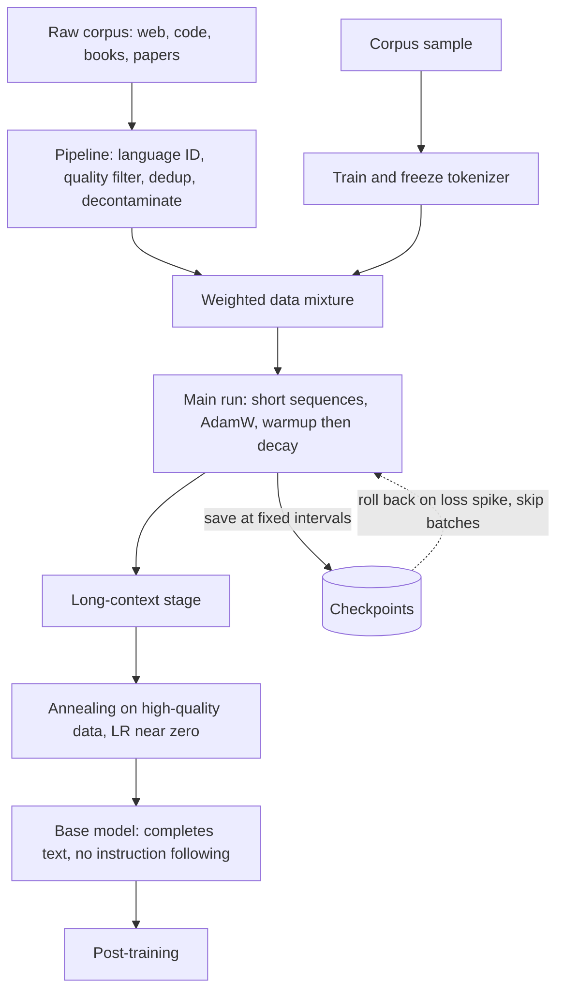

## TL;DR
Pre-training makes a random transformer predict the next token over trillions of tokens. The text is
its own label (self-supervised), it uses almost all the compute, and it yields a *base model* that
completes text but does not yet follow instructions.

## Why it exists
- **Per-task models starved for data.** Before pre-training, each NLP task got its own model trained from
  scratch. A sentiment classifier learned English from a few thousand labelled reviews, far too little
  for grammar, world knowledge and idiom.
- **Labels are expensive.** The quantity of labelled data needed to learn language from zero would be
  impossible to annotate.
- **Next-token prediction has free labels.** Hide the token after position *t* and predict it from tokens
  ≤ *t*. Every web document becomes training data without a single annotator. To predict well the model
  must learn syntax, semantics, facts (the capital of France is ...) and procedures (how a proof or a
  function body continues). The objective is simple; the data makes it hard.
- **Training the big model on your task fails.** No downstream dataset is large enough to set billions of
  parameters without overfitting, and most of what the task needs is general competence shared across
  tasks.
- **Pay once, adapt many times.** Learning that competence once is cheaper than per task. Pre-training is
  the one-time payment; fine-tuning, RAG and prompting are all ways to spend its result.

## How it works
### The objective
For a token sequence x₁…x_T, the model with parameters θ maximises the log-likelihood of each token given
its prefix:

```
L(θ) = − Σ_t log p_θ(x_t | x_<t)
```

- **It is cross-entropy** between the one-hot next token and the softmax output, averaged over every
  position in every sequence.
- **One pass scores every position.** The causal mask lets a forward pass score all T positions at once,
  so a sequence of 8k tokens yields 8k training signals.
- **Progress is reported as loss or perplexity**, not accuracy, because perplexity is just exp of this
  loss.

| Anchor | Value |
|---|---|
| Starting loss of a random model | ≈ ln(V), about 11.9 nats for a 152k-token vocabulary |
| Starting perplexity | equal to the vocabulary size (probability spread evenly) |
| Each nat below ln(V) | information extracted about how text continues |
| Reading perplexity | "the number of tokens the model is still choosing between, on average" |

### Why causal, not masked, prediction
| | Masked LM (BERT-style) | Causal next-token |
|---|---|---|
| What is supervised | only the ~15% of tokens hidden | *every* position in one pass |
| Context used | both sides | left only |
| Produces a generator? | no, nothing learns to write left to right | yes, the trained form is a sampler |
| Kept for | embedding and classification encoders | LLMs: completion, chat, tool calls after post-training |

That is why decoder-only causal pre-training became the default for LLMs.

### The data
1. **Train the tokenizer first**, on a sample of the same corpus, then freeze it for the model's life.
   Its vocabulary sets how many tokens a text costs, which is why a model can be several times more
   expensive per word in a language its tokenizer under-represents.
2. **Build a curated mixture**: web crawl, code, books, reference text, academic papers, and increasingly
   multilingual and synthetic data.
3. **Run the pipeline**, which matters as much as the model:
   - language identification;
   - quality filtering (classifiers or heuristics);
   - near-duplicate removal, because duplicated text makes the model memorise rather than generalise;
   - decontamination against evaluation sets.
4. **Choose mixture weights** (how much code versus web). They shape what the base model is good at,
   because the model allocates capacity to what it sees most.

### The compute budget
```
training FLOPs ≈ 6 · N · D      (N = parameters, D = tokens)
               = 2·N·D forward + ~4·N·D backward
```

- **Kaplan et al.:** loss falls smoothly as a power law in compute.
- **Hoffmann et al. (Chinchilla):** earlier models were undertrained. For compute-optimal training N and
  D should grow together, roughly 20 tokens per parameter as a rule of thumb.
- **Later open models train far past that ratio** because they optimise for *inference* cost: a smaller
  model trained on more tokens is cheaper to serve for the same quality.

### The schedule
| Ingredient | Typical choice | Because |
|---|---|---|
| Optimiser | AdamW | standard for transformers |
| Warmup | linear | Adam's second-moment estimates are unreliable for the first steps, and a full LR on random weights tends to diverge |
| Decay | cosine or warmup-stable-decay | a high rate keeps weights bouncing around a basin; loss drops visibly in the final decay |
| Batch | millions of tokens | stable gradient estimates at scale |
| Precision | bf16 mixed precision, gradient clipping | throughput and stability |

Training runs in stages:
1. **Main run** on short sequences.
2. **Long-context stage**, shorter, that extends the context window.
3. **Annealing** (often) on high-quality data with the LR decayed to near zero, which measurably lifts
   benchmark scores.
4. **Throughout:** keep mid-training checkpoints, so a loss spike or divergence can be rolled back to a
   point before it and resumed, often with the offending data batches skipped.

### What the model learns, and why prompting works
- **General machinery is the cheapest route to low loss** on trillions of varied tokens: representations
  of entities and relations, syntax, and the structure of code.
- **In-context learning is a by-product.** Web documents often repeat patterns (lists of examples, Q&A
  pages, tables). Predicting the next item requires inferring the rule from earlier items.
- **So a base model already does few-shot learning** from the prompt, the latent ability instruction
  tuning later makes reliable.

### Why the result is a base model
- **Nothing in the objective says "be helpful".** Asked a question, a base model may answer, continue with
  more questions, or write a forum-style thread, because all are plausible continuations of web text.
- **Post-training adds behaviour.** Instruction following, refusals and chat formatting come later.
- **The base carries knowledge and latent skills**; it is the asset every downstream stage starts from.

## Diagram
Follow the data from raw text to a base model: the pipeline and tokenizer come first, then the
training stages, with checkpoints as the rollback path when loss spikes.



## Examples
### One step of pre-training in code
The labels are the input ids shifted left by one; the loss is cross-entropy at every position. This is
exactly what `AutoModelForCausalLM` does internally when you pass `labels=input_ids`.

```python
import torch, torch.nn.functional as F
from transformers import AutoModelForCausalLM, AutoTokenizer

name = "Qwen/Qwen2.5-0.5B"               # a small base model, not an -Instruct one
tok = AutoTokenizer.from_pretrained(name)
model = AutoModelForCausalLM.from_pretrained(name, torch_dtype=torch.bfloat16).cuda()
opt = torch.optim.AdamW(model.parameters(), lr=1e-5, weight_decay=0.1)

text = "Pre-training predicts the next token. The loss is cross-entropy over the vocabulary."
ids = tok(text, return_tensors="pt").input_ids.cuda()        # [1, T]

logits = model(input_ids=ids).logits                          # [1, T, vocab]
pred, target = logits[:, :-1, :], ids[:, 1:]                  # position t predicts token t+1
loss = F.cross_entropy(pred.reshape(-1, pred.size(-1)).float(), target.reshape(-1))
print(f"loss={loss.item():.3f}  perplexity={loss.exp().item():.1f}")

loss.backward()                                               # one optimiser step of "pre-training"
torch.nn.utils.clip_grad_norm_(model.parameters(), 1.0)
opt.step(); opt.zero_grad()
# Scale this loop to ~10^13 tokens, thousands of GPUs and a cosine LR schedule and you have a base model.
```

- **Read the loss against the anchor:** a trained base model sits far below the ~11.9 nats a random model
  would score on this sentence.
- **The `[:, :-1]` / `[:, 1:]` shift is the entire supervision mechanism.** The sentence's tokens are
  both input and label, which is the "self-supervised" claim made concrete.

### Worked budget: GPU-days for a 7B base
Back-of-envelope, as an illustrative order of magnitude:

| Step | Value |
|---|---|
| Model and data | 7B parameters, 1 trillion tokens |
| FLOPs | 6 × 7e9 × 1e12 ≈ 4e22 |
| Achieved throughput | 4e14 FLOP/s per GPU (roughly 40% utilisation of a modern accelerator's bf16 peak) |
| GPU-seconds | 1e8 |
| GPU-days | about 1,200 |

Pre-training is the one stage where the arithmetic is in GPU-years, not GPU-hours. The same sum as a
function you can rerun with your own numbers:

```python
import math

def pretrain_budget(params, tokens, flops_per_gpu=4e14, gpus=1024, vocab=152_000):
    flops = 6 * params * tokens
    gpu_days = flops / flops_per_gpu / 86_400
    return {
        "flops": f"{flops:.1e}",
        "gpu_days": round(gpu_days),
        "wall_clock_days": round(gpu_days / gpus, 1),
        "chinchilla_tokens": f"{20 * params:.1e}",       # ~20 tokens per parameter
        "tokens_per_param": round(tokens / params),
        "initial_loss_nats": round(math.log(vocab), 1),  # random model: ln(V)
    }

print(pretrain_budget(7e9, 1e12))
# gpu_days ~1215, wall_clock ~1.2 days on 1,024 GPUs, chinchilla_tokens 1.4e+11,
# tokens_per_param 143 (well past compute-optimal, as inference-minded models are), initial loss 11.9
```

## Production patterns
- **Measure tokenizer cost before choosing a base.** When shortlisting checkpoints, tokenise a sample of
  your documents with each tokenizer and compute tokens per word. Monitor it per language, because it
  sets your API bill and how much fits in the context window.
- **Compare bases on bits per byte, not raw loss.** Score held-out domain text with each candidate, divide
  total negative log-likelihood (in bits) by the text's byte count, and add few-shot or log-likelihood
  tasks you care about. Monitor rank agreement with downstream evals.
- **Replay general data in continued pre-training.** When adapting to a large domain corpus, mix general
  text back into every batch rather than training on domain text alone. Monitor loss on a general
  held-out set alongside domain loss; a rise means forgetting.
- **Checkpoint often and roll back on spikes.** Save checkpoints at a fixed step interval and alert on loss
  and gradient-norm jumps. On a spike that does not recover, restore the last good checkpoint, skip the
  offending batches, and lower the LR or tighten clipping.
- **Decontaminate before you trust a benchmark.** Run n-gram overlap checks between training data and
  every eval set you report, and drop matching documents. Monitor the gap between public-benchmark
  scores and a private held-out set of the same kind.
- **Track utilisation against the 6·N·D estimate.** Divide 6·N·(tokens per second) by the cluster's peak
  FLOP/s to get model FLOPs utilisation. A falling figure flags data-loader stalls, communication
  bottlenecks or a slow node.

## Trade-offs
- **More tokens per parameter vs training compute.** Quality rises and serving cost falls for a fixed model
  size, but past the compute-optimal point each extra point costs disproportionately more training
  compute. Over-training wins when inference spend will exceed training spend; it loses for a model
  trained once and queried rarely.
- **Broad mixture vs domain strength.** A broad mixture gives general competence; over-weighting one domain
  (code, a language) improves it at the expense of others. The right mix depends on what the model will
  be served for.
- **Long sequences vs quadratic attention.** They teach long-range structure but cost quadratic attention
  compute. At a few thousand tokens the MLP and projection matmuls dominate, so the quadratic term bites
  only at long contexts, which is why context extension is a short late stage.
- **Aggressive filtering vs robustness.** It raises per-token value but can remove dialects, formats and
  messy text the model meets in production. It pays while unique high-quality data is plentiful and stops
  paying once it forces the same documents to repeat for many epochs.

## Pitfalls
- **Judging a base model by chatting with it.** It was never trained to answer, so a rambling or
  repetitive reply says nothing about its knowledge. Fix: evaluate with few-shot prompts or
  log-likelihood tasks.
- **Letting eval data leak into the corpus.** Symptom: benchmark scores that do not transfer to held-out
  tasks of the same kind. Fix: decontamination is part of the pipeline.
- **Comparing models by raw pre-training loss.** Loss is per token, so a coarser tokenizer looks worse per
  token while being better per character. Symptom: a perplexity ranking that disagrees with downstream
  evals. Fix: normalise to bits per byte (or per character) on the same corpus.
- **Training through loss spikes.** A jump that does not recover, or recovers to a worse curve, usually
  means numerical instability or a bad data shard. Fix: roll back to an earlier checkpoint, skip the
  batches, and lower the LR or tighten clipping.
- **Treating continued pre-training as cheap.** Without general data mixed in at a sensible ratio the model
  forgets general skills. Symptom: loss jumps on everything outside the domain.

## When to use
Almost no application team pre-trains from scratch: the cost is in GPU-years and the data engineering is
a product in itself.
- **Decide which base to build on.** Its token budget and data mix predict its strengths; its tokenizer,
  context window, licence and training-data provenance are all fixed at this stage.
- **Measure on your data:** tokens per word on a sample of your documents (cost and context budget), bits
  per byte on held-out domain text, and few-shot or log-likelihood scores on a small task set you care
  about.
- **Use continued pre-training when** you have a large domain corpus (tens of millions of tokens or more,
  such as legal or biomedical text). It is the one case where an application team runs this objective,
  usually on a smaller model.
- **Avoid when** the goal is "know our facts": retrieval or fine-tuning on a pre-trained base is cheaper
  and keeps answers current.
- **Interviews:** explain the objective, why it is self-supervised, what scaling laws say about N versus
  D, and why a base model differs from a chat model.

## Role lens
- **Engineer:** Chooses a base checkpoint by its training tokens, data mix and context length, and runs
  continued pre-training only with a general-data replay mix to avoid forgetting.
- **Architect:** Owns the build-versus-adopt decision on foundation models, weighing training cost,
  data provenance and licence terms against the control a custom base would give.
- **FDE:** Explains to a customer why "train a model on our data" usually means fine-tuning or RAG on a
  pre-trained base, not pre-training, and what a corpus of their size can realistically teach.

## Check yourself
**Q:** A customer with 200 million tokens of proprietary manuals asks you to "pre-train a model on our
data so it knows our products". How do you respond, and what would you actually propose?
**A:** 200M tokens is four orders of magnitude short of a pre-training corpus, so training from scratch
would produce a model that cannot even write fluent English. The knowledge they want lives in two
places: facts, which are best served by retrieval over the manuals so answers stay current and citable,
and style or terminology, which a fine-tune on a pre-trained base can absorb. If the domain vocabulary is
genuinely far from web text, continued pre-training of an open-weight base on the 200M tokens, mixed with
general data to prevent forgetting, is a defensible middle option. I would propose RAG first, measure the
failure cases, and only then decide whether adaptation of the weights is justified.

## Interview questions
### Why is pre-training called self-supervised, and why did that unlock scale?
- **The text is its own label.** At each position the target is the next token already in the document,
  so the loss is cross-entropy against data that needs no annotator.
- **So the corpus can be the web.** Trillions of tokens become usable, which is the only way to set
  billions of parameters without overfitting.
- **Causal beats masked for generation** because every position is supervised in one pass and the trained
  model is already a left-to-right sampler.

### Your pre-training loss spikes at step 40k and does not recover. What do you do?
- **Stop training through it.** A spike that never recovers, or recovers to a worse curve, usually means
  numerical instability or a bad data shard.
- **Roll back** to the last good checkpoint before the spike and resume with the offending batches skipped.
- **Then reduce risk:** lower the LR or tighten gradient clipping, and check that bf16 mixed precision and
  clipping are configured as intended.
- **Monitor** loss and gradient norm with alerts on jumps so the next one is caught early.

### Chinchilla says about 20 tokens per parameter. Why do open models train far past that?
- **Chinchilla optimises training compute.** For a fixed budget, N and D should grow together.
- **Product teams optimise total cost.** A smaller model trained on more tokens is cheaper to serve for the
  same quality, so over-training wins when inference spend will exceed training spend.
- **It flips** for a model trained once and queried rarely, where the extra training compute is wasted.

### Estimate the compute to pre-train a 7B model on 1 trillion tokens.
- **Use 6·N·D:** 6 × 7e9 × 1e12 ≈ 4e22 FLOPs (2·N·D forward plus about 4·N·D backward).
- **Divide by achieved throughput:** at 4e14 FLOP/s per GPU that is about 1e8 GPU-seconds, roughly 1,200
  GPU-days, or a little over a day of wall clock on 1,024 GPUs.
- **Sanity-check the ratio:** 1e12 / 7e9 is about 143 tokens per parameter, well past compute-optimal.

### How would you compare two candidate base models for a domain product?
- **Not by chatting with them**, because a base model was never trained to answer.
- **Not by raw loss either**, because loss is per token and tokenizers differ; normalise to bits per byte
  on the same held-out domain text.
- **Add** tokens per word on your documents (cost and context budget) and few-shot or log-likelihood
  scores on a small task set, then check licence and data provenance.

## Quiz
### Q: Why can pre-training use the raw internet while earlier NLP models needed labelled datasets?
- [ ] Transformers are robust to label noise, so unlabelled text is acceptable
- [x] Next-token prediction uses the text itself as the label, so no annotation is needed
- [ ] Web text is pre-labelled by its HTML structure
- [ ] Pre-training uses clustering, which is unsupervised
> The target at each position is simply the next token already present in the document. That makes the
> objective self-supervised: supervision exists, but it comes for free from the data rather than from
> annotators.

### Q: According to the Chinchilla result, what was wrong with earlier large models like GPT-3?
- [ ] They had too few parameters for their training data
- [x] They were trained on too few tokens for their parameter count
- [ ] They used the wrong tokenizer
- [ ] They were trained with too high a learning rate
> Hoffmann et al. showed that for a fixed compute budget, parameters and tokens should scale together,
> roughly 20 tokens per parameter. GPT-3-era models had far fewer tokens than that, so a smaller model
> trained longer would have matched them for the same compute.

### Q: A freshly pre-trained base model is asked "What is the capital of France?" and replies with three more geography questions. What does this show?
- [ ] The model failed to learn the fact during pre-training
- [ ] The tokenizer split the question badly
- [x] The base model is continuing text in a plausible style; answering is a behaviour added in post-training
- [ ] The learning rate was too low in the annealing phase
> A list of questions is a perfectly likely continuation of a question in web text. The fact may well be
> encoded; eliciting it as an answer rather than a continuation is what instruction tuning and preference
> training provide.
