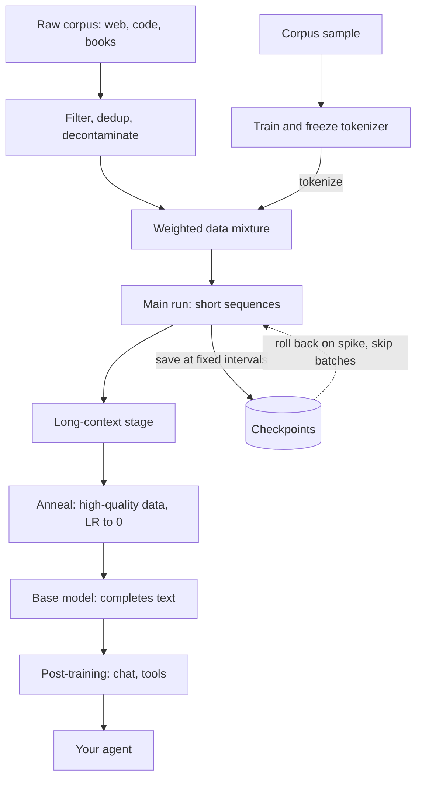

## TL;DR
Pre-training makes a random transformer predict the next token over trillions of tokens, producing the
*base model* your agent runs on. You will never run it, but it fixes the tokenizer, context window,
knowledge and licence your agent inherits.

## For agent builders
- **Why it matters for agents.** Every agent capability (reading tool schemas, writing JSON arguments,
  in-context learning from few-shot examples) is latent knowledge from pre-training that post-training
  only elicits. A base that saw little code or structured text makes a weak tool caller no matter how you
  prompt it.
- **Where it shows up in your stack.** The model card of the checkpoint you pick: training tokens, data
  mix, context length, tokenizer and licence. The tokenizer sets how many tokens your system prompt, tool
  definitions and every tool result cost on each agent step.
- **What you control.** Which base or open-weight checkpoint to build on, measured on your own agent
  transcripts (tokens per word, bits per byte), and whether a large domain corpus justifies continued
  pre-training before agent fine-tuning.
- **What you can skip.** Running pre-training, cluster design and scaling-law fitting. Know the
  objective, the 6·N·D budget and why a base model does not follow instructions; that is enough.

## Why it exists
- **Per-task models starved for data.** Before pre-training, each NLP task got its own model trained from
  scratch. A sentiment classifier learned English from a few thousand labelled reviews, far too little
  for grammar, world knowledge and idiom.
- **Labels are expensive.** The quantity of labelled data needed to learn language from zero would be
  impossible to annotate.
- **Next-token prediction has free labels.** Hide the token after position *t* and predict it from tokens
  ≤ *t*. Every web document becomes training data without a single annotator. To predict well the model
  must learn syntax, semantics, facts (the capital of France is ...) and procedures (how a proof or a
  function body continues). The objective is simple; the data makes it hard.
- **Training the big model on your task fails.** No downstream dataset is large enough to set billions of
  parameters without overfitting, and most of what the task needs is general competence shared across
  tasks.
- **Pay once, adapt many times.** Learning that competence once is cheaper than per task. Pre-training is
  the one-time payment; fine-tuning, RAG, prompting and agent scaffolding are all ways to spend its result.

## How it works
### Background: the objective
For a token sequence x₁…x_T, the model with parameters θ maximises the log-likelihood of each token given
its prefix:

```
L(θ) = − Σ_t log p_θ(x_t | x_<t)
```

- **It is cross-entropy** between the one-hot next token and the softmax output, averaged over every
  position in every sequence.
- **One pass scores every position.** The causal mask lets a forward pass score all T positions at once,
  so a sequence of 8k tokens yields 8k training signals.
- **Progress is reported as loss or perplexity**, not accuracy, because perplexity is just exp of this
  loss. In code, the labels are the input ids shifted by one (`[:, :-1]` predicts `[:, 1:]`), which is
  what `AutoModelForCausalLM` does internally when you pass `labels=input_ids`.

| Anchor | Value |
|---|---|
| Starting loss of a random model | ≈ ln(V), about 11.9 nats for a 152k-token vocabulary |
| Starting perplexity | equal to the vocabulary size (probability spread evenly) |
| Each nat below ln(V) | information extracted about how text continues |
| Reading perplexity | "the number of tokens the model is still choosing between, on average" |

### Background: why causal, not masked, prediction
| | Masked LM (BERT-style) | Causal next-token |
|---|---|---|
| What is supervised | only the ~15% of tokens hidden | *every* position in one pass |
| Context used | both sides | left only |
| Produces a generator? | no, nothing learns to write left to right | yes, the trained form is a sampler |
| Kept for | embedding and classification encoders (your RAG retriever) | LLMs: completion, chat, tool calls after post-training |

That is why decoder-only causal pre-training became the default for LLMs, and why the embedding model in
your RAG pipeline is often a different, encoder-style model.

### The data (what your agent inherits)
1. **Train the tokenizer first**, on a sample of the same corpus, then freeze it for the model's life.
   Its vocabulary sets how many tokens a text costs, which is why a model can be several times more
   expensive per word in a language its tokenizer under-represents. JSON, code and tool output are
   "languages" too.
2. **Build a curated mixture**: web crawl, code, books, reference text, academic papers, and increasingly
   multilingual and synthetic data.
3. **Run the pipeline**, which matters as much as the model:
   - language identification;
   - quality filtering (classifiers or heuristics);
   - near-duplicate removal, because duplicated text makes the model memorise rather than generalise;
   - decontamination against evaluation sets.
4. **Choose mixture weights** (how much code versus web). They shape what the base model is good at,
   because the model allocates capacity to what it sees most. Code-heavy mixes tend to make stronger
   structured-output and tool-calling bases.

### Background: the compute budget
```
training FLOPs ≈ 6 · N · D      (N = parameters, D = tokens)
               = 2·N·D forward + ~4·N·D backward
```

- **Kaplan et al.:** loss falls smoothly as a power law in compute.
- **Hoffmann et al. (Chinchilla):** earlier models were undertrained. For compute-optimal training N and
  D should grow together, roughly 20 tokens per parameter as a rule of thumb.
- **Later open models train far past that ratio** because they optimise for *inference* cost: a smaller
  model trained on more tokens is cheaper to serve for the same quality. Agents, which call the model many
  times per task, are exactly the inference-heavy workload this favours.

### Background: the schedule
| Ingredient | Typical choice | Because |
|---|---|---|
| Optimiser | AdamW | standard for transformers |
| Warmup | linear | Adam's second-moment estimates are unreliable for the first steps, and a full LR on random weights tends to diverge |
| Decay | cosine or warmup-stable-decay | a high rate keeps weights bouncing around a basin; loss drops visibly in the final decay |
| Batch | millions of tokens | stable gradient estimates at scale |
| Precision | bf16 mixed precision, gradient clipping | throughput and stability |

Training runs in stages:
1. **Main run** on short sequences.
2. **Long-context stage**, shorter, that extends the context window your agent's transcript must fit in.
3. **Annealing** (often) on high-quality data with the LR decayed to near zero, which measurably lifts
   benchmark scores.
4. **Throughout:** keep mid-training checkpoints, so a loss spike or divergence can be rolled back to a
   point before it and resumed, often with the offending data batches skipped.

### What the model learns, and why prompting agents works
- **General machinery is the cheapest route to low loss** on trillions of varied tokens: representations
  of entities and relations, syntax, and the structure of code.
- **In-context learning is a by-product.** Web documents often repeat patterns (lists of examples, Q&A
  pages, tables). Predicting the next item requires inferring the rule from earlier items.
- **So a base model already does few-shot learning** from the prompt, the latent ability instruction
  tuning later makes reliable. Few-shot tool-call examples in an agent prompt lean on this.

### Why the result is a base model
- **Nothing in the objective says "be helpful".** Asked a question, a base model may answer, continue with
  more questions, or write a forum-style thread, because all are plausible continuations of web text.
- **Post-training adds behaviour.** Instruction following, refusals, chat formatting and tool-call formats
  come later.
- **The base carries knowledge and latent skills**; it is the asset every downstream stage starts from.
  Never point an agent loop at a base checkpoint: it will not stop, call tools or follow a schema.

## Diagram
Follow the data from raw text to the base model your agent is built on. The pipeline and the frozen
tokenizer come first; checkpoints are the rollback path when loss spikes; post-training turns the base
into a tool-calling chat model.



## Misconceptions
- **"A base model is just a weaker chat model."** It has the knowledge but no behaviour: nothing in the
  objective rewards answering, stopping or calling tools, so it continues text. Judge it with few-shot or
  log-likelihood tasks, never by chatting.
- **"Tool calling is learned in post-training."** Post-training teaches the format and when to call; the
  ability to read schemas and emit valid JSON comes from the code and structured text in the pre-training
  mix. A base that saw little of either stays a weak tool caller.
- **"Lower loss means the better base."** Loss is per token, so a coarser tokenizer (fewer, more informative
  tokens) can look worse per token while predicting the same text as well or better per byte. Compare
  candidates on bits per byte over the same corpus.
- **"Chinchilla's ~20 tokens per parameter is the right amount of training."** It is the loss-optimal
  split for a fixed training budget and ignores inference. Agents spend far more on inference, so a
  smaller base trained well past the ratio (143 tokens per parameter in the 7B example) is often the
  cheaper total for the same quality.
- **"Pre-training on our documents will teach it our products."** 200M tokens is orders of magnitude
  short of a corpus; facts belong in retrieval, style in a fine-tune, and continued pre-training only fits
  a large corpus mixed with general data.
- **"The tokenizer is a detail you can swap later."** It is frozen before the main run and the embedding
  table is built on it, so its cost per tool schema and tool result is permanent for that model family.

## Examples
### Worked budget: why nobody on an agent team pre-trains
Back-of-envelope for a 7B base, as an illustrative order of magnitude:

| Step | Value |
|---|---|
| Model and data | 7B parameters, 1 trillion tokens |
| FLOPs | 6 × 7e9 × 1e12 ≈ 4e22 |
| Achieved throughput | 4e14 FLOP/s per GPU (roughly 40% utilisation of a modern accelerator's bf16 peak) |
| GPU-seconds | 1e8 |
| GPU-days | about 1,200 |
| Wall clock on 1,024 GPUs | a little over a day, after months of data engineering |
| Tokens per parameter | 1e12 / 7e9 ≈ 143, well past the compute-optimal ~20 |

Pre-training is the one stage where the arithmetic is in GPU-years, not GPU-hours. By the same 6·N·D sum,
an agent fine-tune on 50k traces of about 4k tokens (2e8 tokens) is about 6 GPU-hours on the same model,
which is where agent teams spend their training budget.

```python
import math

def pretrain_budget(params, tokens, flops_per_gpu=4e14, gpus=1024, vocab=152_000):
    flops = 6 * params * tokens
    gpu_days = flops / flops_per_gpu / 86_400
    return {
        "flops": f"{flops:.1e}",
        "gpu_days": round(gpu_days),
        "wall_clock_days": round(gpu_days / gpus, 1),
        "chinchilla_tokens": f"{20 * params:.1e}",       # ~20 tokens per parameter
        "tokens_per_param": round(tokens / params),
        "initial_loss_nats": round(math.log(vocab), 1),  # random model: ln(V)
    }

print(pretrain_budget(7e9, 1e12))
# gpu_days ~1215, wall_clock ~1.2 days on 1,024 GPUs, chinchilla_tokens 1.4e+11,
# tokens_per_param 143 (well past compute-optimal, as inference-minded models are), initial loss 11.9
```

### Measure what a tokenizer costs your agent
Before shortlisting open-weight bases, tokenise a real agent prefix (system prompt plus tool schemas) and
a typical tool result with each candidate. The tokenizer was frozen at pre-training, so this cost is
permanent for that model family.

```python
import json
from transformers import AutoTokenizer

tools = [{"name": "search_orders", "description": "Find orders by customer email",
          "parameters": {"type": "object", "properties": {"email": {"type": "string"},
                         "status": {"type": "string", "enum": ["open", "shipped", "refunded"]}},
                         "required": ["email"]}}]
system = "You are a support agent. Call tools to look up orders before answering."
tool_result = json.dumps({"orders": [{"id": "A-1042", "status": "shipped", "eta": "2026-10-25"}] * 20})
prefix = system + "\n" + json.dumps(tools)

for name in ["Qwen/Qwen2.5-0.5B", "gpt2"]:            # swap in the bases you are comparing
    tok = AutoTokenizer.from_pretrained(name)
    n_prefix = len(tok(prefix).input_ids)
    n_result = len(tok(tool_result).input_ids)
    words = len((prefix + tool_result).split())
    print(f"{name}: prefix={n_prefix} result={n_result} tokens/word={(n_prefix + n_result) / words:.2f}")
# Multiply the per-step tokens by steps per task and tasks per day to see the bill difference.
```

### Worked scenario: a tokenizer choice on a 20-step agent
Illustrative numbers for a support agent with a 6k-token prefix and ~1.5k tokens of tool output per step.

| | Base A tokenizer | Base B tokenizer (1.3× more tokens on JSON) |
|---|---|---|
| Prefix | 6k tokens | ~7.8k tokens |
| Tokens added per step | ~1.5k | ~1.95k |
| Context after 20 steps | ~36k | ~46.8k |
| Fits a 32k window? | no: crosses it after step 18 | no: crosses it after step 13 |

Same task, same quality: the tokenizer alone moves context pressure, prefill cost and when compaction
kicks in.

## Production patterns
- **Measure tokenizer cost before choosing a base.** When shortlisting checkpoints, tokenise a sample of
  your real agent transcripts (system prompt, tool schemas, tool results) with each tokenizer and compute
  tokens per word. Monitor it per language and per tool, because it sets your API bill and how many steps
  fit in the context window.
- **Compare bases on bits per byte, not raw loss.** Score held-out domain text with each candidate, divide
  total negative log-likelihood (in bits) by the text's byte count, and add few-shot or log-likelihood
  tasks you care about. Monitor rank agreement with downstream agent evals (task success, valid tool-call
  rate).
- **Replay general data in continued pre-training.** When adapting to a large domain corpus before agent
  fine-tuning, mix general text back into every batch rather than training on domain text alone. Monitor
  loss on a general held-out set alongside domain loss; a rise means forgetting.
- **Checkpoint often and roll back on spikes.** For continued pre-training, save checkpoints at a fixed
  step interval and alert on loss and gradient-norm jumps. On a spike that does not recover, restore the
  last good checkpoint, skip the offending batches, and lower the LR or tighten clipping.
- **Decontaminate before you trust a benchmark.** Run n-gram overlap checks between training data and
  every eval set you report, including your agent task suite, and drop matching documents. Monitor the
  gap between public-benchmark scores and a private held-out set of the same kind.
- **Track utilisation against the 6·N·D estimate.** Divide 6·N·(tokens per second) by the cluster's peak
  FLOP/s to get model FLOPs utilisation. A falling figure flags data-loader stalls, communication
  bottlenecks or a slow node.

## Trade-offs
- **More tokens per parameter vs training compute.** Quality rises and serving cost falls for a fixed model
  size, but past the compute-optimal point each extra point costs disproportionately more training
  compute. Over-training wins when inference spend will exceed training spend, as it does for agents; it
  loses for a model trained once and queried rarely.
- **Broad mixture vs domain strength.** A broad mixture gives general competence; over-weighting one domain
  (code, a language) improves it at the expense of others. The right mix depends on what the model will
  be served for; for agents, code and structured data usually earn their weight.
- **Long sequences vs quadratic attention.** They teach long-range structure but cost quadratic attention
  compute. At a few thousand tokens the MLP and projection matmuls dominate, so the quadratic term bites
  only at long contexts, which is why context extension is a short late stage.
- **Aggressive filtering vs robustness.** It raises per-token value but can remove dialects, formats and
  messy text the model meets in production, such as raw logs and HTML in tool results. It pays while
  unique high-quality data is plentiful and stops paying once it forces the same documents to repeat for
  many epochs.

## Pitfalls
- **Judging a base model by chatting with it.** It was never trained to answer, so a rambling or
  repetitive reply says nothing about its knowledge. Fix: evaluate with few-shot prompts or
  log-likelihood tasks.
- **Wiring a base checkpoint into an agent loop.** Symptom: no stop token, invented tool syntax, the model
  writes both sides of the conversation. Fix: use the post-trained (instruct or chat) variant, or
  post-train it yourself.
- **Letting eval data leak into the corpus.** Symptom: benchmark scores that do not transfer to held-out
  tasks of the same kind. Fix: decontamination is part of the pipeline.
- **Comparing models by raw pre-training loss.** Loss is per token, so a coarser tokenizer looks worse per
  token while being better per character. Symptom: a perplexity ranking that disagrees with downstream
  evals. Fix: normalise to bits per byte (or per character) on the same corpus.
- **Training through loss spikes.** A jump that does not recover, or recovers to a worse curve, usually
  means numerical instability or a bad data shard. Fix: roll back to an earlier checkpoint, skip the
  batches, and lower the LR or tighten clipping.
- **Treating continued pre-training as cheap.** Without general data mixed in at a sensible ratio the model
  forgets general skills. Symptom: loss jumps on everything outside the domain.

## When to use
Almost no application or agent team pre-trains from scratch: the cost is in GPU-years and the data
engineering is a product in itself.
- **Decide which base to build on.** Its token budget and data mix predict its strengths; its tokenizer,
  context window, licence and training-data provenance are all fixed at this stage.
- **Measure on your data:** tokens per word on a sample of your agent transcripts (cost and context
  budget), bits per byte on held-out domain text, and few-shot or log-likelihood scores on a small task
  set you care about.
- **Use continued pre-training when** you have a large domain corpus (tens of millions of tokens or more,
  such as legal or biomedical text). It is the one case where an application team runs this objective,
  usually on a smaller model.
- **Avoid when** the goal is "know our facts": retrieval (a RAG tool for the agent) or fine-tuning on a
  pre-trained base is cheaper and keeps answers current.
- **Interviews:** explain the objective, why it is self-supervised, what scaling laws say about N versus
  D, and why a base model differs from a chat model.

## Role lens
- **Engineer:** Chooses a base checkpoint by its training tokens, data mix and context length, and runs
  continued pre-training only with a general-data replay mix to avoid forgetting.
- **Architect:** Owns the build-versus-adopt decision on foundation models, weighing training cost,
  data provenance and licence terms against the control a custom base would give.
- **FDE:** Explains to a customer why "train a model on our data" usually means fine-tuning or RAG on a
  pre-trained base, not pre-training, and what a corpus of their size can realistically teach.

## Check yourself
**Q:** A customer with 200 million tokens of proprietary manuals asks you to "pre-train a model on our
data so it knows our products". How do you respond, and what would you actually propose?
**A:** 200M tokens is four orders of magnitude short of a pre-training corpus, so training from scratch
would produce a model that cannot even write fluent English. The knowledge they want lives in two
places: facts, which are best served by retrieval over the manuals so answers stay current and citable,
and style or terminology, which a fine-tune on a pre-trained base can absorb. If the domain vocabulary is
genuinely far from web text, continued pre-training of an open-weight base on the 200M tokens, mixed with
general data to prevent forgetting, is a defensible middle option. I would propose RAG first, measure the
failure cases, and only then decide whether adaptation of the weights is justified.

## Interview questions
### Why is pre-training called self-supervised, and why did that unlock scale?
- **The text is its own label.** At each position the target is the next token already in the document,
  so the loss is cross-entropy against data that needs no annotator.
- **So the corpus can be the web.** Trillions of tokens become usable, whereas no labelled downstream
  dataset is large enough to set billions of parameters without overfitting.
- **Causal beats masked for generation** because every position is supervised in one pass and the trained
  model is already a left-to-right sampler.

### You are picking an open-weight base for a tool-calling agent. What do you look at from its pre-training?
- **Tokenizer cost on your transcripts.** Tokens per word on your system prompt, tool schemas and tool
  results, because that cost repeats on every agent step.
- **Context length and data mix.** The window must hold a long agent transcript, and a mix with plenty of
  code and structured text tends to give a better tool-calling base.
- **Licence and provenance**, then bits per byte on domain text and your agent eval suite after a quick
  fine-tune, rather than chatting with the base.

### Your continued pre-training loss spikes at step 40k and does not recover. What do you do?
- **Stop training through it.** A spike that never recovers, or recovers to a worse curve, usually means
  numerical instability or a bad data shard.
- **Roll back** to the last good checkpoint before the spike and resume with the offending batches skipped.
- **Then reduce risk:** lower the LR or tighten gradient clipping, and check that bf16 mixed precision and
  clipping are configured as intended.
- **Monitor** loss and gradient norm with alerts on jumps so the next one is caught early.

### Chinchilla says about 20 tokens per parameter. Why do open models train far past that?
- **Chinchilla optimises training compute.** For a fixed budget, N and D should grow together.
- **Product teams optimise total cost.** A smaller model trained on more tokens is cheaper to serve for the
  same quality, so over-training wins when inference spend will exceed training spend, as with agents
  that call the model dozens of times per task.
- **It flips** for a model trained once and queried rarely, where the extra training compute is wasted.

### Estimate the compute to pre-train a 7B model on 1 trillion tokens.
- **Use 6·N·D:** 6 × 7e9 × 1e12 ≈ 4e22 FLOPs (2·N·D forward plus about 4·N·D backward).
- **Divide by achieved throughput:** at 4e14 FLOP/s per GPU that is about 1e8 GPU-seconds, roughly 1,200
  GPU-days, or a little over a day of wall clock on 1,024 GPUs.
- **Sanity-check the ratio:** 1e12 / 7e9 is about 143 tokens per parameter, well past compute-optimal.

### A teammate wired a base checkpoint into the agent loop and it never calls tools. Why?
- **A base model only continues text.** Nothing in pre-training taught it chat turns, stop tokens or a
  tool-call format, so it writes plausible continuations instead of structured calls.
- **The fix is post-training**, not prompting harder: use the instruct variant or run SFT on tool-calling
  traces, then evaluate valid-call rate and task success.

## Quiz
### Q: Why can pre-training use the raw internet while earlier NLP models needed labelled datasets?
- [ ] Transformers are robust to label noise, so unlabelled text is acceptable
- [x] Next-token prediction uses the text itself as the label, so no annotation is needed
- [ ] Web text is pre-labelled by its HTML structure
- [ ] Pre-training uses clustering, which is unsupervised
> The target at each position is simply the next token already present in the document. That makes the
> objective self-supervised: supervision exists, but it comes for free from the data rather than from
> annotators.

### Q: According to the Chinchilla result, what was wrong with earlier large models like GPT-3?
- [ ] They had too few parameters for their training data
- [x] They were trained on too few tokens for their parameter count
- [ ] They used the wrong tokenizer
- [ ] They were trained with too high a learning rate
> Hoffmann et al. showed that for a fixed compute budget, parameters and tokens should scale together,
> roughly 20 tokens per parameter. GPT-3-era models had far fewer tokens than that, so a smaller model
> trained longer would have matched them for the same compute.

### Q: A freshly pre-trained base model is asked "What is the capital of France?" and replies with three more geography questions. What does this show?
- [ ] The model failed to learn the fact during pre-training
- [ ] The tokenizer split the question badly
- [x] The base model is continuing text in a plausible style; answering is a behaviour added in post-training
- [ ] The learning rate was too low in the annealing phase
> A list of questions is a perfectly likely continuation of a question in web text. The fact may well be
> encoded; eliciting it as an answer rather than a continuation is what instruction tuning and preference
> training provide.

## Use cases & projects
### Use cases
- **Picking a base for an open-weight agent.** Teams compare candidate checkpoints on their own agent
  transcripts before any fine-tuning, because a weak base caps tool-calling quality.
- **Estimating agent token cost.** Tokenizer efficiency on tool schemas, JSON arguments and tool results
  decides how many tokens every agent step costs.
- **Domain agents with a large private corpus.** Legal, medical or code-heavy teams weigh continued
  pre-training against RAG before building the agent on top.
- **Explaining base-model behaviour.** When a base checkpoint continues a prompt instead of answering,
  the team knows the fix is post-training, not prompt tweaking.

### Mini project
**Score two base checkpoints on your agent traffic (1-2 hours).**
- **Goal:** pick the better base for an agent from data, not from leaderboards.
- **Steps:** collect 50 agent transcripts (system prompt, tool definitions, tool calls and results); load
  two small open-weight base models; measure tokens per word and bits per byte on the transcripts for each
  (raw loss is per token, so it is not comparable across tokenizers); then give each a 3-shot prompt
  asking for one JSON tool call and check how many outputs parse.
- **Done when:** you have a table with tokens per word, bits per byte and JSON parse rate per model, and
  a short recommendation of which base to fine-tune for the agent and why.
