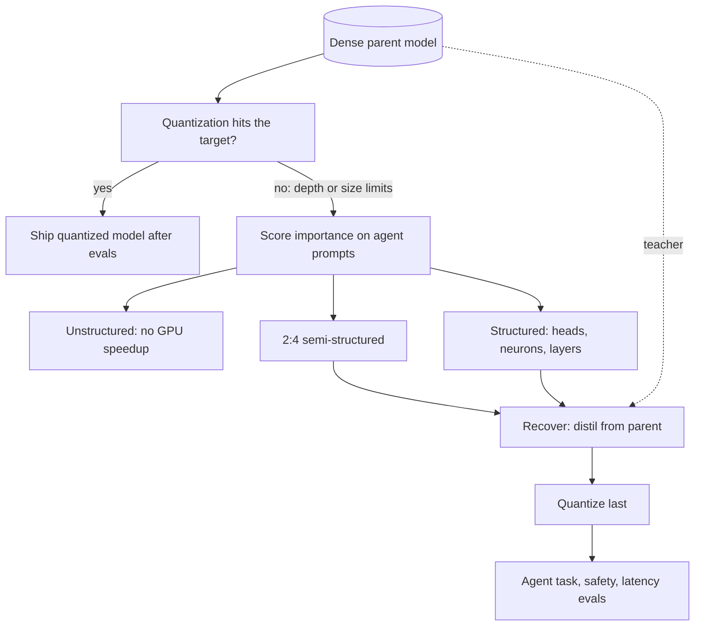

## TL;DR
Pruning removes weights, heads or layers a model barely uses, then repairs it by distillation. Agent
builders mostly meet it as the origin of small, fast open models for routers and tool-callers; only
structured cuts give real GPU speedups.

## For agent builders
- **Why it matters for agents.** Agents make many short calls (route, pick a tool, emit JSON), so step
  latency adds up. Several small open models you might put behind those steps were made by pruning a
  larger parent and distilling it back, which is why they punch above their size.
- **Where it shows up in your stack.** Mostly upstream: model cards that say "pruned and distilled from"
  a parent, vendor claims of "50% sparse", and 2:4 sparse checkpoints that need engine kernel support.
  You rarely run a pruning job yourself.
- **What you control.** Whether to quantize instead (almost always first), and the eval that decides if
  a pruned candidate is good enough for your agent: tool-call validity, task success and policy refusals.
- **What you can skip.** Wanda and SparseGPT internals, lottery tickets and the PyTorch pruning code.
  Know the granularity ladder, why sparsity is not speedup, and that safety behaviour is fragile.

## Why it exists
- **Large models are heavily over-parameterised.** They are trained big because width and depth make
  optimisation easy and sample-efficient, not because every parameter is needed at inference. Much
  inference compute moves the output very little.
- **The slack is well documented.** Many attention heads can be removed after training with little loss;
  a sizeable fraction of middle layers barely change the residual stream they receive; half the individual
  weights of a large model can be zeroed in one shot with a modest perplexity increase. You pay for that
  slack on every token served.
- **Training small from scratch is the expensive route.** It costs the full pretraining budget, trillions
  of tokens, and the result was never as good as the big one. A pruned-and-repaired model starts from the
  parent's knowledge; recovery has been reported to need tens of times fewer tokens.
- **Quantization alone hits a floor.** It shaves a constant factor on bytes but leaves parameter count and
  FLOPs unchanged, and bottoms out around 4 bits. Pruning attacks the count and composes with
  quantization: fewer weights at fewer bits multiply.
- **Hardware decides what counts.** GPUs multiply dense matrices; a matrix 50% zeros in random places
  costs the same unless the kernel knows the pattern. The real question is "which *shape* of removal can
  the hardware cash in", not "which weights are unimportant".

## How it works
### What an agent builder does with pruning
1. **Treat it as a supplier question.** When a model card says pruned and distilled, ask which parent,
   which granularity, and which hardware gets the speedup.
2. **Benchmark on agent traffic.** Measure step latency (time to first token plus a short tool-call
   decode) at your real concurrency, not sparsity percentages.
3. **Run the agent eval suite and the policy suite.** Pruned models can keep perplexity while losing
   instruction following, tool-call formatting and refusals.
4. **Prefer quantization or a smaller sibling first.** Pruning yourself is a model-training project with
   a distillation phase, justified only when no existing model fits the size and latency target.

The rest of this section is background: what gets removed, how importance is scored, and how recovery
works.

### Background: what you remove, the granularity ladder
| Granularity | Removes | Accuracy at a given sparsity | GPU speedup |
|---|---|---|---|
| Unstructured | individual weights anywhere | best | almost none |
| Semi-structured 2:4 | two of every four consecutive weights | middle | up to 2× matmul on Ampere+ |
| Structured | heads, neurons, channels, layers | largest hit per parameter | everywhere, no special support |

- **Unstructured.**
  - Most freedom, so best accuracy, but an irregular sparse matrix: dense kernels gain nothing.
  - Sparse storage needs column indices whose overhead eats most of the saving at 50%; general sparse
    kernels only beat dense at very high sparsity (around 90% and up).
  - Useful for CPU runtimes with sparse support and research, rarely for GPU serving.
- **Semi-structured N:M, in practice 2:4.**
  - NVIDIA GPUs from Ampere onward have sparse tensor cores that run this pattern at up to twice the dense
    matmul rate.
  - Storage: the two survivors plus 2-bit position indices. Per four 16-bit weights, 2 × 16 + 2 × 2 = 36
    bits instead of 64, about 56% of dense.
  - Sparsity is fixed at 50% and the constraint is local, so quality drops more than free unstructured
    pruning at the same ratio.
- **Structured.**
  - Attention heads: the matching slices of W_Q, W_K, W_V and W_O.
  - MLP neurons: columns of the up/gate projections and the matching rows of the down projection.
  - Hidden channels: hard, because the residual stream touches every layer.
  - Entire layers: depth pruning.
  - The output is a smaller *dense* model, so every kernel on every device gets faster. The coarsest
    constraint costs the most quality, which is why recovery training almost always follows.

### Background: how importance is scored
| Score | What it computes | Strength | Weakness |
|---|---|---|---|
| Magnitude | \|w\| | cheap, good after training with weight decay | fails one-shot at 50% on large LLMs: blind to outlier features |
| Wanda | \|W_ij\| · ‖X_j‖₂ over a few calibration sequences, pruned *within each output row* | no gradients or retraining, seconds per layer, matches costlier methods at 50% | needs calibration data like deployment |
| SparseGPT | Optimal Brain Surgeon (as in GPTQ): remove the weight that least raises ‖WX − ŴX‖², update the rest with **H⁻¹** = (XXᵀ)⁻¹ | 100B+ models to 50–60% unstructured or 2:4 in a few hours on one GPU, more accurate than Wanda | Hessian work |
| Gradient / Taylor | \|w · ∂L/∂w\| and group versions: estimated loss change from removing a unit | usual choice for heads and neurons | needs gradients |
| Layer influence | cosine similarity of a layer's input and output hidden states | similarity near 1 marks a near-identity block to drop first | first and last few layers almost never qualify |

- **Why magnitude fails:** a small weight on an input channel that always carries huge activations is
  important, and |w| cannot see it; Wanda fixes exactly that blind spot.
- **Why per row:** pruning within each output row keeps every output's number of inputs equal.

### Background: when you prune and how you recover
- **One-shot (Wanda, SparseGPT).** Prune a finished model and stop: the right tool for a quick 50% result.
- **Iterative.** Alternate prune → fine-tune → prune with a gradually ramping sparsity schedule, because
  the network needs time to reroute around each cut.
- **Lottery tickets.** Iterative magnitude pruning of small vision networks found sparse subnetworks that,
  rewound to early-training weights, train to full accuracy alone. Useful intuition for *why*
  over-parameterised training works, but not a practical LLM recipe: finding the ticket costs more than
  training the dense model.
- **Structured LLM recipe: prune, then distil from the unpruned parent.** The pruned model is an excellent
  initialisation; token-level distillation gives a dense repair signal at a small fraction of a
  pretraining budget.

Reported findings from that line of work:

| Choice | Quality at equal parameter count | Latency win |
|---|---|---|
| Width pruning (heads, MLP, embedding channels) | better preserved | smaller |
| Depth pruning (layers) | worse | bigger: fewer sequential layers, fewer kernel launches per token |

**Contrast mixture-of-experts.** MoE is structured sparsity designed in and *learned during pretraining*
(each token activates a few experts), not carved out afterwards. At frontier scale it has been the more
widely adopted way to cut FLOPs per token; see that lesson.

## Diagram
The pipeline behind a pruned agent model: quantization is tried first, and pruning starts only when depth
or parameter count is the limit. Granularity decides whether hardware can cash in the cut (2:4 gives up
to 2x matmul on Ampere and later), and recovery plus agent and safety evals follow.



## Examples
### Wanda vs magnitude pruning on one layer
PyTorch, unstructured (per-row 50%) and 2:4. The calibration activations include a few outlier channels,
exactly where magnitude scores go wrong and activation-aware scores do not.

```python
import torch
torch.manual_seed(0)
d_in, d_out, n_tok = 1024, 1024, 4096
W = torch.randn(d_out, d_in) * 0.02                # [out, in]
X = torch.randn(n_tok, d_in)
X[:, torch.randperm(d_in)[:8]] *= 30                # a few scattered outlier input channels, as in real LLMs

def prune_rows(W, score, sparsity=0.5):
    """Zero the lowest-scoring fraction of weights within each output row (Wanda's comparison group)."""
    k = int(W.shape[1] * sparsity)
    idx = score.argsort(dim=1)[:, :k]
    mask = torch.ones_like(W, dtype=torch.bool).scatter_(1, idx, False)
    return W * mask

def prune_2of4(W, score):
    """Keep the two highest-scoring weights in every block of four along the input dimension."""
    s = score.view(W.shape[0], -1, 4)
    keep = torch.zeros_like(s, dtype=torch.bool).scatter_(2, s.topk(2, dim=2).indices, True)
    return W * keep.view_as(W)

ref = X @ W.T
magnitude = W.abs()                                 # |W_ij|
wanda = W.abs() * X.norm(dim=0)                     # |W_ij| * ||X_j||_2
for name, Wp in [("magnitude 50%", prune_rows(W, magnitude)), ("wanda 50%", prune_rows(W, wanda)),
                 ("magnitude 2:4", prune_2of4(W, magnitude)), ("wanda 2:4", prune_2of4(W, wanda))]:
    density = (Wp != 0).float().mean().item()
    err = ((X @ Wp.T - ref).norm() / ref.norm()).item()
    print(f"{name:14s} density={density:.2f} relative output error={err:.3f}")
# Expect wanda to beat magnitude clearly: magnitude happily deletes small weights on the outlier
# channels, which carry most of the output. Same density, very different damage.
# In a real model you would score every linear layer with a few hundred calibration sequences,
# then measure perplexity and task evals; for structured cuts, follow with distillation from W.
```

### Rank layers for depth pruning by block influence
Hugging Face Transformers. `hidden_states` holds the embedding output plus each layer's output, so entries
*i* and *i+1* are layer *i*'s input and output. Use production prompts as calibration text.

```python
import torch
import torch.nn.functional as F
from transformers import AutoModelForCausalLM, AutoTokenizer

name = "Qwen/Qwen2.5-0.5B"                                   # any causal LM
tok = AutoTokenizer.from_pretrained(name)
model = AutoModelForCausalLM.from_pretrained(name, torch_dtype=torch.float32).eval()
texts = ["Summarise this support ticket: printer offline after update.",
         "Write a SQL query that counts orders per customer."]   # use a few hundred real prompts

sims = None
with torch.no_grad():
    for t in texts:
        hs = model(**tok(t, return_tensors="pt"), output_hidden_states=True).hidden_states
        s = torch.stack([F.cosine_similarity(hs[i], hs[i + 1], dim=-1).mean() for i in range(len(hs) - 1)])
        sims = s if sims is None else sims + s
sims /= len(texts)
order = sims.argsort(descending=True)                        # most identity-like first
print("drop candidates:", [int(i) for i in order[:4]])       # skip the first and last few layers
# Note: in many HF models the final entry of hidden_states is taken after the last norm, so the
# last layer's score is not comparable to the others; another reason to exclude it.
```

### Worked scenario: what each cut buys an 8B model on an A100
Illustrative planning numbers for a 32-layer model; confirm every row with your own benchmark.

| Option | Weight bytes | Decode effect | Recovery needed |
|---|---|---|---|
| 50% unstructured | unchanged in a dense engine | none | optional |
| 2:4 sparse | about 56% of dense | only if the kernel reads the compressed form | usually |
| Drop 8 of 32 layers | about 75% of the layer weights | about a quarter less sequential work | distil from parent |
| INT4 weights, no pruning | about 26% of bf16 | largest at low batch | none |

This is why quantization comes first: it hits the memory target with no training.

### Worked scenario: a pruned router model for a support agent
A support agent makes 15 calls per task, each a short tool call or routing decision of about 60 output
tokens, served on an 8B model. Assume an illustrative 10 ms per output token at the serving batch size.

| Candidate | Decode per task (15 × 60 tokens) | Tool-call validity | Policy refusals kept | Verdict |
|---|---|---|---|---|
| 8B dense (baseline) | 900 tokens × 10 ms = 9.0 s | baseline | baseline | reference |
| 8B with 8 of 32 layers dropped, distilled | ~6.75 s (about a quarter less sequential work) | measure | measure: fragile under pruning | ship only if both hold |
| 8B INT4, no pruning | lower still at low batch, no training | measure | usually close | try first |
| 50% unstructured sparse 8B | 9.0 s in a dense engine | measure | measure | no latency win |

The decision comes from the two "measure" columns on your agent eval and policy suites, not from the
latency column alone.

## Production patterns
- **Evaluate pruned models as agent models.** When adopting a pruned-and-distilled checkpoint for an
  agent step, replay your agent task suite and policy-refusal suite against the parent or your current
  model. Monitor tool-call schema failures and refusal rate per model version after rollout.
- **Quantize first, prune second.** When the target is bytes or decode latency, try INT8/INT4 before any
  pruning; prune only when parameter count or sequential depth is the constraint. Track tokens per second
  at deployment batch size after each step.
- **Prune → distil → quantize, with evals at every stage.** Keep the dense parent as the distillation
  teacher, recover the pruned model, and quantize last, because errors compound. Log task, safety and
  general-benchmark scores at each stage so you know where quality went.
- **Calibrate on production prompts.** Importance scores are activation-dependent, so sample a few hundred
  real requests (code, chat, languages in proportion) for Wanda, SparseGPT or block-influence scoring.
  Watch per-domain eval deltas, not just aggregate perplexity.
- **Verify 2:4 end to end in the engine.** In PyTorch, `torch.sparse.to_sparse_semi_structured`
  converts a 2:4-masked weight for sparse kernels; in a serving engine, confirm the sparse kernel path is
  actually selected. Benchmark real tokens per second against the dense model before claiming a win.
- **Safety suite as a release gate.** Re-run refusal and safety evals on every pruned candidate, because
  safety behaviour can be disproportionately fragile under pruning; for agents, include prompts that try
  to make the agent call tools it should refuse.

## Trade-offs
- **Unstructured accuracy vs no GPU speedup.** Best accuracy per removed weight, but it only pays on
  sparse-aware CPU runtimes or at extreme sparsity; for GPU serving it is a reporting exercise, not a cost
  saving.
- **2:4 speed vs rigidity.** Matmuls can run at up to twice the dense rate on supporting GPUs (realised
  gains are smaller and kernel-dependent) and weight bytes drop to about 56%. But it is a fixed 50%,
  usually needs recovery, and helps decode only if the kernel reads the compressed form. On hardware
  without sparse tensor cores it is pure quality loss.
- **Structured speed vs quality.** Faster everywhere, but more quality lost per parameter and the most
  recovery compute. Depth pruning is cheapest to implement and best for latency; width pruning preserves
  quality better at the same size.
- **Prune-then-distil efficiency vs inheritance.** A small fraction of a fresh model's tokens, but the
  result inherits the parent's architecture, tokenizer and biases, and its ceiling is the parent.
- **Stacking with quantization.** Savings multiply but errors compound, so prune and recover first,
  quantize last, and evaluate at every stage.

## Pitfalls
- **Reporting sparsity as speedup.** A 50% unstructured-sparse model runs at identical tokens per second
  in a dense engine. Symptom: a proud "50% smaller" slide and an unchanged GPU bill.
- **Calibrating on data unlike deployment traffic.** Scores are activation-dependent. Symptom: fine
  perplexity on web text, broken behaviour on code or chat.
- **Removing layers by position rules of thumb.** Without measuring block influence, and especially
  cutting first or last layers. Symptom: degenerate, repetitive output even at a small depth cut.
- **Skipping recovery because perplexity looked fine.** Perplexity and downstream ability diverge after
  pruning. Symptom: intact next-token loss, collapsed instruction following or reasoning on your evals.
- **Width-pruning one side of a paired matrix.** Dropping MLP up-projection columns without the matching
  down-projection rows, or query heads without accounting for grouped KV heads. Symptom: a shape error if
  lucky, silent garbage if not.
- **Assuming pruning is behaviour-neutral.** Safety and refusal behaviour can be disproportionately
  fragile. Symptom: a smaller model that complies with requests its parent refused. Re-run the safety
  suite, not just capability evals.
- **Trusting a pruned model's chat benchmarks for agent work.** Instruction following and strict output
  formats can degrade while chat scores hold. Symptom: more malformed tool calls and retries per task.
  Fix: replay your agent suite before swapping it into a step.

## When to use
- **Use when:** you need a size that does not exist in your standard family, you have a strong parent and
  recovery budget, or the hardware has 2:4 support and the workload is matmul-heavy.
- **Prefer quantization first:** it is cheaper and usually reaches the memory target alone. Prune only
  when latency or parameter count, not bytes, is the constraint.
- **Measure:** tokens per second and task evals at deployment batch size, never sparsity percentages.
  Keep the KV cache in view: pruning query heads does not shrink it, pruning KV heads or layers does.
- **Day to day:** a model-shrinking project with a distillation phase attached; for most agent teams,
  choosing between existing pruned, quantized or smaller sibling models by running the agent evals.
- **Interviews:** explain why unstructured sparsity does not speed up a GPU, how Wanda differs from
  magnitude pruning, and what 2:4 actually buys.

## Role lens
- **Engineer:** Runs one-shot pruning with calibration data from production prompts, wires the recovery
  distillation run, and benchmarks real tokens per second against the dense parent before claiming a win.
- **Architect:** Decides whether the size gap is better closed by pruning a known-good parent or by
  adopting a different model, weighing recovery compute against the operational cost of a new family.
- **FDE:** Rarely prunes in the field, but must recognise a vendor's "50% sparse" claim for what it is and
  ask which hardware and kernel path turns that into latency the customer will feel.

## Check yourself
**Q:** A product needs decode latency about 30% lower than its 8B model delivers on A100s, with no budget
for a different GPU. Which pruning options are realistic, and in what order would you try them?
**A:** Decode is bandwidth-bound, so the target is fewer bytes read per token, and the first option is not
pruning at all: INT4 or INT8 weights cut bytes more than 30% with no training, so quantize first and
measure. If latency is still short, depth pruning is the direct lever, since dropping a quarter of the
layers removes a quarter of the sequential work and the bytes; measure block influence by input/output
cosine similarity, remove the least influential middle layers, and distil from the unpruned 8B to recover.
2:4 sparsity is tempting on A100s, but its decode benefit depends on the engine reading the compressed
format and it needs recovery training too, so I would try it only after depth pruning. Throughout, I would
track task evals and safety evals, not perplexity, and verify the KV cache budget is unchanged.

## Interview questions
### A vendor offers a "50% sparse" version of your agent's model. What do you ask before adopting it?
- **Which sparsity:** unstructured gives no speedup in a dense engine; 2:4 needs sparse tensor cores
  (Ampere onward) and an engine kernel that reads the compressed form; structured gives a smaller dense
  model.
- **Measured step latency:** time to first token plus a short tool-call decode at your concurrency, not
  sparsity percentages.
- **Agent quality:** replay your task suite and policy-refusal suite, because formats and safety
  behaviour degrade before perplexity does.

### Your agent's router step is too slow on an 8B model. Would you prune it?
- **Not first:** try INT4 or INT8 weights, prefix caching for the shared prompt, or a smaller existing
  model, because none needs a training run.
- **Prune when** no model fits the latency target: drop the least influential middle layers by block
  influence and distil from the 8B parent on router traffic.
- **Gate it** on routing accuracy, tool-call validity and refusals at real concurrency before switching
  traffic.

### One-shot magnitude pruning at 50% wrecked your LLM. Why, and what would you use instead?
- **Outlier features:** a small weight on an input channel that always carries huge activations matters a
  lot, and |w| alone cannot see it, so magnitude deletes exactly those weights.
- **Wanda** fixes the blind spot by scoring |W_ij| · ‖X_j‖₂ per output row, with no gradients and seconds
  per layer.
- **SparseGPT** is more accurate still, using the inverse Hessian to compensate the remaining weights, at
  the cost of the Hessian work.

### Width pruning or depth pruning for a latency-bound service? What do you give up?
- **Depth pruning** drops whole layers: fewer sequential layers and kernel launches per token, so the
  bigger latency win and the simplest implementation.
- **Width pruning** removes heads, MLP neurons or embedding channels: better quality at equal parameter
  count, smaller latency win.
- **Either way** recovery by distillation from the parent follows, and for depth pruning you measure block
  influence and never cut the first or last few layers.

### A pruned 8B model passes perplexity checks but now answers requests its parent refused. What went wrong?
- **Perplexity and behaviour diverge after pruning:** next-token loss can stay intact while instruction
  following, reasoning or refusals collapse.
- **Safety behaviour is fragile:** it can be disproportionately damaged by pruning, so a capability-only
  eval misses it.
- **Fix:** add the refusal and safety suite to the release gate for every pruned candidate, and recover
  with distillation from the parent before re-checking.

### When would you not prune at all?
- **When bytes are the constraint:** quantization is cheaper, needs no training and usually reaches the
  memory target alone; INT4 weights are about 26% of bf16.
- **When the GPU lacks the pattern:** 2:4 on hardware without sparse tensor cores is pure quality loss,
  and unstructured sparsity gives no speedup in a dense engine.
- **When you have no recovery budget or strong parent:** a different, smaller model family may be the
  cheaper route.

## Quiz
### Q: Why does 50% unstructured sparsity usually not make a GPU model faster?
- [ ] Zero weights still consume registers during attention
- [x] Dense kernels multiply the zeros anyway, and sparse formats need index overhead and specialised kernels that only pay off at much higher sparsity
- [ ] The KV cache grows to compensate for the missing weights
- [ ] Sparse models cannot be quantized
> GPUs execute dense matmuls regardless of zero values. Cashing in sparsity needs either hardware-known
> patterns such as 2:4 or structural removal that yields a smaller dense matrix.

### Q: What does Wanda's importance score multiply together?
- [ ] Weight magnitude and the weight's gradient
- [ ] Weight magnitude and the inverse Hessian diagonal
- [x] Weight magnitude and the L2 norm of the input activation feature it multiplies
- [ ] Output activation variance and layer depth
> Wanda scores |W_ij| · ‖X_j‖₂ so that small weights on outlier input channels are protected, which is
> the case where pure magnitude pruning does the most damage in large language models.

### Q: After structurally pruning a large model, what is the most token-efficient way to recover quality?
- [ ] Retrain the pruned architecture from random initialisation on the original corpus
- [x] Distil from the unpruned parent, using the pruned weights as the initialisation
- [ ] Quantize it to 4-bit so the remaining weights are used more efficiently
- [ ] Increase the learning rate and run one more epoch of SFT
> The pruned model already sits near a good solution, and token-level distillation gives a dense signal, so
> recovery reportedly needs a small fraction of the tokens a fresh small model would require.

## Use cases & projects
### Use cases
- **Choosing a small model for fast agent steps.** Pruned-and-distilled open models are common
  candidates for routers, classifiers and tool selectors where step latency dominates.
- **Checking vendor sparsity claims.** Before adopting a "sparse" checkpoint, teams benchmark real tokens
  per second in their serving engine against the dense model.
- **Depth pruning for latency-bound agents.** Removing whole layers cuts sequential depth, which helps
  when an agent makes many short calls in a row.
- **Safety re-validation of a compressed model.** Any pruned candidate re-runs the refusal suite,
  including prompts that try to make the agent call tools it should refuse.

### Mini project
**Evaluate a pruned model as an agent step (1-2 hours).**
- **Goal:** decide whether a pruned-and-distilled small model can replace its parent for one agent step.
- **Steps:** pick a pruned-and-distilled model whose model card names its parent (NVIDIA's Minitron
  checkpoints are one family), using instruct variants or few-shot prompts if only base weights exist;
  write 40 routing or tool-selection tasks and 15 prompts the agent should refuse; run both models in the
  same engine and precision; record schema-valid outputs, task accuracy, refusal rate and latency per
  call.
- **Done when:** a side-by-side table shows the quality, safety and latency deltas, with a one-paragraph
  ship or no-ship decision.
