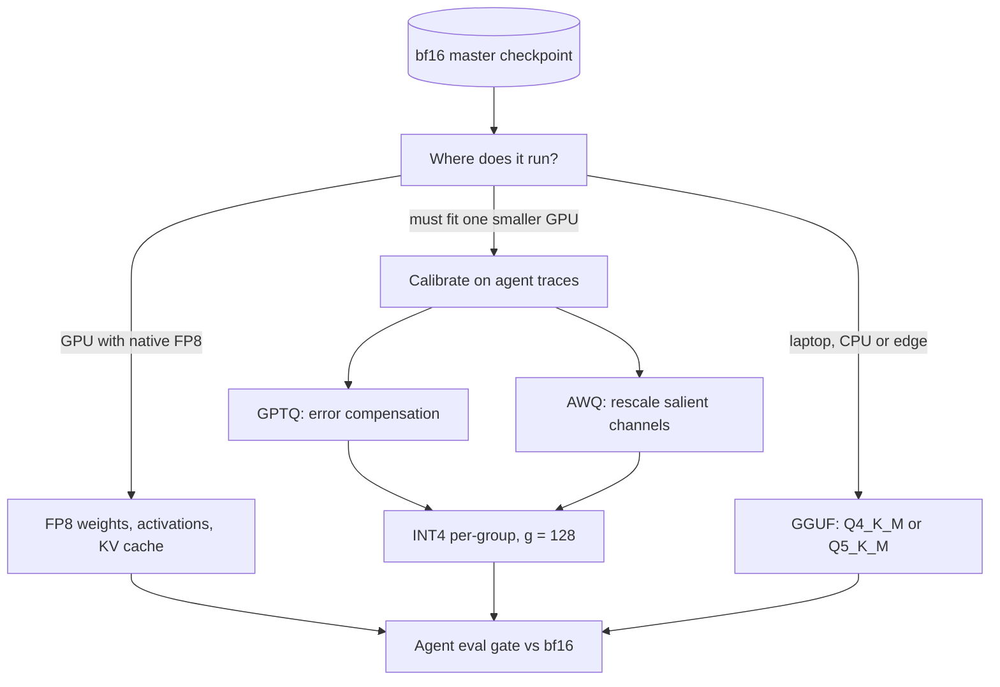

## TL;DR
Quantization stores a self-hosted agent model's weights in INT8, INT4 or FP8 instead of 16 bits, so it
fits cheaper GPUs, decodes faster and leaves room for long agent transcripts. GPTQ and AWQ calibrate
4-bit weights; GGUF runs local agents on CPUs.

## For agent builders
- **Why it matters for agents.** Agent quality hinges on brittle outputs: valid JSON tool calls, exact
  argument names, many reasoning steps in a row. Those regress under quantization before chat quality
  does, so a quant that "looks fine" can break your agent.
- **Where it shows up in your stack.** Pre-quantized AWQ, GPTQ or FP8 checkpoints served by vLLM, SGLang
  or TensorRT-LLM; GGUF files run by llama.cpp or tools built on it for local and edge agents; and FP8
  KV caches for long transcripts.
- **What you control.** Precision per deployment target, calibration data (use agent traces with tool
  schemas), KV-cache precision, and the eval gate: tool-call validity and task success against the bf16
  parent.
- **What you can skip.** The GPTQ Hessian derivation and AWQ's grid search. Know bits per weight,
  weight-only versus W8A8, and why decode speeds up but prefill does not. Hosted APIs make this choice
  for you.

## Why it exists
- **Memory.** A 70B-parameter model in bf16 is 140 GB of weights and does not fit one 80 GB GPU; at 4 bits
  it is about 35–40 GB and does. A 7B model goes from 14 GB to about 4 GB: data-centre card to laptop.
- **Speed.** During decode the GPU reads every weight once per token, with tiny arithmetic per weight (one
  multiply-add per token at batch size 1). Time per token ≈ weight bytes ÷ memory bandwidth, so halving
  the bytes nearly doubles small-batch decode speed. It is a bandwidth optimisation wearing a compression
  costume.
- **"Train a smaller model instead" loses more quality.** At a fixed memory budget, a 4-bit model with
  roughly four times the parameters generally beats the 16-bit model filling the same bytes. That is the
  core finding of the k-bit inference scaling-law work (Dettmers & Zettlemoyer), and why 4-bit became the
  default for local models.
- **"Just cast to int8 with one scale per tensor" fails on outliers.** Transformers past a few billion
  parameters develop a handful of activation channels tens of times larger than the rest. One such value
  sets the whole tensor's scale, so everything else rounds to zero or one level.
- **Every modern method attacks that range problem:** finer-grained scales, outlier-aware scaling, or
  error compensation.

## How it works
### The arithmetic of a quantizer
Symmetric *b*-bit quantization maps a real *x* to an integer *q* with one scale *s*:

```
s = max|x| / (2^(b−1) − 1)        q = clamp(round(x / s), −2^(b−1), 2^(b−1) − 1)        x̂ = s · q
```

- **Levels:** INT8 gives 127 levels on each side of zero; INT4 gives only −8…7.
- **Asymmetric (affine):** adds a zero-point *z* so the grid covers [min, max] exactly. Matters for skewed
  distributions; the usual choice for 4-bit weights.
- **Error:** roughly uniform in [−*s*/2, *s*/2] with mean-squared error *s*²/12, so error grows with the
  range the scale must cover. That one fact explains the granularity ladder.

### The granularity ladder
| Granularity | Scales | Notes |
|---|---|---|
| Per-tensor | one | cheapest; ruined by a single outlier |
| Per-channel | one per output row | standard for INT8 |
| Per-group | one (plus zero-point) per *g* consecutive input weights, *g* = 128 or 32 | an outlier only degrades its own group |

- **Per-group overhead:** INT4 with *g* = 128, an fp16 scale and a 4-bit zero-point costs 4 + 20/128 ≈
  4.16 bits per weight; *g* = 32 costs about 4.6.
- **"4-bit" models are never exactly 4 bits.**

### Weights only, or weights and activations
- **W4A16 / W8A16 (weight-only).**
  - Low-bit storage, dequantized to fp16/bf16 inside the matmul kernel. GPTQ and AWQ live here.
  - Memory and bandwidth drop; compute does not, because the multiply still runs in 16-bit.
  - Helps decode (bandwidth-bound), does nothing for prefill (compute-bound). At large batch sizes the
    dequantization overhead can make W4A16 slower than the fp16 original.
- **W8A8 (weights and activations).**
  - The matmul runs on INT8 (or FP8) tensor cores at roughly twice fp16 throughput.
  - Activations are harder: outlier channels, and they change with every input.
  - LLM.int8() pulls the few outlier columns into an fp16 side-matmul. SmoothQuant migrates activation
    range into the weights with a per-channel scale before quantizing both.
- **FP8 (E4M3) on GPUs with native support.** A float format has a built-in exponent and copes with
  dynamic range, so FP8 weights+activations+KV cache became the default "almost free" setting for
  throughput serving on that hardware.
- **KV cache.** Quantizing it (8-bit is common) doubles concurrent sequences at long context; see the KV
  cache lesson for why that is often the binding constraint rather than weights.

### PTQ versus QAT
| | Post-training (PTQ) | Quantization-aware training (QAT) |
|---|---|---|
| Input | trained model + calibration set (a few hundred sequences) | a fine-tuning run |
| Time | minutes to hours | a training run |
| Mechanism | fit quantized values to calibration data | simulate quantization in forward, straight-through estimator in backward, so the weights learn to live on the grid |
| Best fit | the common 4–8 bit settings, where it is cheap and usually good enough | extreme bit-widths (2–3 bits) or small models, where it is more accurate |
| Examples | GPTQ, AWQ | QAT fine-tunes |

QLoRA sits in between: a frozen 4-bit base with trainable adapters that learn around its rounding error
(see the PEFT lesson).

### GPTQ: compensate the error you just made
1. **Objective.** Round-to-nearest treats weights independently. GPTQ minimises the layer's reconstruction
   error ‖**WX** − **ŴX**‖² over calibration inputs **X**, using Optimal Brain Surgeon's second-order
   machinery.
2. **Hessian.** **H** = 2**XXᵀ**, which depends on the inputs, not on **W**.
3. **Column by column.** Round column *j*, compute the error, and update all still-unquantized columns by a
   multiple of the matching row of **H⁻¹** so they absorb it.
4. **Made practical.** A fixed column order, a Cholesky factor of **H⁻¹** and lazy batched updates made it
   stable and fast enough to quantize a 175B model in a few GPU-hours.

- **Result:** 4-bit (and usable 3-bit) weights with a small perplexity increase.
- **Caveat:** it fits **W** to the calibration inputs, so it is somewhat sensitive to calibration domain.

### AWQ: protect the weights that matter
- **Saliency comes from activations.** A small weight on a channel that always carries large activations
  contributes a lot to the output, so its rounding error hurts. A weight's own magnitude is not the signal.
- **Keeping ~1% of channels in fp16 works** but yields a mixed-precision layout hardware dislikes.
- **The free trick.** Multiply a salient weight channel by *s* > 1 and divide the matching activation
  channel by *s*. The product is unchanged, but the weight is larger relative to the rounding step, so its
  relative error falls.
- **Choosing scales.** A small grid search (*s* = mean activation magnitude^α, α ∈ [0, 1]) minimising
  output error on calibration data.
- **Why it generalises.** No gradient and no weight reconstruction, so AWQ runs fast, overfits calibration
  less than GPTQ, and transfers well across domains and modalities.
- **Kernels.** Both run on fast INT4 GPU kernels: Marlin and ExLlama-style kernels in vLLM and SGLang,
  and TensorRT-LLM's own INT4 weight-only kernels.

### GGUF: a container, not a method
- **What it is.** The single-file format of llama.cpp (it replaced the older GGML format in 2023). One
  file holds tensors, per-tensor quantization types and all metadata: architecture hyperparameters,
  tokenizer vocabulary and chat template, laid out for memory-mapping.
- **Why it exists.** llama.cpp targets CPUs, Apple silicon and mixed CPU/GPU machines that offload layer
  by layer; block layouts are designed for SIMD dequantization there.
- **On a GPU server** GPTQ/AWQ/FP8 through a batching engine usually out-throughputs it.

| GGUF type | Scheme | Bits per weight |
|---|---|---|
| `Q8_0`, `Q4_0` | blocks of 32, one fp16 scale | about 8.5 and 4.5 |
| K-quants: `Q4_K_M`, `Q5_K_M`, `Q6_K` | 256-weight super-blocks, compact sub-block scales | varies |
| `S`/`M`/`L` suffix | mixing recipe: sensitive tensors (attention value/output, parts of MLP) kept higher | varies |
| I-quants: `IQ2_XXS`…`IQ4_XS` | non-uniform codebooks, optional importance matrix from calibration | below 4 |

### What it changes in an agent
- **Agent workloads are prefill-heavy.** Each step re-sends system prompt, tool schemas and history, then
  decodes a short tool call. Weight-only INT4 helps the short decode, not the long prefill, so pair it
  with prefix caching; FP8 W8A8 helps both.
- **Memory freed by smaller weights becomes KV cache**, which long agent transcripts need more than chat
  does, so quantizing weights often buys more concurrent agents than faster tokens.
- **Errors compound across steps.** A small per-call drop in tool-call validity multiplies over a
  20-step trajectory, so evaluate whole tasks, not single prompts.
- **Calibrate on what the agent sees:** rendered agent traces with tool schemas and JSON, not generic
  web text.

## Diagram
Read it as the decision path from where the agent model runs to the format; GPTQ and AWQ both land at
about 4.16 bits per weight with group 128. Every branch ends at the same gate: tool-call validity, task
success and tokens per second against the bf16 parent.



## Misconceptions
- **"Quantization makes every agent step faster."** Weight-only INT4 cuts bytes read per decoded token,
  but prefill stays compute-bound in 16-bit. Agent steps re-send long prompts and decode short tool calls,
  so the bigger win is often memory freed for KV cache and more concurrent agents.
- **"A 4-bit model is a quarter of the bf16 size."** Group scales and zero-points add overhead: about 4.16
  bits per weight at group 128, so a 70B model is about 36.4 GB, not 35, before the KV cache.
- **"If perplexity barely moves, the agent is fine."** Perplexity can shift by 0.1 while JSON tool calls,
  maths or a minority language regress sharply, and small per-call drops compound over a 20-step task.
  Gate on tool-call validity and full replayed tasks.
- **"A smaller 16-bit model is safer than a bigger 4-bit one."** At a fixed memory budget, a 4-bit model
  with roughly four times the parameters generally wins; that is why 4-bit is the local default.
- **"GGUF is a quantization algorithm like GPTQ or AWQ."** It is llama.cpp's single-file container; the
  quantization type (`Q4_K_M`, `Q8_0`) is chosen at conversion, and the file also carries the tokenizer
  and chat template your tool-call format depends on.

## Examples
### Why the granularity ladder matters (NumPy)
A Gaussian weight matrix gets one outlier input channel, as real transformer weights and (more severely)
activations do. Relative output error on random activations shows per-tensor INT4 collapsing, per-channel
barely helping, and per-group scales rescuing it.

```python
import numpy as np
rng = np.random.default_rng(0)
W = rng.normal(0, 0.02, size=(4096, 4096)).astype(np.float32)   # [out, in]
W[:, 7] *= 40                                                   # one outlier input channel

def quant_sym(x, bits, axis=None):
    """Symmetric round-to-nearest with one scale per slice along `axis` (None = per-tensor)."""
    qmax = 2 ** (bits - 1) - 1
    s = np.max(np.abs(x), axis=axis, keepdims=True) / qmax
    q = np.clip(np.round(x / s), -qmax - 1, qmax)
    return (q * s).astype(np.float32)

def quant_grouped(x, bits, g):
    rows, cols = x.shape
    return quant_sym(x.reshape(rows, cols // g, g), bits, axis=2).reshape(rows, cols)

X = rng.normal(size=(512, 4096)).astype(np.float32)             # calibration activations
ref = X @ W.T
for name, W_hat in [("int8 per-tensor", quant_sym(W, 8)),
                    ("int4 per-tensor", quant_sym(W, 4)),
                    ("int4 per-channel", quant_sym(W, 4, axis=1)),
                    ("int4 group=128", quant_grouped(W, 4, 128)),
                    ("int4 group=32", quant_grouped(W, 4, 32))]:
    err = np.linalg.norm(X @ W_hat.T - ref) / np.linalg.norm(ref)
    print(f"{name:17s} relative output error = {err:.3f}")
# Prints roughly 0.32 / 0.85 / 0.68 / 0.16 / 0.10 (int8 per-tensor already hurts with a 40x outlier).
# Per-channel still fails here because every output row contains the outlier column, so every
# row's scale is set by it; grouping isolates the damage to 1/32 (g=128) or 1/128 (g=32) of the weights.
# GPTQ would additionally push each group's rounding error into its neighbours; AWQ would rescale
# channel 7 before rounding. Bits per weight with an fp16 scale + 4-bit zero-point per group, as in
# the ladder above: 8 / 4 / 4 / ~4.16 / ~4.6 respectively (this symmetric toy stores no zero-point).
```

### Sizing calculator: real bits per weight
Pure Python. Shows why "4-bit" 70B lands at 35–40 GB, not 35 GB flat.

```python
def bits_per_weight(bits, group=None, scale_bits=16, zero_bits=0):
    return bits if group is None else bits + (scale_bits + zero_bits) / group

def weights_gb(params_b, bpw):
    return params_b * 1e9 * bpw / 8 / 1e9

schemes = {
    "bf16":              bits_per_weight(16),
    "int8 per-channel":  bits_per_weight(8),            # per-row scales: negligible overhead
    "int4 g=128 (+zp)":  bits_per_weight(4, 128, 16, 4),
    "int4 g=32 (+zp)":   bits_per_weight(4, 32, 16, 4),
    "Q4_0 (block 32)":   bits_per_weight(4, 32, 16),
}
for name, bpw in schemes.items():
    print(f"{name:18s} {bpw:5.2f} bits/w   7B: {weights_gb(7, bpw):5.1f} GB   70B: {weights_gb(70, bpw):6.1f} GB")
# bf16               16.00 bits/w   7B:  14.0 GB   70B:  140.0 GB
# int8 per-channel    8.00 bits/w   7B:   7.0 GB   70B:   70.0 GB
# int4 g=128 (+zp)    4.16 bits/w   7B:   3.6 GB   70B:   36.4 GB
# int4 g=32 (+zp)     4.62 bits/w   7B:   4.0 GB   70B:   40.5 GB
# Q4_0 (block 32)     4.50 bits/w   7B:   3.9 GB   70B:   39.4 GB
```

### Worked scenario: what INT4 does to decode and prefill
A 7B model on a GPU with about 2 TB/s of bandwidth (bandwidth floor only; rough orders of magnitude, not a
benchmark):

| Workload | bf16 (14 GB) | INT4 g=128 (3.6 GB) | Why |
|---|---|---|---|
| Decode, batch 1 | ~7 ms/token floor | ~1.8 ms/token floor | bytes read per token fall ~4× |
| Prefill of a long RAG prompt | compute-bound | about the same, or slower | weight-only keeps 16-bit FLOPs, adds dequant |
| High-batch serving | baseline | can lose to fp16 or FP8 W8A8 | dequant overhead dominates |

Real decode gains are smaller than the floor suggests, because KV-cache reads and kernel overhead do not
shrink.

### Worked scenario: how many long-running agents fit on one 80 GB GPU
A 70B-class agent model (80 layers, 8 KV heads, head dim 128) runs coding agents whose transcripts reach
32k tokens. KV cache per token in fp16 is 2 × 80 × 8 × 128 × 2 ≈ 0.33 MB, so one agent needs ≈ 10.5 GB.

| Weights | Weight memory | Left for KV (about 90% of the rest) | Agents at 32k, fp16 KV | With FP8 KV |
|---|---|---|---|---|
| bf16 | 140 GB | does not fit | 0 | 0 |
| INT8 per-channel | 70 GB | ~9 GB | 0 | 1 |
| INT4 g=128 AWQ | 36.4 GB | ~39 GB | 3 | 7 |

Quantizing weights is what makes this deployment possible at all; the eval gate below decides whether
the INT4 agent still finishes its tasks.

### Agent eval gate: tool-call validity across precisions
Pure Python harness. `call_model` is whatever client you use (for example an OpenAI-compatible endpoint
served by vLLM); run it once against the bf16 parent and once against each quantized build.

```python
import json

def tool_call_validity(call_model, cases, tools):
    """cases: [{"messages": [...], "expect_tool": "search_orders"}]; tools: {name: required_arg_names}."""
    ok_json = ok_tool = ok_args = 0
    for c in cases:
        raw = call_model(c["messages"])            # tool-call text: {"name": ..., "arguments": {...}}
        try:
            call = json.loads(raw)
        except json.JSONDecodeError:
            continue
        ok_json += 1
        if call.get("name") == c["expect_tool"]:
            ok_tool += 1
            if set(tools[call["name"]]) <= set(call.get("arguments", {})):
                ok_args += 1
    n = len(cases)
    return {"json": ok_json / n, "right_tool": ok_tool / n, "valid_args": ok_args / n}

# Gate: block the quantized build if any rate drops more than your agreed threshold versus bf16,
# then confirm on full replayed tasks, because per-call drops compound over many steps.
```

## Production patterns
- **Calibrate and gate on agent traces.** Use rendered agent conversations (tool schemas, JSON calls,
  tool results) as the AWQ or GPTQ calibration set, and gate every quantized build on tool-call validity
  and end-to-end task success versus the bf16 parent. Monitor schema-validation failures per model
  version in production.
- **FP8 first on hardware that supports it.** For throughput serving, enable FP8 weights and KV cache in
  the engine (in vLLM, `--quantization fp8` and `--kv-cache-dtype fp8`), then run task evals. Monitor
  eval deltas, time to first token and tokens per second at real batch size.
- **Serve pre-quantized INT4 checkpoints for single-GPU fits.** Quantize once with AWQ or GPTQ offline on
  in-domain calibration data, publish the checkpoint, and point the engine at it (vLLM detects the
  format from the checkpoint config). Confirm a fast kernel (Marlin, ExLlama) is actually selected in the
  engine logs.
- **Quantize from the highest-precision source.** Keep the bf16 master in the model registry and derive
  every format (AWQ, GPTQ, each GGUF type) from it, never from another quantized file, because errors
  compound.
- **GGUF build pipeline for edge targets.** Convert with llama.cpp's `convert_hf_to_gguf.py`, then
  quantize with `llama-quantize` to `Q4_K_M` or `Q5_K_M`; for I-quants, build an importance matrix from
  in-domain text first. Check that the chat template and end-of-turn token survive by running a scripted
  conversation.
- **Eval-delta release gate.** No quantized model ships without task evals versus its full-precision
  parent, covering maths, code and minority languages if you serve them. Block on regressions above your
  agreed threshold, not on perplexity alone.

## Trade-offs
- **Memory and speed vs quality.** Gains are roughly proportional to bits saved. Loss is small at 8-bit
  and usually modest at 4-bit for 7B and up; it grows for small models and precision-sensitive tasks
  (maths, code, long multi-step reasoning), where it must be measured.
- **Weight-only INT4 vs W8A8.** INT4 speeds small-batch decode but not prefill, and at high batch its
  dequantization overhead can lose to fp16 or FP8 W8A8. The choice flips with batch size and with
  prompt-heavy (RAG, agent steps with long histories) versus generation-heavy (chat) workloads.
- **Smaller groups vs overhead.** They cut error but add bits per weight and kernel complexity; *g* = 128
  is the usual compromise, and *g* = 32 pays off mainly below 4 bits or on small models.
- **PTQ vs QAT.** PTQ is cheap and fast but depends on calibration data matching deployment. QAT is more
  robust at extreme bit-widths but costs a training run and a pipeline most teams lack.
- **GGUF portability vs GPU throughput.** GGUF runs nearly anywhere with partial GPU offload and one
  portable file; a batching GPU engine with AWQ/GPTQ/FP8 kernels gives far higher throughput per dollar for
  a multi-user service.

## Pitfalls
- **Evaluating only perplexity on generic text.** Perplexity can move by 0.1 while instruction following,
  maths or a minority language regress sharply. Symptom: a clean report and a stream of complaints. Run
  your task evals before and after.
- **Calibrating a code or multilingual model on English web text.** Quality looks fine on general prompts
  and degrades exactly in the deployment domain; GPTQ is more sensitive than AWQ here.
- **Expecting INT4 to cut time-to-first-token on long prompts.** Prefill is compute-bound and weight-only
  quantization does not reduce FLOPs. Symptom: unchanged or worse TTFT.
- **Sizing hardware at 4.0 bits per weight.** Scales and zero-points make it 4.2–5.5 depending on scheme,
  and the KV cache is extra. Symptom: OOM on a card that "should have fit".
- **Re-quantizing an already quantized checkpoint.** GPTQ → GGUF, or a merged QLoRA model, compounds
  errors. Symptom: noticeably worse than the same scheme applied to the bf16 original.
- **Losing tokenizer or chat-template metadata in GGUF conversion.** Symptom: the model rambles, never
  emits the end-of-turn token, or ignores the system prompt despite correct weights. For agents the
  template also carries the tool-call format, so tool calls stop parsing.
- **Gating an agent model on single-call accuracy.** A 2-point drop in valid tool calls per step looks
  harmless but compounds over a 20-step task. Symptom: more stalled or looping agents after the switch.
  Fix: replay full tasks before and after quantizing.

## When to use
- **GPU servers:** start with FP8 if the hardware supports it: near-zero quality cost, faster prefill and
  decode.
- **INT4 AWQ or GPTQ:** when a model must fit a smaller or single GPU, or decode latency at low batch
  dominates; verify on your evals.
- **GGUF:** for a laptop, CPU box, edge device or developer machine; `Q4_K_M` or `Q5_K_M` are sensible
  defaults, moving up when quality evals demand it.
- **QLoRA, not a serving format:** when the goal is fine-tuning on a small GPU.
- **Skip it when:** your agent runs on a hosted API; the provider chooses precision, and your lever is
  model tier, not bits.
- **Measure every time:** task evals against the unquantized model, tokens per second at your real batch
  size, and total memory including the KV cache at your context length.
- **Interviews:** derive bits per weight for a grouped scheme, explain why outliers break per-tensor
  scaling, and contrast how GPTQ and AWQ decide what to protect.

## Role lens
- **Engineer:** Picks the quantization scheme per deployment target, runs the calibration and the task
  evals, and checks the serving engine actually has a fast kernel for that format before shipping.
- **Architect:** Owns the fit between model size, precision, GPU class and concurrency targets, and sets the
  rule that no quantized model ships without an eval delta against its full-precision parent.
- **FDE:** Gets a customer's chosen model running on the hardware they already own, often a single
  24–48 GB card or a CPU-only box, by choosing AWQ/GPTQ or a GGUF quant and proving quality on their data.

## Check yourself
**Q:** You must serve a 70B-class model (80 layers, 8 KV heads, head dim 128) on a single 80 GB GPU with 8k
context. Which precision do you pick, how much room is left for the KV cache, and what else do you check?
**A:** bf16 needs 140 GB, so it is out; INT8 needs about 70 GB, leaving almost nothing for activations and
cache; INT4 with group 128 is about 4.2 bits per weight, roughly 37 GB, leaving around 40 GB. The KV cache
per token in fp16 is 2 × 80 × 8 × 128 × 2 ≈ 0.33 MB, so an 8k sequence costs about 2.6 GB and about 15
concurrent sequences fit, more with an 8-bit cache. I would use AWQ (or GPTQ with in-domain calibration),
run the task evals against the bf16 model on a second machine, check that the engine has a fast INT4 kernel
for this architecture, and confirm the workload is decode-heavy, because INT4 does nothing for prefill. If
quality drops too far, the honest options are two GPUs with FP8 or a smaller model.

## Interview questions
### Why does weight-only INT4 speed up decode but not prefill?
- **Decode is bandwidth-bound:** each token reads every weight once with about one multiply-add per
  weight at batch 1, so time per token ≈ weight bytes ÷ bandwidth and about 4× fewer bytes lowers that floor about 4×
  (real gains are smaller, because KV-cache reads and kernel overhead do not shrink).
- **Prefill is compute-bound:** W4A16 dequantizes to 16-bit inside the kernel, so FLOPs do not fall and
  time-to-first-token stays the same or gets worse.
- **To cut compute** you need W8A8 or FP8 on tensor cores that run it at roughly twice fp16 throughput.

### Why does per-tensor INT8 break on large transformers, and how do the main methods fix it?
- **The cause:** past a few billion parameters a handful of activation channels grow tens of times larger
  than the rest, and one outlier sets the whole tensor's scale, so other values round to zero or one level.
- **Finer scales:** per-channel or per-group (*g* = 128 or 32) confine an outlier's damage to its slice.
- **Outlier handling:** LLM.int8() routes outlier columns to an fp16 side-matmul; SmoothQuant moves
  activation range into the weights; AWQ scales salient weight channels up before rounding.

### You moved your agent model to INT4 AWQ, but agent steps got barely faster. Why, and what would you try?
- **Agent steps are prefill-heavy:** each step re-sends system prompt, tool schemas and a growing history,
  then decodes a short tool call, and weight-only INT4 does not cut prefill FLOPs.
- **Levers:** prefix caching so only new tokens are prefilled, FP8 W8A8 on hardware that runs it, and
  spending the freed memory on more concurrent agents rather than expecting lower step latency.
- **Calibration check:** AWQ is the safer pick with a small agent-trace calibration set because GPTQ is
  more calibration-sensitive; confirm tool-call validity did not drop.

### How much memory do a 7B model's INT4 weights need with group 128? Show the arithmetic.
- **Bits per weight:** 4 + (16-bit scale + 4-bit zero-point) / 128 = 4 + 20/128 ≈ 4.16.
- **Weights:** 7 × 10⁹ × 4.16 / 8 ≈ 3.6 GB, against 14 GB in bf16; at *g* = 32 it is about 4.6 bits and
  4.0 GB.
- **Then add** the KV cache at your context length and concurrency, because sizing at a flat 4.0 bits and
  forgetting the cache is a classic OOM.

### Your INT4 agent passed a perplexity check, but tool calls fail and maths and Spanish users complain. What happened?
- **Perplexity hides it:** it can move by 0.1 while maths, instruction following, JSON tool calls or a
  minority language regress sharply, so the gate measured the wrong thing.
- **Likely causes:** calibration on English web text instead of in-domain data, or a checkpoint
  re-quantized from another quantized file, which compounds errors.
- **Fix:** re-quantize from the bf16 master with in-domain calibration, add maths and per-language task
  evals to the release gate, and step up to group 32, 8-bit or FP8 if 4-bit still regresses.

## Quiz
### Q: Why does weight-only INT4 quantization speed up decoding but not prefill?
- [ ] Prefill runs on the CPU in most engines
- [x] Decode is memory-bandwidth-bound, so reading fewer weight bytes helps; prefill is compute-bound and the matmul still runs in 16-bit
- [ ] The KV cache is written in fp16 during prefill
- [ ] INT4 kernels only support batch size 1
> Weight-only schemes dequantize to 16-bit inside the kernel, so FLOPs are unchanged. Decode reads all
> weights per token and benefits from fewer bytes; prefill is dominated by arithmetic over many tokens.

### Q: How does AWQ decide which weights deserve protection?
- [ ] It keeps the largest-magnitude weights in fp16
- [ ] It uses the Hessian of the reconstruction loss to rank weights
- [x] It looks at activation magnitudes per input channel and scales up the channels that carry large activations before rounding
- [ ] It trains the weights with a straight-through estimator
> AWQ's observation is that saliency comes from the activations a weight multiplies, not the weight's own
> size. Rescaling those channels is output-preserving and shrinks their relative rounding error.

### Q: What exactly is GGUF, and what does a GGUF file contain?
- [ ] A 4-bit quantization algorithm that replaces GPTQ
- [x] A single-file container used by llama.cpp holding per-tensor quantized weights plus tokenizer and architecture metadata
- [ ] NVIDIA's FP8 format for Hopper GPUs
- [ ] A calibration dataset for post-training quantization
> GGUF is a file format: it bundles tensors in block-quantized types such as Q4_K_M with everything needed
> to run them. The quantization recipes are chosen when converting into it, not defined by it.

## Use cases & projects
### Use cases
- **Fitting a self-hosted agent model on one GPU.** An INT4 AWQ or GPTQ checkpoint leaves enough memory
  for long agent transcripts where the bf16 model would not fit at all.
- **Local and edge agents.** GGUF files run coding or desktop agents on a laptop CPU or Apple silicon
  with no data leaving the machine.
- **Throughput serving for many agent sessions.** FP8 weights and KV cache raise concurrent sessions per
  GPU on hardware that supports it.
- **Release gating a cheaper model.** Teams compare a quantized build against its bf16 parent on
  tool-call validity and task success before it replaces the parent behind an agent.

### Mini project
**Quantization eval gate for a tool-calling agent (2-3 hours).**
- **Goal:** find the cheapest precision of one open model that keeps your agent's tool calls valid.
- **Steps:** pick a small open model (1-4B) with a chat template that supports tools; get three builds
  in one runtime so speed is comparable (for example F16, `Q8_0` and `Q4_K_M` GGUF files served by
  llama.cpp's OpenAI-compatible `llama-server`); run the same 50 scripted tool-calling tasks against
  each; record schema-valid calls, correct tool names, task success and tokens per second.
- **Done when:** a table ranks the three builds, names the one you would ship and states the regression
  threshold you used to decide.
