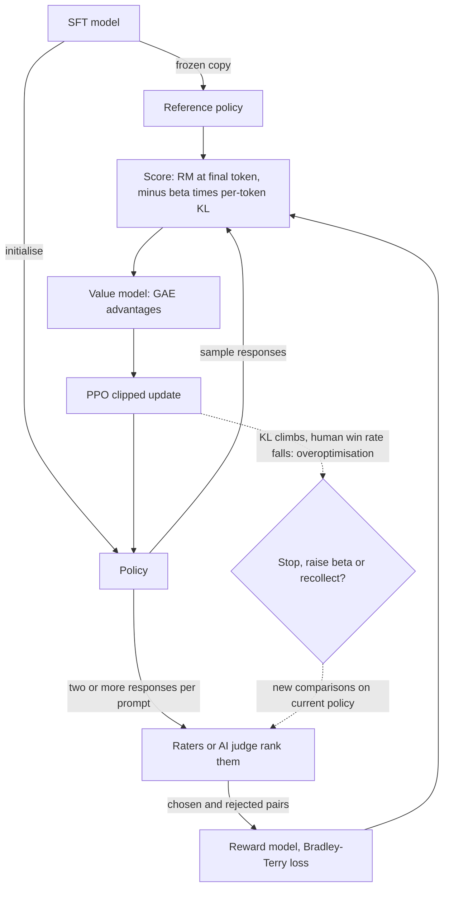

## TL;DR
RLHF trains a reward model on human "which is better" comparisons, then uses RL (usually PPO) to push
the model toward high-scoring responses, with a KL penalty to the SFT model. Its central hazard: the
policy learns to exploit the reward model's errors.

## Why it exists
- **SFT cannot rank.** After SFT a model answers in the right format, but the demonstration it imitated
  is one of many acceptable answers; it cannot know a confident wrong answer is worse than a careful
  right one.
- **Comparing is easier than writing.** Perfect demonstrations are slow, and annotators' own answers are
  often worse than the model's. People agree with each other on comparisons much more than on what the
  ideal response is.
- **A comparison is not a next-token target**, only a scalar notion of goodness. That is an RL problem:
  the model is a *policy* emitting a response (an action sequence), the environment returns a *reward*,
  the objective is expected reward.
- **The recipe has a lineage.** Christiano et al. showed it in 2017 for control tasks: fit a reward model
  to comparisons, optimise the policy, keep collecting comparisons on the new policy. Stiennon et al. and
  InstructGPT applied it to language: the jump from "completes text" to "helps".
- **The reward model amortises human labels.** PPO scores hundreds of thousands of samples or more per
  run, far beyond what raters could label. Tens of thousands of comparisons train a model that scores
  every sample for free. The price: it is wrong in places, and the policy will find them.

## How it works
### Step 1: collect comparisons
1. Sample prompts from the target distribution.
2. The current policy generates two or more responses per prompt.
3. Raters pick the better one, or rank several; rankings are decomposed into pairs.

- **Rater engineering is a large part of the work:** guidelines, calibration sessions and agreement
  measurement, because a reward model trained on inconsistent labels learns noise.

### Step 2: train the reward model
- **Architecture:** r_φ(x, y) is often the SFT model (or a smaller sibling, as in InstructGPT) with its
  output head replaced by a scalar head; it reads prompt and response and emits one number.
- **Loss:** Bradley–Terry pairwise, which says the probability y_w beats y_l is the sigmoid of their score
  difference:

```
L_RM(φ) = − E_(x, y_w, y_l) [ log σ( r_φ(x, y_w) − r_φ(x, y_l) ) ]
```

- **Only differences matter**, so the reward scale is arbitrary; implementations often normalise it.
- **Why this loss:** it models the data you have (comparisons) rather than absolute scores nobody gave
  you.
- **Why start from SFT:** the reward model must judge the kind of text the policy produces, and a model
  already representing that distribution learns the judgement from far fewer comparisons.
- **Measure it** as accuracy on held-out comparison pairs, read against inter-annotator agreement on the
  same pairs: a reward model cannot meaningfully beat the rate at which humans agree with each other.

### Step 3: optimise the policy with PPO
Expected reward with a KL penalty to the reference policy π_ref (the SFT model):

```
J(θ) = E_x E_y~π_θ [ r_φ(x, y) − β · KL( π_θ(·|x) ‖ π_ref(·|x) ) ]
```

**Reward shaping.** The KL term is applied per token as a shaped reward
(−β·[log π_θ(y_t|·) − log π_ref(y_t|·)]); the reward model's score is added at the final token, because
it judges the finished response and says nothing about individual tokens.

**Credit assignment.** Which of 300 tokens earned the score? PPO uses a learned *value model* V(s_t)
that predicts the eventual return from each prefix:
1. TD error `δ_t = r_t + V(s_{t+1}) − V(s_t)`: did token t make the outcome look better or worse than
   expected?
2. Generalised advantage estimation sums these with a decay: `A_t = Σ_k (γλ)^k · δ_{t+k}`. γ is usually 1
   for text; λ trades bias against variance.

**The PPO loop:**
1. Sample responses from the current policy.
2. Compute rewards, then advantages.
3. Update the policy with the clipped surrogate `min(ρ·A, clip(ρ, 1−ε, 1+ε)·A)`, where ρ is the ratio of
   new to old token probabilities.

- **Why clip:** policy-gradient steps on sampled text are high-variance; the clip stops any one batch
  moving the policy too far.
- **PPO-ptx:** InstructGPT also mixed in pre-training gradients to limit the capability loss they called
  the alignment tax.

### Why the KL penalty is not optional
- **The reward model is accurate near its training data** and increasingly wrong far from it.
- **An unconstrained policy climbs into high-score, low-quality regions:** longer and longer answers,
  flattery, repeated keywords, an authoritative tone regardless of correctness, or gibberish that happens
  to score well.
- **Gao et al. measured this *overoptimisation*:** as KL from the reference grows, proxy reward keeps
  rising while true reward peaks and then falls.
- **β sets how far you let it go.** Tune it against held-out human evaluation, not against the reward
  model.

### What is running during training
| Network | State | Role |
|---|---|---|
| Policy | trained | generates responses |
| Reference | frozen copy | KL penalty |
| Reward model | frozen | scores finished responses |
| Value model | trained | per-prefix return estimate for advantages |

- **Memory and orchestration are the burden:** several copies of a large policy's weights, optimiser
  state for two of them, and a fast generation loop, because sampling dominates wall-clock time.
- **This cost is the main reason DPO and GRPO exist.**

### Iteration and rejection sampling
- **Iterate because the reward model is trusted only near its data:** after a PPO round, sample from the
  new policy, collect new comparisons, retrain the reward model, repeat.
- **Rejection sampling fine-tuning is the cheaper cousin:** sample k responses, keep the top-scored, SFT
  on those. Same reward model, no RL machinery, and often the first round before PPO.

### Where the comparisons come from
- **"Human feedback" is increasingly partly AI feedback.** In RLAIF a strong model ranks pairs against
  written principles (the idea behind Constitutional AI); humans label a smaller slice to audit the
  judge.
- **The rest of the pipeline is unchanged**, but the judge's biases (for length, for its own style)
  become the reward model's biases, so the audit slice is not optional.

## Diagram
The three steps as one loop: comparisons train the reward model, PPO optimises the policy against it
under a KL leash, and fresh comparisons on the new policy restart the cycle.



## Examples
### Reward-model loss and PPO reward shaping
The two numerical pieces that make RLHF concrete. Shapes are for one prompt with two candidate responses.

```python
import torch, torch.nn.functional as F

# --- Reward model training step: Bradley-Terry loss on one (chosen, rejected) pair ---
def rm_loss(score_chosen, score_rejected):
    # score_* : [batch] scalars from the reward head at the final token
    return -F.logsigmoid(score_chosen - score_rejected).mean()

s_w, s_l = torch.tensor([1.3]), torch.tensor([0.4])
print("RM loss:", rm_loss(s_w, s_l).item())          # 0.341 ; falls as the gap widens

# --- PPO reward shaping for one sampled response of T tokens ---
beta = 0.05
logp_policy = torch.tensor([-2.1, -0.4, -1.7, -0.9, -0.3])   # log pi_theta(y_t | x, y_<t)
logp_ref    = torch.tensor([-2.0, -0.6, -1.5, -0.9, -2.1])   # log pi_ref(y_t | x, y_<t)
rm_score    = 0.8                                            # r_phi(x, y) for the whole response

per_token_kl = logp_policy - logp_ref                        # positive where policy drifted up
rewards = -beta * per_token_kl                               # KL penalty at every token ...
rewards[-1] += rm_score                                      # ... plus the RM score at the end
print("shaped rewards:", rewards.tolist())                   # [0.005, -0.01, 0.01, 0.0, 0.71]
print("sequence KL estimate:", per_token_kl.sum().item())    # 1.7 ; watched as a drift gauge
# PPO then computes advantages from these rewards with a value model and applies the clipped
# surrogate objective to the policy's token log-probs. If the KL estimate climbs while held-out
# human win-rate stalls, beta is too low: the policy is optimising the reward model's mistakes.
```

- **The last token carries a large KL penalty.** Its log-ratio is +1.8: the policy puts about six times
  (e^1.8) more mass on it than the reference, so −β·1.8 ≈ −0.09 is subtracted from the 0.8 reward-model
  score at that position.
- **A few tokens drifted far up is the exploitation pattern**, which is why per-token KL, not just the
  final score, is logged during training.
- **Single-sample log-ratios can be negative** on individual tokens (tokens 1 and 3 above, where the
  policy moved down). Only the sum or expectation over a sequence estimates the KL, so the sequence-level
  number is the one watched.

### From shaped rewards to advantages (GAE)
The next step PPO takes with those rewards, in pure Python. The value estimates are illustrative.

```python
def gae(rewards, values, gamma=1.0, lam=0.95):
    """Advantages A_t = sum_k (gamma*lam)^k * delta_{t+k}, computed backwards."""
    adv, running = [0.0] * len(rewards), 0.0
    for t in reversed(range(len(rewards))):
        next_v = values[t + 1] if t + 1 < len(values) else 0.0   # terminal state is worth 0
        delta = rewards[t] + gamma * next_v - values[t]           # TD error for token t
        running = delta + gamma * lam * running
        adv[t] = running
    return adv

rewards = [0.005, -0.01, 0.01, 0.0, 0.71]   # shaped rewards from the example above
values  = [0.60, 0.62, 0.61, 0.64, 0.66]    # value model's guess of the return at each prefix
print([round(a, 3) for a in gae(rewards, values)])
# [0.1, 0.079, 0.104, 0.067, 0.05]  every token gets credit for the final score,
# scaled by how much better than expected the outcome turned out from that prefix
```

- **The final score reaches early tokens** only through the value model: a bad value model gives noisy
  advantages, which is one reason PPO for LLMs is fragile and why GRPO drops it.

## Production patterns
- **Early-stop on human win rate, not reward.** Run a held-out human or strong-judge win-rate eval at
  fixed step intervals and plot it against sequence KL from the reference. Keep the checkpoint at the KL
  where win rate peaks; alert when proxy reward rises while win rate is flat.
- **Gate the reward model before PPO.** Measure accuracy on held-out comparison pairs and on fresh samples
  from the current policy, and compare it with inter-annotator agreement on the same pairs. Do not start
  RL when accuracy on the new policy's outputs is far below the in-distribution number.
- **Watch length as an exploit signal.** Log mean response length and reward-versus-length correlation
  every round. If length creeps up, add a length penalty to the reward or use length-controlled win
  rates, and re-check rater guidelines for a verbosity preference.
- **Run best-of-n rejection sampling as round one.** Sample several responses per prompt, keep the top
  reward-model score, and SFT on them before setting up PPO. Monitor the reward gap between best and
  median sample; when it shrinks, the cheap round has done its work.
- **Use an established RL stack.** Libraries such as Hugging Face TRL (`RewardTrainer`, PPO trainer) or
  OpenRLHF provide the four-model orchestration and generation loop. Still log per-token KL, value loss,
  clip fraction and reward per step, because default hyperparameters do not transfer between models.

## Trade-offs
- **Learned reward vs off-distribution error.** It lets you optimise against millions of samples from tens
  of thousands of human labels, but is wrong off-distribution, so the gain reverses once the policy
  drifts past its data.
- **On-policy PPO vs cost.** PPO adapts as the policy improves and can reach behaviours no demonstration
  contains, at the cost of four models in memory, a sampling loop and fragile hyperparameters. DPO wins
  when the dataset is fixed and the budget small.
- **Low vs high KL coefficient.** Low allows bigger behaviour changes and faster reward gains; high
  preserves capability. The right value flips with how trustworthy the reward model is far from its data.
- **Separate vs single reward models.** Separate helpfulness and safety models allow explicit trade-offs
  but need a combination rule and twice the comparison data. A single model is simpler and wins when the
  goals rarely conflict on your prompts.

## Pitfalls
- **Trusting the reward model's score as success.** Symptom: rising proxy reward with flat or falling
  human win rate, the overoptimisation signature.
- **Length and sycophancy bias in comparisons.** Raters prefer longer, more agreeable answers, so the
  policy learns verbosity and flattery, visible as answer length creeping up round over round.
- **Noisy or inconsistent labels.** Low inter-annotator agreement yields a reward model that cannot
  separate good from bad, and PPO then optimises noise.
- **Reusing a reward model after the policy moved.** Trained on an old policy's comparisons, it is
  confidently wrong on the new policy's typical outputs.
- **Treating PPO hyperparameters as defaults.** A too-large clip range or learning rate shows up as sudden
  KL spikes and a collapse into repetitive text within a few hundred steps.

## When to use
- **Use when** demonstrations cannot express what you want, you can collect reliable comparisons on your
  own prompt distribution, and you have the engineering capacity to run and monitor an RL loop.
- **Prefer for most application teams:** DPO on the same comparison data, or rejection sampling with a
  reward model; reserve full PPO for cases where on-policy iteration clearly pays.
- **Measure** with human or strong-judge win rates on held-out prompts, track KL from the reference, and
  run a general capability suite to catch the alignment tax.
- **Interviews:** draw the three stages, write the Bradley–Terry loss, explain why the KL penalty exists,
  and describe reward overoptimisation and how you would detect it.

## Role lens
- **Engineer:** Implements comparison collection, trains and validates the reward model on held-out
  pairs, and watches KL, reward and win-rate curves together during PPO.
- **Architect:** Decides whether on-policy RL is justified over DPO or rejection sampling given the
  data, compute and evaluation budget, and owns the safety-versus-helpfulness reward policy.
- **FDE:** Runs the rater calibration with a customer's domain experts, measures agreement, and
  explains why the reward model, not the GPUs, is the component that decides what the model becomes.

## Check yourself
**Q:** During PPO, the reward model's average score on sampled responses rises steadily for a thousand
steps, but a weekly human evaluation shows win rate against the SFT model peaked at step 300 and has
since fallen. What is happening, how do you confirm it, and what do you change?
**A:** This is reward overoptimisation: the policy has moved into regions where the reward model
overestimates quality, so the proxy rises while real quality falls. I would confirm by plotting the KL
from the reference over steps and checking that the human win rate peaks at a particular KL and
declines beyond it, and by inspecting samples for the usual exploits, such as growing length,
flattery, or repeated phrasing. Remedies: raise the KL coefficient or stop at the KL where human
evaluation peaked; collect fresh comparisons on the current policy's outputs and retrain the reward
model so it is accurate where the policy now lives; consider a reward ensemble or a length penalty if
the exploit is identifiable. The deeper fix is institutional: never gate releases on the reward model's
own score.

## Interview questions
### Walk me through RLHF end to end. Why does each piece exist?
- **Comparisons:** raters rank responses, because comparing is easier and more consistent than writing
  ideal answers.
- **Reward model:** trained with the Bradley–Terry loss, it amortises tens of thousands of labels over
  every sample PPO generates.
- **PPO with a KL penalty:** maximises reward while staying near the SFT reference, because the reward
  model is only trustworthy near its training data.

### Why does PPO for LLMs need a value model, and what goes wrong when it is poor?
- **Credit assignment:** the reward arrives once at the final token, so a value model V(s_t) estimates the
  return from each prefix to compute TD errors and GAE advantages.
- **A poor value model gives noisy advantages**, so updates push on the wrong tokens and training becomes
  fragile.
- **That cost and fragility** is one reason GRPO drops the value model and uses group-relative rewards.

### When would you not run full PPO, even though you have comparison data?
- **When the dataset is fixed and the budget small:** DPO on the same pairs avoids four models in memory
  and a sampling loop.
- **When a cheaper round suffices:** best-of-n rejection sampling plus SFT uses the same reward model
  without RL machinery.
- **PPO pays** when on-policy iteration clearly helps, you can keep collecting comparisons, and the team
  can monitor an RL loop.

### Your answers get longer every RLHF round. Diagnose and fix it.
- **It is a reward exploit:** raters and reward models often prefer longer answers, so the policy learns
  verbosity.
- **Confirm** by logging mean length and the correlation between reward and length per round.
- **Fix** with a length penalty or length-controlled win rates, tighten rater guidelines, and raise β if
  KL from the reference is also climbing.

### How do you know the reward model is good enough to start PPO?
- **Held-out pair accuracy** compared with inter-annotator agreement on the same pairs, because it cannot
  meaningfully beat how often humans agree.
- **Accuracy on fresh samples from the current policy**, since that is where PPO will query it.
- **Do not start** if accuracy on the new policy's outputs is far below the in-distribution number.

## Quiz
### Q: Why does RLHF train a reward model instead of optimising the policy directly on human ratings?
- [ ] Human ratings are not differentiable, but a neural reward model is
- [x] RL scores far more sampled responses than raters could label; the reward model amortises tens of thousands of human comparisons over all of them
- [ ] PPO can only consume scalar rewards from a network of the same size as the policy
- [ ] Humans cannot compare responses reliably
> Policy-gradient methods are sample-hungry. A reward model turns a modest number of human comparisons
> into a function that can score every sampled response for free, which is the only way the RL loop
> is affordable. Differentiability is irrelevant: PPO does not backpropagate through the reward.

### Q: What does the Bradley-Terry loss −log σ(r(x,y_w) − r(x,y_l)) assume about the data?
- [ ] That each response has an absolute quality score from 0 to 1
- [ ] That rewards are normally distributed across prompts
- [x] That the probability one response beats another is a sigmoid of their score difference, so only differences matter
- [ ] That the chosen response is always correct
> The loss models comparisons, not absolute scores, which matches the data raters actually produce.
> Because only differences enter, the reward scale is arbitrary and implementations normalise it.

### Q: A team sets the KL coefficient β to zero to "let the model improve freely". What is the most likely result?
- [ ] Training diverges immediately because the gradients explode
- [ ] The model stops changing, because there is no penalty to push against
- [x] Proxy reward rises while real quality degrades into verbose, repetitive or sycophantic outputs that exploit the reward model
- [ ] The reward model is retrained automatically to compensate
> Without the leash the policy climbs the reward model's surface into regions far from its training
> data where its scores are unreliable. The classic exploits are length, flattery and degenerate text
> that happen to score well.
