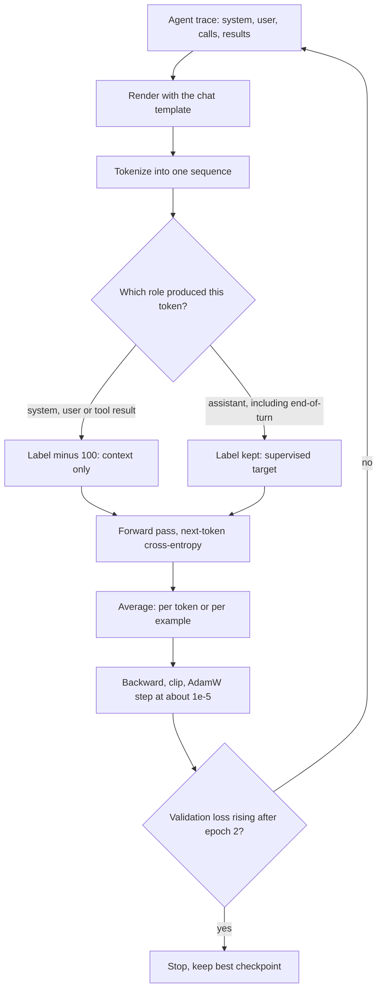

## TL;DR
SFT trains a model on demonstrations, for agents usually tool-calling traces, with next-token loss on
the assistant turns only. It is the cheapest, most predictable way to install a tool-call format or
procedure, but it can only imitate, never rank answers.

## For agent builders
- **Why it matters for agents.** SFT on successful agent traces (assistant tool calls and final answers,
  with tool results as context) is the standard first step when an open-weight model keeps getting your
  tool-call format, argument schema or stop behaviour slightly wrong.
- **Where it shows up in your stack.** TRL's `SFTTrainer` and `SFTConfig`, the tokenizer's
  `apply_chat_template` with a `tools` list, LoRA adapters served next to a base model, and hosted
  fine-tuning APIs that accept chat-format JSONL with tool calls.
- **What you control.** Which traces to keep (only successful, verified ones), what is masked (system,
  user and tool results), the chat template parity between training and serving, learning rate, epochs
  and a general-data replay slice.
- **What you can skip.** Writing the training loop by hand. Learn the masking rule and the template
  contract well enough to audit a trainer; let the library do the rest.

## Why it exists
- **Prompting is not enough for strict behaviour.** The prompt is re-sent every call, drifts on edge
  cases, and cannot install what the base does not already do. "Open with a one-line summary, cite a
  source id, never exceed 120 words": a prompt gets most of the way most of the time; a fine-tune gets
  there every time with a shorter prompt. In an agent the long prompt is re-sent on every step.
- **Continued pre-training teaches the wrong thing.** It learns the *distribution* of your documents, not
  how to answer about them: continued-pre-trained on support tickets, a model produces more support
  tickets.
- **You want a conditional.** Given this prompt (and these tool results), produce this response or this
  tool call. SFT frames data as (prompt, response) pairs and masks the loss so the prompt is context
  rather than target.
- **Quality beats quantity.** LIMA showed about a thousand carefully written demonstrations can turn a
  strong base into a capable assistant; quality and diversity matter more than count. SFT chooses which
  existing behaviours to surface, and noisy data (failed or lucky agent runs) surfaces noisy behaviour.

## How it works
### Data format and the chat template
- **Each example is a conversation:** optional system message, one or more user turns, and the assistant
  turns you want produced. Agent traces add assistant tool calls and tool-result turns in between.
- **A chat template renders it** into one token sequence with special tokens marking each role, for
  example `<|im_start|>assistant ... <|im_end|>`, and its own wrapping for tool definitions and calls.
- **The template is part of the model's contract.** Train with one and serve with another and the model
  will not recognise where it is supposed to speak, or how a tool call should look to your parser.

### Loss masking
1. Score the sequence with next-token cross-entropy exactly as in pre-training.
2. Set labels for prompt and system tokens to an ignore value (−100 in PyTorch), so gradients flow only
   from assistant tokens.
3. In multi-turn data, every assistant turn is a target and every earlier turn is context. In agent
   traces, tool results are context too: the model should read them, not learn to invent them.

- **Why mask:** the model should not spend capacity predicting user questions, and in multi-turn data user
  turns are often noisy or adversarial. Tool output (JSON, logs, HTML) is long and would dominate the loss.
- **Keep the end-of-turn token supervised.** `<|im_end|>` above (or the model's EOS) must sit *inside*
  the supervised span. It is the only thing that teaches the model to stop; mask it with the prompt and
  the model rambles past its answer into an invented next turn, or invents a tool result after its call.

### How the loss is averaged
Masked examples contribute very different numbers of supervised tokens, say a 20-token and a 600-token
answer in one batch.

| Rule | Weights each | Effect when lengths are skewed |
|---|---|---|
| Average over all supervised tokens (default in most trainers) | *token* equally | long responses dominate; over-trains the long-form style |
| Average per example first | *conversation* equally | short answers get equal say |

- **Neither is wrong, but the choice changes what the model learns.** For agents, short tool calls can be
  drowned out by long final answers under token averaging.
- **Gradient accumulation can silently mix the two:** code that averages per micro-batch, then across
  micro-batches, is neither rule. Check what your trainer does before comparing runs.

### Where demonstrations come from
- **Human-written:** the gold standard, but scarce.
- **Distilled:** a stronger model drafts responses (or runs the agent), humans or filters reject the bad
  ones, the student trains on the survivors. Most practical SFT sets are partly this.
- **Rejection-sampling fine-tuning:** sample several responses or trajectories from the model itself and
  keep those a verifier or reward model scores best, such as runs whose task check passed.
- **All three are still SFT;** only target provenance changes, and the student inherits whatever errors
  survive the filter.

### Full fine-tuning versus parameter-efficient
| | Full SFT | LoRA / QLoRA |
|---|---|---|
| What trains | every weight | small adapters on a frozen base |
| Memory | about 16 bytes per parameter (weights, gradients, AdamW state, mixed precision): a 7B model needs over 100 GB before activations | fits a single GPU |
| Prefer when | target behaviour is far from the base, or data is large | many variants (one adapter per agent or tenant) or a small budget |
| Cost | hardware | some limit on how far behaviour can move |

### Hyperparameters that actually matter
- **Learning rate.** Far smaller than pre-training: roughly 1e-5 to 2e-5 for full fine-tuning of a
  7B-class model, around ten times higher for LoRA adapters. Too high and the model forgets general
  capability within a few hundred steps.
- **Epochs.** Usually one to three. Small sets are easy to memorise; rising validation loss after epoch
  two is the usual signal to stop.
- **Sequence packing.** Concatenate short examples to fill the context window so no compute is wasted on
  padding. Either reset position ids and mask attention across example boundaries, or accept small
  cross-contamination; naive packing lets one example attend to its neighbour.
- **Mixing in general data.** A slice of broad instruction data alongside domain examples prevents the SFT
  form of catastrophic forgetting.

### What SFT can and cannot teach
- **Strong at:** format, register, length, persona, well-specified procedures, domain terminology, and
  tool-call syntax and argument conventions.
- **Weak where the demonstration is one of many acceptable answers.** It never sees a worse answer, so it
  cannot learn that a confident, fluent, wrong answer (or a needless extra tool call) is worse.
- **It can teach hallucination.** Demonstrations containing facts the base does not know teach it to
  produce facts in that style whether or not it knows them.
- **So keep demonstrations consistent with the base's knowledge**, or grounded in context provided in the
  prompt, which for agents means facts that appear in a tool result earlier in the trace.

## Diagram
Trace one agent trace through a training step: the chat template and the mask decide which tokens the
loss sees; tool results stay context, and the end-of-turn token must land on the supervised side.



## Examples
### One masked SFT step on a tool-calling trace
Render the trace with its tools, supervise only the assistant turns (the tool call and the final answer),
and leave the tool result as context. Trainers such as TRL's `SFTTrainer` wrap this with batching,
packing and checkpointing.

```python
import torch, torch.nn.functional as F
from transformers import AutoModelForCausalLM, AutoTokenizer

name = "Qwen/Qwen2.5-0.5B-Instruct"                    # its template renders tools and tool turns
tok = AutoTokenizer.from_pretrained(name)
model = AutoModelForCausalLM.from_pretrained(name, torch_dtype=torch.bfloat16).cuda()
opt = torch.optim.AdamW(model.parameters(), lr=1e-5, weight_decay=0.0)

tools = [{"type": "function", "function": {"name": "get_order", "description": "Look up an order",
          "parameters": {"type": "object", "properties": {"order_id": {"type": "string"}},
                         "required": ["order_id"]}}}]
trace = [
    {"role": "system", "content": "You are a support agent. Look orders up before answering."},
    {"role": "user", "content": "Where is order A-1042?"},
    {"role": "assistant", "tool_calls": [{"type": "function", "function":
        {"name": "get_order", "arguments": {"order_id": "A-1042"}}}]},
    {"role": "tool", "name": "get_order", "content": '{"status": "shipped", "eta": "2026-10-25"}'},
    {"role": "assistant", "content": "Order A-1042 has shipped and should arrive on 25 October."},
]
def render(msgs, gen=False):
    return tok.apply_chat_template(msgs, tools=tools, tokenize=False, add_generation_prompt=gen)

ids = tok(render(trace), return_tensors="pt").input_ids.cuda()       # [1, T]
labels = torch.full_like(ids, -100)                                   # all context by default
for i, m in enumerate(trace):
    if m["role"] != "assistant":
        continue                                  # system, user and tool results stay masked
    start = len(tok(render(trace[:i], gen=True)).input_ids)   # assumes each rendered prefix is an
    end = len(tok(render(trace[:i + 1])).input_ids)           # exact token prefix of the full trace
    labels[:, start:end] = ids[:, start:end]                  # includes this turn's end-of-turn token

logits = model(input_ids=ids).logits
loss = F.cross_entropy(logits[:, :-1].reshape(-1, logits.size(-1)).float(),
                       labels[:, 1:].reshape(-1), ignore_index=-100)
loss.backward(); torch.nn.utils.clip_grad_norm_(model.parameters(), 1.0)
opt.step(); opt.zero_grad()
print(f"trained on {(labels != -100).sum().item()} of {ids.numel()} tokens, loss {loss.item():.3f}")
print(tok.decode(ids[0][labels[0] != -100]))          # should show only the call and the answer
```

- **What it achieves:** with a few thousand such traces, two epochs and a cosine schedule, the model
  learns to call `get_order` before answering and to answer in the house voice.
- **Read the printed count critically.** System prompt, tool schemas, question, tool result and role
  markers are context; only the call, the answer and their end-of-turn markers are targets, so expect a
  small share of the sequence in agent traces.
- **Count equals full length:** masking is off.
- **Count is zero:** the span lengths came from a different template and every label is −100, which
  trains nothing useful while the loop runs without error. In plain PyTorch the mean over zero targets
  is NaN, so a `nan` loss is the tell; do not let that step update the weights.
- **One-minute test for both:** decode `ids[0][labels[0] != -100]` back to text and eyeball it. Templates
  that rewrite earlier turns (some strip old reasoning) break the prefix assumption, and this decode shows
  it.

### Worked numbers: loss averaging and memory
The two silent budget questions before a run, as pure Python you can rerun:

```python
def batch_weights(lengths):
    """Share of the gradient each example gets under the two averaging rules."""
    total = sum(lengths)
    token_avg = [n / total for n in lengths]          # every supervised token counts once
    example_avg = [1 / len(lengths)] * len(lengths)   # every conversation counts once
    return token_avg, example_avg

tok, ex = batch_weights([20, 600])                    # a short tool call and a long answer
print([f"{w:.1%}" for w in tok], [f"{w:.1%}" for w in ex])
# ['3.2%', '96.8%'] ['50.0%', '50.0%']

def full_ft_gb(params, bytes_per_param=16):          # weights + grads + AdamW state, mixed precision
    return params * bytes_per_param / 1e9

print(full_ft_gb(7e9))                                # 112.0 GB before activations
```

| Question | Answer | Consequence |
|---|---|---|
| Who drives the gradient in a batch of a 20- and a 600-token answer? | the long one, ~97% under token averaging | a set with many long answers pulls the model toward long-form style and under-trains short tool calls |
| Does full SFT of a 7B model fit one 80 GB GPU? | no, ~112 GB before activations | shard across GPUs, or use LoRA/QLoRA |

### Worked scenario: building an SFT set from agent logs
Illustrative numbers for a team distilling a hosted model's agent runs into an open-weight 7B agent.

| Step | Count | Why |
|---|---|---|
| Logged agent runs | 40,000 | raw material from the hosted teacher |
| Task check passed (end state verified) | 26,000 | failed runs would teach failure |
| Deduplicated by intent and tool sequence | 9,000 | near-copies over-train common paths |
| Held out by intent group | 1,000 | measures generalisation, not recall |
| Training traces | 8,000 | two epochs, LoRA, plus a general-data slice |

Gate: valid tool-call rate and task success on the held-out intents, plus a general capability suite,
compared against the prompted baseline.

## Production patterns
- **Train only on verified trajectories.** Keep agent runs whose end state a check confirmed, not runs
  that merely ended. Monitor the share of kept traces per tool and intent, so one easy path does not
  dominate the set.
- **Assert the mask on every run.** At data-load time, decode the supervised span of a few examples and
  log the supervised-token count per batch. Fail the job if any batch has zero supervised tokens or a
  count equal to its full length, and check that the end-of-turn token is inside the span and tool
  results are outside it.
- **Let the trainer do assistant-only loss and packing.** In recent TRL versions, set
  `SFTConfig(assistant_only_loss=True, packing=True)` for conversational data rather than hand-rolling
  masks. Assistant-only loss needs a chat template that marks assistant spans with generation tags, so
  confirm yours does. Monitor the same supervised-token count, because a template change can silently
  break span detection.
- **Keep the best checkpoint by validation loss.** Evaluate every epoch (or every few hundred steps) on
  held-out prompts and use `load_best_model_at_end=True` with `metric_for_best_model="eval_loss"` in
  Hugging Face `TrainingArguments`, with matching eval and save strategies. Monitor validation loss for
  the upturn that signals memorisation.
- **Replay general instruction data.** Mix a slice of broad instruction data into every epoch alongside
  domain traces. Monitor a general capability benchmark before and after each round; a drop means the
  replay slice is too small.
- **Split held-out data by topic, not row.** Group examples by product area, intent or tool sequence and
  hold out whole groups, so the eval measures generalisation rather than paraphrase recall. Gate releases
  on held-out task success, never on training loss.

## Trade-offs
- **Precise control vs data cost.** Demonstrations control format and style precisely, but are the most
  expensive data per example in post-training. That flips in your favour only when a strong model can
  draft them (or run the agent) for human or programmatic review.
- **Full fine-tuning vs LoRA.** Full moves behaviour furthest and handles large datasets; LoRA fits one GPU
  and gives swappable adapters, but loses when the target distribution is far from the base.
- **More epochs vs overfitting.** More epochs fit the demonstrations better but overfit sooner; the gain
  reverses once validation loss turns upward, typically between epochs two and three on small sets.
- **Assistant-only loss vs signal per example.** It focuses capacity on the wanted behaviour, but very
  short responses (a single tool call) give few supervised tokens per example, so you need more examples
  or longer responses.
- **Fine-tuned agent vs prompted frontier model.** A tuned small model is cheaper and faster per step, but
  you own retraining whenever tools or schemas change; a prompted model absorbs a new tool with a schema
  edit.

## Pitfalls
- **Serving with a different chat template from training.** Symptom: the model ignores the system prompt,
  answers as the user, never emits the end-of-turn token, or emits tool calls your parser rejects.
- **Forgetting to mask the prompt.** Symptom: suspiciously low training loss (it learns to predict easy
  prompt text) and a model that generates user questions.
- **Supervising tool results.** Symptom: the agent writes a plausible tool result itself instead of
  waiting for the real one. Fix: mask tool turns as context.
- **Fine-tuning on facts the base does not know.** Symptom: confident hallucination in the same style on
  unrelated questions, because it learned "state facts fluently" rather than the facts.
- **Skipping a general-data mix.** Symptom: excellent on the domain eval, measurably worse on general
  reasoning or coding benchmarks after a single round.
- **Judging success by training loss.** Low loss on memorised examples says nothing about generalisation;
  hold out prompts by topic, not just by row.
- **Masking the end-of-turn token with the prompt.** Symptom: the model answers correctly, then keeps
  going, generating a fake user turn or repeating itself until the token limit.

## When to use
- **Use when** the behaviour is consistent and describable by examples: a fixed output schema, a tone, a
  domain vocabulary, a procedure, or a tool-calling convention that prompting keeps getting slightly
  wrong.
- **Avoid when** injecting knowledge that changes weekly; retrieval does that better and stays auditable.
- **Baseline first:** measure how far prompting plus a few-shot examples gets you; the fine-tune must beat
  that net of its maintenance cost.
- **Measure during the work:** validation loss, a held-out task metric (task success, valid tool-call
  rate) and a general capability benchmark, together.
- **Interviews:** explain loss masking, why the learning rate is tiny, and why SFT alone cannot fix
  "fluent but wrong".

## Role lens
- **Engineer:** Writes the data pipeline that renders conversations through the chat template, masks
  prompts, packs sequences and tracks the supervised-token count per batch as a sanity check.
- **Architect:** Decides whether a fine-tuned model is worth owning versus a prompt, including who
  re-trains it when the base model or the format changes.
- **FDE:** Turns a customer's best human responses into demonstrations, negotiates the review process
  that keeps them consistent, and sets expectations that a few thousand good examples beat a hundred
  thousand scraped ones.

## Check yourself
**Q:** After SFT on 20,000 customer-service transcripts, the model's training loss is very low but it
frequently makes up product features that do not exist, and it sometimes continues the conversation by
writing the customer's next message. What went wrong, and how would you fix each symptom?
**A:** Two separate bugs. Writing the customer's next turn means the loss was not masked to assistant
tokens, so the model learned to generate user turns too; fix by setting prompt and user labels to the
ignore index and checking the supervised-token count per batch. Invented features point to data
content: transcripts contain facts the base model never saw, so SFT taught it to assert product facts
fluently without grounding. Fix by grounding responses in retrieved documentation placed in the prompt
so the demonstrations show "answer from the provided context", filtering transcripts with unverifiable
claims, and following up with preference pairs that penalise invented details. The low training loss is
consistent with both problems, which is why a held-out task metric, not loss, should gate the release.

## Interview questions
### What is SFT, and how does it differ from continued pre-training on the same data?
- **SFT learns a conditional:** given this prompt, produce this response, with loss on response tokens
  only because the prompt is masked as context.
- **Continued pre-training learns the distribution** of your documents: trained on support tickets, a
  model produces more support tickets rather than answers to them.
- **So pick SFT** when you want a format, persona or procedure, and continued pre-training when the
  domain vocabulary itself is unfamiliar.

### You are fine-tuning a 7B model on agent traces. Which tokens do you supervise, and why?
- **Assistant turns only:** the tool calls (name and arguments) and the final answer, each with its
  end-of-turn token so the model learns to stop after a call.
- **Mask system, user and tool results**, because the model must read tool output, not learn to invent
  it, and long JSON results would otherwise dominate the loss.
- **Verify it** by decoding the supervised span of a few traces and failing the job on zero or full-length
  counts.

### Offline evals looked great, but in production the fine-tuned model ignores the system prompt. What do you check?
- **Template parity first.** If the serving stack renders a different chat template from training (or a
  client builds raw strings), the model does not recognise where the system turn is.
- **Compare token ids, not text:** render one training example with the saved tokenizer's
  `apply_chat_template` and diff it against a logged production request.
- **Then check the data:** if every demonstration used the same fixed system prompt, the model never
  learned that changing it should change behaviour; vary system prompts in the training set.

### When would you choose LoRA over full fine-tuning, and when not?
- **LoRA when** budget is one GPU or you need many swappable variants on one base, such as one adapter
  per agent or tenant.
- **Full fine-tuning when** the target behaviour is far from the base or the dataset is large, because
  adapters limit how far behaviour can move.
- **Memory decides fast:** full SFT needs about 16 bytes per parameter, so a 7B model needs about 112 GB
  before activations, more than one 80 GB GPU.

### Your batch mixes 20-token and 600-token answers. Why does that matter?
- **Under token averaging** (the default in most trainers) the long answer gets about 97% of the gradient.
- **The model drifts toward long-form style** if long answers are common in the set, and short tool calls
  get little say.
- **Per-example averaging** gives each conversation an equal 50% say; pick deliberately and check that
  gradient accumulation does not silently mix the two rules.

### How much data and what hyperparameters would you start with for a style fine-tune of a 7B model?
- **Data:** LIMA showed about a thousand carefully written demonstrations can be enough; quality and
  diversity matter more than count.
- **Learning rate:** roughly 1e-5 to 2e-5 for full fine-tuning, around ten times higher for LoRA.
- **Epochs:** one to three, stopping when validation loss turns up, with a general-data slice mixed in to
  prevent forgetting.

## Quiz
### Q: Why are the prompt tokens masked out of the SFT loss?
- [ ] To reduce the memory used by the backward pass
- [x] So the model learns to produce the response conditioned on the prompt rather than to predict the prompt itself
- [ ] Because prompt tokens are already encoded in the KV cache
- [ ] To prevent the model from seeing the system prompt
> The prompt is context, not a target. Training on it wastes capacity on predicting user text and, in
> multi-turn data, teaches the model to generate user turns, which shows up as the model continuing the
> conversation on the user's behalf.

### Q: Which learning rate is a sensible starting point for full fine-tuning a 7B model with SFT?
- [ ] 3e-4, the usual pre-training peak
- [ ] 1e-2, because the dataset is small and needs fast learning
- [x] About 1e-5 to 2e-5, far below pre-training
- [ ] 1e-7, to avoid any change to the base weights
> Fine-tuning starts from a good solution and must not destroy it. Learning rates near pre-training
> levels cause rapid forgetting of general capability; rates that are too low fail to move the behaviour
> in the few thousand steps available.

### Q: A team wants the model to stop giving confident wrong answers and prefer hedged correct ones. Why is SFT the wrong tool on its own?
- [ ] SFT cannot change the tone of responses
- [ ] SFT requires more data than preference methods
- [x] SFT only ever sees the demonstrated answer, so it cannot learn that one fluent answer is worse than another
- [ ] Hedging requires a larger context window
> Imitation learning has no notion of a worse alternative. Expressing "A is better than B" needs
> comparison data consumed by RLHF or DPO; SFT can set the format, but the quality ranking comes from
> preference optimisation.

## Use cases & projects
### Use cases
- **Teaching a custom tool-call format.** An open-weight agent that keeps emitting slightly wrong
  arguments is fine-tuned on verified traces in the serving chat template.
- **Distilling a large agent into a small one.** Successful traces from a strong hosted model become SFT
  data for a cheaper model that runs the same tools.
- **Per-tenant LoRA adapters.** One base model serves several agents, each with a small adapter trained
  on that team's tools and tone.
- **Hardening stop behaviour.** Traces that end cleanly after a tool call teach the model to hand control
  back to the runtime instead of inventing tool results.

### Mini project
**Build a masked SFT dataset from agent traces (2-3 hours).**
- **Goal:** turn raw agent logs into training examples where only the agent's own turns carry loss.
- **Steps:** export 100 agent transcripts; keep only runs whose final answer passed a check; render each
  with the tokenizer's `apply_chat_template` and the same `tools` list used at serving time; build a
  label mask that covers assistant tool calls and answers but not system, user or tool-result tokens;
  print one example with masked tokens greyed out.
- **Done when:** a script outputs a JSONL file, a count of kept versus dropped traces, and a check that
  the training render matches the serving render byte for byte on five samples.
