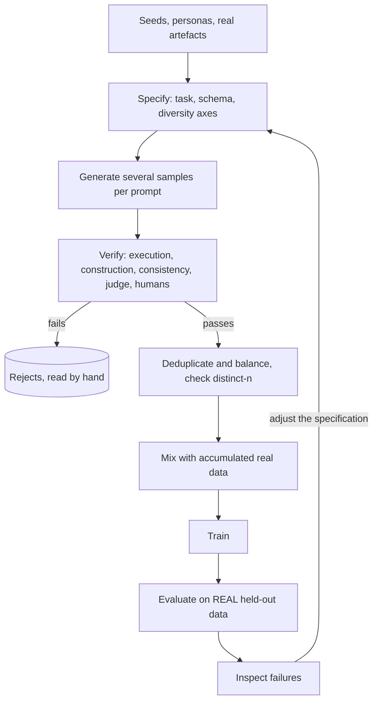

## TL;DR
Synthetic data generation uses a model, program or simulator to manufacture training or eval examples.
Its value is decided by verification: examples are only as good as the filter choosing survivors, and
recursive training on unfiltered output collapses the distribution.

## Why it exists
- **Real data is scarce where you need it most.** The long tail of odd inputs that break a product
  appears once a month in logs and never in a scraped corpus.
- **Real data is private.** A customer's internal forms, ticket formats and tool outputs exist nowhere
  public, and often cannot leave their environment.
- **Real data lacks the behaviours you want.** Humans do not write out step-by-step reasoning, preference
  comparisons between two drafts, or tool-call sequences, so modern post-training has no natural corpus.
- **Naive generation fails three ways.** Generation is cheap (a hundred thousand examples overnight), but
  "prompt the big model to write a dataset":
  - collapses onto the generator's favourite phrasings, names and structures, so the model learns a
    narrow template and fails on real inputs;
  - turns the generator's mistakes into the student's ground truth;
  - can contain your evaluation questions, making scores meaningless.
- **The scarce resource is verification, not generation.** Self-Instruct bootstrapped from 175
  human-written seed tasks and filtered for novelty; STaR kept only traces reaching the correct answer;
  code pipelines keep programs that pass tests; reasoning distillates keep traces a checker accepts. With
  strong verification a model can exceed its own data; without it, you get a slow copy of the generator
  with the tails cut off.

## How it works
### The loop
```
seed → specify → generate → verify → deduplicate and balance → train
     → evaluate on REAL held-out data → inspect failures → adjust the specification
```
The last three steps are the ones teams skip, and they are why the loop converges rather than drifts.

### Sources of diversity
Mode collapse is the default behaviour of a sampled generator, so diversity must be engineered in:
- **Seeds and in-context examples.** Self-Instruct sampled a handful of tasks from a seed pool (human
  written at first, then including accepted generations) per prompt, and rejected candidates whose ROUGE-L
  overlap with existing tasks was too high, so each round pushed outward.
- **Evolution.** Evol-Instruct rewrites instructions along explicit axes (add a constraint, deepen,
  concretise, require more reasoning, or mutate to a new topic), so difficulty grows instead of regressing
  to easy prompts.
- **Personas.** Conditioning on who is asking (a billion-persona pool was built for exactly this) spreads
  vocabulary, intent and style far more than temperature does.
- **Grounding in real artefacts.** Generate questions *from* real documents, records or code. Inputs then
  follow the real distribution, and often the label comes for free.
- **Sampling.** Several samples per prompt at moderate temperature, then dedup by n-gram overlap and
  embedding similarity, because duplicates are far denser in synthetic sets than in scraped ones.

### Verification, strongest to weakest
| # | Verifier | How | Strength | Weakness |
|---|---|---|---|---|
| 1 | Execution | code vs unit tests, SQL vs a database, maths vs a known answer or symbolic solver | exact, cheap | only some domains |
| 2 | Construction | decide the label first, generate the input | correct by construction | needs a structured label |
| 3 | Consistency | majority vote (self-consistency) or two generators agreeing | filters one-off errors | shared errors survive |
| 4 | LLM-as-judge | rubric-driven judge | scales to anything | length, position, self-preference bias |
| 5 | Humans | domain experts on a stratified sample | gold standard | the bottleneck |

- **Execution** is why code and maths are where synthetic data has done best.
- **Construction:** sample a structured record and have the model write the email containing it; sample
  a tool-call sequence and generate the request it answers. Add a round-trip check (an independent pass
  must recover the label) to catch generations that quietly dropped a fact.
- **Consistency:** STaR's "rationalisation" regenerates a rationale with the answer as a hint, recovering
  training signal from failures.
- **LLM judges** must be calibrated against human labels before you trust their filter rate.
- **Humans:** spend them on calibrating the other verifiers, not on everything.

### Where it is used
- **Instruction tuning:** prompt–response pairs.
- **Preference data for DPO and RLHF:** AI feedback over pairs of candidates, with a judge or a rubric.
- **Pretraining-scale corpora:** synthetic textbooks and rephrased web text proved unusually
  token-efficient for small models.
- **Evaluation and red-team sets:** with the caveat that a model must not be judged on data its own
  generator produced.
- **Privacy-preserving stand-ins:** a programmatic generator with synthetic identities lets work proceed
  outside a restricted environment.
- **Distillation:** the same machinery with a specific aim; see the knowledge distillation lesson.

### Model collapse and how to avoid it
**Mechanism:** training on its own (or a predecessor's) unfiltered output, generation after generation,
shrinks the tails first, then the whole distribution. Rare phrasings vanish, variance falls, errors
compound, and each generation is a blurrier copy. The defences follow from the mechanism:
- **Keep real data in the mix**, accumulating rather than replacing it.
- **Verify**, so errors do not compound.
- **Track diversity directly** across dataset versions: distinct n-gram ratios, embedding dispersion,
  length and topic distributions.
- **Prefer a different or stronger generator** to the model being trained.
- **Decontaminate against every eval**, because a generator that has seen the benchmark will reproduce it.

### Provenance and permission
- **Per example, record** the generator model and version, prompt template, seed, every verifier's
  verdict and the sampling settings, because you will need to trace a bad behaviour to the batch that
  taught it.
- **Check the generator's terms.** Some API providers prohibit using outputs to train competing models,
  and some open-weight licences attach conditions to derived models.

## Diagram
The generate-verify loop: verification decides what survives, real held-out data decides whether it
worked, and failures flow back into the specification rather than into more generation.



## Examples
### Construction-first generation with a round-trip check
An extraction task. A program samples the record, so the label is correct before any model is involved;
the model only writes the realistic email. `llm` is a stub for whichever provider you use.

```python
import json, random

def llm(prompt: str, temperature: float = 0.8) -> str:
    """Call your model provider and return text. Use temperature ~0.8 to write, 0 to check."""
    raise NotImplementedError

VENDORS = ["Acme Tooling", "Northwind Traders", "Blue Fern Studio", "Kappa Logistics"]
PERSONAS = ["terse accounts-payable clerk", "chatty small-business owner", "automated billing system"]

def sample_record(rng):                          # the LABEL comes first, so it is correct by construction
    return {"vendor": rng.choice(VENDORS), "invoice_no": f"INV-{rng.randint(1000, 99999)}",
            "total": round(rng.uniform(20, 5000), 2), "currency": rng.choice(["USD", "EUR"]),
            "due_date": f"2026-{rng.randint(1, 12):02d}-{rng.randint(1, 28):02d}"}

def make_example(rng):
    rec = sample_record(rng)
    email = llm(f"You are a {rng.choice(PERSONAS)}. Write a realistic email of 60-150 words that mentions "
                f"exactly these facts in your own words and order, plus one unrelated detail: "
                f"{json.dumps(rec)}. Do not output JSON.")
    # round-trip verification: an independent extraction pass must recover the record exactly
    back = llm("Extract vendor, invoice_no, total (number), currency and due_date (YYYY-MM-DD) as JSON "
               f"from this email:\n{email}", temperature=0)
    try:
        ok = json.loads(back) == rec
    except json.JSONDecodeError:
        ok = False
    return {"input": email, "output": rec, "verified": ok,
            "provenance": {"generator": "<model id>", "prompt": "invoice-v3", "persona_pool": "v1"}}

rng = random.Random(7)
examples = [make_example(rng) for _ in range(1000)]
kept = [e for e in examples if e["verified"]]
print(f"kept {len(kept)}/{len(examples)}")
# Next: near-deduplicate the emails, balance vendors and currencies, hold out a slice for evaluation,
# and have a human read 50 kept and 50 rejected examples before trusting the pass rate.
```

### Execution verifier for generated code
Pure Python, runnable. Keeps only candidates whose unit tests pass in a separate process with a timeout.
`subprocess` isolation is not a security sandbox; run untrusted generations in a locked-down container.

```python
import subprocess, sys, tempfile, os

def passes_tests(candidate_code: str, tests: str, timeout_s: float = 5.0) -> bool:
    """Run generated code plus its unit tests in a separate process; keep only clean exits."""
    with tempfile.NamedTemporaryFile("w", suffix=".py", delete=False) as f:
        f.write(candidate_code + "\n\n" + tests)
        path = f.name
    try:
        r = subprocess.run([sys.executable, "-I", path], capture_output=True, timeout=timeout_s)
        return r.returncode == 0
    except subprocess.TimeoutExpired:
        return False                                   # infinite loops count as failures
    finally:
        os.unlink(path)

tests = "assert slugify('Hello World') == 'hello-world'\nassert slugify('  A  b ') == 'a-b'"
good = "def slugify(s):\n    return '-'.join(s.lower().split())"
bad = "def slugify(s):\n    return s.lower().replace(' ', '-')"
print(passes_tests(good, tests), passes_tests(bad, tests))   # True False
```

### A diversity gate: distinct-n across a batch
Pure Python. A batch that collapsed onto one template scores far lower than a varied one; track this
number per batch and per dataset version.

```python
import re

def distinct_n(texts, n=2):
    """Unique n-grams / total n-grams across a batch: falls as a generator collapses onto templates."""
    grams = [tuple(t[i:i + n]) for t in (re.findall(r"\w+", x.lower()) for x in texts)
             for i in range(len(t) - n + 1)]
    return len(set(grams)) / max(1, len(grams))

collapsed = ["Dear team, I hope this email finds you well. Invoice INV-1001 is due soon."] * 3 + \
            ["Dear team, I hope this email finds you well. Invoice INV-2002 is due soon."]
varied = ["hey - acme here, 1001 still unpaid?? due friday",
          "Per our records, invoice INV-2002 (EUR 310.00) remains outstanding.",
          "Reminder: Kappa Logistics bill #3003 falls due on 2026-04-12.",
          "Hi Sam, quick one: can you confirm you got invoice 4004 for the shoot?"]
print(f"collapsed distinct-2 = {distinct_n(collapsed):.2f}")   # 0.29
print(f"varied    distinct-2 = {distinct_n(varied):.2f}")      # 1.00
```

## Production patterns
- **Construction-first for structured tasks.** For extraction, classification and tool calls, sample
  the label programmatically and generate only the surface text, with a round-trip extraction at
  temperature 0. Monitor round-trip pass rate per type, and read rejects to catch a checker that discards
  hard-but-valid examples.
- **Per-row provenance in the dataset schema.** Every row carries generator id and version, prompt
  template version, seed, sampling settings and verifier verdicts, so a bad behaviour traces to one batch
  and you regenerate that batch, not everything.
- **Batch gates on verification and diversity.** Reject a batch whose pass rate or distinct-n falls
  outside the range of previous accepted batches; also track length and topic distributions per version.
- **Judge calibration before scale.** Before an LLM judge filters a full run, score a few hundred
  human-labelled items and measure agreement; recalibrate whenever the judge model or rubric changes.
- **Real data as the anchor, walled-off evals.** Accumulate real curated data across versions and add
  synthetic data only for gaps found by error analysis. Keep evaluation sets from any generator prompt,
  and decontaminate synthetic sets against them.

## Trade-offs
- **Coverage vs drift.** Cheap, fast, controllable coverage of rare cases, against a distribution that
  drifts from real usage. Once real traffic exists, curated real data should anchor the set and synthetic
  data fill gaps, not the reverse.
- **Bounded by the generator.** The student is bounded by the generator on the same task, unless
  verification adds outside information (test results, ground truth); then self-improvement loops become
  possible. Without such a verifier, expect a slightly worse copy.
- **Verifier choice.** Executable verifiers are exact and cheap but exist only for some domains; LLM judges
  cover everything with known biases; humans are accurate and slow. Calibrate the fast verifiers against a
  human-labelled sample.
- **Breadth vs realism.** Personas and evolution widen coverage but produce some unrealistic examples, so
  you trade a realism check for the breadth.
- **Privacy vs realism.** Synthetic stand-ins unblock work on private data, but a generator fine-tuned on
  that data can leak it; a purely programmatic generator is safe and less realistic.

## Pitfalls
- **No verification step.** The student learns the generator's errors as truth. Symptom: confidently
  wrong in exactly the generator's places.
- **Letting a model-based verifier define "correct" without auditing rejects.** A round-trip or judge
  filter keeps what the checker already handles, discarding hard-but-valid examples and drifting toward
  easy cases. Symptom: high pass rate, little gain on the hardest real inputs. Read the rejects and rescue
  valid ones with a stronger checker or a human.
- **Low diversity.** The same four names, opening sentence and structure. Symptom: a low distinct-n-gram
  ratio and a model that handles the template but fails real inputs.
- **Evaluating on data from the same generator and prompt as training.** Symptom: an excellent eval score
  and a production rollout that does not match.
- **Replacing real data across versions.** Symptom: vocabulary and variance shrink version to version,
  which is collapse in progress.
- **Inheriting the generator's style.** Overly polite, markdown-heavy, verbose. Symptom: the customer says
  outputs do not sound like their house style despite fine accuracy.
- **No per-example provenance.** Nobody can say which batch, prompt or generator version taught a bad
  behaviour, so the fix becomes "regenerate everything".
- **Ignoring terms of service or licence until launch review.** Symptom: a legal block on a model that
  already works.

## When to use
- **Use when:** real labelled data is scarce, private or missing rare cases; you need behaviours nobody
  writes down (reasoning traces, preference pairs, tool-call sequences); you are bootstrapping before
  traffic; and above all when you have a verifier that tells good examples from bad.
- **Lean on real curated data when:** it is abundant; use synthetic data to fill gaps found by error
  analysis.
- **Measure:** verification pass rate per batch, diversity across versions, the eval delta on *real*
  held-out data, and agreement between fast verifiers and a human-labelled sample.
- **Day to day:** a generation pipeline with provenance on every row.
- **Interviews:** how you would prevent collapse, and why you would generate the label before the input.

## Role lens
- **Engineer:** Builds the generate–verify–deduplicate pipeline with per-row provenance, calibrates the
  judge against human labels, and gates every batch on verification pass rate and diversity metrics.
- **Architect:** Decides which generators are permitted (licence and terms), how synthetic and real data
  are mixed and versioned, and which evaluation sets are walled off from any generator.
- **FDE:** Bootstraps a customer's model from thirty labelled examples by construction-first generation
  over their real document types, with SMEs reviewing samples and verifying the round-trip check.

## Check yourself
**Q:** A customer wants a model that extracts fields from forty internal form types, but can supply only
thirty labelled examples. How would you build a training set, and how would you know it is trustworthy?
**A:** I would not ask the model to invent forms. I would take the forty real templates and the field
schema, write a program that samples valid records for each type, and use a model to render each record
into realistic filled forms in several personas and styles, varying layout noise. The label is the sampled
record, so it is correct by construction; a separate extraction pass must recover it exactly, and only
round-trip successes survive. I would near-deduplicate, balance across form types, and keep the thirty
human-labelled examples strictly as evaluation, never training or few-shot prompts. Thirty examples
cannot cover forty types, though, so I would ask the SMEs to label a handful more for each uncovered type,
or report those types as unmeasured rather than averaging them away. Trust comes from three measurements: the
round-trip pass rate per form type, SME review of a stratified sample of kept and rejected items, and the
eval score on the thirty real examples, with any gap between synthetic and real scores treated as the
pipeline's error bar, not noise.

## Interview questions
### Temperature alone does not give a diverse synthetic set. What do you do instead?
- **Seeds with a novelty filter:** Self-Instruct sampled tasks from a seed pool and rejected candidates
  whose ROUGE-L overlap with existing tasks was too high, so each round pushed outward.
- **Evolution and personas:** Evol-Instruct rewrites prompts along explicit axes (add a constraint,
  deepen, mutate topic); conditioning on who is asking spreads vocabulary, intent and style.
- **Ground in real artefacts:** generating questions from real documents, records or code keeps inputs on
  the real distribution, then dedup by n-gram and embedding similarity.

### Your model scores very well on a synthetic eval but disappoints in production. How do you debug it?
- **Check eval provenance:** if the eval came from the same generator and prompt as training, the score
  measures template-matching; rebuild it from real held-out data.
- **Check diversity:** a low distinct-n ratio or repeated names and openings means the model learned a
  narrow template that real inputs do not follow.
- **Check style and verifier drift:** inherited generator style, or a filter that kept only easy cases,
  show up as fine accuracy on easy inputs and misses on the hardest real ones.

### Can a student trained on synthetic data beat its generator? When would you not use synthetic data?
- **Only with outside information:** test results or ground truth from a verifier let self-improvement
  loops exceed the generator; without one, expect a slightly worse copy.
- **Avoid leaning on it** when real curated data is abundant: use it to anchor the set and generate only
  for gaps found by error analysis.
- **Also avoid** when the generator's terms or licence forbid training on its outputs.

### You want an LLM judge to filter 500,000 generated examples. How do you decide whether to trust it?
- **Calibrate first:** score a few hundred human-labelled items and measure agreement before the judge
  filters the full run.
- **Know its biases:** length, position and self-preference bias can skew what survives, so inspect
  rejects as well as keeps.
- **Recalibrate on change:** whenever the judge model or rubric changes, rerun the agreement check, and
  spend human effort calibrating verifiers rather than labelling everything.

### Design the verifier for a synthetic code-generation dataset. What do you monitor?
- **Execution:** run each candidate with its unit tests in a separate process with a timeout, counting
  infinite loops as failures, and keep only clean exits.
- **Isolation:** `subprocess` is not a security sandbox, so run untrusted generations in a locked-down
  container.
- **Monitor:** pass rate and distinct-n per batch against previous accepted batches, plus per-row
  provenance so a bad batch can be regenerated alone.

## Quiz
### Q: What most determines the quality of a synthetic training set?
- [ ] The size of the generator model
- [ ] The sampling temperature
- [x] The strength of the verification step that decides which generated examples survive
- [ ] The number of examples generated
> Generation is cheap and errors are the norm; a verifier that catches wrong or duplicated examples is what
> separates a dataset that improves a model from one that teaches the generator's mistakes.

### Q: Why generate the label first and the input second in a construction-first pipeline?
- [ ] Because inputs are longer and more expensive to generate
- [x] Because the label is then correct by construction, and a round-trip check can verify the input faithfully contains it
- [ ] Because models cannot produce structured output reliably
- [ ] Because it avoids needing any deduplication
> Sampling the structured answer programmatically removes the generator from the label entirely; the model
> only writes the surface text, and an independent extraction pass confirms nothing was dropped or changed.

### Q: Which practice best protects against model collapse across successive training rounds?
- [ ] Raising the sampling temperature each round
- [ ] Using a larger generator each round
- [x] Keeping real data in the mix, verifying outputs, and tracking diversity across dataset versions
- [ ] Training for fewer epochs
> Collapse comes from recursively copying a narrowing distribution with compounding errors. Anchoring on
> real data, filtering errors and measuring diversity attack each part of that mechanism directly.
